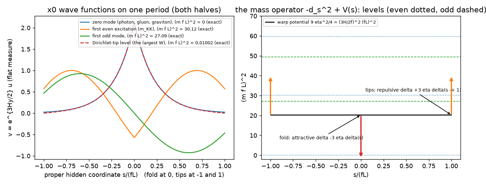
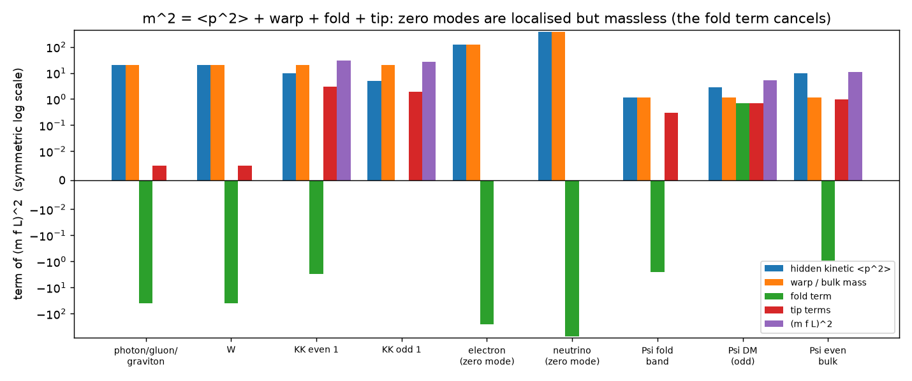
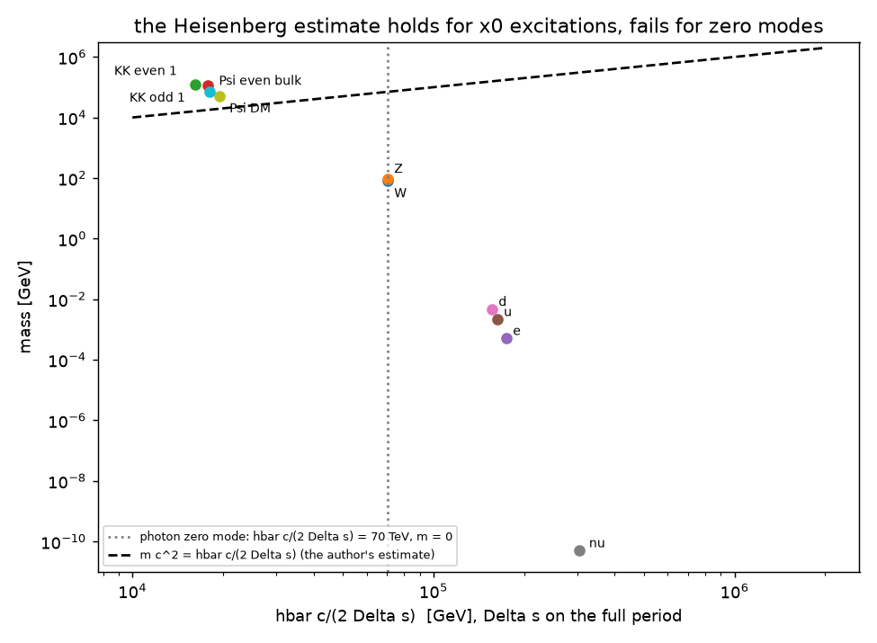
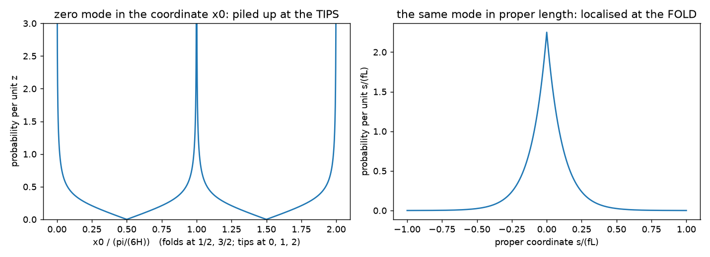
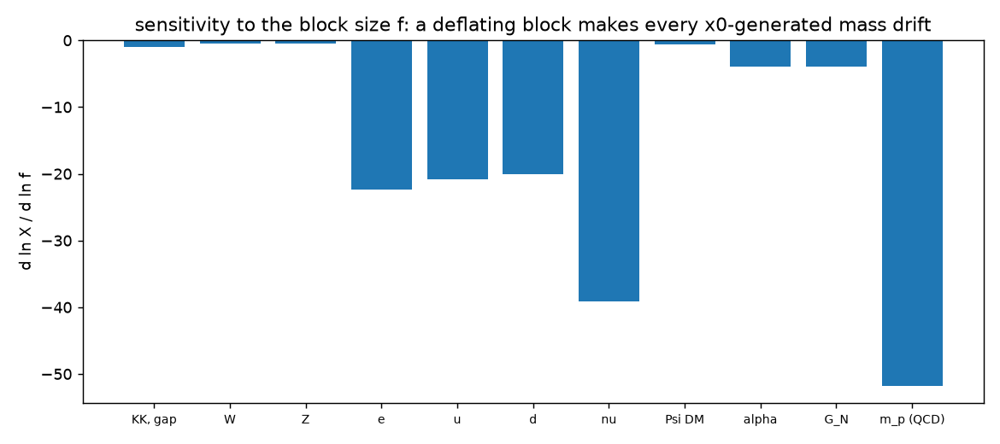
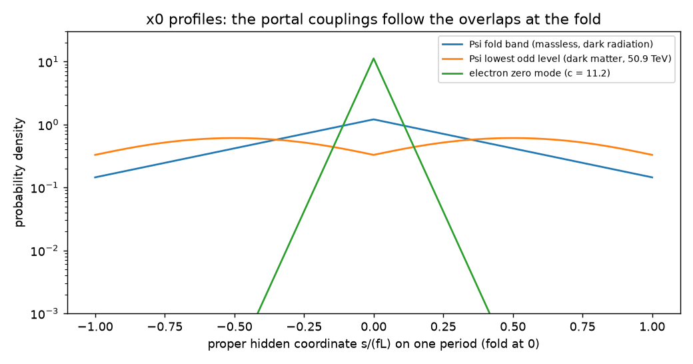
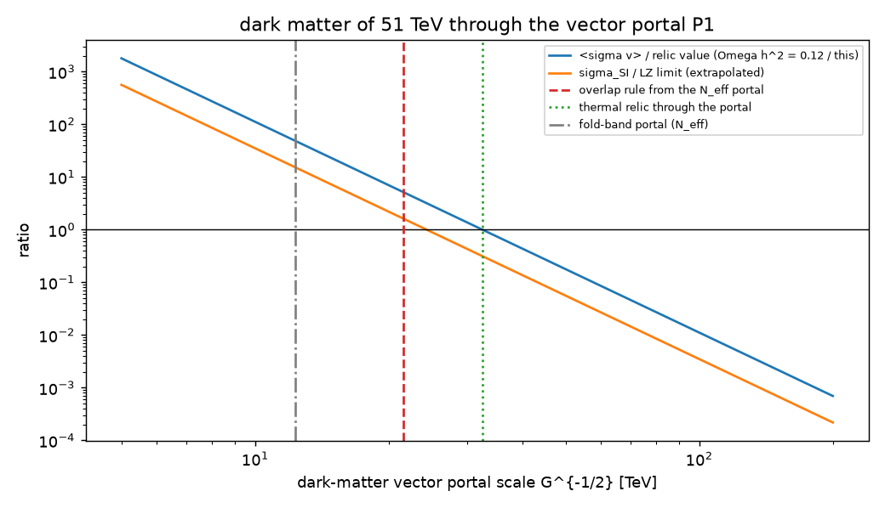
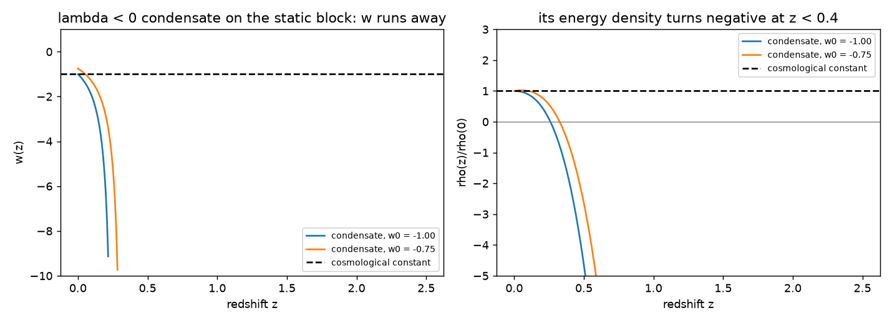

# UM-1 analysis: the x0 mass mechanism and the dark sector of dirac16complex

Version 1 of 2026-10-17, written at the author's request of 2026-10-17: "analyze the x0 mass mechanism, and ... analyze
the validity of associating dark matter (and dark energy) with dirac16complex". The model is defined in `MODEL.md`
(version 1.1), its field equations are in `FIELD_EQUATIONS.md`, its approximate solution is in `SOLUTION.md`, and the
origin of every ingredient is in `PROVENANCE.md`. This document examines two of the model's central claims against
the model's own equations and numbers. The scripts are `analysis/x0_mass_analysis.py` (21 of 21 checks PASS,
`analysis/reports/x0-mass-checks.json`) and `analysis/dark_validity.py` (13 of 13 checks PASS,
`analysis/reports/dark-validity-checks.json`); every number below comes from them, and the tables of section 12 are
generated by the second script. The labels are those of `MODEL.md`: DERIVED, TAKEN, STANDARD, ASSUMED, INVENTED, OPEN;
ESTIMATE marks an order-of-magnitude calculation and FROM MEMORY a number quoted without a document at hand.

Coordinates are the author's: $X = \{x_0, x_1, \dots, x_7\}$, $x_0$ the hidden space-like direction, $z = 6Hx_0$ real,
$y = \ln|\sin z|/(6H) \in (-\infty, 0]$, the fold at $z = \pi/2$ ($y = 0$) and the tips at $z = 0, \pi$
($y \to -\infty$, cut at $y = -L$ by the regular tip of the record). The block $(x_0, x_5, x_6, x_7)$ has the scale
factor $f = e^{-a_4}b_4^{1/2}$; $g_{00} = f^2\cot^2 z$, so the proper hidden length is $ds = f\,|dy|$. The numbers use
the vacuum of `SOLUTION.md`: $H = 23.42$ TeV, $\eta = HL = 3$, $f = 8^{-1/2}$, the proper half-cell
$fL = 8.94\times10^{-21}$ m.

## 1. Summary: the answers

**Part A, the $x_0$ mass mechanism.**

1. What holds. Every four-dimensional mass of UM-1 is an eigenvalue of an $x_0$ operator acting on a wave function
   that is periodic in $x_0$ with the period $\pi/(6H)$, and the massless particles are exactly the graviton, the photon,
   the gluons and the fold-band quanta of $\Psi$. The author's requirement, mass from the $x_0$ dependence of the wave
   function, is met in this sense (DERIVED, section 3).
2. The exact mass formula (DERIVED, check A1_factorisation). In the flat proper measure every bosonic mass is
   $m^2 = \langle p^2\rangle + (3H/2f)^2 - (3H/f)\,\rho(\text{fold}) + (3H/f)\,\rho(\text{tips}) + (\text{tip field})$,
   with $\rho$ the normalised proper density. The uncertainty relation bounds the first term only. The second term is
   the warp of the three extra times, the third an ATTRACTIVE point potential at the fold, the fourth and fifth
   repulsive tip terms. Spin 1/2 has the same structure with the bulk mass in place of the warp (the Jackiw-Rebbi
   kink).
3. Where the Heisenberg argument holds: the $x_0$ excitations. Every odd mode and every excitation has
   $m \geq 3H/(2f) = 99.4$ TeV (the gap theorem, check A2_gap_theorem). For these modes the author's estimate
   $\hbar c/(2\Delta s)$ is a true lower bound, exceeded by factors 2.6 to 7.5. The dark-matter candidate of $\Psi$
   (50.9 TeV) belongs here: 78.9 % of its $\varepsilon^2$ is the $x_0$ standing wave. The Kohn-Sham energy-momentum
   tensor confirms this independently: the hidden pressure of the dark-matter quanta equals
   $-d\ln M_{DM}/d\ln f = 0.6575394$ to $1.1\times10^{-9}$.
4. Where it fails: the zero modes. The photon, gluon and graviton zero mode is localised at the fold within
   $\Delta s = 1.4\times10^{-21}$ m. The estimate gives it $\hbar c/(2\Delta s) = 70$ TeV, but its mass is exactly zero:
   the fold term cancels the hidden kinetic energy, and gauge invariance protects the cancellation. The same holds for
   the chiral fermion zero modes and the $\Psi$ fold band. The light masses of UM-1 are boundary effects at the tip.
   For the $W$, the tip term is 99.87 % of $m_W^2$. For the fermions, $m_f = m_{KK}\zeta(c)^2$ FALLS as the localisation
   sharpens, the reverse of the Heisenberg intuition. The ratio $m/(\hbar c/2\Delta s)$ is $1.1\times10^{-3}$ for the $W$
   and $3\times10^{-9}$ to $1.6\times10^{-16}$ for $e, u, d, \nu$.
5. Localisation in the coordinate $x_0$ is not physical. The zero mode, localised at the fold in proper length, has
   62 % of its probability within $\pi/8$ of the tips in the coordinate $x_0$, because $g_{00} = f^2\cot^2 z$ vanishes
   at the fold. Only the proper form $\Delta s\,\Delta p \geq \hbar/2$ says anything about masses, and on a compact
   period not even that in general (the $\Psi$ fold band has $\langle p^2\rangle\Delta s^2 = 0.20 < 1/4$).
6. Every $x_0$-generated mass tracks the block size $f$: $d\ln m/d\ln f = -1$ (KK modes), $-0.50$ ($W$, $Z$), $-20$ to
   $-39$ ($e, u, d, \nu$), $-0.66$ (dark matter); $\alpha$ and $G_N$ go like $f^{-4}$, and $m_p/m_e$ like $f^{-29}$
   (ESTIMATE). Atomic clocks require $|h_4|/H_0 < 1.2\times10^{-8}$ today (FROM MEMORY); UM-1 has $10^{-93}$. The
   primordial deflation $h_4 = -H/3$ would change $m_e$ by a factor $e$ every $4\times10^{-30}$ s, so it must end long
   before nucleosynthesis.
7. Verdict on the mechanism. The mechanism is VALID as a kinematic statement (all masses are $x_0$ eigenvalues of
   periodic wave functions). It is dynamically correct, Heisenberg estimate included, for the heavy sector. It is NOT
   the origin of the light Standard-Model masses: taken literally as a principle, it would put every massive particle
   above the gap of 99 TeV.

**Part B, the dark sector.**

1. Dark matter: the association is CONDITIONAL. The heavy odd quanta of $\Psi$ ($M_{DM} = 50.9$ TeV) are cold on the
   static block ($w = 0$), dark (a gauge singlet), collisionless ($\sigma/M \sim 3\times10^{-18}$ cm$^2$/g) and get
   their mass from $x_0$. Not established:
   - stability: it needs the fold parity exact to $2\times10^{-27}$ (ASSUMED);
   - the relic abundance: it needs $\langle\sigma v\rangle = 6.5\times10^{-26}$ cm$^3$/s, 37 % of the s-wave unitarity
     limit, i.e. a contact strength $G \approx 1.4/H^2$ of natural size, not derived (OPEN);
   - the computed Kohn-Sham ground states are dark RADIATION, not dark matter;
   - while the block deflates, the quanta have $w_{eff} = -0.073$, not 0;
   - TENSION: the portal that gives $N_{eff} = 2.99$ (decoupling of the fold band in the QCD crossover), applied to the
     dark matter with its $x_0$ overlap, makes it under-abundant ($\Omega h^2 = 0.023$) and puts $\sigma_{SI}$ at
     1.6 times the LZ limit.

   A thermal relic through the portal alone is consistent ($G^{-1/2} = 32.5$ TeV,
   $\sigma_{SI} = 8.8\times10^{-46}$ cm$^2$) and testable.
2. Dark energy: the association is NOT SUPPORTED. No $\Psi$ state of positive energy has $w < 0$ on the static block.
   The $\lambda < 0$ condensate tuned to $w_0 = -1$ has $w_a = -6$, and its energy density turns negative at
   $z = 0.26$. A natural vacuum energy of $\Psi$ exceeds the dark energy by $6\times10^{64}$. The dark energy of UM-1
   is $\delta\Lambda$, a tuned geometric cosmological constant.
3. Consequences for the documents (section 10). Statements of `MODEL.md` (sections 1 and 4.4), `FIELD_EQUATIONS.md`
   (check D3) and `SOLUTION.md` (section 5.2) that said the uncertainty relation bounds every mass, or quoted the
   Standard-Model relic value, are corrected and point here.

## 2. The question, the definitions and the method

The author's argument (`PROVENANCE.md` section 1) is that localisation in $x_0$ implies, through
$\Delta x_0\,\Delta p_{x_0} \geq \hbar/2$, a momentum along $x_0$. That momentum is proportional to a mass, so every
particle whose wave function depends periodically on $x_0$ acquires an effective mass, except the graviton, the photon
and perhaps the quanta of the dirac16complex field. Three definitions make the argument testable.

* The momentum that is a mass. For an eight-dimensional massless field the four-dimensional mass is
  $m^2 = g^{00}p_0p_0 = \hat p^2$, the square of the hidden momentum in the orthonormal frame,
  $\hat p = -i\hbar\,\partial_s$ with $s$ the proper hidden length. The coordinate momentum $p_{x_0}$ differs from
  $\hat p$ by the position-dependent factor $f|\cot z|$, which vanishes at the fold.
* The mass of a mode is not a local momentum but an eigenvalue: $m^2$ is the eigenvalue of the $x_0$ operator of the
  field with the fold and tip conditions (section 3). The question is whether that eigenvalue is bounded below by the
  hidden kinetic energy $\langle\hat p^2\rangle \geq \hbar^2/(4\Delta s^2)$.
* The localisation $\Delta s$ is the standard deviation of the proper density on one full period (both halves of the
  cell, the fold in the middle). `SOLUTION.md` used one half, which gives a $\Delta s$ smaller by about $\sqrt2$; no
  conclusion depends on the choice.

The analysis is exact where it can be (sympy, part A1 of the script) and numerical otherwise. Part A2 uses two
independent finite-element discretisations of the same eigenproblem, compared with the exact spectra. Part B
evaluates the standard criteria for dark matter and dark energy with the numbers of the solution.

## 3. The $x_0$ operators of all fields (DERIVED, checks A1)

### 3.1 Scalars, gauge fields and the graviton

For the corrected metric (version 2), $\sqrt{|g|} = f^4e^{3a_4}|\cot z|\,|\sin z|^{1/2}$, so that
$\sqrt{|g|}\,dx_0 = e^{3a_4}f^4e^{3Hy}\,dy$. The $x_0$ part of the d'Alembertian of a field that depends on $x_0$
through $u$ is (check A1_scalar_x0_operator, exact for a generic profile)

$$ -\frac{1}{f^2}\,e^{-3Hy}\,\partial_y\big(e^{3Hy}\,\partial_y u\big) = m^2\,u . $$

The four-dimensional components of a gauge field and the transverse-traceless graviton see the same operator, because
the four-dimensional part of the metric does not depend on $x_0$. For the graviton this is exact in Einstein gravity.
With the Lovelock terms the zero mode stays massless by four-dimensional general covariance, and the excited spectrum
carries background-curvature factors that are not computed here (OPEN).

* Fold conditions (check A1_fold_conditions_from_flux). The flux of the operator through $x_0$ is
  $e^{3a_4}f^2\,\mathrm{sign}(\cot z)\,e^{3Hy}u_y$. Continuity across the fold gives $u_y(0) = 0$ for a mode EVEN under
  the fold reflection $z \to \pi - z$ (Neumann), and $u(0) = 0$ for an ODD mode (Dirichlet).
* The flat form (check A1_flat_form_warp_potential). With $u = e^{-3Hy/2}v$ the measure becomes flat and the operator
  becomes $f^{-2}(-v'' + \tfrac94H^2v)$: the warp of the three extra times is a constant potential $(3H/2f)^2$, and the
  Neumann condition becomes the Robin condition $v'(0) = \tfrac32Hv(0)$. On one full period in the proper coordinate
  $s \in [-fL, fL]$ (fold at $s = 0$, tips at $s = \pm fL$, identified by the periodicity) this is the Schroedinger
  problem

$$ -\partial_s^2v + V(s)\,v = m^2v,\qquad V(s) = \Big(\frac{3H}{2f}\Big)^2 - \frac{3H}{f}\,\delta(s) + \frac{3H}{f}\,\big[\delta(s - fL) + \delta(s + fL)\big] + \beta\text{-terms of the tip field} . $$

* The factorisation (check A1_factorisation). With $\phi = \frac{3H}{2f}|s|$, the operator is $A^\dagger A$ with
  $A = \partial_s + \phi'$, the structure of supersymmetric quantum mechanics. So

$$ m^2 = \frac{\int ds\,|(\partial_s + \phi')v|^2}{\int ds\,|v|^2} + (\text{tip field}) = \frac{\int dy\,e^{3Hy}|\partial_su|^2}{\int dy\,e^{3Hy}|u|^2} + (\text{tip field}) . $$

  This is the precise form of the author's idea. The mass is the $x_0$ dependence of $u$, the profile measured
  RELATIVE to the geometric zero mode $v_0 = e^{-\phi}$. A mode localised exactly as the geometry dictates
  ($u = $ const) is massless. Every deviation from it costs mass.
* Without a cutoff (check A1_exact_spectrum_without_cutoff). For $L \to \infty$ the only normalisable mode below
  $3H/(2f)$ is $u = e^{(\kappa - 3H/2)y}$. The fold condition forces $\kappa = 3H/2$, i.e. $m = 0$ (the flat zero mode,
  of finite weighted norm $1/(3H)$), and the odd condition forbids it. Above $3H/(2f)$ the spectrum is continuous. The
  proper length of a half cell is infinite, but its weighted volume is finite, so four-dimensional gravity and the
  gauge couplings are finite without the cutoff.

### 3.2 Spin 1/2 (TAKEN block, DERIVED identity)

The Kohn-Sham record reduces $\Psi$ and every Standard-Model fermion to the $2\times2$ block
$h = -i\sigma_1\partial_t + c\,\sigma_2$ ($t = y/L$, $c = f\mu L$, units $1/(fL)$), in which the spin connection removes
the warp. For every profile $\chi$ (check A1_spin_half_boundary_identity)

$$ \int|h\chi|^2 = \int|\chi'|^2 + c^2\int|\chi|^2 - c\,\big[\chi^\dagger\sigma_3\chi\big]_{-1}^{0} . $$

The chiral zero mode $(e^{ct}, 0)$ is annihilated by $h$. Its kinetic energy $c^2$ and bulk mass $c^2$ are cancelled
by the fold term $-2c^2/(1 - e^{-2c})$: the Jackiw-Rebbi mechanism of a kink in the bulk mass. It is localised within
$1/(2c)$ yet massless.

### 3.3 The tip parameter

Matching the bulk gauge kinetic term $\hat g^{-2}e^{3a_4}f^2e^{3Hy}(A_y)^2$ to the tip mass term of the sigma field,
with $\sqrt{|g_{tip}|} = e^{3a_4}f^3e^{3Hy}$, gives the Robin condition $u'(-1) = \beta u(-1)$ with
$\beta = c\,\hat g^2v_\Sigma^2fL$ (check A1_tip_parameter_scaling). So $\beta$ is proportional to $f$, and the warp
factors cancel. The docstring of `solution/masses.py` writes $c_{tip}f^2Le^{3\eta}$, a different parametrisation of
the same fitted $\beta$. The fit is unaffected, and only the $f$ dependence of section 7 uses the scaling derived
here.

### 3.4 What the period $\pi/(6H)$ means

Without a cutoff, every period of $x_0$ is a whole real line in proper length, and consecutive periods are separated
by tips at infinite proper distance. Every function of $y$ is automatically periodic, so periodicity alone constrains
nothing. With the regular tip of the record a period is a circle of proper circumference $2fL$. Its modes are
classified by the two reflections, about the fold and about the tip. The content of the author's requirement lies in
these parities and in the boundary terms at the fold and the tips.

## 4. The spectra and the gap (checks A2)

* Two discretisations, one problem (check A2_spectra_two_discretisations). The flat $v$-form and the weighted $u$-form
  finite elements (600 and 1200 elements, Richardson) reproduce the exact levels of the four boundary classes to
  $2.6\times10^{-9}$. The classes are: fold even or odd, tip Neumann or Dirichlet; their exact formulas are in the script.
  In units $(mfL)^2$, with the gap at $9\eta^2/4 = 20.25$:
  - even and Neumann tip: $0, 30.12, 59.73$;
  - even and Dirichlet tip: $0.01002, 35.07$ (the largest $W$ a positive tip term can give);
  - odd and Neumann tip: $27.09, 49.48$;
  - odd and Dirichlet tip: $30.12, 59.73$.
* The gap theorem (check A2_gap_theorem). For tip parameters $\beta$ from 0 to $10^6$, the even sector has exactly one
  level below the gap $(3H/2f)^2$ (the zero mode, lifted only by the tip) and the odd sector has none. Every odd mode
  and every excitation has $m \geq 3H/(2f) = 99.4$ TeV. The reason: the Dirichlet condition removes the attractive fold
  term, and a rank-one attraction binds at most one level.
* Without the cutoff (check A2_no_cutoff_limit). For $\eta = 3, 6, 12, 24$ the zero mode stays massless, and the first
  even excitation falls to the gap from above: $m_1f/H = 1.8294, 1.5888, 1.5227, 1.5057$.



## 5. The mass of every particle, term by term (checks A2)

The table of section 12.1 splits $(mfL)^2$ of every particle of UM-1 into the hidden kinetic energy
$\langle p^2\rangle$, the warp (or bulk mass), the fold term and the tip terms. It compares the mass with the
author's estimate $m_H = \hbar c/(2\Delta s)$. The sums reproduce the eigenvalues to $2.8\times10^{-4}$ (check
A2_decomposition_sum_rule).

* Photon, gluons, graviton (check A2_localised_massless_modes). $\Delta s = 0.157\,fL = 1.4\times10^{-21}$ m and
  $\langle p^2\rangle = 20.25 = (3H/2f)^2(fL)^2$, so $m_H = 70.5$ TeV. Yet $m = 0$: warp $+20.25$ and fold $-40.50$
  cancel the kinetic energy exactly. The uncertainty relation holds ($\langle p^2\rangle\Delta s^2 = 0.497$) but does
  not bound the mass.
* $W$ and $Z$ (check A2_W_mass_is_a_tip_term). In the dressed form, the bending of the profile is $1.32\times10^{-3}$ of
  $m_W^2$ and the sigma-field tip term is $0.99868$. In the flat form the $W$ has the same kinetic energy as the photon,
  $1.5\times10^6$ times $m_W^2$. $m_W/m_H = 1.1\times10^{-3}$.
* Kaluza-Klein and odd modes (check A2_heisenberg_holds_for_excitations): $m/m_H = 7.49$ (first even) and $6.47$
  (first odd). The odd mode has no fold term.
* Fermions (check A2_localisation_lowers_fermion_masses). Each zero mode has kinetic $c^2$, bulk $c^2$ and fold
  $-2c^2$ (sum 0 to $2.4\times10^{-5}$). Its mass $m_f = m_{KK}\zeta(c)^2 \approx 2c\,e^{-2c}m_{KK}$ comes from the tip
  Yukawa coupling. The electron has $c = 11.20$, $\Delta s = 5.6\times10^{-22}$ m and $m_H = 175$ TeV, while
  $m_e = 0.511$ MeV. A sharper localisation (larger $c$) gives a LIGHTER fermion:
  $d\ln m_f/d\ln c = 1 - 2c - 2c\,e^{-2c}/(1 - e^{-2c})$.
* $\Psi$ (check A2_dark_matter_mass_is_x0_momentum). The fold band is a chiral zero mode ($c = fmL = 1.061$),
  localised but massless. The lowest odd level satisfies $a(0) = 0$, $b(-L) = 0$ and $\tan q = -q/c$, which gives
  $q = 2.0486$ and $\varepsilon = 2.174920403411\,m$, equal to the record to $10^{-12}$. The $x_0$ standing wave carries
  78.9 % of $\varepsilon^2$, and its fold and tip terms are POSITIVE, so $m^2 \geq \langle p^2\rangle + m^2_{bulk}$
  and $m/m_H = 2.61$. The lowest even bulk level ($3.1262\,m$) has $m/m_H = 4.07$.





## 6. The uncertainty relation: what it bounds

* The proper uncertainty relation $\Delta s\,\Delta\hat p \geq \hbar/2$ bounds $\langle\hat p^2\rangle$, the first
  term of $m^2 = \langle\hat p^2\rangle + \langle V\rangle$. It bounds the mass only when $\langle V\rangle$ is at least
  the warp gap, i.e. when the fold term is absent or repulsive. That is the case for every odd mode, every excitation
  and the $\Psi$ bulk band.
* For the zero modes $\langle V\rangle = -\langle\hat p^2\rangle$ exactly. This is not a numerical accident. The
  cancellation is protected by four-dimensional gauge invariance (photon, gluons), general covariance (graviton) and
  chirality, i.e. the index of the Dirac block (the fermion zero modes and the $\Psi$ fold band). The author's
  exception list (graviton, photon, perhaps the $\Psi$ quanta) is therefore exactly the list of protected zero modes,
  extended by the gluons.
* Localisation in the coordinate $x_0$ (check A2_coordinate_localisation_is_not_physical, figure below) is
  chart-dependent. Since $g_{00} = f^2\cot^2 z$ vanishes at the fold, a short proper interval there spans a long
  coordinate interval. The zero mode that sits at the fold in proper length has 62 % of its probability within $\pi/8$
  of the tips in $x_0$ ($\Delta x_0/\ell_0 = 0.40$). The coordinate relation $\Delta x_0\,\Delta p_{x_0} \geq \hbar/2$
  therefore says nothing about masses.
* On a compact period the position is not a canonical observable. The uncertainty product can fall below 1/4: the
  $\Psi$ fold band has $\langle p^2\rangle\Delta s^2 = 0.20$, because its density at the tips is 0.12 of its fold value.
  For a compact cell the correct statement is the spectral gap of section 4, not the uncertainty relation.



## 7. The block size and the constancy of the masses

At fixed eight-dimensional parameters every $x_0$-generated mass depends on $f$ (checks A2_sensitivities and
A2_deflation_bound_today; table of section 12.2):
* the Kaluza-Klein masses and the gap go like $1/f$;
* $W$ and $Z$ go like $f^{-0.50}$ ($\beta \propto f$, $d\ln\Lambda/d\ln\beta = 0.9987$);
* the fermions go like $f^{-2c}$: $-22.4$ ($e$), $-20.9$ ($u$), $-20.1$ ($d$), $-39.1$ ($\nu$), with closed forms
  agreeing to $10^{-7}$;
* the dark matter goes like $f^{-0.658}$;
* $\alpha$ and $G_N$ go like $f^{-4}$ (the proper volume $V_\perp \propto f^4$);
* $\Lambda_{QCD}$ goes like $f^{-51.8}$ (one loop, $n_f = 2$, ESTIMATE), so $m_p/m_e$ goes like $f^{-29.4}$.

The atomic-clock limits on $\dot\alpha/\alpha$ and $\dot\mu/\mu$ (FROM MEMORY: Lange et al. 2021, PRL 126, 011102,
2-sigma) give $|h_4|/H_0 < 1.2\times10^{-8}$ today; UM-1 has $h_4/A = -8.9\times10^{-94}$ (`SOLUTION.md` section 3.4).
The record's primordial deflation $h_4 = -H/3$ would change $m_e$ by a factor $e$ every $3.8\times10^{-30}$ s. The
exponential deflation of the extra times must therefore end (the static block of UM-1) long before nucleosynthesis;
after that, the block deflates only slowly and never stops.

The hidden-pressure identity (check A2_hidden_pressure_is_the_x0_mass). The pressure of a quantum on the hidden
direction is $-dE/d\ln(\text{proper length})$. The Kohn-Sham energy-momentum tensor of eight dark-matter quanta,
solved self-consistently on three grids (`solution/outputs/ks/dm_lam0.json`), gives $p_0/\rho = 0.6575394020$ and
$p_t = 0$. The $x_0$ eigenvalue gives $-d\ln\varepsilon/d\ln f = 0.6575394031$. Two independent computations, one
from the stress tensor and one from the spectrum, agree to $1.1\times10^{-9}$. The ratio would be 1 for a mass that is
pure $x_0$ momentum and 0 for a bulk mass.



## 8. Is dirac16complex the dark matter? (checks B)

### 8.1 Which quanta

$\Psi$ has three kinds of quanta in UM-1 (`MODEL.md` section 4.2).
* The fold band: massless chiral zero modes, $w = 1/3$.
* The bulk band: massive, with the lightest odd level at $2.17492\,m = 50.9$ TeV.
* The homogeneous condensate.

The dark-matter hypothesis can only refer to the bulk band. The Kohn-Sham ground states computed in the record and in
UM-1 fill the fold band exactly (check B6_the_computed_ground_states_are_radiation). They are dark RADIATION
($\Delta N_{eff} = 1.98$ in the $N_{eff}$ fit), and they do not populate the bulk band.

### 8.2 The criteria

| criterion | result | status |
| --- | --- | --- |
| cold | $w = 0$ ($\lambda = 0$), $0.0018$ ($\lambda_1$) on the static block (B1) | PASS |
| dust in the primordial era | $w_{eff}(A) = -0.0731$ while the block deflates, from $p_0$ and from the $x_0$ mass alike (B1) | not dust before the block is static |
| massive, mass from $x_0$ | 50.9 TeV, 78.9 % $x_0$ momentum, $p_0/\rho$ identity (A2) | PASS |
| dark | gauge singlet; the dipole portal P3 is unbounded here | ASSUMED, P3 OPEN |
| stable | lightest odd state; a parity violation must stay below $1.8\times10^{-27}$ (B1) | ASSUMED |
| relic abundance | $6.5\times10^{-26}$ cm$^3$/s needed, 37 % of unitarity, $G \approx 1.42/H^2$ (B3) | OPEN (natural size) |
| consistent with the $N_{eff}$ portal | $\Omega h^2 = 0.023$, $\sigma_{SI} = 1.6\times$ LZ limit (B4) | TENSION |
| relic through the portal alone | $G^{-1/2} = 32.5$ TeV, $\sigma_{SI} = 8.8\times10^{-46}$ cm$^2$ (B4) | consistent, testable |
| collisionless | $\sigma/M = 2.9\times10^{-18}$ cm$^2$/g for $G = 1/H^2$ (B5) | PASS |
| Pauli (Tremaine-Gunn) | 50.9 TeV against a bound of order keV | PASS |
| back-reaction on the block | $\delta k/k_0 = 8\times10^{-95}$ today (B7) | PASS |

### 8.3 Stability

The lightest odd level ($2.174920\,m$) lies below the lightest even bulk level ($3.126177\,m$). With exact fold parity
it cannot decay. If a tip term or a portal breaks the parity with an amplitude $\epsilon_P$, the width is of order
$\epsilon_P^2M/(8\pi)$. A lifetime above $10^{26}$ s (the order of the indirect-detection limits) then requires
$\epsilon_P < 1.8\times10^{-27}$. The parity must be an exact symmetry of the full model, including the tip sigma field
and the portals at both tips. UM-1 assumes it; it is not derived.

### 8.4 The relic abundance

The vector-contact annihilation is computed by an explicit Dirac trace (check B2_vector_contact_annihilation):
$\sum|\mathcal M|^2 = 128\,G^2M^4$ at threshold, so $\sigma v_{rel} = G^2M^2/\pi$ per massless Dirac final state
(half for a chiral one). Freeze-out (Kolb-Turner, STANDARD) with the light states of UM-1 ($g_* = 60.25$: 53.25 of the
one-generation Standard Model above $m_W$, plus the fold band) gives $x_f = 29.5$. It requires
$\langle\sigma v\rangle = 6.47\times10^{-26}$ cm$^3$/s. The familiar $4.4\times10^{-26}$ assumes $g_* = 106.75$;
rescaled it is $6.9\times10^{-26}$. This is 37 % of the thermally averaged s-wave unitarity limit
$1.73\times10^{-25}$ cm$^3$/s, which a 50.9 TeV relic would reach at 83 TeV. As one contact channel, the required
strength is $G^{-1/2} = 19.6$ TeV, i.e. $G = 1.42/H^2$: the natural size of an interaction of the cell. Whether
$\lambda(\bar\Psi\Psi)^2$ (whose scalar-scalar part annihilates only in the p-wave) and the portals supply it is OPEN.

### 8.5 The tension with the $N_{eff}$ portal

`SOLUTION.md` fits $N_{eff} = 2.99$ with the fold band decoupling in the QCD crossover. A neutrino-like estimate
gives the corresponding vector portal $G^{-1/2} = 12.3$ TeV (ESTIMATE). The four-dimensional portal coupling of a
$\Psi$ mode is proportional to its overlap with the fold-localised Standard-Model fermions (figure B2). The dark
matter's overlap is 0.329 of the fold band's, so its portal is $G^{-1/2} = 21.5$ TeV. Annihilation into
$e, \nu, u, d$ (7.5 Dirac-equivalent channels) then gives 5.2 times the relic cross-section, i.e. $\Omega h^2 = 0.023$:
UNDER-abundant. Coherent scattering on nucleons gives $\sigma_{SI} = 4.6\times10^{-45}$ cm$^2$. That is 1.6 times the
LZ limit $2.8\times10^{-45}$ cm$^2$ at 50.9 TeV, linearly extrapolated from the published minimum ($2.2\times10^{-48}$
cm$^2$ at 40 GeV, PRL 135, 011802 (2025)). The extrapolation is weaker than the published curve, so the tension is
conservative.

The dark-matter reading of the bulk band and the $N_{eff}$ reading of the fold band are therefore in tension unless
the portal coefficients of the two modes differ by an $O(1)$ factor beyond their overlaps, or the one-half count
($g_F = 4$) of `SOLUTION.md` holds. Conversely, a relic that annihilates through the vector portal alone needs
$G^{-1/2} = 32.5$ TeV and predicts $\sigma_{SI} = 8.8\times10^{-46}$ cm$^2$ (0.31 of the limit), within reach of the
next xenon experiments.





### 8.6 The primordial era

On the record's history ($\beta = 4/3$) the bulk quanta are blueshifted by the shrinking hidden direction:
$w_{eff}(A) = (\beta/2 - 1)p_0/(3\rho) = -0.0731$, equal to $-\tfrac13\,d\ln\varepsilon/da_4$ from the $x_0$ mass (check
B1_not_dust_while_the_block_deflates). This is the record's finding that the bulk band falls through $w = 0$
(`Revision/dark_sector/dirac16complex/README.md`). The dark matter is dust only once the block is static.

### 8.7 Verdict

CONDITIONAL. The heavy odd quanta of $\Psi$ are a valid cold-dark-matter candidate of UM-1 provided three things hold:
the fold parity is exact, an annihilation of natural cell strength exists, and the portal coefficients are not
universal across modes. The dirac16complex field as a whole is NOT "the dark matter": its computed states are dark
radiation, and its dark-matter sector is a heavy Kaluza-Klein-like excitation whose abundance the model does not yet
predict.

## 9. Is dirac16complex the dark energy? (checks E)

* Positive-energy states (check E2_no_positive_energy_state_accelerates). On the static block the record's shift
  $(\beta/2 - 1)(P_0 + 3P_t)/(3E)$ vanishes, so $w_{eff} = P_3/E \geq 0$ for every real-frequency state. The values are:
  dark-matter quanta 0 and 0.0018, fold band 1/3, the record's interacting gas 0.3306 to 0.3361. None accelerates the
  expansion. On the primordial history the record's bound $w_{eff}(C) \geq -4/9$ applies (TAKEN).
* The condensate (check E1_condensate_cannot_be_dark_energy, table of section 12.4). On the static block
  $S = \bar\Psi\Psi \propto e^{(1-2\beta)a_4} = a^{-3}$: the condensate dilutes like dust. Its ratio is
  $w = x/(1 + x)$ with $x = \lambda S/(2m) \propto a^{-3}$. Tuned to $w_0 = -1$ ($\lambda < 0$), it has $w_a = -6$, and
  its energy density $mS(1 + x)$ vanishes at $z = 0.26$ and is negative before. For $w_0 = -0.75$, $w_a = -3.9$ and the
  zero is at $z = 0.33$. For every $w_0 \leq -0.3$ the zero lies below $z = 1$, where the dark-energy density is measured
  to be positive. A $\lambda < 0$ mean field is moreover unbounded below.
* The vacuum energy (check E3). A natural Dirac-sea (Casimir) energy of $\Psi$ on the cell,
  $m_{KK}^4/(16\pi^2) = 1.4\times10^{18}$ GeV$^4$, exceeds the dark-energy density $2.5\times10^{-47}$ GeV$^4$ by
  $6\times10^{64}$. Calling it the dark energy restates the cosmological-constant problem; it does not solve it.
* What UM-1 uses: $\delta\Lambda/H^2 = 7.5\times10^{-93}$, a tuned geometric cosmological constant with $w = -1$
  exactly. The record's observer on the primordial history sees $w_{exp} = -1$ for every $b_4$ (TAKEN): that
  acceleration is geometric, not $\Psi$.

Verdict: NOT SUPPORTED. Nothing in the dirac16complex sector of UM-1 behaves as dark energy. The association should
not be made.



## 10. What this changes in UM-1

* `MODEL.md` section 1 said that "the uncertainty relation is a lower bound that every such eigenvalue satisfies". That
  is false for the zero modes and the light particles. Corrected there (section 1, section 4.4) to the statements of
  sections 5 and 6, with a new section 9 summarising this analysis.
* `FIELD_EQUATIONS.md` check D3 said "the mass squared of a bosonic mode is its mean squared hidden momentum". In the
  warped cell the Rayleigh quotient is the weighted mean of $|\partial_su|^2$, the dressed momentum of section 3.1, not
  $\langle\hat p^2\rangle$. The Gaussian identity of D3 holds on a flat line; the text is corrected.
* `SOLUTION.md` section 5.2 quoted the Standard-Model relic value $4.4\times10^{-26}$ cm$^3$/s. UM-1 needs
  $6.5\times10^{-26}$ (section 8.4). Corrected, with the unitarity fraction.
* `solution/masses.py`: the docstring's parametrisation of $\beta$ (section 3.3) is recorded; the fit is unchanged.
* New requirements of the model, now explicit: the fold parity must be exact (section 8.3); the portal coefficients of
  the fold band and of the dark matter must differ, or the one-half count must hold (section 8.5); the primordial
  deflation must end before nucleosynthesis (section 7).
* The gaps these open, to be addressed in the next step: the origin of the light masses beyond the tip
  parametrisation; the derivation of the annihilation and portal coefficients; the dark-energy sector, which is
  $\delta\Lambda$.

## 11. Reproduction

From the repository root (each under `timeout -k 5 423`; the scripts locate their inputs from their own path):

```
cd Revision/universe_model
python analysis/x0_mass_analysis.py   # about 30 s, 21 checks
python analysis/dark_validity.py      # about 3 s, 13 checks; section 12
python tools/build_pdfs.py ANALYSIS
```

Inputs: `solution/outputs/masses.json`, `late_time.json`, `cosmology.json`, `ks/spectrum.json`, `ks/dm_lam0.json`,
`ks/dm_lam1.json` (all from the solution, unchanged). Outputs: `analysis/outputs/x0_mass.json`,
`analysis/outputs/dark_validity.json`, `analysis/outputs/generated_tables.md`, `analysis/reports/*.json`,
`analysis/figures/fig*.png`. Gate steps: um1-analysis-x0 and um1-analysis-dark in `Revision/verify_revision.{sh,ps1}`.

## 12. Results

<!-- BEGIN GENERATED -->
### 12.1 The mass decomposition and the Heisenberg comparison (`analysis/outputs/x0_mass.json`)

Units $(fL)^{-2}$ for the terms; $\Delta s$ on one full period of $x_0$ (both halves); $m_H = \hbar c/(2\Delta s)$.

| particle | $(mfL)^2$ | $\langle p^2\rangle$ | warp or $c^2$ | fold | tip |
| --- | --- | --- | --- | --- | --- |
| photon, gluon, graviton | 0 | 20.25 | 20.25 | -40.5 | 0.004999 |
| $W$ | $1.325\times10^{-5}$ | 20.25 | 20.25 | -40.5 | 0.004999 |
| $Z$ | $1.705\times10^{-5}$ | 20.25 | 20.25 | -40.5 | 0.004999 |
| first even KK mode | 30.12 | 9.87 | 20.25 | -2.949 | 2.949 |
| first odd mode | 27.09 | 4.891 | 20.25 | 0 | 1.948 |
| $e$ (zero mode) | 0 | 125.4 | 125.4 | -250.7 | $4.721\times10^{-8}$ |
| $u$ (zero mode) | 0 | 109 | 109 | -218 | $1.861\times10^{-7}$ |
| $d$ (zero mode) | 0 | 100.6 | 100.6 | -201.3 | $3.891\times10^{-7}$ |
| $\nu$ (zero mode) | 0 | 382 | 382 | -764 | $8.064\times10^{-15}$ |
| $\Psi$ fold band | 0 | 1.125 | 1.125 | -2.556 | 0.3064 |
| $\Psi$ dark matter (odd) | 5.322 | 2.802 | 1.125 | 0.6974 | 0.6974 |
| $\Psi$ even bulk | 10.99 | 9.87 | 1.125 | -0.9521 | 0.9521 |

| particle | $\Delta s$ [m] | $m$ [GeV] | $m_H$ [GeV] | $m/m_H$ | $\langle p^2\rangle\Delta s^2$ |
| --- | --- | --- | --- | --- | --- |
| photon, gluon, graviton | $1.40\times10^{-21}$ | 0 | $7.048\times10^{4}$ | 0 | 0.497 |
| $W$ | $1.40\times10^{-21}$ | 80.37 | $7.048\times10^{4}$ | 0.00114 | 0.497 |
| $Z$ | $1.40\times10^{-21}$ | 91.17 | $7.048\times10^{4}$ | 0.00129 | 0.497 |
| first even KK mode | $6.10\times10^{-21}$ | $1.212\times10^{5}$ | $1.619\times10^{4}$ | 7.49 | 4.59 |
| first odd mode | $5.56\times10^{-21}$ | $1.149\times10^{5}$ | $1.775\times10^{4}$ | 6.47 | 1.89 |
| $e$ (zero mode) | $5.64\times10^{-22}$ | $5.110\times10^{-4}$ | $1.748\times10^{5}$ | $2.92\times10^{-9}$ | 0.5 |
| $u$ (zero mode) | $6.05\times10^{-22}$ | 0.00216 | $1.630\times10^{5}$ | $1.32\times10^{-8}$ | 0.5 |
| $d$ (zero mode) | $6.30\times10^{-22}$ | 0.0047 | $1.566\times10^{5}$ | $3.00\times10^{-8}$ | 0.5 |
| $\nu$ (zero mode) | $3.23\times10^{-22}$ | $5.000\times10^{-11}$ | $3.052\times10^{5}$ | $1.64\times10^{-16}$ | 0.5 |
| $\Psi$ fold band | $3.79\times10^{-21}$ | 0 | $2.604\times10^{4}$ | 0 | 0.202 |
| $\Psi$ dark matter (odd) | $5.06\times10^{-21}$ | $5.094\times10^{4}$ | $1.951\times10^{4}$ | 2.61 | 0.897 |
| $\Psi$ even bulk | $5.48\times10^{-21}$ | $7.322\times10^{4}$ | $1.800\times10^{4}$ | 4.07 | 3.71 |

The fermion rows of the first table give the decomposition of the zero mode itself ($(mfL)^2 = 0$); the masses in the $m$ column of the second come from the tip Yukawa coupling, $m_f = m_{KK}\zeta(c_f)^2$.

### 12.2 Sensitivity to the block size, $d\ln X/d\ln f$

| $X$ | $d\ln X/d\ln f$ |
| --- | --- |
| Kaluza-Klein masses, the gap $3H/(2f)$ | -1 |
| $m_W$ | -0.5007 |
| $m_Z$ | -0.5009 |
| $m_e$ | -22.39 |
| $m_u$ | -20.88 |
| $m_d$ | -20.06 |
| $m_\nu$ | -39.09 |
| $M_{DM}$ | -0.6575 |
| $\alpha$ | -4 |
| $G_N$ | -4 |
| $\Lambda_{QCD}$, $m_p$ (one-loop ESTIMATE) | -51.8 |
| $m_p/m_e$ | -29.41 |

Bound today (atomic clocks, FROM MEMORY): $|h_4|/H_0 <$ $1.2\times10^{-8}$; UM-1: $h_4/A =$ $-8.86\times10^{-94}$.

### 12.3 Dark matter: the numbers (`analysis/outputs/dark_validity.json`)

| quantity | value |
| --- | --- |
| $M_{DM}$ | 50.94 TeV |
| $w$ of the $k = 0$ quanta, $\lambda = 0$ / $\lambda_1$ | 0 / 0.001817 |
| $w_{eff}(A)$ on the primordial history | -0.07306 |
| hidden pressure $p_0/\rho$ | 0.6575 |
| largest allowed parity-violating amplitude | $1.8\times10^{-27}$ |
| freeze-out $x_f$, $g_*$ | 29.46, 60.25 |
| needed $\langle\sigma v\rangle$ | $6.47\times10^{-26}$ cm$^3$/s |
| thermal s-wave unitarity limit | $1.73\times10^{-25}$ cm$^3$/s (fraction used 0.374) |
| one-channel contact scale needed, $G^{-1/2}$ | 19.6 TeV ($G =$ 1.42 $/H^2$) |
| fold-band portal for $N_{eff} = 2.99$, $G^{-1/2}$ | 12.3 TeV |
| overlap ratio dark matter / fold band | 0.329 |
| dark-matter portal by the overlap rule, $G^{-1/2}$ | 21.5 TeV |
| $\langle\sigma v\rangle$ through the portal / needed | 5.2 ($\Omega h^2 =$ 0.0231) |
| $\sigma_{SI}$ (overlap rule) | $4.58\times10^{-45}$ cm$^2$ (1.63 of the limit) |
| LZ limit at $M_{DM}$, linear extrapolation | $2.80\times10^{-45}$ cm$^2$ |
| relic through the portal alone: $G^{-1/2}$, $\sigma_{SI}$ | 32.5 TeV, $8.80\times10^{-46}$ cm$^2$ |
| self-interaction $\sigma/M$ for $G = 1/H^2$ | $2.9\times10^{-18}$ cm$^2$/g |

### 12.4 Dark energy: the $\lambda < 0$ condensate on the static block

| $w_0$ | $w_a$ (tangent) | energy density zero at $z$ |
| --- | --- | --- |
| -1.2 | -7.92 | 0.2239 |
| -1 | -6 | 0.2599 |
| -0.9 | -5.13 | 0.2828 |
| -0.75 | -3.938 | 0.3264 |
| -0.5 | -2.25 | 0.4422 |
| -0.3 | -1.17 | 0.6303 |
| -0.1 | -0.33 | 1.224 |

Natural vacuum energy of $\Psi$ on the cell $m_{KK}^4/(16\pi^2) =$ $1.37\times10^{18}$ GeV$^4$; dark-energy density $2.47\times10^{-47}$ GeV$^4$; ratio $5.5\times10^{64}$.

<!-- END GENERATED -->
