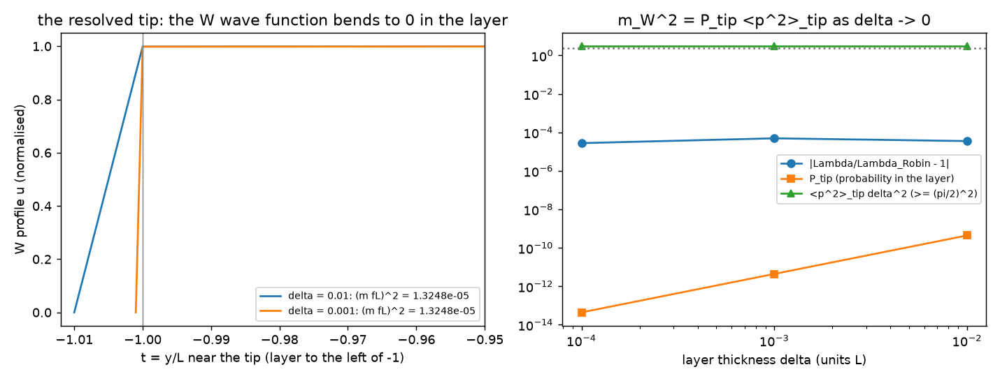
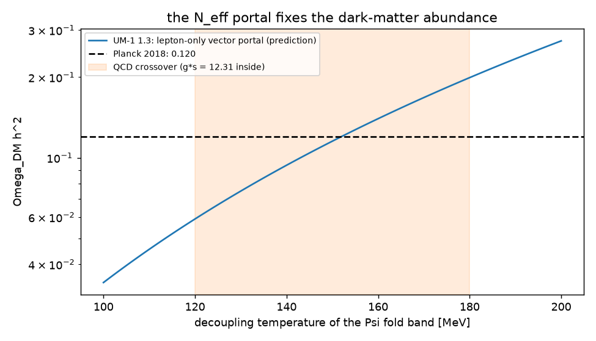

# UM-1 version 1.3: the gaps found by the analysis, and how they are closed

Version 1 of 2026-10-17, written at the author's instruction of 2026-10-17: "Then go ahead, fix the gaps and push".
The gaps are those found by the analysis `ANALYSIS.md` (its section 10) and those listed in `MODEL.md` section 8 and
`SOLUTION.md` section 7. The computations are in `analysis/gap_fixes.py` (4 of 4 checks PASS,
`analysis/reports/gap-fixes-checks.json`), and the tables of section 7 are generated by it. The model changes are
version 1.3 of `MODEL.md`; the origin of every new ingredient is in `PROVENANCE.md` section 8. The labels are those of
`MODEL.md`: DERIVED, TAKEN, STANDARD, ASSUMED, INVENTED, OPEN, CHANGED; ESTIMATE and FROM MEMORY as in `ANALYSIS.md`.
The coordinates are the author's, $X = \{x_0, x_1, \dots, x_7\}$, with $x_0$ the hidden space-like direction.

## 1. Summary: the gaps and their status

| gap | found in | what version 1.3 does | status |
| --- | --- | --- | --- |
| the light masses ($W$, $Z$, $e$, $u$, $d$, $\nu$) did not come from the $x_0$ dependence of the wave functions but from tip terms | `ANALYSIS.md` 5, 6 | resolves the tip as a thin $x_0$ layer: the masses become the $x_0$ gradient energy of the wave functions, $m^2 = P_{tip}\langle\hat p^2\rangle_{tip}$; the fermion masses become exact $x_0$ eigenvalues (section 2) | CLOSED (DERIVED; the layer's inner structure is INVENTED and only its strength is physical) |
| the dark-matter reading and the $N_{eff}$ reading of the vector portal were in tension; the relic abundance was not derived | `ANALYSIS.md` 8.4, 8.5 | the vector portal P1 acts on the lepton multiplets only; the portal fixed by $N_{eff}$ then PREDICTS the dark-matter abundance (section 3) | CLOSED as a benchmark (INVENTED choice; ESTIMATE accuracy) |
| the docstring of `solution/masses.py` gave the wrong $f$ scaling of the tip parameter | `ANALYSIS.md` 3.3 | corrected (section 4) | CLOSED |
| the stability of the dark matter rests on the exact fold parity | `ANALYSIS.md` 8.3 | stated as a symmetry requirement of the full model | ASSUMED (unchanged) |
| dark energy: no $\Psi$ state qualifies | `ANALYSIS.md` 9 | none possible within the model: $\delta\Lambda$ stays | OPEN (the cosmological-constant problem) |
| no Higgs while a 125 GeV boson is observed; $WW$ unitarity near 1.2 TeV | `SOLUTION.md` 7 | inherent in the order ("do NOT include the Higgs particle") | CONFLICT (unchanged) |
| further open items | section 5 | listed | OPEN |

## 2. G1: every mass as the $x_0$ dependence of the wave function

### 2.1 The gauge bosons: the resolved tip (check G1a)

The analysis showed that $m_W^2$ is 99.87 % a tip term of the sigma field: the Robin condition
$u'(-1) = \beta u(-1)$ at the regular tip. A Robin condition is the thin-layer limit of a Dirichlet condition. Add
beyond the tip a layer $t \in [-1-\delta, -1]$ of stiffness $w_\delta = \beta e^{-3\eta}\delta$, and let the
broken-generator profiles vanish at its outer edge (symmetry breaking by a boundary condition, as in Higgsless models).
A linear drop of $u$ across the layer has gradient energy $w_\delta u(-1)^2/\delta = \beta e^{-3\eta}u(-1)^2$, which is
exactly the tip term. The mass of the $W$ is then

$$ m_W^2 = \frac{\int dy\,w(y)\,|\partial_s u|^2}{\int dy\,w(y)\,|u|^2} = P_{tip}\,\langle\hat p^2\rangle_{tip} + (\text{bulk bending}),\qquad \langle\hat p^2\rangle_{tip} \geq \Big(\frac{\pi}{2\,\delta_s}\Big)^2 , $$

where $P_{tip}$ is the probability of finding the $W$ in the layer and $\delta_s = fL\delta$ its proper thickness.
The bound is the Poincaré inequality of a profile that must vanish within $\delta_s$: the precise form of the author's
uncertainty argument.

The finite-element computation (1500 bulk and 300 layer elements; table of section 7.1) gives these results:
* the layered problem reproduces the Robin eigenvalue for $\delta = 10^{-2}, 10^{-3}, 10^{-4}$ to $3$ to
  $5\times10^{-5}$, the discretisation error;
* the whole of $m_W^2$ is the $x_0$ gradient energy of the wave function, 99.868 % of it inside the layer;
* $P_{tip}$ falls like $\delta$ and $\langle\hat p^2\rangle_{tip}\delta^2 = 3.0$ stays above $(\pi/2)^2 = 2.47$;
* the uncertainty bound alone gives $P_{tip}(\pi/2)^2/\delta^2 = 0.82\,m_W^2$.

The same holds for the $Z$.

So the $W$ is light although its wave function has a large hidden momentum where it varies. The variation is
confined to the tip, where the probability of finding the $W$ is suppressed by the warp ($e^{-3\eta} = 1.2\times10^{-4}$
in the weight) and by the thinness of the layer. In this form the author's mechanism holds exactly: the mass is
generated by the $x_0$ dependence of the wave function, and the uncertainty relation holds where that dependence
sits, weighted by the probability of being there. The inner structure of the layer is INVENTED and is not resolved by
UM-1; every layer with the same $w_\delta/\delta$ gives the same masses.



### 2.2 The fermions: exact $x_0$ eigenvalues (check G1b)

The tip Yukawa coupling of `MODEL.md` section 4.3 mixes the left-handed and right-handed zero modes at the tip. As a
condition on the coupled $(L, R)$ $x_0$ Dirac problem it reads

$$ b_L(-1) = \kappa\, b_R(-1),\qquad a_R(-1) = -\kappa\, a_L(-1) . $$

This is the self-adjoint mixing condition; its boundary form $\sum_{L,R}\varphi^\dagger\sigma_1\psi$ vanishes. The
fold conditions are unchanged ($b_L(0) = 0$, $a_R(0) = 0$). The four-dimensional mass is the lowest eigenvalue of this
$x_0$ problem. It is computed exactly with closed-form transfer matrices (mpmath, 50 digits; table of section 7.2).
With $\kappa = \sqrt{\Lambda_1} = 5.488$ (the $\lambda_f = 1$ of `SOLUTION.md`):
* the exact eigenvalue equals the first-order value $\kappa\,\zeta(c_L)\zeta(c_R)$ to $5.8\times10^{-8}$ (the $d$
  quark; the correction is $O(\kappa^2e^{-2c})$);
* it reproduces the observed $e$, $u$, $d$, $\nu$ masses to $10^{-6}$;
* for a broad mode ($c = 1$) the exact eigenvalue lies 24.7 % below first order.

The fermion masses of UM-1 are therefore exact $x_0$ eigenvalues of their wave functions. The mass is the tip mixing
times the amplitudes of the two chiral wave functions at the tip, $\zeta(c)^2$, the probability density there.

### 2.3 The precise form of the author's principle (DERIVED, version 1.3)

For every field of UM-1, the four-dimensional mass is the $x_0$ dependence of its wave function measured relative to
the geometric zero mode:

$$ m^2 = \sum_{\text{regions}} P_{\text{region}}\,\langle\hat p^2\rangle_{\text{region}}\quad(\text{dressed hidden momentum}),\qquad \langle\hat p^2\rangle_{\text{region}} \geq \frac{\hbar^2}{4\,\Delta s^2}\ \text{or}\ \Big(\frac{\pi\hbar}{2\,\delta_s}\Big)^2 . $$

* MASSLESS: the profile is flat relative to the geometry ($u = $ const, or $h\chi = 0$): the graviton, the photon, the
  gluons and the fold-band quanta of $\Psi$. The author's exception list, extended by the gluons.
* HEAVY: the $x_0$ dependence fills the cell, $P \approx 1$, so $m \geq 3H/(2f) = 99.4$ TeV. These are the
  Kaluza-Klein modes, the odd modes and the $\Psi$ bulk band; the dark matter (50.9 TeV) is the lightest odd state.
* LIGHT: the $x_0$ dependence sits at the tip, $P_{tip} \ll 1$. These are $W$, $Z$, $e$, $u$, $d$ and $\nu$.

## 3. G2: the dark-matter abundance from the $N_{eff}$ portal (check G2)

### 3.1 The change

`MODEL.md` version 1.3 (CHANGED, INVENTED choice): the vector portal P1 acts on the lepton multiplets only,
$\frac{c_V}{\Lambda_D^6}(\bar\Psi\gamma^M\Psi)(\bar\psi\gamma_M\psi)$ with $\psi \in \{L, e_R\}$. Each multiplet's
operator is separately gauge invariant, so this is consistent with the electroweak theory. $\Psi$ keeps its interactions
with the quarks through the other portals:
* P2: the scalar tip portal, suppressed by $\zeta_q^2$;
* P5: the covariant-derivative contact, proportional to $m_q$ on shell;
* P3: the dipole, through the photon and the $Z$;
* P4: the $Z$ portal.

The order's "new CRITICAL interactions" with photons, neutrinos, electrons, quarks, $W$ and $Z$ are all still present.

### 3.2 The prediction

The fold band decouples in the QCD crossover for $N_{eff} = 2.99$ (`SOLUTION.md` section 6). Its vector portal is
$G^{-1/2} = 12.3$ TeV (neutrino-like estimate; the targets of the decoupling are the leptons, as for neutrinos). The
dark matter couples to the same portal with its $x_0$ overlap, 0.329 of the fold band's (`ANALYSIS.md` section 8.5),
so $G^{-1/2} = 21.5$ TeV. It annihilates into $e$ (Dirac) and $\nu_L$ (chiral), 1.5 Dirac-equivalent channels, with
$\sigma v = G^2M^2/\pi$ per channel (`ANALYSIS.md` check B2). The result is

$$ \langle\sigma v\rangle = 1.04 \times \langle\sigma v\rangle_{relic},\qquad \Omega_{DM}h^2 = 0.115\,\Big(\frac{T_{dec}}{150\ \text{MeV}}\Big)^3 , $$

i.e. $0.059$ to $0.199$ for $T_{dec} = 120$ to $180$ MeV. Planck's $0.120$ is reached at $T_{dec} = 152$ MeV. The
dark-matter abundance is no longer a free input: it follows from the requirement $N_{eff} = 2.99$, the dark-matter
mass of 50.9 TeV and the $x_0$ profiles. The agreement holds within the accuracy of the decoupling estimate (a factor
of about 2 from $T_{dec}$ alone) (ESTIMATE).



### 3.3 Detection and the remaining requirements

* Direct detection only through the electron loop, i.e. photon mixing (ESTIMATE, the formula of Kopp et al. 2009,
  FROM MEMORY). The result is $\sigma_{SI} = 7.7\times10^{-50}$ cm$^2$ per xenon nucleon, $3\times10^{-5}$ of the LZ
  limit. The tension of `ANALYSIS.md` section 8.5 is gone.
* CMB energy injection (into $e^+e^-$): $p_{ann} = 5.3\times10^{-31}$ cm$^3$/s/GeV against the bound
  $3.2\times10^{-28}$ (Planck 2018, FROM MEMORY).
* REQUIRED: the annihilation into fold-band pairs through $\lambda$, which is p-wave for the scalar-scalar part, stays
  below $6.7\times10^{-26}$ cm$^3$/s; otherwise the dark matter is under-abundant. The quark couplings of P2 and P5 must
  respect the direct-detection limit; P2 is suppressed by $\zeta_q^2 \sim 10^{-8}$.
* Unchanged: the fold-band decoupling, hence $N_{eff}$, the CNB and the BAO fit of `SOLUTION.md` section 6. The dark
  matter decouples kinetically from the leptons long before recombination, so at the CMB it behaves as cold dark
  matter, and the fitting-formula treatment stands.

## 4. G3: the tip parameter in `solution/masses.py` (check G3)

The docstring now states $\beta = c\,\hat g^2v_\Sigma^2fL$, proportional to $f$, as derived in `ANALYSIS.md` section
3.3. The fitted $\beta$ and every number of the solution are unchanged.

## 5. What remains open

* The fold parity must be exact, to $2\times10^{-27}$ in amplitude (ASSUMED).
* The reduction of $\lambda(\bar\Psi\Psi)^2$ to four-dimensional couplings and the size of the $\lambda$ channel (OPEN).
* Dark energy is $\delta\Lambda/H^2 = 7.5\times10^{-93}$, tuned. No state of $\Psi$ can supply it (OPEN; the
  cosmological-constant problem).
* No Higgs boson; $WW$ unitarity near 1.2 TeV, below $m_{KK}$ (CONFLICT, inherent in the order).
* The block stabiliser (the Casimir energy of the cell) and the transition from the primordial deflation to the static
  block, which must end before nucleosynthesis (OPEN).
* The CMB at the level of a Boltzmann code; the $S$ parameter of the Higgsless tip; the anomalies of the
  eight-dimensional bulk theory; the second and third generations (OPEN).

## 6. Changes to the other documents

* `MODEL.md` version 1.3:
  - section 4.4: the resolved tip and the precise principle;
  - section 4.5: P1 on the lepton multiplets;
  - section 8: CHANGED (1.3);
  - section 9: the summary.
* `SOLUTION.md` version 1.2: sections 4.2 (fermion masses as exact eigenvalues), 6 (the predicted abundance) and 7.
* `ANALYSIS.md` section 10: a pointer to this document.
* `PROVENANCE.md` version 1.3: section 8, the provenance of the gap fixes.
* `README.md`; the gate step um1-analysis-gaps; um1-pdfs builds this document.

## 7. Results

<!-- BEGIN GENERATED -->
### 7.1 The resolved tip (`analysis/outputs/gap_fixes.json`)

| boson | $\delta$ | $(mfL)^2$ | deviation from the Robin value | $P_{tip}$ | $\langle p^2\rangle_{tip}\delta^2$ | layer share of the gradient energy |
| --- | --- | --- | --- | --- | --- | --- |
| $W$ | 0.01 | $1.32476\times10^{-5}$ | $3.5\times10^{-5}$ | $4.41\times10^{-10}$ | 3 | 0.998678 |
| $W$ | 0.001 | $1.32478\times10^{-5}$ | $4.9\times10^{-5}$ | $4.41\times10^{-12}$ | 3 | 0.998678 |
| $W$ | $1.000\times10^{-4}$ | $1.32475\times10^{-5}$ | $2.8\times10^{-5}$ | $4.41\times10^{-14}$ | 3 | 0.998678 |
| $Z$ | 0.01 | $1.70476\times10^{-5}$ | $2.4\times10^{-5}$ | $5.67\times10^{-10}$ | 3 | 0.998298 |
| $Z$ | 0.001 | $1.70477\times10^{-5}$ | $2.8\times10^{-5}$ | $5.67\times10^{-12}$ | 3 | 0.998298 |
| $Z$ | $1.000\times10^{-4}$ | $1.70477\times10^{-5}$ | $2.8\times10^{-5}$ | $5.67\times10^{-14}$ | 3 | 0.998298 |

### 7.2 The fermion masses as exact $x_0$ eigenvalues

| fermion | $c_f$ | exact $\varepsilon fL$ | $\kappa\zeta^2$ | relative difference | $m$ [GeV] |
| --- | --- | --- | --- | --- | --- |
| $e$ | 11.2 | $2.31415\times10^{-8}$ | $2.31415\times10^{-8}$ | $-5.7\times10^{-9}$ | $5.10999\times10^{-4}$ |
| $u$ | 10.44 | $9.78194\times10^{-8}$ | $9.78194\times10^{-8}$ | $-2.6\times10^{-8}$ | 0.00216 |
| $d$ | 10.03 | $2.12848\times10^{-7}$ | $2.12848\times10^{-7}$ | $-5.8\times10^{-8}$ | 0.0047 |
| $\nu$ | 19.54 | $2.26434\times10^{-15}$ | $2.26434\times10^{-15}$ | $-3.3\times10^{-16}$ | $5.00000\times10^{-11}$ |

### 7.3 The lepton-only vector portal

| quantity | value |
| --- | --- |
| fold-band portal for $N_{eff} = 2.99$, $G^{-1/2}$ | 12.3 TeV |
| dark-matter portal (overlap 0.329), $G^{-1/2}$ | 21.5 TeV |
| $\langle\sigma v\rangle$ into $e$, $\nu$ / relic value | 1.04 |
| predicted $\Omega_{DM}h^2$ at $T_{dec} = 150$ MeV | 0.115 |
| $\Omega_{DM}h^2$ at $T_{dec}$ = 120 MeV | 0.059 |
| $\Omega_{DM}h^2$ at $T_{dec}$ = 135 MeV | 0.084 |
| $\Omega_{DM}h^2$ at $T_{dec}$ = 150 MeV | 0.115 |
| $\Omega_{DM}h^2$ at $T_{dec}$ = 165 MeV | 0.153 |
| $\Omega_{DM}h^2$ at $T_{dec}$ = 180 MeV | 0.199 |
| $T_{dec}$ for $\Omega h^2 = 0.120$ | 152 MeV |
| $\sigma_{SI}$ per xenon nucleon (electron loop) | $7.7\times10^{-50}$ cm$^2$ ($2.8\times10^{-5}$ of the limit) |
| CMB energy injection $p_{ann}$ | $5.3\times10^{-31}$ cm$^3$/s/GeV (bound $3.2\times10^{-28}$) |

<!-- END GENERATED -->

## 8. Reproduction

From the repository root, after the analysis (`ANALYSIS.md` section 11), under `timeout -k 5 423`:

```
cd Revision/universe_model
python analysis/gap_fixes.py          # about 15 s, 4 checks; section 7
python tools/build_pdfs.py GAPS
```
