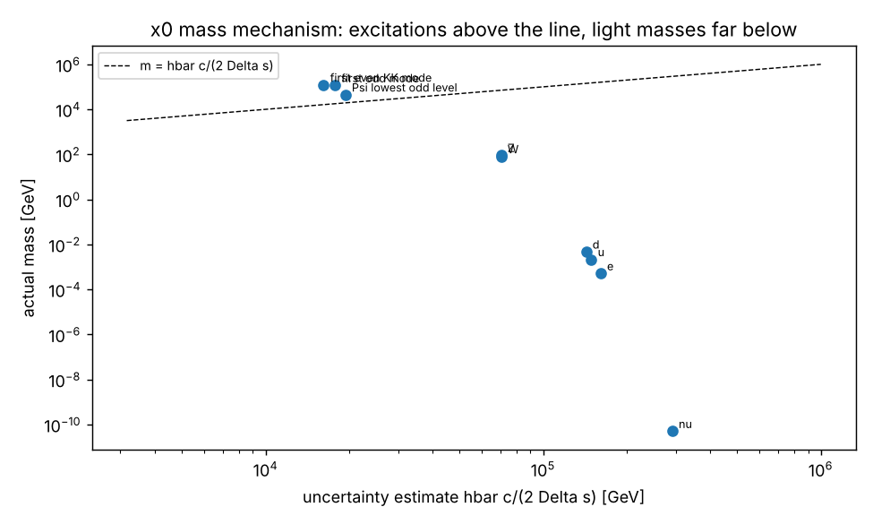
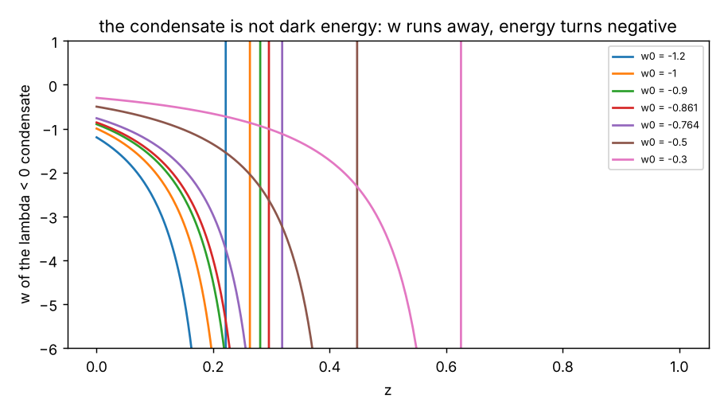

# How to read this document

The author asked for two analyses: of the mechanism that gives every non-massless particle its mass through the
dependence of its wave function on the hidden space coordinate $x_0$ (periodic with period $\pi/(6H)$, the uncertainty
relation $\Delta x_0\,\Delta p_{x_0} \ge \hbar/2$ being the physical reason), and of the validity of associating dark matter
and dark energy with dirac16complex. This document carries out both within UM-2. It is self-contained: every equation it
uses is written here. Labels: AUTHOR, RECORD, STANDARD, ASSUMED, INVENTED, DERIVED (computed and verified), ESTIMATE,
FROM MEMORY (a measured bound quoted from memory), OPEN. Units $\hbar = c = 1$. Coordinates are the author's
$x_0, \dots, x_7$ ($x_0$ hidden space, $x_1, x_2, x_3$ space, $x_4$ time, $x_5, x_6, x_7$ extra times); $W^+$ has charge $+e$,
$W^-$ charge $-e$.

**Summary of the verdicts.**

| question | verdict |
| --- | --- |
| Can every mass come from the $x_0$ dependence of wave functions periodic with period $\pi/(6H)$? | YES (DERIVED): every four-dimensional mass of UM-2 is an eigenvalue of an $x_0$ operator; graviton, photon, gluons and the dirac16complex fold band are exactly massless |
| Is the uncertainty relation the reason for the masses? | ONLY FOR THE HEAVY STATES: it bounds the Kaluza-Klein and odd excitations (and the dark matter) from below, but the light masses ($W^\pm$, $Z$, $e$, $\nu$, $u$, $d$) lie $10^{-3}$ to $10^{-16}$ below the uncertainty estimate and come from the tip of the $x_0$ cell |
| Do the extra times deflate to irrelevance? | IN THE PRIMORDIAL ERA, then FROZEN: they deflate by up to a factor 2.9 into the stabilised block; a continuing deflation is excluded because every mass and coupling depends on the block size |
| Is dirac16complex dark matter? | CONDITIONALLY YES: the lightest odd quantum of the $\Psi_B$ half (44.3 TeV, cold, neutral, stable) is a viable candidate whose relic abundance fixes one portal scale; the massless fold bands are radiation, not dark matter |
| Is dirac16complex dark energy? | NOT SUPPORTED: no positive-energy state has $w < 0$; a negative-coupling condensate runs away; the dark energy of UM-2 is a tuned four-dimensional cosmological term |

# The $x_0$ mass mechanism

## The author's requirement in equations

The hidden coordinate enters through $z = 6Hx_0$; one period is $\ell_0 = \pi/(6H)$; on each half of a period
$$ y = \frac{\ln\lvert\sin z\rvert}{6H} \in (-L, 0],\qquad dy = \cot z\,dx_0,\qquad ds_{hidden} = f\,dy ,$$
the fold $y = 0$ ($z = \pi/2$) joining the two halves and the tip $y = -L$ ($\eta = HL = 3$) closing them. Every wave function of
UM-2 depends on $x_0$ through $y(z)$, so it is periodic in $x_0$ with period $\pi/(6H)$. The uncertainty relation, in the
proper hidden length $s = fy$, reads $\Delta s\,\Delta p_s \ge \frac12$, and the author's estimate of a mass is
$$ m_H = \frac{\hbar c}{2\Delta s}.$$

## Every mass is an $x_0$ eigenvalue (DERIVED)

With $t = y/L$:

* **Gauge bosons and the graviton**: $-e^{-3\eta t}(e^{3\eta t}u')' = \Lambda u$, $\Lambda = (m\,fL)^2$; fold $u'(0) = 0$ (even) or
  $u(0) = 0$ (odd); tip $u'(-1) = \beta u(-1)$ with $\beta = 0$ for the photon, the gluons and the graviton and
  $\beta_W = 0.011932$ ($W^+$, $W^-$), $\beta_Z = \beta_W/\cos^2\theta_W$ ($Z$).
* **Fermions**: $h_j = j[-\frac{i}{f}\sigma_1\partial_y + \mu\sigma_2 + \kappa k\sigma_3]$ with the chiral boundary conditions and the tip
  mixing $b_L = \kappa_fb_R$, $a_R = -\kappa_fa_L$; the mass is the root of
  $D(e) = e^2s_Ls_R - \kappa_f^2(C_L - c_Ls_L)(C_R + c_Rs_R)$, $s = \sinh w/w$, $C = \cosh w$, $w = \sqrt{c^2 - e^2}$, $c = f\mu L$.
* **dirac16complex**: $h_j$ with $M = m$, fold $\chi_2(0) = 0$ (even) or $\chi_1(0) = 0$ (odd), tip $\chi_2(-L) = 0$.

The masses (DERIVED): photon, gluons, graviton $0$ exactly (flat profile); dirac16complex fold band $0$ exactly
(chiral zero mode, $\varepsilon = \kappa\lvert k\rvert$); $W^\pm$ $80.36$ GeV and $Z$ $91.17$ GeV (fit of $\beta_W$ to $\rho_0$);
$\nu$, $e$, $u$, $d$ with $c = 18.67, 10.30, 9.54, 9.13$; the dark matter $3.102204\,m = 44.31$ TeV; Kaluza-Klein levels from
$121$ TeV; every odd mode and every excitation above the gap $3H/(2f_*) = 99.4$ TeV.

## What the uncertainty relation does and does not bound (DERIVED)

For a boson, write $u = e^{-3\eta t/2}v$. The exact identity
$$ e^{3\eta t}u'^2 = v'^2 + \frac94\eta^2v^2 - \frac32\eta\,(v^2)'$$
turns the Rayleigh quotient into the decomposition
$$ (m\,fL)^2 = \langle p^2\rangle + \frac{9\eta^2}{4} - \frac{3\eta}{2}\rho(\text{fold}) + \Big(\frac{3\eta}{2} + \beta\Big)\rho(\text{tip}),\qquad
   \langle p^2\rangle = \frac{\int v'^2}{\int v^2},\quad \rho = \frac{v^2}{\int v^2}, $$
and for a fermion $(\varepsilon fL)^2 = \langle\lvert\chi'\rvert^2\rangle + c^2 - c\,[\chi^\dagger\sigma_3\chi]_{-1}^{0}/\!\int\lvert\chi\rvert^2$. Only the
hidden kinetic term is bounded by the uncertainty relation, $\langle p^2\rangle \ge 1/(4\Delta t^2)$. Computed for every class
of particle (DERIVED; sum rules reproduce the eigenvalues to $10^{-8}$, the dark matter to $10^{-11}$):

Bosons (the warp term is $9\eta^2/4 = 20.25$ for every mode):

| state | $\langle p^2\rangle$ | fold term | tip term | $(m\,fL)^2$ | $m/m_H$ |
| --- | --- | --- | --- | --- | --- |
| photon, gluons, graviton | $20.250$ | $-40.505$ | $0.0050$ | $0$ | $0$ |
| $W^\pm$ | $20.250$ | $-40.505$ | $0.0050$ | $1.32\times10^{-5}$ | $1.14\times10^{-3}$ |
| $Z$ | $20.250$ | $-40.505$ | $0.0050$ | $1.70\times10^{-5}$ | $1.29\times10^{-3}$ |
| first even Kaluza-Klein mode | $9.870$ | $-2.949$ | $2.949$ | $30.120$ | $7.49$ |
| first odd mode | $4.891$ | $0$ | $1.949$ | $27.089$ | $6.47$ |

Fermions (the kinetic term $\langle\lvert\chi'\rvert^2\rangle$ equals the bulk term $c^2$ for the zero modes):

| state | $\langle\lvert\chi'\rvert^2\rangle$ | bulk $c^2$ | boundary term | $(\varepsilon fL)^2$ | $m/m_H$ |
| --- | --- | --- | --- | --- | --- |
| $\nu$ zero mode | $348.60$ | $348.60$ | $-697.21$ | $0$ | $1.7\times10^{-16}$ |
| $e$ zero mode | $106.17$ | $106.17$ | $-212.34$ | $0$ | $3.2\times10^{-9}$ |
| $u$ zero mode | $91.10$ | $91.10$ | $-182.21$ | $0$ | $1.4\times10^{-8}$ |
| $d$ zero mode | $83.43$ | $83.43$ | $-166.86$ | $0$ | $3.3\times10^{-8}$ |
| $\Psi$ fold band | $0.418$ | $0.418$ | $-0.836$ | $0$ | $0$ |
| $\Psi_B$ dark matter | $2.608$ | $0.418$ | $0.998$ | $4.024$ | $2.29$ |

(the masses of $\nu$, $e$, $u$, $d$ come from the tip mixing, not from these zero modes). Proper spreads and uncertainty
estimates:

| state | $\Delta s$ (m) | $m_H = \hbar c/(2\Delta s)$ (GeV) |
| --- | --- | --- |
| photon, gluons, graviton; $W^\pm$; $Z$ | $1.40\times10^{-21}$ | $70\,500$ |
| first even Kaluza-Klein mode; first odd mode | $6.09\times10^{-21}$; $5.56\times10^{-21}$ | $16\,191$; $17\,756$ |
| $\nu$; $e$; $u$; $d$ zero modes | $3.38$; $6.13$; $6.62$; $6.92\times10^{-22}$ | $291\,611$; $160\,929$; $149\,075$; $142\,660$ |
| $\Psi$ fold band; $\Psi_B$ dark matter | $4.31\times10^{-21}$; $5.09\times10^{-21}$ | $22\,884$; $19\,378$ |

Three classes follow.

* **Massless although localised.** The photon, the gluons and the graviton are localised at the fold
  ($\Delta s = 1.40\times10^{-21}$ m, $m_H = 70.5$ TeV, $\langle p^2\rangle\Delta t^2 = 0.497 \ge 1/4$), yet exactly massless: the fold
  term cancels the hidden kinetic energy and the warp. The cancellation is exact because the flat profile is an
  eigenfunction with $\Lambda = 0$, protected by four-dimensional gauge invariance and general covariance. The fold bands
  of dirac16complex are massless for the analogous chiral reason ($\chi = (e^{f\int Mdy}, 0)$ is a zero mode for every mass
  profile).
* **Heavy: the uncertainty relation is a true lower bound.** Every $x_0$ excitation lies above the gap: for every tip
  coupling $\beta$ from $0$ to $10^6$ exactly one even level lies below $9\eta^2/4$ (the zero mode, lifted only by the tip) and
  no odd level does (the gap theorem, DERIVED), so every odd mode and every excitation has $m \ge 3H/(2f_*) = 99.4$ TeV. For
  these states $m_H$ is exceeded by factors 2.3 to 7.5 (dark matter 2.29, first odd 6.47, first even 7.49): the author's
  Heisenberg estimate holds as a bound, and the dark-matter mass is an $x_0$ mass in this sense (its hidden wave number $p$
  carries $p^2/\varepsilon^2 = 0.896$ of $\varepsilon^2$).
* **Light: the mass comes from the tip, not from localisation.** For $W^\pm$, $Z$, $e$, $\nu$, $u$, $d$ the $x_0$ dependence that costs
  energy sits at the tip, where the probability is small: $m/m_H = 10^{-3}$ ($W^\pm$, $Z$) to $10^{-16}$ ($\nu$). For the fermions
  a sharper localisation gives a LIGHTER particle, $d\ln m_f/d\ln c = -36.3, -19.6, -18.1, -17.3$ ($\nu$, $e$, $u$, $d$): the
  reverse of the Heisenberg intuition.

## Proper versus coordinate localisation (DERIVED)

The photon zero mode, localised at the fold in proper length, has 61.9 % of its probability within $\pi/8$ of the tips in
the coordinate $z = 6Hx_0$: localisation in the coordinate $x_0$ is chart dependent, because $ds_{hidden} = f\cot z\,dx_0$ diverges
at the fold. Only the proper hidden length enters the masses; a statement "$\Delta x_0$ small" must therefore be read as
"$\Delta s$ small".

## The mass mechanism, the block and the deflating extra times

Every mass and coupling depends on the block scale $f$ (DERIVED):

| quantity $X$ | $d\ln X/d\ln f$ |
| --- | --- |
| Kaluza-Klein masses, the gap $3H/(2f)$ | $-1$ |
| $m_W$ (and $m_Z$) | $-0.501$ |
| $m_e$, $m_u$, $m_d$, $m_\nu$ | $-20.6$, $-19.1$, $-18.3$, $-37.3$ |
| $M_{DM}$ | $-0.772$ |
| $G_N$ and the gauge couplings ($\propto 1/V_\perp \propto f^{-4}$) | $-4$ |

The author's metric lets the extra times $x_5, x_6, x_7$ (and, in the corrected metric, $x_0$ with them) deflate
exponentially. In UM-2 they do so in the primordial era: the full nonlinear equations take a large block into the
stabilised one at rates up to $\lvert h\rvert = 2.63H$, deflating by up to $f(k_c)/f_* = 2.917$, after which the block oscillates
about $f_*$ (the radion) and stays frozen. A continuing deflation today is excluded (ESTIMATE, bounds FROM MEMORY): the
atomic-clock bound $\lvert d\ln\alpha/dt\rvert < 10^{-17}$/yr and $d\ln\alpha/d\ln f = -4$ require $\lvert h\rvert < 2.5\times10^{-18}$/yr
$= 3.6\times10^{-8}H_0$; lunar ranging ($\lvert d\ln G/dt\rvert < 10^{-13}$/yr) requires $\lvert h\rvert < 3.6\times10^{-4}H_0$; a block deflating at the
Hubble rate would change the electron mass by $1.4\times10^{-9}$ per year. The extra times are irrelevant at low energies
not because they keep deflating but because they are small ($f_*/H$, a proper cell of $9\times10^{-21}$ m, Kaluza-Klein
masses above 100 TeV) and frozen. The price is the stabiliser (ASSUMED, origin OPEN) and the radion left over from the
deflation (ESTIMATE: lifetime $0.43\,\text{s}/C$, reheating to $1.85\sqrt C$ MeV, below the 4.7 MeV that nucleosynthesis needs unless
the order-one coupling factor $C > 6.5$: a moduli problem, OPEN).

## Assessment of the mechanism

The author's mechanism works in UM-2 in a precise sense: all masses are $x_0$ eigenvalues, the period $\pi/(6H)$ is built
into every wave function, and the massless particles are exactly those protected by symmetry. The uncertainty relation,
however, is the reason for the masses of the heavy states only. The light masses need two further ingredients that are
not consequences of the uncertainty relation: the tip of the cell (where electroweak symmetry is broken by $\Sigma$) and
exponentially localised chiral zero modes, whose overlap at the tip ($\zeta(c)^2 \simeq 2c\,e^{-2c}$) produces the hierarchy from
order-one bulk masses. The scales are not free: once the Kaluza-Klein scale is fitted ($m_{KK} = 121$ TeV from $\rho_0$), the
dark-matter mass ($44$ TeV) and the radion ($48$ TeV) follow.

# dirac16complex as dark matter

## The candidate

$\Psi$ splits into two four-dimensionally Lorentz-invariant halves, $\Psi_A$ ($B = -1$) and $\Psi_B$ ($B = +1$), $B = -iC\gamma^{x_4}$. In
the good sector every term of UM-2 commutes with $B$ (DERIVED with the author's matrices: $B$ commutes with $C$, with
$\gamma^a$ and $C\gamma^a$ for $a = x_0, \dots, x_4$, anticommutes with them for $a = x_5, x_6, x_7$, and
$\gamma^M\Omega_M = \frac32\frac Hf\gamma^{x_0} + (\frac{\dot b_4}{b_4} - \frac{\dot a_4}{2})\gamma^{x_4}$ contains $\gamma^{x_0}$ and $\gamma^{x_4}$ only), so $N_A$ and $N_B$ are
separately conserved. The tip projector of the $Z$ portal, $P_+ = (1 + \Gamma_4)/2 = (1 - B\gamma^{x_0})/2$ ($\Gamma_4 = -B\gamma^{x_0}$,
DERIVED), annihilates every $\Psi_B$ orbital at the tip. The dark-matter candidate is the lightest odd state of $\Psi_B$:

* a Dirac fermion of mass $M_{DM} = \sqrt{m^2 + p^2} = 3.102204\,m = 44.31$ TeV ($\tan(p\,fL) = -p/m$, $m = H$);
* cold: $w = p_3/\rho = 0$ for quanta at rest (Kohn-Sham, DERIVED; $2.8\times10^{-5}$ with the benchmark self-coupling);
* electrically neutral (a gauge singlet) and with no $Z$ coupling and no transition current at the tip (exactly);
* stable: $N_B$ is conserved and its fold parity is exact (no tip operator reaches $\Psi_B$; the bulk is symmetric under the
  fold reflection); the heavy odd $\Psi_A$ states, which carry a tip $Z$ charge, decay through the oriented part of I9;
* its mass is an $x_0$ mass: $p^2/\varepsilon^2 = 0.896$, $m/m_H = 2.29$, and its hidden pressure $p_0/\rho = 0.772 = -d\ln\varepsilon_{DM}/d\ln f$
  (two independent computations agree to $10^{-9}$).

## Relic abundance

Through the gauge-kinetic portal $S_{I12} = -\int\sqrt{\lvert g\rvert}\,\bar\Psi\Psi(c_GG^2 + c_WW^2 + c_BB^2)/\Lambda_\star^3$ the four-dimensional
operator is $G_i\bar\chi\chi F^i_{\mu\nu}F^{i\mu\nu}$ with $G_i = \mathcal O\,c_ig_i^2/\Lambda_\star^3$, $\mathcal O = \partial\varepsilon_{DM}/\partial m = 0.7072$. The annihilation is
p-wave: $\sigma v = G^2s(s - 4M^2)/(4\pi) \to G^2M^4v^2/\pi$ per abelian channel, $(M^4v^2/\pi)(8G_g^2 + 3G_W^2 + G_B^2)$ in total. The
thermal relic (Kolb-Turner freeze-out, Dirac fermion, $g_* = 56.75$) requires (DERIVED)
$$ x_f = 30.31,\qquad \langle\sigma v\rangle(x_f) = 1.37\times10^{-25}\ \text{cm}^3/\text{s},\qquad (8G_g^2 + 3G_W^2 + G_B^2)^{1/2} = (16.6\ \text{TeV})^{-3},$$
below the thermal unitarity scale ($2.3\times10^{-25}$ cm$^3$/s). The portal scale is therefore of the order of the dark-matter
mass, not far above it: the effective description is at its edge (a dedicated ultraviolet completion of I12 is OPEN).

## Detection

* Direct (ESTIMATE): through gluons only, $\sigma_{SI} = \mu^2f_N^2/\pi = 4.3\times10^{-53}$ cm$^2$ with
  $f_N = G_g\frac{8\pi}{9\alpha_s}m_Nf_{TG}$, eight orders below the LZ limit extrapolated to 44 TeV ($2.4\times10^{-45}$ cm$^2$): the relic
  coupling could sit entirely in gluons ($5.7\times10^7$ times the allowed fraction). The electroweak channels have no
  tree-level nucleon coupling.
* Indirect: the annihilation is p-wave, $\propto v^2 \sim 10^{-6}$ in galaxies today, so present-day annihilation signals are
  suppressed by about $10^{-5}$ relative to freeze-out.
* Colliders: 44 TeV is beyond the reach of present and planned colliders.

## The massless quanta are not dark matter

The fold bands of both halves are massless four-dimensional fermions ($\varepsilon = \kappa\lvert k\rvert$); a gas of them has
$w = 1/3$ exactly (Kohn-Sham, DERIVED). The $\Psi_A$ fold band couples to the $Z$ through I9 and is part of the radiation
($N_{eff} = 3.044$, two of the three CNB species; it replaces $\nu_\mu$ and $\nu_\tau$ in the $Z$ invisible width, $r^2 = 0.992$). The
$\Psi_B$ fold band must stay cold: if it were thermalised above the QCD crossover it would add $\Delta N_{eff} = 0.18$, which at
fixed Planck parameters changes the CMB temperature spectrum by up to 2.8 % (a joint refit is OPEN).

## Assessment

The association of dirac16complex with dark matter is valid in UM-2 under stated conditions: (i) the good sector (no
extra-time momenta; outside it the halves mix and modes are tachyonic, OPEN); (ii) the exact fold parity of $\Psi_B$, which
UM-2 derives from $P_+\Psi_B = 0$ at the tip; (iii) a gauge-kinetic portal I12 with coefficients set by the relic
abundance; (iv) a $\Psi_B$ fold band that never thermalises. It is the heavy odd part of one half of the field, not the
field as a whole, that is dark matter; the field's massless fold bands are radiation.

# dirac16complex as dark energy

## No positive-energy state accelerates (DERIVED)

On the static block every computed Kohn-Sham state of $\Psi$ has $w = \int p_3/\int\rho \ge 0$: dark matter $0$ ($2.8\times10^{-5}$ with
$\lambda_B$), fold-band gas $1/3$ ($0.3312$ with $+\lambda_B$, $0.3354$ with $-\lambda_B$).

## The condensate runs away (DERIVED)

A homogeneous condensate $S = \bar\Psi\Psi \propto a^{-3}$ with $U = \frac{\lambda}{2}S^2$ has $\rho = mS + U$, $p = SU' - U = \frac{\lambda}{2}S^2$, so
$$ w(a) = \frac{x(a)}{1 + x(a)},\qquad x(a) = \frac{\lambda S}{2m} = x_0a^{-3},\qquad x_0 = \frac{w_0}{1 - w_0},\qquad
   w_a \equiv -\frac{dw}{da}\Big\vert_{a=1} = \frac{3x_0}{(1 + x_0)^2}.$$
$w < 0$ needs $\lambda < 0$, and then the energy density $\rho = mS(1 + x)$ crosses zero at $a = (-x_0)^{1/3}$:

| $w_0$ | $-1.2$ | $-1$ | $-0.9$ | $-0.861$ | $-0.764$ | $-0.5$ | $-0.3$ |
| --- | --- | --- | --- | --- | --- | --- | --- |
| $w_a$ (tangent) | $-7.92$ | $-6.00$ | $-5.13$ | $-4.81$ | $-4.04$ | $-2.25$ | $-1.17$ |
| energy zero at $z$ | $0.224$ | $0.260$ | $0.283$ | $0.293$ | $0.322$ | $0.442$ | $0.630$ |

The supernova fits of the author's private file, a constant $w = -0.764$ and $(w_0, w_a) = (-0.861, -0.60)$, are not
reproduced: a condensate tuned to $w_0 = -0.861$ has $w_a = -4.81$ and negative energy density beyond $z = 0.29$.

## The vacuum energy and the tuning

A natural vacuum energy of the cell, $m_{KK}^4/(16\pi^2) = 1.4\times10^{18}$ GeV$^4$, exceeds the dark-energy density
($2.5\times10^{-47}$ GeV$^4$) by $5.5\times10^{64}$. In UM-2 the four-dimensional cosmological term is the residual of the stabiliser
balance, $\Lambda_4 = [6H^2k(1 - 2w_2k) + \Lambda + \kappa\rho_b]/G(k)$, zero at the static point; the observed dark energy needs
$\Lambda_4/H^2 \sim (H_0/H)^2 = 1.0\times10^{-92}$: the cosmological-constant problem, unsolved (OPEN). A slowly deflating block
cannot provide a dynamical dark energy instead, because it would make $\alpha$, $G_N$ and the masses drift (the bound
$\lvert h\rvert < 3.6\times10^{-8}H_0$ above).

## Assessment

The association of dirac16complex with dark energy is not supported in UM-2: its positive-energy states are matter or
radiation, its only accelerating configuration is unstable and reaches negative energy density at $z \approx 0.2$ to $0.6$,
and the measured $(w_0, w_a)$ are not reproduced. The dark energy of UM-2 is the tuned four-dimensional cosmological term
$\Lambda_4$.

# Conditions, open problems and conflicts

* **Conditions on which the conclusions rest** (ASSUMED): the stabiliser and its $f^{-8}$ law; the good sector; the regular
  tip at $\eta = 3$; $m = H$; the tip sigma field and the boundary assignments of the Standard-Model fields; the portals
  I9, I11, I12 (INVENTED).
* **Open**: the origin of the stabiliser; the extra-time modes; the radion moduli problem; the block-shape mode driven by
  $p_0 - p_t$; the ultraviolet completion of I12; the joint CMB and BAO fit of the variant with a thermalised $\Psi_B$ fold band;
  the cosmological-constant problem.
* **Conflicts with data inherent in the order**: no Higgs boson (one is observed), perturbative unitarity of $W^+W^-$
  scattering lost near 1.2 TeV, and a one-generation $Z$ width of $1.23$ GeV against $2.4955$ GeV.
