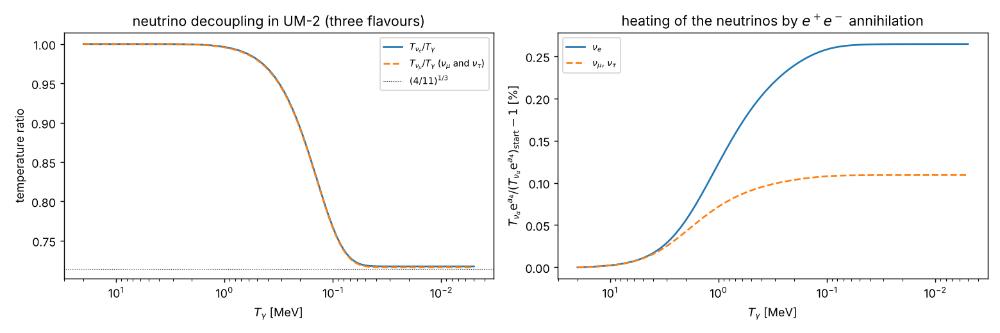
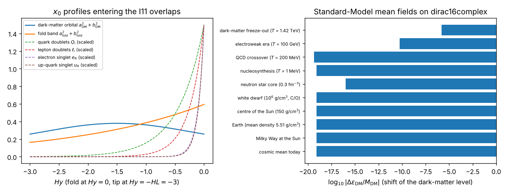
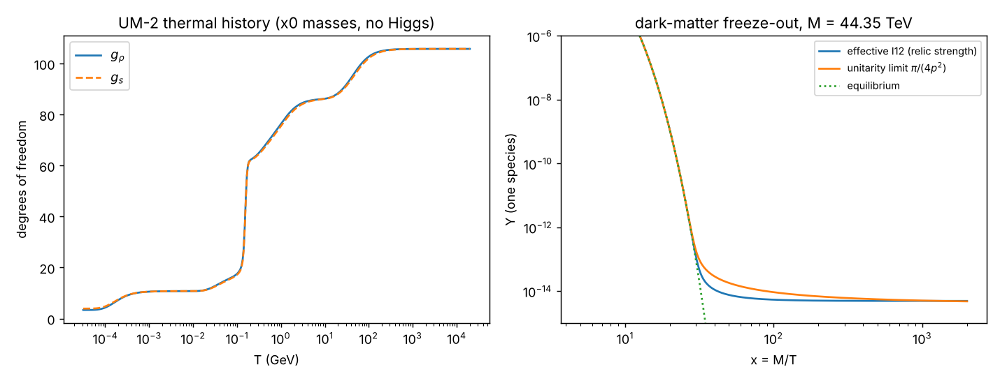

# How to read this document

**What it contains.** This document presents the accurate approximate solution of the coupled field equations of the
universe model UM-2, in ten steps that follow the hierarchy of the problem: (1) the background and the primordial era;
(2) the masses from the $x_0$ dependence of the wave functions; (3) the Kohn-Sham states of dirac16complex coupled to all
fields and their back-reaction on gravity; (4) the electroweak sector; (5) the flavour conversion of the three neutrinos,
$N_{\mathrm{eff}}$ and the cosmic neutrino background (CNB); (6) the cosmic microwave background (CMB), the CNB and the
baryon acoustic oscillations (BAO); (7) the dark-matter relic and its detection; (8) the coupled solution in ten
environments; (9) the thermal history and the relic with the portal I13; (10) the terms of the metric power series. Before
the steps, "The coupled system" lists every field equation with its fields and the step that solves it, and "The
approximation scheme" states the small parameters. After the steps, "Accuracy of the solution" collects in one table, for
every equation, the method, the measured residual, the neglected terms and the checks in concert with the other field
equations; the last section states what the solution does not reproduce and what is open.

**How every step is presented.** Each step has five parts: (1) *the field equations*: every field equation (tag FE-$n$)
and every interaction term of the action (tag IN-$n$) that the step solves or uses, written out in full with its list of
symbols, also when an earlier step has already written it, so that every definition stands next to the equation that
uses it; (2) *the approximation*: the small parameter and the size of what is neglected, as equations with their symbol
lists; (3) *the solution*: formulas and numbers; (4) *the check*: the residual or the measured error of the solution in
its own equation, and its consistency with the other field equations that contain the same fields (in concert); (5) *the
status* of each result. The tags FE-$n$ and IN-$n$ are one numbering, shared by all documents of UM-2, of the 136 field
equations and the 18 interaction terms of the model.

**Symbols.** Every display equation is followed by the complete list of its symbols: every quantity, field, coupling,
constant, operator, index (with the values it takes) and special mark, with its meaning, its unit, its value where it has
one, and its status. Typography needs no definition (digits, $+$, $-$, $=$, brackets, fractions, roots, $\cdot$, $\dots$,
$\le$, $\approx$, $\sim$, $\times$, the standard functions sin, cos, tan, cot, sinh, cosh, tanh, exp, ln, log, det, min,
max, lim and the signs of sums, products and integrals; their index letters and integration variables are symbols and are
listed). A symbol has one meaning throughout the document, in the displays, in the inline formulas and in the text.
Euler's number is written $\mathrm{e}$, the imaginary unit $\mathrm{i}$ and the differential $\mathrm{d}$.

**Status labels.** Every result carries one of these labels:

* **AUTHOR**: taken from the author's notebooks (the coordinates, the metric, the Lovelock weights, the gamma matrices,
  the mass parameter);
* **RECORD**: taken from the Revision record of this repository (the dirac16complex Lagrangian, the Kohn-Sham reference
  states);
* **STANDARD**: textbook physics or a measured value used as an input;
* **ASSUMED**: a choice made for this model;
* **INVENTED**: a new phenomenological ingredient of this model (the tip sigma field, the portals I11, I12, I13);
* **DERIVED**: computed and verified in this work (symbolically or numerically); the verification is stated with the
  result;
* **ESTIMATE**: an order-of-magnitude evaluation, not a precision computation;
* **OPEN**: not resolved in this version.

**Units and conventions.** $\hbar = c = 1$. In the numerical work on the block the author's constant is $H = 1$ and the mass
of dirac16complex is $m_\Psi = H$, unless a physical unit is given; the physical scale is $H = 14.296$ TeV (step 2). The
coordinates are the author's $X = \{x_0, x_1, \dots, x_7\}$: $x_0$ the hidden space-like direction, listed first, periodic
with the period $\pi/(6H)$; $x_1, x_2, x_3$ ordinary space; $x_4$ the time; $x_5, x_6, x_7$ the three extra time-like
directions. $W^+$ carries the electric charge $+e$ and $W^-$ the charge $-e$; UM-2 contains no Higgs particle.

**The numbers.** Every number is taken from the outputs of the computations of UM-2 (the scripts in
`universe_model_2/code/`, which write `universe_model_2/outputs/` and `universe_model_2/reports/`; the residuals of this
version are computed by `universe_model_2/code/um2_residuals.py`) and is quoted with the precision of the output. These
files are named for reproduction only: everything the reader needs (every equation, every definition and every argument)
is written in this document.

**Versions.** Version 1 (2026-10-17) had one generation. Version 2 (2026-10-18) has three generations of quarks and
leptons and three neutrino flavours with their mixing (step 5), and removes the chiral tip $Z$ portal of version 1 (step 4).
Version 3 (2026-10-18), by the author's order to find and document an accurate approximate solution of the coupled field
equations, added the coupled solution in environments (step 8), the thermal history and the relic with the portal I13 (step
9), the terms of the metric power series (step 10), the Majorana alternative (step 5) and the matter power spectrum (step 6);
after its independent review the I13 sum leaves out the direction $x_0$, the coupled solution uses the full adiabatic block
response with the hot plasma and the order-$\alpha$ electroweak condensates, and step 9 has the self-interaction channel of
the dark matter. **Version 4** (2026-10-18), by the author's order of 2026-10-18, 15:42, reorganises the presentation: every
field equation is written out with its symbols wherever it is used, every step states its approximation, its solution and
its check in concert with the other field equations, every symbol has one meaning (several letters of version 3 had more
than one), and the residuals of the solution in its equations are computed anew (the check of every step and the table
"Accuracy of the solution"). The physics and the claims of version 3 are unchanged; every number is taken from the
computations as refined for version 4 (precision fixes changed a few values in their last digits, and each change is stated
where the value appears), and the residual computation adds 52 checks to the 235 of version 3 (287 in all).

# The coupled system

The fields of UM-2 are the metric $g_{MN}$ of Einstein-Lovelock gravity; the dirac16complex field $\Psi$; the gauge fields of $SU(3)_c\times SU(2)_L\times U(1)_Y$ (gluons; $W^+$, $W^-$, $Z$ and the photon); the quarks and leptons of three generations (with the three left-handed neutrino flavours, the left-handed electrons, the singlet right-handed electrons and right-handed neutrinos); and the tip sigma field $\Sigma$ (no Higgs particle). They are coupled: gravity to everything (the canonical spin connection for $\Psi$ and the fermions, the metric in every kinetic term, the stabiliser); $\Psi$ to gravity, to itself (the self-coupling $\lambda$), to the fermion currents (I11), to the gauge-field invariants (I12) and, with its $x_0$-chiral current, to the baryon-number current (I13); the fermions to the gauge fields, to $\Sigma$ at the tip (through the tip matrices, which carry the flavour mixing) and to $\Psi$ (I11, and I13 for the quarks); the gauge fields to the fermions, to $\Sigma$ at the tip and to $\Psi$ (I12, a field-dependent coupling).

The action consists of 18 interaction terms (IN-1 to IN-18); varying it gives the 136 field equations FE-1 to FE-136, which include their exact reductions on the static block and the equations of the four-dimensional effective theory. Every one is written out, with its symbols, in the steps listed. The action is the sum of the interaction terms:

$$
\begin{aligned}
S ={}& S_{\mathrm{EL}} + S_{\mathrm{stab}} + S_\Psi + S_{\mathrm{gauge}} + S_{\mathrm{f}} + S_{\mathrm{tip}}
 + S_{\mathrm{I11}} + S_{\mathrm{I12}} + S_{\mathrm{I13}}
\end{aligned} \tag{IN-1}
$$

<!-- symbols: Saction, SEL, Sstab, SPsi, Sgauge, Sf, Stip, SI11, SI12, SI13 -->
<!-- begin generated symbol list -->
**Symbols in (IN-1).**

- $S$: The action of UM-2 (the integral of the Lagrangian density over spacetime); its variation with respect to every field gives the field equations. Unit: dimensionless ($\hbar = 1$). Status: ASSUMED.
- $S_{\mathrm{EL}}$: The Einstein-Lovelock action of gravity. Unit: dimensionless. Status: AUTHOR.
- $S_{\mathrm{stab}}$: The action of the block stabiliser (a vacuum energy of the block). Unit: dimensionless. Status: ASSUMED.
- $S_\Psi$: The action of the dirac16complex field (kinetic term with the canonical spin connection, mass term and contact self-interaction). Unit: dimensionless. Status: RECORD.
- $S_{\mathrm{gauge}}$: The action of the gauge fields of SU(3), SU(2) and U(1)$_Y$ in eight dimensions. Unit: dimensionless. Status: ASSUMED.
- $S_{\mathrm{f}}$: The action of the Standard-Model fermions of three generations (kinetic and bulk-mass terms). Unit: dimensionless. Status: ASSUMED.
- $S_{\mathrm{tip}}$: The action on the tip $y = -L$: the sigma field and the tip Yukawa couplings. Unit: dimensionless. Status: INVENTED.
- $S_{\mathrm{I11}}$: The action of the portal I11 (dirac16complex vector current times the $B - L$ current of the fermions). Unit: dimensionless. Status: INVENTED.
- $S_{\mathrm{I12}}$: The action of the portal I12 (scalar density of dirac16complex times the gauge kinetic invariants). Unit: dimensionless. Status: INVENTED.
- $S_{\mathrm{I13}}$: The action of the portal I13 (the $x_0$-chiral vector current of dirac16complex times the baryon-number current). Unit: dimensionless. Status: INVENTED.

<!-- end generated symbol list -->

| term | interaction | fields | steps |
|:---------|:--------------------------------|:---------------------------|:--------|
| IN-1 | The action of UM-2 | all fields | written out above |
| IN-2 | Einstein-Lovelock gravity with the author's weights | metric $g_{MN}$ | 1 |
| IN-3 | The Lovelock densities | metric $g_{MN}$ | 1 |
| IN-4 | The block stabiliser | metric $g_{MN}$ (block scale $f$) | 1 |
| IN-5 | The dirac16complex field | dirac16complex $\Psi$; metric $g_{MN}$ | 3 |
| IN-6 | The Clifford algebra, the Dirac adjoint and the two halves of dirac16complex | dirac16complex $\Psi$; every Standard-Model fermion | 3, 4 |
| IN-7 | The canonical spin connection (the coupling of every spinor to gravity) | metric $g_{MN}$; dirac16complex $\Psi$; every Standard-Model fermion | 3 |
| IN-8 | The gauge fields of SU(3) $\times$ SU(2) $\times$ U(1)$_Y$ in eight dimensions | gluons; $SU(2)$ fields; hypercharge field; metric $g_{MN}$ | 2, 4 |
| IN-9 | The field strengths | gluons; $SU(2)$ fields; hypercharge field | 4 |
| IN-10 | The physical electroweak fields $W^+$, $W^-$, $Z$ and the photon (canonically normalised) | $W^+$; $W^-$; $Z$; photon; $SU(2)$ fields; hypercharge field | 2, 4 |
| IN-11 | The Standard-Model fermions: three generations with bulk masses | quarks $Q$, $u_R$, $d_R$; leptons $\ell$, $e_R$, $\nu_R$; metric $g_{MN}$; gauge fields | 2 |
| IN-12 | The covariant derivative of a Standard-Model fermion and the electric charge | every Standard-Model fermion; gauge fields; metric $g_{MN}$ | 4 |
| IN-13 | The tip sigma field and the tip Yukawa couplings (no Higgs particle) | sigma field $\Sigma$; $SU(2)$ fields; hypercharge field; every Standard-Model fermion | 2, 4 |
| IN-14 | The covariant derivative of the sigma field and its gauge transformation | sigma field $\Sigma$; $SU(2)$ fields; hypercharge field | 4 |
| IN-15 | The tip mass term of $W^+$, $W^-$ and $Z$ in the unitary gauge | $W^+$; $W^-$; $Z$; photon | 2, 4 |
| IN-16 | Portal I11: the vector contact portal to the $B - L$ currents | dirac16complex $\Psi$; every Standard-Model fermion | 3, 8, 9 |
| IN-17 | Portal I12: the gauge-kinetic scalar portal | dirac16complex $\Psi$; gluons; $SU(2)$ fields; hypercharge field | 3, 7, 8, 9 |
| IN-18 | Portal I13: the $x_0$-chiral vector portal to the baryon-number current | dirac16complex $\Psi$; quarks | 3, 8, 9 |

| equation | field equation | fields | solved (used) in step |
|:---------|:--------------------------------|:---------------------------|:--------|
| FE-1 | The Einstein-Lovelock equations | metric $g_{MN}$; all fields (source) | 1 (order 0), 6 (order 1), 10 |
| FE-2 | The energy-momentum tensor: definition and components | metric $g_{MN}$; all fields | 1 |
| FE-3 | The total source of gravity | all fields | 1, 8 |
| FE-4 | The energy-momentum tensor of the stabiliser | metric $g_{MN}$ (block scale $f$) | 1 |
| FE-5 | The energy-momentum tensor of dirac16complex | dirac16complex $\Psi$; metric $g_{MN}$ | 3 |
| FE-6 | The energy-momentum tensor of the Standard-Model fermions | every Standard-Model fermion; metric $g_{MN}$; gauge fields | 8 |
| FE-7 | The energy-momentum tensor of the gauge fields | gluons; $SU(2)$ fields; hypercharge field; metric $g_{MN}$ | 8 |
| FE-8 | The energy-momentum tensor of the tip | sigma field $\Sigma$; $SU(2)$ fields; hypercharge field; every Standard-Model fermion; metric $g_{MN}$ | 4 (part of the rest energies) |
| FE-9 | The energy-momentum tensors of the portals I11 and I13 | dirac16complex $\Psi$; fermions; metric $g_{MN}$ | 8 |
| FE-10 | The energy-momentum tensor of the portal I12 | dirac16complex $\Psi$; gauge fields; metric $g_{MN}$ | 8 |
| FE-11 | Conservation of the source | all fields | 1 |
| FE-12 | The dirac16complex field equation with the canonical spin connection and the portals | dirac16complex $\Psi$; metric $g_{MN}$; gauge fields (I12); fermion currents (I11, I13) | 2 (spectrum), 3 (Kohn-Sham) |
| FE-13 | The canonical spin connection on the order-0 metric | dirac16complex $\Psi$; every fermion; metric $g_{MN}$ | 1 (check), 3 |
| FE-14 | The Dirac equation of the quark doublets $Q_i$ | quark doublets; gauge fields; metric $g_{MN}$; $\Psi$ (I11, I13); $\Sigma$ | 2 |
| FE-15 | The Dirac equation of the up-type quark singlets $u_{Ri}$ (right-handed up, charm and top quarks) | up-type quark singlets; gauge fields; metric $g_{MN}$; $\Psi$; $\Sigma$ | 2 |
| FE-16 | The Dirac equation of the down-type quark singlets $d_{Ri}$ (right-handed down, strange and bottom quarks) | down-type quark singlets; gauge fields; metric $g_{MN}$; $\Psi$; $\Sigma$ | 2 |
| FE-17 | The Dirac equation of the lepton doublets (left-handed neutrinos and charged leptons of three flavours) | lepton doublets; gauge fields; metric $g_{MN}$; $\Psi$ (I11); $\Sigma$ | 2 |
| FE-18 | The Dirac equation of the right-handed charged leptons $e_{Ri}$ (electron, muon and tau) | right-handed charged leptons; gauge fields; metric $g_{MN}$; $\Psi$; $\Sigma$ | 2 |
| FE-19 | The Dirac equation of the right-handed neutrinos $\nu_{Ri}$ | right-handed neutrinos; metric $g_{MN}$; $\Psi$ (I11); $\Sigma$ | 2 |
| FE-20 | The fermion currents of the gauge fields | every Standard-Model fermion; gauge fields | 4 |
| FE-21 | The field-dependent gauge couplings produced by I12 | gauge fields; dirac16complex $\Psi$ | 8 |
| FE-22 | The Yang-Mills equation of the gluons | gluons; quarks; $\Psi$ (I12); metric $g_{MN}$ | 2 (massless gluons), 4 |
| FE-23 | The Yang-Mills equation of the SU(2) field $W^I$ (matrix form) with the tip current | $SU(2)$ fields; hypercharge field; lepton and quark doublets; $\Sigma$; $\Psi$ (I12); metric $g_{MN}$ | 2 (masses), 4 |
| FE-24 | The Yang-Mills equation of the hypercharge field $B$ | hypercharge field; $W^3$; every fermion; $\Sigma$; $\Psi$ (I12); metric $g_{MN}$ | 2 (masses), 4 |
| FE-25 | The $W^+$, $W^-$, $Z$ and photon field equations to linear order in the fields (I12 neglected) | $W^+$; $W^-$; $Z$; photon; every fermion; $\Sigma$ | 2, 4 |
| FE-26 | The tip sigma field equation (the Noether identity of the gauge symmetry) | sigma field $\Sigma$; $SU(2)$ fields; hypercharge field; fermions at the tip | 4 |
| FE-27 | The boundary conditions of gravity and the gauge fields at the fold and the tip | metric $g_{MN}$; gauge fields | 2 |
| FE-28 | The boundary conditions of dirac16complex | dirac16complex $\Psi$ | 2, 3 |
| FE-29 | The boundary conditions of the Standard-Model fermions | every Standard-Model fermion | 2 |
| FE-30 | The tip mixing conditions of one and of three generations | every Standard-Model fermion; $\Sigma$ | 2 |
| FE-31 | The order-0 metric in the author's coordinates | metric $g_{MN}$ | 1 |
| FE-32 | The hidden coordinate $y$, the block scale and the rates of the background | metric $g_{MN}$ | 1 |
| FE-33 | The sectional curvatures of the order-0 metric | metric $g_{MN}$ | 1 |
| FE-34 | The Lovelock densities and tensors of a pair-diagonal curvature | metric $g_{MN}$ | 1 |
| FE-35 | The first Lovelock tensor (the Einstein tensor) of the order-0 metric | metric $g_{MN}$ | 1 |
| FE-36 | The second Lovelock tensor (Gauss-Bonnet) of the order-0 metric | metric $g_{MN}$ | 1 |
| FE-37 | The third Lovelock tensor of the order-0 metric | metric $g_{MN}$ | 1 |
| FE-38 | The background equation: the $x_4$ component (the constraint) | metric $g_{MN}$ ($a_4$, $b_4$); all sources (block averages) | 1 |
| FE-39 | The background equation: the 3-space component | metric $g_{MN}$; all sources | 1 |
| FE-40 | The background equation: the hidden (block) component | metric $g_{MN}$; all sources | 1 |
| FE-41 | The conservation of the order-0 source | all sources | 1 |
| FE-42 | The static block | metric $g_{MN}$; sources | 1 |
| FE-43 | The stabilised block | metric $g_{MN}$ (block scale); stabiliser | 1 |
| FE-44 | The linearised block and the radion | metric $g_{MN}$ (block scale) | 1, 10 |
| FE-45 | The response of the block to matter to first order | metric $g_{MN}$ (block); all sources | 1 |
| FE-46 | The coefficients of the first-order block response | metric $g_{MN}$ (block) | 1 |
| FE-47 | The adiabatic block response and the four-dimensional Friedmann acceleration equation | metric $g_{MN}$ (block); all sources | 1, 3, 8 |
| FE-48 | The four-dimensional reduction of the Lovelock action on the static block | metric $g_{MN}$ | 1 |
| FE-49 | The four-dimensional effective gravity and the four-dimensional couplings | four-dimensional metric; all fields | 1, 6 |
| FE-50 | The $x_0$ eigenvalue equation of the gauge fields and the graviton | gluons; photon; $W^+$; $W^-$; $Z$; graviton (transverse-traceless) | 2, 10 |
| FE-51 | The fold and tip conditions of the boson $x_0$ profiles | gluons; photon; $W^+$; $W^-$; $Z$; graviton | 2, 10 |
| FE-52 | The boson eigenvalue conditions | gauge fields; graviton | 2 |
| FE-53 | The tower of Kaluza-Klein gravitons (the terms $n \ge 1$ of the metric series) | graviton tower | 2 (first level), 10 |
| FE-54 | The potential between two static masses with the Kaluza-Klein gravitons | graviton tower; sources with $x_0$ profiles | 10 |
| FE-55 | The $W^\pm$ and $Z$ masses, the electroweak parameter and the Kaluza-Klein scale | $W^+$; $W^-$; $Z$ | 2 |
| FE-56 | The exact reduction of the eight-dimensional Dirac equation to the block Hamiltonian | dirac16complex $\Psi$; every Standard-Model fermion; metric $g_{MN}$ | 2, 3 |
| FE-57 | The chiral zero modes (massless four-dimensional fermions) | every Standard-Model fermion; dirac16complex $\Psi$ (fold band) | 2 |
| FE-58 | The tip values of the doublet and singlet solutions at $k = 0$ | every Standard-Model fermion | 2 |
| FE-59 | The exact mass condition of one generation and its first-order root | every Standard-Model fermion | 2 |
| FE-60 | The mass condition of three generations with the $3 \times 3$ tip matrices | quarks and leptons of three generations | 2 |
| FE-61 | The standard parametrisation of the mixing matrices (the tip matrices of UM-2) | neutrinos; quarks | 2, 5 |
| FE-62 | The spectrum of dirac16complex on the static block | dirac16complex $\Psi$ | 2 |
| FE-63 | The Kohn-Sham equations of dirac16complex coupled to all fields | dirac16complex $\Psi$; metric $g_{MN}$; all Standard-Model fields (mean fields) | 3, 8 |
| FE-64 | The Kohn-Sham mean fields | dirac16complex $\Psi$; fermions (I11, I13); gauge condensates (I12) | 3, 8 |
| FE-65 | The Kohn-Sham densities, shells, cell volume and occupations | dirac16complex $\Psi$ | 3 |
| FE-66 | The Kohn-Sham energy | dirac16complex $\Psi$ | 3 |
| FE-67 | The energy-momentum tensor of a Kohn-Sham state | dirac16complex $\Psi$; metric $g_{MN}$ (source) | 3 |
| FE-68 | The energy identity and the $y$-conservation law of a Kohn-Sham state | dirac16complex $\Psi$ | 3 |
| FE-69 | The boundary conditions of the Kohn-Sham orbitals | dirac16complex $\Psi$ | 3 |
| FE-70 | The portals I11 and I13 on the zero modes: the four-dimensional contact interactions | dirac16complex $\Psi$; every Standard-Model fermion | 8, 9 |
| FE-71 | The portal I12 on the dark matter | dark matter; gluons; $SU(2)$ fields; hypercharge field | 3, 7, 8 |
| FE-72 | The shift of a Kohn-Sham level by the mean fields of an environment | dirac16complex $\Psi$; every Standard-Model field (densities, condensates) | 3, 8 |
| FE-73 | The level shift of the dark matter in matter of protons, neutrons and electrons | dark matter; quarks; electrons | 8 |
| FE-74 | The thermal gluon condensate from the trace anomaly | gluons | 8 |
| FE-75 | The QCD interaction measure | quark-gluon plasma | 8 |
| FE-76 | The thermal condensate of a massive vector boson and the order-$\alpha_{\mathrm{G}}$ condensate of a gauge plasma | $SU(2)$ fields; $Z$; gauge plasmas | 8 |
| FE-77 | The running electroweak couplings without a Higgs particle | $SU(2)$ fields; hypercharge field | 8, 9 (couplings at $2M_{\mathrm{DM}}$) |
| FE-78 | The electroweak condensates of a hot plasma | $SU(2)$ fields; $Z$; hypercharge field | 8 |
| FE-79 | dirac16complex acting on the Standard Model: the coupling shifts and the $x_0$ problem of $W^\pm$ and $Z$ | $SU(2)$ fields; $Z$; photon; gluons; dark matter | 8 |
| FE-80 | Gravity in the coupled solution: the block response to every species | metric $g_{MN}$ (block); all species | 8, 10 |
| FE-81 | The hidden pressure of matter and of the hot plasma | all species | 8 |
| FE-82 | The block dependence of a gauge coupling and the trace of an electroweak plasma | gauge fields | 8 |
| FE-83 | The block dependence of the QCD scale and of the nucleon mass | quarks; gluons; nucleons | 8 |
| FE-84 | The block dependence of the QCD scale through the quark thresholds | gluons; quarks | 8 |
| FE-85 | The block dependence of a fermion mass | every Standard-Model fermion | 8 |
| FE-86 | The densities of the environments of the coupled solution | baryons; electrons; dark matter | 8 |
| FE-87 | The metric as a power series of terms of decreasing magnitude | metric $g_{MN}$ | 10 (scheme) |
| FE-88 | The order-1, $n = 0$ term of the metric in the Newtonian gauge (eight dimensions) | metric $g_{MN}$ | 6, 10 |
| FE-89 | The four-dimensional perturbed metric in conformal time | four-dimensional metric | 6 |
| FE-90 | The linearised Einstein equations for a Fourier mode | four-dimensional metric; all species | 6 |
| FE-91 | The perturbations of the dark matter (cold) | dark matter (the odd quanta of $\Psi_A$ and $\Psi_B$) | 6 |
| FE-92 | The perturbations of the baryons | baryons (protons, neutrons, electrons); photons | 6 |
| FE-93 | The perturbations of the photons: density and velocity | photons; baryons | 6 |
| FE-94 | The photon temperature hierarchy | photons | 6 |
| FE-95 | The photon polarisation hierarchy | photons | 6 |
| FE-96 | The hierarchy of each neutrino mass state (the cosmic neutrino background) | neutrino mass states $\nu_1$, $\nu_2$, $\nu_3$; fold bands (massless limit) | 6 |
| FE-97 | The background expansion, the neutrino temperature and the primordial spectrum | four-dimensional metric; all species | 6 |
| FE-98 | The size of the first-order potentials: rms value, Poisson equation and large scales | four-dimensional metric; matter | 6, 10 |
| FE-99 | The amplitude of the matter fluctuations | matter | 6 |
| FE-100 | The three neutrino masses | neutrinos | 5 |
| FE-101 | The four-fermion interactions at low energy | neutrinos; charged leptons; medium fermions | 5 |
| FE-102 | The Fermi constant and the neutral-current couplings | $SU(2)$ fields; $Z$; fermions | 4, 5 |
| FE-103 | The matter potentials of forward scattering | neutrinos; electrons; neutrons | 5 |
| FE-104 | The flavour evolution in vacuum and in matter | neutrinos | 5 |
| FE-105 | The vacuum oscillation probability, CPT and the T-odd difference | neutrinos | 5 |
| FE-106 | The MSW resonances of the 1-3 and 1-2 sectors | neutrinos; electrons | 5 |
| FE-107 | The adiabatic survival probability of solar electron neutrinos | neutrinos; electrons | 5 |
| FE-108 | The resonance density, the adiabaticity and the Landau-Zener jump probability | neutrinos; electrons | 5 |
| FE-109 | The thermal potential of the early Universe | neutrinos; electrons and positrons | 5 |
| FE-110 | The quantum kinetic equations of a neutrino gas | neutrinos | 5 |
| FE-111 | Neutrino decoupling: the temperature equations | photons; electrons and positrons; neutrinos | 5 |
| FE-112 | The energy transfer by collisions | neutrinos; electrons and positrons | 5 |
| FE-113 | The finite-temperature QED pressure of the electron-photon plasma | photons; electrons and positrons | 5 |
| FE-114 | The integrals of the QED pressure | electrons and positrons | 5 |
| FE-115 | The effective number of neutrino species and the common temperature | neutrinos; photons | 5 |
| FE-116 | The fast flavour instability: the electron-lepton-number distribution | neutrinos (dense gas) | 5 |
| FE-117 | The fast flavour instability: the dispersion relation | neutrinos (dense gas) | 5 |
| FE-118 | The axisymmetric and azimuthal branches of the dispersion relation | neutrinos (dense gas) | 5 |
| FE-119 | The homogeneous mode and the mode $k_{\mathrm{f}} = \mathcal{I}_1$ | neutrinos (dense gas) | 5 |
| FE-120 | The cosmic neutrino background | neutrino mass states | 5 |
| FE-121 | The ideal-gas densities of a species of the plasma | every species in equilibrium | 9 |
| FE-122 | The effective degrees of freedom and the Hubble rate of the hot Universe | plasma | 9 |
| FE-123 | The QCD crossover, the neutrino temperature after decoupling and the cooling of the plasma | plasma | 9 |
| FE-124 | The Boltzmann equation of one dark-matter species | dark matter; plasma | 9 (7) |
| FE-125 | The relativistic thermal average of the annihilation cross-section | dark matter | 9 (7) |
| FE-126 | The relic density | dark matter | 9 (7) |
| FE-127 | The annihilation cross-sections of the dark matter through I12 and I13 | dark matter; gauge bosons; quarks | 7, 9 |
| FE-128 | The partial-wave unitarity bounds | dark matter | 7, 9 |
| FE-129 | The freeze-in of the fold bands through I11 | fold bands of $\Psi$; Standard-Model plasma | 9 |
| FE-130 | The dark radiation of the fold bands and their departure from equilibrium | fold bands | 9 |
| FE-131 | The right-handed neutrinos if I13 coupled to $B - L$ | right-handed neutrinos; dark matter | 9 |
| FE-132 | The elastic scattering of right-handed neutrinos on the dark matter | right-handed neutrinos; dark matter | 9 |
| FE-133 | The extra radiation of species that decouple early | decoupled Weyl species | 9, 4 |
| FE-134 | The production of right-handed neutrinos through I11 (with the baryon current in I13) | right-handed neutrinos; dark matter | 9 |
| FE-135 | The self-interaction channel of the dark matter into the fold bands | dark matter; fold bands | 9 |
| FE-136 | The energy put into the fold bands by the self-interaction channel | dark matter; fold bands | 9 |

# The approximation scheme

The coupled field equations are solved in a hierarchy that uses the small parameters of the problem. Each step of the
solution states its own approximation in its second part, with the size of the neglected terms; the five parameters that
organise the whole solution are these.

**The metric is a power series of terms of decreasing magnitude.** Order 0 is the background (step 1); order 1 with $n = 0$
carries the CMB, the CNB and the BAO (step 6); the terms with $n \ge 1$ are the Kaluza-Klein gravitons, and order 2 is the
first omitted order (step 10):

$$
g_{MN} = \bar g_{MN} + \epsilon\,h^{(1)}_{MN} + \epsilon^2\,h^{(2)}_{MN} + \dots,\qquad
h^{(1)}_{MN}(X^\mu, x_0) = \sum_{n\ge0}h^{(1,n)}_{MN}(X^\mu)\,F_n(x_0),\qquad \epsilon \sim 10^{-5}
 \tag{FE-87}
$$

<!-- symbols: metric, iM, iN, gbar, epsser, h1, Xcoord, imu, x0, in, h1n, Fprof -->
<!-- begin generated symbol list -->
**Symbols in (FE-87).**

- $g_{MN}$: The metric tensor of the eight-dimensional spacetime (signature $+,+,+,+,-,-,-,-$ in the order $x_0, \dots, x_7$): $g_{MN}\,\mathrm{d}X^M\mathrm{d}X^N$ is the squared interval; $g^{MN}$ is its inverse, $g^M{}_N = \delta^M_N$, and $\lvert g\rvert$ the absolute value of its determinant, so that $\sqrt{\lvert g\rvert}\,\mathrm{d}^8X$ is the proper volume element. Unit: dimensionless. Status: AUTHOR.
- $M$: A coordinate index of eight dimensions (also with a numbered copy $M_1, M_2, \dots$): it runs over $x_0, x_1, \dots, x_7$; a repeated index is summed. Status: STANDARD.
- $N$: A coordinate index of eight dimensions (also $N_1, N_2, \dots$), running over $x_0, \dots, x_7$; a repeated index is summed. Status: STANDARD.
- $\bar g_{MN}$: The order-0 (background) metric of the power series: the corrected primordial metric in the author's coordinates, determined by the two functions $a_4(x_4)$ and $b_4(x_4)$; $\lvert\bar g\rvert$ is the absolute value of its determinant. Unit: dimensionless. Status: AUTHOR.
- $\epsilon$: The bookkeeping parameter of the power series of the metric: the term of order $q$ is multiplied by $\epsilon^q$ (the size of the first-order potentials). Unit: dimensionless. Value: $\epsilon \sim 10^{-5}$. Status: DERIVED.
- $h^{(1)}_{MN},\ h^{(2)}_{MN}$: The first- and second-order terms of the power series of the metric. Unit: dimensionless. Status: DERIVED.
- $X = \{x_0, \dots, x_7\}$: The author's coordinates of the eight-dimensional spacetime, $X = \{x_0, x_1, \dots, x_7\}$ with the hidden direction first; $X^M$ is the coordinate with the index $M$, $\mathrm{d}^8X = \mathrm{d}x_0\,\mathrm{d}x_1\cdots\mathrm{d}x_7$ the coordinate volume element and $X^\mu$ (four-dimensional index $\mu$) the observable coordinates $x_1, \dots, x_4$. Unit: length (each coordinate). Status: AUTHOR.
- $\mu$: A four-dimensional coordinate index running over the observable coordinates $x_1, x_2, x_3, x_4$ (signature $+,+,+,-$); on the tip it runs over the tip directions; a repeated index is summed. Status: STANDARD.
- $x_0$: The hidden space-like coordinate (listed first); the metric depends on it through $z = 6Hx_0$, periodically with the period $\pi/(6H)$. Unit: length. Status: AUTHOR.
- $n$: The level number of the Kaluza-Klein tower ($n = 1, 2, 3, \dots$; $n = 0$ the flat zero mode). Status: DERIVED.
- $h^{(1,n)}_{MN}$: The four-dimensional coefficient of the $n$-th $x_0$ profile $F_n$ in the first-order term ($n = 0$: the flat zero mode, the perturbations of four-dimensional gravity; $n \ge 1$: the Kaluza-Klein gravitons). Unit: dimensionless. Status: DERIVED.
- $F(\xi),\ F_n$: The $x_0$ profile of a boson mode on one half of the period (a function of $y$ or of $\xi = y/L$): of a gauge field (gauge $A_y = 0$) or of the transverse-traceless graviton; $F_n$ is the profile of the $n$-th Kaluza-Klein level of the graviton tower ($F_0 = 1$ the flat zero mode). Unit: dimensionless. Status: DERIVED.

<!-- end generated symbol list -->

**After the primordial era the matter sources are tiny compared with the stabiliser of the block.** The constraint
$3\mathcal{G}(K_*)\,\mathcal{H}^2 = \kappa\Delta\rho$ of the first-order block response (step 1) fixes their ratio by the
expansion rate of 3-space; today the rate is the Hubble constant $\mathcal{H}_0$, and the ratio is $10^{-92}$:

$$
\frac{\kappa\Delta\rho}{\kappa\rho_{\mathrm{stab}}(f_*)} = \frac{3\mathcal{G}(K_*)\,\mathcal{H}^2}{\kappa\rho_{\mathrm{stab}}(f_*)}
 = 0.7592\,\frac{\mathcal{H}^2}{H^2},\qquad \frac{\mathcal{H}_0^2}{H^2} = 1.0\times10^{-92}
$$

<!-- symbols: kappa, Delta, rho, rhostab, fstar, GK, Kstar, Hubble, Hconst, H0 -->
<!-- begin generated symbol list -->
**Symbols in this equation.**

- $\kappa$: The eight-dimensional gravitational coupling, $\kappa = 8\pi G_8$. Unit: $\mathrm{GeV}^{-6}$. Value: $\kappa/V_\perp = 8\pi G_{\mathrm{N}}\mathcal{G}(K_*) = 2.328\times10^{-36}$ GeV$^{-2}$. Status: AUTHOR.
- $\Delta$: The change (difference or small perturbation) of the quantity that follows: $\Delta K$, $\Delta\rho$, $\Delta p_3$ are first-order changes about the static block, $\Delta\varepsilon_o$ a level shift, $\Delta m^2_{21} = m_2^2 - m_1^2$ a difference of squared masses, $\Delta N_{\mathrm{eff}}$ an addition to $N_{\mathrm{eff}}$, $\Delta S_{\mathrm{m}}$ the change of an action under a change $\Delta g^{MN}$ of the metric. In an uncertainty relation it is the spread, the root-mean-square deviation from the mean value in a state: $\Delta x_0$, $\Delta k_{x_0}$, $\Delta\xi$, $\Delta(fy)$ (as in the author's $\Delta x_0\,\Delta p_{x_0} \ge \hbar/2$). Status: STANDARD.
- $\rho$: An energy density: in eight dimensions $\rho = -\mathcal{T}^{x_4}{}_{x_4}$ (of the total source, or of the species named by a subscript; $\rho_s$ of the species $s$, $\rho_i$ of the neutrino mass state $i$); in the cosmological perturbation equations $\Delta\rho$ is the density perturbation summed over the species. Unit: $\mathrm{GeV}^{8}$ (eight dimensions), $\mathrm{GeV}^{4}$ (four dimensions). Status: STANDARD.
- $\rho_{\mathrm{stab}}$: The energy density of the block stabiliser, a function of the block scale, $\rho_{\mathrm{stab}} \propto f^{-8}$; its value at the static block is $\rho_{\mathrm{stab}}(f_*)$. Unit: $\mathrm{GeV}^{8}$. Value: $\kappa\rho_{\mathrm{stab}}(f_*) = (26 + 4\sqrt{51})H^2 = 54.566\,H^2$. Status: ASSUMED.
- $f_*$: The block scale of the stabilised (static) block, $f_* = K_*^{-1/2}$. Unit: dimensionless. Value: 0.215556. Status: DERIVED.
- $\mathcal{G}(K)$: The coefficient of the four-dimensional Einstein-Hilbert term on a static block, $\mathcal{G}(K) = 1 - 24w_{(2)}K + 72w_{(3)}K^2 = (K^2 - 12K + 16)/16$; four-dimensional gravity is attractive for $\mathcal{G} > 0$. Unit: dimensionless. Value: $\mathcal{G}(K_*) = 20/3 + \sqrt{51} = 13.8081$. Status: DERIVED.
- $K_*$: The block variable of the stabilised block, $K_* = 12 + \frac43\sqrt{51}$ (the upper root $K_+$). Unit: dimensionless. Value: 21.5219. Status: DERIVED.
- $\mathcal{H}$: The expansion rate of ordinary 3-space, $\mathcal{H} = \dot a_4$ (the Hubble rate of the observer; in the hot Universe $\mathcal{H} = (8\pi^3g_\rho/90)^{1/2}T^2/M_{\mathrm{Pl}}$). Unit: GeV. Status: DERIVED.
- $H$: The author's constant (an inverse length) that fixes the period $\pi/(6H)$ of $x_0$, the Lovelock couplings, the cosmological constant $\Lambda = -10H^2$ and the mass parameter $m_\Psi = H$. Unit: GeV (1/length). Value: 14.296 TeV (from the fit of $m_{\mathrm{W}}$ and $\rho_{\mathrm{EW},0}$). Status: AUTHOR.
- $\mathcal{H}_0$: The Hubble rate today (the Hubble constant). Unit: GeV (km/s/Mpc). Value: 67.38 km/s/Mpc. Status: DERIVED.

<!-- end generated symbol list -->

so the block responds linearly and adiabatically to every source, and the block scale moves by at most
$\lvert\Delta\ln f\rvert = 1.1\times10^{-34}$ in any environment of the model (step 8).

**The Standard-Model masses lie far below the gap of the $x_0$ operators.** The lightest massive Kaluza-Klein state has the
mass $3H/(2f_*) = 99.48$ TeV (the gap) and the first Kaluza-Klein level $m_{\mathrm{KK}} = 121.32$ TeV, while the heaviest
Standard-Model particle, the top quark, has $172.56$ GeV; the four-dimensional fields are the zero modes of the $x_0$
operators, and the exchange of Kaluza-Klein modes corrects the four-dimensional interactions at the relative order

$$
\Big(\frac{m_{\mathrm{W}}}{m_{\mathrm{KK}}}\Big)^2 = 4.39\times10^{-7},\qquad
\Big(\frac{2f_*\,m_{\mathrm{t}}}{3H}\Big)^2 = 3.0\times10^{-6}
$$

<!-- symbols: mW, mKK, fstar, mquarks, Hconst -->
<!-- begin generated symbol list -->
**Symbols in this equation.**

- $m_{\mathrm{W}}$: The mass of $W^+$ and $W^-$. Unit: GeV. Value: 80.3625 GeV (measured, input). Status: STANDARD.
- $m^{\mathrm{KK}}_n,\ m_{\mathrm{KK}}$: The mass of the $n$-th Kaluza-Klein graviton (and gauge) level, $m^{\mathrm{KK}}_n = \tilde m_n/(fL)$; $m_{\mathrm{KK}} = m^{\mathrm{KK}}_1$ is the Kaluza-Klein scale. Unit: GeV. Value: $m_{\mathrm{KK}} = 121.32$ TeV. Status: DERIVED.
- $f_*$: The block scale of the stabilised (static) block, $f_* = K_*^{-1/2}$. Unit: dimensionless. Value: 0.215556. Status: DERIVED.
- $m_{\mathrm{u}},\ m_{\mathrm{d}},\ m_{\mathrm{s}},\ m_{\mathrm{c}},\ m_{\mathrm{b}},\ m_{\mathrm{t}}$: The masses of the up, down, strange, charm, bottom and top quarks (the upright subscript names the quark). Unit: GeV. Value: 2.16 MeV, 4.70 MeV, 93.5 MeV, 1.273 GeV, 4.183 GeV, 172.56 GeV (the $x_0$ masses, fitted to the PDG values). Status: DERIVED.
- $H$: The author's constant (an inverse length) that fixes the period $\pi/(6H)$ of $x_0$, the Lovelock couplings, the cosmological constant $\Lambda = -10H^2$ and the mass parameter $m_\Psi = H$. Unit: GeV (1/length). Value: 14.296 TeV (from the fit of $m_{\mathrm{W}}$ and $\rho_{\mathrm{EW},0}$). Status: AUTHOR.

<!-- end generated symbol list -->

(step 2; the largest off-diagonal coupling of the first Kaluza-Klein gauge mode in the mass basis is $1.0\times10^{-17}$).

**dirac16complex is treated by Kohn-Sham theory on the static block.** Its many-body state is described by Kohn-Sham orbitals
in the local mean fields of its contact self-interaction and of the portals I11, I12 and I13, through which the
Standard-Model fields enter with their densities and condensates (steps 3 and 8). The portal mean fields are external
fields of first order: the dark-matter level moves by at most

$$
\frac{\lvert\Delta\varepsilon_{\mathrm{DM}}\rvert}{M_{\mathrm{DM}}} \le 1.5\times10^{-6}
$$

<!-- symbols: Delta, epsDM, MDM -->
<!-- begin generated symbol list -->
**Symbols in this equation.**

- $\Delta$: The change (difference or small perturbation) of the quantity that follows: $\Delta K$, $\Delta\rho$, $\Delta p_3$ are first-order changes about the static block, $\Delta\varepsilon_o$ a level shift, $\Delta m^2_{21} = m_2^2 - m_1^2$ a difference of squared masses, $\Delta N_{\mathrm{eff}}$ an addition to $N_{\mathrm{eff}}$, $\Delta S_{\mathrm{m}}$ the change of an action under a change $\Delta g^{MN}$ of the metric. In an uncertainty relation it is the spread, the root-mean-square deviation from the mean value in a state: $\Delta x_0$, $\Delta k_{x_0}$, $\Delta\xi$, $\Delta(fy)$ (as in the author's $\Delta x_0\,\Delta p_{x_0} \ge \hbar/2$). Status: STANDARD.
- $\varepsilon_{\mathrm{DM}}$: The energy of the dark-matter level at rest (its mass $M_{\mathrm{DM}}$ on the static block). Unit: GeV. Value: $3.102204\,m_\Psi = 44.35$ TeV. Status: DERIVED.
- $M_{\mathrm{DM}}$: The mass of a dark-matter particle (the lowest odd level of dirac16complex). Unit: GeV. Value: 44.35 TeV. Status: DERIVED.

<!-- end generated symbol list -->

(at the dark-matter freeze-out; below $10^{-15}$ in every cold environment), and the response of a level to them is
screened by the self-interaction by only $3.5\times10^{-4}$ (step 8).

**The neutrinos are ultra-relativistic and their flavour evolution is coherent.** For every source of UM-2 the energy
exceeds the masses by many orders ($m_3/E = 1.3\times10^{-8}$ for reactor antineutrinos of 4 MeV), and outside the early
Universe the collisions are negligible against the forward scattering (step 5).

The hierarchy of the solution follows from these parameters: (1) the background and the primordial era; (2) the $x_0$
spectra, i.e. all masses and the mixing matrices; (3) the Kohn-Sham states of dirac16complex coupled to gravity and to the
Standard-Model fields, and their back-reaction on the block; (4) the electroweak sector; (5) the flavour conversion of the
three neutrinos, $N_{\mathrm{eff}}$ and the CNB; (6) the linear cosmology (CMB, CNB, BAO); (7) the dark-matter relic through
I12 and its detection; (8) the coupled solution in environments, iterated to self-consistency; (9) the thermal history and
the relic with I13; (10) the magnitudes of the terms of the metric series. Each step uses the results of the earlier ones,
and its check in concert returns its results to the equations of the other steps.

# Step 1: the background and the primordial era

## The field equations of step 1

The gravitational field is the metric $g_{MN}$ of the eight coordinates. Its action is the Einstein-Lovelock action with the
author's weights, and the block of the hidden direction and the extra times is held by a stabiliser:

$$
\begin{aligned}
S_{\mathrm{EL}} &= \frac{1}{2\kappa}\int\mathrm{d}^8X\,\sqrt{\lvert g\rvert}\,
 \Big(\sum_{p=1}^{3}\alpha_{(p)}\,\mathcal{L}_{(p)} - 2\Lambda\Big),\qquad \kappa = 8\pi G_8,\\
\alpha_{(p)} &= w_{(p)}\,H^{2-2p},\qquad w_{(1)} = 1,\quad w_{(2)} = \frac{1}{32},\quad w_{(3)} =
 \frac{1}{1152},
 \qquad \Lambda = -10H^2
\end{aligned} \tag{IN-2}
$$

<!-- symbols: SEL, kappa, diff, Xcoord, metric, ip, alphaL, Lov, Lambda, pi, G8, wL, Hconst -->
<!-- begin generated symbol list -->
**Symbols in (IN-2).**

- $S_{\mathrm{EL}}$: The Einstein-Lovelock action of gravity. Unit: dimensionless. Status: AUTHOR.
- $\kappa$: The eight-dimensional gravitational coupling, $\kappa = 8\pi G_8$. Unit: $\mathrm{GeV}^{-6}$. Value: $\kappa/V_\perp = 8\pi G_{\mathrm{N}}\mathcal{G}(K_*) = 2.328\times10^{-36}$ GeV$^{-2}$. Status: AUTHOR.
- $\mathrm{d}$: The differential: $\mathrm{d}X$ is an infinitesimal change of $X$, $\mathrm{d}X/\mathrm{d}Y$ the derivative of $X$ with respect to $Y$, $\mathrm{d}^nX$ the volume element of $n$ variables. Status: STANDARD.
- $X = \{x_0, \dots, x_7\}$: The author's coordinates of the eight-dimensional spacetime, $X = \{x_0, x_1, \dots, x_7\}$ with the hidden direction first; $X^M$ is the coordinate with the index $M$, $\mathrm{d}^8X = \mathrm{d}x_0\,\mathrm{d}x_1\cdots\mathrm{d}x_7$ the coordinate volume element and $X^\mu$ (four-dimensional index $\mu$) the observable coordinates $x_1, \dots, x_4$. Unit: length (each coordinate). Status: AUTHOR.
- $g_{MN}$: The metric tensor of the eight-dimensional spacetime (signature $+,+,+,+,-,-,-,-$ in the order $x_0, \dots, x_7$): $g_{MN}\,\mathrm{d}X^M\mathrm{d}X^N$ is the squared interval; $g^{MN}$ is its inverse, $g^M{}_N = \delta^M_N$, and $\lvert g\rvert$ the absolute value of its determinant, so that $\sqrt{\lvert g\rvert}\,\mathrm{d}^8X$ is the proper volume element. Unit: dimensionless. Status: AUTHOR.
- $p$: The Lovelock order $p = 1, 2, 3$ (Einstein, Gauss-Bonnet, cubic). Status: STANDARD.
- $\alpha_{(p)}$: The Lovelock coupling of order $p$, $\alpha_{(p)} = w_{(p)}H^{2-2p}$ ($\alpha_{(1)} = 1$). Unit: $\mathrm{GeV}^{2-2p}$. Status: AUTHOR.
- $\mathcal{L}_{(p)}$: The Lovelock density of order $p$ of the metric (a scalar built from $p$ Riemann tensors): $\mathcal{L}_{(1)} = R$ (Einstein-Hilbert), $\mathcal{L}_{(2)}$ the Gauss-Bonnet density, $\mathcal{L}_{(3)}$ the cubic Lovelock density. Unit: 1/$\mathrm{length}^{2p}$. Status: STANDARD.
- $\Lambda$: The eight-dimensional cosmological constant, $\Lambda = -10H^2$. Unit: $\mathrm{GeV}^{2}$. Value: $-10H^2$. Status: AUTHOR.
- $\pi$: The number pi, the ratio of the circumference of a circle to its diameter. Unit: dimensionless. Value: 3.141592654. Status: STANDARD.
- $G_8$: The eight-dimensional Newton constant ($\kappa = 8\pi G_8$). Unit: $\mathrm{GeV}^{-6}$. Status: AUTHOR.
- $w_{(p)}$: The author's Lovelock weights, $w_{(1)} = 1$, $w_{(2)} = 1/32$, $w_{(3)} = 1/1152$. Unit: dimensionless. Value: $(1, 1/32, 1/1152)$. Status: AUTHOR.
- $H$: The author's constant (an inverse length) that fixes the period $\pi/(6H)$ of $x_0$, the Lovelock couplings, the cosmological constant $\Lambda = -10H^2$ and the mass parameter $m_\Psi = H$. Unit: GeV (1/length). Value: 14.296 TeV (from the fit of $m_{\mathrm{W}}$ and $\rho_{\mathrm{EW},0}$). Status: AUTHOR.

<!-- end generated symbol list -->

$$
\begin{aligned}
\mathcal{L}_{(p)} &= \frac{1}{2^{p}}\,\delta^{M_1N_1\cdots M_pN_p}_{P_1Q_1\cdots P_pQ_p}\,
 R^{P_1Q_1}{}_{M_1N_1}\cdots R^{P_pQ_p}{}_{M_pN_p},\\
\mathcal{L}_{(1)} &= R,\qquad \mathcal{L}_{(2)} = R^2 - 4R_{MN}R^{MN} + R_{MNPQ}R^{MNPQ}
\end{aligned} \tag{IN-3}
$$

<!-- symbols: Lov, ip, delta, iM, iN, iP, iQ, Riemann -->
<!-- begin generated symbol list -->
**Symbols in (IN-3).**

- $\mathcal{L}_{(p)}$: The Lovelock density of order $p$ of the metric (a scalar built from $p$ Riemann tensors): $\mathcal{L}_{(1)} = R$ (Einstein-Hilbert), $\mathcal{L}_{(2)}$ the Gauss-Bonnet density, $\mathcal{L}_{(3)}$ the cubic Lovelock density. Unit: 1/$\mathrm{length}^{2p}$. Status: STANDARD.
- $p$: The Lovelock order $p = 1, 2, 3$ (Einstein, Gauss-Bonnet, cubic). Status: STANDARD.
- $\delta$: The Kronecker delta: with two indices $\delta^M_N = 1$ if $M = N$ and 0 otherwise (likewise $\delta_{\alpha e}$, $\delta_{l0}$, $\delta^{I3}$); with upper and lower index strings the generalised Kronecker delta $\delta^{M_1\cdots M_n}_{N_1\cdots N_n}$, the determinant of the $n \times n$ matrix of Kronecker deltas $\delta^{M_a}_{N_b}$ (+1 or -1 if the upper indices are an even or odd permutation of the lower ones, 0 otherwise). Status: STANDARD.
- $M$: A coordinate index of eight dimensions (also with a numbered copy $M_1, M_2, \dots$): it runs over $x_0, x_1, \dots, x_7$; a repeated index is summed. Status: STANDARD.
- $N$: A coordinate index of eight dimensions (also $N_1, N_2, \dots$), running over $x_0, \dots, x_7$; a repeated index is summed. Status: STANDARD.
- $P$: A coordinate index of eight dimensions (also $P_1, P_2, \dots$), running over $x_0, \dots, x_7$; a repeated index is summed. Status: STANDARD.
- $Q$: A coordinate index of eight dimensions (also $Q_1, Q_2, \dots$), running over $x_0, \dots, x_7$; a repeated index is summed. Status: STANDARD.
- $R^{MN}{}_{PQ},\ R_{MN},\ R$: The curvature of the metric $g_{MN}$: with four indices the Riemann tensor, with two indices the Ricci tensor $R_{MN} = R^P{}_{MPN}$, without indices the Ricci (scalar) curvature $R = g^{MN}R_{MN}$; $R^{ab}{}_{ab}$ (no sum) is the sectional curvature of the coordinate plane $(a, b)$. Unit: 1/$\mathrm{length}^{2}$. Status: STANDARD.

<!-- end generated symbol list -->

$$
S_{\mathrm{stab}} = -\int\mathrm{d}^8X\,\sqrt{\lvert g\rvert}\;\rho_{\mathrm{stab}}(f),\qquad
\kappa\rho_{\mathrm{stab}}(f) = \kappa\rho_{\mathrm{stab}}(f_*)\Big(\frac{f_*}{f}\Big)^{8},\qquad
f = \mathrm{e}^{-a_4}\,b_4^{1/2} \tag{IN-4}
$$

<!-- symbols: Sstab, diff, Xcoord, metric, rhostab, fblock, kappa, fstar, euler, a4, b4 -->
<!-- begin generated symbol list -->
**Symbols in (IN-4).**

- $S_{\mathrm{stab}}$: The action of the block stabiliser (a vacuum energy of the block). Unit: dimensionless. Status: ASSUMED.
- $\mathrm{d}$: The differential: $\mathrm{d}X$ is an infinitesimal change of $X$, $\mathrm{d}X/\mathrm{d}Y$ the derivative of $X$ with respect to $Y$, $\mathrm{d}^nX$ the volume element of $n$ variables. Status: STANDARD.
- $X = \{x_0, \dots, x_7\}$: The author's coordinates of the eight-dimensional spacetime, $X = \{x_0, x_1, \dots, x_7\}$ with the hidden direction first; $X^M$ is the coordinate with the index $M$, $\mathrm{d}^8X = \mathrm{d}x_0\,\mathrm{d}x_1\cdots\mathrm{d}x_7$ the coordinate volume element and $X^\mu$ (four-dimensional index $\mu$) the observable coordinates $x_1, \dots, x_4$. Unit: length (each coordinate). Status: AUTHOR.
- $g_{MN}$: The metric tensor of the eight-dimensional spacetime (signature $+,+,+,+,-,-,-,-$ in the order $x_0, \dots, x_7$): $g_{MN}\,\mathrm{d}X^M\mathrm{d}X^N$ is the squared interval; $g^{MN}$ is its inverse, $g^M{}_N = \delta^M_N$, and $\lvert g\rvert$ the absolute value of its determinant, so that $\sqrt{\lvert g\rvert}\,\mathrm{d}^8X$ is the proper volume element. Unit: dimensionless. Status: AUTHOR.
- $\rho_{\mathrm{stab}}$: The energy density of the block stabiliser, a function of the block scale, $\rho_{\mathrm{stab}} \propto f^{-8}$; its value at the static block is $\rho_{\mathrm{stab}}(f_*)$. Unit: $\mathrm{GeV}^{8}$. Value: $\kappa\rho_{\mathrm{stab}}(f_*) = (26 + 4\sqrt{51})H^2 = 54.566\,H^2$. Status: ASSUMED.
- $f$: The block scale: the common scale factor of the hidden direction and the extra times, $f = \mathrm{e}^{-a_4}b_4^{1/2}$ (the block is $f^2$ times a four-dimensional space of constant curvature $-H^2$). Unit: dimensionless. Status: DERIVED.
- $\kappa$: The eight-dimensional gravitational coupling, $\kappa = 8\pi G_8$. Unit: $\mathrm{GeV}^{-6}$. Value: $\kappa/V_\perp = 8\pi G_{\mathrm{N}}\mathcal{G}(K_*) = 2.328\times10^{-36}$ GeV$^{-2}$. Status: AUTHOR.
- $f_*$: The block scale of the stabilised (static) block, $f_* = K_*^{-1/2}$. Unit: dimensionless. Value: 0.215556. Status: DERIVED.
- $\mathrm{e}$: Euler's number, the base of the natural logarithm; $\mathrm{e}^{X}$ is the exponential of $X$. Unit: dimensionless. Value: 2.718281828. Status: STANDARD.
- $a_4$: The author's metric function of the time $x_4$ that scales ordinary 3-space: the scale factor of cosmology is $\mathrm{e}^{a_4}$. Unit: dimensionless. Status: AUTHOR.
- $b_4$: The author's metric function of the time $x_4$ in the hidden and extra-time components, $b_4 > 0$. Unit: dimensionless. Status: AUTHOR.

<!-- end generated symbol list -->

Varying the action with respect to the metric gives the Einstein-Lovelock equations, sourced by the energy-momentum tensor
of all fields:

$$
\begin{aligned}
&\sum_{p=1}^{3}\alpha_{(p)}\,\mathcal{E}_{(p)}{}^M{}_N + \Lambda\,\delta^M_N = \kappa\,\mathcal{T}^M{}_N,\\
&\mathcal{E}_{(p)}{}^M{}_N = -\frac{1}{2^{p+1}}\,\delta^{MM_1N_1\cdots M_pN_p}_{NP_1Q_1\cdots P_pQ_p}\,
 R^{P_1Q_1}{}_{M_1N_1}\cdots R^{P_pQ_p}{}_{M_pN_p}
\end{aligned} \tag{FE-1}
$$

<!-- symbols: ip, alphaL, LovE, iM, iN, Lambda, delta, kappa, EMT, iP, iQ, Riemann -->
<!-- begin generated symbol list -->
**Symbols in (FE-1).**

- $p$: The Lovelock order $p = 1, 2, 3$ (Einstein, Gauss-Bonnet, cubic). Status: STANDARD.
- $\alpha_{(p)}$: The Lovelock coupling of order $p$, $\alpha_{(p)} = w_{(p)}H^{2-2p}$ ($\alpha_{(1)} = 1$). Unit: $\mathrm{GeV}^{2-2p}$. Status: AUTHOR.
- $\mathcal{E}_{(p)}{}^M{}_N$: The Lovelock tensor of order $p$, the metric variation of $\sqrt{\lvert g\rvert}\mathcal{L}_{(p)}$: $\mathcal{E}_{(1)}$ is the Einstein tensor $R^M{}_N - \frac12\delta^M_NR$; every $\mathcal{E}_{(p)}$ is divergence free. Unit: 1/$\mathrm{length}^{2p}$. Status: STANDARD.
- $M$: A coordinate index of eight dimensions (also with a numbered copy $M_1, M_2, \dots$): it runs over $x_0, x_1, \dots, x_7$; a repeated index is summed. Status: STANDARD.
- $N$: A coordinate index of eight dimensions (also $N_1, N_2, \dots$), running over $x_0, \dots, x_7$; a repeated index is summed. Status: STANDARD.
- $\Lambda$: The eight-dimensional cosmological constant, $\Lambda = -10H^2$. Unit: $\mathrm{GeV}^{2}$. Value: $-10H^2$. Status: AUTHOR.
- $\delta$: The Kronecker delta: with two indices $\delta^M_N = 1$ if $M = N$ and 0 otherwise (likewise $\delta_{\alpha e}$, $\delta_{l0}$, $\delta^{I3}$); with upper and lower index strings the generalised Kronecker delta $\delta^{M_1\cdots M_n}_{N_1\cdots N_n}$, the determinant of the $n \times n$ matrix of Kronecker deltas $\delta^{M_a}_{N_b}$ (+1 or -1 if the upper indices are an even or odd permutation of the lower ones, 0 otherwise). Status: STANDARD.
- $\kappa$: The eight-dimensional gravitational coupling, $\kappa = 8\pi G_8$. Unit: $\mathrm{GeV}^{-6}$. Value: $\kappa/V_\perp = 8\pi G_{\mathrm{N}}\mathcal{G}(K_*) = 2.328\times10^{-36}$ GeV$^{-2}$. Status: AUTHOR.
- $\mathcal{T}^M{}_N$: The energy-momentum tensor of all matter (every field except gravity, the stabiliser included), the source of gravity; defined by the change of the matter action under a change of the metric. Unit: $\mathrm{GeV}^{8}$. Status: STANDARD.
- $P$: A coordinate index of eight dimensions (also $P_1, P_2, \dots$), running over $x_0, \dots, x_7$; a repeated index is summed. Status: STANDARD.
- $Q$: A coordinate index of eight dimensions (also $Q_1, Q_2, \dots$), running over $x_0, \dots, x_7$; a repeated index is summed. Status: STANDARD.
- $R^{MN}{}_{PQ},\ R_{MN},\ R$: The curvature of the metric $g_{MN}$: with four indices the Riemann tensor, with two indices the Ricci tensor $R_{MN} = R^P{}_{MPN}$, without indices the Ricci (scalar) curvature $R = g^{MN}R_{MN}$; $R^{ab}{}_{ab}$ (no sum) is the sectional curvature of the coordinate plane $(a, b)$. Unit: 1/$\mathrm{length}^{2}$. Status: STANDARD.

<!-- end generated symbol list -->

$$
\begin{aligned}
&\Delta S_{\mathrm{m}} = -\frac12\int\mathrm{d}^8X\,\sqrt{\lvert g\rvert}\;\mathcal{T}_{MN}\,\Delta
 g^{MN},\qquad
 \rho = -\mathcal{T}^{x_4}{}_{x_4},\qquad p_M = \mathcal{T}^M{}_M\quad \text{($M \ne x_4$, no sum)},\\
&\mathcal{T}^M{}_N = \mathrm{diag}\big(p_0,\ p_3,\ p_3,\ p_3,\ -\rho,\ p_5,\ p_5,\ p_5\big)\quad
 \text{(a diagonal source)},\qquad \bar p = \frac{p_0 + 3p_5}{4}
\end{aligned} \tag{FE-2}
$$

<!-- symbols: Delta, Sm, diff, Xcoord, metric, EMT, iM, iN, rho, x4, pressure, diag, p0, p3, p5, pbar -->
<!-- begin generated symbol list -->
**Symbols in (FE-2).**

- $\Delta$: The change (difference or small perturbation) of the quantity that follows: $\Delta K$, $\Delta\rho$, $\Delta p_3$ are first-order changes about the static block, $\Delta\varepsilon_o$ a level shift, $\Delta m^2_{21} = m_2^2 - m_1^2$ a difference of squared masses, $\Delta N_{\mathrm{eff}}$ an addition to $N_{\mathrm{eff}}$, $\Delta S_{\mathrm{m}}$ the change of an action under a change $\Delta g^{MN}$ of the metric. In an uncertainty relation it is the spread, the root-mean-square deviation from the mean value in a state: $\Delta x_0$, $\Delta k_{x_0}$, $\Delta\xi$, $\Delta(fy)$ (as in the author's $\Delta x_0\,\Delta p_{x_0} \ge \hbar/2$). Status: STANDARD.
- $S_{\mathrm{m}}$: The matter action: all terms of the action except $S_{\mathrm{EL}}$ (the stabiliser included). Unit: dimensionless. Status: DERIVED.
- $\mathrm{d}$: The differential: $\mathrm{d}X$ is an infinitesimal change of $X$, $\mathrm{d}X/\mathrm{d}Y$ the derivative of $X$ with respect to $Y$, $\mathrm{d}^nX$ the volume element of $n$ variables. Status: STANDARD.
- $X = \{x_0, \dots, x_7\}$: The author's coordinates of the eight-dimensional spacetime, $X = \{x_0, x_1, \dots, x_7\}$ with the hidden direction first; $X^M$ is the coordinate with the index $M$, $\mathrm{d}^8X = \mathrm{d}x_0\,\mathrm{d}x_1\cdots\mathrm{d}x_7$ the coordinate volume element and $X^\mu$ (four-dimensional index $\mu$) the observable coordinates $x_1, \dots, x_4$. Unit: length (each coordinate). Status: AUTHOR.
- $g_{MN}$: The metric tensor of the eight-dimensional spacetime (signature $+,+,+,+,-,-,-,-$ in the order $x_0, \dots, x_7$): $g_{MN}\,\mathrm{d}X^M\mathrm{d}X^N$ is the squared interval; $g^{MN}$ is its inverse, $g^M{}_N = \delta^M_N$, and $\lvert g\rvert$ the absolute value of its determinant, so that $\sqrt{\lvert g\rvert}\,\mathrm{d}^8X$ is the proper volume element. Unit: dimensionless. Status: AUTHOR.
- $\mathcal{T}^M{}_N$: The energy-momentum tensor of all matter (every field except gravity, the stabiliser included), the source of gravity; defined by the change of the matter action under a change of the metric. Unit: $\mathrm{GeV}^{8}$. Status: STANDARD.
- $M$: A coordinate index of eight dimensions (also with a numbered copy $M_1, M_2, \dots$): it runs over $x_0, x_1, \dots, x_7$; a repeated index is summed. Status: STANDARD.
- $N$: A coordinate index of eight dimensions (also $N_1, N_2, \dots$), running over $x_0, \dots, x_7$; a repeated index is summed. Status: STANDARD.
- $\rho$: An energy density: in eight dimensions $\rho = -\mathcal{T}^{x_4}{}_{x_4}$ (of the total source, or of the species named by a subscript; $\rho_s$ of the species $s$, $\rho_i$ of the neutrino mass state $i$); in the cosmological perturbation equations $\Delta\rho$ is the density perturbation summed over the species. Unit: $\mathrm{GeV}^{8}$ (eight dimensions), $\mathrm{GeV}^{4}$ (four dimensions). Status: STANDARD.
- $x_4$: The time; dots denote $\mathrm{d}/\mathrm{d}x_4$. Unit: length (= time, c = 1). Status: AUTHOR.
- $p$: A pressure: $p_M = \mathcal{T}^M{}_M$ (no sum) for the direction $M \ne x_4$, $p_s$ the pressure of the species $s$; $\Delta p$ the pressure perturbation in the cosmological perturbation equations; in the Feynman-Hellmann relation the pressure of a gauge plasma. Unit: $\mathrm{GeV}^{8}$ (eight dimensions), $\mathrm{GeV}^{4}$ (four dimensions). Status: STANDARD.
- $\mathrm{diag}$: A diagonal matrix with the listed entries on its diagonal (in the order of the coordinates $x_0, x_1, \dots, x_7$ when it is a tensor in eight dimensions). Status: STANDARD.
- $p_0$: The pressure along the hidden direction $x_0$, $p_0 = \mathcal{T}^{x_0}{}_{x_0}$. Unit: $\mathrm{GeV}^{8}$. Status: STANDARD.
- $p_3$: The pressure of ordinary 3-space, $p_3 = \mathcal{T}^{x_1}{}_{x_1} = \mathcal{T}^{x_2}{}_{x_2} = \mathcal{T}^{x_3}{}_{x_3}$ for an isotropic source. Unit: $\mathrm{GeV}^{8}$. Status: STANDARD.
- $p_5$: The pressure along the extra times, $p_5 = \mathcal{T}^{x_5}{}_{x_5} = \mathcal{T}^{x_6}{}_{x_6} = \mathcal{T}^{x_7}{}_{x_7}$. Unit: $\mathrm{GeV}^{8}$. Status: STANDARD.
- $\bar p$: The hidden pressure, the pressure averaged over the block, $\bar p = (p_0 + 3p_5)/4$; for a species at fixed temperature $\bar p = \frac14\,\partial p/\partial\ln f$. Unit: $\mathrm{GeV}^{8}$ (or $\mathrm{GeV}^{4}$ for a four-dimensional density). Status: DERIVED.

<!-- end generated symbol list -->

$$
\mathcal{T}^M{}_N = \mathcal{T}_{\mathrm{stab}}{}^M{}_N + \mathcal{T}_\Psi{}^M{}_N +
 \mathcal{T}_{\mathrm{gauge}}{}^M{}_N
 + \mathcal{T}_{\mathrm{f}}{}^M{}_N + \mathcal{T}_{\mathrm{tip}}{}^M{}_N + \mathcal{T}_{\mathrm{I11}}{}^M{}_N
 + \mathcal{T}_{\mathrm{I12}}{}^M{}_N + \mathcal{T}_{\mathrm{I13}}{}^M{}_N \tag{FE-3}
$$

<!-- symbols: EMT, iM, iN, Tstab, TPsi, Tgauge, Tf, Ttip, TI11, TI12, TI13 -->
<!-- begin generated symbol list -->
**Symbols in (FE-3).**

- $\mathcal{T}^M{}_N$: The energy-momentum tensor of all matter (every field except gravity, the stabiliser included), the source of gravity; defined by the change of the matter action under a change of the metric. Unit: $\mathrm{GeV}^{8}$. Status: STANDARD.
- $M$: A coordinate index of eight dimensions (also with a numbered copy $M_1, M_2, \dots$): it runs over $x_0, x_1, \dots, x_7$; a repeated index is summed. Status: STANDARD.
- $N$: A coordinate index of eight dimensions (also $N_1, N_2, \dots$), running over $x_0, \dots, x_7$; a repeated index is summed. Status: STANDARD.
- $\mathcal{T}_{\mathrm{stab}}$: The energy-momentum tensor of the stabiliser. Unit: $\mathrm{GeV}^{8}$. Status: DERIVED.
- $\mathcal{T}_\Psi$: The energy-momentum tensor of the dirac16complex field. Unit: $\mathrm{GeV}^{8}$. Status: DERIVED.
- $\mathcal{T}_{\mathrm{gauge}}$: The energy-momentum tensor of the gauge fields. Unit: $\mathrm{GeV}^{8}$. Status: STANDARD.
- $\mathcal{T}_{\mathrm{f}}$: The energy-momentum tensor of the Standard-Model fermions. Unit: $\mathrm{GeV}^{8}$. Status: DERIVED.
- $\mathcal{T}_{\mathrm{tip}}$: The energy-momentum tensor of the tip terms (non-zero only for the tip directions). Unit: $\mathrm{GeV}^{8}$. Status: DERIVED.
- $\mathcal{T}_{\mathrm{I11}}$: The energy-momentum tensor of the portal I11. Unit: $\mathrm{GeV}^{8}$. Status: DERIVED.
- $\mathcal{T}_{\mathrm{I12}}$: The energy-momentum tensor of the portal I12. Unit: $\mathrm{GeV}^{8}$. Status: DERIVED.
- $\mathcal{T}_{\mathrm{I13}}$: The energy-momentum tensor of the portal I13. Unit: $\mathrm{GeV}^{8}$. Status: DERIVED.

<!-- end generated symbol list -->

At order 0 the source is dominated by the stabiliser, whose energy-momentum tensor is exact:

$$
\mathcal{T}_{\mathrm{stab}}{}^M{}_N =
 \rho_{\mathrm{stab}}\;\mathrm{diag}(1,\ -1,\ -1,\ -1,\ -1,\ 1,\ 1,\ 1):\qquad
\rho = \rho_{\mathrm{stab}},\qquad p_3 = -\rho_{\mathrm{stab}},\qquad p_0 = p_5 = \rho_{\mathrm{stab}}
 \tag{FE-4}
$$

<!-- symbols: Tstab, iM, iN, rhostab, diag, rho, p3, p0, p5 -->
<!-- begin generated symbol list -->
**Symbols in (FE-4).**

- $\mathcal{T}_{\mathrm{stab}}$: The energy-momentum tensor of the stabiliser. Unit: $\mathrm{GeV}^{8}$. Status: DERIVED.
- $M$: A coordinate index of eight dimensions (also with a numbered copy $M_1, M_2, \dots$): it runs over $x_0, x_1, \dots, x_7$; a repeated index is summed. Status: STANDARD.
- $N$: A coordinate index of eight dimensions (also $N_1, N_2, \dots$), running over $x_0, \dots, x_7$; a repeated index is summed. Status: STANDARD.
- $\rho_{\mathrm{stab}}$: The energy density of the block stabiliser, a function of the block scale, $\rho_{\mathrm{stab}} \propto f^{-8}$; its value at the static block is $\rho_{\mathrm{stab}}(f_*)$. Unit: $\mathrm{GeV}^{8}$. Value: $\kappa\rho_{\mathrm{stab}}(f_*) = (26 + 4\sqrt{51})H^2 = 54.566\,H^2$. Status: ASSUMED.
- $\mathrm{diag}$: A diagonal matrix with the listed entries on its diagonal (in the order of the coordinates $x_0, x_1, \dots, x_7$ when it is a tensor in eight dimensions). Status: STANDARD.
- $\rho$: An energy density: in eight dimensions $\rho = -\mathcal{T}^{x_4}{}_{x_4}$ (of the total source, or of the species named by a subscript; $\rho_s$ of the species $s$, $\rho_i$ of the neutrino mass state $i$); in the cosmological perturbation equations $\Delta\rho$ is the density perturbation summed over the species. Unit: $\mathrm{GeV}^{8}$ (eight dimensions), $\mathrm{GeV}^{4}$ (four dimensions). Status: STANDARD.
- $p_3$: The pressure of ordinary 3-space, $p_3 = \mathcal{T}^{x_1}{}_{x_1} = \mathcal{T}^{x_2}{}_{x_2} = \mathcal{T}^{x_3}{}_{x_3}$ for an isotropic source. Unit: $\mathrm{GeV}^{8}$. Status: STANDARD.
- $p_0$: The pressure along the hidden direction $x_0$, $p_0 = \mathcal{T}^{x_0}{}_{x_0}$. Unit: $\mathrm{GeV}^{8}$. Status: STANDARD.
- $p_5$: The pressure along the extra times, $p_5 = \mathcal{T}^{x_5}{}_{x_5} = \mathcal{T}^{x_6}{}_{x_6} = \mathcal{T}^{x_7}{}_{x_7}$. Unit: $\mathrm{GeV}^{8}$. Status: STANDARD.

<!-- end generated symbol list -->

The Lovelock tensors are divergence-free, so the source is conserved:

$$
\nabla_M\,\mathcal{T}^M{}_N = 0,\qquad \text{because}\qquad \nabla_M\,\mathcal{E}_{(p)}{}^M{}_N = 0\quad
 \text{($p = 1, 2, 3$)} \tag{FE-11}
$$

<!-- symbols: nabla, iM, EMT, iN, LovE, ip -->
<!-- begin generated symbol list -->
**Symbols in (FE-11).**

- $\nabla$: The covariant derivative of a tensor with the Levi-Civita connection of the metric $g_{MN}$ (Christoffel symbols $\Gamma^N{}_{MP}$); $\nabla_M$ acts on the index $M$, $\nabla^M = g^{MN}\nabla_N$. Status: STANDARD.
- $M$: A coordinate index of eight dimensions (also with a numbered copy $M_1, M_2, \dots$): it runs over $x_0, x_1, \dots, x_7$; a repeated index is summed. Status: STANDARD.
- $\mathcal{T}^M{}_N$: The energy-momentum tensor of all matter (every field except gravity, the stabiliser included), the source of gravity; defined by the change of the matter action under a change of the metric. Unit: $\mathrm{GeV}^{8}$. Status: STANDARD.
- $N$: A coordinate index of eight dimensions (also $N_1, N_2, \dots$), running over $x_0, \dots, x_7$; a repeated index is summed. Status: STANDARD.
- $\mathcal{E}_{(p)}{}^M{}_N$: The Lovelock tensor of order $p$, the metric variation of $\sqrt{\lvert g\rvert}\mathcal{L}_{(p)}$: $\mathcal{E}_{(1)}$ is the Einstein tensor $R^M{}_N - \frac12\delta^M_NR$; every $\mathcal{E}_{(p)}$ is divergence free. Unit: 1/$\mathrm{length}^{2p}$. Status: STANDARD.
- $p$: The Lovelock order $p = 1, 2, 3$ (Einstein, Gauss-Bonnet, cubic). Status: STANDARD.

<!-- end generated symbol list -->

At order 0 the metric is the corrected primordial metric of the record, with two functions $a_4(x_4)$ and $b_4(x_4)$ of the
time. In the chart of the hidden coordinate $y$ it is a warped product of an expanding 3-space with the block:

$$
\begin{aligned}
\bar g = \mathrm{diag}\Big(&\mathrm{e}^{-2a_4}b_4\cot^2z,\ \mathrm{e}^{2a_4},\ \mathrm{e}^{2a_4},\ 
 \mathrm{e}^{2a_4},\ -1,\\
&-\mathrm{e}^{-2a_4}b_4(\sin^2z)^{1/6},\ -\mathrm{e}^{-2a_4}b_4(\sin^2z)^{1/6},\ -\mathrm{e}^{-2a_4}b_4(
 \sin^2z)^{1/6}\Big),
 \qquad z = 6Hx_0
\end{aligned} \tag{FE-31}
$$

<!-- symbols: gbar, diag, euler, a4, b4, zvar, Hconst, x0 -->
<!-- begin generated symbol list -->
**Symbols in (FE-31).**

- $\bar g_{MN}$: The order-0 (background) metric of the power series: the corrected primordial metric in the author's coordinates, determined by the two functions $a_4(x_4)$ and $b_4(x_4)$; $\lvert\bar g\rvert$ is the absolute value of its determinant. Unit: dimensionless. Status: AUTHOR.
- $\mathrm{diag}$: A diagonal matrix with the listed entries on its diagonal (in the order of the coordinates $x_0, x_1, \dots, x_7$ when it is a tensor in eight dimensions). Status: STANDARD.
- $\mathrm{e}$: Euler's number, the base of the natural logarithm; $\mathrm{e}^{X}$ is the exponential of $X$. Unit: dimensionless. Value: 2.718281828. Status: STANDARD.
- $a_4$: The author's metric function of the time $x_4$ that scales ordinary 3-space: the scale factor of cosmology is $\mathrm{e}^{a_4}$. Unit: dimensionless. Status: AUTHOR.
- $b_4$: The author's metric function of the time $x_4$ in the hidden and extra-time components, $b_4 > 0$. Unit: dimensionless. Status: AUTHOR.
- $z$: The angle variable of the hidden direction, $z = 6Hx_0$; one period of $x_0$ is $0 < z < \pi$. Unit: dimensionless. Status: AUTHOR.
- $H$: The author's constant (an inverse length) that fixes the period $\pi/(6H)$ of $x_0$, the Lovelock couplings, the cosmological constant $\Lambda = -10H^2$ and the mass parameter $m_\Psi = H$. Unit: GeV (1/length). Value: 14.296 TeV (from the fit of $m_{\mathrm{W}}$ and $\rho_{\mathrm{EW},0}$). Status: AUTHOR.
- $x_0$: The hidden space-like coordinate (listed first); the metric depends on it through $z = 6Hx_0$, periodically with the period $\pi/(6H)$. Unit: length. Status: AUTHOR.

<!-- end generated symbol list -->

$$
\begin{aligned}
&y = \frac{\ln\lvert\sin z\rvert}{6H},\qquad \mathrm{d}y = \cot z\,\mathrm{d}x_0,\qquad \xi =
 \frac{y}{L}\in[-1, 0],\\
&\bar g_{MN}\,\mathrm{d}X^M\mathrm{d}X^N = \mathrm{e}^{2a_4}\big(\mathrm{d}x_1^2 + \mathrm{d}x_2^2 +
 \mathrm{d}x_3^2\big)
 - \mathrm{d}x_4^2 + f^2\Big[\mathrm{d}y^2 - \mathrm{e}^{2Hy}\big(\mathrm{d}x_5^2 + \mathrm{d}x_6^2 +
 \mathrm{d}x_7^2\big)\Big],\\
&f = \mathrm{e}^{-a_4}b_4^{1/2},\qquad K = \frac{1}{f^2},\qquad \mathcal{H} = \dot a_4,\qquad
 \mathcal{H}_f = \frac{\dot f}{f} = \frac{\dot b_4}{2b_4} - \dot a_4,\qquad \dot K = -2K\mathcal{H}_f,\\
&\sqrt{\lvert\bar g\rvert} = \mathrm{e}^{3a_4}f^4\lvert\cot z\rvert(\sin^2z)^{1/4}
 = \mathrm{e}^{3a_4}f^4\,\mathrm{e}^{3Hy}\Big\lvert\frac{\mathrm{d}y}{\mathrm{d}x_0}\Big\rvert
\end{aligned} \tag{FE-32}
$$

<!-- symbols: ycoord, zvar, Hconst, diff, x0, xi, Lcut, gbar, iM, iN, Xcoord, euler, a4, x1, x2, x3, x4, fblock, x5, x6, x7, b4, Kblock, Hubble, a4dot, Hf, fdot, b4dot, Kdot -->
<!-- begin generated symbol list -->
**Symbols in (FE-32).**

- $y$: The hidden coordinate of the $y$ chart, $y = \ln\lvert\sin z\rvert/(6H)$, with $y = 0$ at the fold ($z = \pi/2$) and $y = -L$ at the regular tip; each half of a period of $x_0$ is the interval $-L \le y \le 0$. Unit: length. Status: DERIVED.
- $z$: The angle variable of the hidden direction, $z = 6Hx_0$; one period of $x_0$ is $0 < z < \pi$. Unit: dimensionless. Status: AUTHOR.
- $H$: The author's constant (an inverse length) that fixes the period $\pi/(6H)$ of $x_0$, the Lovelock couplings, the cosmological constant $\Lambda = -10H^2$ and the mass parameter $m_\Psi = H$. Unit: GeV (1/length). Value: 14.296 TeV (from the fit of $m_{\mathrm{W}}$ and $\rho_{\mathrm{EW},0}$). Status: AUTHOR.
- $\mathrm{d}$: The differential: $\mathrm{d}X$ is an infinitesimal change of $X$, $\mathrm{d}X/\mathrm{d}Y$ the derivative of $X$ with respect to $Y$, $\mathrm{d}^nX$ the volume element of $n$ variables. Status: STANDARD.
- $x_0$: The hidden space-like coordinate (listed first); the metric depends on it through $z = 6Hx_0$, periodically with the period $\pi/(6H)$. Unit: length. Status: AUTHOR.
- $\xi$: The scaled hidden coordinate, $\xi = y/L$, running from $-1$ (tip) to $0$ (fold) on each half of a period. Unit: dimensionless. Status: DERIVED.
- $L$: The depth of the regular tip: each half of a period of $x_0$ ends at $y = -L$; $HL = 3$. Unit: length. Value: $L = 3/H$ ($fL = 8.926\times10^{-21}$ m at the stabilised block). Status: ASSUMED.
- $\bar g_{MN}$: The order-0 (background) metric of the power series: the corrected primordial metric in the author's coordinates, determined by the two functions $a_4(x_4)$ and $b_4(x_4)$; $\lvert\bar g\rvert$ is the absolute value of its determinant. Unit: dimensionless. Status: AUTHOR.
- $M$: A coordinate index of eight dimensions (also with a numbered copy $M_1, M_2, \dots$): it runs over $x_0, x_1, \dots, x_7$; a repeated index is summed. Status: STANDARD.
- $N$: A coordinate index of eight dimensions (also $N_1, N_2, \dots$), running over $x_0, \dots, x_7$; a repeated index is summed. Status: STANDARD.
- $X = \{x_0, \dots, x_7\}$: The author's coordinates of the eight-dimensional spacetime, $X = \{x_0, x_1, \dots, x_7\}$ with the hidden direction first; $X^M$ is the coordinate with the index $M$, $\mathrm{d}^8X = \mathrm{d}x_0\,\mathrm{d}x_1\cdots\mathrm{d}x_7$ the coordinate volume element and $X^\mu$ (four-dimensional index $\mu$) the observable coordinates $x_1, \dots, x_4$. Unit: length (each coordinate). Status: AUTHOR.
- $\mathrm{e}$: Euler's number, the base of the natural logarithm; $\mathrm{e}^{X}$ is the exponential of $X$. Unit: dimensionless. Value: 2.718281828. Status: STANDARD.
- $a_4$: The author's metric function of the time $x_4$ that scales ordinary 3-space: the scale factor of cosmology is $\mathrm{e}^{a_4}$. Unit: dimensionless. Status: AUTHOR.
- $x_1$: The first coordinate of ordinary 3-space. Unit: length. Status: AUTHOR.
- $x_2$: The second coordinate of ordinary 3-space. Unit: length. Status: AUTHOR.
- $x_3$: The third coordinate of ordinary 3-space (also the symmetry axis of the fast-flavour analysis). Unit: length. Status: AUTHOR.
- $x_4$: The time; dots denote $\mathrm{d}/\mathrm{d}x_4$. Unit: length (= time, c = 1). Status: AUTHOR.
- $f$: The block scale: the common scale factor of the hidden direction and the extra times, $f = \mathrm{e}^{-a_4}b_4^{1/2}$ (the block is $f^2$ times a four-dimensional space of constant curvature $-H^2$). Unit: dimensionless. Status: DERIVED.
- $x_5$: The first of the three extra time-like coordinates. Unit: length. Status: AUTHOR.
- $x_6$: The second of the three extra time-like coordinates. Unit: length. Status: AUTHOR.
- $x_7$: The third of the three extra time-like coordinates. Unit: length. Status: AUTHOR.
- $b_4$: The author's metric function of the time $x_4$ in the hidden and extra-time components, $b_4 > 0$. Unit: dimensionless. Status: AUTHOR.
- $K$: The block variable, $K = 1/f^2$. Unit: dimensionless. Status: DERIVED.
- $\mathcal{H}$: The expansion rate of ordinary 3-space, $\mathcal{H} = \dot a_4$ (the Hubble rate of the observer; in the hot Universe $\mathcal{H} = (8\pi^3g_\rho/90)^{1/2}T^2/M_{\mathrm{Pl}}$). Unit: GeV. Status: DERIVED.
- $\dot a_4$: The time derivative $\mathrm{d}a_4/\mathrm{d}x_4$. Unit: GeV. Status: DERIVED.
- $\mathcal{H}_f$: The expansion rate of the block, $\mathcal{H}_f = \dot f/f = \dot b_4/(2b_4) - \dot a_4$ (negative when the extra times and $x_0$ deflate). Unit: GeV. Status: DERIVED.
- $\dot f$: The time derivative $\mathrm{d}f/\mathrm{d}x_4$ of the block scale. Unit: GeV. Status: DERIVED.
- $\dot b_4$: The time derivative $\mathrm{d}b_4/\mathrm{d}x_4$. Unit: GeV. Status: DERIVED.
- $\dot K$: The time derivative $\mathrm{d}K/\mathrm{d}x_4$. Unit: GeV. Status: DERIVED.

<!-- end generated symbol list -->

Its curvature is pair-diagonal and does not depend on $x_0$; the Lovelock densities and tensors are then sums of products
of the sectional curvatures:

$$
\begin{aligned}
&R^{x_1x_2}{}_{x_1x_2} = \mathcal{H}^2,\qquad R^{x_1x_4}{}_{x_1x_4} = \mathcal{H}^2 + \dot{\mathcal{H}},\qquad
 R^{x_1x_0}{}_{x_1x_0} = \mathcal{H}\mathcal{H}_f,\qquad R^{x_4x_0}{}_{x_4x_0} = \mathcal{H}_f^2 +
 \dot{\mathcal{H}}_f,\\
&R^{x_0x_5}{}_{x_0x_5} = \mathcal{H}_f^2 - H^2K;\\
&\text{the same for every pair of the same kind; all other $R^{ab}{}_{cd}$ with $\{a, b\} \ne \{c, d\}$
 vanish}
\end{aligned} \tag{FE-33}
$$

<!-- symbols: Riemann, x1, x2, Hubble, x4, Hdot, x0, Hf, Hfdot, x5, Hconst, Kblock -->
<!-- begin generated symbol list -->
**Symbols in (FE-33).**

- $R^{MN}{}_{PQ},\ R_{MN},\ R$: The curvature of the metric $g_{MN}$: with four indices the Riemann tensor, with two indices the Ricci tensor $R_{MN} = R^P{}_{MPN}$, without indices the Ricci (scalar) curvature $R = g^{MN}R_{MN}$; $R^{ab}{}_{ab}$ (no sum) is the sectional curvature of the coordinate plane $(a, b)$. Unit: 1/$\mathrm{length}^{2}$. Status: STANDARD.
- $x_1$: The first coordinate of ordinary 3-space. Unit: length. Status: AUTHOR.
- $x_2$: The second coordinate of ordinary 3-space. Unit: length. Status: AUTHOR.
- $\mathcal{H}$: The expansion rate of ordinary 3-space, $\mathcal{H} = \dot a_4$ (the Hubble rate of the observer; in the hot Universe $\mathcal{H} = (8\pi^3g_\rho/90)^{1/2}T^2/M_{\mathrm{Pl}}$). Unit: GeV. Status: DERIVED.
- $x_4$: The time; dots denote $\mathrm{d}/\mathrm{d}x_4$. Unit: length (= time, c = 1). Status: AUTHOR.
- $\dot{\mathcal{H}}$: The time derivative $\mathrm{d}\mathcal{H}/\mathrm{d}x_4$. Unit: $\mathrm{GeV}^{2}$. Status: DERIVED.
- $x_0$: The hidden space-like coordinate (listed first); the metric depends on it through $z = 6Hx_0$, periodically with the period $\pi/(6H)$. Unit: length. Status: AUTHOR.
- $\mathcal{H}_f$: The expansion rate of the block, $\mathcal{H}_f = \dot f/f = \dot b_4/(2b_4) - \dot a_4$ (negative when the extra times and $x_0$ deflate). Unit: GeV. Status: DERIVED.
- $\dot{\mathcal{H}}_f$: The time derivative $\mathrm{d}\mathcal{H}_f/\mathrm{d}x_4$. Unit: $\mathrm{GeV}^{2}$. Status: DERIVED.
- $x_5$: The first of the three extra time-like coordinates. Unit: length. Status: AUTHOR.
- $H$: The author's constant (an inverse length) that fixes the period $\pi/(6H)$ of $x_0$, the Lovelock couplings, the cosmological constant $\Lambda = -10H^2$ and the mass parameter $m_\Psi = H$. Unit: GeV (1/length). Value: 14.296 TeV (from the fit of $m_{\mathrm{W}}$ and $\rho_{\mathrm{EW},0}$). Status: AUTHOR.
- $K$: The block variable, $K = 1/f^2$. Unit: dimensionless. Status: DERIVED.

<!-- end generated symbol list -->

$$
\begin{aligned}
&\mathcal{L}_{(1)} = 2\sum_{\text{pairs}}R^{ab}{}_{ab},\qquad
 \mathcal{L}_{(2)} = 8\sum_{\text{2 disjoint pairs}}\ \prod_{\text{pairs}}R^{ab}{}_{ab},\qquad
 \mathcal{L}_{(3)} = 48\sum_{\text{3 disjoint pairs}}\ \prod_{\text{pairs}}R^{ab}{}_{ab},\\
&\mathcal{E}_{(1)}{}^c{}_c = -\sum_{\text{pairs avoiding $c$}}R^{ab}{}_{ab},\qquad
 \mathcal{E}_{(2)}{}^c{}_c = -4\sum_{\text{2 disjoint pairs avoiding
 $c$}}\ \prod_{\text{pairs}}R^{ab}{}_{ab},\\
&\mathcal{E}_{(3)}{}^c{}_c = -24\sum_{\text{3 disjoint pairs avoiding $c$}}\ \prod_{\text{pairs}}R^{ab}{}_{ab}
\end{aligned} \tag{FE-34}
$$

<!-- symbols: Lov, Riemann, ia, ib, LovE, ic -->
<!-- begin generated symbol list -->
**Symbols in (FE-34).**

- $\mathcal{L}_{(p)}$: The Lovelock density of order $p$ of the metric (a scalar built from $p$ Riemann tensors): $\mathcal{L}_{(1)} = R$ (Einstein-Hilbert), $\mathcal{L}_{(2)}$ the Gauss-Bonnet density, $\mathcal{L}_{(3)}$ the cubic Lovelock density. Unit: 1/$\mathrm{length}^{2p}$. Status: STANDARD.
- $R^{MN}{}_{PQ},\ R_{MN},\ R$: The curvature of the metric $g_{MN}$: with four indices the Riemann tensor, with two indices the Ricci tensor $R_{MN} = R^P{}_{MPN}$, without indices the Ricci (scalar) curvature $R = g^{MN}R_{MN}$; $R^{ab}{}_{ab}$ (no sum) is the sectional curvature of the coordinate plane $(a, b)$. Unit: 1/$\mathrm{length}^{2}$. Status: STANDARD.
- $a$: A frame (orthonormal) index running over $0, 1, \dots, 7$, aligned with $x_0, \dots, x_7$; raised and lowered with $\eta_{ab}$; a repeated index is summed (except in a sectional curvature $R^{ab}{}_{ab}$). Status: STANDARD.
- $b$: A frame index running over $0, \dots, 7$ (as $a$). Status: STANDARD.
- $\mathcal{E}_{(p)}{}^M{}_N$: The Lovelock tensor of order $p$, the metric variation of $\sqrt{\lvert g\rvert}\mathcal{L}_{(p)}$: $\mathcal{E}_{(1)}$ is the Einstein tensor $R^M{}_N - \frac12\delta^M_NR$; every $\mathcal{E}_{(p)}$ is divergence free. Unit: 1/$\mathrm{length}^{2p}$. Status: STANDARD.
- $c$: A frame index running over $0, \dots, 7$ (as $a$). Status: STANDARD.

<!-- end generated symbol list -->

$$
\begin{aligned}
\mathcal{E}_{(1)}{}^{x_4}{}_{x_4} ={}& -3\,\mathcal{H}^{2} - 12\,\mathcal{H}\mathcal{H}_f -
 6\,\mathcal{H}_f^{2} + 6\,KH^{2} \\
\mathcal{E}_{(1)}{}^{x_1}{}_{x_1} ={}& -3\,\mathcal{H}^{2} - 8\,\mathcal{H}\mathcal{H}_f -
 10\,\mathcal{H}_f^{2} - 2\,\dot{\mathcal{H}} - 4\,\dot{\mathcal{H}}_f + 6\,KH^{2} \\
\mathcal{E}_{(1)}{}^{x_0}{}_{x_0} ={}& -6\,\mathcal{H}^{2} - 9\,\mathcal{H}\mathcal{H}_f -
 6\,\mathcal{H}_f^{2} - 3\,\dot{\mathcal{H}} - 3\,\dot{\mathcal{H}}_f + 3\,KH^{2}
\end{aligned} \tag{FE-35}
$$

<!-- symbols: LovE, x4, Hubble, Hf, Kblock, Hconst, x1, Hdot, Hfdot, x0 -->
<!-- begin generated symbol list -->
**Symbols in (FE-35).**

- $\mathcal{E}_{(p)}{}^M{}_N$: The Lovelock tensor of order $p$, the metric variation of $\sqrt{\lvert g\rvert}\mathcal{L}_{(p)}$: $\mathcal{E}_{(1)}$ is the Einstein tensor $R^M{}_N - \frac12\delta^M_NR$; every $\mathcal{E}_{(p)}$ is divergence free. Unit: 1/$\mathrm{length}^{2p}$. Status: STANDARD.
- $x_4$: The time; dots denote $\mathrm{d}/\mathrm{d}x_4$. Unit: length (= time, c = 1). Status: AUTHOR.
- $\mathcal{H}$: The expansion rate of ordinary 3-space, $\mathcal{H} = \dot a_4$ (the Hubble rate of the observer; in the hot Universe $\mathcal{H} = (8\pi^3g_\rho/90)^{1/2}T^2/M_{\mathrm{Pl}}$). Unit: GeV. Status: DERIVED.
- $\mathcal{H}_f$: The expansion rate of the block, $\mathcal{H}_f = \dot f/f = \dot b_4/(2b_4) - \dot a_4$ (negative when the extra times and $x_0$ deflate). Unit: GeV. Status: DERIVED.
- $K$: The block variable, $K = 1/f^2$. Unit: dimensionless. Status: DERIVED.
- $H$: The author's constant (an inverse length) that fixes the period $\pi/(6H)$ of $x_0$, the Lovelock couplings, the cosmological constant $\Lambda = -10H^2$ and the mass parameter $m_\Psi = H$. Unit: GeV (1/length). Value: 14.296 TeV (from the fit of $m_{\mathrm{W}}$ and $\rho_{\mathrm{EW},0}$). Status: AUTHOR.
- $x_1$: The first coordinate of ordinary 3-space. Unit: length. Status: AUTHOR.
- $\dot{\mathcal{H}}$: The time derivative $\mathrm{d}\mathcal{H}/\mathrm{d}x_4$. Unit: $\mathrm{GeV}^{2}$. Status: DERIVED.
- $\dot{\mathcal{H}}_f$: The time derivative $\mathrm{d}\mathcal{H}_f/\mathrm{d}x_4$. Unit: $\mathrm{GeV}^{2}$. Status: DERIVED.
- $x_0$: The hidden space-like coordinate (listed first); the metric depends on it through $z = 6Hx_0$, periodically with the period $\pi/(6H)$. Unit: length. Status: AUTHOR.

<!-- end generated symbol list -->

$$
\begin{aligned}
\mathcal{E}_{(2)}{}^{x_4}{}_{x_4} ={}& -48\,\mathcal{H}^{3}\mathcal{H}_f -
 216\,\mathcal{H}^{2}\mathcal{H}_f^{2} - 144\,\mathcal{H}\mathcal{H}_f^{3} - 12\,\mathcal{H}_f^{4} +
 72\,K\mathcal{H}^{2}H^{2} \\
 &+ 144\,K\mathcal{H}\mathcal{H}_fH^{2} + 24\,K\mathcal{H}_f^{2}H^{2} - 12\,K^{2}H^{4} \\
\mathcal{E}_{(2)}{}^{x_1}{}_{x_1} ={}& -32\,\mathcal{H}^{3}\mathcal{H}_f -
 136\,\mathcal{H}^{2}\mathcal{H}_f^{2} - 192\,\mathcal{H}\mathcal{H}_f^{3} - 60\,\mathcal{H}_f^{4} \\
 &- 32\,\dot{\mathcal{H}}\mathcal{H}\mathcal{H}_f - 48\,\dot{\mathcal{H}}\mathcal{H}_f^{2} -
 16\,\dot{\mathcal{H}}_f\mathcal{H}^{2} - 96\,\dot{\mathcal{H}}_f\mathcal{H}\mathcal{H}_f \\
 &- 48\,\dot{\mathcal{H}}_f\mathcal{H}_f^{2} + 72\,K\mathcal{H}^{2}H^{2} +
 96\,K\mathcal{H}\mathcal{H}_fH^{2} + 72\,K\mathcal{H}_f^{2}H^{2} + 48\,\dot{\mathcal{H}}KH^{2} \\
 &+ 48\,\dot{\mathcal{H}}_fKH^{2} - 12\,K^{2}H^{4} \\
\mathcal{E}_{(2)}{}^{x_0}{}_{x_0} ={}& -12\,\mathcal{H}^{4} - 108\,\mathcal{H}^{3}\mathcal{H}_f -
 180\,\mathcal{H}^{2}\mathcal{H}_f^{2} - 108\,\mathcal{H}\mathcal{H}_f^{3} - 12\,\mathcal{H}_f^{4} \\
 &- 12\,\dot{\mathcal{H}}\mathcal{H}^{2} - 72\,\dot{\mathcal{H}}\mathcal{H}\mathcal{H}_f -
 36\,\dot{\mathcal{H}}\mathcal{H}_f^{2} - 36\,\dot{\mathcal{H}}_f\mathcal{H}^{2} \\
 &- 72\,\dot{\mathcal{H}}_f\mathcal{H}\mathcal{H}_f - 12\,\dot{\mathcal{H}}_f\mathcal{H}_f^{2} +
 72\,K\mathcal{H}^{2}H^{2} + 36\,K\mathcal{H}\mathcal{H}_fH^{2} + 12\,K\mathcal{H}_f^{2}H^{2} \\
 &+ 36\,\dot{\mathcal{H}}KH^{2} + 12\,\dot{\mathcal{H}}_fKH^{2}
\end{aligned} \tag{FE-36}
$$

<!-- symbols: LovE, x4, Hubble, Hf, Kblock, Hconst, x1, Hdot, Hfdot, x0 -->
<!-- begin generated symbol list -->
**Symbols in (FE-36).**

- $\mathcal{E}_{(p)}{}^M{}_N$: The Lovelock tensor of order $p$, the metric variation of $\sqrt{\lvert g\rvert}\mathcal{L}_{(p)}$: $\mathcal{E}_{(1)}$ is the Einstein tensor $R^M{}_N - \frac12\delta^M_NR$; every $\mathcal{E}_{(p)}$ is divergence free. Unit: 1/$\mathrm{length}^{2p}$. Status: STANDARD.
- $x_4$: The time; dots denote $\mathrm{d}/\mathrm{d}x_4$. Unit: length (= time, c = 1). Status: AUTHOR.
- $\mathcal{H}$: The expansion rate of ordinary 3-space, $\mathcal{H} = \dot a_4$ (the Hubble rate of the observer; in the hot Universe $\mathcal{H} = (8\pi^3g_\rho/90)^{1/2}T^2/M_{\mathrm{Pl}}$). Unit: GeV. Status: DERIVED.
- $\mathcal{H}_f$: The expansion rate of the block, $\mathcal{H}_f = \dot f/f = \dot b_4/(2b_4) - \dot a_4$ (negative when the extra times and $x_0$ deflate). Unit: GeV. Status: DERIVED.
- $K$: The block variable, $K = 1/f^2$. Unit: dimensionless. Status: DERIVED.
- $H$: The author's constant (an inverse length) that fixes the period $\pi/(6H)$ of $x_0$, the Lovelock couplings, the cosmological constant $\Lambda = -10H^2$ and the mass parameter $m_\Psi = H$. Unit: GeV (1/length). Value: 14.296 TeV (from the fit of $m_{\mathrm{W}}$ and $\rho_{\mathrm{EW},0}$). Status: AUTHOR.
- $x_1$: The first coordinate of ordinary 3-space. Unit: length. Status: AUTHOR.
- $\dot{\mathcal{H}}$: The time derivative $\mathrm{d}\mathcal{H}/\mathrm{d}x_4$. Unit: $\mathrm{GeV}^{2}$. Status: DERIVED.
- $\dot{\mathcal{H}}_f$: The time derivative $\mathrm{d}\mathcal{H}_f/\mathrm{d}x_4$. Unit: $\mathrm{GeV}^{2}$. Status: DERIVED.
- $x_0$: The hidden space-like coordinate (listed first); the metric depends on it through $z = 6Hx_0$, periodically with the period $\pi/(6H)$. Unit: length. Status: AUTHOR.

<!-- end generated symbol list -->

$$
\begin{aligned}
\mathcal{E}_{(3)}{}^{x_4}{}_{x_4} ={}& -1440\,\mathcal{H}^{3}\mathcal{H}_f^{3} -
 1080\,\mathcal{H}^{2}\mathcal{H}_f^{4} + 864\,K\mathcal{H}^{3}\mathcal{H}_fH^{2} +
 1296\,K\mathcal{H}^{2}\mathcal{H}_f^{2}H^{2} \\
 &- 216\,K^{2}\mathcal{H}^{2}H^{4} \\
\mathcal{E}_{(3)}{}^{x_1}{}_{x_1} ={}& -576\,\mathcal{H}^{3}\mathcal{H}_f^{3} -
 1368\,\mathcal{H}^{2}\mathcal{H}_f^{4} - 576\,\mathcal{H}\mathcal{H}_f^{5} -
 576\,\dot{\mathcal{H}}\mathcal{H}\mathcal{H}_f^{3} \\
 &- 144\,\dot{\mathcal{H}}\mathcal{H}_f^{4} - 864\,\dot{\mathcal{H}}_f\mathcal{H}^{2}\mathcal{H}_f^{2} -
 576\,\dot{\mathcal{H}}_f\mathcal{H}\mathcal{H}_f^{3} + 576\,K\mathcal{H}^{3}\mathcal{H}_fH^{2} \\
 &+ 1008\,K\mathcal{H}^{2}\mathcal{H}_f^{2}H^{2} + 576\,K\mathcal{H}\mathcal{H}_f^{3}H^{2} +
 576\,\dot{\mathcal{H}}K\mathcal{H}\mathcal{H}_fH^{2} \\
 &+ 288\,\dot{\mathcal{H}}K\mathcal{H}_f^{2}H^{2} + 288\,\dot{\mathcal{H}}_fK\mathcal{H}^{2}H^{2} +
 576\,\dot{\mathcal{H}}_fK\mathcal{H}\mathcal{H}_fH^{2} - 216\,K^{2}\mathcal{H}^{2}H^{4} \\
 &- 144\,\dot{\mathcal{H}}K^{2}H^{4} \\
\mathcal{E}_{(3)}{}^{x_0}{}_{x_0} ={}& -648\,\mathcal{H}^{4}\mathcal{H}_f^{2} -
 1224\,\mathcal{H}^{3}\mathcal{H}_f^{3} - 648\,\mathcal{H}^{2}\mathcal{H}_f^{4} -
 648\,\dot{\mathcal{H}}\mathcal{H}^{2}\mathcal{H}_f^{2} \\
 &- 432\,\dot{\mathcal{H}}\mathcal{H}\mathcal{H}_f^{3} -
 432\,\dot{\mathcal{H}}_f\mathcal{H}^{3}\mathcal{H}_f -
 648\,\dot{\mathcal{H}}_f\mathcal{H}^{2}\mathcal{H}_f^{2} + 216\,K\mathcal{H}^{4}H^{2} \\
 &+ 648\,K\mathcal{H}^{3}\mathcal{H}_fH^{2} + 216\,K\mathcal{H}^{2}\mathcal{H}_f^{2}H^{2} +
 216\,\dot{\mathcal{H}}K\mathcal{H}^{2}H^{2} + 432\,\dot{\mathcal{H}}K\mathcal{H}\mathcal{H}_fH^{2} \\
 &+ 216\,\dot{\mathcal{H}}_fK\mathcal{H}^{2}H^{2}
\end{aligned} \tag{FE-37}
$$

<!-- symbols: LovE, x4, Hubble, Hf, Kblock, Hconst, x1, Hdot, Hfdot, x0 -->
<!-- begin generated symbol list -->
**Symbols in (FE-37).**

- $\mathcal{E}_{(p)}{}^M{}_N$: The Lovelock tensor of order $p$, the metric variation of $\sqrt{\lvert g\rvert}\mathcal{L}_{(p)}$: $\mathcal{E}_{(1)}$ is the Einstein tensor $R^M{}_N - \frac12\delta^M_NR$; every $\mathcal{E}_{(p)}$ is divergence free. Unit: 1/$\mathrm{length}^{2p}$. Status: STANDARD.
- $x_4$: The time; dots denote $\mathrm{d}/\mathrm{d}x_4$. Unit: length (= time, c = 1). Status: AUTHOR.
- $\mathcal{H}$: The expansion rate of ordinary 3-space, $\mathcal{H} = \dot a_4$ (the Hubble rate of the observer; in the hot Universe $\mathcal{H} = (8\pi^3g_\rho/90)^{1/2}T^2/M_{\mathrm{Pl}}$). Unit: GeV. Status: DERIVED.
- $\mathcal{H}_f$: The expansion rate of the block, $\mathcal{H}_f = \dot f/f = \dot b_4/(2b_4) - \dot a_4$ (negative when the extra times and $x_0$ deflate). Unit: GeV. Status: DERIVED.
- $K$: The block variable, $K = 1/f^2$. Unit: dimensionless. Status: DERIVED.
- $H$: The author's constant (an inverse length) that fixes the period $\pi/(6H)$ of $x_0$, the Lovelock couplings, the cosmological constant $\Lambda = -10H^2$ and the mass parameter $m_\Psi = H$. Unit: GeV (1/length). Value: 14.296 TeV (from the fit of $m_{\mathrm{W}}$ and $\rho_{\mathrm{EW},0}$). Status: AUTHOR.
- $x_1$: The first coordinate of ordinary 3-space. Unit: length. Status: AUTHOR.
- $\dot{\mathcal{H}}$: The time derivative $\mathrm{d}\mathcal{H}/\mathrm{d}x_4$. Unit: $\mathrm{GeV}^{2}$. Status: DERIVED.
- $\dot{\mathcal{H}}_f$: The time derivative $\mathrm{d}\mathcal{H}_f/\mathrm{d}x_4$. Unit: $\mathrm{GeV}^{2}$. Status: DERIVED.
- $x_0$: The hidden space-like coordinate (listed first); the metric depends on it through $z = 6Hx_0$, periodically with the period $\pi/(6H)$. Unit: length. Status: AUTHOR.

<!-- end generated symbol list -->

With the author's weights $w_{(2)} = 1/32$, $w_{(3)} = 1/1152$ and $\Lambda = -10H^2$, the field equations of the order-0
metric are three ordinary differential equations: the $x_4$ component is a constraint, and the 3-space and hidden
components are linear in $\dot{\mathcal{H}}$ and $\dot{\mathcal{H}}_f$ (the extra-time components $x_5$, $x_6$, $x_7$ have the same
left side as the hidden one). These are the equations that step 1 solves:

$$
\begin{aligned}
x_4:\quad &-\frac{5\,\mathcal{H}^{3}\mathcal{H}_f^{3}}{4H^{4}} -
 \frac{15\,\mathcal{H}^{2}\mathcal{H}_f^{4}}{16H^{4}} + \frac{3\,K\mathcal{H}^{3}\mathcal{H}_f}{4H^{2}} \\
 &+ \frac{9\,K\mathcal{H}^{2}\mathcal{H}_f^{2}}{8H^{2}} - \frac{3\,\mathcal{H}^{3}\mathcal{H}_f}{2H^{2}}
 - \frac{27\,\mathcal{H}^{2}\mathcal{H}_f^{2}}{4H^{2}} \\
 &- \frac{9\,\mathcal{H}\mathcal{H}_f^{3}}{2H^{2}} - \frac{3\,\mathcal{H}_f^{4}}{8H^{2}} -
 \frac{3\,K^{2}\mathcal{H}^{2}}{16} + \frac{9\,K\mathcal{H}^{2}}{4} \\
 &+ \frac{9\,K\mathcal{H}\mathcal{H}_f}{2} + \frac{3\,K\mathcal{H}_f^{2}}{4} - 3\,\mathcal{H}^{2} -
 12\,\mathcal{H}\mathcal{H}_f - 6\,\mathcal{H}_f^{2} - \frac{3\,K^{2}H^{2}}{8} + 6\,KH^{2} - 10\,H^{2} \\
 &= -\kappa\rho
\end{aligned} \tag{FE-38}
$$

<!-- symbols: x4, Hubble, Hf, Hconst, Kblock, kappa, rho -->
<!-- begin generated symbol list -->
**Symbols in (FE-38).**

- $x_4$: The time; dots denote $\mathrm{d}/\mathrm{d}x_4$. Unit: length (= time, c = 1). Status: AUTHOR.
- $\mathcal{H}$: The expansion rate of ordinary 3-space, $\mathcal{H} = \dot a_4$ (the Hubble rate of the observer; in the hot Universe $\mathcal{H} = (8\pi^3g_\rho/90)^{1/2}T^2/M_{\mathrm{Pl}}$). Unit: GeV. Status: DERIVED.
- $\mathcal{H}_f$: The expansion rate of the block, $\mathcal{H}_f = \dot f/f = \dot b_4/(2b_4) - \dot a_4$ (negative when the extra times and $x_0$ deflate). Unit: GeV. Status: DERIVED.
- $H$: The author's constant (an inverse length) that fixes the period $\pi/(6H)$ of $x_0$, the Lovelock couplings, the cosmological constant $\Lambda = -10H^2$ and the mass parameter $m_\Psi = H$. Unit: GeV (1/length). Value: 14.296 TeV (from the fit of $m_{\mathrm{W}}$ and $\rho_{\mathrm{EW},0}$). Status: AUTHOR.
- $K$: The block variable, $K = 1/f^2$. Unit: dimensionless. Status: DERIVED.
- $\kappa$: The eight-dimensional gravitational coupling, $\kappa = 8\pi G_8$. Unit: $\mathrm{GeV}^{-6}$. Value: $\kappa/V_\perp = 8\pi G_{\mathrm{N}}\mathcal{G}(K_*) = 2.328\times10^{-36}$ GeV$^{-2}$. Status: AUTHOR.
- $\rho$: An energy density: in eight dimensions $\rho = -\mathcal{T}^{x_4}{}_{x_4}$ (of the total source, or of the species named by a subscript; $\rho_s$ of the species $s$, $\rho_i$ of the neutrino mass state $i$); in the cosmological perturbation equations $\Delta\rho$ is the density perturbation summed over the species. Unit: $\mathrm{GeV}^{8}$ (eight dimensions), $\mathrm{GeV}^{4}$ (four dimensions). Status: STANDARD.

<!-- end generated symbol list -->

$$
\begin{aligned}
x_1:\quad &\Big[-\frac{\mathcal{H}\mathcal{H}_f^{3}}{2H^{4}} - \frac{\mathcal{H}_f^{4}}{8H^{4}} +
 \frac{K\mathcal{H}\mathcal{H}_f}{2H^{2}} + \frac{K\mathcal{H}_f^{2}}{4H^{2}} \\
 &- \frac{\mathcal{H}\mathcal{H}_f}{H^{2}} - \frac{3\,\mathcal{H}_f^{2}}{2H^{2}} - \frac{K^{2}}{8} +
 \frac{3\,K}{2} - 2\Big]\,\dot{\mathcal{H}} \\
 &+ \Big[-\frac{3\,\mathcal{H}^{2}\mathcal{H}_f^{2}}{4H^{4}} -
 \frac{\mathcal{H}\mathcal{H}_f^{3}}{2H^{4}} + \frac{K\mathcal{H}^{2}}{4H^{2}} \\
 &+ \frac{K\mathcal{H}\mathcal{H}_f}{2H^{2}} - \frac{\mathcal{H}^{2}}{2H^{2}} -
 \frac{3\,\mathcal{H}\mathcal{H}_f}{H^{2}} - \frac{3\,\mathcal{H}_f^{2}}{2H^{2}} + \frac{3\,K}{2} -
 4\Big]\,\dot{\mathcal{H}}_f \\
 &-\frac{\mathcal{H}^{3}\mathcal{H}_f^{3}}{2H^{4}} -
 \frac{19\,\mathcal{H}^{2}\mathcal{H}_f^{4}}{16H^{4}} - \frac{\mathcal{H}\mathcal{H}_f^{5}}{2H^{4}} +
 \frac{K\mathcal{H}^{3}\mathcal{H}_f}{2H^{2}} \\
 &+ \frac{7\,K\mathcal{H}^{2}\mathcal{H}_f^{2}}{8H^{2}} + \frac{K\mathcal{H}\mathcal{H}_f^{3}}{2H^{2}} -
 \frac{\mathcal{H}^{3}\mathcal{H}_f}{H^{2}} - \frac{17\,\mathcal{H}^{2}\mathcal{H}_f^{2}}{4H^{2}} \\
 &- \frac{6\,\mathcal{H}\mathcal{H}_f^{3}}{H^{2}} - \frac{15\,\mathcal{H}_f^{4}}{8H^{2}} -
 \frac{3\,K^{2}\mathcal{H}^{2}}{16} + \frac{9\,K\mathcal{H}^{2}}{4} \\
 &+ 3\,K\mathcal{H}\mathcal{H}_f + \frac{9\,K\mathcal{H}_f^{2}}{4} - 3\,\mathcal{H}^{2} -
 8\,\mathcal{H}\mathcal{H}_f - 10\,\mathcal{H}_f^{2} - \frac{3\,K^{2}H^{2}}{8} + 6\,KH^{2} - 10\,H^{2} \\
 &= \kappa p_3
\end{aligned} \tag{FE-39}
$$

<!-- symbols: x1, Hubble, Hf, Hconst, Kblock, Hdot, Hfdot, kappa, p3 -->
<!-- begin generated symbol list -->
**Symbols in (FE-39).**

- $x_1$: The first coordinate of ordinary 3-space. Unit: length. Status: AUTHOR.
- $\mathcal{H}$: The expansion rate of ordinary 3-space, $\mathcal{H} = \dot a_4$ (the Hubble rate of the observer; in the hot Universe $\mathcal{H} = (8\pi^3g_\rho/90)^{1/2}T^2/M_{\mathrm{Pl}}$). Unit: GeV. Status: DERIVED.
- $\mathcal{H}_f$: The expansion rate of the block, $\mathcal{H}_f = \dot f/f = \dot b_4/(2b_4) - \dot a_4$ (negative when the extra times and $x_0$ deflate). Unit: GeV. Status: DERIVED.
- $H$: The author's constant (an inverse length) that fixes the period $\pi/(6H)$ of $x_0$, the Lovelock couplings, the cosmological constant $\Lambda = -10H^2$ and the mass parameter $m_\Psi = H$. Unit: GeV (1/length). Value: 14.296 TeV (from the fit of $m_{\mathrm{W}}$ and $\rho_{\mathrm{EW},0}$). Status: AUTHOR.
- $K$: The block variable, $K = 1/f^2$. Unit: dimensionless. Status: DERIVED.
- $\dot{\mathcal{H}}$: The time derivative $\mathrm{d}\mathcal{H}/\mathrm{d}x_4$. Unit: $\mathrm{GeV}^{2}$. Status: DERIVED.
- $\dot{\mathcal{H}}_f$: The time derivative $\mathrm{d}\mathcal{H}_f/\mathrm{d}x_4$. Unit: $\mathrm{GeV}^{2}$. Status: DERIVED.
- $\kappa$: The eight-dimensional gravitational coupling, $\kappa = 8\pi G_8$. Unit: $\mathrm{GeV}^{-6}$. Value: $\kappa/V_\perp = 8\pi G_{\mathrm{N}}\mathcal{G}(K_*) = 2.328\times10^{-36}$ GeV$^{-2}$. Status: AUTHOR.
- $p_3$: The pressure of ordinary 3-space, $p_3 = \mathcal{T}^{x_1}{}_{x_1} = \mathcal{T}^{x_2}{}_{x_2} = \mathcal{T}^{x_3}{}_{x_3}$ for an isotropic source. Unit: $\mathrm{GeV}^{8}$. Status: STANDARD.

<!-- end generated symbol list -->

$$
\begin{aligned}
x_0:\quad &\Big[-\frac{9\,\mathcal{H}^{2}\mathcal{H}_f^{2}}{16H^{4}} -
 \frac{3\,\mathcal{H}\mathcal{H}_f^{3}}{8H^{4}} + \frac{3\,K\mathcal{H}^{2}}{16H^{2}} +
 \frac{3\,K\mathcal{H}\mathcal{H}_f}{8H^{2}} \\
 &- \frac{3\,\mathcal{H}^{2}}{8H^{2}} - \frac{9\,\mathcal{H}\mathcal{H}_f}{4H^{2}} -
 \frac{9\,\mathcal{H}_f^{2}}{8H^{2}} + \frac{9\,K}{8} - 3\Big]\,\dot{\mathcal{H}} \\
 &+ \Big[-\frac{3\,\mathcal{H}^{3}\mathcal{H}_f}{8H^{4}} -
 \frac{9\,\mathcal{H}^{2}\mathcal{H}_f^{2}}{16H^{4}} + \frac{3\,K\mathcal{H}^{2}}{16H^{2}} -
 \frac{9\,\mathcal{H}^{2}}{8H^{2}} \\
 &- \frac{9\,\mathcal{H}\mathcal{H}_f}{4H^{2}} - \frac{3\,\mathcal{H}_f^{2}}{8H^{2}} + \frac{3\,K}{8} -
 3\Big]\,\dot{\mathcal{H}}_f \\
 &-\frac{9\,\mathcal{H}^{4}\mathcal{H}_f^{2}}{16H^{4}} -
 \frac{17\,\mathcal{H}^{3}\mathcal{H}_f^{3}}{16H^{4}} -
 \frac{9\,\mathcal{H}^{2}\mathcal{H}_f^{4}}{16H^{4}} + \frac{3\,K\mathcal{H}^{4}}{16H^{2}} \\
 &+ \frac{9\,K\mathcal{H}^{3}\mathcal{H}_f}{16H^{2}} +
 \frac{3\,K\mathcal{H}^{2}\mathcal{H}_f^{2}}{16H^{2}} - \frac{3\,\mathcal{H}^{4}}{8H^{2}} -
 \frac{27\,\mathcal{H}^{3}\mathcal{H}_f}{8H^{2}} \\
 &- \frac{45\,\mathcal{H}^{2}\mathcal{H}_f^{2}}{8H^{2}} -
 \frac{27\,\mathcal{H}\mathcal{H}_f^{3}}{8H^{2}} - \frac{3\,\mathcal{H}_f^{4}}{8H^{2}} \\
 &+ \frac{9\,K\mathcal{H}^{2}}{4} + \frac{9\,K\mathcal{H}\mathcal{H}_f}{8} +
 \frac{3\,K\mathcal{H}_f^{2}}{8} - 6\,\mathcal{H}^{2} - 9\,\mathcal{H}\mathcal{H}_f \\
 &- 6\,\mathcal{H}_f^{2} + 3\,KH^{2} - 10\,H^{2} \\
 &= \kappa p_0;\qquad x_5, x_6, x_7:\ \text{the same left side} = \kappa p_5; \\
 &\text{block-isotropic order-0 metric: the same left side} = \kappa\bar p,\qquad \bar p =
 \tfrac14\big(p_0 + 3p_5\big)
\end{aligned} \tag{FE-40}
$$

<!-- symbols: x0, Hubble, Hf, Hconst, Kblock, Hdot, Hfdot, kappa, p0, x5, x6, x7, p5, pbar -->
<!-- begin generated symbol list -->
**Symbols in (FE-40).**

- $x_0$: The hidden space-like coordinate (listed first); the metric depends on it through $z = 6Hx_0$, periodically with the period $\pi/(6H)$. Unit: length. Status: AUTHOR.
- $\mathcal{H}$: The expansion rate of ordinary 3-space, $\mathcal{H} = \dot a_4$ (the Hubble rate of the observer; in the hot Universe $\mathcal{H} = (8\pi^3g_\rho/90)^{1/2}T^2/M_{\mathrm{Pl}}$). Unit: GeV. Status: DERIVED.
- $\mathcal{H}_f$: The expansion rate of the block, $\mathcal{H}_f = \dot f/f = \dot b_4/(2b_4) - \dot a_4$ (negative when the extra times and $x_0$ deflate). Unit: GeV. Status: DERIVED.
- $H$: The author's constant (an inverse length) that fixes the period $\pi/(6H)$ of $x_0$, the Lovelock couplings, the cosmological constant $\Lambda = -10H^2$ and the mass parameter $m_\Psi = H$. Unit: GeV (1/length). Value: 14.296 TeV (from the fit of $m_{\mathrm{W}}$ and $\rho_{\mathrm{EW},0}$). Status: AUTHOR.
- $K$: The block variable, $K = 1/f^2$. Unit: dimensionless. Status: DERIVED.
- $\dot{\mathcal{H}}$: The time derivative $\mathrm{d}\mathcal{H}/\mathrm{d}x_4$. Unit: $\mathrm{GeV}^{2}$. Status: DERIVED.
- $\dot{\mathcal{H}}_f$: The time derivative $\mathrm{d}\mathcal{H}_f/\mathrm{d}x_4$. Unit: $\mathrm{GeV}^{2}$. Status: DERIVED.
- $\kappa$: The eight-dimensional gravitational coupling, $\kappa = 8\pi G_8$. Unit: $\mathrm{GeV}^{-6}$. Value: $\kappa/V_\perp = 8\pi G_{\mathrm{N}}\mathcal{G}(K_*) = 2.328\times10^{-36}$ GeV$^{-2}$. Status: AUTHOR.
- $p_0$: The pressure along the hidden direction $x_0$, $p_0 = \mathcal{T}^{x_0}{}_{x_0}$. Unit: $\mathrm{GeV}^{8}$. Status: STANDARD.
- $x_5$: The first of the three extra time-like coordinates. Unit: length. Status: AUTHOR.
- $x_6$: The second of the three extra time-like coordinates. Unit: length. Status: AUTHOR.
- $x_7$: The third of the three extra time-like coordinates. Unit: length. Status: AUTHOR.
- $p_5$: The pressure along the extra times, $p_5 = \mathcal{T}^{x_5}{}_{x_5} = \mathcal{T}^{x_6}{}_{x_6} = \mathcal{T}^{x_7}{}_{x_7}$. Unit: $\mathrm{GeV}^{8}$. Status: STANDARD.
- $\bar p$: The hidden pressure, the pressure averaged over the block, $\bar p = (p_0 + 3p_5)/4$; for a species at fixed temperature $\bar p = \frac14\,\partial p/\partial\ln f$. Unit: $\mathrm{GeV}^{8}$ (or $\mathrm{GeV}^{4}$ for a four-dimensional density). Status: DERIVED.

<!-- end generated symbol list -->

$$
\dot\rho = -3\mathcal{H}(\rho + p_3) - \mathcal{H}_f(\rho + p_0) - 3\mathcal{H}_f(\rho + p_5)
 = -3\mathcal{H}(\rho + p_3) - 4\mathcal{H}_f(\rho + \bar p) \tag{FE-41}
$$

<!-- symbols: rhodot, Hubble, rho, p3, Hf, p0, p5, pbar -->
<!-- begin generated symbol list -->
**Symbols in (FE-41).**

- $\dot\rho$: The time derivative $\mathrm{d}\rho/\mathrm{d}x_4$. Unit: $\mathrm{GeV}^{9}$. Status: STANDARD.
- $\mathcal{H}$: The expansion rate of ordinary 3-space, $\mathcal{H} = \dot a_4$ (the Hubble rate of the observer; in the hot Universe $\mathcal{H} = (8\pi^3g_\rho/90)^{1/2}T^2/M_{\mathrm{Pl}}$). Unit: GeV. Status: DERIVED.
- $\rho$: An energy density: in eight dimensions $\rho = -\mathcal{T}^{x_4}{}_{x_4}$ (of the total source, or of the species named by a subscript; $\rho_s$ of the species $s$, $\rho_i$ of the neutrino mass state $i$); in the cosmological perturbation equations $\Delta\rho$ is the density perturbation summed over the species. Unit: $\mathrm{GeV}^{8}$ (eight dimensions), $\mathrm{GeV}^{4}$ (four dimensions). Status: STANDARD.
- $p_3$: The pressure of ordinary 3-space, $p_3 = \mathcal{T}^{x_1}{}_{x_1} = \mathcal{T}^{x_2}{}_{x_2} = \mathcal{T}^{x_3}{}_{x_3}$ for an isotropic source. Unit: $\mathrm{GeV}^{8}$. Status: STANDARD.
- $\mathcal{H}_f$: The expansion rate of the block, $\mathcal{H}_f = \dot f/f = \dot b_4/(2b_4) - \dot a_4$ (negative when the extra times and $x_0$ deflate). Unit: GeV. Status: DERIVED.
- $p_0$: The pressure along the hidden direction $x_0$, $p_0 = \mathcal{T}^{x_0}{}_{x_0}$. Unit: $\mathrm{GeV}^{8}$. Status: STANDARD.
- $p_5$: The pressure along the extra times, $p_5 = \mathcal{T}^{x_5}{}_{x_5} = \mathcal{T}^{x_6}{}_{x_6} = \mathcal{T}^{x_7}{}_{x_7}$. Unit: $\mathrm{GeV}^{8}$. Status: STANDARD.
- $\bar p$: The hidden pressure, the pressure averaged over the block, $\bar p = (p_0 + 3p_5)/4$; for a species at fixed temperature $\bar p = \frac14\,\partial p/\partial\ln f$. Unit: $\mathrm{GeV}^{8}$ (or $\mathrm{GeV}^{4}$ for a four-dimensional density). Status: DERIVED.

<!-- end generated symbol list -->

## The approximation of step 1

**Order 0 of the metric series.** The background keeps only the order-0 term of the metric series (written out in "The
approximation scheme"). The order-1 terms average to zero in the block-averaged background equations, and their
back-reaction is of second order: on cosmological scales the omitted order is
$\Phi_{\mathrm{rms}}^2 = 5.8\times10^{-10}$ of the background, i.e. $2.4\times10^{-5}$ of the kept first order (step 10).

**A block-isotropic source.** The hidden and extra-time components of the order-0 Lovelock tensors coincide identically,
so the order-0 metric admits only sources with $p_0 = p_5$; for $p_0 \ne p_5$ the hidden component is the variation with
respect to the common block scale $f$, with the hidden pressure $\bar p = (p_0 + 3p_5)/4$, and the difference $p_0 - p_5$
drives a block-shape mode outside the order-0 metric (OPEN). This difference is not small against the kept hidden pressure
(0.9 for the self-interacting Kohn-Sham test states of step 3 and 4 for dark matter at rest, whose $p_5 = 0$), but its
absolute size is suppressed like that of $\bar p$, by $10^{-32}$ or more against the stabiliser (below).

**The static block plus its first-order response.** After the primordial era the matter sources are tiny against the
stabiliser: with the constraint $3\mathcal{G}(K_*)\,\mathcal{H}^2 = \kappa\Delta\rho$ of the response,

$$
\frac{\kappa\Delta\rho}{\kappa\rho_{\mathrm{stab}}(f_*)} = 0.7592\,\frac{\mathcal{H}^2}{H^2}:\qquad
\begin{aligned}&2.96\times10^{-32}\ \ \text{at the dark-matter freeze-out},\\
&2.4\times10^{-93}\ \ \text{for the cosmic mean today},\end{aligned}
$$

<!-- symbols: kappa, Delta, rho, rhostab, fstar, Hubble, Hconst -->
<!-- begin generated symbol list -->
**Symbols in this equation.**

- $\kappa$: The eight-dimensional gravitational coupling, $\kappa = 8\pi G_8$. Unit: $\mathrm{GeV}^{-6}$. Value: $\kappa/V_\perp = 8\pi G_{\mathrm{N}}\mathcal{G}(K_*) = 2.328\times10^{-36}$ GeV$^{-2}$. Status: AUTHOR.
- $\Delta$: The change (difference or small perturbation) of the quantity that follows: $\Delta K$, $\Delta\rho$, $\Delta p_3$ are first-order changes about the static block, $\Delta\varepsilon_o$ a level shift, $\Delta m^2_{21} = m_2^2 - m_1^2$ a difference of squared masses, $\Delta N_{\mathrm{eff}}$ an addition to $N_{\mathrm{eff}}$, $\Delta S_{\mathrm{m}}$ the change of an action under a change $\Delta g^{MN}$ of the metric. In an uncertainty relation it is the spread, the root-mean-square deviation from the mean value in a state: $\Delta x_0$, $\Delta k_{x_0}$, $\Delta\xi$, $\Delta(fy)$ (as in the author's $\Delta x_0\,\Delta p_{x_0} \ge \hbar/2$). Status: STANDARD.
- $\rho$: An energy density: in eight dimensions $\rho = -\mathcal{T}^{x_4}{}_{x_4}$ (of the total source, or of the species named by a subscript; $\rho_s$ of the species $s$, $\rho_i$ of the neutrino mass state $i$); in the cosmological perturbation equations $\Delta\rho$ is the density perturbation summed over the species. Unit: $\mathrm{GeV}^{8}$ (eight dimensions), $\mathrm{GeV}^{4}$ (four dimensions). Status: STANDARD.
- $\rho_{\mathrm{stab}}$: The energy density of the block stabiliser, a function of the block scale, $\rho_{\mathrm{stab}} \propto f^{-8}$; its value at the static block is $\rho_{\mathrm{stab}}(f_*)$. Unit: $\mathrm{GeV}^{8}$. Value: $\kappa\rho_{\mathrm{stab}}(f_*) = (26 + 4\sqrt{51})H^2 = 54.566\,H^2$. Status: ASSUMED.
- $f_*$: The block scale of the stabilised (static) block, $f_* = K_*^{-1/2}$. Unit: dimensionless. Value: 0.215556. Status: DERIVED.
- $\mathcal{H}$: The expansion rate of ordinary 3-space, $\mathcal{H} = \dot a_4$ (the Hubble rate of the observer; in the hot Universe $\mathcal{H} = (8\pi^3g_\rho/90)^{1/2}T^2/M_{\mathrm{Pl}}$). Unit: GeV. Status: DERIVED.
- $H$: The author's constant (an inverse length) that fixes the period $\pi/(6H)$ of $x_0$, the Lovelock couplings, the cosmological constant $\Lambda = -10H^2$ and the mass parameter $m_\Psi = H$. Unit: GeV (1/length). Value: 14.296 TeV (from the fit of $m_{\mathrm{W}}$ and $\rho_{\mathrm{EW},0}$). Status: AUTHOR.

<!-- end generated symbol list -->

so the block responds linearly. The terms of second order in the sources are smaller than the first-order response by a
factor of the same size ($2.3\times10^{-32}$ at the freeze-out, the largest source of the model), and the response is adiabatic: the
inertia of the block, $\Delta\ddot K$ against $\omega_{\mathrm{r}}^2\Delta K$, is of the relative size

$$
\frac{\lvert\Delta\ddot K\rvert}{\omega_{\mathrm{r}}^2\,\lvert\Delta K\rvert} \sim \frac{\mathcal{H}^2}{\omega_{\mathrm{r}}^2}
 = 3.4\times10^{-33}\ \ \text{at the dark-matter freeze-out}.
$$

<!-- symbols: Delta, Kddot, omegar, Kblock, Hubble -->
<!-- begin generated symbol list -->
**Symbols in this equation.**

- $\Delta$: The change (difference or small perturbation) of the quantity that follows: $\Delta K$, $\Delta\rho$, $\Delta p_3$ are first-order changes about the static block, $\Delta\varepsilon_o$ a level shift, $\Delta m^2_{21} = m_2^2 - m_1^2$ a difference of squared masses, $\Delta N_{\mathrm{eff}}$ an addition to $N_{\mathrm{eff}}$, $\Delta S_{\mathrm{m}}$ the change of an action under a change $\Delta g^{MN}$ of the metric. In an uncertainty relation it is the spread, the root-mean-square deviation from the mean value in a state: $\Delta x_0$, $\Delta k_{x_0}$, $\Delta\xi$, $\Delta(fy)$ (as in the author's $\Delta x_0\,\Delta p_{x_0} \ge \hbar/2$). Status: STANDARD.
- $\ddot K$: The second time derivative $\mathrm{d}^2K/\mathrm{d}x_4^2$. Unit: $\mathrm{GeV}^{2}$. Status: DERIVED.
- $\omega_{\mathrm{r}}$: The angular frequency of the oscillation of the block about the static point (the radion), equal to the radion mass. Unit: GeV. Value: $3.38705\,H = 48.42$ TeV. Status: DERIVED.
- $K$: The block variable, $K = 1/f^2$. Unit: dimensionless. Status: DERIVED.
- $\mathcal{H}$: The expansion rate of ordinary 3-space, $\mathcal{H} = \dot a_4$ (the Hubble rate of the observer; in the hot Universe $\mathcal{H} = (8\pi^3g_\rho/90)^{1/2}T^2/M_{\mathrm{Pl}}$). Unit: GeV. Status: DERIVED.

<!-- end generated symbol list -->

**The primordial era** is solved without approximation in the order-0 equations (numerically); the radiation of zero modes
that is added in one run changes the final block by $1.0\times10^{-6}$.

## The solution of step 1

### The static block

For $\mathcal{H}_f = 0$ and $\dot{\mathcal{H}} = 0$ the three background equations become algebraic:

$$
\begin{aligned}
&x_4:\ -3\mathcal{G}(K)\,\mathcal{H}^2 + 6H^2K\big(1 - 2w_{(2)}K\big) + \Lambda + \kappa\rho = 0,\qquad
 x_1:\ \text{the same with } -\kappa p_3 \text{ in place of } \kappa\rho,\\
&x_0:\ 6\big(12w_{(2)}K - 1\big)\mathcal{H}^2 - \frac{12\big(w_{(2)} -
 18w_{(3)}K\big)}{H^2}\,\mathcal{H}^4 + 3H^2K + \Lambda
 - \kappa p_0 = 0,\\
&x_5, x_6, x_7:\ \text{the same with } \kappa p_5 \text{ in place of } \kappa p_0;\qquad
 \text{block-isotropic order-0 metric: the same with } \kappa\bar p,\\
&\mathcal{G}(K) = 1 - 24w_{(2)}K + 72w_{(3)}K^2 = \frac{K^2 - 12K + 16}{16}
\end{aligned} \tag{FE-42}
$$

<!-- symbols: x4, GK, Kblock, Hubble, Hconst, wL, Lambda, kappa, rho, x1, p3, x0, p0, x5, x6, x7, p5, pbar -->
<!-- begin generated symbol list -->
**Symbols in (FE-42).**

- $x_4$: The time; dots denote $\mathrm{d}/\mathrm{d}x_4$. Unit: length (= time, c = 1). Status: AUTHOR.
- $\mathcal{G}(K)$: The coefficient of the four-dimensional Einstein-Hilbert term on a static block, $\mathcal{G}(K) = 1 - 24w_{(2)}K + 72w_{(3)}K^2 = (K^2 - 12K + 16)/16$; four-dimensional gravity is attractive for $\mathcal{G} > 0$. Unit: dimensionless. Value: $\mathcal{G}(K_*) = 20/3 + \sqrt{51} = 13.8081$. Status: DERIVED.
- $K$: The block variable, $K = 1/f^2$. Unit: dimensionless. Status: DERIVED.
- $\mathcal{H}$: The expansion rate of ordinary 3-space, $\mathcal{H} = \dot a_4$ (the Hubble rate of the observer; in the hot Universe $\mathcal{H} = (8\pi^3g_\rho/90)^{1/2}T^2/M_{\mathrm{Pl}}$). Unit: GeV. Status: DERIVED.
- $H$: The author's constant (an inverse length) that fixes the period $\pi/(6H)$ of $x_0$, the Lovelock couplings, the cosmological constant $\Lambda = -10H^2$ and the mass parameter $m_\Psi = H$. Unit: GeV (1/length). Value: 14.296 TeV (from the fit of $m_{\mathrm{W}}$ and $\rho_{\mathrm{EW},0}$). Status: AUTHOR.
- $w_{(p)}$: The author's Lovelock weights, $w_{(1)} = 1$, $w_{(2)} = 1/32$, $w_{(3)} = 1/1152$. Unit: dimensionless. Value: $(1, 1/32, 1/1152)$. Status: AUTHOR.
- $\Lambda$: The eight-dimensional cosmological constant, $\Lambda = -10H^2$. Unit: $\mathrm{GeV}^{2}$. Value: $-10H^2$. Status: AUTHOR.
- $\kappa$: The eight-dimensional gravitational coupling, $\kappa = 8\pi G_8$. Unit: $\mathrm{GeV}^{-6}$. Value: $\kappa/V_\perp = 8\pi G_{\mathrm{N}}\mathcal{G}(K_*) = 2.328\times10^{-36}$ GeV$^{-2}$. Status: AUTHOR.
- $\rho$: An energy density: in eight dimensions $\rho = -\mathcal{T}^{x_4}{}_{x_4}$ (of the total source, or of the species named by a subscript; $\rho_s$ of the species $s$, $\rho_i$ of the neutrino mass state $i$); in the cosmological perturbation equations $\Delta\rho$ is the density perturbation summed over the species. Unit: $\mathrm{GeV}^{8}$ (eight dimensions), $\mathrm{GeV}^{4}$ (four dimensions). Status: STANDARD.
- $x_1$: The first coordinate of ordinary 3-space. Unit: length. Status: AUTHOR.
- $p_3$: The pressure of ordinary 3-space, $p_3 = \mathcal{T}^{x_1}{}_{x_1} = \mathcal{T}^{x_2}{}_{x_2} = \mathcal{T}^{x_3}{}_{x_3}$ for an isotropic source. Unit: $\mathrm{GeV}^{8}$. Status: STANDARD.
- $x_0$: The hidden space-like coordinate (listed first); the metric depends on it through $z = 6Hx_0$, periodically with the period $\pi/(6H)$. Unit: length. Status: AUTHOR.
- $p_0$: The pressure along the hidden direction $x_0$, $p_0 = \mathcal{T}^{x_0}{}_{x_0}$. Unit: $\mathrm{GeV}^{8}$. Status: STANDARD.
- $x_5$: The first of the three extra time-like coordinates. Unit: length. Status: AUTHOR.
- $x_6$: The second of the three extra time-like coordinates. Unit: length. Status: AUTHOR.
- $x_7$: The third of the three extra time-like coordinates. Unit: length. Status: AUTHOR.
- $p_5$: The pressure along the extra times, $p_5 = \mathcal{T}^{x_5}{}_{x_5} = \mathcal{T}^{x_6}{}_{x_6} = \mathcal{T}^{x_7}{}_{x_7}$. Unit: $\mathrm{GeV}^{8}$. Status: STANDARD.
- $\bar p$: The hidden pressure, the pressure averaged over the block, $\bar p = (p_0 + 3p_5)/4$; for a species at fixed temperature $\bar p = \frac14\,\partial p/\partial\ln f$. Unit: $\mathrm{GeV}^{8}$ (or $\mathrm{GeV}^{4}$ for a four-dimensional density). Status: DERIVED.

<!-- end generated symbol list -->

Without a source and with $\mathcal{H} = 0$ the only static block is $K = 1/(4w_{(2)}) = 8$, which would need
$\Lambda = -24H^2$ and has $\mathcal{G} = -1$: four-dimensional gravity would be repulsive. The stabiliser removes this
obstruction with the author's weights and $\Lambda = -10H^2$ unchanged (DERIVED):

$$
\begin{aligned}
&\kappa\rho_{\mathrm{stab}} = 10H^2 - 6H^2K + \tfrac38H^2K^2\ \ (x_4),\qquad
 \kappa p_0 = \kappa p_5 = \kappa\rho_{\mathrm{stab}} = 3H^2K - 10H^2\ \ (x_0;\ x_5, x_6, x_7),\\
&\Rightarrow\ K_{\pm} = 12 \pm \tfrac43\sqrt{51},\qquad
K_* = 12 + \tfrac43\sqrt{51} = 21.5219,\qquad f_* = K_*^{-1/2} = 0.215556,\\
&\mathcal{G}(K_*) = \tfrac{20}{3} + \sqrt{51} = 13.8081,\qquad \kappa\rho_{\mathrm{stab}}(f_*) = \big(26
 + 4\sqrt{51}\big)H^2
\end{aligned} \tag{FE-43}
$$

<!-- symbols: kappa, rhostab, Hconst, Kblock, x4, p0, p5, x0, x5, x6, x7, Kpm, Kstar, fstar, GK -->
<!-- begin generated symbol list -->
**Symbols in (FE-43).**

- $\kappa$: The eight-dimensional gravitational coupling, $\kappa = 8\pi G_8$. Unit: $\mathrm{GeV}^{-6}$. Value: $\kappa/V_\perp = 8\pi G_{\mathrm{N}}\mathcal{G}(K_*) = 2.328\times10^{-36}$ GeV$^{-2}$. Status: AUTHOR.
- $\rho_{\mathrm{stab}}$: The energy density of the block stabiliser, a function of the block scale, $\rho_{\mathrm{stab}} \propto f^{-8}$; its value at the static block is $\rho_{\mathrm{stab}}(f_*)$. Unit: $\mathrm{GeV}^{8}$. Value: $\kappa\rho_{\mathrm{stab}}(f_*) = (26 + 4\sqrt{51})H^2 = 54.566\,H^2$. Status: ASSUMED.
- $H$: The author's constant (an inverse length) that fixes the period $\pi/(6H)$ of $x_0$, the Lovelock couplings, the cosmological constant $\Lambda = -10H^2$ and the mass parameter $m_\Psi = H$. Unit: GeV (1/length). Value: 14.296 TeV (from the fit of $m_{\mathrm{W}}$ and $\rho_{\mathrm{EW},0}$). Status: AUTHOR.
- $K$: The block variable, $K = 1/f^2$. Unit: dimensionless. Status: DERIVED.
- $x_4$: The time; dots denote $\mathrm{d}/\mathrm{d}x_4$. Unit: length (= time, c = 1). Status: AUTHOR.
- $p_0$: The pressure along the hidden direction $x_0$, $p_0 = \mathcal{T}^{x_0}{}_{x_0}$. Unit: $\mathrm{GeV}^{8}$. Status: STANDARD.
- $p_5$: The pressure along the extra times, $p_5 = \mathcal{T}^{x_5}{}_{x_5} = \mathcal{T}^{x_6}{}_{x_6} = \mathcal{T}^{x_7}{}_{x_7}$. Unit: $\mathrm{GeV}^{8}$. Status: STANDARD.
- $x_0$: The hidden space-like coordinate (listed first); the metric depends on it through $z = 6Hx_0$, periodically with the period $\pi/(6H)$. Unit: length. Status: AUTHOR.
- $x_5$: The first of the three extra time-like coordinates. Unit: length. Status: AUTHOR.
- $x_6$: The second of the three extra time-like coordinates. Unit: length. Status: AUTHOR.
- $x_7$: The third of the three extra time-like coordinates. Unit: length. Status: AUTHOR.
- $K_\pm$: The two static blocks with the stabiliser, $K_\pm = 12 \pm \frac43\sqrt{51}$. Unit: dimensionless. Value: 21.5219 and 2.4781. Status: DERIVED.
- $K_*$: The block variable of the stabilised block, $K_* = 12 + \frac43\sqrt{51}$ (the upper root $K_+$). Unit: dimensionless. Value: 21.5219. Status: DERIVED.
- $f_*$: The block scale of the stabilised (static) block, $f_* = K_*^{-1/2}$. Unit: dimensionless. Value: 0.215556. Status: DERIVED.
- $\mathcal{G}(K)$: The coefficient of the four-dimensional Einstein-Hilbert term on a static block, $\mathcal{G}(K) = 1 - 24w_{(2)}K + 72w_{(3)}K^2 = (K^2 - 12K + 16)/16$; four-dimensional gravity is attractive for $\mathcal{G} > 0$. Unit: dimensionless. Value: $\mathcal{G}(K_*) = 20/3 + \sqrt{51} = 13.8081$. Status: DERIVED.

<!-- end generated symbol list -->

$\mathcal{G}(K_*) = 13.8081 > 0$: four-dimensional gravity is attractive. The normalisation of the stabiliser is
$\kappa\rho_{\mathrm{stab}}(f_*) = 54.566\,H^2$.

### Stability: the radion

Linearised about the static block, the background equations give a closed system for $(\Delta\mathcal{H},
\Delta\mathcal{H}_f, \Delta K)$ with the eigenvalues $0$ and $\pm\mathrm{i}\,\omega_{\mathrm{r}}$ (DERIVED, exact):

$$
\begin{aligned}
&\Delta\dot{\mathcal{H}} = \Xi_{\mathcal{H}K}\,\Delta K,\qquad \Delta\dot{\mathcal{H}}_f =
 \Xi_{fK}\,\Delta K,\qquad
 \Delta\dot K = -2K_*\,\Delta\mathcal{H}_f,\\
&\omega_{\mathrm{r}}^2 = 2K_*\,\Xi_{fK} = \Big(\frac{31552}{2249} - \frac{2416\sqrt{51}}{6747}\Big)H^2 =
 (3.38705\,H)^2
\end{aligned} \tag{FE-44}
$$

<!-- symbols: Delta, Hdot, XiHK, Kblock, Hfdot, XifK, Kdot, Kstar, Hf, omegar, Hconst -->
<!-- begin generated symbol list -->
**Symbols in (FE-44).**

- $\Delta$: The change (difference or small perturbation) of the quantity that follows: $\Delta K$, $\Delta\rho$, $\Delta p_3$ are first-order changes about the static block, $\Delta\varepsilon_o$ a level shift, $\Delta m^2_{21} = m_2^2 - m_1^2$ a difference of squared masses, $\Delta N_{\mathrm{eff}}$ an addition to $N_{\mathrm{eff}}$, $\Delta S_{\mathrm{m}}$ the change of an action under a change $\Delta g^{MN}$ of the metric. In an uncertainty relation it is the spread, the root-mean-square deviation from the mean value in a state: $\Delta x_0$, $\Delta k_{x_0}$, $\Delta\xi$, $\Delta(fy)$ (as in the author's $\Delta x_0\,\Delta p_{x_0} \ge \hbar/2$). Status: STANDARD.
- $\dot{\mathcal{H}}$: The time derivative $\mathrm{d}\mathcal{H}/\mathrm{d}x_4$. Unit: $\mathrm{GeV}^{2}$. Status: DERIVED.
- $\Xi_{\mathcal{H}K}$: The coefficient of $\Delta K$ in the first-order equation for $\Delta\dot{\mathcal{H}}$ (linearised block about $K_*$). Unit: $\mathrm{GeV}^{2}$. Value: $6(238 - 19\sqrt{51})H^2/2249 = 0.272956\,H^2$. Status: DERIVED.
- $K$: The block variable, $K = 1/f^2$. Unit: dimensionless. Status: DERIVED.
- $\dot{\mathcal{H}}_f$: The time derivative $\mathrm{d}\mathcal{H}_f/\mathrm{d}x_4$. Unit: $\mathrm{GeV}^{2}$. Status: DERIVED.
- $\Xi_{fK}$: The coefficient of $\Delta K$ in the first-order equation for $\Delta\dot{\mathcal{H}}_f$. Unit: $\mathrm{GeV}^{2}$. Value: $(4063 - 485\sqrt{51})H^2/2249 = 0.266522\,H^2$. Status: DERIVED.
- $\dot K$: The time derivative $\mathrm{d}K/\mathrm{d}x_4$. Unit: GeV. Status: DERIVED.
- $K_*$: The block variable of the stabilised block, $K_* = 12 + \frac43\sqrt{51}$ (the upper root $K_+$). Unit: dimensionless. Value: 21.5219. Status: DERIVED.
- $\mathcal{H}_f$: The expansion rate of the block, $\mathcal{H}_f = \dot f/f = \dot b_4/(2b_4) - \dot a_4$ (negative when the extra times and $x_0$ deflate). Unit: GeV. Status: DERIVED.
- $\omega_{\mathrm{r}}$: The angular frequency of the oscillation of the block about the static point (the radion), equal to the radion mass. Unit: GeV. Value: $3.38705\,H = 48.42$ TeV. Status: DERIVED.
- $H$: The author's constant (an inverse length) that fixes the period $\pi/(6H)$ of $x_0$, the Lovelock couplings, the cosmological constant $\Lambda = -10H^2$ and the mass parameter $m_\Psi = H$. Unit: GeV (1/length). Value: 14.296 TeV (from the fit of $m_{\mathrm{W}}$ and $\rho_{\mathrm{EW},0}$). Status: AUTHOR.

<!-- end generated symbol list -->

The block is stable and oscillates with the radion frequency $\omega_{\mathrm{r}} = 3.38705\,H$, i.e. the radion mass
$48.42$ TeV; the zero eigenvalue belongs to $\Delta\mathcal{H}$ (a small four-dimensional cosmological term). Every
stabiliser of the family whose hidden pressure is a fixed multiple, from $1/4$ to $3$, of its energy density gives a stable
block, with $\omega_{\mathrm{r}} = 3.33\,H$ to $4.10\,H$ (DERIVED).

### The primordial era: the deflating extra times

The three background equations, with the stabiliser $\kappa\rho_{\mathrm{stab}} = \kappa\rho_{\mathrm{stab}}(f_*)\,(K/K_*)^4$,
$p_3 = -\rho_{\mathrm{stab}}$, $\bar p = \rho_{\mathrm{stab}}$ (plus radiation where stated), were integrated from an
expanding 3-space and a block larger than the stabilised one ($K < K_*$ at the start, $x_4 = 0$) that deflates at the rate
$\mathcal{H}_f = -H/2$, $-H/3$ or $-H/10$ (DERIVED; DOP853, relative tolerance $10^{-11}$). The value of $K$ at
$x_4 = 60/H$:

| start $K$ | $\mathcal{H}_f = -H/10$ at the start | $\mathcal{H}_f = -H/3$ | $\mathcal{H}_f = -H/2$ |
| --- | --- | --- | --- |
| 1.5 | singular at $x_4 = 1.44/H$ | singular at $1.26/H$ | singular at $1.14/H$ |
| 2.3 | singular at $0.33/H$ | singular at $0.31/H$ | no expanding start |
| 2.7 | $21.415$ | $21.435$ | $21.451$ |
| 3 | $21.412$ | $21.434$ | $21.455$ |
| 6 | $21.405$ | $21.453$ | $21.500$ |
| 10 | $21.446$ | $21.541$ | $21.584$ |
| 20 | $21.634$ | $21.640$ | $21.638$ |

Every start above the separatrix $K_{\mathrm{sep}} = 2.5301$, $2.5991$, $2.6983$ (for the initial rates $-H/10$, $-H/3$,
$-H/2$; just above the unstable static block $K_- = 2.4781$) ends at the stable block: the extra times $x_5, x_6, x_7$ and
the hidden direction $x_0$ deflate at rates up to $\lvert\mathcal{H}_f\rvert = 2.63\,H$ (in the stored runs with the start
$K = 3, 5, 10$), by up to the factor $f(K_{\mathrm{sep}})/f_* = 2.917$, reach $K_*$ within $x_4 < 1/H$, and then oscillate
about it with the radion frequency ($3.3868\,H$ measured, $3.3870\,H$ linear), while 3-space keeps expanding; the
oscillation energy redshifts like dust ($\mathcal{H}\,x_4 \to 0.667$ to $0.670$; $2/3$ for dust). The extra times therefore
deflate only in a short primordial era and are then frozen: the masses, all of which depend on $f$ (step 2), become constant.

### The response of the block to matter

To first order about the static block, with the block-averaged matter sources and $\mathcal{H}^2$ counted as of first order
(the constraint gives $3\mathcal{G}(K_*)\,\mathcal{H}^2 = \kappa\Delta\rho$ because $\mathrm{d}[6H^2K(1 - 2w_{(2)}K) +
\kappa\rho_{\mathrm{stab}}]/\mathrm{d}K$ vanishes at $K_*$), the block obeys a driven oscillator equation (DERIVED, exact):

$$
\begin{aligned}
\Delta\dot{\mathcal{H}} &= \Xi_{\mathcal{H}K}\,\Delta K + \Xi_{\mathcal{H}3}\,\kappa\Delta p_3
 + \Xi_{\mathcal{H}p}\,\kappa\Delta\bar p + \Xi_{\mathcal{H}\rho}\,\kappa\Delta\rho,\qquad
 3\mathcal{G}(K_*)\,\mathcal{H}^2 = \kappa\Delta\rho,\\
\Delta\dot{\mathcal{H}}_f &= \Xi_{fK}\,\Delta K + \Xi_{f3}\,\kappa\Delta p_3 + \Xi_{fp}\,\kappa\Delta\bar p
 + \Xi_{f\rho}\,\kappa\Delta\rho,\\
\Delta\ddot K + \omega_{\mathrm{r}}^2\,\Delta K &= -2K_*\big(\Xi_{f3}\,\kappa\Delta p_3 +
 \Xi_{fp}\,\kappa\Delta\bar p
 + \Xi_{f\rho}\,\kappa\Delta\rho\big)
\end{aligned} \tag{FE-45}
$$

<!-- symbols: Delta, Hdot, XiHK, Kblock, XiH3, kappa, p3, XiHp, pbar, XiHrho, rho, GK, Kstar, Hubble, Hfdot, XifK, Xif3, Xifp, Xifrho, Kddot, omegar -->
<!-- begin generated symbol list -->
**Symbols in (FE-45).**

- $\Delta$: The change (difference or small perturbation) of the quantity that follows: $\Delta K$, $\Delta\rho$, $\Delta p_3$ are first-order changes about the static block, $\Delta\varepsilon_o$ a level shift, $\Delta m^2_{21} = m_2^2 - m_1^2$ a difference of squared masses, $\Delta N_{\mathrm{eff}}$ an addition to $N_{\mathrm{eff}}$, $\Delta S_{\mathrm{m}}$ the change of an action under a change $\Delta g^{MN}$ of the metric. In an uncertainty relation it is the spread, the root-mean-square deviation from the mean value in a state: $\Delta x_0$, $\Delta k_{x_0}$, $\Delta\xi$, $\Delta(fy)$ (as in the author's $\Delta x_0\,\Delta p_{x_0} \ge \hbar/2$). Status: STANDARD.
- $\dot{\mathcal{H}}$: The time derivative $\mathrm{d}\mathcal{H}/\mathrm{d}x_4$. Unit: $\mathrm{GeV}^{2}$. Status: DERIVED.
- $\Xi_{\mathcal{H}K}$: The coefficient of $\Delta K$ in the first-order equation for $\Delta\dot{\mathcal{H}}$ (linearised block about $K_*$). Unit: $\mathrm{GeV}^{2}$. Value: $6(238 - 19\sqrt{51})H^2/2249 = 0.272956\,H^2$. Status: DERIVED.
- $K$: The block variable, $K = 1/f^2$. Unit: dimensionless. Status: DERIVED.
- $\Xi_{\mathcal{H}3}$: The coefficient of $\kappa\Delta p_3$ in the equation for $\Delta\dot{\mathcal{H}}$. Unit: dimensionless. Value: $2283/4498 - 162\sqrt{51}/2249 = -0.006853$. Status: DERIVED.
- $\kappa$: The eight-dimensional gravitational coupling, $\kappa = 8\pi G_8$. Unit: $\mathrm{GeV}^{-6}$. Value: $\kappa/V_\perp = 8\pi G_{\mathrm{N}}\mathcal{G}(K_*) = 2.328\times10^{-36}$ GeV$^{-2}$. Status: AUTHOR.
- $p_3$: The pressure of ordinary 3-space, $p_3 = \mathcal{T}^{x_1}{}_{x_1} = \mathcal{T}^{x_2}{}_{x_2} = \mathcal{T}^{x_3}{}_{x_3}$ for an isotropic source. Unit: $\mathrm{GeV}^{8}$. Status: STANDARD.
- $\Xi_{\mathcal{H}p}$: The coefficient of $\kappa\Delta\bar p$ in the equation for $\Delta\dot{\mathcal{H}}$. Unit: dimensionless. Value: $(28\sqrt{51} - 114)/2249 = 0.038221$. Status: DERIVED.
- $\bar p$: The hidden pressure, the pressure averaged over the block, $\bar p = (p_0 + 3p_5)/4$; for a species at fixed temperature $\bar p = \frac14\,\partial p/\partial\ln f$. Unit: $\mathrm{GeV}^{8}$ (or $\mathrm{GeV}^{4}$ for a four-dimensional density). Status: DERIVED.
- $\Xi_{\mathcal{H}\rho}$: The coefficient of $\kappa\Delta\rho$ in the equation for $\Delta\dot{\mathcal{H}}$. Unit: dimensionless. Value: $135021/265382 - 10308\sqrt{51}/132691 = -0.045997$. Status: DERIVED.
- $\rho$: An energy density: in eight dimensions $\rho = -\mathcal{T}^{x_4}{}_{x_4}$ (of the total source, or of the species named by a subscript; $\rho_s$ of the species $s$, $\rho_i$ of the neutrino mass state $i$); in the cosmological perturbation equations $\Delta\rho$ is the density perturbation summed over the species. Unit: $\mathrm{GeV}^{8}$ (eight dimensions), $\mathrm{GeV}^{4}$ (four dimensions). Status: STANDARD.
- $\mathcal{G}(K)$: The coefficient of the four-dimensional Einstein-Hilbert term on a static block, $\mathcal{G}(K) = 1 - 24w_{(2)}K + 72w_{(3)}K^2 = (K^2 - 12K + 16)/16$; four-dimensional gravity is attractive for $\mathcal{G} > 0$. Unit: dimensionless. Value: $\mathcal{G}(K_*) = 20/3 + \sqrt{51} = 13.8081$. Status: DERIVED.
- $K_*$: The block variable of the stabilised block, $K_* = 12 + \frac43\sqrt{51}$ (the upper root $K_+$). Unit: dimensionless. Value: 21.5219. Status: DERIVED.
- $\mathcal{H}$: The expansion rate of ordinary 3-space, $\mathcal{H} = \dot a_4$ (the Hubble rate of the observer; in the hot Universe $\mathcal{H} = (8\pi^3g_\rho/90)^{1/2}T^2/M_{\mathrm{Pl}}$). Unit: GeV. Status: DERIVED.
- $\dot{\mathcal{H}}_f$: The time derivative $\mathrm{d}\mathcal{H}_f/\mathrm{d}x_4$. Unit: $\mathrm{GeV}^{2}$. Status: DERIVED.
- $\Xi_{fK}$: The coefficient of $\Delta K$ in the first-order equation for $\Delta\dot{\mathcal{H}}_f$. Unit: $\mathrm{GeV}^{2}$. Value: $(4063 - 485\sqrt{51})H^2/2249 = 0.266522\,H^2$. Status: DERIVED.
- $\Xi_{f3}$: The coefficient of $\kappa\Delta p_3$ in the equation for $\Delta\dot{\mathcal{H}}_f$. Unit: dimensionless. Value: $21\sqrt{51}/2249 - 171/4498 = 0.028666$. Status: DERIVED.
- $\Xi_{fp}$: The coefficient of $\kappa\Delta\bar p$ in the equation for $\Delta\dot{\mathcal{H}}_f$. Unit: dimensionless. Value: $239\sqrt{51}/6747 - 485/2249 = 0.037320$. Status: DERIVED.
- $\Xi_{f\rho}$: The coefficient of $\kappa\Delta\rho$ in the equation for $\Delta\dot{\mathcal{H}}_f$. Unit: dimensionless. Value: $57/4498 - 7\sqrt{51}/2249 = -0.009555$. Status: DERIVED.
- $\ddot K$: The second time derivative $\mathrm{d}^2K/\mathrm{d}x_4^2$. Unit: $\mathrm{GeV}^{2}$. Status: DERIVED.
- $\omega_{\mathrm{r}}$: The angular frequency of the oscillation of the block about the static point (the radion), equal to the radion mass. Unit: GeV. Value: $3.38705\,H = 48.42$ TeV. Status: DERIVED.

<!-- end generated symbol list -->

$$
\begin{aligned}
&\Xi_{\mathcal{H}K} = \frac{6\big(238 - 19\sqrt{51}\big)}{2249}H^2,\qquad \Xi_{fK} = \frac{4063 -
 485\sqrt{51}}{2249}H^2,\qquad
 \Xi_{\mathcal{H}3} = \frac{2283}{4498} - \frac{162\sqrt{51}}{2249},\\
&\Xi_{\mathcal{H}p} = \frac{28\sqrt{51} - 114}{2249},\qquad
 \Xi_{\mathcal{H}\rho} = \frac{135021}{265382} - \frac{10308\sqrt{51}}{132691},\qquad
 \Xi_{f3} = \frac{21\sqrt{51}}{2249} - \frac{171}{4498},\\
&\Xi_{fp} = \frac{239\sqrt{51}}{6747} - \frac{485}{2249},\qquad \Xi_{f\rho} = \frac{57}{4498} -
 \frac{7\sqrt{51}}{2249}
\end{aligned} \tag{FE-46}
$$

<!-- symbols: XiHK, Hconst, XifK, XiH3, XiHp, XiHrho, Xif3, Xifp, Xifrho -->
<!-- begin generated symbol list -->
**Symbols in (FE-46).**

- $\Xi_{\mathcal{H}K}$: The coefficient of $\Delta K$ in the first-order equation for $\Delta\dot{\mathcal{H}}$ (linearised block about $K_*$). Unit: $\mathrm{GeV}^{2}$. Value: $6(238 - 19\sqrt{51})H^2/2249 = 0.272956\,H^2$. Status: DERIVED.
- $H$: The author's constant (an inverse length) that fixes the period $\pi/(6H)$ of $x_0$, the Lovelock couplings, the cosmological constant $\Lambda = -10H^2$ and the mass parameter $m_\Psi = H$. Unit: GeV (1/length). Value: 14.296 TeV (from the fit of $m_{\mathrm{W}}$ and $\rho_{\mathrm{EW},0}$). Status: AUTHOR.
- $\Xi_{fK}$: The coefficient of $\Delta K$ in the first-order equation for $\Delta\dot{\mathcal{H}}_f$. Unit: $\mathrm{GeV}^{2}$. Value: $(4063 - 485\sqrt{51})H^2/2249 = 0.266522\,H^2$. Status: DERIVED.
- $\Xi_{\mathcal{H}3}$: The coefficient of $\kappa\Delta p_3$ in the equation for $\Delta\dot{\mathcal{H}}$. Unit: dimensionless. Value: $2283/4498 - 162\sqrt{51}/2249 = -0.006853$. Status: DERIVED.
- $\Xi_{\mathcal{H}p}$: The coefficient of $\kappa\Delta\bar p$ in the equation for $\Delta\dot{\mathcal{H}}$. Unit: dimensionless. Value: $(28\sqrt{51} - 114)/2249 = 0.038221$. Status: DERIVED.
- $\Xi_{\mathcal{H}\rho}$: The coefficient of $\kappa\Delta\rho$ in the equation for $\Delta\dot{\mathcal{H}}$. Unit: dimensionless. Value: $135021/265382 - 10308\sqrt{51}/132691 = -0.045997$. Status: DERIVED.
- $\Xi_{f3}$: The coefficient of $\kappa\Delta p_3$ in the equation for $\Delta\dot{\mathcal{H}}_f$. Unit: dimensionless. Value: $21\sqrt{51}/2249 - 171/4498 = 0.028666$. Status: DERIVED.
- $\Xi_{fp}$: The coefficient of $\kappa\Delta\bar p$ in the equation for $\Delta\dot{\mathcal{H}}_f$. Unit: dimensionless. Value: $239\sqrt{51}/6747 - 485/2249 = 0.037320$. Status: DERIVED.
- $\Xi_{f\rho}$: The coefficient of $\kappa\Delta\rho$ in the equation for $\Delta\dot{\mathcal{H}}_f$. Unit: dimensionless. Value: $57/4498 - 7\sqrt{51}/2249 = -0.009555$. Status: DERIVED.

<!-- end generated symbol list -->

For a slowly varying source the block follows it adiabatically, and 3-space obeys the four-dimensional Friedmann
acceleration equation exactly:

$$
\Delta K = \frac{c_\rho\,\kappa\Delta\rho + c_3\,\kappa\Delta p_3 + c_p\,\kappa\Delta\bar p}{H^2},\qquad
\Delta\ln f = -\frac{\Delta K}{2K_*},\qquad c_3 = -3c_\rho,\qquad
\Delta\dot{\mathcal{H}} = -\frac{\kappa(\Delta\rho + \Delta p_3)}{2\mathcal{G}(K_*)} \tag{FE-47}
$$

<!-- symbols: Delta, Kblock, crho, kappa, rho, c3, p3, cp, pbar, Hconst, fblock, Kstar, Hdot, GK -->
<!-- begin generated symbol list -->
**Symbols in (FE-47).**

- $\Delta$: The change (difference or small perturbation) of the quantity that follows: $\Delta K$, $\Delta\rho$, $\Delta p_3$ are first-order changes about the static block, $\Delta\varepsilon_o$ a level shift, $\Delta m^2_{21} = m_2^2 - m_1^2$ a difference of squared masses, $\Delta N_{\mathrm{eff}}$ an addition to $N_{\mathrm{eff}}$, $\Delta S_{\mathrm{m}}$ the change of an action under a change $\Delta g^{MN}$ of the metric. In an uncertainty relation it is the spread, the root-mean-square deviation from the mean value in a state: $\Delta x_0$, $\Delta k_{x_0}$, $\Delta\xi$, $\Delta(fy)$ (as in the author's $\Delta x_0\,\Delta p_{x_0} \ge \hbar/2$). Status: STANDARD.
- $K$: The block variable, $K = 1/f^2$. Unit: dimensionless. Status: DERIVED.
- $c_\rho$: The coefficient of $\kappa\Delta\rho$ in the adiabatic block response $\Delta K$. Unit: dimensionless. Value: 0.0358521. Status: DERIVED.
- $\kappa$: The eight-dimensional gravitational coupling, $\kappa = 8\pi G_8$. Unit: $\mathrm{GeV}^{-6}$. Value: $\kappa/V_\perp = 8\pi G_{\mathrm{N}}\mathcal{G}(K_*) = 2.328\times10^{-36}$ GeV$^{-2}$. Status: AUTHOR.
- $\rho$: An energy density: in eight dimensions $\rho = -\mathcal{T}^{x_4}{}_{x_4}$ (of the total source, or of the species named by a subscript; $\rho_s$ of the species $s$, $\rho_i$ of the neutrino mass state $i$); in the cosmological perturbation equations $\Delta\rho$ is the density perturbation summed over the species. Unit: $\mathrm{GeV}^{8}$ (eight dimensions), $\mathrm{GeV}^{4}$ (four dimensions). Status: STANDARD.
- $c_3$: The coefficient of $\kappa\Delta p_3$ in the adiabatic block response, $c_3 = -3c_\rho$ (so radiation drops out). Unit: dimensionless. Value: -0.107556. Status: DERIVED.
- $p_3$: The pressure of ordinary 3-space, $p_3 = \mathcal{T}^{x_1}{}_{x_1} = \mathcal{T}^{x_2}{}_{x_2} = \mathcal{T}^{x_3}{}_{x_3}$ for an isotropic source. Unit: $\mathrm{GeV}^{8}$. Status: STANDARD.
- $c_p$: The coefficient of $\kappa\Delta\bar p$ in the adiabatic block response. Unit: dimensionless. Value: -0.140028. Status: DERIVED.
- $\bar p$: The hidden pressure, the pressure averaged over the block, $\bar p = (p_0 + 3p_5)/4$; for a species at fixed temperature $\bar p = \frac14\,\partial p/\partial\ln f$. Unit: $\mathrm{GeV}^{8}$ (or $\mathrm{GeV}^{4}$ for a four-dimensional density). Status: DERIVED.
- $H$: The author's constant (an inverse length) that fixes the period $\pi/(6H)$ of $x_0$, the Lovelock couplings, the cosmological constant $\Lambda = -10H^2$ and the mass parameter $m_\Psi = H$. Unit: GeV (1/length). Value: 14.296 TeV (from the fit of $m_{\mathrm{W}}$ and $\rho_{\mathrm{EW},0}$). Status: AUTHOR.
- $f$: The block scale: the common scale factor of the hidden direction and the extra times, $f = \mathrm{e}^{-a_4}b_4^{1/2}$ (the block is $f^2$ times a four-dimensional space of constant curvature $-H^2$). Unit: dimensionless. Status: DERIVED.
- $K_*$: The block variable of the stabilised block, $K_* = 12 + \frac43\sqrt{51}$ (the upper root $K_+$). Unit: dimensionless. Value: 21.5219. Status: DERIVED.
- $\dot{\mathcal{H}}$: The time derivative $\mathrm{d}\mathcal{H}/\mathrm{d}x_4$. Unit: $\mathrm{GeV}^{2}$. Status: DERIVED.
- $\mathcal{G}(K)$: The coefficient of the four-dimensional Einstein-Hilbert term on a static block, $\mathcal{G}(K) = 1 - 24w_{(2)}K + 72w_{(3)}K^2 = (K^2 - 12K + 16)/16$; four-dimensional gravity is attractive for $\mathcal{G} > 0$. Unit: dimensionless. Value: $\mathcal{G}(K_*) = 20/3 + \sqrt{51} = 13.8081$. Status: DERIVED.

<!-- end generated symbol list -->

with $c_\rho = 0.035852$, $c_3 = -0.107556$, $c_p = -0.140028$: radiation ($\Delta p_3 = \Delta\rho/3$) drops out exactly
($c_3 = -3c_\rho$), so only the trace $\Delta\rho - 3\Delta p_3$ and the hidden pressure move the block. The hidden-pressure
part alone is $\Delta K = \kappa\Delta\bar p/(3H^2 - 4\kappa\rho_{\mathrm{stab}}(f_*)/K_*)$, a stiffness of $-7.1414\,H^2$.

### Four-dimensional gravity

On a product of a four-dimensional metric with the static block the Lovelock densities factorise, and the eight-dimensional
action becomes the Einstein-Hilbert action with the coefficient $\mathcal{G}(K)$ (DERIVED, exact):

$$
\begin{aligned}
&\mathcal{L}_{(1)} = \mathcal{L}^{(4)}_{(1)} + \mathcal{L}^{(\mathrm{int})}_{(1)},\qquad
 \mathcal{L}_{(2)} = \mathcal{L}^{(4)}_{(2)} + 2\mathcal{L}^{(4)}_{(1)}\mathcal{L}^{(\mathrm{int})}_{(1)}
 + \mathcal{L}^{(\mathrm{int})}_{(2)},\qquad
 \mathcal{L}_{(3)} = 3\mathcal{L}^{(4)}_{(2)}\mathcal{L}^{(\mathrm{int})}_{(1)} +
 3\mathcal{L}^{(4)}_{(1)}\mathcal{L}^{(\mathrm{int})}_{(2)},\\
&\mathcal{L}^{(4)}_{(1)} = R^{(4)},\qquad \mathcal{L}^{(4)}_{(3)} = 0,\qquad
 \mathcal{L}^{(\mathrm{int})}_{(1)} = -12H^2K,\qquad
 \mathcal{L}^{(\mathrm{int})}_{(2)} = 24H^4K^2,\qquad \mathcal{L}^{(\mathrm{int})}_{(3)} = 0,\\
&\sum_{p=1}^{3}\alpha_{(p)}\,\mathcal{L}_{(p)} - 2\Lambda - 2\kappa\rho_{\mathrm{stab}}
 = \mathcal{G}(K)\,R^{(4)} + \text{(topological)} - 2\mathcal{G}(K)\,\Lambda_4,\\
&\Lambda_4 = \frac{6H^2K\big(1 - 2w_{(2)}K\big) + \Lambda + \kappa\rho_{\mathrm{stab}}}{\mathcal{G}(K)}
\end{aligned} \tag{FE-48}
$$

<!-- symbols: Lov, Lov4, Lovint, R4, Hconst, Kblock, ip, alphaL, Lambda, kappa, rhostab, GK, Lambda4, wL -->
<!-- begin generated symbol list -->
**Symbols in (FE-48).**

- $\mathcal{L}_{(p)}$: The Lovelock density of order $p$ of the metric (a scalar built from $p$ Riemann tensors): $\mathcal{L}_{(1)} = R$ (Einstein-Hilbert), $\mathcal{L}_{(2)}$ the Gauss-Bonnet density, $\mathcal{L}_{(3)}$ the cubic Lovelock density. Unit: 1/$\mathrm{length}^{2p}$. Status: STANDARD.
- $\mathcal{L}^{(4)}_{(r)}$: The Lovelock density of order $r$ of the four-dimensional metric $g^{(4)}_{\mu\nu}$ ($\mathcal{L}^{(4)}_{(1)} = R^{(4)}$; the order 2 is topological and the order 3 vanishes in four dimensions). Unit: 1/$\mathrm{length}^{2r}$. Status: STANDARD.
- $\mathcal{L}^{(\mathrm{int})}_{(r)}$: The Lovelock density of order $r$ of the static block (a four-dimensional space of constant curvature $-H^2K$): 1, $-12H^2K$, $24H^4K^2$, 0 for $r = 0, 1, 2, 3$. Unit: 1/$\mathrm{length}^{2r}$. Status: DERIVED.
- $R^{(4)}$: The Ricci scalar of the four-dimensional metric $g^{(4)}_{\mu\nu}$. Unit: 1/$\mathrm{length}^{2}$. Status: STANDARD.
- $H$: The author's constant (an inverse length) that fixes the period $\pi/(6H)$ of $x_0$, the Lovelock couplings, the cosmological constant $\Lambda = -10H^2$ and the mass parameter $m_\Psi = H$. Unit: GeV (1/length). Value: 14.296 TeV (from the fit of $m_{\mathrm{W}}$ and $\rho_{\mathrm{EW},0}$). Status: AUTHOR.
- $K$: The block variable, $K = 1/f^2$. Unit: dimensionless. Status: DERIVED.
- $p$: The Lovelock order $p = 1, 2, 3$ (Einstein, Gauss-Bonnet, cubic). Status: STANDARD.
- $\alpha_{(p)}$: The Lovelock coupling of order $p$, $\alpha_{(p)} = w_{(p)}H^{2-2p}$ ($\alpha_{(1)} = 1$). Unit: $\mathrm{GeV}^{2-2p}$. Status: AUTHOR.
- $\Lambda$: The eight-dimensional cosmological constant, $\Lambda = -10H^2$. Unit: $\mathrm{GeV}^{2}$. Value: $-10H^2$. Status: AUTHOR.
- $\kappa$: The eight-dimensional gravitational coupling, $\kappa = 8\pi G_8$. Unit: $\mathrm{GeV}^{-6}$. Value: $\kappa/V_\perp = 8\pi G_{\mathrm{N}}\mathcal{G}(K_*) = 2.328\times10^{-36}$ GeV$^{-2}$. Status: AUTHOR.
- $\rho_{\mathrm{stab}}$: The energy density of the block stabiliser, a function of the block scale, $\rho_{\mathrm{stab}} \propto f^{-8}$; its value at the static block is $\rho_{\mathrm{stab}}(f_*)$. Unit: $\mathrm{GeV}^{8}$. Value: $\kappa\rho_{\mathrm{stab}}(f_*) = (26 + 4\sqrt{51})H^2 = 54.566\,H^2$. Status: ASSUMED.
- $\mathcal{G}(K)$: The coefficient of the four-dimensional Einstein-Hilbert term on a static block, $\mathcal{G}(K) = 1 - 24w_{(2)}K + 72w_{(3)}K^2 = (K^2 - 12K + 16)/16$; four-dimensional gravity is attractive for $\mathcal{G} > 0$. Unit: dimensionless. Value: $\mathcal{G}(K_*) = 20/3 + \sqrt{51} = 13.8081$. Status: DERIVED.
- $\Lambda_4$: The four-dimensional cosmological constant of the effective theory on the block, $\Lambda_4 = [6H^2K(1 - 2w_{(2)}K) + \Lambda + \kappa\rho_{\mathrm{stab}}]/\mathcal{G}(K)$; zero at the static point, the observed dark energy a tuned residual. Unit: $\mathrm{GeV}^{2}$. Value: 0 at the static point; observed $\Lambda_4/H^2 \sim 10^{-92}$. Status: DERIVED.
- $w_{(p)}$: The author's Lovelock weights, $w_{(1)} = 1$, $w_{(2)} = 1/32$, $w_{(3)} = 1/1152$. Unit: dimensionless. Value: $(1, 1/32, 1/1152)$. Status: AUTHOR.

<!-- end generated symbol list -->

$$
\begin{aligned}
&G^{(4)}_{\mu\nu} + \Lambda_4\,g^{(4)}_{\mu\nu} = 8\pi G_{\mathrm{N}}\,\mathcal{T}^{(4)}_{\mu\nu},\qquad
 8\pi G_{\mathrm{N}} = \frac{\kappa}{\mathcal{G}(K_*)\,V_\perp},\qquad V_\perp =
 \frac{2f^4v_{\mathrm{t}}\big(1 - \mathrm{e}^{-3HL}\big)}{3H},\\
&\mathcal{T}^{(4)}_{\mu\nu} =
 \int\mathrm{d}x_0\,\mathrm{d}x_5\,\mathrm{d}x_6\,\mathrm{d}x_7\,\sqrt{\lvert
 g_\perp\rvert}\;\mathcal{T}_{\mu\nu},
 \qquad g_3^2 = \frac{\hat g_3^2}{V_\perp},\qquad g_2^2 = \frac{\hat g_2^2}{V_\perp},\qquad g_1^2 =
 \frac{\hat g_1^2}{V_\perp}
\end{aligned} \tag{FE-49}
$$

<!-- symbols: G4tensor, imu, inu, Lambda4, g4, pi, GN, T4, kappa, GK, Kstar, Vperp, fblock, vt, euler, Hconst, Lcut, diff, x0, x5, x6, x7, gperp, EMT, g3, ghat3, g2, ghat2, g1, ghat1 -->
<!-- begin generated symbol list -->
**Symbols in (FE-49).**

- $G^{(4)}_{\mu\nu}$: The Einstein tensor of the four-dimensional metric, $R^{(4)}_{\mu\nu} - \frac12 g^{(4)}_{\mu\nu}R^{(4)}$. Unit: 1/$\mathrm{length}^{2}$. Status: STANDARD.
- $\mu$: A four-dimensional coordinate index running over the observable coordinates $x_1, x_2, x_3, x_4$ (signature $+,+,+,-$); on the tip it runs over the tip directions; a repeated index is summed. Status: STANDARD.
- $\nu$: A four-dimensional coordinate index running over $x_1, \dots, x_4$ (as $\mu$). Status: STANDARD.
- $\Lambda_4$: The four-dimensional cosmological constant of the effective theory on the block, $\Lambda_4 = [6H^2K(1 - 2w_{(2)}K) + \Lambda + \kappa\rho_{\mathrm{stab}}]/\mathcal{G}(K)$; zero at the static point, the observed dark energy a tuned residual. Unit: $\mathrm{GeV}^{2}$. Value: 0 at the static point; observed $\Lambda_4/H^2 \sim 10^{-92}$. Status: DERIVED.
- $g^{(4)}_{\mu\nu}$: The four-dimensional metric of the observable coordinates $x_1, \dots, x_4$ (the metric of the effective four-dimensional general relativity on the stabilised block). Unit: dimensionless. Status: DERIVED.
- $\pi$: The number pi, the ratio of the circumference of a circle to its diameter. Unit: dimensionless. Value: 3.141592654. Status: STANDARD.
- $G_{\mathrm{N}}$: Newton's constant of four-dimensional gravity, $8\pi G_{\mathrm{N}} = \kappa/(\mathcal{G}(K_*)V_\perp)$. Unit: $\mathrm{GeV}^{-2}$. Value: $6.709\times10^{-39}$ GeV$^{-2}$ ($M_{\mathrm{Pl}} = G_{\mathrm{N}}^{-1/2} = 1.22091\times10^{19}$ GeV). Status: STANDARD.
- $\mathcal{T}^{(4)}_{\mu\nu}$: The four-dimensional energy-momentum tensor: $\mathcal{T}_{\mu\nu}$ integrated over the block (both halves of a period of $x_0$ and the extra times). Unit: $\mathrm{GeV}^{4}$. Status: DERIVED.
- $\kappa$: The eight-dimensional gravitational coupling, $\kappa = 8\pi G_8$. Unit: $\mathrm{GeV}^{-6}$. Value: $\kappa/V_\perp = 8\pi G_{\mathrm{N}}\mathcal{G}(K_*) = 2.328\times10^{-36}$ GeV$^{-2}$. Status: AUTHOR.
- $\mathcal{G}(K)$: The coefficient of the four-dimensional Einstein-Hilbert term on a static block, $\mathcal{G}(K) = 1 - 24w_{(2)}K + 72w_{(3)}K^2 = (K^2 - 12K + 16)/16$; four-dimensional gravity is attractive for $\mathcal{G} > 0$. Unit: dimensionless. Value: $\mathcal{G}(K_*) = 20/3 + \sqrt{51} = 13.8081$. Status: DERIVED.
- $K_*$: The block variable of the stabilised block, $K_* = 12 + \frac43\sqrt{51}$ (the upper root $K_+$). Unit: dimensionless. Value: 21.5219. Status: DERIVED.
- $V_\perp$: The proper volume of the block per unit four-volume (both halves of a period of $x_0$ and the extra times), $V_\perp = 2f^4v_{\mathrm{t}}(1 - \mathrm{e}^{-3HL})/(3H)$. Unit: $\mathrm{GeV}^{-4}$. Status: DERIVED.
- $f$: The block scale: the common scale factor of the hidden direction and the extra times, $f = \mathrm{e}^{-a_4}b_4^{1/2}$ (the block is $f^2$ times a four-dimensional space of constant curvature $-H^2$). Unit: dimensionless. Status: DERIVED.
- $v_{\mathrm{t}}$: The coordinate volume of the compact extra times $x_5, x_6, x_7$. Unit: $\mathrm{GeV}^{-3}$. Value: not fixed; $v_{\mathrm{t}} = H^{-3}$ in the quoted conversions. Status: ASSUMED.
- $\mathrm{e}$: Euler's number, the base of the natural logarithm; $\mathrm{e}^{X}$ is the exponential of $X$. Unit: dimensionless. Value: 2.718281828. Status: STANDARD.
- $H$: The author's constant (an inverse length) that fixes the period $\pi/(6H)$ of $x_0$, the Lovelock couplings, the cosmological constant $\Lambda = -10H^2$ and the mass parameter $m_\Psi = H$. Unit: GeV (1/length). Value: 14.296 TeV (from the fit of $m_{\mathrm{W}}$ and $\rho_{\mathrm{EW},0}$). Status: AUTHOR.
- $L$: The depth of the regular tip: each half of a period of $x_0$ ends at $y = -L$; $HL = 3$. Unit: length. Value: $L = 3/H$ ($fL = 8.926\times10^{-21}$ m at the stabilised block). Status: ASSUMED.
- $\mathrm{d}$: The differential: $\mathrm{d}X$ is an infinitesimal change of $X$, $\mathrm{d}X/\mathrm{d}Y$ the derivative of $X$ with respect to $Y$, $\mathrm{d}^nX$ the volume element of $n$ variables. Status: STANDARD.
- $x_0$: The hidden space-like coordinate (listed first); the metric depends on it through $z = 6Hx_0$, periodically with the period $\pi/(6H)$. Unit: length. Status: AUTHOR.
- $x_5$: The first of the three extra time-like coordinates. Unit: length. Status: AUTHOR.
- $x_6$: The second of the three extra time-like coordinates. Unit: length. Status: AUTHOR.
- $x_7$: The third of the three extra time-like coordinates. Unit: length. Status: AUTHOR.
- $g_\perp$: The metric of the four transverse directions $x_0, x_5, x_6, x_7$ (the block); $\lvert g_\perp\rvert$ is the absolute value of its determinant. Unit: dimensionless. Status: DERIVED.
- $\mathcal{T}^M{}_N$: The energy-momentum tensor of all matter (every field except gravity, the stabiliser included), the source of gravity; defined by the change of the matter action under a change of the metric. Unit: $\mathrm{GeV}^{8}$. Status: STANDARD.
- $g_3$: The four-dimensional strong coupling ($g_3^2 = 4\pi\alpha_3$). Unit: dimensionless. Value: $g_3^2 = 0.7786$ at $2M_{\mathrm{DM}}$. Status: DERIVED.
- $\hat g_3$: The eight-dimensional SU(3) coupling (it multiplies the gluon kinetic term as $1/\hat g_3^2$); $g_3^2 = \hat g_3^2/V_\perp$. Unit: $\mathrm{GeV}^{-2}$. Status: ASSUMED.
- $g_2$: The four-dimensional SU(2) coupling ($g_2^2 = 4\pi\alpha_2$). Unit: dimensionless. Value: $g_2^2 = 0.3781$ at $2M_{\mathrm{DM}}$. Status: DERIVED.
- $\hat g_2$: The eight-dimensional SU(2) coupling; $g_2^2 = \hat g_2^2/V_\perp$. Unit: $\mathrm{GeV}^{-2}$. Status: ASSUMED.
- $g_1$: The four-dimensional hypercharge coupling ($g_1^2 = 4\pi\alpha_1$, Standard-Model normalisation without the GUT factor). Unit: dimensionless. Value: $g_1^2 = 0.1380$ at $2M_{\mathrm{DM}}$. Status: DERIVED.
- $\hat g_1$: The eight-dimensional U(1)$_Y$ coupling; $g_1^2 = \hat g_1^2/V_\perp$. Unit: $\mathrm{GeV}^{-2}$. Status: ASSUMED.

<!-- end generated symbol list -->

Four-dimensional gravity on the stabilised block is general relativity, with $\Lambda_4 = 0$ at the static point. The
observed dark energy needs $\Lambda_4/H^2 \sim (\mathcal{H}_0/H)^2 = 1.0\times10^{-92}$, a tuned residual (OPEN).

## The check of step 1

**In its own equations.**

* *The static block in the background equations.* Substituted into the printed $x_4$, $x_1$ and $x_0$ equations, the stored
  $K_* = 21.5219045714$ and $\kappa\rho_{\mathrm{stab}}(f_*) = 54.5657137142\,H^2$ leave the residual $3.9\times10^{-13}$ of
  the largest term ($1.2\times10^{-16}$ with the closed forms), and the printed polynomials equal the code's symbolic field
  equations exactly (DERIVED, `um2_residuals.py`).
* *The primordial trajectories in the background equations.* The constraint $x_4$ holds at the 1604 stored samples to
  $3.6\times10^{-12}$ of the sum of its terms ($5.6\times10^{-10}$ absolute over the whole integration), and the one-step
  defect of the stored trajectory, re-integrated over $0.1/H$ from every fifth sample, is $1.3\times10^{-11}$ in units of $H$
  (DERIVED).
* *The first-order response in the nonlinear equations.* The adiabatic solution substituted into the full nonlinear
  equations leaves a residual of second order, as it must: for sources $\kappa(\Delta\rho, \Delta p_3, \Delta\bar p) =
  \epsilon(1, 0.2, 0.7)\,H^2$ the residual is $1.4\times10^{-6}$ at $\epsilon = 10^{-4}$ and $1.4\times10^{-7}$ at
  $\epsilon = 10^{-5}$ (ratio $0.10$), and the cancellation of radiation, $c_3 + 3c_\rho$, holds to $2\times10^{-13}$ (DERIVED).
* *The four-dimensional reduction.* $\Lambda_4(K_*) = 0$ and $\mathrm{d}[6H^2K(1 - 2w_{(2)}K) + \kappa\rho_{\mathrm{stab}}]
  /\mathrm{d}K = 0$ at $K_*$ hold to $3.9\times10^{-13}$ of the largest term with the stored numbers and to $1.2\times10^{-16}$
  with the closed forms (the exact values are 0; version 3 quoted the stored $-6\times10^{-12}$ of the derivative, which is
  this rounding), and the coefficient of $R^{(4)}$ equals $\mathcal{G}(K)$ symbolically (DERIVED).

**In concert with the other field equations.**

*The spinor equations on the static block.* Every spinor of UM-2 couples to the metric through the canonical spin
connection, which on the order-0 metric is exactly

$$
\gamma^M\Omega_M = \frac32\,\frac{H}{f}\,\gamma^{x_0} + \Big(\frac{\dot b_4}{b_4} - \frac{\dot
 a_4}{2}\Big)\gamma^{x_4} \tag{FE-13}
$$

<!-- symbols: gamma, iM, Omega, Hconst, fblock, x0, b4dot, b4, a4dot, x4 -->
<!-- begin generated symbol list -->
**Symbols in (FE-13).**

- $\gamma^a,\ \gamma^M,\ \gamma^\mu$: The Dirac matrices: $\gamma^a$ with a frame index are the author's real $16 \times 16$ matrices of the Clifford algebra of signature $(4, 4)$; $\gamma^M = \mathbf{e}_a{}^M\gamma^a$ along a coordinate ($\gamma^{x_0}$, $\gamma^{x_4}$, ... the matrices along $x_0$, $x_4$, ...), $\gamma_M = g_{MN}\gamma^N$; $\gamma^\mu$ the matrices of the four observable directions in four-dimensional formulas. Unit: dimensionless. Status: AUTHOR.
- $M$: A coordinate index of eight dimensions (also with a numbered copy $M_1, M_2, \dots$): it runs over $x_0, x_1, \dots, x_7$; a repeated index is summed. Status: STANDARD.
- $\Omega_M$: The spin connection acting on spinors, the matrix $\Omega_M = \frac12\omega_{Mab}\mathcal{S}^{ab}$. Unit: 1/length. Status: STANDARD.
- $H$: The author's constant (an inverse length) that fixes the period $\pi/(6H)$ of $x_0$, the Lovelock couplings, the cosmological constant $\Lambda = -10H^2$ and the mass parameter $m_\Psi = H$. Unit: GeV (1/length). Value: 14.296 TeV (from the fit of $m_{\mathrm{W}}$ and $\rho_{\mathrm{EW},0}$). Status: AUTHOR.
- $f$: The block scale: the common scale factor of the hidden direction and the extra times, $f = \mathrm{e}^{-a_4}b_4^{1/2}$ (the block is $f^2$ times a four-dimensional space of constant curvature $-H^2$). Unit: dimensionless. Status: DERIVED.
- $x_0$: The hidden space-like coordinate (listed first); the metric depends on it through $z = 6Hx_0$, periodically with the period $\pi/(6H)$. Unit: length. Status: AUTHOR.
- $\dot b_4$: The time derivative $\mathrm{d}b_4/\mathrm{d}x_4$. Unit: GeV. Status: DERIVED.
- $b_4$: The author's metric function of the time $x_4$ in the hidden and extra-time components, $b_4 > 0$. Unit: dimensionless. Status: AUTHOR.
- $\dot a_4$: The time derivative $\mathrm{d}a_4/\mathrm{d}x_4$. Unit: GeV. Status: DERIVED.
- $x_4$: The time; dots denote $\mathrm{d}/\mathrm{d}x_4$. Unit: length (= time, c = 1). Status: AUTHOR.

<!-- end generated symbol list -->

On the static block ($\dot a_4 = \dot b_4 = 0$) it reduces to $\tfrac32(H/f_*)\gamma^{x_0}$, which the factor
$\mathrm{e}^{-\frac32Hy}$ of the reduction of step 2 removes exactly; the masses of step 2 and the Kohn-Sham states of
step 3 are therefore solutions on this background.

* *The radion frequency of the linear analysis and of the nonlinear integration.* The closed form
  $\omega_{\mathrm{r}} = 3.387049962\,H$ and the frequency $3.386781524\,H$ measured from the zero crossings of the nonlinear
  primordial oscillation (relative amplitude $3\times10^{-3}$) agree to $7.9\times10^{-5}$ (DERIVED).
* *The block scale in every other equation.* The block scale $f_* = 0.215555768391$ of the static block is the one used in
  the $x_0$ spectra (step 2), the Kohn-Sham states (step 3) and the metric series (step 10), to $2.2\times10^{-12}$; the
  response coefficients used in steps 3 and 8 are those of the background equations to $2\times10^{-13}$ (the printed six
  decimals within $2.6\times10^{-7}$) (DERIVED).
* *The Friedmann equation of the thermal history.* At the dark-matter freeze-out the four-dimensional Friedmann equation with
  $8\pi G_{\mathrm{N}} = \kappa/(\mathcal{G}(K_*)V_\perp)$ and all species gives an expansion rate $1.7\times10^{-4}$ above
  the one used in the Boltzmann equation of step 9, because the thermal history leaves out the fold bands of dirac16complex
  ($3.5\times10^{-4}$ of the energy density then); the relic density moves by about the same relative amount, a tenth of the
  precision of the measured dark-matter density (DERIVED).

## The status of step 1

DERIVED (exact, symbolic): the Lovelock tensors of the order-0 metric, the three background equations, the static block and
$K_*$, $\mathcal{G}(K_*)$, the radion frequency, the first-order and the adiabatic response, the four-dimensional reduction.
DERIVED (numerical): the primordial era. ASSUMED: the stabiliser (its microscopic origin is OPEN). OPEN: the block-shape mode
driven by $p_0 - p_5$; the tuning of $\Lambda_4$ (dark energy).

# Step 2: the masses from the $x_0$ dependence of the wave functions

Every four-dimensional mass of UM-2 is an eigenvalue of the $x_0$ operator of its field on the static block of step 1. The
eigenfunctions depend on $x_0$ through $y(z)$, $z = 6Hx_0$, and are periodic with the period $\pi/(6H)$ (the author's
requirement): a field that is localised in $x_0$ carries an $x_0$ momentum and hence a four-dimensional mass, while a flat
profile is massless. Step 2 solves the field equations of the gauge bosons, the graviton, the twelve fermions of three
generations and dirac16complex for their $x_0$ eigenvalues.

## The field equations of step 2

**Gauge bosons and the graviton.** The gauge fields of the Standard Model live in the eight dimensions; the tip sigma field
$\Sigma$ (no radial mode, hence no Higgs particle) gives $W^+$, $W^-$ and $Z$ a mass term at the tip $y = -L$ and the photon
none:

$$
S_{\mathrm{gauge}} = -\frac14\int\mathrm{d}^8X\,\sqrt{\lvert g\rvert}\,\Big(\frac{1}{\hat
 g_3^2}\,G^A_{MN}G^{AMN}
 + \frac{1}{\hat g_2^2}\,W^I_{MN}W^{IMN} + \frac{1}{\hat g_1^2}\,B_{MN}B^{MN}\Big) \tag{IN-8}
$$

<!-- symbols: Sgauge, diff, Xcoord, metric, ghat3, Ggluon, iA, iM, iN, ghat2, Wsu2, iI, ghat1, Bhyp -->
<!-- begin generated symbol list -->
**Symbols in (IN-8).**

- $S_{\mathrm{gauge}}$: The action of the gauge fields of SU(3), SU(2) and U(1)$_Y$ in eight dimensions. Unit: dimensionless. Status: ASSUMED.
- $\mathrm{d}$: The differential: $\mathrm{d}X$ is an infinitesimal change of $X$, $\mathrm{d}X/\mathrm{d}Y$ the derivative of $X$ with respect to $Y$, $\mathrm{d}^nX$ the volume element of $n$ variables. Status: STANDARD.
- $X = \{x_0, \dots, x_7\}$: The author's coordinates of the eight-dimensional spacetime, $X = \{x_0, x_1, \dots, x_7\}$ with the hidden direction first; $X^M$ is the coordinate with the index $M$, $\mathrm{d}^8X = \mathrm{d}x_0\,\mathrm{d}x_1\cdots\mathrm{d}x_7$ the coordinate volume element and $X^\mu$ (four-dimensional index $\mu$) the observable coordinates $x_1, \dots, x_4$. Unit: length (each coordinate). Status: AUTHOR.
- $g_{MN}$: The metric tensor of the eight-dimensional spacetime (signature $+,+,+,+,-,-,-,-$ in the order $x_0, \dots, x_7$): $g_{MN}\,\mathrm{d}X^M\mathrm{d}X^N$ is the squared interval; $g^{MN}$ is its inverse, $g^M{}_N = \delta^M_N$, and $\lvert g\rvert$ the absolute value of its determinant, so that $\sqrt{\lvert g\rvert}\,\mathrm{d}^8X$ is the proper volume element. Unit: dimensionless. Status: AUTHOR.
- $\hat g_3$: The eight-dimensional SU(3) coupling (it multiplies the gluon kinetic term as $1/\hat g_3^2$); $g_3^2 = \hat g_3^2/V_\perp$. Unit: $\mathrm{GeV}^{-2}$. Status: ASSUMED.
- $G^A_M,\ G_M,\ G_{MN},\ G^A_{MN}$: The gluon field (SU(3)), in the geometric normalisation of the action (couplings in front of the kinetic terms): the components $G^A_M$ ($A = 1, \dots, 8$), the matrix $G_M = G^A_Mt^A$, the field strength $G_{MN}$ (matrix) and its components $G^A_{MN}$; $G^A_{\mu\nu}$ are its components along the observable directions (the zero mode, flat in $x_0$). Unit: GeV (field), $\mathrm{GeV}^{2}$ (field strength). Status: ASSUMED.
- $A$: A colour (adjoint SU(3)) index running over $1, \dots, 8$; a repeated index is summed. Status: STANDARD.
- $M$: A coordinate index of eight dimensions (also with a numbered copy $M_1, M_2, \dots$): it runs over $x_0, x_1, \dots, x_7$; a repeated index is summed. Status: STANDARD.
- $N$: A coordinate index of eight dimensions (also $N_1, N_2, \dots$), running over $x_0, \dots, x_7$; a repeated index is summed. Status: STANDARD.
- $\hat g_2$: The eight-dimensional SU(2) coupling; $g_2^2 = \hat g_2^2/V_\perp$. Unit: $\mathrm{GeV}^{-2}$. Status: ASSUMED.
- $W^I_M,\ W_M,\ W_{MN},\ W^I_{MN}$: The SU(2) gauge field (geometric normalisation): the components $W^I_M$ ($I = 1, 2, 3$; $W^3$ the third component), the matrix $W_M = W^I_M\tau^I/2$, the field strength $W_{MN}$ and its components $W^I_{MN}$; with Greek indices the components along the observable directions. Unit: GeV (field), $\mathrm{GeV}^{2}$ (field strength). Status: ASSUMED.
- $I$: A weak-isospin (adjoint SU(2)) index running over $1, 2, 3$; a repeated index is summed. Status: STANDARD.
- $\hat g_1$: The eight-dimensional U(1)$_Y$ coupling; $g_1^2 = \hat g_1^2/V_\perp$. Unit: $\mathrm{GeV}^{-2}$. Status: ASSUMED.
- $B_M,\ B_{MN}$: The hypercharge gauge field U(1)$_Y$ (geometric normalisation) and its field strength. Unit: GeV (field), $\mathrm{GeV}^{2}$ (field strength). Status: ASSUMED.

<!-- end generated symbol list -->

$$
\begin{aligned}
&W^\pm_M = \frac{W^1_M \mp \mathrm{i}W^2_M}{\sqrt2\,\hat g_2},\qquad
 Z_M = \frac{W^3_M - B_M}{\hat g_Z},\qquad A_M = \frac{\hat g_1^2\,W^3_M + \hat g_2^2\,B_M}{\hat g_1\hat
 g_2\hat g_Z},\\
&\hat g_Z = \sqrt{\hat g_2^2 + \hat g_1^2},\qquad \cos\theta_{\mathrm{W}} = \frac{\hat g_2}{\hat g_Z},\qquad
 \sin\theta_{\mathrm{W}} = \frac{\hat g_1}{\hat g_Z}
\end{aligned} \tag{IN-10}
$$

<!-- symbols: Wpm, iM, Wsu2, imag, ghat2, Zboson, Bhyp, ghatZ, Aphoton, ghat1, thetaW -->
<!-- begin generated symbol list -->
**Symbols in (IN-10).**

- $W^\pm_M,\ W^+,\ W^-$: The charged weak bosons, canonically normalised: $W^\pm_M = (W^1_M \mp \mathrm{i}W^2_M)/(\sqrt2\,\hat g_2)$; $W^+$ carries the electric charge $+e$ and $W^-$ the charge $-e$ (they are each other's antiparticles and have one mass). Unit: $\mathrm{GeV}^{3}$. Status: STANDARD.
- $M$: A coordinate index of eight dimensions (also with a numbered copy $M_1, M_2, \dots$): it runs over $x_0, x_1, \dots, x_7$; a repeated index is summed. Status: STANDARD.
- $W^I_M,\ W_M,\ W_{MN},\ W^I_{MN}$: The SU(2) gauge field (geometric normalisation): the components $W^I_M$ ($I = 1, 2, 3$; $W^3$ the third component), the matrix $W_M = W^I_M\tau^I/2$, the field strength $W_{MN}$ and its components $W^I_{MN}$; with Greek indices the components along the observable directions. Unit: GeV (field), $\mathrm{GeV}^{2}$ (field strength). Status: ASSUMED.
- $\mathrm{i}$: The imaginary unit, $\mathrm{i}^2 = -1$. Unit: dimensionless. Status: STANDARD.
- $\hat g_2$: The eight-dimensional SU(2) coupling; $g_2^2 = \hat g_2^2/V_\perp$. Unit: $\mathrm{GeV}^{-2}$. Status: ASSUMED.
- $Z_M$: The $Z$ boson field, canonically normalised, $Z_M = (W^3_M - B_M)/\hat g_Z$. Unit: $\mathrm{GeV}^{3}$. Status: STANDARD.
- $B_M,\ B_{MN}$: The hypercharge gauge field U(1)$_Y$ (geometric normalisation) and its field strength. Unit: GeV (field), $\mathrm{GeV}^{2}$ (field strength). Status: ASSUMED.
- $\hat g_Z$: The eight-dimensional coupling of the $Z$, $\hat g_Z = (\hat g_2^2 + \hat g_1^2)^{1/2}$. Unit: $\mathrm{GeV}^{-2}$. Status: STANDARD.
- $A_M$: The photon field, canonically normalised, $A_M = (\hat g_1^2W^3_M + \hat g_2^2B_M)/(\hat g_1\hat g_2\hat g_Z)$. Unit: $\mathrm{GeV}^{3}$. Status: STANDARD.
- $\hat g_1$: The eight-dimensional U(1)$_Y$ coupling; $g_1^2 = \hat g_1^2/V_\perp$. Unit: $\mathrm{GeV}^{-2}$. Status: ASSUMED.
- $\theta_{\mathrm{W}}$: The weak mixing angle of the couplings, $\cos\theta_{\mathrm{W}} = \hat g_2/\hat g_Z$, $\sin\theta_{\mathrm{W}} = \hat g_1/\hat g_Z$; fixed by the measured $W$ and $Z$ masses with $\rho_{\mathrm{EW},0}$. Unit: dimensionless. Value: $\cos^2\theta_{\mathrm{W}} = 0.776368$. Status: DERIVED.

<!-- end generated symbol list -->

$$
\begin{aligned}
S_{\mathrm{tip}} &= \int_{y=-L}\mathrm{d}^7X_{\mathrm{tip}}\sqrt{\lvert g_{\mathrm{tip}}\rvert}\,\Big[
 -\frac{v_\Sigma^2}{4}\,\mathrm{tr}\big((D_\mu\Sigma)^\dagger D^\mu\Sigma\big) -
 \mathcal{L}_{\mathrm{Y}}\Big],\\
\mathcal{L}_{\mathrm{Y}} &=
 \sum_{i,j=1}^{3}\Big[\bar\ell_i\,\Sigma\begin{pmatrix}(\mathcal{Y}_\nu)_{ij}\,\nu_{Rj}\\
 (\mathcal{Y}_e)_{ij}\,e_{Rj}\end{pmatrix}
 + \bar Q_i\,\Sigma\begin{pmatrix}(\mathcal{Y}_u)_{ij}\,u_{Rj}\\ (\mathcal{Y}_d)_{ij}\,d_{Rj}
 \end{pmatrix}\Big]
 + \text{h.c.}
\end{aligned} \tag{IN-13}
$$

<!-- symbols: Stip, ycoord, Lcut, diff, Xtip, gtip, vSigma, trace, Dcov, imu, Sigma, dagger, LYuk, ii, ij, ldoublet, Yuk, nuR, eR, Qdoublet, uR, dR -->
<!-- begin generated symbol list -->
**Symbols in (IN-13).**

- $S_{\mathrm{tip}}$: The action on the tip $y = -L$: the sigma field and the tip Yukawa couplings. Unit: dimensionless. Status: INVENTED.
- $y$: The hidden coordinate of the $y$ chart, $y = \ln\lvert\sin z\rvert/(6H)$, with $y = 0$ at the fold ($z = \pi/2$) and $y = -L$ at the regular tip; each half of a period of $x_0$ is the interval $-L \le y \le 0$. Unit: length. Status: DERIVED.
- $L$: The depth of the regular tip: each half of a period of $x_0$ ends at $y = -L$; $HL = 3$. Unit: length. Value: $L = 3/H$ ($fL = 8.926\times10^{-21}$ m at the stabilised block). Status: ASSUMED.
- $\mathrm{d}$: The differential: $\mathrm{d}X$ is an infinitesimal change of $X$, $\mathrm{d}X/\mathrm{d}Y$ the derivative of $X$ with respect to $Y$, $\mathrm{d}^nX$ the volume element of $n$ variables. Status: STANDARD.
- $X_{\mathrm{tip}}$: The seven coordinates $x_1, \dots, x_7$ of the tip $y = -L$ of the hidden direction; $\mathrm{d}^7X_{\mathrm{tip}}$ is their coordinate volume element. Unit: length (each coordinate). Status: DERIVED.
- $g_{\mathrm{tip}}$: The metric induced on the seven-dimensional tip $y = -L$ (the metric $g_{MN}$ restricted to the tip directions $x_1, \dots, x_7$); $\lvert g_{\mathrm{tip}}\rvert$ is the absolute value of its determinant. Unit: dimensionless. Status: DERIVED.
- $v_\Sigma$: The scale of the tip sigma field (its kinetic term is $-\frac{v_\Sigma^2}{4}\mathrm{tr}((D_\mu\Sigma)^\dagger D^\mu\Sigma)$); on the static block it fixes the Robin parameter $\beta_{\mathrm{W}}$. Unit: $\mathrm{GeV}^{5/2}$. Value: fixed through $\beta_{\mathrm{W}} = 0.011912$. Status: INVENTED.
- $\mathrm{tr}$: The trace of a matrix: the sum of its diagonal entries. Status: STANDARD.
- $D_M,\ D_\mu$: The covariant derivative: on a spinor $D_M = \partial_M + \Omega_M$ (spin connection), on a Standard-Model fermion with the gauge fields added; on the sigma field $D_\mu\Sigma$ with the $W$ and $B$ fields. Unit: 1/length. Status: STANDARD.
- $\mu$: A four-dimensional coordinate index running over the observable coordinates $x_1, x_2, x_3, x_4$ (signature $+,+,+,-$); on the tip it runs over the tip directions; a repeated index is summed. Status: STANDARD.
- $\Sigma$: The tip sigma field: a unitary $2 \times 2$ matrix field on the tip ($\Sigma^\dagger\Sigma = \mathbf{1}$) that replaces the Higgs doublet; its three modes are the longitudinal $W^+$, $W^-$ and $Z$, and $\Sigma = \mathbf{1}$ is the unitary gauge. Unit: dimensionless. Status: INVENTED.
- ${}^\dagger$: Hermitian conjugation: the complex conjugate of the transpose of a matrix or spinor (for field operators the adjoint operator). Status: STANDARD.
- $\mathcal{L}_{\mathrm{Y}}$: The tip Yukawa Lagrangian: the couplings of the doublets to the singlets through the sigma field and the tip matrices $\mathcal{Y}$ (plus the Hermitian conjugate, h.c.). Unit: $\mathrm{GeV}^{7}$. Status: INVENTED.
- $i$: The generation index ($i = 1, 2, 3$), which also labels the neutrino mass states $\nu_1, \nu_2, \nu_3$; a repeated index is not summed unless a sum sign is written. Status: STANDARD.
- $j$: A second generation index ($j = 1, 2, 3$). Status: STANDARD.
- $\ell_i,\ \bar\ell_i$: The lepton doublet of the generation $i$ (left-handed neutrino and charged lepton) and its Dirac adjoint. Unit: $\mathrm{GeV}^{7/2}$. Status: ASSUMED.
- $\mathcal{Y}_\nu,\ \mathcal{Y}_e,\ \mathcal{Y}_u,\ \mathcal{Y}_d$: The complex $3 \times 3$ tip Yukawa matrices of the neutrino, charged-lepton, up-quark and down-quark sectors (generation indices $i, j$); on the static block they become the tip mixing matrices $\mathcal{K}$ (the normalisation of that relation is not fixed: OPEN). Unit: dimensionless. Status: INVENTED.
- $\nu_R,\ \nu_{Ri}$: The right-handed neutrino (a gauge singlet): $\nu_R$ the multiplet, $\nu_{Ri}$ that of the generation $i$; its zero modes give Dirac neutrino masses. Unit: $\mathrm{GeV}^{7/2}$. Status: ASSUMED.
- $e_R,\ e_{Ri}$: The right-handed charged-lepton singlet: $e_R$ the multiplet, $e_{Ri}$ that of the generation $i$ ($e_R$, $\mu_R$, $\tau_R$). Unit: $\mathrm{GeV}^{7/2}$. Status: ASSUMED.
- $Q_i,\ \bar Q_i$: The quark doublet of the generation $i$ (left-handed up and down quark of one generation, three colours) and its Dirac adjoint. Unit: $\mathrm{GeV}^{7/2}$. Status: ASSUMED.
- $u_R,\ u_{Ri},\ \bar u_{Ri}$: The up-type quark singlet: $u_R$ the multiplet, $u_{Ri}$ that of the generation $i$ ($u_R$, $c_R$, $t_R$), $\bar u_{Ri}$ its Dirac adjoint. Unit: $\mathrm{GeV}^{7/2}$. Status: ASSUMED.
- $d_R,\ d_{Ri},\ \bar d_{Ri}$: The down-type quark singlet: $d_R$ the multiplet, $d_{Ri}$ that of the generation $i$ ($d_R$, $s_R$, $b_R$), $\bar d_{Ri}$ its Dirac adjoint. Unit: $\mathrm{GeV}^{7/2}$. Status: ASSUMED.

<!-- end generated symbol list -->

$$
-\frac{v_\Sigma^2}{4}\,\mathrm{tr}\big((D_\mu\Sigma)^\dagger D^\mu\Sigma\big)\Big\vert_{\Sigma = \mathbf{1}}
= -\frac{v_\Sigma^2}{8}\Big[2\hat g_2^2\,W^+_\mu W^-{}^\mu + \hat g_Z^2\,Z_\mu Z^\mu\Big] \tag{IN-15}
$$

<!-- symbols: vSigma, trace, Dcov, imu, Sigma, dagger, identity, ghat2, Wpm, ghatZ, Zboson -->
<!-- begin generated symbol list -->
**Symbols in (IN-15).**

- $v_\Sigma$: The scale of the tip sigma field (its kinetic term is $-\frac{v_\Sigma^2}{4}\mathrm{tr}((D_\mu\Sigma)^\dagger D^\mu\Sigma)$); on the static block it fixes the Robin parameter $\beta_{\mathrm{W}}$. Unit: $\mathrm{GeV}^{5/2}$. Value: fixed through $\beta_{\mathrm{W}} = 0.011912$. Status: INVENTED.
- $\mathrm{tr}$: The trace of a matrix: the sum of its diagonal entries. Status: STANDARD.
- $D_M,\ D_\mu$: The covariant derivative: on a spinor $D_M = \partial_M + \Omega_M$ (spin connection), on a Standard-Model fermion with the gauge fields added; on the sigma field $D_\mu\Sigma$ with the $W$ and $B$ fields. Unit: 1/length. Status: STANDARD.
- $\mu$: A four-dimensional coordinate index running over the observable coordinates $x_1, x_2, x_3, x_4$ (signature $+,+,+,-$); on the tip it runs over the tip directions; a repeated index is summed. Status: STANDARD.
- $\Sigma$: The tip sigma field: a unitary $2 \times 2$ matrix field on the tip ($\Sigma^\dagger\Sigma = \mathbf{1}$) that replaces the Higgs doublet; its three modes are the longitudinal $W^+$, $W^-$ and $Z$, and $\Sigma = \mathbf{1}$ is the unitary gauge. Unit: dimensionless. Status: INVENTED.
- ${}^\dagger$: Hermitian conjugation: the complex conjugate of the transpose of a matrix or spinor (for field operators the adjoint operator). Status: STANDARD.
- $\mathbf{1}$: The identity matrix (of the size fixed by the context: 16 x 16 on spinors, 3 x 3 on the generations or flavours, 2 x 2 for the sigma field). Unit: dimensionless. Status: STANDARD.
- $\hat g_2$: The eight-dimensional SU(2) coupling; $g_2^2 = \hat g_2^2/V_\perp$. Unit: $\mathrm{GeV}^{-2}$. Status: ASSUMED.
- $W^\pm_M,\ W^+,\ W^-$: The charged weak bosons, canonically normalised: $W^\pm_M = (W^1_M \mp \mathrm{i}W^2_M)/(\sqrt2\,\hat g_2)$; $W^+$ carries the electric charge $+e$ and $W^-$ the charge $-e$ (they are each other's antiparticles and have one mass). Unit: $\mathrm{GeV}^{3}$. Status: STANDARD.
- $\hat g_Z$: The eight-dimensional coupling of the $Z$, $\hat g_Z = (\hat g_2^2 + \hat g_1^2)^{1/2}$. Unit: $\mathrm{GeV}^{-2}$. Status: STANDARD.
- $Z_M$: The $Z$ boson field, canonically normalised, $Z_M = (W^3_M - B_M)/\hat g_Z$. Unit: $\mathrm{GeV}^{3}$. Status: STANDARD.

<!-- end generated symbol list -->

The Yang-Mills equations of the gluons, of the $SU(2)$ field and of the hypercharge field, with the fermion currents and the tip
current:

$$
\nabla_M\Big(\frac{G^{MN}}{\hat g_{3,\mathrm{eff}}^2}\Big) - \mathrm{i}\Big[G_M,\ \frac{G^{MN}}{\hat
 g_{3,\mathrm{eff}}^2}\Big]
 = J_3^{AN}\,t^A \tag{FE-22}
$$

<!-- symbols: nabla, iM, Ggluon, iN, geff, imag, J3, iA, tgen -->
<!-- begin generated symbol list -->
**Symbols in (FE-22).**

- $\nabla$: The covariant derivative of a tensor with the Levi-Civita connection of the metric $g_{MN}$ (Christoffel symbols $\Gamma^N{}_{MP}$); $\nabla_M$ acts on the index $M$, $\nabla^M = g^{MN}\nabla_N$. Status: STANDARD.
- $M$: A coordinate index of eight dimensions (also with a numbered copy $M_1, M_2, \dots$): it runs over $x_0, x_1, \dots, x_7$; a repeated index is summed. Status: STANDARD.
- $G^A_M,\ G_M,\ G_{MN},\ G^A_{MN}$: The gluon field (SU(3)), in the geometric normalisation of the action (couplings in front of the kinetic terms): the components $G^A_M$ ($A = 1, \dots, 8$), the matrix $G_M = G^A_Mt^A$, the field strength $G_{MN}$ (matrix) and its components $G^A_{MN}$; $G^A_{\mu\nu}$ are its components along the observable directions (the zero mode, flat in $x_0$). Unit: GeV (field), $\mathrm{GeV}^{2}$ (field strength). Status: ASSUMED.
- $N$: A coordinate index of eight dimensions (also $N_1, N_2, \dots$), running over $x_0, \dots, x_7$; a repeated index is summed. Status: STANDARD.
- $\hat g_{3,\mathrm{eff}},\ \hat g_{2,\mathrm{eff}},\ \hat g_{1,\mathrm{eff}}$: The field-dependent eight-dimensional couplings produced by I12: $1/\hat g_{i,\mathrm{eff}}^2 = 1/\hat g_i^2 + 4c\,\bar\Psi\Psi/\Lambda_\star^3$ with $c = c_{\mathrm{G}}, c_{\mathrm{W}}, c_{\mathrm{B}}$. Unit: $\mathrm{GeV}^{-2}$. Status: DERIVED.
- $\mathrm{i}$: The imaginary unit, $\mathrm{i}^2 = -1$. Unit: dimensionless. Status: STANDARD.
- $J_3^{AN}$: The colour current of the quarks (the source of the gluons), summed over the generations. Unit: $\mathrm{GeV}^{7}$. Status: STANDARD.
- $A$: A colour (adjoint SU(3)) index running over $1, \dots, 8$; a repeated index is summed. Status: STANDARD.
- $t^A$: The generators of SU(3) in the fundamental representation (the Gell-Mann matrices divided by 2), $\mathrm{tr}(t^At^B) = \frac12\delta^{AB}$. Unit: dimensionless. Status: STANDARD.

<!-- end generated symbol list -->

$$
\nabla_M\Big(\frac{W^{MN}}{\hat g_{2,\mathrm{eff}}^2}\Big) - \mathrm{i}\Big[W_M,\ \frac{W^{MN}}{\hat
 g_{2,\mathrm{eff}}^2}\Big]
 = J_2^{IN}\,\frac{\tau^I}{2} + \delta_{\mathrm{tip}}\,\frac{v_\Sigma^2}{4}\Big(W^N -
 B^N\,\frac{\tau^3}{2}\Big)\qquad
 (\Sigma = \mathbf{1}) \tag{FE-23}
$$

<!-- symbols: nabla, iM, Wsu2, iN, geff, imag, J2, iI, tau, deltatip, vSigma, Bhyp, Sigma, identity -->
<!-- begin generated symbol list -->
**Symbols in (FE-23).**

- $\nabla$: The covariant derivative of a tensor with the Levi-Civita connection of the metric $g_{MN}$ (Christoffel symbols $\Gamma^N{}_{MP}$); $\nabla_M$ acts on the index $M$, $\nabla^M = g^{MN}\nabla_N$. Status: STANDARD.
- $M$: A coordinate index of eight dimensions (also with a numbered copy $M_1, M_2, \dots$): it runs over $x_0, x_1, \dots, x_7$; a repeated index is summed. Status: STANDARD.
- $W^I_M,\ W_M,\ W_{MN},\ W^I_{MN}$: The SU(2) gauge field (geometric normalisation): the components $W^I_M$ ($I = 1, 2, 3$; $W^3$ the third component), the matrix $W_M = W^I_M\tau^I/2$, the field strength $W_{MN}$ and its components $W^I_{MN}$; with Greek indices the components along the observable directions. Unit: GeV (field), $\mathrm{GeV}^{2}$ (field strength). Status: ASSUMED.
- $N$: A coordinate index of eight dimensions (also $N_1, N_2, \dots$), running over $x_0, \dots, x_7$; a repeated index is summed. Status: STANDARD.
- $\hat g_{3,\mathrm{eff}},\ \hat g_{2,\mathrm{eff}},\ \hat g_{1,\mathrm{eff}}$: The field-dependent eight-dimensional couplings produced by I12: $1/\hat g_{i,\mathrm{eff}}^2 = 1/\hat g_i^2 + 4c\,\bar\Psi\Psi/\Lambda_\star^3$ with $c = c_{\mathrm{G}}, c_{\mathrm{W}}, c_{\mathrm{B}}$. Unit: $\mathrm{GeV}^{-2}$. Status: DERIVED.
- $\mathrm{i}$: The imaginary unit, $\mathrm{i}^2 = -1$. Unit: dimensionless. Status: STANDARD.
- $J_2^{IN}$: The weak-isospin current of the doublets $Q_i$, $\ell_i$ (the source of $W^I$). Unit: $\mathrm{GeV}^{7}$. Status: STANDARD.
- $I$: A weak-isospin (adjoint SU(2)) index running over $1, 2, 3$; a repeated index is summed. Status: STANDARD.
- $\tau^I$: The Pauli matrices acting on weak-isospin doublets ($\tau^I/2$ the generators of SU(2); $\tau^3 = \mathrm{diag}(1, -1)$). Unit: dimensionless. Status: STANDARD.
- $\delta_{\mathrm{tip}}$: The density that places a tip term in the field equations of eight dimensions, $\delta_{\mathrm{tip}} = \delta_{\mathrm{D}}(y + L)/f$ (the Dirac delta function at the tip with the proper length of the hidden direction). Unit: 1/length. Status: DERIVED.
- $v_\Sigma$: The scale of the tip sigma field (its kinetic term is $-\frac{v_\Sigma^2}{4}\mathrm{tr}((D_\mu\Sigma)^\dagger D^\mu\Sigma)$); on the static block it fixes the Robin parameter $\beta_{\mathrm{W}}$. Unit: $\mathrm{GeV}^{5/2}$. Value: fixed through $\beta_{\mathrm{W}} = 0.011912$. Status: INVENTED.
- $B_M,\ B_{MN}$: The hypercharge gauge field U(1)$_Y$ (geometric normalisation) and its field strength. Unit: GeV (field), $\mathrm{GeV}^{2}$ (field strength). Status: ASSUMED.
- $\Sigma$: The tip sigma field: a unitary $2 \times 2$ matrix field on the tip ($\Sigma^\dagger\Sigma = \mathbf{1}$) that replaces the Higgs doublet; its three modes are the longitudinal $W^+$, $W^-$ and $Z$, and $\Sigma = \mathbf{1}$ is the unitary gauge. Unit: dimensionless. Status: INVENTED.
- $\mathbf{1}$: The identity matrix (of the size fixed by the context: 16 x 16 on spinors, 3 x 3 on the generations or flavours, 2 x 2 for the sigma field). Unit: dimensionless. Status: STANDARD.

<!-- end generated symbol list -->

$$
\nabla_M\Big(\frac{B^{MN}}{\hat g_{1,\mathrm{eff}}^2}\Big) = J_1^N -
 \delta_{\mathrm{tip}}\,\frac{v_\Sigma^2}{4}\,
 \big(W^{3N} - B^N\big)\qquad (\Sigma = \mathbf{1}) \tag{FE-24}
$$

<!-- symbols: nabla, iM, Bhyp, iN, geff, J1, deltatip, vSigma, Wsu2, Sigma, identity -->
<!-- begin generated symbol list -->
**Symbols in (FE-24).**

- $\nabla$: The covariant derivative of a tensor with the Levi-Civita connection of the metric $g_{MN}$ (Christoffel symbols $\Gamma^N{}_{MP}$); $\nabla_M$ acts on the index $M$, $\nabla^M = g^{MN}\nabla_N$. Status: STANDARD.
- $M$: A coordinate index of eight dimensions (also with a numbered copy $M_1, M_2, \dots$): it runs over $x_0, x_1, \dots, x_7$; a repeated index is summed. Status: STANDARD.
- $B_M,\ B_{MN}$: The hypercharge gauge field U(1)$_Y$ (geometric normalisation) and its field strength. Unit: GeV (field), $\mathrm{GeV}^{2}$ (field strength). Status: ASSUMED.
- $N$: A coordinate index of eight dimensions (also $N_1, N_2, \dots$), running over $x_0, \dots, x_7$; a repeated index is summed. Status: STANDARD.
- $\hat g_{3,\mathrm{eff}},\ \hat g_{2,\mathrm{eff}},\ \hat g_{1,\mathrm{eff}}$: The field-dependent eight-dimensional couplings produced by I12: $1/\hat g_{i,\mathrm{eff}}^2 = 1/\hat g_i^2 + 4c\,\bar\Psi\Psi/\Lambda_\star^3$ with $c = c_{\mathrm{G}}, c_{\mathrm{W}}, c_{\mathrm{B}}$. Unit: $\mathrm{GeV}^{-2}$. Status: DERIVED.
- $J_1^N$: The hypercharge current of all fermions (the source of $B$). Unit: $\mathrm{GeV}^{7}$. Status: STANDARD.
- $\delta_{\mathrm{tip}}$: The density that places a tip term in the field equations of eight dimensions, $\delta_{\mathrm{tip}} = \delta_{\mathrm{D}}(y + L)/f$ (the Dirac delta function at the tip with the proper length of the hidden direction). Unit: 1/length. Status: DERIVED.
- $v_\Sigma$: The scale of the tip sigma field (its kinetic term is $-\frac{v_\Sigma^2}{4}\mathrm{tr}((D_\mu\Sigma)^\dagger D^\mu\Sigma)$); on the static block it fixes the Robin parameter $\beta_{\mathrm{W}}$. Unit: $\mathrm{GeV}^{5/2}$. Value: fixed through $\beta_{\mathrm{W}} = 0.011912$. Status: INVENTED.
- $W^I_M,\ W_M,\ W_{MN},\ W^I_{MN}$: The SU(2) gauge field (geometric normalisation): the components $W^I_M$ ($I = 1, 2, 3$; $W^3$ the third component), the matrix $W_M = W^I_M\tau^I/2$, the field strength $W_{MN}$ and its components $W^I_{MN}$; with Greek indices the components along the observable directions. Unit: GeV (field), $\mathrm{GeV}^{2}$ (field strength). Status: ASSUMED.
- $\Sigma$: The tip sigma field: a unitary $2 \times 2$ matrix field on the tip ($\Sigma^\dagger\Sigma = \mathbf{1}$) that replaces the Higgs doublet; its three modes are the longitudinal $W^+$, $W^-$ and $Z$, and $\Sigma = \mathbf{1}$ is the unitary gauge. Unit: dimensionless. Status: INVENTED.
- $\mathbf{1}$: The identity matrix (of the size fixed by the context: 16 x 16 on spinors, 3 x 3 on the generations or flavours, 2 x 2 for the sigma field). Unit: dimensionless. Status: STANDARD.

<!-- end generated symbol list -->

To linear order in the fields (the non-abelian terms and I12 neglected, as for a mass eigenvalue), they become the field
equations of $W^+$, $W^-$, $Z$ and the photon with their tip mass terms (the gluon equation, which has no tip term, is that of the
photon with the colour index):

$$
\begin{aligned}
&\nabla_MW^{\pm}{}^{MN} = \hat g_2\,J_2^{\pm}{}^N + \delta_{\mathrm{tip}}\,\frac{v_\Sigma^2}{4}\,\hat
 g_2^2\,W^{\pm}{}^N,\qquad
 \nabla_MA^{MN} = \hat e\,J_{\mathrm{em}}^N,\qquad \hat e = \frac{\hat g_2\hat g_1}{\hat g_Z},\\
&\nabla_MZ^{MN} = \hat g_Z\big(J_2^{3N} - \sin^2\theta_{\mathrm{W}}\,J_{\mathrm{em}}^N\big)
 + \delta_{\mathrm{tip}}\,\frac{v_\Sigma^2}{4}\,\hat g_Z^2\,Z^N,\\
&W^{\pm}{}^{MN} = \nabla^MW^{\pm}{}^N - \nabla^NW^{\pm}{}^M,\qquad Z^{MN} = \nabla^MZ^N - \nabla^NZ^M,\qquad
 A^{MN} = \nabla^MA^N - \nabla^NA^M
\end{aligned} \tag{FE-25}
$$

<!-- symbols: nabla, iM, Wpm, iN, ghat2, J2pm, deltatip, vSigma, Aphoton, ehat, Jem, ghat1, ghatZ, Zboson, J2, thetaW -->
<!-- begin generated symbol list -->
**Symbols in (FE-25).**

- $\nabla$: The covariant derivative of a tensor with the Levi-Civita connection of the metric $g_{MN}$ (Christoffel symbols $\Gamma^N{}_{MP}$); $\nabla_M$ acts on the index $M$, $\nabla^M = g^{MN}\nabla_N$. Status: STANDARD.
- $M$: A coordinate index of eight dimensions (also with a numbered copy $M_1, M_2, \dots$): it runs over $x_0, x_1, \dots, x_7$; a repeated index is summed. Status: STANDARD.
- $W^\pm_M,\ W^+,\ W^-$: The charged weak bosons, canonically normalised: $W^\pm_M = (W^1_M \mp \mathrm{i}W^2_M)/(\sqrt2\,\hat g_2)$; $W^+$ carries the electric charge $+e$ and $W^-$ the charge $-e$ (they are each other's antiparticles and have one mass). Unit: $\mathrm{GeV}^{3}$. Status: STANDARD.
- $N$: A coordinate index of eight dimensions (also $N_1, N_2, \dots$), running over $x_0, \dots, x_7$; a repeated index is summed. Status: STANDARD.
- $\hat g_2$: The eight-dimensional SU(2) coupling; $g_2^2 = \hat g_2^2/V_\perp$. Unit: $\mathrm{GeV}^{-2}$. Status: ASSUMED.
- $J_2^{\pm}{}^N$: The charged combinations of the isospin current, $J_2^\pm = (J_2^1 \mp \mathrm{i}J_2^2)/\sqrt2$ (the sources of $W^\pm$). Unit: $\mathrm{GeV}^{7}$. Status: STANDARD.
- $\delta_{\mathrm{tip}}$: The density that places a tip term in the field equations of eight dimensions, $\delta_{\mathrm{tip}} = \delta_{\mathrm{D}}(y + L)/f$ (the Dirac delta function at the tip with the proper length of the hidden direction). Unit: 1/length. Status: DERIVED.
- $v_\Sigma$: The scale of the tip sigma field (its kinetic term is $-\frac{v_\Sigma^2}{4}\mathrm{tr}((D_\mu\Sigma)^\dagger D^\mu\Sigma)$); on the static block it fixes the Robin parameter $\beta_{\mathrm{W}}$. Unit: $\mathrm{GeV}^{5/2}$. Value: fixed through $\beta_{\mathrm{W}} = 0.011912$. Status: INVENTED.
- $A_M$: The photon field, canonically normalised, $A_M = (\hat g_1^2W^3_M + \hat g_2^2B_M)/(\hat g_1\hat g_2\hat g_Z)$. Unit: $\mathrm{GeV}^{3}$. Status: STANDARD.
- $\hat e$: The eight-dimensional electric coupling, $\hat e = \hat g_2\hat g_1/\hat g_Z$ ($e^2 = \hat e^2/V_\perp$). Unit: $\mathrm{GeV}^{-2}$. Status: STANDARD.
- $J_{\mathrm{em}}^N$: The electromagnetic current, $J_{\mathrm{em}} = J_2^3 + J_1$ (in units of the elementary charge). Unit: $\mathrm{GeV}^{7}$. Status: STANDARD.
- $\hat g_1$: The eight-dimensional U(1)$_Y$ coupling; $g_1^2 = \hat g_1^2/V_\perp$. Unit: $\mathrm{GeV}^{-2}$. Status: ASSUMED.
- $\hat g_Z$: The eight-dimensional coupling of the $Z$, $\hat g_Z = (\hat g_2^2 + \hat g_1^2)^{1/2}$. Unit: $\mathrm{GeV}^{-2}$. Status: STANDARD.
- $Z_M$: The $Z$ boson field, canonically normalised, $Z_M = (W^3_M - B_M)/\hat g_Z$. Unit: $\mathrm{GeV}^{3}$. Status: STANDARD.
- $J_2^{IN}$: The weak-isospin current of the doublets $Q_i$, $\ell_i$ (the source of $W^I$). Unit: $\mathrm{GeV}^{7}$. Status: STANDARD.
- $\theta_{\mathrm{W}}$: The weak mixing angle of the couplings, $\cos\theta_{\mathrm{W}} = \hat g_2/\hat g_Z$, $\sin\theta_{\mathrm{W}} = \hat g_1/\hat g_Z$; fixed by the measured $W$ and $Z$ masses with $\rho_{\mathrm{EW},0}$. Unit: dimensionless. Value: $\cos^2\theta_{\mathrm{W}} = 0.776368$. Status: DERIVED.

<!-- end generated symbol list -->

$$
\begin{aligned}
&z \to \pi - z:\qquad \partial_yF\big\vert_{y=0} = 0\ \ \text{(even)}\quad\text{or}\quad
 F\big\vert_{y=0} = 0\ \ \text{(odd)};\\
&\text{at } y = -L\text{: the natural (Robin) condition of the tip term}
\end{aligned} \tag{FE-27}
$$

<!-- symbols: zvar, pi, partial, iy, Fprof, ycoord, Lcut -->
<!-- begin generated symbol list -->
**Symbols in (FE-27).**

- $z$: The angle variable of the hidden direction, $z = 6Hx_0$; one period of $x_0$ is $0 < z < \pi$. Unit: dimensionless. Status: AUTHOR.
- $\pi$: The number pi, the ratio of the circumference of a circle to its diameter. Unit: dimensionless. Value: 3.141592654. Status: STANDARD.
- $\partial$: A partial derivative: $\partial_M$ is the derivative with respect to the coordinate $X^M$, $\partial_y$ with respect to $y$, $\partial_{x_4}$ with respect to the time $x_4$, $\partial X/\partial Y$ the derivative of $X$ with respect to $Y$ at fixed other variables. Status: STANDARD.
- $y$: The label $y$ in $\partial_y$: the derivative with respect to the hidden coordinate $y$. Status: STANDARD.
- $F(\xi),\ F_n$: The $x_0$ profile of a boson mode on one half of the period (a function of $y$ or of $\xi = y/L$): of a gauge field (gauge $A_y = 0$) or of the transverse-traceless graviton; $F_n$ is the profile of the $n$-th Kaluza-Klein level of the graviton tower ($F_0 = 1$ the flat zero mode). Unit: dimensionless. Status: DERIVED.
- $y$: The hidden coordinate of the $y$ chart, $y = \ln\lvert\sin z\rvert/(6H)$, with $y = 0$ at the fold ($z = \pi/2$) and $y = -L$ at the regular tip; each half of a period of $x_0$ is the interval $-L \le y \le 0$. Unit: length. Status: DERIVED.
- $L$: The depth of the regular tip: each half of a period of $x_0$ ends at $y = -L$; $HL = 3$. Unit: length. Value: $L = 3/H$ ($fL = 8.926\times10^{-21}$ m at the stabilised block). Status: ASSUMED.

<!-- end generated symbol list -->

**The fermions of three generations.** The quark and lepton multiplets have bulk masses $\mu_{\psi i}$ (the doublets of a
sector share one) and are mixed at the tip by the tip Yukawa couplings:

$$
\begin{aligned}
S_{\mathrm{f}} &= \sum_{i=1}^{3}\sum_{\psi}\int\mathrm{d}^8X\,\sqrt{\lvert
 g\rvert}\,\Big[\tfrac12\big(\bar\psi_i\gamma^MD_M\psi_i
 - (D_M\bar\psi_i)\gamma^M\psi_i\big) - \mu_{\psi i}\,\bar\psi_i\psi_i\Big],\\
\psi &\in \{Q,\ u_R,\ d_R,\ \ell,\ e_R,\ \nu_R\},\qquad \mu_{\psi i} = \mu_Q\ (\psi = Q),\qquad
 \mu_{\psi i} = \mu_\ell\ (\psi = \ell)
\end{aligned} \tag{IN-11}
$$

<!-- symbols: Sf, ii, ipsi, diff, Xcoord, metric, psi, gamma, iM, Dcov, mubulk, Qdoublet, uR, dR, ldoublet, eR, nuR, muQ, muell -->
<!-- begin generated symbol list -->
**Symbols in (IN-11).**

- $S_{\mathrm{f}}$: The action of the Standard-Model fermions of three generations (kinetic and bulk-mass terms). Unit: dimensionless. Status: ASSUMED.
- $i$: The generation index ($i = 1, 2, 3$), which also labels the neutrino mass states $\nu_1, \nu_2, \nu_3$; a repeated index is not summed unless a sum sign is written. Status: STANDARD.
- $\psi$: The label of a Standard-Model multiplet: $\psi \in \{Q, u_R, d_R, \ell, e_R, \nu_R\}$ (quark doublet, up and down quark singlets, lepton doublet, charged-lepton singlet, right-handed neutrino); a sum over $\psi$ runs over the six. Status: STANDARD.
- $\mathrm{d}$: The differential: $\mathrm{d}X$ is an infinitesimal change of $X$, $\mathrm{d}X/\mathrm{d}Y$ the derivative of $X$ with respect to $Y$, $\mathrm{d}^nX$ the volume element of $n$ variables. Status: STANDARD.
- $X = \{x_0, \dots, x_7\}$: The author's coordinates of the eight-dimensional spacetime, $X = \{x_0, x_1, \dots, x_7\}$ with the hidden direction first; $X^M$ is the coordinate with the index $M$, $\mathrm{d}^8X = \mathrm{d}x_0\,\mathrm{d}x_1\cdots\mathrm{d}x_7$ the coordinate volume element and $X^\mu$ (four-dimensional index $\mu$) the observable coordinates $x_1, \dots, x_4$. Unit: length (each coordinate). Status: AUTHOR.
- $g_{MN}$: The metric tensor of the eight-dimensional spacetime (signature $+,+,+,+,-,-,-,-$ in the order $x_0, \dots, x_7$): $g_{MN}\,\mathrm{d}X^M\mathrm{d}X^N$ is the squared interval; $g^{MN}$ is its inverse, $g^M{}_N = \delta^M_N$, and $\lvert g\rvert$ the absolute value of its determinant, so that $\sqrt{\lvert g\rvert}\,\mathrm{d}^8X$ is the proper volume element. Unit: dimensionless. Status: AUTHOR.
- $\psi_i,\ \bar\psi_i$: A Standard-Model fermion field of eight dimensions: $\psi_i$ is the multiplet $\psi \in \{Q, u_R, d_R, \ell, e_R, \nu_R\}$ of the generation $i$, $\psi_f$ one fermion component $f$ (in four-dimensional formulas its zero mode); $\bar\psi = \psi^\dagger C$ the Dirac adjoint. Unit: $\mathrm{GeV}^{7/2}$ (eight dimensions), $\mathrm{GeV}^{3/2}$ (four dimensions). Status: ASSUMED.
- $\gamma^a,\ \gamma^M,\ \gamma^\mu$: The Dirac matrices: $\gamma^a$ with a frame index are the author's real $16 \times 16$ matrices of the Clifford algebra of signature $(4, 4)$; $\gamma^M = \mathbf{e}_a{}^M\gamma^a$ along a coordinate ($\gamma^{x_0}$, $\gamma^{x_4}$, ... the matrices along $x_0$, $x_4$, ...), $\gamma_M = g_{MN}\gamma^N$; $\gamma^\mu$ the matrices of the four observable directions in four-dimensional formulas. Unit: dimensionless. Status: AUTHOR.
- $M$: A coordinate index of eight dimensions (also with a numbered copy $M_1, M_2, \dots$): it runs over $x_0, x_1, \dots, x_7$; a repeated index is summed. Status: STANDARD.
- $D_M,\ D_\mu$: The covariant derivative: on a spinor $D_M = \partial_M + \Omega_M$ (spin connection), on a Standard-Model fermion with the gauge fields added; on the sigma field $D_\mu\Sigma$ with the $W$ and $B$ fields. Unit: 1/length. Status: STANDARD.
- $\mu_{\psi i}$: The bulk mass of a Standard-Model fermion: $\mu_{\psi i}$ of the multiplet $\psi$ of the generation $i$; with the hidden direction it fixes the localisation $c = f\mu L$ of the zero mode. Unit: GeV. Value: $\mu_{\psi i} = c/(fL)$ with the localisation $c$ of the zero mode (doublets: $\mu_Q = 5.2304\,H$, $\mu_\ell = 9.2055\,H$). Status: ASSUMED.
- $Q_i,\ \bar Q_i$: The quark doublet of the generation $i$ (left-handed up and down quark of one generation, three colours) and its Dirac adjoint. Unit: $\mathrm{GeV}^{7/2}$. Status: ASSUMED.
- $u_R,\ u_{Ri},\ \bar u_{Ri}$: The up-type quark singlet: $u_R$ the multiplet, $u_{Ri}$ that of the generation $i$ ($u_R$, $c_R$, $t_R$), $\bar u_{Ri}$ its Dirac adjoint. Unit: $\mathrm{GeV}^{7/2}$. Status: ASSUMED.
- $d_R,\ d_{Ri},\ \bar d_{Ri}$: The down-type quark singlet: $d_R$ the multiplet, $d_{Ri}$ that of the generation $i$ ($d_R$, $s_R$, $b_R$), $\bar d_{Ri}$ its Dirac adjoint. Unit: $\mathrm{GeV}^{7/2}$. Status: ASSUMED.
- $\ell_i,\ \bar\ell_i$: The lepton doublet of the generation $i$ (left-handed neutrino and charged lepton) and its Dirac adjoint. Unit: $\mathrm{GeV}^{7/2}$. Status: ASSUMED.
- $e_R,\ e_{Ri}$: The right-handed charged-lepton singlet: $e_R$ the multiplet, $e_{Ri}$ that of the generation $i$ ($e_R$, $\mu_R$, $\tau_R$). Unit: $\mathrm{GeV}^{7/2}$. Status: ASSUMED.
- $\nu_R,\ \nu_{Ri}$: The right-handed neutrino (a gauge singlet): $\nu_R$ the multiplet, $\nu_{Ri}$ that of the generation $i$; its zero modes give Dirac neutrino masses. Unit: $\mathrm{GeV}^{7/2}$. Status: ASSUMED.
- $\mu_Q$: The common bulk mass of the three quark doublets. Unit: GeV. Value: $5.2304\,H$ ($c_Q = 3.38230$). Status: DERIVED.
- $\mu_\ell$: The common bulk mass of the three lepton doublets. Unit: GeV. Value: $9.2055\,H$ ($c_\ell = 5.95288$). Status: DERIVED.

<!-- end generated symbol list -->

$$
\begin{aligned}
\gamma^MD_MQ_i ={}& \mu_Q\,Q_i -
 \mathrm{i}\,\frac{c_{\mathrm{V}}}{\Lambda_\star^6}\,q_Q\,\big(\mathrm{i}\bar\Psi\gamma_M\Psi\big)\gamma^MQ_i
 - \frac{\mathrm{i}}{3}\,\frac{c_{\mathrm{A}}}{\Lambda_\star^6}\sum_{M\ne
 x_0}\big(\mathrm{i}\bar\Psi\gamma_MP_b\Psi\big)\gamma^MQ_i\\
 &+ \delta_{\mathrm{tip}}\sum_{j=1}^{3}\Sigma\begin{pmatrix}(\mathcal{Y}_u)_{ij}\,u_{Rj}\\ (
 \mathcal{Y}_d)_{ij}\,d_{Rj}\end{pmatrix}
\end{aligned} \tag{FE-14}
$$

<!-- symbols: gamma, iM, Dcov, Qdoublet, ii, muQ, imag, cV, LambdaStar, qBL, Psi, cA, x0, Pab, deltatip, ij, Sigma, Yuk, uR, dR -->
<!-- begin generated symbol list -->
**Symbols in (FE-14).**

- $\gamma^a,\ \gamma^M,\ \gamma^\mu$: The Dirac matrices: $\gamma^a$ with a frame index are the author's real $16 \times 16$ matrices of the Clifford algebra of signature $(4, 4)$; $\gamma^M = \mathbf{e}_a{}^M\gamma^a$ along a coordinate ($\gamma^{x_0}$, $\gamma^{x_4}$, ... the matrices along $x_0$, $x_4$, ...), $\gamma_M = g_{MN}\gamma^N$; $\gamma^\mu$ the matrices of the four observable directions in four-dimensional formulas. Unit: dimensionless. Status: AUTHOR.
- $M$: A coordinate index of eight dimensions (also with a numbered copy $M_1, M_2, \dots$): it runs over $x_0, x_1, \dots, x_7$; a repeated index is summed. Status: STANDARD.
- $D_M,\ D_\mu$: The covariant derivative: on a spinor $D_M = \partial_M + \Omega_M$ (spin connection), on a Standard-Model fermion with the gauge fields added; on the sigma field $D_\mu\Sigma$ with the $W$ and $B$ fields. Unit: 1/length. Status: STANDARD.
- $Q_i,\ \bar Q_i$: The quark doublet of the generation $i$ (left-handed up and down quark of one generation, three colours) and its Dirac adjoint. Unit: $\mathrm{GeV}^{7/2}$. Status: ASSUMED.
- $i$: The generation index ($i = 1, 2, 3$), which also labels the neutrino mass states $\nu_1, \nu_2, \nu_3$; a repeated index is not summed unless a sum sign is written. Status: STANDARD.
- $\mu_Q$: The common bulk mass of the three quark doublets. Unit: GeV. Value: $5.2304\,H$ ($c_Q = 3.38230$). Status: DERIVED.
- $\mathrm{i}$: The imaginary unit, $\mathrm{i}^2 = -1$. Unit: dimensionless. Status: STANDARD.
- $c_{\mathrm{V}}$: The coefficient of the vector portal I11. Unit: dimensionless. Value: benchmark through $G_{\mathrm{V}} = 4.38\times10^{-17}$ GeV$^{-2}$. Status: INVENTED.
- $\Lambda_\star$: The scale of the portal operators I11, I12, I13. Unit: GeV. Value: only the combinations $c/\Lambda_\star^n$ enter. Status: INVENTED.
- $q_\psi,\ q_f$: The $B - L$ charge: $q_\psi$ of the multiplet $\psi$ ($q_Q = q_{u_R} = q_{d_R} = \frac13$, $q_\ell = q_{e_R} = q_{\nu_R} = -1$), $q_f$ of the fermion component $f$. Unit: dimensionless. Status: STANDARD.
- $\Psi,\ \bar\Psi$: dirac16complex: the 16-component complex spinor field of eight dimensions of the record (the author's field), the source of the dark matter (its lowest odd level) and of the massless fold bands; $\bar\Psi = \Psi^\dagger C$ is its Dirac adjoint. Unit: $\mathrm{GeV}^{7/2}$. Status: RECORD.
- $c_{\mathrm{A}}$: The coefficient of the $x_0$-chiral vector portal I13. Unit: dimensionless. Value: fixed through $G_{\mathrm{A}} = 1.278\times10^{-9}$ GeV$^{-2}$ (dark-matter relic). Status: INVENTED.
- $x_0$: The hidden space-like coordinate (listed first); the metric depends on it through $z = 6Hx_0$, periodically with the period $\pi/(6H)$. Unit: length. Status: AUTHOR.
- $P_a,\ P_b$: The projectors on the two $x_0$-chiralities, $P_a = (1 + \gamma^{x_0})/2$ and $P_b = (1 - \gamma^{x_0})/2$ (in a block: the upper and the lower component). Unit: dimensionless. Status: INVENTED.
- $\delta_{\mathrm{tip}}$: The density that places a tip term in the field equations of eight dimensions, $\delta_{\mathrm{tip}} = \delta_{\mathrm{D}}(y + L)/f$ (the Dirac delta function at the tip with the proper length of the hidden direction). Unit: 1/length. Status: DERIVED.
- $j$: A second generation index ($j = 1, 2, 3$). Status: STANDARD.
- $\Sigma$: The tip sigma field: a unitary $2 \times 2$ matrix field on the tip ($\Sigma^\dagger\Sigma = \mathbf{1}$) that replaces the Higgs doublet; its three modes are the longitudinal $W^+$, $W^-$ and $Z$, and $\Sigma = \mathbf{1}$ is the unitary gauge. Unit: dimensionless. Status: INVENTED.
- $\mathcal{Y}_\nu,\ \mathcal{Y}_e,\ \mathcal{Y}_u,\ \mathcal{Y}_d$: The complex $3 \times 3$ tip Yukawa matrices of the neutrino, charged-lepton, up-quark and down-quark sectors (generation indices $i, j$); on the static block they become the tip mixing matrices $\mathcal{K}$ (the normalisation of that relation is not fixed: OPEN). Unit: dimensionless. Status: INVENTED.
- $u_R,\ u_{Ri},\ \bar u_{Ri}$: The up-type quark singlet: $u_R$ the multiplet, $u_{Ri}$ that of the generation $i$ ($u_R$, $c_R$, $t_R$), $\bar u_{Ri}$ its Dirac adjoint. Unit: $\mathrm{GeV}^{7/2}$. Status: ASSUMED.
- $d_R,\ d_{Ri},\ \bar d_{Ri}$: The down-type quark singlet: $d_R$ the multiplet, $d_{Ri}$ that of the generation $i$ ($d_R$, $s_R$, $b_R$), $\bar d_{Ri}$ its Dirac adjoint. Unit: $\mathrm{GeV}^{7/2}$. Status: ASSUMED.

<!-- end generated symbol list -->

$$
\begin{aligned}
\gamma^MD_Mu_{Ri} ={}& \mu_{\psi i}\,u_{Ri} - \mathrm{i}\,\frac{c_{\mathrm{V}}}{\Lambda_\star^6}\,q_{u_R}\,
 \big(\mathrm{i}\bar\Psi\gamma_M\Psi\big)\gamma^Mu_{Ri}
 - \frac{\mathrm{i}}{3}\,\frac{c_{\mathrm{A}}}{\Lambda_\star^6}\sum_{M\ne
 x_0}\big(\mathrm{i}\bar\Psi\gamma_MP_b\Psi\big)\gamma^Mu_{Ri}\\
 &+ \delta_{\mathrm{tip}}\sum_{j=1}^{3}(\mathcal{Y}_u)^*_{ji}\,\big(\Sigma^\dagger Q_j\big)_1\qquad
 (\psi = u_R)
\end{aligned} \tag{FE-15}
$$

<!-- symbols: gamma, iM, Dcov, uR, mubulk, ipsi, ii, imag, cV, LambdaStar, qBL, Psi, cA, x0, Pab, deltatip, ij, Yuk, star, Sigma, dagger, Qdoublet, psi -->
<!-- begin generated symbol list -->
**Symbols in (FE-15).**

- $\gamma^a,\ \gamma^M,\ \gamma^\mu$: The Dirac matrices: $\gamma^a$ with a frame index are the author's real $16 \times 16$ matrices of the Clifford algebra of signature $(4, 4)$; $\gamma^M = \mathbf{e}_a{}^M\gamma^a$ along a coordinate ($\gamma^{x_0}$, $\gamma^{x_4}$, ... the matrices along $x_0$, $x_4$, ...), $\gamma_M = g_{MN}\gamma^N$; $\gamma^\mu$ the matrices of the four observable directions in four-dimensional formulas. Unit: dimensionless. Status: AUTHOR.
- $M$: A coordinate index of eight dimensions (also with a numbered copy $M_1, M_2, \dots$): it runs over $x_0, x_1, \dots, x_7$; a repeated index is summed. Status: STANDARD.
- $D_M,\ D_\mu$: The covariant derivative: on a spinor $D_M = \partial_M + \Omega_M$ (spin connection), on a Standard-Model fermion with the gauge fields added; on the sigma field $D_\mu\Sigma$ with the $W$ and $B$ fields. Unit: 1/length. Status: STANDARD.
- $u_R,\ u_{Ri},\ \bar u_{Ri}$: The up-type quark singlet: $u_R$ the multiplet, $u_{Ri}$ that of the generation $i$ ($u_R$, $c_R$, $t_R$), $\bar u_{Ri}$ its Dirac adjoint. Unit: $\mathrm{GeV}^{7/2}$. Status: ASSUMED.
- $\mu_{\psi i}$: The bulk mass of a Standard-Model fermion: $\mu_{\psi i}$ of the multiplet $\psi$ of the generation $i$; with the hidden direction it fixes the localisation $c = f\mu L$ of the zero mode. Unit: GeV. Value: $\mu_{\psi i} = c/(fL)$ with the localisation $c$ of the zero mode (doublets: $\mu_Q = 5.2304\,H$, $\mu_\ell = 9.2055\,H$). Status: ASSUMED.
- $\psi$: The label of a Standard-Model multiplet: $\psi \in \{Q, u_R, d_R, \ell, e_R, \nu_R\}$ (quark doublet, up and down quark singlets, lepton doublet, charged-lepton singlet, right-handed neutrino); a sum over $\psi$ runs over the six. Status: STANDARD.
- $i$: The generation index ($i = 1, 2, 3$), which also labels the neutrino mass states $\nu_1, \nu_2, \nu_3$; a repeated index is not summed unless a sum sign is written. Status: STANDARD.
- $\mathrm{i}$: The imaginary unit, $\mathrm{i}^2 = -1$. Unit: dimensionless. Status: STANDARD.
- $c_{\mathrm{V}}$: The coefficient of the vector portal I11. Unit: dimensionless. Value: benchmark through $G_{\mathrm{V}} = 4.38\times10^{-17}$ GeV$^{-2}$. Status: INVENTED.
- $\Lambda_\star$: The scale of the portal operators I11, I12, I13. Unit: GeV. Value: only the combinations $c/\Lambda_\star^n$ enter. Status: INVENTED.
- $q_\psi,\ q_f$: The $B - L$ charge: $q_\psi$ of the multiplet $\psi$ ($q_Q = q_{u_R} = q_{d_R} = \frac13$, $q_\ell = q_{e_R} = q_{\nu_R} = -1$), $q_f$ of the fermion component $f$. Unit: dimensionless. Status: STANDARD.
- $\Psi,\ \bar\Psi$: dirac16complex: the 16-component complex spinor field of eight dimensions of the record (the author's field), the source of the dark matter (its lowest odd level) and of the massless fold bands; $\bar\Psi = \Psi^\dagger C$ is its Dirac adjoint. Unit: $\mathrm{GeV}^{7/2}$. Status: RECORD.
- $c_{\mathrm{A}}$: The coefficient of the $x_0$-chiral vector portal I13. Unit: dimensionless. Value: fixed through $G_{\mathrm{A}} = 1.278\times10^{-9}$ GeV$^{-2}$ (dark-matter relic). Status: INVENTED.
- $x_0$: The hidden space-like coordinate (listed first); the metric depends on it through $z = 6Hx_0$, periodically with the period $\pi/(6H)$. Unit: length. Status: AUTHOR.
- $P_a,\ P_b$: The projectors on the two $x_0$-chiralities, $P_a = (1 + \gamma^{x_0})/2$ and $P_b = (1 - \gamma^{x_0})/2$ (in a block: the upper and the lower component). Unit: dimensionless. Status: INVENTED.
- $\delta_{\mathrm{tip}}$: The density that places a tip term in the field equations of eight dimensions, $\delta_{\mathrm{tip}} = \delta_{\mathrm{D}}(y + L)/f$ (the Dirac delta function at the tip with the proper length of the hidden direction). Unit: 1/length. Status: DERIVED.
- $j$: A second generation index ($j = 1, 2, 3$). Status: STANDARD.
- $\mathcal{Y}_\nu,\ \mathcal{Y}_e,\ \mathcal{Y}_u,\ \mathcal{Y}_d$: The complex $3 \times 3$ tip Yukawa matrices of the neutrino, charged-lepton, up-quark and down-quark sectors (generation indices $i, j$); on the static block they become the tip mixing matrices $\mathcal{K}$ (the normalisation of that relation is not fixed: OPEN). Unit: dimensionless. Status: INVENTED.
- ${}^*$: Complex conjugation of a number or of each entry of a matrix. Status: STANDARD.
- $\Sigma$: The tip sigma field: a unitary $2 \times 2$ matrix field on the tip ($\Sigma^\dagger\Sigma = \mathbf{1}$) that replaces the Higgs doublet; its three modes are the longitudinal $W^+$, $W^-$ and $Z$, and $\Sigma = \mathbf{1}$ is the unitary gauge. Unit: dimensionless. Status: INVENTED.
- ${}^\dagger$: Hermitian conjugation: the complex conjugate of the transpose of a matrix or spinor (for field operators the adjoint operator). Status: STANDARD.
- $Q_i,\ \bar Q_i$: The quark doublet of the generation $i$ (left-handed up and down quark of one generation, three colours) and its Dirac adjoint. Unit: $\mathrm{GeV}^{7/2}$. Status: ASSUMED.
- $\psi_i,\ \bar\psi_i$: A Standard-Model fermion field of eight dimensions: $\psi_i$ is the multiplet $\psi \in \{Q, u_R, d_R, \ell, e_R, \nu_R\}$ of the generation $i$, $\psi_f$ one fermion component $f$ (in four-dimensional formulas its zero mode); $\bar\psi = \psi^\dagger C$ the Dirac adjoint. Unit: $\mathrm{GeV}^{7/2}$ (eight dimensions), $\mathrm{GeV}^{3/2}$ (four dimensions). Status: ASSUMED.

<!-- end generated symbol list -->

$$
\begin{aligned}
\gamma^MD_Md_{Ri} ={}& \mu_{\psi i}\,d_{Ri} - \mathrm{i}\,\frac{c_{\mathrm{V}}}{\Lambda_\star^6}\,q_{d_R}\,
 \big(\mathrm{i}\bar\Psi\gamma_M\Psi\big)\gamma^Md_{Ri}
 - \frac{\mathrm{i}}{3}\,\frac{c_{\mathrm{A}}}{\Lambda_\star^6}\sum_{M\ne
 x_0}\big(\mathrm{i}\bar\Psi\gamma_MP_b\Psi\big)\gamma^Md_{Ri}\\
 &+ \delta_{\mathrm{tip}}\sum_{j=1}^{3}(\mathcal{Y}_d)^*_{ji}\,\big(\Sigma^\dagger Q_j\big)_2\qquad
 (\psi = d_R)
\end{aligned} \tag{FE-16}
$$

<!-- symbols: gamma, iM, Dcov, dR, mubulk, ipsi, ii, imag, cV, LambdaStar, qBL, Psi, cA, x0, Pab, deltatip, ij, Yuk, star, Sigma, dagger, Qdoublet, psi -->
<!-- begin generated symbol list -->
**Symbols in (FE-16).**

- $\gamma^a,\ \gamma^M,\ \gamma^\mu$: The Dirac matrices: $\gamma^a$ with a frame index are the author's real $16 \times 16$ matrices of the Clifford algebra of signature $(4, 4)$; $\gamma^M = \mathbf{e}_a{}^M\gamma^a$ along a coordinate ($\gamma^{x_0}$, $\gamma^{x_4}$, ... the matrices along $x_0$, $x_4$, ...), $\gamma_M = g_{MN}\gamma^N$; $\gamma^\mu$ the matrices of the four observable directions in four-dimensional formulas. Unit: dimensionless. Status: AUTHOR.
- $M$: A coordinate index of eight dimensions (also with a numbered copy $M_1, M_2, \dots$): it runs over $x_0, x_1, \dots, x_7$; a repeated index is summed. Status: STANDARD.
- $D_M,\ D_\mu$: The covariant derivative: on a spinor $D_M = \partial_M + \Omega_M$ (spin connection), on a Standard-Model fermion with the gauge fields added; on the sigma field $D_\mu\Sigma$ with the $W$ and $B$ fields. Unit: 1/length. Status: STANDARD.
- $d_R,\ d_{Ri},\ \bar d_{Ri}$: The down-type quark singlet: $d_R$ the multiplet, $d_{Ri}$ that of the generation $i$ ($d_R$, $s_R$, $b_R$), $\bar d_{Ri}$ its Dirac adjoint. Unit: $\mathrm{GeV}^{7/2}$. Status: ASSUMED.
- $\mu_{\psi i}$: The bulk mass of a Standard-Model fermion: $\mu_{\psi i}$ of the multiplet $\psi$ of the generation $i$; with the hidden direction it fixes the localisation $c = f\mu L$ of the zero mode. Unit: GeV. Value: $\mu_{\psi i} = c/(fL)$ with the localisation $c$ of the zero mode (doublets: $\mu_Q = 5.2304\,H$, $\mu_\ell = 9.2055\,H$). Status: ASSUMED.
- $\psi$: The label of a Standard-Model multiplet: $\psi \in \{Q, u_R, d_R, \ell, e_R, \nu_R\}$ (quark doublet, up and down quark singlets, lepton doublet, charged-lepton singlet, right-handed neutrino); a sum over $\psi$ runs over the six. Status: STANDARD.
- $i$: The generation index ($i = 1, 2, 3$), which also labels the neutrino mass states $\nu_1, \nu_2, \nu_3$; a repeated index is not summed unless a sum sign is written. Status: STANDARD.
- $\mathrm{i}$: The imaginary unit, $\mathrm{i}^2 = -1$. Unit: dimensionless. Status: STANDARD.
- $c_{\mathrm{V}}$: The coefficient of the vector portal I11. Unit: dimensionless. Value: benchmark through $G_{\mathrm{V}} = 4.38\times10^{-17}$ GeV$^{-2}$. Status: INVENTED.
- $\Lambda_\star$: The scale of the portal operators I11, I12, I13. Unit: GeV. Value: only the combinations $c/\Lambda_\star^n$ enter. Status: INVENTED.
- $q_\psi,\ q_f$: The $B - L$ charge: $q_\psi$ of the multiplet $\psi$ ($q_Q = q_{u_R} = q_{d_R} = \frac13$, $q_\ell = q_{e_R} = q_{\nu_R} = -1$), $q_f$ of the fermion component $f$. Unit: dimensionless. Status: STANDARD.
- $\Psi,\ \bar\Psi$: dirac16complex: the 16-component complex spinor field of eight dimensions of the record (the author's field), the source of the dark matter (its lowest odd level) and of the massless fold bands; $\bar\Psi = \Psi^\dagger C$ is its Dirac adjoint. Unit: $\mathrm{GeV}^{7/2}$. Status: RECORD.
- $c_{\mathrm{A}}$: The coefficient of the $x_0$-chiral vector portal I13. Unit: dimensionless. Value: fixed through $G_{\mathrm{A}} = 1.278\times10^{-9}$ GeV$^{-2}$ (dark-matter relic). Status: INVENTED.
- $x_0$: The hidden space-like coordinate (listed first); the metric depends on it through $z = 6Hx_0$, periodically with the period $\pi/(6H)$. Unit: length. Status: AUTHOR.
- $P_a,\ P_b$: The projectors on the two $x_0$-chiralities, $P_a = (1 + \gamma^{x_0})/2$ and $P_b = (1 - \gamma^{x_0})/2$ (in a block: the upper and the lower component). Unit: dimensionless. Status: INVENTED.
- $\delta_{\mathrm{tip}}$: The density that places a tip term in the field equations of eight dimensions, $\delta_{\mathrm{tip}} = \delta_{\mathrm{D}}(y + L)/f$ (the Dirac delta function at the tip with the proper length of the hidden direction). Unit: 1/length. Status: DERIVED.
- $j$: A second generation index ($j = 1, 2, 3$). Status: STANDARD.
- $\mathcal{Y}_\nu,\ \mathcal{Y}_e,\ \mathcal{Y}_u,\ \mathcal{Y}_d$: The complex $3 \times 3$ tip Yukawa matrices of the neutrino, charged-lepton, up-quark and down-quark sectors (generation indices $i, j$); on the static block they become the tip mixing matrices $\mathcal{K}$ (the normalisation of that relation is not fixed: OPEN). Unit: dimensionless. Status: INVENTED.
- ${}^*$: Complex conjugation of a number or of each entry of a matrix. Status: STANDARD.
- $\Sigma$: The tip sigma field: a unitary $2 \times 2$ matrix field on the tip ($\Sigma^\dagger\Sigma = \mathbf{1}$) that replaces the Higgs doublet; its three modes are the longitudinal $W^+$, $W^-$ and $Z$, and $\Sigma = \mathbf{1}$ is the unitary gauge. Unit: dimensionless. Status: INVENTED.
- ${}^\dagger$: Hermitian conjugation: the complex conjugate of the transpose of a matrix or spinor (for field operators the adjoint operator). Status: STANDARD.
- $Q_i,\ \bar Q_i$: The quark doublet of the generation $i$ (left-handed up and down quark of one generation, three colours) and its Dirac adjoint. Unit: $\mathrm{GeV}^{7/2}$. Status: ASSUMED.
- $\psi_i,\ \bar\psi_i$: A Standard-Model fermion field of eight dimensions: $\psi_i$ is the multiplet $\psi \in \{Q, u_R, d_R, \ell, e_R, \nu_R\}$ of the generation $i$, $\psi_f$ one fermion component $f$ (in four-dimensional formulas its zero mode); $\bar\psi = \psi^\dagger C$ the Dirac adjoint. Unit: $\mathrm{GeV}^{7/2}$ (eight dimensions), $\mathrm{GeV}^{3/2}$ (four dimensions). Status: ASSUMED.

<!-- end generated symbol list -->

$$
\begin{aligned}
\gamma^MD_M\ell_i ={}& \mu_\ell\,\ell_i - \mathrm{i}\,\frac{c_{\mathrm{V}}}{\Lambda_\star^6}\,q_\ell\,
 \big(\mathrm{i}\bar\Psi\gamma_M\Psi\big)\gamma^M\ell_i
 + \delta_{\mathrm{tip}}\sum_{j=1}^{3}\Sigma\begin{pmatrix}(\mathcal{Y}_\nu)_{ij}\,\nu_{Rj}\\ (
 \mathcal{Y}_e)_{ij}\,e_{Rj}\end{pmatrix}
\end{aligned} \tag{FE-17}
$$

<!-- symbols: gamma, iM, Dcov, ldoublet, ii, muell, imag, cV, LambdaStar, qBL, Psi, deltatip, ij, Sigma, Yuk, nuR, eR -->
<!-- begin generated symbol list -->
**Symbols in (FE-17).**

- $\gamma^a,\ \gamma^M,\ \gamma^\mu$: The Dirac matrices: $\gamma^a$ with a frame index are the author's real $16 \times 16$ matrices of the Clifford algebra of signature $(4, 4)$; $\gamma^M = \mathbf{e}_a{}^M\gamma^a$ along a coordinate ($\gamma^{x_0}$, $\gamma^{x_4}$, ... the matrices along $x_0$, $x_4$, ...), $\gamma_M = g_{MN}\gamma^N$; $\gamma^\mu$ the matrices of the four observable directions in four-dimensional formulas. Unit: dimensionless. Status: AUTHOR.
- $M$: A coordinate index of eight dimensions (also with a numbered copy $M_1, M_2, \dots$): it runs over $x_0, x_1, \dots, x_7$; a repeated index is summed. Status: STANDARD.
- $D_M,\ D_\mu$: The covariant derivative: on a spinor $D_M = \partial_M + \Omega_M$ (spin connection), on a Standard-Model fermion with the gauge fields added; on the sigma field $D_\mu\Sigma$ with the $W$ and $B$ fields. Unit: 1/length. Status: STANDARD.
- $\ell_i,\ \bar\ell_i$: The lepton doublet of the generation $i$ (left-handed neutrino and charged lepton) and its Dirac adjoint. Unit: $\mathrm{GeV}^{7/2}$. Status: ASSUMED.
- $i$: The generation index ($i = 1, 2, 3$), which also labels the neutrino mass states $\nu_1, \nu_2, \nu_3$; a repeated index is not summed unless a sum sign is written. Status: STANDARD.
- $\mu_\ell$: The common bulk mass of the three lepton doublets. Unit: GeV. Value: $9.2055\,H$ ($c_\ell = 5.95288$). Status: DERIVED.
- $\mathrm{i}$: The imaginary unit, $\mathrm{i}^2 = -1$. Unit: dimensionless. Status: STANDARD.
- $c_{\mathrm{V}}$: The coefficient of the vector portal I11. Unit: dimensionless. Value: benchmark through $G_{\mathrm{V}} = 4.38\times10^{-17}$ GeV$^{-2}$. Status: INVENTED.
- $\Lambda_\star$: The scale of the portal operators I11, I12, I13. Unit: GeV. Value: only the combinations $c/\Lambda_\star^n$ enter. Status: INVENTED.
- $q_\psi,\ q_f$: The $B - L$ charge: $q_\psi$ of the multiplet $\psi$ ($q_Q = q_{u_R} = q_{d_R} = \frac13$, $q_\ell = q_{e_R} = q_{\nu_R} = -1$), $q_f$ of the fermion component $f$. Unit: dimensionless. Status: STANDARD.
- $\Psi,\ \bar\Psi$: dirac16complex: the 16-component complex spinor field of eight dimensions of the record (the author's field), the source of the dark matter (its lowest odd level) and of the massless fold bands; $\bar\Psi = \Psi^\dagger C$ is its Dirac adjoint. Unit: $\mathrm{GeV}^{7/2}$. Status: RECORD.
- $\delta_{\mathrm{tip}}$: The density that places a tip term in the field equations of eight dimensions, $\delta_{\mathrm{tip}} = \delta_{\mathrm{D}}(y + L)/f$ (the Dirac delta function at the tip with the proper length of the hidden direction). Unit: 1/length. Status: DERIVED.
- $j$: A second generation index ($j = 1, 2, 3$). Status: STANDARD.
- $\Sigma$: The tip sigma field: a unitary $2 \times 2$ matrix field on the tip ($\Sigma^\dagger\Sigma = \mathbf{1}$) that replaces the Higgs doublet; its three modes are the longitudinal $W^+$, $W^-$ and $Z$, and $\Sigma = \mathbf{1}$ is the unitary gauge. Unit: dimensionless. Status: INVENTED.
- $\mathcal{Y}_\nu,\ \mathcal{Y}_e,\ \mathcal{Y}_u,\ \mathcal{Y}_d$: The complex $3 \times 3$ tip Yukawa matrices of the neutrino, charged-lepton, up-quark and down-quark sectors (generation indices $i, j$); on the static block they become the tip mixing matrices $\mathcal{K}$ (the normalisation of that relation is not fixed: OPEN). Unit: dimensionless. Status: INVENTED.
- $\nu_R,\ \nu_{Ri}$: The right-handed neutrino (a gauge singlet): $\nu_R$ the multiplet, $\nu_{Ri}$ that of the generation $i$; its zero modes give Dirac neutrino masses. Unit: $\mathrm{GeV}^{7/2}$. Status: ASSUMED.
- $e_R,\ e_{Ri}$: The right-handed charged-lepton singlet: $e_R$ the multiplet, $e_{Ri}$ that of the generation $i$ ($e_R$, $\mu_R$, $\tau_R$). Unit: $\mathrm{GeV}^{7/2}$. Status: ASSUMED.

<!-- end generated symbol list -->

$$
\gamma^MD_Me_{Ri} = \mu_{\psi i}\,e_{Ri} - \mathrm{i}\,\frac{c_{\mathrm{V}}}{\Lambda_\star^6}\,q_{e_R}\,
 \big(\mathrm{i}\bar\Psi\gamma_M\Psi\big)\gamma^Me_{Ri}
 + \delta_{\mathrm{tip}}\sum_{j=1}^{3}(\mathcal{Y}_e)^*_{ji}\,\big(\Sigma^\dagger\ell_j\big)_2\qquad
 (\psi = e_R) \tag{FE-18}
$$

<!-- symbols: gamma, iM, Dcov, eR, mubulk, ipsi, ii, imag, cV, LambdaStar, qBL, Psi, deltatip, ij, Yuk, star, Sigma, dagger, ldoublet, psi -->
<!-- begin generated symbol list -->
**Symbols in (FE-18).**

- $\gamma^a,\ \gamma^M,\ \gamma^\mu$: The Dirac matrices: $\gamma^a$ with a frame index are the author's real $16 \times 16$ matrices of the Clifford algebra of signature $(4, 4)$; $\gamma^M = \mathbf{e}_a{}^M\gamma^a$ along a coordinate ($\gamma^{x_0}$, $\gamma^{x_4}$, ... the matrices along $x_0$, $x_4$, ...), $\gamma_M = g_{MN}\gamma^N$; $\gamma^\mu$ the matrices of the four observable directions in four-dimensional formulas. Unit: dimensionless. Status: AUTHOR.
- $M$: A coordinate index of eight dimensions (also with a numbered copy $M_1, M_2, \dots$): it runs over $x_0, x_1, \dots, x_7$; a repeated index is summed. Status: STANDARD.
- $D_M,\ D_\mu$: The covariant derivative: on a spinor $D_M = \partial_M + \Omega_M$ (spin connection), on a Standard-Model fermion with the gauge fields added; on the sigma field $D_\mu\Sigma$ with the $W$ and $B$ fields. Unit: 1/length. Status: STANDARD.
- $e_R,\ e_{Ri}$: The right-handed charged-lepton singlet: $e_R$ the multiplet, $e_{Ri}$ that of the generation $i$ ($e_R$, $\mu_R$, $\tau_R$). Unit: $\mathrm{GeV}^{7/2}$. Status: ASSUMED.
- $\mu_{\psi i}$: The bulk mass of a Standard-Model fermion: $\mu_{\psi i}$ of the multiplet $\psi$ of the generation $i$; with the hidden direction it fixes the localisation $c = f\mu L$ of the zero mode. Unit: GeV. Value: $\mu_{\psi i} = c/(fL)$ with the localisation $c$ of the zero mode (doublets: $\mu_Q = 5.2304\,H$, $\mu_\ell = 9.2055\,H$). Status: ASSUMED.
- $\psi$: The label of a Standard-Model multiplet: $\psi \in \{Q, u_R, d_R, \ell, e_R, \nu_R\}$ (quark doublet, up and down quark singlets, lepton doublet, charged-lepton singlet, right-handed neutrino); a sum over $\psi$ runs over the six. Status: STANDARD.
- $i$: The generation index ($i = 1, 2, 3$), which also labels the neutrino mass states $\nu_1, \nu_2, \nu_3$; a repeated index is not summed unless a sum sign is written. Status: STANDARD.
- $\mathrm{i}$: The imaginary unit, $\mathrm{i}^2 = -1$. Unit: dimensionless. Status: STANDARD.
- $c_{\mathrm{V}}$: The coefficient of the vector portal I11. Unit: dimensionless. Value: benchmark through $G_{\mathrm{V}} = 4.38\times10^{-17}$ GeV$^{-2}$. Status: INVENTED.
- $\Lambda_\star$: The scale of the portal operators I11, I12, I13. Unit: GeV. Value: only the combinations $c/\Lambda_\star^n$ enter. Status: INVENTED.
- $q_\psi,\ q_f$: The $B - L$ charge: $q_\psi$ of the multiplet $\psi$ ($q_Q = q_{u_R} = q_{d_R} = \frac13$, $q_\ell = q_{e_R} = q_{\nu_R} = -1$), $q_f$ of the fermion component $f$. Unit: dimensionless. Status: STANDARD.
- $\Psi,\ \bar\Psi$: dirac16complex: the 16-component complex spinor field of eight dimensions of the record (the author's field), the source of the dark matter (its lowest odd level) and of the massless fold bands; $\bar\Psi = \Psi^\dagger C$ is its Dirac adjoint. Unit: $\mathrm{GeV}^{7/2}$. Status: RECORD.
- $\delta_{\mathrm{tip}}$: The density that places a tip term in the field equations of eight dimensions, $\delta_{\mathrm{tip}} = \delta_{\mathrm{D}}(y + L)/f$ (the Dirac delta function at the tip with the proper length of the hidden direction). Unit: 1/length. Status: DERIVED.
- $j$: A second generation index ($j = 1, 2, 3$). Status: STANDARD.
- $\mathcal{Y}_\nu,\ \mathcal{Y}_e,\ \mathcal{Y}_u,\ \mathcal{Y}_d$: The complex $3 \times 3$ tip Yukawa matrices of the neutrino, charged-lepton, up-quark and down-quark sectors (generation indices $i, j$); on the static block they become the tip mixing matrices $\mathcal{K}$ (the normalisation of that relation is not fixed: OPEN). Unit: dimensionless. Status: INVENTED.
- ${}^*$: Complex conjugation of a number or of each entry of a matrix. Status: STANDARD.
- $\Sigma$: The tip sigma field: a unitary $2 \times 2$ matrix field on the tip ($\Sigma^\dagger\Sigma = \mathbf{1}$) that replaces the Higgs doublet; its three modes are the longitudinal $W^+$, $W^-$ and $Z$, and $\Sigma = \mathbf{1}$ is the unitary gauge. Unit: dimensionless. Status: INVENTED.
- ${}^\dagger$: Hermitian conjugation: the complex conjugate of the transpose of a matrix or spinor (for field operators the adjoint operator). Status: STANDARD.
- $\ell_i,\ \bar\ell_i$: The lepton doublet of the generation $i$ (left-handed neutrino and charged lepton) and its Dirac adjoint. Unit: $\mathrm{GeV}^{7/2}$. Status: ASSUMED.
- $\psi_i,\ \bar\psi_i$: A Standard-Model fermion field of eight dimensions: $\psi_i$ is the multiplet $\psi \in \{Q, u_R, d_R, \ell, e_R, \nu_R\}$ of the generation $i$, $\psi_f$ one fermion component $f$ (in four-dimensional formulas its zero mode); $\bar\psi = \psi^\dagger C$ the Dirac adjoint. Unit: $\mathrm{GeV}^{7/2}$ (eight dimensions), $\mathrm{GeV}^{3/2}$ (four dimensions). Status: ASSUMED.

<!-- end generated symbol list -->

$$
\gamma^MD_M\nu_{Ri} = \mu_{\psi i}\,\nu_{Ri} - \mathrm{i}\,\frac{c_{\mathrm{V}}}{\Lambda_\star^6}\,q_{\nu_R}\,
 \big(\mathrm{i}\bar\Psi\gamma_M\Psi\big)\gamma^M\nu_{Ri}
 + \delta_{\mathrm{tip}}\sum_{j=1}^{3}(\mathcal{Y}_\nu)^*_{ji}\,\big(\Sigma^\dagger\ell_j\big)_1\qquad
 (\psi = \nu_R) \tag{FE-19}
$$

<!-- symbols: gamma, iM, Dcov, nuR, mubulk, ipsi, ii, imag, cV, LambdaStar, qBL, Psi, deltatip, ij, Yuk, star, Sigma, dagger, ldoublet, psi -->
<!-- begin generated symbol list -->
**Symbols in (FE-19).**

- $\gamma^a,\ \gamma^M,\ \gamma^\mu$: The Dirac matrices: $\gamma^a$ with a frame index are the author's real $16 \times 16$ matrices of the Clifford algebra of signature $(4, 4)$; $\gamma^M = \mathbf{e}_a{}^M\gamma^a$ along a coordinate ($\gamma^{x_0}$, $\gamma^{x_4}$, ... the matrices along $x_0$, $x_4$, ...), $\gamma_M = g_{MN}\gamma^N$; $\gamma^\mu$ the matrices of the four observable directions in four-dimensional formulas. Unit: dimensionless. Status: AUTHOR.
- $M$: A coordinate index of eight dimensions (also with a numbered copy $M_1, M_2, \dots$): it runs over $x_0, x_1, \dots, x_7$; a repeated index is summed. Status: STANDARD.
- $D_M,\ D_\mu$: The covariant derivative: on a spinor $D_M = \partial_M + \Omega_M$ (spin connection), on a Standard-Model fermion with the gauge fields added; on the sigma field $D_\mu\Sigma$ with the $W$ and $B$ fields. Unit: 1/length. Status: STANDARD.
- $\nu_R,\ \nu_{Ri}$: The right-handed neutrino (a gauge singlet): $\nu_R$ the multiplet, $\nu_{Ri}$ that of the generation $i$; its zero modes give Dirac neutrino masses. Unit: $\mathrm{GeV}^{7/2}$. Status: ASSUMED.
- $\mu_{\psi i}$: The bulk mass of a Standard-Model fermion: $\mu_{\psi i}$ of the multiplet $\psi$ of the generation $i$; with the hidden direction it fixes the localisation $c = f\mu L$ of the zero mode. Unit: GeV. Value: $\mu_{\psi i} = c/(fL)$ with the localisation $c$ of the zero mode (doublets: $\mu_Q = 5.2304\,H$, $\mu_\ell = 9.2055\,H$). Status: ASSUMED.
- $\psi$: The label of a Standard-Model multiplet: $\psi \in \{Q, u_R, d_R, \ell, e_R, \nu_R\}$ (quark doublet, up and down quark singlets, lepton doublet, charged-lepton singlet, right-handed neutrino); a sum over $\psi$ runs over the six. Status: STANDARD.
- $i$: The generation index ($i = 1, 2, 3$), which also labels the neutrino mass states $\nu_1, \nu_2, \nu_3$; a repeated index is not summed unless a sum sign is written. Status: STANDARD.
- $\mathrm{i}$: The imaginary unit, $\mathrm{i}^2 = -1$. Unit: dimensionless. Status: STANDARD.
- $c_{\mathrm{V}}$: The coefficient of the vector portal I11. Unit: dimensionless. Value: benchmark through $G_{\mathrm{V}} = 4.38\times10^{-17}$ GeV$^{-2}$. Status: INVENTED.
- $\Lambda_\star$: The scale of the portal operators I11, I12, I13. Unit: GeV. Value: only the combinations $c/\Lambda_\star^n$ enter. Status: INVENTED.
- $q_\psi,\ q_f$: The $B - L$ charge: $q_\psi$ of the multiplet $\psi$ ($q_Q = q_{u_R} = q_{d_R} = \frac13$, $q_\ell = q_{e_R} = q_{\nu_R} = -1$), $q_f$ of the fermion component $f$. Unit: dimensionless. Status: STANDARD.
- $\Psi,\ \bar\Psi$: dirac16complex: the 16-component complex spinor field of eight dimensions of the record (the author's field), the source of the dark matter (its lowest odd level) and of the massless fold bands; $\bar\Psi = \Psi^\dagger C$ is its Dirac adjoint. Unit: $\mathrm{GeV}^{7/2}$. Status: RECORD.
- $\delta_{\mathrm{tip}}$: The density that places a tip term in the field equations of eight dimensions, $\delta_{\mathrm{tip}} = \delta_{\mathrm{D}}(y + L)/f$ (the Dirac delta function at the tip with the proper length of the hidden direction). Unit: 1/length. Status: DERIVED.
- $j$: A second generation index ($j = 1, 2, 3$). Status: STANDARD.
- $\mathcal{Y}_\nu,\ \mathcal{Y}_e,\ \mathcal{Y}_u,\ \mathcal{Y}_d$: The complex $3 \times 3$ tip Yukawa matrices of the neutrino, charged-lepton, up-quark and down-quark sectors (generation indices $i, j$); on the static block they become the tip mixing matrices $\mathcal{K}$ (the normalisation of that relation is not fixed: OPEN). Unit: dimensionless. Status: INVENTED.
- ${}^*$: Complex conjugation of a number or of each entry of a matrix. Status: STANDARD.
- $\Sigma$: The tip sigma field: a unitary $2 \times 2$ matrix field on the tip ($\Sigma^\dagger\Sigma = \mathbf{1}$) that replaces the Higgs doublet; its three modes are the longitudinal $W^+$, $W^-$ and $Z$, and $\Sigma = \mathbf{1}$ is the unitary gauge. Unit: dimensionless. Status: INVENTED.
- ${}^\dagger$: Hermitian conjugation: the complex conjugate of the transpose of a matrix or spinor (for field operators the adjoint operator). Status: STANDARD.
- $\ell_i,\ \bar\ell_i$: The lepton doublet of the generation $i$ (left-handed neutrino and charged lepton) and its Dirac adjoint. Unit: $\mathrm{GeV}^{7/2}$. Status: ASSUMED.
- $\psi_i,\ \bar\psi_i$: A Standard-Model fermion field of eight dimensions: $\psi_i$ is the multiplet $\psi \in \{Q, u_R, d_R, \ell, e_R, \nu_R\}$ of the generation $i$, $\psi_f$ one fermion component $f$ (in four-dimensional formulas its zero mode); $\bar\psi = \psi^\dagger C$ the Dirac adjoint. Unit: $\mathrm{GeV}^{7/2}$ (eight dimensions), $\mathrm{GeV}^{3/2}$ (four dimensions). Status: ASSUMED.

<!-- end generated symbol list -->

$$
\begin{aligned}
&P_{\mathrm{sel}} = \frac{1 + \Gamma_4\gamma^{x_0}}{2}\,\frac{1 - \mathrm{i}\gamma^{x_5}\gamma^{x_6}}{2};\\
&\text{doublets } (Q, \ell):\quad P_{\mathrm{sel}}\big(1 - \gamma^{x_0}\big)\psi\big\vert_{y=0}
 = \big(1 - P_{\mathrm{sel}}\big)\big(1 + \gamma^{x_0}\big)\psi\big\vert_{y=0} = 0,\qquad
 \big(1 - \gamma^{x_0}\big)\psi\big\vert_{y=-L} = 0;\\
&\text{singlets } (u_R, d_R, e_R, \nu_R):\quad P_{\mathrm{sel}}\big(1 + \gamma^{x_0}\big)\psi\big\vert_{y=0}
 = \big(1 - P_{\mathrm{sel}}\big)\big(1 - \gamma^{x_0}\big)\psi\big\vert_{y=0} = 0,\qquad
 \big(1 + \gamma^{x_0}\big)\psi\big\vert_{y=-L} = 0
\end{aligned} \tag{FE-29}
$$

<!-- symbols: Psel, Gamma4, gamma, x0, imag, x5, x6, Qdoublet, ldoublet, psi, ycoord, Lcut, uR, dR, eR, nuR -->
<!-- begin generated symbol list -->
**Symbols in (FE-29).**

- $P_{\mathrm{sel}}$: The projector that selects the two blocks of the half $\mathcal{B} = -1$ in which the Standard-Model zero modes live, $P_{\mathrm{sel}} = \frac{1 + \Gamma_4\gamma^{x_0}}{2}\,\frac{1 - \mathrm{i}\gamma^{x_5}\gamma^{x_6}}{2}$. Unit: dimensionless. Status: INVENTED.
- $\Gamma_4$: The four-dimensional chirality matrix, $\Gamma_4 = \mathrm{i}\gamma^{x_1}\gamma^{x_2}\gamma^{x_3}\gamma^{x_4}$; a doublet zero mode has $\Gamma_4 = +1$ (left-handed), a singlet zero mode $\Gamma_4 = -1$ (right-handed). Unit: dimensionless. Status: DERIVED.
- $\gamma^a,\ \gamma^M,\ \gamma^\mu$: The Dirac matrices: $\gamma^a$ with a frame index are the author's real $16 \times 16$ matrices of the Clifford algebra of signature $(4, 4)$; $\gamma^M = \mathbf{e}_a{}^M\gamma^a$ along a coordinate ($\gamma^{x_0}$, $\gamma^{x_4}$, ... the matrices along $x_0$, $x_4$, ...), $\gamma_M = g_{MN}\gamma^N$; $\gamma^\mu$ the matrices of the four observable directions in four-dimensional formulas. Unit: dimensionless. Status: AUTHOR.
- $x_0$: The hidden space-like coordinate (listed first); the metric depends on it through $z = 6Hx_0$, periodically with the period $\pi/(6H)$. Unit: length. Status: AUTHOR.
- $\mathrm{i}$: The imaginary unit, $\mathrm{i}^2 = -1$. Unit: dimensionless. Status: STANDARD.
- $x_5$: The first of the three extra time-like coordinates. Unit: length. Status: AUTHOR.
- $x_6$: The second of the three extra time-like coordinates. Unit: length. Status: AUTHOR.
- $Q_i,\ \bar Q_i$: The quark doublet of the generation $i$ (left-handed up and down quark of one generation, three colours) and its Dirac adjoint. Unit: $\mathrm{GeV}^{7/2}$. Status: ASSUMED.
- $\ell_i,\ \bar\ell_i$: The lepton doublet of the generation $i$ (left-handed neutrino and charged lepton) and its Dirac adjoint. Unit: $\mathrm{GeV}^{7/2}$. Status: ASSUMED.
- $\psi_i,\ \bar\psi_i$: A Standard-Model fermion field of eight dimensions: $\psi_i$ is the multiplet $\psi \in \{Q, u_R, d_R, \ell, e_R, \nu_R\}$ of the generation $i$, $\psi_f$ one fermion component $f$ (in four-dimensional formulas its zero mode); $\bar\psi = \psi^\dagger C$ the Dirac adjoint. Unit: $\mathrm{GeV}^{7/2}$ (eight dimensions), $\mathrm{GeV}^{3/2}$ (four dimensions). Status: ASSUMED.
- $y$: The hidden coordinate of the $y$ chart, $y = \ln\lvert\sin z\rvert/(6H)$, with $y = 0$ at the fold ($z = \pi/2$) and $y = -L$ at the regular tip; each half of a period of $x_0$ is the interval $-L \le y \le 0$. Unit: length. Status: DERIVED.
- $L$: The depth of the regular tip: each half of a period of $x_0$ ends at $y = -L$; $HL = 3$. Unit: length. Value: $L = 3/H$ ($fL = 8.926\times10^{-21}$ m at the stabilised block). Status: ASSUMED.
- $u_R,\ u_{Ri},\ \bar u_{Ri}$: The up-type quark singlet: $u_R$ the multiplet, $u_{Ri}$ that of the generation $i$ ($u_R$, $c_R$, $t_R$), $\bar u_{Ri}$ its Dirac adjoint. Unit: $\mathrm{GeV}^{7/2}$. Status: ASSUMED.
- $d_R,\ d_{Ri},\ \bar d_{Ri}$: The down-type quark singlet: $d_R$ the multiplet, $d_{Ri}$ that of the generation $i$ ($d_R$, $s_R$, $b_R$), $\bar d_{Ri}$ its Dirac adjoint. Unit: $\mathrm{GeV}^{7/2}$. Status: ASSUMED.
- $e_R,\ e_{Ri}$: The right-handed charged-lepton singlet: $e_R$ the multiplet, $e_{Ri}$ that of the generation $i$ ($e_R$, $\mu_R$, $\tau_R$). Unit: $\mathrm{GeV}^{7/2}$. Status: ASSUMED.
- $\nu_R,\ \nu_{Ri}$: The right-handed neutrino (a gauge singlet): $\nu_R$ the multiplet, $\nu_{Ri}$ that of the generation $i$; its zero modes give Dirac neutrino masses. Unit: $\mathrm{GeV}^{7/2}$. Status: ASSUMED.

<!-- end generated symbol list -->

$$
\begin{aligned}
&\text{one generation:}\quad b_L(-L) = \mathcal{K}\,b_R(-L),\qquad a_R(-L) =
 -\mathcal{K}\,a_L(-L),\qquad \chi = (a,\ \mathrm{i}b);\\
&\text{three generations:}\quad b_L(-L) = \mathcal{K}\,b_R(-L),\qquad a_R(-L) = -\mathcal{K}^\dagger
 a_L(-L),\qquad
 \mathcal{K} \in \{\mathcal{K}_\nu, \mathcal{K}_e, \mathcal{K}_u, \mathcal{K}_d\};\\
&\text{UM-2:}\quad \mathcal{K}_e = \mathcal{K}_u = \mathbf{1},\qquad \mathcal{K}_\nu = U,\qquad
 \mathcal{K}_d = V_{\mathrm{CKM}}
\end{aligned} \tag{FE-30}
$$

<!-- symbols: ab, iL, Lcut, Ktip, iR, chi, imag, dagger, identity, Upmns, VCKM -->
<!-- begin generated symbol list -->
**Symbols in (FE-30).**

- $a,\ b$: The upper and lower components of a block spinor, $\chi = (a, \mathrm{i}b)$, real at $k = 0$: $a_L, b_L$ of a doublet and $a_R, b_R$ of a singlet solution ($a_{Ri}$, $b_{Ri}$ of the generation $i$, $b_{L\alpha}$, $a_{L\alpha}$ of the doublet in the flavour basis), $a_o, b_o$ of the orbital $o$. Unit: $\mathrm{GeV}^{1/2}$ (normalised orbital). Status: DERIVED.
- $L$: The chirality label L: the left-handed (doublet) zero mode, or the left-handed projection $P_L = (1 + \Gamma_4)/2$. Status: STANDARD.
- $L$: The depth of the regular tip: each half of a period of $x_0$ ends at $y = -L$; $HL = 3$. Unit: length. Value: $L = 3/H$ ($fL = 8.926\times10^{-21}$ m at the stabilised block). Status: ASSUMED.
- $\mathcal{K}$: The tip mixing matrix of a sector in the boundary conditions of the fermion zero modes (a number $\mathcal{K}$ for one generation, a $3 \times 3$ matrix for three): $\mathcal{K}_\nu$, $\mathcal{K}_e$, $\mathcal{K}_u$, $\mathcal{K}_d$ of the neutrino, charged-lepton, up-quark and down-quark sectors; UM-2 takes $\mathcal{K}_e = \mathcal{K}_u = \mathbf{1}$, $\mathcal{K}_\nu = U$, $\mathcal{K}_d = V_{\mathrm{CKM}}$. Unit: dimensionless. Status: ASSUMED.
- $R$: The chirality label R: the right-handed (singlet) zero mode or field, or the projection $P_R = (1 - \Gamma_4)/2$. Status: STANDARD.
- $\chi,\ \chi_o,\ \chi_1,\ \chi_2$: The two-component spinor of one block of the reduction (a function of $y$ and $x_4$), $\chi = (\chi_1, \chi_2)^T = (a, \mathrm{i}b)^T$; $\chi_o$ the Kohn-Sham orbital $o$, normalised as $\int_{-L}^{0}\chi_o^\dagger\chi_o\,\mathrm{d}y = 1$. Unit: $\mathrm{GeV}^{1/2}$ (normalised orbital). Status: DERIVED.
- $\mathrm{i}$: The imaginary unit, $\mathrm{i}^2 = -1$. Unit: dimensionless. Status: STANDARD.
- ${}^\dagger$: Hermitian conjugation: the complex conjugate of the transpose of a matrix or spinor (for field operators the adjoint operator). Status: STANDARD.
- $\mathbf{1}$: The identity matrix (of the size fixed by the context: 16 x 16 on spinors, 3 x 3 on the generations or flavours, 2 x 2 for the sigma field). Unit: dimensionless. Status: STANDARD.
- $U$: The PMNS matrix, the unitary $3 \times 3$ mixing matrix of the leptons, $\nu_\alpha = \sum_iU_{\alpha i}\nu_i$ (rows $\alpha = e, \mu, \tau$, columns the mass states $i$); in UM-2 $U = \mathcal{K}_e^\dagger\mathcal{K}_\nu$. Unit: dimensionless. Value: $\sin^2\theta_{12} = 0.308$, $\sin^2\theta_{13} = 0.02215$, $\sin^2\theta_{23} = 0.470$, $\delta_{\mathrm{CP}} = 212^\circ$ (NuFIT 6.0). Status: STANDARD.
- $V_{\mathrm{CKM}}$: The CKM matrix, the unitary $3 \times 3$ mixing matrix of the quarks (the same parametrisation as $U$); in UM-2 $V_{\mathrm{CKM}} = \mathcal{K}_u^\dagger\mathcal{K}_d$. Unit: dimensionless. Value: $s_{12} = 0.22501$, $s_{13} = 0.003732$, $s_{23} = 0.04183$, $\delta = 1.147$ (PDG). Status: STANDARD.

<!-- end generated symbol list -->

**dirac16complex** obeys its own Dirac equation with the canonical spin connection, the self-coupling and the portals; for
its free spectrum the self-coupling and the portal fields are set to zero (their effect is step 3 and step 8):

$$
\gamma^MD_M\Psi = \Big[m_\Psi + \lambda\,\bar\Psi\Psi + \frac{\mathcal{F}}{\Lambda_\star^3}\Big]\Psi
 - \mathrm{i}\,\frac{c_{\mathrm{V}}}{\Lambda_\star^6}\,J^{B-L}_M\gamma^M\Psi
 - \mathrm{i}\,\frac{c_{\mathrm{A}}}{\Lambda_\star^6}\sum_{M\ne x_0}J^{B}_M\gamma^MP_b\Psi \tag{FE-12}
$$

<!-- symbols: gamma, iM, Dcov, Psi, mPsi, lambda, calF, LambdaStar, imag, cV, JBL, cA, x0, JB, Pab -->
<!-- begin generated symbol list -->
**Symbols in (FE-12).**

- $\gamma^a,\ \gamma^M,\ \gamma^\mu$: The Dirac matrices: $\gamma^a$ with a frame index are the author's real $16 \times 16$ matrices of the Clifford algebra of signature $(4, 4)$; $\gamma^M = \mathbf{e}_a{}^M\gamma^a$ along a coordinate ($\gamma^{x_0}$, $\gamma^{x_4}$, ... the matrices along $x_0$, $x_4$, ...), $\gamma_M = g_{MN}\gamma^N$; $\gamma^\mu$ the matrices of the four observable directions in four-dimensional formulas. Unit: dimensionless. Status: AUTHOR.
- $M$: A coordinate index of eight dimensions (also with a numbered copy $M_1, M_2, \dots$): it runs over $x_0, x_1, \dots, x_7$; a repeated index is summed. Status: STANDARD.
- $D_M,\ D_\mu$: The covariant derivative: on a spinor $D_M = \partial_M + \Omega_M$ (spin connection), on a Standard-Model fermion with the gauge fields added; on the sigma field $D_\mu\Sigma$ with the $W$ and $B$ fields. Unit: 1/length. Status: STANDARD.
- $\Psi,\ \bar\Psi$: dirac16complex: the 16-component complex spinor field of eight dimensions of the record (the author's field), the source of the dark matter (its lowest odd level) and of the massless fold bands; $\bar\Psi = \Psi^\dagger C$ is its Dirac adjoint. Unit: $\mathrm{GeV}^{7/2}$. Status: RECORD.
- $m_\Psi$: The mass parameter of dirac16complex, $m_\Psi = 3H\mathcal{M} = H$. Unit: GeV. Value: 14.296 TeV. Status: RECORD.
- $\lambda$: The contact self-coupling of dirac16complex (the term $-\frac{\lambda}{2}(\bar\Psi\Psi)^2$ of the record). Unit: $\mathrm{GeV}^{-6}$. Value: not fixed; Kohn-Sham states computed for $\lambda = 0$ and $\pm7\times10^{-5}H^{-6}$; the fold-band radiation requires $\lvert\lambda\rvert \lesssim 1.4\times10^{-10}H^{-6}$ (for $\Delta N_{\mathrm{eff}} \le 0.001$). Status: RECORD.
- $\mathcal{F}$: The gauge-kinetic operator of the portal I12, $\mathcal{F} = c_{\mathrm{G}}G^A_{MN}G^{AMN} + c_{\mathrm{W}}W^I_{MN}W^{IMN} + c_{\mathrm{B}}B_{MN}B^{MN}$; $\langle\mathcal{F}\rangle$ its mean value in an environment. Unit: $\mathrm{GeV}^{4}$. Status: INVENTED.
- $\Lambda_\star$: The scale of the portal operators I11, I12, I13. Unit: GeV. Value: only the combinations $c/\Lambda_\star^n$ enter. Status: INVENTED.
- $\mathrm{i}$: The imaginary unit, $\mathrm{i}^2 = -1$. Unit: dimensionless. Status: STANDARD.
- $c_{\mathrm{V}}$: The coefficient of the vector portal I11. Unit: dimensionless. Value: benchmark through $G_{\mathrm{V}} = 4.38\times10^{-17}$ GeV$^{-2}$. Status: INVENTED.
- $J^{B-L}_M$: The $B - L$ current of the Standard-Model fermions (baryon minus lepton number), summed over the generations. Unit: $\mathrm{GeV}^{7}$. Status: STANDARD.
- $c_{\mathrm{A}}$: The coefficient of the $x_0$-chiral vector portal I13. Unit: dimensionless. Value: fixed through $G_{\mathrm{A}} = 1.278\times10^{-9}$ GeV$^{-2}$ (dark-matter relic). Status: INVENTED.
- $x_0$: The hidden space-like coordinate (listed first); the metric depends on it through $z = 6Hx_0$, periodically with the period $\pi/(6H)$. Unit: length. Status: AUTHOR.
- $J^{B}_M$: The baryon-number current of the quarks (one third per quark), summed over the generations. Unit: $\mathrm{GeV}^{7}$. Status: STANDARD.
- $P_a,\ P_b$: The projectors on the two $x_0$-chiralities, $P_a = (1 + \gamma^{x_0})/2$ and $P_b = (1 - \gamma^{x_0})/2$ (in a block: the upper and the lower component). Unit: dimensionless. Status: INVENTED.

<!-- end generated symbol list -->

$$
\big(1 - \gamma^{x_0}\big)\Psi\big\vert_{y=0} = 0\ \ \text{(even)}\quad\text{or}\quad
\big(1 + \gamma^{x_0}\big)\Psi\big\vert_{y=0} = 0\ \ \text{(odd)},\qquad
\big(1 - \gamma^{x_0}\big)\Psi\big\vert_{y=-L} = 0 \tag{FE-28}
$$

<!-- symbols: gamma, x0, Psi, ycoord, Lcut -->
<!-- begin generated symbol list -->
**Symbols in (FE-28).**

- $\gamma^a,\ \gamma^M,\ \gamma^\mu$: The Dirac matrices: $\gamma^a$ with a frame index are the author's real $16 \times 16$ matrices of the Clifford algebra of signature $(4, 4)$; $\gamma^M = \mathbf{e}_a{}^M\gamma^a$ along a coordinate ($\gamma^{x_0}$, $\gamma^{x_4}$, ... the matrices along $x_0$, $x_4$, ...), $\gamma_M = g_{MN}\gamma^N$; $\gamma^\mu$ the matrices of the four observable directions in four-dimensional formulas. Unit: dimensionless. Status: AUTHOR.
- $x_0$: The hidden space-like coordinate (listed first); the metric depends on it through $z = 6Hx_0$, periodically with the period $\pi/(6H)$. Unit: length. Status: AUTHOR.
- $\Psi,\ \bar\Psi$: dirac16complex: the 16-component complex spinor field of eight dimensions of the record (the author's field), the source of the dark matter (its lowest odd level) and of the massless fold bands; $\bar\Psi = \Psi^\dagger C$ is its Dirac adjoint. Unit: $\mathrm{GeV}^{7/2}$. Status: RECORD.
- $y$: The hidden coordinate of the $y$ chart, $y = \ln\lvert\sin z\rvert/(6H)$, with $y = 0$ at the fold ($z = \pi/2$) and $y = -L$ at the regular tip; each half of a period of $x_0$ is the interval $-L \le y \le 0$. Unit: length. Status: DERIVED.
- $L$: The depth of the regular tip: each half of a period of $x_0$ ends at $y = -L$; $HL = 3$. Unit: length. Value: $L = 3/H$ ($fL = 8.926\times10^{-21}$ m at the stabilised block). Status: ASSUMED.

<!-- end generated symbol list -->

## The approximation of step 2

The $x_0$ reductions below are exact on the static block (order 0 of the metric series): no approximation enters the
eigenvalue problems themselves, and the eigenvalues are computed as exact roots. What step 2 leaves out is, first, *the mixing of the zero modes with the Kaluza-Klein modes* through the interactions, of
the relative size $(m/m_{\mathrm{KK}})^2$, largest for the top quark:

$$
\Big(\frac{m_{\mathrm{t}}}{m_{\mathrm{KK}}}\Big)^2 = 2.0\times10^{-6}
$$

<!-- symbols: mquarks, mKK -->
<!-- begin generated symbol list -->
**Symbols in this equation.**

- $m_{\mathrm{u}},\ m_{\mathrm{d}},\ m_{\mathrm{s}},\ m_{\mathrm{c}},\ m_{\mathrm{b}},\ m_{\mathrm{t}}$: The masses of the up, down, strange, charm, bottom and top quarks (the upright subscript names the quark). Unit: GeV. Value: 2.16 MeV, 4.70 MeV, 93.5 MeV, 1.273 GeV, 4.183 GeV, 172.56 GeV (the $x_0$ masses, fitted to the PDG values). Status: DERIVED.
- $m^{\mathrm{KK}}_n,\ m_{\mathrm{KK}}$: The mass of the $n$-th Kaluza-Klein graviton (and gauge) level, $m^{\mathrm{KK}}_n = \tilde m_n/(fL)$; $m_{\mathrm{KK}} = m^{\mathrm{KK}}_1$ is the Kaluza-Klein scale. Unit: GeV. Value: $m_{\mathrm{KK}} = 121.32$ TeV. Status: DERIVED.

<!-- end generated symbol list -->

It further leaves out the following.

* *Radiative corrections.* The masses are tree-level eigenvalues fitted to the measured values used as tree-level targets;
  the electroweak parameter $\rho_{\mathrm{EW},0} - 1 = 3.8\times10^{-4}$ is fitted, not computed from loops.
* *The mean fields of the environment.* The $W$ eigenvalue moves by the dark-matter kinetic function of step 8 by at most
  $1.9\times10^{-17}$ of itself (at the dark-matter freeze-out), and the dark-matter level by the Standard-Model mean fields by
  at most $1.5\times10^{-6}$ of itself (step 8).
* *The Lovelock corrections to the graviton operator* are not estimated (OPEN): the graviton profiles below are those of
  Einstein gravity on the block.

The first-order formula of the fermion masses (written out below) is not used for the masses; it differs from the exact
roots by up to $1.1\times10^{-3}$ (top quark) and serves for the block sensitivities of step 8.

## The solution of step 2

### The $x_0$ eigenvalue problem of the gauge bosons and the graviton

A four-dimensional component with the $x_0$ profile $F(y)$ (in the gauge with no $y$ component) has a reduced action whose
stationarity gives a Sturm-Liouville problem in $\xi = y/L$; the tip mass term becomes the Robin condition at $\xi = -1$
(DERIVED):

$$
\begin{aligned}
&\int_{-L}^{0}\mathrm{d}y\,f^4\mathrm{e}^{3Hy}\Big[\frac{(\partial_yF)^2}{f^2} -
 m^2F^2\Big]\ \text{stationary}:\qquad
 -\frac{1}{f^2}\,\mathrm{e}^{-3Hy}\,\partial_y\big(\mathrm{e}^{3Hy}\,\partial_yF\big) = m^2F,\\
&\Leftrightarrow\qquad
 -\mathrm{e}^{-3HL\xi}\,\frac{\mathrm{d}}{\mathrm{d}\xi}\Big(\mathrm{e}^{3HL\xi}\,\frac{\mathrm{d}F}{
 \mathrm{d}\xi}\Big)
 = \tilde m^2F,\qquad \tilde m = m\,fL
\end{aligned} \tag{FE-50}
$$

<!-- symbols: Lcut, diff, ycoord, fblock, euler, Hconst, partial, iy, Fprof, mmass, xi, mtilde -->
<!-- begin generated symbol list -->
**Symbols in (FE-50).**

- $L$: The depth of the regular tip: each half of a period of $x_0$ ends at $y = -L$; $HL = 3$. Unit: length. Value: $L = 3/H$ ($fL = 8.926\times10^{-21}$ m at the stabilised block). Status: ASSUMED.
- $\mathrm{d}$: The differential: $\mathrm{d}X$ is an infinitesimal change of $X$, $\mathrm{d}X/\mathrm{d}Y$ the derivative of $X$ with respect to $Y$, $\mathrm{d}^nX$ the volume element of $n$ variables. Status: STANDARD.
- $y$: The hidden coordinate of the $y$ chart, $y = \ln\lvert\sin z\rvert/(6H)$, with $y = 0$ at the fold ($z = \pi/2$) and $y = -L$ at the regular tip; each half of a period of $x_0$ is the interval $-L \le y \le 0$. Unit: length. Status: DERIVED.
- $f$: The block scale: the common scale factor of the hidden direction and the extra times, $f = \mathrm{e}^{-a_4}b_4^{1/2}$ (the block is $f^2$ times a four-dimensional space of constant curvature $-H^2$). Unit: dimensionless. Status: DERIVED.
- $\mathrm{e}$: Euler's number, the base of the natural logarithm; $\mathrm{e}^{X}$ is the exponential of $X$. Unit: dimensionless. Value: 2.718281828. Status: STANDARD.
- $H$: The author's constant (an inverse length) that fixes the period $\pi/(6H)$ of $x_0$, the Lovelock couplings, the cosmological constant $\Lambda = -10H^2$ and the mass parameter $m_\Psi = H$. Unit: GeV (1/length). Value: 14.296 TeV (from the fit of $m_{\mathrm{W}}$ and $\rho_{\mathrm{EW},0}$). Status: AUTHOR.
- $\partial$: A partial derivative: $\partial_M$ is the derivative with respect to the coordinate $X^M$, $\partial_y$ with respect to $y$, $\partial_{x_4}$ with respect to the time $x_4$, $\partial X/\partial Y$ the derivative of $X$ with respect to $Y$ at fixed other variables. Status: STANDARD.
- $y$: The label $y$ in $\partial_y$: the derivative with respect to the hidden coordinate $y$. Status: STANDARD.
- $F(\xi),\ F_n$: The $x_0$ profile of a boson mode on one half of the period (a function of $y$ or of $\xi = y/L$): of a gauge field (gauge $A_y = 0$) or of the transverse-traceless graviton; $F_n$ is the profile of the $n$-th Kaluza-Klein level of the graviton tower ($F_0 = 1$ the flat zero mode). Unit: dimensionless. Status: DERIVED.
- $m,\ m_s,\ m_i$: A four-dimensional mass: $m$ the mass of a mode (the eigenvalue of an $x_0$ problem) or of a fermion; $m_s$ the mass of the species $s$; $m_i$ the mass of the neutrino mass state $i$. Unit: GeV. Status: DERIVED.
- $\xi$: The scaled hidden coordinate, $\xi = y/L$, running from $-1$ (tip) to $0$ (fold) on each half of a period. Unit: dimensionless. Status: DERIVED.
- $\tilde m,\ \tilde m_n$: The dimensionless $x_0$ eigenvalue of a boson mode, $\tilde m = m\,fL$; $\tilde m_n$ the $n$-th even Kaluza-Klein level of the tower with $\beta = 0$ ($\tilde m_1$ the first). Unit: dimensionless. Value: $\tilde m_1^2 = 30.1196$, $\tilde m_2^2 = 59.7284$, $\tilde m_3^2 = 109.0764$ ($HL = 3$), i.e. $\tilde m_1 = 5.48813$, $\tilde m_2 = 7.72842$, $\tilde m_3 = 10.44397$. Status: DERIVED.

<!-- end generated symbol list -->

$$
\begin{aligned}
&\frac{\mathrm{d}F}{\mathrm{d}\xi}\Big\vert_{\xi=0} = 0\ \ \text{(even)}\quad\text{or}\quad F(0) =
 0\ \ \text{(odd)},\qquad
 \frac{\mathrm{d}F}{\mathrm{d}\xi}\Big\vert_{\xi=-1} = \beta\,F(-1),\\
&\beta = 0\ \ (\text{photon, gluons, graviton}),\qquad \beta = \beta_{\mathrm{W}}\ \ (W^\pm),\qquad
 \beta = \beta_{\mathrm{Z}} = \frac{\beta_{\mathrm{W}}}{\cos^2\theta_{\mathrm{W}}}\ \ (Z)
\end{aligned} \tag{FE-51}
$$

<!-- symbols: diff, Fprof, xi, betaRobin, betaW, Wpm, betaZ, thetaW, Zboson -->
<!-- begin generated symbol list -->
**Symbols in (FE-51).**

- $\mathrm{d}$: The differential: $\mathrm{d}X$ is an infinitesimal change of $X$, $\mathrm{d}X/\mathrm{d}Y$ the derivative of $X$ with respect to $Y$, $\mathrm{d}^nX$ the volume element of $n$ variables. Status: STANDARD.
- $F(\xi),\ F_n$: The $x_0$ profile of a boson mode on one half of the period (a function of $y$ or of $\xi = y/L$): of a gauge field (gauge $A_y = 0$) or of the transverse-traceless graviton; $F_n$ is the profile of the $n$-th Kaluza-Klein level of the graviton tower ($F_0 = 1$ the flat zero mode). Unit: dimensionless. Status: DERIVED.
- $\xi$: The scaled hidden coordinate, $\xi = y/L$, running from $-1$ (tip) to $0$ (fold) on each half of a period. Unit: dimensionless. Status: DERIVED.
- $\beta$: The Robin parameter of the tip condition of a boson profile, $\mathrm{d}F/\mathrm{d}\xi = \beta F$ at $\xi = -1$ (zero for the massless gauge fields and the graviton). Unit: dimensionless. Status: DERIVED.
- $\beta_{\mathrm{W}}$: The Robin parameter of $W^+$ and $W^-$ (set by the tip mass term of the sigma field). Unit: dimensionless. Value: 0.011912 (fitted). Status: DERIVED.
- $W^\pm_M,\ W^+,\ W^-$: The charged weak bosons, canonically normalised: $W^\pm_M = (W^1_M \mp \mathrm{i}W^2_M)/(\sqrt2\,\hat g_2)$; $W^+$ carries the electric charge $+e$ and $W^-$ the charge $-e$ (they are each other's antiparticles and have one mass). Unit: $\mathrm{GeV}^{3}$. Status: STANDARD.
- $\beta_{\mathrm{Z}}$: The Robin parameter of the $Z$, $\beta_{\mathrm{Z}} = \beta_{\mathrm{W}}/\cos^2\theta_{\mathrm{W}}$. Unit: dimensionless. Value: 0.015343. Status: DERIVED.
- $\theta_{\mathrm{W}}$: The weak mixing angle of the couplings, $\cos\theta_{\mathrm{W}} = \hat g_2/\hat g_Z$, $\sin\theta_{\mathrm{W}} = \hat g_1/\hat g_Z$; fixed by the measured $W$ and $Z$ masses with $\rho_{\mathrm{EW},0}$. Unit: dimensionless. Value: $\cos^2\theta_{\mathrm{W}} = 0.776368$. Status: DERIVED.
- $Z_M$: The $Z$ boson field, canonically normalised, $Z_M = (W^3_M - B_M)/\hat g_Z$. Unit: $\mathrm{GeV}^{3}$. Status: STANDARD.

<!-- end generated symbol list -->

$$
\begin{aligned}
&F = \mathrm{e}^{-3HL\xi/2}\,\tilde F,\qquad \varpi^2 = \tilde m^2 - \frac{9H^2L^2}{4}:\\
&\text{even: }\Big[\varpi^2 + \frac{3HL}{2}\Big(\beta + \frac{3HL}{2}\Big)\Big]\sin\varpi -
 \beta\,\varpi\cos\varpi = 0,\qquad
 \text{odd: }\varpi\cos\varpi + \Big(\beta + \frac{3HL}{2}\Big)\sin\varpi = 0;\\
&\beta = 0:\quad \tilde m = 0\ \text{(flat profile)},\qquad \tilde m_n^2 = \frac{9H^2L^2}{4} +
 \varpi_n^2\ \text{(even)},\qquad
 \varpi\cot\varpi = -\frac{3HL}{2}\ \text{(odd)}
\end{aligned} \tag{FE-52}
$$

<!-- symbols: Fprof, euler, Hconst, Lcut, xi, Ftilde, varpi, mtilde, betaRobin, in -->
<!-- begin generated symbol list -->
**Symbols in (FE-52).**

- $F(\xi),\ F_n$: The $x_0$ profile of a boson mode on one half of the period (a function of $y$ or of $\xi = y/L$): of a gauge field (gauge $A_y = 0$) or of the transverse-traceless graviton; $F_n$ is the profile of the $n$-th Kaluza-Klein level of the graviton tower ($F_0 = 1$ the flat zero mode). Unit: dimensionless. Status: DERIVED.
- $\mathrm{e}$: Euler's number, the base of the natural logarithm; $\mathrm{e}^{X}$ is the exponential of $X$. Unit: dimensionless. Value: 2.718281828. Status: STANDARD.
- $H$: The author's constant (an inverse length) that fixes the period $\pi/(6H)$ of $x_0$, the Lovelock couplings, the cosmological constant $\Lambda = -10H^2$ and the mass parameter $m_\Psi = H$. Unit: GeV (1/length). Value: 14.296 TeV (from the fit of $m_{\mathrm{W}}$ and $\rho_{\mathrm{EW},0}$). Status: AUTHOR.
- $L$: The depth of the regular tip: each half of a period of $x_0$ ends at $y = -L$; $HL = 3$. Unit: length. Value: $L = 3/H$ ($fL = 8.926\times10^{-21}$ m at the stabilised block). Status: ASSUMED.
- $\xi$: The scaled hidden coordinate, $\xi = y/L$, running from $-1$ (tip) to $0$ (fold) on each half of a period. Unit: dimensionless. Status: DERIVED.
- $\tilde F$: The rescaled boson profile, $F = \mathrm{e}^{-3HL\xi/2}\tilde F$. Unit: dimensionless. Status: DERIVED.
- $\varpi,\ \varpi_n$: The wave number of an oscillating $x_0$ profile on $-1 \le \xi \le 0$ (of a boson after the rescaling, or of a bulk level of dirac16complex); $\varpi_n$ that of the $n$-th even level ($\varpi_n = n\pi$ for $\beta = 0$). Unit: dimensionless. Value: 1.89901 for the lowest odd level of dirac16complex. Status: DERIVED.
- $\tilde m,\ \tilde m_n$: The dimensionless $x_0$ eigenvalue of a boson mode, $\tilde m = m\,fL$; $\tilde m_n$ the $n$-th even Kaluza-Klein level of the tower with $\beta = 0$ ($\tilde m_1$ the first). Unit: dimensionless. Value: $\tilde m_1^2 = 30.1196$, $\tilde m_2^2 = 59.7284$, $\tilde m_3^2 = 109.0764$ ($HL = 3$), i.e. $\tilde m_1 = 5.48813$, $\tilde m_2 = 7.72842$, $\tilde m_3 = 10.44397$. Status: DERIVED.
- $\beta$: The Robin parameter of the tip condition of a boson profile, $\mathrm{d}F/\mathrm{d}\xi = \beta F$ at $\xi = -1$ (zero for the massless gauge fields and the graviton). Unit: dimensionless. Status: DERIVED.
- $n$: The level number of the Kaluza-Klein tower ($n = 1, 2, 3, \dots$; $n = 0$ the flat zero mode). Status: DERIVED.

<!-- end generated symbol list -->

The operator with $\beta = 0$ is also the $x_0$ operator of the graviton; its levels form the Kaluza-Klein tower, whose first level
fixes the scale $m_{\mathrm{KK}}$ of UM-2:

$$
\begin{aligned}
&F_n(\xi) = \mathrm{e}^{-3HL\xi/2}\Big(\cos\varpi_n\xi + \frac{3HL}{2\varpi_n}\sin\varpi_n\xi\Big),\qquad
 \varpi_n = \pi,\ 2\pi,\ 3\pi,\ \dots,\\
&\tilde m_n^2 = \frac{9H^2L^2}{4} + \varpi_n^2,\qquad m^{\mathrm{KK}}_n = \frac{\tilde m_n}{fL},\qquad
 N_n = \int_{-1}^{0}\mathrm{e}^{3HL\xi}F_n^2\,\mathrm{d}\xi = \frac12\Big(1 +
 \frac{9H^2L^2}{4\varpi_n^2}\Big),\qquad
 N_0 = \frac{1 - \mathrm{e}^{-3HL}}{3HL}
\end{aligned} \tag{FE-53}
$$

<!-- symbols: Fprof, in, xi, euler, Hconst, Lcut, varpi, pi, mtilde, mKK, fblock, Nnorm, diff -->
<!-- begin generated symbol list -->
**Symbols in (FE-53).**

- $F(\xi),\ F_n$: The $x_0$ profile of a boson mode on one half of the period (a function of $y$ or of $\xi = y/L$): of a gauge field (gauge $A_y = 0$) or of the transverse-traceless graviton; $F_n$ is the profile of the $n$-th Kaluza-Klein level of the graviton tower ($F_0 = 1$ the flat zero mode). Unit: dimensionless. Status: DERIVED.
- $n$: The level number of the Kaluza-Klein tower ($n = 1, 2, 3, \dots$; $n = 0$ the flat zero mode). Status: DERIVED.
- $\xi$: The scaled hidden coordinate, $\xi = y/L$, running from $-1$ (tip) to $0$ (fold) on each half of a period. Unit: dimensionless. Status: DERIVED.
- $\mathrm{e}$: Euler's number, the base of the natural logarithm; $\mathrm{e}^{X}$ is the exponential of $X$. Unit: dimensionless. Value: 2.718281828. Status: STANDARD.
- $H$: The author's constant (an inverse length) that fixes the period $\pi/(6H)$ of $x_0$, the Lovelock couplings, the cosmological constant $\Lambda = -10H^2$ and the mass parameter $m_\Psi = H$. Unit: GeV (1/length). Value: 14.296 TeV (from the fit of $m_{\mathrm{W}}$ and $\rho_{\mathrm{EW},0}$). Status: AUTHOR.
- $L$: The depth of the regular tip: each half of a period of $x_0$ ends at $y = -L$; $HL = 3$. Unit: length. Value: $L = 3/H$ ($fL = 8.926\times10^{-21}$ m at the stabilised block). Status: ASSUMED.
- $\varpi,\ \varpi_n$: The wave number of an oscillating $x_0$ profile on $-1 \le \xi \le 0$ (of a boson after the rescaling, or of a bulk level of dirac16complex); $\varpi_n$ that of the $n$-th even level ($\varpi_n = n\pi$ for $\beta = 0$). Unit: dimensionless. Value: 1.89901 for the lowest odd level of dirac16complex. Status: DERIVED.
- $\pi$: The number pi, the ratio of the circumference of a circle to its diameter. Unit: dimensionless. Value: 3.141592654. Status: STANDARD.
- $\tilde m,\ \tilde m_n$: The dimensionless $x_0$ eigenvalue of a boson mode, $\tilde m = m\,fL$; $\tilde m_n$ the $n$-th even Kaluza-Klein level of the tower with $\beta = 0$ ($\tilde m_1$ the first). Unit: dimensionless. Value: $\tilde m_1^2 = 30.1196$, $\tilde m_2^2 = 59.7284$, $\tilde m_3^2 = 109.0764$ ($HL = 3$), i.e. $\tilde m_1 = 5.48813$, $\tilde m_2 = 7.72842$, $\tilde m_3 = 10.44397$. Status: DERIVED.
- $m^{\mathrm{KK}}_n,\ m_{\mathrm{KK}}$: The mass of the $n$-th Kaluza-Klein graviton (and gauge) level, $m^{\mathrm{KK}}_n = \tilde m_n/(fL)$; $m_{\mathrm{KK}} = m^{\mathrm{KK}}_1$ is the Kaluza-Klein scale. Unit: GeV. Value: $m_{\mathrm{KK}} = 121.32$ TeV. Status: DERIVED.
- $f$: The block scale: the common scale factor of the hidden direction and the extra times, $f = \mathrm{e}^{-a_4}b_4^{1/2}$ (the block is $f^2$ times a four-dimensional space of constant curvature $-H^2$). Unit: dimensionless. Status: DERIVED.
- $N_n,\ N_0$: The normalisation integral of the profile $F_n$ of the $n$-th Kaluza-Klein level, $N_n = \int_{-1}^{0}\mathrm{e}^{3HL\xi}F_n^2\,\mathrm{d}\xi$; $N_0$ that of the flat zero mode. Unit: dimensionless. Value: $N_0 = (1 - \mathrm{e}^{-3HL})/(3HL) = 0.1111$. Status: DERIVED.
- $\mathrm{d}$: The differential: $\mathrm{d}X$ is an infinitesimal change of $X$, $\mathrm{d}X/\mathrm{d}Y$ the derivative of $X$ with respect to $Y$, $\mathrm{d}^nX$ the volume element of $n$ variables. Status: STANDARD.

<!-- end generated symbol list -->

With the depth of the cell $HL = 3$ (ASSUMED) the eigenvalues are (DERIVED):

| mode ($HL = 3$) | $\tilde m^2 = (m\,fL)^2$ | status |
| --- | --- | --- |
| photon, gluons, graviton ($\beta = 0$, flat profile) | $0$ exactly | DERIVED |
| first even Kaluza-Klein level | $9H^2L^2/4 + \pi^2 = 30.1196$ | DERIVED (finite elements $1.9\times10^{-10}$) |
| first odd level | $27.0890$ ($\varpi\cot\varpi = -9/2$) | DERIVED (finite elements $4.5\times10^{-10}$) |
| gap | $9H^2L^2/4 = 20.25$ | DERIVED |
| $W^+$, $W^-$ ($\beta_{\mathrm{W}} = 0.011912$) | $1.32149\times10^{-5}$ | DERIVED (fit; finite elements $3\times10^{-14}$) |
| $Z$ ($\beta_{\mathrm{Z}} = \beta_{\mathrm{W}}/\cos^2\theta_{\mathrm{W}} = 0.015343$) | $1.70150\times10^{-5}$ | DERIVED |
| Dirichlet bound ($\beta \to \infty$) | $0.010016$: $m_{\mathrm{W}} \le 0.01824\,m_{\mathrm{KK}}$ | DERIVED |

Here $\theta_{\mathrm{W}}$ is the angle of the couplings, $\cos^2\theta_{\mathrm{W}} = \hat g_2^2/(\hat g_2^2 + \hat g_1^2)$. The
bending of the tip-localised profiles moves the mass ratio $m_{\mathrm{W}}^2/m_{\mathrm{Z}}^2 = \tilde m_{\mathrm{W}}^2/\tilde
m_{\mathrm{Z}}^2$ away from $\cos^2\theta_{\mathrm{W}}$, so the electroweak parameter exceeds 1: $\rho_{\mathrm{EW}} - 1 =
3.2\times10^{-8}$ at $\beta_{\mathrm{W}} = 10^{-6}$ (custodial symmetry at leading order), $6.4\times10^{-5}$ at
$\beta_{\mathrm{W}} = 0.002$, $3.2\times10^{-3}$ at $0.1$. This tree-level custodial violation is fitted to the measured
$\rho_{\mathrm{EW},0} - 1 = 0.00038$ (the violation beyond the Standard-Model loops), and the angle of the couplings is fixed
by the measured masses:

$$
\rho_{\mathrm{EW}} = \frac{\tilde m_{\mathrm{W}}^2}{\tilde m_{\mathrm{Z}}^2\cos^2\theta_{\mathrm{W}}} =
 \rho_{\mathrm{EW},0},\qquad
\cos^2\theta_{\mathrm{W}} = \frac{m_{\mathrm{W}}^2/m_{\mathrm{Z}}^2}{\rho_{\mathrm{EW},0}},\qquad
m_{\mathrm{KK}} = m_{\mathrm{W}}\,\frac{\tilde m_1}{\tilde m_{\mathrm{W}}},\qquad
m_{\mathrm{Z}} = m_{\mathrm{W}}\,\frac{\tilde m_{\mathrm{Z}}}{\tilde m_{\mathrm{W}}} \tag{FE-55}
$$

<!-- symbols: rhoEW, mtildeW, mtildeZ, thetaW, rhoEW0, mW, mZ, mKK, mtilde -->
<!-- begin generated symbol list -->
**Symbols in (FE-55).**

- $\rho_{\mathrm{EW}}$: The electroweak parameter, $\rho_{\mathrm{EW}} = \tilde m_{\mathrm{W}}^2/(\tilde m_{\mathrm{Z}}^2\cos^2\theta_{\mathrm{W}})$. Unit: dimensionless. Status: DERIVED.
- $\tilde m_{\mathrm{W}}$: The dimensionless $x_0$ eigenvalue of the lowest $W^\pm$ mode ($\beta = \beta_{\mathrm{W}}$). Unit: dimensionless. Value: $\tilde m_{\mathrm{W}}^2 = 1.32149\times10^{-5}$. Status: DERIVED.
- $\tilde m_{\mathrm{Z}}$: The dimensionless $x_0$ eigenvalue of the lowest $Z$ mode ($\beta = \beta_{\mathrm{Z}}$). Unit: dimensionless. Value: $\tilde m_{\mathrm{Z}}^2 = 1.70150\times10^{-5}$. Status: DERIVED.
- $\theta_{\mathrm{W}}$: The weak mixing angle of the couplings, $\cos\theta_{\mathrm{W}} = \hat g_2/\hat g_Z$, $\sin\theta_{\mathrm{W}} = \hat g_1/\hat g_Z$; fixed by the measured $W$ and $Z$ masses with $\rho_{\mathrm{EW},0}$. Unit: dimensionless. Value: $\cos^2\theta_{\mathrm{W}} = 0.776368$. Status: DERIVED.
- $\rho_{\mathrm{EW},0}$: The measured value of the electroweak parameter (PDG fit). Unit: dimensionless. Value: $1.00038$. Status: STANDARD.
- $m_{\mathrm{W}}$: The mass of $W^+$ and $W^-$. Unit: GeV. Value: 80.3625 GeV (measured, input). Status: STANDARD.
- $m_{\mathrm{Z}}$: The mass of the $Z$. Unit: GeV. Value: 91.1879 GeV (reproduced). Status: STANDARD.
- $m^{\mathrm{KK}}_n,\ m_{\mathrm{KK}}$: The mass of the $n$-th Kaluza-Klein graviton (and gauge) level, $m^{\mathrm{KK}}_n = \tilde m_n/(fL)$; $m_{\mathrm{KK}} = m^{\mathrm{KK}}_1$ is the Kaluza-Klein scale. Unit: GeV. Value: $m_{\mathrm{KK}} = 121.32$ TeV. Status: DERIVED.
- $\tilde m,\ \tilde m_n$: The dimensionless $x_0$ eigenvalue of a boson mode, $\tilde m = m\,fL$; $\tilde m_n$ the $n$-th even Kaluza-Klein level of the tower with $\beta = 0$ ($\tilde m_1$ the first). Unit: dimensionless. Value: $\tilde m_1^2 = 30.1196$, $\tilde m_2^2 = 59.7284$, $\tilde m_3^2 = 109.0764$ ($HL = 3$), i.e. $\tilde m_1 = 5.48813$, $\tilde m_2 = 7.72842$, $\tilde m_3 = 10.44397$. Status: DERIVED.

<!-- end generated symbol list -->

i.e. $\cos^2\theta_{\mathrm{W}} = 0.776368$ (the on-shell ratio $m_{\mathrm{W}}^2/m_{\mathrm{Z}}^2 = 0.776663$); both masses
are then reproduced. With $m_{\mathrm{W}} = 80.3625$ GeV (STANDARD, PDG 2026) the scales of UM-2 are (DERIVED):

| quantity | value |
| --- | --- |
| first Kaluza-Klein level $m_{\mathrm{KK}} = m_{\mathrm{W}}\,\tilde m_1/\tilde m_{\mathrm{W}}$ | $121.32$ TeV |
| the author's constant $H = 3f_*\,m_{\mathrm{KK}}/\tilde m_1$ | $14.296$ TeV |
| proper half cell $fL$; period of $x_0$, $\pi/(6H)$ | $8.926\times10^{-21}$ m; $7.227\times10^{-21}$ m |
| gap $3H/(2f_*)$ | $99.48$ TeV |
| radion mass $\omega_{\mathrm{r}} = 3.387\,H$ | $48.42$ TeV |
| $m_{\mathrm{Z}} = m_{\mathrm{W}}\,\tilde m_{\mathrm{Z}}/\tilde m_{\mathrm{W}}$ | $91.1879$ GeV (the measured value, reproduced) |

### The fermions: the exact reduction and the zero modes

With the factors of the ansatz below, the eight-dimensional Dirac equation, the canonical spin connection included, is
EXACTLY a two-component equation in each of the eight blocks of the spinor (DERIVED, all blocks, general $a_4(x_4)$,
$b_4(x_4)$, $M(y)$, $v(y)$):

$$
\begin{aligned}
&\Psi = \mathrm{e}^{\mathrm{i}kx_1}\,\mathrm{e}^{-\frac32Hy}\,\mathrm{e}^{a_4/2}\,b_4^{-1}\,\mathcal{V}
 \chi(y, x_4):\\
&\gamma^MD_M\Psi - \big(M(y) - \mathrm{i}v(y)\gamma^{x_4}\big)\Psi
 = \mathrm{e}^{\mathrm{i}kx_1}\,\mathrm{e}^{-\frac32Hy}\,\mathrm{e}^{a_4/2}\,b_4^{-1}\,\gamma^{x_4}\mathcal{V}
 \big[\partial_{x_4}\chi + \mathrm{i}h\chi\big],\\
&h = \varsigma\Big[-\frac{\mathrm{i}}{f}\sigma_1\partial_y + M(y)\,\sigma_2 +
 \mathrm{e}^{-a_4}k\,\sigma_3\Big] + v(y),\qquad
 \mathrm{i}\,\partial_{x_4}\chi = h\chi;\\
&\text{in each block: }\gamma^{x_0} = \sigma_3,\qquad \mathcal{B} = \varsigma\varsigma_2,\qquad
 C = \varsigma_2\sigma_2,\qquad \Gamma_4 = -\varsigma\varsigma_2\sigma_3
\end{aligned} \tag{FE-56}
$$

<!-- symbols: Psi, euler, imag, kwave, x1, Hconst, ycoord, a4, b4, calV, chi, x4, gamma, iM, Dcov, Mfun, vpot, partial, hblock, varsigma, fblock, sigmaPauli, iy, x0, calB, varsigma2, Cmat, Gamma4 -->
<!-- begin generated symbol list -->
**Symbols in (FE-56).**

- $\Psi,\ \bar\Psi$: dirac16complex: the 16-component complex spinor field of eight dimensions of the record (the author's field), the source of the dark matter (its lowest odd level) and of the massless fold bands; $\bar\Psi = \Psi^\dagger C$ is its Dirac adjoint. Unit: $\mathrm{GeV}^{7/2}$. Status: RECORD.
- $\mathrm{e}$: Euler's number, the base of the natural logarithm; $\mathrm{e}^{X}$ is the exponential of $X$. Unit: dimensionless. Value: 2.718281828. Status: STANDARD.
- $\mathrm{i}$: The imaginary unit, $\mathrm{i}^2 = -1$. Unit: dimensionless. Status: STANDARD.
- $k$: The magnitude of the wave vector (the momentum, $\hbar = 1$) of a mode: in the reduction, the Kohn-Sham and the perturbation equations the comoving wavenumber (physical momentum $\mathrm{e}^{-a_4}k$); in the thermal integrals the momentum of a particle at the time considered (the variable of integration). Unit: GeV (1/length). Status: STANDARD.
- $x_1$: The first coordinate of ordinary 3-space. Unit: length. Status: AUTHOR.
- $H$: The author's constant (an inverse length) that fixes the period $\pi/(6H)$ of $x_0$, the Lovelock couplings, the cosmological constant $\Lambda = -10H^2$ and the mass parameter $m_\Psi = H$. Unit: GeV (1/length). Value: 14.296 TeV (from the fit of $m_{\mathrm{W}}$ and $\rho_{\mathrm{EW},0}$). Status: AUTHOR.
- $y$: The hidden coordinate of the $y$ chart, $y = \ln\lvert\sin z\rvert/(6H)$, with $y = 0$ at the fold ($z = \pi/2$) and $y = -L$ at the regular tip; each half of a period of $x_0$ is the interval $-L \le y \le 0$. Unit: length. Status: DERIVED.
- $a_4$: The author's metric function of the time $x_4$ that scales ordinary 3-space: the scale factor of cosmology is $\mathrm{e}^{a_4}$. Unit: dimensionless. Status: AUTHOR.
- $b_4$: The author's metric function of the time $x_4$ in the hidden and extra-time components, $b_4 > 0$. Unit: dimensionless. Status: AUTHOR.
- $\mathcal{V}$: The constant $16 \times 2$ matrix of the reduction ansatz that places the two-component spinor $\chi$ of one block into the 16 components of the eight-dimensional spinor. Unit: dimensionless. Status: DERIVED.
- $\chi,\ \chi_o,\ \chi_1,\ \chi_2$: The two-component spinor of one block of the reduction (a function of $y$ and $x_4$), $\chi = (\chi_1, \chi_2)^T = (a, \mathrm{i}b)^T$; $\chi_o$ the Kohn-Sham orbital $o$, normalised as $\int_{-L}^{0}\chi_o^\dagger\chi_o\,\mathrm{d}y = 1$. Unit: $\mathrm{GeV}^{1/2}$ (normalised orbital). Status: DERIVED.
- $x_4$: The time; dots denote $\mathrm{d}/\mathrm{d}x_4$. Unit: length (= time, c = 1). Status: AUTHOR.
- $\gamma^a,\ \gamma^M,\ \gamma^\mu$: The Dirac matrices: $\gamma^a$ with a frame index are the author's real $16 \times 16$ matrices of the Clifford algebra of signature $(4, 4)$; $\gamma^M = \mathbf{e}_a{}^M\gamma^a$ along a coordinate ($\gamma^{x_0}$, $\gamma^{x_4}$, ... the matrices along $x_0$, $x_4$, ...), $\gamma_M = g_{MN}\gamma^N$; $\gamma^\mu$ the matrices of the four observable directions in four-dimensional formulas. Unit: dimensionless. Status: AUTHOR.
- $M$: A coordinate index of eight dimensions (also with a numbered copy $M_1, M_2, \dots$): it runs over $x_0, x_1, \dots, x_7$; a repeated index is summed. Status: STANDARD.
- $D_M,\ D_\mu$: The covariant derivative: on a spinor $D_M = \partial_M + \Omega_M$ (spin connection), on a Standard-Model fermion with the gauge fields added; on the sigma field $D_\mu\Sigma$ with the $W$ and $B$ fields. Unit: 1/length. Status: STANDARD.
- $M(y)$: The mass function of the block Hamiltonian (the scalar potential): $M = \mu_{\psi i}$ for a Standard-Model fermion, $M = M_{\mathrm{eff}}$ for dirac16complex. Unit: GeV. Status: DERIVED.
- $v(y)$: The vector potential of the block Hamiltonian (the mean field along $\gamma^{x_4}$): for dirac16complex the contact term and the mean field of I11; zero for a Standard-Model fermion. Unit: GeV. Status: DERIVED.
- $\partial$: A partial derivative: $\partial_M$ is the derivative with respect to the coordinate $X^M$, $\partial_y$ with respect to $y$, $\partial_{x_4}$ with respect to the time $x_4$, $\partial X/\partial Y$ the derivative of $X$ with respect to $Y$ at fixed other variables. Status: STANDARD.
- $h$: The block Hamiltonian: the $2 \times 2$ differential operator of one block that generates the time evolution of $\chi$, $\mathrm{i}\,\partial_{x_4}\chi = h\chi$; its eigenvalues are the energies $\varepsilon$. Unit: GeV. Status: DERIVED.
- $\varsigma$: The first of the three signs $(\varsigma, \varsigma_2, \varsigma_3)$, each $\pm1$, that label the eight blocks of the reduction. Unit: dimensionless. Status: DERIVED.
- $f$: The block scale: the common scale factor of the hidden direction and the extra times, $f = \mathrm{e}^{-a_4}b_4^{1/2}$ (the block is $f^2$ times a four-dimensional space of constant curvature $-H^2$). Unit: dimensionless. Status: DERIVED.
- $\sigma_1,\ \sigma_2,\ \sigma_3$: The Pauli matrices acting on the two components of a block spinor $\chi$ ($\sigma_3 = \mathrm{diag}(1, -1)$). Unit: dimensionless. Status: STANDARD.
- $y$: The label $y$ in $\partial_y$: the derivative with respect to the hidden coordinate $y$. Status: STANDARD.
- $x_0$: The hidden space-like coordinate (listed first); the metric depends on it through $z = 6Hx_0$, periodically with the period $\pi/(6H)$. Unit: length. Status: AUTHOR.
- $\mathcal{B}$: The author's operator $\mathcal{B} = -\mathrm{i}C\gamma^{x_4}$; its eigenvalues $\mp1$ define the halves $\Psi_A$ and $\Psi_B$, and it commutes with every interaction of the good sector. Unit: dimensionless. Status: AUTHOR.
- $\varsigma_2$: The second sign that labels the blocks ($\pm1$). Unit: dimensionless. Status: DERIVED.
- $C$: The matrix of the Dirac adjoint, $C = \gamma^{x_0}\gamma^{x_1}\gamma^{x_2}\gamma^{x_3}$ ($\bar\Psi = \Psi^\dagger C$); in each block of the reduction $C = \varsigma_2\sigma_2$. Unit: dimensionless. Status: AUTHOR.
- $\Gamma_4$: The four-dimensional chirality matrix, $\Gamma_4 = \mathrm{i}\gamma^{x_1}\gamma^{x_2}\gamma^{x_3}\gamma^{x_4}$; a doublet zero mode has $\Gamma_4 = +1$ (left-handed), a singlet zero mode $\Gamma_4 = -1$ (right-handed). Unit: dimensionless. Status: DERIVED.

<!-- end generated symbol list -->

For a Standard-Model multiplet $M = \mu_{\psi i}$ and $v = 0$; the zero modes are massless four-dimensional particles:

$$
\begin{aligned}
&\chi = \big(\mathrm{e}^{c\xi},\ 0\big)^T\ \ (\text{doublet},\ \Gamma_4 = +1),\qquad
 \chi = \big(0,\ \mathrm{e}^{-c\xi}\big)^T\ \ (\text{singlet},\ \Gamma_4 = -1),\qquad c = f\mu L,\\
&h\big(\mathrm{e}^{c\xi},\ 0\big)^T = \varsigma\,\mathrm{e}^{-a_4}k\big(\mathrm{e}^{c\xi},\ 0\big)^T
\end{aligned} \tag{FE-57}
$$

<!-- symbols: chi, euler, cloc, xi, transpose, Gamma4, fblock, mubulk, Lcut, hblock, varsigma, a4, kwave -->
<!-- begin generated symbol list -->
**Symbols in (FE-57).**

- $\chi,\ \chi_o,\ \chi_1,\ \chi_2$: The two-component spinor of one block of the reduction (a function of $y$ and $x_4$), $\chi = (\chi_1, \chi_2)^T = (a, \mathrm{i}b)^T$; $\chi_o$ the Kohn-Sham orbital $o$, normalised as $\int_{-L}^{0}\chi_o^\dagger\chi_o\,\mathrm{d}y = 1$. Unit: $\mathrm{GeV}^{1/2}$ (normalised orbital). Status: DERIVED.
- $\mathrm{e}$: Euler's number, the base of the natural logarithm; $\mathrm{e}^{X}$ is the exponential of $X$. Unit: dimensionless. Value: 2.718281828. Status: STANDARD.
- $c,\ c_L,\ c_R$: The localisation of a zero mode, $c = f\mu L$ (bulk mass times the proper depth); $c_L$ of a doublet (localised at the fold for $c_L > 0$), $c_R$ of a singlet (localised at the fold for $c_R < 0$). Unit: dimensionless. Value: doublets $c_L = 3.38230$ (quarks) and 5.95288 (leptons); singlets $c_R$: up $-15.4300$, down $-14.6258$, strange $-11.5158$, charm $-8.7683$, bottom $-7.5005$, top $-3.3823$, electron $-14.5539$, muon $-8.9809$, tau $-5.9529$, neutrinos $-35.0452$, $-32.8481$, $-31.0702$ (fixed by the measured masses). Status: DERIVED.
- $\xi$: The scaled hidden coordinate, $\xi = y/L$, running from $-1$ (tip) to $0$ (fold) on each half of a period. Unit: dimensionless. Status: DERIVED.
- ${}^T$: The transpose: a row written with $^T$ is a column. Status: STANDARD.
- $\Gamma_4$: The four-dimensional chirality matrix, $\Gamma_4 = \mathrm{i}\gamma^{x_1}\gamma^{x_2}\gamma^{x_3}\gamma^{x_4}$; a doublet zero mode has $\Gamma_4 = +1$ (left-handed), a singlet zero mode $\Gamma_4 = -1$ (right-handed). Unit: dimensionless. Status: DERIVED.
- $f$: The block scale: the common scale factor of the hidden direction and the extra times, $f = \mathrm{e}^{-a_4}b_4^{1/2}$ (the block is $f^2$ times a four-dimensional space of constant curvature $-H^2$). Unit: dimensionless. Status: DERIVED.
- $\mu_{\psi i}$: The bulk mass of a Standard-Model fermion: $\mu_{\psi i}$ of the multiplet $\psi$ of the generation $i$; with the hidden direction it fixes the localisation $c = f\mu L$ of the zero mode. Unit: GeV. Value: $\mu_{\psi i} = c/(fL)$ with the localisation $c$ of the zero mode (doublets: $\mu_Q = 5.2304\,H$, $\mu_\ell = 9.2055\,H$). Status: ASSUMED.
- $L$: The depth of the regular tip: each half of a period of $x_0$ ends at $y = -L$; $HL = 3$. Unit: length. Value: $L = 3/H$ ($fL = 8.926\times10^{-21}$ m at the stabilised block). Status: ASSUMED.
- $h$: The block Hamiltonian: the $2 \times 2$ differential operator of one block that generates the time evolution of $\chi$, $\mathrm{i}\,\partial_{x_4}\chi = h\chi$; its eigenvalues are the energies $\varepsilon$. Unit: GeV. Status: DERIVED.
- $\varsigma$: The first of the three signs $(\varsigma, \varsigma_2, \varsigma_3)$, each $\pm1$, that label the eight blocks of the reduction. Unit: dimensionless. Status: DERIVED.
- $a_4$: The author's metric function of the time $x_4$ that scales ordinary 3-space: the scale factor of cosmology is $\mathrm{e}^{a_4}$. Unit: dimensionless. Status: AUTHOR.
- $k$: The magnitude of the wave vector (the momentum, $\hbar = 1$) of a mode: in the reduction, the Kohn-Sham and the perturbation equations the comoving wavenumber (physical momentum $\mathrm{e}^{-a_4}k$); in the thermal integrals the momentum of a particle at the time considered (the variable of integration). Unit: GeV (1/length). Status: STANDARD.

<!-- end generated symbol list -->

### The masses of one generation

At $k = 0$ the doublet and singlet solutions that satisfy the fold conditions reach the tip with closed-form values, and the
tip mixing conditions give the exact mass condition (DERIVED):

$$
\begin{aligned}
&\frac{\mathrm{d}a}{\mathrm{d}\xi} = c\,a - \tilde\varepsilon\,b,\qquad
 \frac{\mathrm{d}b}{\mathrm{d}\xi} = \tilde\varepsilon\,a - c\,b,
 \qquad \chi = (a,\ \mathrm{i}b),\qquad \tilde\varepsilon = \varepsilon fL,\qquad
 \upsilon_L = \sqrt{c_L^2 - \tilde\varepsilon^2},\qquad \upsilon_R = \sqrt{c_R^2 - \tilde\varepsilon^2},\\
&(a_L,\ b_L)\big\vert_{\xi=-1} = \Big(\cosh\upsilon_L - c_L\frac{\sinh\upsilon_L}{\upsilon_L},
 -\tilde\varepsilon\,\frac{\sinh\upsilon_L}{\upsilon_L}\Big),\qquad
 (a_R,\ b_R)\big\vert_{\xi=-1} = \Big(\tilde\varepsilon\,\frac{\sinh\upsilon_R}{\upsilon_R},
 \cosh\upsilon_R + c_R\frac{\sinh\upsilon_R}{\upsilon_R}\Big)
\end{aligned} \tag{FE-58}
$$

<!-- symbols: diff, ab, xi, cloc, epstilde, chi, imag, varepsilon, fblock, Lcut, upsilon, iL, iR -->
<!-- begin generated symbol list -->
**Symbols in (FE-58).**

- $\mathrm{d}$: The differential: $\mathrm{d}X$ is an infinitesimal change of $X$, $\mathrm{d}X/\mathrm{d}Y$ the derivative of $X$ with respect to $Y$, $\mathrm{d}^nX$ the volume element of $n$ variables. Status: STANDARD.
- $a,\ b$: The upper and lower components of a block spinor, $\chi = (a, \mathrm{i}b)$, real at $k = 0$: $a_L, b_L$ of a doublet and $a_R, b_R$ of a singlet solution ($a_{Ri}$, $b_{Ri}$ of the generation $i$, $b_{L\alpha}$, $a_{L\alpha}$ of the doublet in the flavour basis), $a_o, b_o$ of the orbital $o$. Unit: $\mathrm{GeV}^{1/2}$ (normalised orbital). Status: DERIVED.
- $\xi$: The scaled hidden coordinate, $\xi = y/L$, running from $-1$ (tip) to $0$ (fold) on each half of a period. Unit: dimensionless. Status: DERIVED.
- $c,\ c_L,\ c_R$: The localisation of a zero mode, $c = f\mu L$ (bulk mass times the proper depth); $c_L$ of a doublet (localised at the fold for $c_L > 0$), $c_R$ of a singlet (localised at the fold for $c_R < 0$). Unit: dimensionless. Value: doublets $c_L = 3.38230$ (quarks) and 5.95288 (leptons); singlets $c_R$: up $-15.4300$, down $-14.6258$, strange $-11.5158$, charm $-8.7683$, bottom $-7.5005$, top $-3.3823$, electron $-14.5539$, muon $-8.9809$, tau $-5.9529$, neutrinos $-35.0452$, $-32.8481$, $-31.0702$ (fixed by the measured masses). Status: DERIVED.
- $\tilde\varepsilon$: The dimensionless energy (mass) of a fermion mode, $\tilde\varepsilon = \varepsilon fL$. Unit: dimensionless. Status: DERIVED.
- $\chi,\ \chi_o,\ \chi_1,\ \chi_2$: The two-component spinor of one block of the reduction (a function of $y$ and $x_4$), $\chi = (\chi_1, \chi_2)^T = (a, \mathrm{i}b)^T$; $\chi_o$ the Kohn-Sham orbital $o$, normalised as $\int_{-L}^{0}\chi_o^\dagger\chi_o\,\mathrm{d}y = 1$. Unit: $\mathrm{GeV}^{1/2}$ (normalised orbital). Status: DERIVED.
- $\mathrm{i}$: The imaginary unit, $\mathrm{i}^2 = -1$. Unit: dimensionless. Status: STANDARD.
- $\varepsilon,\ \varepsilon_o$: The energy of a fermion mode (an eigenvalue of the block Hamiltonian; at $k = 0$ the four-dimensional mass); $\varepsilon_o$ the Kohn-Sham level of the orbital $o$. Unit: GeV. Status: DERIVED.
- $f$: The block scale: the common scale factor of the hidden direction and the extra times, $f = \mathrm{e}^{-a_4}b_4^{1/2}$ (the block is $f^2$ times a four-dimensional space of constant curvature $-H^2$). Unit: dimensionless. Status: DERIVED.
- $L$: The depth of the regular tip: each half of a period of $x_0$ ends at $y = -L$; $HL = 3$. Unit: length. Value: $L = 3/H$ ($fL = 8.926\times10^{-21}$ m at the stabilised block). Status: ASSUMED.
- $\upsilon_L,\ \upsilon_R$: The auxiliary roots $\upsilon = (c^2 - \tilde\varepsilon^2)^{1/2}$ of the doublet ($\upsilon_L$) and singlet ($\upsilon_R$) solutions at $k = 0$. Unit: dimensionless. Status: DERIVED.
- $L$: The chirality label L: the left-handed (doublet) zero mode, or the left-handed projection $P_L = (1 + \Gamma_4)/2$. Status: STANDARD.
- $R$: The chirality label R: the right-handed (singlet) zero mode or field, or the projection $P_R = (1 - \Gamma_4)/2$. Status: STANDARD.

<!-- end generated symbol list -->

$$
\begin{aligned}
&\mathcal{D}(\tilde\varepsilon) =
 \tilde\varepsilon^2\,\frac{\sinh\upsilon_L}{\upsilon_L}\frac{\sinh\upsilon_R}{\upsilon_R}
 - \mathcal{K}^2\Big(\cosh\upsilon_L - c_L\frac{\sinh\upsilon_L}{\upsilon_L}\Big)
 \Big(\cosh\upsilon_R + c_R\frac{\sinh\upsilon_R}{\upsilon_R}\Big) = 0,\\
&\tilde\varepsilon \simeq \mathcal{K}\,\mathcal{Z}(c_L)\,\mathcal{Z}(-c_R),\qquad \mathcal{Z}(c)^2 =
 \frac{c\,\mathrm{e}^{-c}}{\sinh c}
\end{aligned} \tag{FE-59}
$$

<!-- symbols: calD, epstilde, upsilon, iL, iR, Ktip, cloc, calZ, euler -->
<!-- begin generated symbol list -->
**Symbols in (FE-59).**

- $\mathcal{D}(\tilde\varepsilon)$: The mass function of one generation: its zeros are the dimensionless masses $\tilde\varepsilon$. Unit: dimensionless. Status: DERIVED.
- $\tilde\varepsilon$: The dimensionless energy (mass) of a fermion mode, $\tilde\varepsilon = \varepsilon fL$. Unit: dimensionless. Status: DERIVED.
- $\upsilon_L,\ \upsilon_R$: The auxiliary roots $\upsilon = (c^2 - \tilde\varepsilon^2)^{1/2}$ of the doublet ($\upsilon_L$) and singlet ($\upsilon_R$) solutions at $k = 0$. Unit: dimensionless. Status: DERIVED.
- $L$: The chirality label L: the left-handed (doublet) zero mode, or the left-handed projection $P_L = (1 + \Gamma_4)/2$. Status: STANDARD.
- $R$: The chirality label R: the right-handed (singlet) zero mode or field, or the projection $P_R = (1 - \Gamma_4)/2$. Status: STANDARD.
- $\mathcal{K}$: The tip mixing matrix of a sector in the boundary conditions of the fermion zero modes (a number $\mathcal{K}$ for one generation, a $3 \times 3$ matrix for three): $\mathcal{K}_\nu$, $\mathcal{K}_e$, $\mathcal{K}_u$, $\mathcal{K}_d$ of the neutrino, charged-lepton, up-quark and down-quark sectors; UM-2 takes $\mathcal{K}_e = \mathcal{K}_u = \mathbf{1}$, $\mathcal{K}_\nu = U$, $\mathcal{K}_d = V_{\mathrm{CKM}}$. Unit: dimensionless. Status: ASSUMED.
- $c,\ c_L,\ c_R$: The localisation of a zero mode, $c = f\mu L$ (bulk mass times the proper depth); $c_L$ of a doublet (localised at the fold for $c_L > 0$), $c_R$ of a singlet (localised at the fold for $c_R < 0$). Unit: dimensionless. Value: doublets $c_L = 3.38230$ (quarks) and 5.95288 (leptons); singlets $c_R$: up $-15.4300$, down $-14.6258$, strange $-11.5158$, charm $-8.7683$, bottom $-7.5005$, top $-3.3823$, electron $-14.5539$, muon $-8.9809$, tau $-5.9529$, neutrinos $-35.0452$, $-32.8481$, $-31.0702$ (fixed by the measured masses). Status: DERIVED.
- $\mathcal{Z}(c)$: The tip amplitude of a normalised zero mode with the localisation $c$, $\mathcal{Z}(c)^2 = c\,\mathrm{e}^{-c}/\sinh c$. Unit: dimensionless. Status: DERIVED.
- $\mathrm{e}$: Euler's number, the base of the natural logarithm; $\mathrm{e}^{X}$ is the exponential of $X$. Unit: dimensionless. Value: 2.718281828. Status: STANDARD.

<!-- end generated symbol list -->

### Three generations: the masses and the mixing matrices

For three generations the tip conditions hold for the vectors of boundary values over the generations; for one doublet bulk
mass per sector and a unitary tip matrix the determinant factorises into the one-generation conditions with
$\mathcal{K} = 1$ (DERIVED, mpmath with 50 digits):

$$
\begin{aligned}
&\Big[\mathrm{diag}\big(b_{L\alpha}\big) +
 \mathcal{K}\,\mathrm{diag}\Big(\frac{b_{Ri}}{a_{Ri}}\Big)\mathcal{K}^\dagger\,
 \mathrm{diag}\big(a_{L\alpha}\big)\Big]\boldsymbol{\alpha} = 0;\qquad
 \det\big[\cdots\big] = \prod_{i=1}^{3}\frac{b_La_{Ri} + a_Lb_{Ri}}{a_{Ri}},\\
&b_La_R + a_Lb_R = -\mathcal{D}(\tilde\varepsilon)\big\vert_{\mathcal{K} = 1},\qquad
 \boldsymbol{\alpha}^{(i)} = \mathcal{K}\,\mathbf{u}_i,\qquad \boldsymbol{\beta}^{(i)} \propto
 \mathbf{u}_i,\qquad
 U = \mathcal{K}_e^\dagger\mathcal{K}_\nu,\qquad V_{\mathrm{CKM}} = \mathcal{K}_u^\dagger\mathcal{K}_d
\end{aligned} \tag{FE-60}
$$

<!-- symbols: diag, ab, iL, ialpha, Ktip, iR, ii, dagger, bsalpha, calD, epstilde, bfu, bsbeta, Upmns, VCKM -->
<!-- begin generated symbol list -->
**Symbols in (FE-60).**

- $\mathrm{diag}$: A diagonal matrix with the listed entries on its diagonal (in the order of the coordinates $x_0, x_1, \dots, x_7$ when it is a tensor in eight dimensions). Status: STANDARD.
- $a,\ b$: The upper and lower components of a block spinor, $\chi = (a, \mathrm{i}b)$, real at $k = 0$: $a_L, b_L$ of a doublet and $a_R, b_R$ of a singlet solution ($a_{Ri}$, $b_{Ri}$ of the generation $i$, $b_{L\alpha}$, $a_{L\alpha}$ of the doublet in the flavour basis), $a_o, b_o$ of the orbital $o$. Unit: $\mathrm{GeV}^{1/2}$ (normalised orbital). Status: DERIVED.
- $L$: The chirality label L: the left-handed (doublet) zero mode, or the left-handed projection $P_L = (1 + \Gamma_4)/2$. Status: STANDARD.
- $\alpha$: A flavour index running over $e, \mu, \tau$ (the flavour states of the leptons and neutrinos). Status: STANDARD.
- $\mathcal{K}$: The tip mixing matrix of a sector in the boundary conditions of the fermion zero modes (a number $\mathcal{K}$ for one generation, a $3 \times 3$ matrix for three): $\mathcal{K}_\nu$, $\mathcal{K}_e$, $\mathcal{K}_u$, $\mathcal{K}_d$ of the neutrino, charged-lepton, up-quark and down-quark sectors; UM-2 takes $\mathcal{K}_e = \mathcal{K}_u = \mathbf{1}$, $\mathcal{K}_\nu = U$, $\mathcal{K}_d = V_{\mathrm{CKM}}$. Unit: dimensionless. Status: ASSUMED.
- $R$: The chirality label R: the right-handed (singlet) zero mode or field, or the projection $P_R = (1 - \Gamma_4)/2$. Status: STANDARD.
- $i$: The generation index ($i = 1, 2, 3$), which also labels the neutrino mass states $\nu_1, \nu_2, \nu_3$; a repeated index is not summed unless a sum sign is written. Status: STANDARD.
- ${}^\dagger$: Hermitian conjugation: the complex conjugate of the transpose of a matrix or spinor (for field operators the adjoint operator). Status: STANDARD.
- $\boldsymbol{\alpha},\ \boldsymbol{\alpha}^{(i)}$: The vector of the three doublet amplitudes at the tip in the mass condition of three generations; $\boldsymbol{\alpha}^{(i)}$ its null vector for the mass state $i$ (the left-handed flavour content). Unit: dimensionless. Status: DERIVED.
- $\mathcal{D}(\tilde\varepsilon)$: The mass function of one generation: its zeros are the dimensionless masses $\tilde\varepsilon$. Unit: dimensionless. Status: DERIVED.
- $\tilde\varepsilon$: The dimensionless energy (mass) of a fermion mode, $\tilde\varepsilon = \varepsilon fL$. Unit: dimensionless. Status: DERIVED.
- $\mathbf{u}_i$: The unit vector of the generation $i$ (the $i$-th column of the $3 \times 3$ identity). Unit: dimensionless. Status: STANDARD.
- $\boldsymbol{\beta}^{(i)}$: The vector of the three singlet amplitudes of the mass state $i$. Unit: dimensionless. Status: DERIVED.
- $U$: The PMNS matrix, the unitary $3 \times 3$ mixing matrix of the leptons, $\nu_\alpha = \sum_iU_{\alpha i}\nu_i$ (rows $\alpha = e, \mu, \tau$, columns the mass states $i$); in UM-2 $U = \mathcal{K}_e^\dagger\mathcal{K}_\nu$. Unit: dimensionless. Value: $\sin^2\theta_{12} = 0.308$, $\sin^2\theta_{13} = 0.02215$, $\sin^2\theta_{23} = 0.470$, $\delta_{\mathrm{CP}} = 212^\circ$ (NuFIT 6.0). Status: STANDARD.
- $V_{\mathrm{CKM}}$: The CKM matrix, the unitary $3 \times 3$ mixing matrix of the quarks (the same parametrisation as $U$); in UM-2 $V_{\mathrm{CKM}} = \mathcal{K}_u^\dagger\mathcal{K}_d$. Unit: dimensionless. Value: $s_{12} = 0.22501$, $s_{13} = 0.003732$, $s_{23} = 0.04183$, $\delta = 1.147$ (PDG). Status: STANDARD.

<!-- end generated symbol list -->

The masses are therefore the one-generation roots with $\mathcal{K} = 1$, the left-handed rotation of each sector is its tip
matrix, and $U = \mathcal{K}_e^\dagger\mathcal{K}_\nu$, $V_{\mathrm{CKM}} = \mathcal{K}_u^\dagger\mathcal{K}_d$; UM-2 takes
$\mathcal{K}_e = \mathcal{K}_u = 1$, $\mathcal{K}_\nu = U$, $\mathcal{K}_d = V_{\mathrm{CKM}}$ (ASSUMED). With one doublet bulk
mass per sector, fixed by the heaviest member with $c_R = -c_L$ ($\tau$, t), the masses require (DERIVED, exact roots):

| fermion | mass | doublet $c_L$ | singlet $c_R$ | $\mu_{\psi i}/H$ (singlet) | singlet width $fL/(2\lvert c_R\rvert)$ | $\tilde\varepsilon = m\,fL$ | first order |
| -- | --- | --- | --- | --- | --- | --- | -- |
| $\nu_1$ | $1.000$ meV | $5.95288$ | $-35.04518$ | $-54.194$ | $1.27\times10^{-22}$ m | $4.5235\times10^{-17}$ | $5.7\times10^{-7}$ |
| $\nu_2$ | $8.712$ meV | $5.95288$ | $-32.84810$ | $-50.796$ | $1.36\times10^{-22}$ m | $3.9409\times10^{-16}$ | $6.1\times10^{-7}$ |
| $\nu_3$ | $50.140$ meV | $5.95288$ | $-31.07017$ | $-48.047$ | $1.44\times10^{-22}$ m | $2.2681\times10^{-15}$ | $6.5\times10^{-7}$ |
| e | $0.51100$ MeV | $5.95288$ | $-14.55391$ | $-22.506$ | $3.07\times10^{-22}$ m | $2.3115\times10^{-8}$ | $1.4\times10^{-6}$ |
| $\mu$ | $105.658$ MeV | $5.95288$ | $-8.98093$ | $-13.888$ | $4.97\times10^{-22}$ m | $4.7795\times10^{-6}$ | $2.2\times10^{-6}$ |
| $\tau$ | $1776.93$ MeV | $5.95288$ | $-5.95288$ | $-9.205$ | $7.50\times10^{-22}$ m | $8.0380\times10^{-5}$ | $6.8\times10^{-6}$ |
| u | $2.16$ MeV | $3.38230$ | $-15.43001$ | $-23.861$ | $2.89\times10^{-22}$ m | $9.7708\times10^{-8}$ | $1.3\times10^{-4}$ |
| c | $1.2730$ GeV | $3.38230$ | $-8.76830$ | $-13.559$ | $5.09\times10^{-22}$ m | $5.7585\times10^{-5}$ | $2.2\times10^{-4}$ |
| t | $172.56$ GeV | $3.38230$ | $-3.38230$ | $-5.230$ | $1.32\times10^{-21}$ m | $7.8058\times10^{-3}$ | $1.1\times10^{-3}$ |
| d | $4.70$ MeV | $3.38230$ | $-14.62578$ | $-22.617$ | $3.05\times10^{-22}$ m | $2.1261\times10^{-7}$ | $1.3\times10^{-4}$ |
| s | $93.5$ MeV | $3.38230$ | $-11.51582$ | $-17.808$ | $3.88\times10^{-22}$ m | $4.2295\times10^{-6}$ | $1.7\times10^{-4}$ |
| b | $4.183$ GeV | $3.38230$ | $-7.50053$ | $-11.599$ | $5.95\times10^{-22}$ m | $1.8922\times10^{-4}$ | $2.6\times10^{-4}$ |

(the last column is the relative difference of the first-order root $\mathcal{K}\,\mathcal{Z}(c_L)\mathcal{Z}(-c_R)$ from the
exact root; the doublets have $\mu_\ell = 9.2055\,H$ and $\mu_Q = 5.2304\,H$; the masses are the PDG values, the light-quark
masses in $\overline{\mathrm{MS}}$ at 2 GeV, $m_{\mathrm{c}}(m_{\mathrm{c}})$, $m_{\mathrm{b}}(m_{\mathrm{b}})$ and the directly
measured $m_{\mathrm{t}}$, used as tree-level targets; $m_1$ is ASSUMED and $m_2$, $m_3$ follow from the NuFIT 6.0 splittings
of step 5; the masses are STANDARD inputs, PDG 2025.) The mixing matrices have the standard form

$$
\begin{aligned}
U = \begin{pmatrix} c_{12}c_{13} & s_{12}c_{13} & s_{13}\mathrm{e}^{-\mathrm{i}\delta_{\mathrm{CP}}}\\
 -s_{12}c_{23} - c_{12}s_{23}s_{13}\mathrm{e}^{\mathrm{i}\delta_{\mathrm{CP}}} &
 c_{12}c_{23} - s_{12}s_{23}s_{13}\mathrm{e}^{\mathrm{i}\delta_{\mathrm{CP}}} & s_{23}c_{13}\\
 s_{12}s_{23} - c_{12}c_{23}s_{13}\mathrm{e}^{\mathrm{i}\delta_{\mathrm{CP}}} &
 -c_{12}s_{23} - s_{12}c_{23}s_{13}\mathrm{e}^{\mathrm{i}\delta_{\mathrm{CP}}} &
 c_{23}c_{13}\end{pmatrix},\qquad
J_{\mathrm{CP}} = c_{12}s_{12}c_{23}s_{23}c_{13}^2s_{13}\sin\delta_{\mathrm{CP}}
\end{aligned} \tag{FE-61}
$$

<!-- symbols: Upmns, cij, sij, euler, imag, deltaCP, JCP -->
<!-- begin generated symbol list -->
**Symbols in (FE-61).**

- $U$: The PMNS matrix, the unitary $3 \times 3$ mixing matrix of the leptons, $\nu_\alpha = \sum_iU_{\alpha i}\nu_i$ (rows $\alpha = e, \mu, \tau$, columns the mass states $i$); in UM-2 $U = \mathcal{K}_e^\dagger\mathcal{K}_\nu$. Unit: dimensionless. Value: $\sin^2\theta_{12} = 0.308$, $\sin^2\theta_{13} = 0.02215$, $\sin^2\theta_{23} = 0.470$, $\delta_{\mathrm{CP}} = 212^\circ$ (NuFIT 6.0). Status: STANDARD.
- $c_{12},\ c_{13},\ c_{23}$: The cosines of the mixing angles, $c_{ij} = \cos\theta_{ij}$. Unit: dimensionless. Status: STANDARD.
- $s_{12},\ s_{13},\ s_{23}$: The sines of the mixing angles, $s_{ij} = \sin\theta_{ij}$. Unit: dimensionless. Status: STANDARD.
- $\mathrm{e}$: Euler's number, the base of the natural logarithm; $\mathrm{e}^{X}$ is the exponential of $X$. Unit: dimensionless. Value: 2.718281828. Status: STANDARD.
- $\mathrm{i}$: The imaginary unit, $\mathrm{i}^2 = -1$. Unit: dimensionless. Status: STANDARD.
- $\delta_{\mathrm{CP}}$: The CP-violating phase of a mixing matrix. Unit: dimensionless. Value: $212^\circ$ (PMNS), 1.147 rad (CKM). Status: STANDARD.
- $J_{\mathrm{CP}}$: The Jarlskog invariant of a mixing matrix (the measure of CP violation). Unit: dimensionless. Value: $-0.01777$ (PMNS), $3.117\times10^{-5}$ (CKM). Status: STANDARD.

<!-- end generated symbol list -->

with the NuFIT 6.0 values $\sin^2\theta_{12} = 0.308$, $\sin^2\theta_{23} = 0.470$, $\sin^2\theta_{13} = 0.02215$,
$\delta_{\mathrm{CP}} = 212^\circ$ ($J_{\mathrm{CP}} = -0.01777$; its largest value over the phase, $0.0335$ for these best-fit
angles, against NuFIT's marginalised $0.0333 \pm 0.0007$) for the PMNS matrix $U$, and the PDG values $s_{12} = 0.22501$,
$s_{13} = 0.003732$, $s_{23} = 0.04183$, $\delta_{\mathrm{CP}} = 1.147$ ($J_{\mathrm{CP}} = 3.117\times10^{-5}$) for the CKM
matrix $V_{\mathrm{CKM}}$, both unitary to $1.1\times10^{-16}$ (DERIVED). The first even Kaluza-Klein gauge mode couples to the
zero modes with the overlaps $0.14434$ (every left-handed lepton) and $-0.30066$ (every left-handed quark) relative to the
zero mode, and in the mass basis its largest off-diagonal coupling is $1.0\times10^{-17}$: no tree-level flavour-changing
neutral current (with the three charged-lepton $\lvert c_R\rvert$ used as different doublet localisations it would be $0.033$).
The rare decay $\mu \to e\gamma$, through the neutrino masses alone, has the branching ratio (flavour indices $\alpha = \mu$,
$\beta = e$)

$$
\mathrm{BR} = \frac{3\alpha_{\mathrm{em},0}}{32\pi}\Big\lvert\sum_{i=1}^{3}U_{\alpha i}^*U_{\beta i}\,\frac{m_i^2}{m_{\mathrm{W}}^2}\Big\rvert^2
 = 2.8\times10^{-55}
$$

<!-- symbols: sol_BR, sol_alpha0, pi, ii, Upmns, ialpha, star, ibeta, mmass, mW -->
<!-- begin generated symbol list -->
**Symbols in this equation.**

- $\mathrm{BR}$: The branching ratio of the lepton-flavour-violating decay of a charged lepton of the flavour $\alpha$ into one of the flavour $\beta$ and a photon, the fraction of all its decays that end in this final state; in step 2 it is the decay $\mu \to e\gamma$ ($\alpha = \mu$, $\beta = e$) through the neutrino masses alone. Unit: dimensionless. Value: $2.8\times10^{-55}$ for $\mu \to e\gamma$. Status: DERIVED.
- $\alpha_{\mathrm{em},0}$: The electromagnetic fine-structure constant at zero momentum transfer, $e^2/(4\pi)$ measured at low energy (distinct from its value at the $Z$ mass). Unit: dimensionless. Value: $1/137.036$. Status: STANDARD.
- $\pi$: The number pi, the ratio of the circumference of a circle to its diameter. Unit: dimensionless. Value: 3.141592654. Status: STANDARD.
- $i$: The generation index ($i = 1, 2, 3$), which also labels the neutrino mass states $\nu_1, \nu_2, \nu_3$; a repeated index is not summed unless a sum sign is written. Status: STANDARD.
- $U$: The PMNS matrix, the unitary $3 \times 3$ mixing matrix of the leptons, $\nu_\alpha = \sum_iU_{\alpha i}\nu_i$ (rows $\alpha = e, \mu, \tau$, columns the mass states $i$); in UM-2 $U = \mathcal{K}_e^\dagger\mathcal{K}_\nu$. Unit: dimensionless. Value: $\sin^2\theta_{12} = 0.308$, $\sin^2\theta_{13} = 0.02215$, $\sin^2\theta_{23} = 0.470$, $\delta_{\mathrm{CP}} = 212^\circ$ (NuFIT 6.0). Status: STANDARD.
- $\alpha$: A flavour index running over $e, \mu, \tau$ (the flavour states of the leptons and neutrinos). Status: STANDARD.
- ${}^*$: Complex conjugation of a number or of each entry of a matrix. Status: STANDARD.
- $\beta$: A second flavour index running over $e, \mu, \tau$. Status: STANDARD.
- $m,\ m_s,\ m_i$: A four-dimensional mass: $m$ the mass of a mode (the eigenvalue of an $x_0$ problem) or of a fermion; $m_s$ the mass of the species $s$; $m_i$ the mass of the neutrino mass state $i$. Unit: GeV. Status: DERIVED.
- $m_{\mathrm{W}}$: The mass of $W^+$ and $W^-$. Unit: GeV. Value: 80.3625 GeV (measured, input). Status: STANDARD.

<!-- end generated symbol list -->

(DERIVED).

### The spectrum of dirac16complex

With $M = m_\Psi$ and $v = 0$ the exact spectrum at $k = 0$ is (DERIVED):

$$
\begin{aligned}
&\text{even: }\chi = \big(\mathrm{e}^{c_\Psi\xi},\ 0\big)^T,\ \varepsilon = 0\ \text{(all eight
 blocks)},\qquad
 \varepsilon = \pm\sqrt{m_\Psi^2 + \Big(\frac{\varpi_n}{fL}\Big)^2},\ \varpi_n = \pi,\ 2\pi,\ \dots;\\
&\text{odd: }\varepsilon = \pm\sqrt{m_\Psi^2 + \Big(\frac{\varpi}{fL}\Big)^2},\quad \tan\varpi =
 -\frac{\varpi}{c_\Psi};\qquad
 c_\Psi = f\,m_\Psi L;\qquad \text{fold band: }\varepsilon = \mathrm{e}^{-a_4}\lvert k\rvert
\end{aligned} \tag{FE-62}
$$

<!-- symbols: chi, euler, cPsi, xi, transpose, varepsilon, mPsi, varpi, in, fblock, Lcut, pi, a4, kwave -->
<!-- begin generated symbol list -->
**Symbols in (FE-62).**

- $\chi,\ \chi_o,\ \chi_1,\ \chi_2$: The two-component spinor of one block of the reduction (a function of $y$ and $x_4$), $\chi = (\chi_1, \chi_2)^T = (a, \mathrm{i}b)^T$; $\chi_o$ the Kohn-Sham orbital $o$, normalised as $\int_{-L}^{0}\chi_o^\dagger\chi_o\,\mathrm{d}y = 1$. Unit: $\mathrm{GeV}^{1/2}$ (normalised orbital). Status: DERIVED.
- $\mathrm{e}$: Euler's number, the base of the natural logarithm; $\mathrm{e}^{X}$ is the exponential of $X$. Unit: dimensionless. Value: 2.718281828. Status: STANDARD.
- $c_\Psi$: The localisation parameter of dirac16complex, $c_\Psi = f\,m_\Psi L$. Unit: dimensionless. Value: 0.646667 at the stabilised block. Status: DERIVED.
- $\xi$: The scaled hidden coordinate, $\xi = y/L$, running from $-1$ (tip) to $0$ (fold) on each half of a period. Unit: dimensionless. Status: DERIVED.
- ${}^T$: The transpose: a row written with $^T$ is a column. Status: STANDARD.
- $\varepsilon,\ \varepsilon_o$: The energy of a fermion mode (an eigenvalue of the block Hamiltonian; at $k = 0$ the four-dimensional mass); $\varepsilon_o$ the Kohn-Sham level of the orbital $o$. Unit: GeV. Status: DERIVED.
- $m_\Psi$: The mass parameter of dirac16complex, $m_\Psi = 3H\mathcal{M} = H$. Unit: GeV. Value: 14.296 TeV. Status: RECORD.
- $\varpi,\ \varpi_n$: The wave number of an oscillating $x_0$ profile on $-1 \le \xi \le 0$ (of a boson after the rescaling, or of a bulk level of dirac16complex); $\varpi_n$ that of the $n$-th even level ($\varpi_n = n\pi$ for $\beta = 0$). Unit: dimensionless. Value: 1.89901 for the lowest odd level of dirac16complex. Status: DERIVED.
- $n$: The level number of the Kaluza-Klein tower ($n = 1, 2, 3, \dots$; $n = 0$ the flat zero mode). Status: DERIVED.
- $f$: The block scale: the common scale factor of the hidden direction and the extra times, $f = \mathrm{e}^{-a_4}b_4^{1/2}$ (the block is $f^2$ times a four-dimensional space of constant curvature $-H^2$). Unit: dimensionless. Status: DERIVED.
- $L$: The depth of the regular tip: each half of a period of $x_0$ ends at $y = -L$; $HL = 3$. Unit: length. Value: $L = 3/H$ ($fL = 8.926\times10^{-21}$ m at the stabilised block). Status: ASSUMED.
- $\pi$: The number pi, the ratio of the circumference of a circle to its diameter. Unit: dimensionless. Value: 3.141592654. Status: STANDARD.
- $a_4$: The author's metric function of the time $x_4$ that scales ordinary 3-space: the scale factor of cosmology is $\mathrm{e}^{a_4}$. Unit: dimensionless. Status: AUTHOR.
- $k$: The magnitude of the wave vector (the momentum, $\hbar = 1$) of a mode: in the reduction, the Kohn-Sham and the perturbation equations the comoving wavenumber (physical momentum $\mathrm{e}^{-a_4}k$); in the thermal integrals the momentum of a particle at the time considered (the variable of integration). Unit: GeV (1/length). Status: STANDARD.

<!-- end generated symbol list -->

At the stabilised block $c_\Psi = f_*m_\Psi L = 0.646667$: the fold zero mode ($\varepsilon = 0$, all eight blocks); the even
bulk levels, the lowest $4.959981\,m_\Psi$; the odd levels, the lowest $3.102204\,m_\Psi$ ($\varpi/(fL) = 2.93661\,m_\Psi$,
$\varpi = 1.89901$), which is the dark matter of UM-2 (steps 3, 7, 9); and the fold band $\varepsilon = \mathrm{e}^{-a_4}\lvert
k\rvert$, massless, $\varepsilon/\lvert k\rvert = 1$ to $6\times10^{-14}$.

## The check of step 2

**In its own equations.**

* *The boson eigenvalues.* Every stored eigenvalue, substituted into its exact characteristic equation, has the implied
  relative error $\lvert F/(\tilde m^2\,\partial F/\partial\tilde m^2)\rvert$ (for the condition $F(\tilde m^2) = 0$) of at most
  $5.9\times10^{-12}$ ($W$; $Z$ $1.4\times10^{-12}$, the Kaluza-Klein levels $2.4\times10^{-13}$ to $1.8\times10^{-12}$, the
  Dirichlet bound $2.0\times10^{-12}$); the flat profile solves the problem with $\beta = 0$ and $\tilde m = 0$ exactly; finite
  elements agree to $5\times10^{-10}$ (DERIVED).
* *The fermion roots.* The implied relative root error $\lvert\mathcal{D}/(\tilde\varepsilon\,\mathrm{d}\mathcal{D}/
  \mathrm{d}\tilde\varepsilon)\rvert$ of the twelve stored roots is at most $5.4\times10^{-11}$ ($\nu_1$; $10^{-13}$ for $\tau$),
  and the three-generation determinant at the stored roots of the four sectors is zero to $1.2\times10^{-11}$ in the same
  measure; the roots of the $3\times3$ determinant agree with the one-generation roots, both refined in the same computation,
  to $3.0\times10^{-42}$, and the null vectors with the columns of the tip matrix to $1.1\times10^{-16}$; direct shooting of
  the coupled Dirac system agrees with the determinant to $6.1\times10^{-10}$ (e), $1.5\times10^{-11}$ ($\tau$),
  $5.6\times10^{-12}$ (t); for a random complex non-unitary tip matrix the exact roots agree with the singular values of
  $\mathcal{Z}(c_L)\,\mathcal{K}\,\mathrm{diag}(\mathcal{Z}(-c_{Ri}))$ to $3.5\times10^{-5}$, $2.8\times10^{-6}$, $2.0\times10^{-6}$
  (DERIVED).
* *The spectrum of dirac16complex.* The stored odd level, its $x_0$ momentum and the lowest even level agree with the closed
  forms to $8.5\times10^{-13}$, and the Kohn-Sham solver of step 3 reproduces them to $10^{-12}$ (DERIVED).

**In concert with the other field equations.**

* *The $Z$ mass in the $Z$ widths.* The $Z$ mass of the $x_0$ eigenvalues, $m_{\mathrm{W}}\tilde m_{\mathrm{Z}}/\tilde
  m_{\mathrm{W}} = 91.187900$ GeV, is the measured value used in the $Z$ widths of step 4, to $2.0\times10^{-12}$; the angle
  of the couplings of the $x_0$ problem ($\sin^2\theta_{\mathrm{W}} = 0.223632$) and the $\overline{\mathrm{MS}}$ value used in
  the widths ($0.23122$) are two values of one angle, and the difference changes the total width by $0.82$ % at tree level
  ($0.83$ % with the QCD factor on the quarks), the size of the electroweak loop corrections that UM-2 does not compute
  (step 4) (DERIVED).
* *The fermion masses in the thermal history.* The twelve masses of the exact roots are the masses of the ideal gases of
  step 9, of the quark components of I13 (step 9) and of the top threshold of step 4, to $3.1\times10^{-12}$ (DERIVED).
* *The neutrino masses and the PMNS matrix.* The three neutrino masses of the tip conditions, their sum and their splittings
  are those of the flavour evolution (step 5), the CNB (step 5) and the CMB computation (step 6), to $5.7\times10^{-12}$, and
  the neutrino tip matrix is the PMNS matrix of the flavour evolution and of the flavour content of the CNB, to
  $8.2\times10^{-13}$ (DERIVED).
* *The dark-matter mass.* The odd level $M_{\mathrm{DM}} = 3.102204\,m_\Psi = 44347.904991$ GeV ($m_\Psi = H$) is the mass of the
  Kohn-Sham quanta (step 3) and of the Boltzmann equation (steps 7 and 9), to $8.1\times10^{-13}$, and its block sensitivity
  $-\mathrm{d}\ln\varepsilon_{\mathrm{DM}}/\mathrm{d}\ln f = 0.772034343$ equals the hidden pressure of the Kohn-Sham quanta
  (step 3) to $6.1\times10^{-12}$ (DERIVED).

## The status of step 2

DERIVED: the exact $x_0$ reductions, the eigenvalue conditions and their roots, the factorisation of the three-generation
condition, the absence of tree-level flavour-changing neutral currents, the spectrum of dirac16complex. ASSUMED: the depth
$HL = 3$, one doublet bulk mass per sector, the tip matrices $\mathcal{K}_e = \mathcal{K}_u = 1$, $\mathcal{K}_\nu = U$,
$\mathcal{K}_d = V_{\mathrm{CKM}}$, the lightest neutrino mass. STANDARD: the measured masses, mixing angles and phases used
as inputs. INVENTED: the tip sigma field and the fermion boundary conditions. OPEN: the Lovelock corrections to the graviton
operator; the radiative corrections.

# Step 3: the Kohn-Sham states of dirac16complex coupled to all fields

dirac16complex $\Psi$ is a 16-component complex spinor field of the author's Clifford algebra $Cl(4,4)$; it couples to
gravity through the canonical spin connection, to itself through a contact self-interaction, and to the Standard-Model
fields through the three portals I11, I12 and I13. Its interacting many-body states on the block are described by
Kohn-Sham theory; step 3 solves the Kohn-Sham equations and returns their energy-momentum tensor to the gravitational
equations of step 1.

## The field equations of step 3

$$
\begin{aligned}
S_\Psi &= \int\mathrm{d}^8X\,\sqrt{\lvert g\rvert}\,\Big[\tfrac12\big(\bar\Psi\gamma^MD_M\Psi
 - (D_M\bar\Psi)\gamma^M\Psi\big) - m_\Psi\,\bar\Psi\Psi - \frac{\lambda}{2}\big(\bar\Psi\Psi\big)^2\Big],\\
m_\Psi &= 3H\mathcal{M} = H\qquad (\mathcal{M} = 1/3)
\end{aligned} \tag{IN-5}
$$

<!-- symbols: SPsi, diff, Xcoord, metric, Psi, gamma, iM, Dcov, mPsi, lambda, Hconst, calM -->
<!-- begin generated symbol list -->
**Symbols in (IN-5).**

- $S_\Psi$: The action of the dirac16complex field (kinetic term with the canonical spin connection, mass term and contact self-interaction). Unit: dimensionless. Status: RECORD.
- $\mathrm{d}$: The differential: $\mathrm{d}X$ is an infinitesimal change of $X$, $\mathrm{d}X/\mathrm{d}Y$ the derivative of $X$ with respect to $Y$, $\mathrm{d}^nX$ the volume element of $n$ variables. Status: STANDARD.
- $X = \{x_0, \dots, x_7\}$: The author's coordinates of the eight-dimensional spacetime, $X = \{x_0, x_1, \dots, x_7\}$ with the hidden direction first; $X^M$ is the coordinate with the index $M$, $\mathrm{d}^8X = \mathrm{d}x_0\,\mathrm{d}x_1\cdots\mathrm{d}x_7$ the coordinate volume element and $X^\mu$ (four-dimensional index $\mu$) the observable coordinates $x_1, \dots, x_4$. Unit: length (each coordinate). Status: AUTHOR.
- $g_{MN}$: The metric tensor of the eight-dimensional spacetime (signature $+,+,+,+,-,-,-,-$ in the order $x_0, \dots, x_7$): $g_{MN}\,\mathrm{d}X^M\mathrm{d}X^N$ is the squared interval; $g^{MN}$ is its inverse, $g^M{}_N = \delta^M_N$, and $\lvert g\rvert$ the absolute value of its determinant, so that $\sqrt{\lvert g\rvert}\,\mathrm{d}^8X$ is the proper volume element. Unit: dimensionless. Status: AUTHOR.
- $\Psi,\ \bar\Psi$: dirac16complex: the 16-component complex spinor field of eight dimensions of the record (the author's field), the source of the dark matter (its lowest odd level) and of the massless fold bands; $\bar\Psi = \Psi^\dagger C$ is its Dirac adjoint. Unit: $\mathrm{GeV}^{7/2}$. Status: RECORD.
- $\gamma^a,\ \gamma^M,\ \gamma^\mu$: The Dirac matrices: $\gamma^a$ with a frame index are the author's real $16 \times 16$ matrices of the Clifford algebra of signature $(4, 4)$; $\gamma^M = \mathbf{e}_a{}^M\gamma^a$ along a coordinate ($\gamma^{x_0}$, $\gamma^{x_4}$, ... the matrices along $x_0$, $x_4$, ...), $\gamma_M = g_{MN}\gamma^N$; $\gamma^\mu$ the matrices of the four observable directions in four-dimensional formulas. Unit: dimensionless. Status: AUTHOR.
- $M$: A coordinate index of eight dimensions (also with a numbered copy $M_1, M_2, \dots$): it runs over $x_0, x_1, \dots, x_7$; a repeated index is summed. Status: STANDARD.
- $D_M,\ D_\mu$: The covariant derivative: on a spinor $D_M = \partial_M + \Omega_M$ (spin connection), on a Standard-Model fermion with the gauge fields added; on the sigma field $D_\mu\Sigma$ with the $W$ and $B$ fields. Unit: 1/length. Status: STANDARD.
- $m_\Psi$: The mass parameter of dirac16complex, $m_\Psi = 3H\mathcal{M} = H$. Unit: GeV. Value: 14.296 TeV. Status: RECORD.
- $\lambda$: The contact self-coupling of dirac16complex (the term $-\frac{\lambda}{2}(\bar\Psi\Psi)^2$ of the record). Unit: $\mathrm{GeV}^{-6}$. Value: not fixed; Kohn-Sham states computed for $\lambda = 0$ and $\pm7\times10^{-5}H^{-6}$; the fold-band radiation requires $\lvert\lambda\rvert \lesssim 1.4\times10^{-10}H^{-6}$ (for $\Delta N_{\mathrm{eff}} \le 0.001$). Status: RECORD.
- $H$: The author's constant (an inverse length) that fixes the period $\pi/(6H)$ of $x_0$, the Lovelock couplings, the cosmological constant $\Lambda = -10H^2$ and the mass parameter $m_\Psi = H$. Unit: GeV (1/length). Value: 14.296 TeV (from the fit of $m_{\mathrm{W}}$ and $\rho_{\mathrm{EW},0}$). Status: AUTHOR.
- $\mathcal{M}$: The record's dimensionless mass parameter of dirac16complex, $\mathcal{M} = 1/3$ ($m_\Psi = 3H\mathcal{M}$). Unit: dimensionless. Value: 1/3. Status: RECORD.

<!-- end generated symbol list -->

$$
\begin{aligned}
&\gamma^a\gamma^b + \gamma^b\gamma^a = 2\eta^{ab}\,\mathbf{1},\qquad
 \eta_{ab} = \mathrm{diag}(+1, +1, +1, +1, -1, -1, -1, -1),\qquad \gamma^M = \mathbf{e}_a{}^M\gamma^a,\\
&\bar\Psi = \Psi^\dagger C,\qquad C = \gamma^{x_0}\gamma^{x_1}\gamma^{x_2}\gamma^{x_3},\qquad
 \Gamma_4 = \mathrm{i}\gamma^{x_1}\gamma^{x_2}\gamma^{x_3}\gamma^{x_4},\qquad \mathcal{B} =
 -\mathrm{i}C\gamma^{x_4},\\
&\Psi = \Psi_A + \Psi_B,\qquad \mathcal{B}\Psi_A = -\Psi_A,\qquad \mathcal{B}\Psi_B = +\Psi_B
\end{aligned} \tag{IN-6}
$$

<!-- symbols: gamma, ia, ib, eta, identity, diag, iM, vielbein, Psi, dagger, Cmat, x0, x1, x2, x3, Gamma4, imag, x4, calB, PsiAB -->
<!-- begin generated symbol list -->
**Symbols in (IN-6).**

- $\gamma^a,\ \gamma^M,\ \gamma^\mu$: The Dirac matrices: $\gamma^a$ with a frame index are the author's real $16 \times 16$ matrices of the Clifford algebra of signature $(4, 4)$; $\gamma^M = \mathbf{e}_a{}^M\gamma^a$ along a coordinate ($\gamma^{x_0}$, $\gamma^{x_4}$, ... the matrices along $x_0$, $x_4$, ...), $\gamma_M = g_{MN}\gamma^N$; $\gamma^\mu$ the matrices of the four observable directions in four-dimensional formulas. Unit: dimensionless. Status: AUTHOR.
- $a$: A frame (orthonormal) index running over $0, 1, \dots, 7$, aligned with $x_0, \dots, x_7$; raised and lowered with $\eta_{ab}$; a repeated index is summed (except in a sectional curvature $R^{ab}{}_{ab}$). Status: STANDARD.
- $b$: A frame index running over $0, \dots, 7$ (as $a$). Status: STANDARD.
- $\eta_{ab}$: The flat metric of the frame, $\eta_{ab} = \mathrm{diag}(+1, +1, +1, +1, -1, -1, -1, -1)$ ($\eta^{ab}$ the same matrix). Unit: dimensionless. Status: AUTHOR.
- $\mathbf{1}$: The identity matrix (of the size fixed by the context: 16 x 16 on spinors, 3 x 3 on the generations or flavours, 2 x 2 for the sigma field). Unit: dimensionless. Status: STANDARD.
- $\mathrm{diag}$: A diagonal matrix with the listed entries on its diagonal (in the order of the coordinates $x_0, x_1, \dots, x_7$ when it is a tensor in eight dimensions). Status: STANDARD.
- $M$: A coordinate index of eight dimensions (also with a numbered copy $M_1, M_2, \dots$): it runs over $x_0, x_1, \dots, x_7$; a repeated index is summed. Status: STANDARD.
- $\mathbf{e}^a{}_M,\ \mathbf{e}_a{}^M$: The vielbein (frame field) of the metric: $g_{MN} = \eta_{ab}\,\mathbf{e}^a{}_M\mathbf{e}^b{}_N$; $\mathbf{e}_a{}^M$ is the inverse matrix. Unit: dimensionless. Status: STANDARD.
- $\Psi,\ \bar\Psi$: dirac16complex: the 16-component complex spinor field of eight dimensions of the record (the author's field), the source of the dark matter (its lowest odd level) and of the massless fold bands; $\bar\Psi = \Psi^\dagger C$ is its Dirac adjoint. Unit: $\mathrm{GeV}^{7/2}$. Status: RECORD.
- ${}^\dagger$: Hermitian conjugation: the complex conjugate of the transpose of a matrix or spinor (for field operators the adjoint operator). Status: STANDARD.
- $C$: The matrix of the Dirac adjoint, $C = \gamma^{x_0}\gamma^{x_1}\gamma^{x_2}\gamma^{x_3}$ ($\bar\Psi = \Psi^\dagger C$); in each block of the reduction $C = \varsigma_2\sigma_2$. Unit: dimensionless. Status: AUTHOR.
- $x_0$: The hidden space-like coordinate (listed first); the metric depends on it through $z = 6Hx_0$, periodically with the period $\pi/(6H)$. Unit: length. Status: AUTHOR.
- $x_1$: The first coordinate of ordinary 3-space. Unit: length. Status: AUTHOR.
- $x_2$: The second coordinate of ordinary 3-space. Unit: length. Status: AUTHOR.
- $x_3$: The third coordinate of ordinary 3-space (also the symmetry axis of the fast-flavour analysis). Unit: length. Status: AUTHOR.
- $\Gamma_4$: The four-dimensional chirality matrix, $\Gamma_4 = \mathrm{i}\gamma^{x_1}\gamma^{x_2}\gamma^{x_3}\gamma^{x_4}$; a doublet zero mode has $\Gamma_4 = +1$ (left-handed), a singlet zero mode $\Gamma_4 = -1$ (right-handed). Unit: dimensionless. Status: DERIVED.
- $\mathrm{i}$: The imaginary unit, $\mathrm{i}^2 = -1$. Unit: dimensionless. Status: STANDARD.
- $x_4$: The time; dots denote $\mathrm{d}/\mathrm{d}x_4$. Unit: length (= time, c = 1). Status: AUTHOR.
- $\mathcal{B}$: The author's operator $\mathcal{B} = -\mathrm{i}C\gamma^{x_4}$; its eigenvalues $\mp1$ define the halves $\Psi_A$ and $\Psi_B$, and it commutes with every interaction of the good sector. Unit: dimensionless. Status: AUTHOR.
- $\Psi_A,\ \Psi_B$: The two halves of dirac16complex, $\Psi = \Psi_A + \Psi_B$, the eigenspaces of $\mathcal{B}$ with the eigenvalues $-1$ and $+1$; each half carries one dark-matter species. Unit: $\mathrm{GeV}^{7/2}$. Status: AUTHOR.

<!-- end generated symbol list -->

$$
\begin{aligned}
&D_M\Psi = \partial_M\Psi + \Omega_M\Psi,\qquad D_M\bar\Psi = \partial_M\bar\Psi - \bar\Psi\Omega_M,\qquad
 \Omega_M = \tfrac12\,\omega_{Mab}\,\mathcal{S}^{ab},\qquad \mathcal{S}^{ab} = \tfrac14\big[\gamma^a,
 \gamma^b\big],\\
&\omega_M{}^a{}_b = \mathbf{e}^a{}_N\big(\partial_M\mathbf{e}_b{}^N +
 \Gamma^N{}_{MP}\,\mathbf{e}_b{}^P\big),\qquad
 \omega_{Mab} = \eta_{ac}\,\omega_M{}^c{}_b,\qquad g_{MN} = \eta_{ab}\,\mathbf{e}^a{}_M\,\mathbf{e}^b{}_N,\\
&\Gamma^N{}_{MP} = \tfrac12\,g^{NQ}\big(\partial_Mg_{QP} + \partial_Pg_{QM} - \partial_Qg_{MP}\big)
\end{aligned} \tag{IN-7}
$$

<!-- symbols: Dcov, iM, Psi, partial, Omega, omega, ia, ib, calS, gamma, vielbein, iN, Christoffel, iP, eta, ic, metric, iQ -->
<!-- begin generated symbol list -->
**Symbols in (IN-7).**

- $D_M,\ D_\mu$: The covariant derivative: on a spinor $D_M = \partial_M + \Omega_M$ (spin connection), on a Standard-Model fermion with the gauge fields added; on the sigma field $D_\mu\Sigma$ with the $W$ and $B$ fields. Unit: 1/length. Status: STANDARD.
- $M$: A coordinate index of eight dimensions (also with a numbered copy $M_1, M_2, \dots$): it runs over $x_0, x_1, \dots, x_7$; a repeated index is summed. Status: STANDARD.
- $\Psi,\ \bar\Psi$: dirac16complex: the 16-component complex spinor field of eight dimensions of the record (the author's field), the source of the dark matter (its lowest odd level) and of the massless fold bands; $\bar\Psi = \Psi^\dagger C$ is its Dirac adjoint. Unit: $\mathrm{GeV}^{7/2}$. Status: RECORD.
- $\partial$: A partial derivative: $\partial_M$ is the derivative with respect to the coordinate $X^M$, $\partial_y$ with respect to $y$, $\partial_{x_4}$ with respect to the time $x_4$, $\partial X/\partial Y$ the derivative of $X$ with respect to $Y$ at fixed other variables. Status: STANDARD.
- $\Omega_M$: The spin connection acting on spinors, the matrix $\Omega_M = \frac12\omega_{Mab}\mathcal{S}^{ab}$. Unit: 1/length. Status: STANDARD.
- $\omega_M{}^a{}_b$: The coefficients of the spin connection of the vielbein (the Levi-Civita connection in the frame basis); $\omega_{Mab} = \eta_{ac}\,\omega_M{}^c{}_b$. Unit: 1/length. Status: STANDARD.
- $a$: A frame (orthonormal) index running over $0, 1, \dots, 7$, aligned with $x_0, \dots, x_7$; raised and lowered with $\eta_{ab}$; a repeated index is summed (except in a sectional curvature $R^{ab}{}_{ab}$). Status: STANDARD.
- $b$: A frame index running over $0, \dots, 7$ (as $a$). Status: STANDARD.
- $\mathcal{S}^{ab}$: The generators of frame rotations on spinors, $\mathcal{S}^{ab} = \frac14[\gamma^a, \gamma^b]$ (the commutator). Unit: dimensionless. Status: STANDARD.
- $\gamma^a,\ \gamma^M,\ \gamma^\mu$: The Dirac matrices: $\gamma^a$ with a frame index are the author's real $16 \times 16$ matrices of the Clifford algebra of signature $(4, 4)$; $\gamma^M = \mathbf{e}_a{}^M\gamma^a$ along a coordinate ($\gamma^{x_0}$, $\gamma^{x_4}$, ... the matrices along $x_0$, $x_4$, ...), $\gamma_M = g_{MN}\gamma^N$; $\gamma^\mu$ the matrices of the four observable directions in four-dimensional formulas. Unit: dimensionless. Status: AUTHOR.
- $\mathbf{e}^a{}_M,\ \mathbf{e}_a{}^M$: The vielbein (frame field) of the metric: $g_{MN} = \eta_{ab}\,\mathbf{e}^a{}_M\mathbf{e}^b{}_N$; $\mathbf{e}_a{}^M$ is the inverse matrix. Unit: dimensionless. Status: STANDARD.
- $N$: A coordinate index of eight dimensions (also $N_1, N_2, \dots$), running over $x_0, \dots, x_7$; a repeated index is summed. Status: STANDARD.
- $\Gamma^N{}_{MP}$: The Christoffel symbols (the Levi-Civita connection) of the metric, $\Gamma^N{}_{MP} = \frac12 g^{NQ}(\partial_Mg_{QP} + \partial_Pg_{QM} - \partial_Qg_{MP})$. Unit: 1/length. Status: STANDARD.
- $P$: A coordinate index of eight dimensions (also $P_1, P_2, \dots$), running over $x_0, \dots, x_7$; a repeated index is summed. Status: STANDARD.
- $\eta_{ab}$: The flat metric of the frame, $\eta_{ab} = \mathrm{diag}(+1, +1, +1, +1, -1, -1, -1, -1)$ ($\eta^{ab}$ the same matrix). Unit: dimensionless. Status: AUTHOR.
- $c$: A frame index running over $0, \dots, 7$ (as $a$). Status: STANDARD.
- $g_{MN}$: The metric tensor of the eight-dimensional spacetime (signature $+,+,+,+,-,-,-,-$ in the order $x_0, \dots, x_7$): $g_{MN}\,\mathrm{d}X^M\mathrm{d}X^N$ is the squared interval; $g^{MN}$ is its inverse, $g^M{}_N = \delta^M_N$, and $\lvert g\rvert$ the absolute value of its determinant, so that $\sqrt{\lvert g\rvert}\,\mathrm{d}^8X$ is the proper volume element. Unit: dimensionless. Status: AUTHOR.
- $Q$: A coordinate index of eight dimensions (also $Q_1, Q_2, \dots$), running over $x_0, \dots, x_7$; a repeated index is summed. Status: STANDARD.

<!-- end generated symbol list -->

$$
\begin{aligned}
S_{\mathrm{I11}} &= \int\mathrm{d}^8X\,\sqrt{\lvert g\rvert}\;\frac{c_{\mathrm{V}}}{\Lambda_\star^6}\,
 \big(\mathrm{i}\bar\Psi\gamma^M\Psi\big)\,J^{B-L}_M,\qquad
 J^{B-L}_M = \sum_{i=1}^{3}\sum_{\psi} q_\psi\,\big(\mathrm{i}\bar\psi_i\gamma_M\psi_i\big),\\
q_Q &= q_{u_R} = q_{d_R} = \frac13,\qquad q_\ell = q_{e_R} = q_{\nu_R} = -1
\end{aligned} \tag{IN-16}
$$

<!-- symbols: SI11, diff, Xcoord, metric, cV, LambdaStar, imag, Psi, gamma, iM, JBL, ii, ipsi, qBL, psi -->
<!-- begin generated symbol list -->
**Symbols in (IN-16).**

- $S_{\mathrm{I11}}$: The action of the portal I11 (dirac16complex vector current times the $B - L$ current of the fermions). Unit: dimensionless. Status: INVENTED.
- $\mathrm{d}$: The differential: $\mathrm{d}X$ is an infinitesimal change of $X$, $\mathrm{d}X/\mathrm{d}Y$ the derivative of $X$ with respect to $Y$, $\mathrm{d}^nX$ the volume element of $n$ variables. Status: STANDARD.
- $X = \{x_0, \dots, x_7\}$: The author's coordinates of the eight-dimensional spacetime, $X = \{x_0, x_1, \dots, x_7\}$ with the hidden direction first; $X^M$ is the coordinate with the index $M$, $\mathrm{d}^8X = \mathrm{d}x_0\,\mathrm{d}x_1\cdots\mathrm{d}x_7$ the coordinate volume element and $X^\mu$ (four-dimensional index $\mu$) the observable coordinates $x_1, \dots, x_4$. Unit: length (each coordinate). Status: AUTHOR.
- $g_{MN}$: The metric tensor of the eight-dimensional spacetime (signature $+,+,+,+,-,-,-,-$ in the order $x_0, \dots, x_7$): $g_{MN}\,\mathrm{d}X^M\mathrm{d}X^N$ is the squared interval; $g^{MN}$ is its inverse, $g^M{}_N = \delta^M_N$, and $\lvert g\rvert$ the absolute value of its determinant, so that $\sqrt{\lvert g\rvert}\,\mathrm{d}^8X$ is the proper volume element. Unit: dimensionless. Status: AUTHOR.
- $c_{\mathrm{V}}$: The coefficient of the vector portal I11. Unit: dimensionless. Value: benchmark through $G_{\mathrm{V}} = 4.38\times10^{-17}$ GeV$^{-2}$. Status: INVENTED.
- $\Lambda_\star$: The scale of the portal operators I11, I12, I13. Unit: GeV. Value: only the combinations $c/\Lambda_\star^n$ enter. Status: INVENTED.
- $\mathrm{i}$: The imaginary unit, $\mathrm{i}^2 = -1$. Unit: dimensionless. Status: STANDARD.
- $\Psi,\ \bar\Psi$: dirac16complex: the 16-component complex spinor field of eight dimensions of the record (the author's field), the source of the dark matter (its lowest odd level) and of the massless fold bands; $\bar\Psi = \Psi^\dagger C$ is its Dirac adjoint. Unit: $\mathrm{GeV}^{7/2}$. Status: RECORD.
- $\gamma^a,\ \gamma^M,\ \gamma^\mu$: The Dirac matrices: $\gamma^a$ with a frame index are the author's real $16 \times 16$ matrices of the Clifford algebra of signature $(4, 4)$; $\gamma^M = \mathbf{e}_a{}^M\gamma^a$ along a coordinate ($\gamma^{x_0}$, $\gamma^{x_4}$, ... the matrices along $x_0$, $x_4$, ...), $\gamma_M = g_{MN}\gamma^N$; $\gamma^\mu$ the matrices of the four observable directions in four-dimensional formulas. Unit: dimensionless. Status: AUTHOR.
- $M$: A coordinate index of eight dimensions (also with a numbered copy $M_1, M_2, \dots$): it runs over $x_0, x_1, \dots, x_7$; a repeated index is summed. Status: STANDARD.
- $J^{B-L}_M$: The $B - L$ current of the Standard-Model fermions (baryon minus lepton number), summed over the generations. Unit: $\mathrm{GeV}^{7}$. Status: STANDARD.
- $i$: The generation index ($i = 1, 2, 3$), which also labels the neutrino mass states $\nu_1, \nu_2, \nu_3$; a repeated index is not summed unless a sum sign is written. Status: STANDARD.
- $\psi$: The label of a Standard-Model multiplet: $\psi \in \{Q, u_R, d_R, \ell, e_R, \nu_R\}$ (quark doublet, up and down quark singlets, lepton doublet, charged-lepton singlet, right-handed neutrino); a sum over $\psi$ runs over the six. Status: STANDARD.
- $q_\psi,\ q_f$: The $B - L$ charge: $q_\psi$ of the multiplet $\psi$ ($q_Q = q_{u_R} = q_{d_R} = \frac13$, $q_\ell = q_{e_R} = q_{\nu_R} = -1$), $q_f$ of the fermion component $f$. Unit: dimensionless. Status: STANDARD.
- $\psi_i,\ \bar\psi_i$: A Standard-Model fermion field of eight dimensions: $\psi_i$ is the multiplet $\psi \in \{Q, u_R, d_R, \ell, e_R, \nu_R\}$ of the generation $i$, $\psi_f$ one fermion component $f$ (in four-dimensional formulas its zero mode); $\bar\psi = \psi^\dagger C$ the Dirac adjoint. Unit: $\mathrm{GeV}^{7/2}$ (eight dimensions), $\mathrm{GeV}^{3/2}$ (four dimensions). Status: ASSUMED.

<!-- end generated symbol list -->

$$
S_{\mathrm{I12}} = -\int\mathrm{d}^8X\,\sqrt{\lvert
 g\rvert}\;\frac{\bar\Psi\Psi}{\Lambda_\star^3}\,\mathcal{F},\qquad
\mathcal{F} = c_{\mathrm{G}}\,G^A_{MN}G^{AMN} + c_{\mathrm{W}}\,W^I_{MN}W^{IMN} +
 c_{\mathrm{B}}\,B_{MN}B^{MN} \tag{IN-17}
$$

<!-- symbols: SI12, diff, Xcoord, metric, Psi, LambdaStar, calF, cG, Ggluon, iA, iM, iN, cW, Wsu2, iI, cB, Bhyp -->
<!-- begin generated symbol list -->
**Symbols in (IN-17).**

- $S_{\mathrm{I12}}$: The action of the portal I12 (scalar density of dirac16complex times the gauge kinetic invariants). Unit: dimensionless. Status: INVENTED.
- $\mathrm{d}$: The differential: $\mathrm{d}X$ is an infinitesimal change of $X$, $\mathrm{d}X/\mathrm{d}Y$ the derivative of $X$ with respect to $Y$, $\mathrm{d}^nX$ the volume element of $n$ variables. Status: STANDARD.
- $X = \{x_0, \dots, x_7\}$: The author's coordinates of the eight-dimensional spacetime, $X = \{x_0, x_1, \dots, x_7\}$ with the hidden direction first; $X^M$ is the coordinate with the index $M$, $\mathrm{d}^8X = \mathrm{d}x_0\,\mathrm{d}x_1\cdots\mathrm{d}x_7$ the coordinate volume element and $X^\mu$ (four-dimensional index $\mu$) the observable coordinates $x_1, \dots, x_4$. Unit: length (each coordinate). Status: AUTHOR.
- $g_{MN}$: The metric tensor of the eight-dimensional spacetime (signature $+,+,+,+,-,-,-,-$ in the order $x_0, \dots, x_7$): $g_{MN}\,\mathrm{d}X^M\mathrm{d}X^N$ is the squared interval; $g^{MN}$ is its inverse, $g^M{}_N = \delta^M_N$, and $\lvert g\rvert$ the absolute value of its determinant, so that $\sqrt{\lvert g\rvert}\,\mathrm{d}^8X$ is the proper volume element. Unit: dimensionless. Status: AUTHOR.
- $\Psi,\ \bar\Psi$: dirac16complex: the 16-component complex spinor field of eight dimensions of the record (the author's field), the source of the dark matter (its lowest odd level) and of the massless fold bands; $\bar\Psi = \Psi^\dagger C$ is its Dirac adjoint. Unit: $\mathrm{GeV}^{7/2}$. Status: RECORD.
- $\Lambda_\star$: The scale of the portal operators I11, I12, I13. Unit: GeV. Value: only the combinations $c/\Lambda_\star^n$ enter. Status: INVENTED.
- $\mathcal{F}$: The gauge-kinetic operator of the portal I12, $\mathcal{F} = c_{\mathrm{G}}G^A_{MN}G^{AMN} + c_{\mathrm{W}}W^I_{MN}W^{IMN} + c_{\mathrm{B}}B_{MN}B^{MN}$; $\langle\mathcal{F}\rangle$ its mean value in an environment. Unit: $\mathrm{GeV}^{4}$. Status: INVENTED.
- $c_{\mathrm{G}}$: The coefficient of the gluon term of the portal I12. Unit: dimensionless. Value: $c_{\mathrm{G}}/\Lambda_\star^3 = c_{\mathrm{I12}}/\Lambda_\star^3$. Status: INVENTED.
- $G^A_M,\ G_M,\ G_{MN},\ G^A_{MN}$: The gluon field (SU(3)), in the geometric normalisation of the action (couplings in front of the kinetic terms): the components $G^A_M$ ($A = 1, \dots, 8$), the matrix $G_M = G^A_Mt^A$, the field strength $G_{MN}$ (matrix) and its components $G^A_{MN}$; $G^A_{\mu\nu}$ are its components along the observable directions (the zero mode, flat in $x_0$). Unit: GeV (field), $\mathrm{GeV}^{2}$ (field strength). Status: ASSUMED.
- $A$: A colour (adjoint SU(3)) index running over $1, \dots, 8$; a repeated index is summed. Status: STANDARD.
- $M$: A coordinate index of eight dimensions (also with a numbered copy $M_1, M_2, \dots$): it runs over $x_0, x_1, \dots, x_7$; a repeated index is summed. Status: STANDARD.
- $N$: A coordinate index of eight dimensions (also $N_1, N_2, \dots$), running over $x_0, \dots, x_7$; a repeated index is summed. Status: STANDARD.
- $c_{\mathrm{W}}$: The coefficient of the SU(2) term of the portal I12. Unit: dimensionless. Value: $c_{\mathrm{W}}/\Lambda_\star^3 = c_{\mathrm{I12}}/\Lambda_\star^3$. Status: INVENTED.
- $W^I_M,\ W_M,\ W_{MN},\ W^I_{MN}$: The SU(2) gauge field (geometric normalisation): the components $W^I_M$ ($I = 1, 2, 3$; $W^3$ the third component), the matrix $W_M = W^I_M\tau^I/2$, the field strength $W_{MN}$ and its components $W^I_{MN}$; with Greek indices the components along the observable directions. Unit: GeV (field), $\mathrm{GeV}^{2}$ (field strength). Status: ASSUMED.
- $I$: A weak-isospin (adjoint SU(2)) index running over $1, 2, 3$; a repeated index is summed. Status: STANDARD.
- $c_{\mathrm{B}}$: The coefficient of the hypercharge term of the portal I12. Unit: dimensionless. Value: $c_{\mathrm{B}}/\Lambda_\star^3 = c_{\mathrm{I12}}/\Lambda_\star^3$. Status: INVENTED.
- $B_M,\ B_{MN}$: The hypercharge gauge field U(1)$_Y$ (geometric normalisation) and its field strength. Unit: GeV (field), $\mathrm{GeV}^{2}$ (field strength). Status: ASSUMED.

<!-- end generated symbol list -->

$$
\begin{aligned}
S_{\mathrm{I13}} &= \int\mathrm{d}^8X\,\sqrt{\lvert g\rvert}\;\frac{c_{\mathrm{A}}}{\Lambda_\star^6}
 \sum_{M\ne x_0}\big(\mathrm{i}\bar\Psi\gamma^MP_b\Psi\big)\,J^{B}_M,\qquad P_b = \frac{1 - \gamma^{x_0}}{2},
 \qquad P_a = \frac{1 + \gamma^{x_0}}{2},\\
J^{B}_M &= \frac13\sum_{i=1}^{3}\big(\mathrm{i}\bar Q_i\gamma_MQ_i + \mathrm{i}\bar u_{Ri}\gamma_Mu_{Ri}
 + \mathrm{i}\bar d_{Ri}\gamma_Md_{Ri}\big)
\end{aligned} \tag{IN-18}
$$

<!-- symbols: SI13, diff, Xcoord, metric, cA, LambdaStar, iM, x0, imag, Psi, gamma, Pab, JB, ii, Qdoublet, uR, dR -->
<!-- begin generated symbol list -->
**Symbols in (IN-18).**

- $S_{\mathrm{I13}}$: The action of the portal I13 (the $x_0$-chiral vector current of dirac16complex times the baryon-number current). Unit: dimensionless. Status: INVENTED.
- $\mathrm{d}$: The differential: $\mathrm{d}X$ is an infinitesimal change of $X$, $\mathrm{d}X/\mathrm{d}Y$ the derivative of $X$ with respect to $Y$, $\mathrm{d}^nX$ the volume element of $n$ variables. Status: STANDARD.
- $X = \{x_0, \dots, x_7\}$: The author's coordinates of the eight-dimensional spacetime, $X = \{x_0, x_1, \dots, x_7\}$ with the hidden direction first; $X^M$ is the coordinate with the index $M$, $\mathrm{d}^8X = \mathrm{d}x_0\,\mathrm{d}x_1\cdots\mathrm{d}x_7$ the coordinate volume element and $X^\mu$ (four-dimensional index $\mu$) the observable coordinates $x_1, \dots, x_4$. Unit: length (each coordinate). Status: AUTHOR.
- $g_{MN}$: The metric tensor of the eight-dimensional spacetime (signature $+,+,+,+,-,-,-,-$ in the order $x_0, \dots, x_7$): $g_{MN}\,\mathrm{d}X^M\mathrm{d}X^N$ is the squared interval; $g^{MN}$ is its inverse, $g^M{}_N = \delta^M_N$, and $\lvert g\rvert$ the absolute value of its determinant, so that $\sqrt{\lvert g\rvert}\,\mathrm{d}^8X$ is the proper volume element. Unit: dimensionless. Status: AUTHOR.
- $c_{\mathrm{A}}$: The coefficient of the $x_0$-chiral vector portal I13. Unit: dimensionless. Value: fixed through $G_{\mathrm{A}} = 1.278\times10^{-9}$ GeV$^{-2}$ (dark-matter relic). Status: INVENTED.
- $\Lambda_\star$: The scale of the portal operators I11, I12, I13. Unit: GeV. Value: only the combinations $c/\Lambda_\star^n$ enter. Status: INVENTED.
- $M$: A coordinate index of eight dimensions (also with a numbered copy $M_1, M_2, \dots$): it runs over $x_0, x_1, \dots, x_7$; a repeated index is summed. Status: STANDARD.
- $x_0$: The hidden space-like coordinate (listed first); the metric depends on it through $z = 6Hx_0$, periodically with the period $\pi/(6H)$. Unit: length. Status: AUTHOR.
- $\mathrm{i}$: The imaginary unit, $\mathrm{i}^2 = -1$. Unit: dimensionless. Status: STANDARD.
- $\Psi,\ \bar\Psi$: dirac16complex: the 16-component complex spinor field of eight dimensions of the record (the author's field), the source of the dark matter (its lowest odd level) and of the massless fold bands; $\bar\Psi = \Psi^\dagger C$ is its Dirac adjoint. Unit: $\mathrm{GeV}^{7/2}$. Status: RECORD.
- $\gamma^a,\ \gamma^M,\ \gamma^\mu$: The Dirac matrices: $\gamma^a$ with a frame index are the author's real $16 \times 16$ matrices of the Clifford algebra of signature $(4, 4)$; $\gamma^M = \mathbf{e}_a{}^M\gamma^a$ along a coordinate ($\gamma^{x_0}$, $\gamma^{x_4}$, ... the matrices along $x_0$, $x_4$, ...), $\gamma_M = g_{MN}\gamma^N$; $\gamma^\mu$ the matrices of the four observable directions in four-dimensional formulas. Unit: dimensionless. Status: AUTHOR.
- $P_a,\ P_b$: The projectors on the two $x_0$-chiralities, $P_a = (1 + \gamma^{x_0})/2$ and $P_b = (1 - \gamma^{x_0})/2$ (in a block: the upper and the lower component). Unit: dimensionless. Status: INVENTED.
- $J^{B}_M$: The baryon-number current of the quarks (one third per quark), summed over the generations. Unit: $\mathrm{GeV}^{7}$. Status: STANDARD.
- $i$: The generation index ($i = 1, 2, 3$), which also labels the neutrino mass states $\nu_1, \nu_2, \nu_3$; a repeated index is not summed unless a sum sign is written. Status: STANDARD.
- $Q_i,\ \bar Q_i$: The quark doublet of the generation $i$ (left-handed up and down quark of one generation, three colours) and its Dirac adjoint. Unit: $\mathrm{GeV}^{7/2}$. Status: ASSUMED.
- $u_R,\ u_{Ri},\ \bar u_{Ri}$: The up-type quark singlet: $u_R$ the multiplet, $u_{Ri}$ that of the generation $i$ ($u_R$, $c_R$, $t_R$), $\bar u_{Ri}$ its Dirac adjoint. Unit: $\mathrm{GeV}^{7/2}$. Status: ASSUMED.
- $d_R,\ d_{Ri},\ \bar d_{Ri}$: The down-type quark singlet: $d_R$ the multiplet, $d_{Ri}$ that of the generation $i$ ($d_R$, $s_R$, $b_R$), $\bar d_{Ri}$ its Dirac adjoint. Unit: $\mathrm{GeV}^{7/2}$. Status: ASSUMED.

<!-- end generated symbol list -->

The field equation of dirac16complex, its boundary conditions and its coupling to the order-0 metric:

$$
\gamma^MD_M\Psi = \Big[m_\Psi + \lambda\,\bar\Psi\Psi + \frac{\mathcal{F}}{\Lambda_\star^3}\Big]\Psi
 - \mathrm{i}\,\frac{c_{\mathrm{V}}}{\Lambda_\star^6}\,J^{B-L}_M\gamma^M\Psi
 - \mathrm{i}\,\frac{c_{\mathrm{A}}}{\Lambda_\star^6}\sum_{M\ne x_0}J^{B}_M\gamma^MP_b\Psi \tag{FE-12}
$$

<!-- symbols: gamma, iM, Dcov, Psi, mPsi, lambda, calF, LambdaStar, imag, cV, JBL, cA, x0, JB, Pab -->
<!-- begin generated symbol list -->
**Symbols in (FE-12).**

- $\gamma^a,\ \gamma^M,\ \gamma^\mu$: The Dirac matrices: $\gamma^a$ with a frame index are the author's real $16 \times 16$ matrices of the Clifford algebra of signature $(4, 4)$; $\gamma^M = \mathbf{e}_a{}^M\gamma^a$ along a coordinate ($\gamma^{x_0}$, $\gamma^{x_4}$, ... the matrices along $x_0$, $x_4$, ...), $\gamma_M = g_{MN}\gamma^N$; $\gamma^\mu$ the matrices of the four observable directions in four-dimensional formulas. Unit: dimensionless. Status: AUTHOR.
- $M$: A coordinate index of eight dimensions (also with a numbered copy $M_1, M_2, \dots$): it runs over $x_0, x_1, \dots, x_7$; a repeated index is summed. Status: STANDARD.
- $D_M,\ D_\mu$: The covariant derivative: on a spinor $D_M = \partial_M + \Omega_M$ (spin connection), on a Standard-Model fermion with the gauge fields added; on the sigma field $D_\mu\Sigma$ with the $W$ and $B$ fields. Unit: 1/length. Status: STANDARD.
- $\Psi,\ \bar\Psi$: dirac16complex: the 16-component complex spinor field of eight dimensions of the record (the author's field), the source of the dark matter (its lowest odd level) and of the massless fold bands; $\bar\Psi = \Psi^\dagger C$ is its Dirac adjoint. Unit: $\mathrm{GeV}^{7/2}$. Status: RECORD.
- $m_\Psi$: The mass parameter of dirac16complex, $m_\Psi = 3H\mathcal{M} = H$. Unit: GeV. Value: 14.296 TeV. Status: RECORD.
- $\lambda$: The contact self-coupling of dirac16complex (the term $-\frac{\lambda}{2}(\bar\Psi\Psi)^2$ of the record). Unit: $\mathrm{GeV}^{-6}$. Value: not fixed; Kohn-Sham states computed for $\lambda = 0$ and $\pm7\times10^{-5}H^{-6}$; the fold-band radiation requires $\lvert\lambda\rvert \lesssim 1.4\times10^{-10}H^{-6}$ (for $\Delta N_{\mathrm{eff}} \le 0.001$). Status: RECORD.
- $\mathcal{F}$: The gauge-kinetic operator of the portal I12, $\mathcal{F} = c_{\mathrm{G}}G^A_{MN}G^{AMN} + c_{\mathrm{W}}W^I_{MN}W^{IMN} + c_{\mathrm{B}}B_{MN}B^{MN}$; $\langle\mathcal{F}\rangle$ its mean value in an environment. Unit: $\mathrm{GeV}^{4}$. Status: INVENTED.
- $\Lambda_\star$: The scale of the portal operators I11, I12, I13. Unit: GeV. Value: only the combinations $c/\Lambda_\star^n$ enter. Status: INVENTED.
- $\mathrm{i}$: The imaginary unit, $\mathrm{i}^2 = -1$. Unit: dimensionless. Status: STANDARD.
- $c_{\mathrm{V}}$: The coefficient of the vector portal I11. Unit: dimensionless. Value: benchmark through $G_{\mathrm{V}} = 4.38\times10^{-17}$ GeV$^{-2}$. Status: INVENTED.
- $J^{B-L}_M$: The $B - L$ current of the Standard-Model fermions (baryon minus lepton number), summed over the generations. Unit: $\mathrm{GeV}^{7}$. Status: STANDARD.
- $c_{\mathrm{A}}$: The coefficient of the $x_0$-chiral vector portal I13. Unit: dimensionless. Value: fixed through $G_{\mathrm{A}} = 1.278\times10^{-9}$ GeV$^{-2}$ (dark-matter relic). Status: INVENTED.
- $x_0$: The hidden space-like coordinate (listed first); the metric depends on it through $z = 6Hx_0$, periodically with the period $\pi/(6H)$. Unit: length. Status: AUTHOR.
- $J^{B}_M$: The baryon-number current of the quarks (one third per quark), summed over the generations. Unit: $\mathrm{GeV}^{7}$. Status: STANDARD.
- $P_a,\ P_b$: The projectors on the two $x_0$-chiralities, $P_a = (1 + \gamma^{x_0})/2$ and $P_b = (1 - \gamma^{x_0})/2$ (in a block: the upper and the lower component). Unit: dimensionless. Status: INVENTED.

<!-- end generated symbol list -->

$$
\big(1 - \gamma^{x_0}\big)\Psi\big\vert_{y=0} = 0\ \ \text{(even)}\quad\text{or}\quad
\big(1 + \gamma^{x_0}\big)\Psi\big\vert_{y=0} = 0\ \ \text{(odd)},\qquad
\big(1 - \gamma^{x_0}\big)\Psi\big\vert_{y=-L} = 0 \tag{FE-28}
$$

<!-- symbols: gamma, x0, Psi, ycoord, Lcut -->
<!-- begin generated symbol list -->
**Symbols in (FE-28).**

- $\gamma^a,\ \gamma^M,\ \gamma^\mu$: The Dirac matrices: $\gamma^a$ with a frame index are the author's real $16 \times 16$ matrices of the Clifford algebra of signature $(4, 4)$; $\gamma^M = \mathbf{e}_a{}^M\gamma^a$ along a coordinate ($\gamma^{x_0}$, $\gamma^{x_4}$, ... the matrices along $x_0$, $x_4$, ...), $\gamma_M = g_{MN}\gamma^N$; $\gamma^\mu$ the matrices of the four observable directions in four-dimensional formulas. Unit: dimensionless. Status: AUTHOR.
- $x_0$: The hidden space-like coordinate (listed first); the metric depends on it through $z = 6Hx_0$, periodically with the period $\pi/(6H)$. Unit: length. Status: AUTHOR.
- $\Psi,\ \bar\Psi$: dirac16complex: the 16-component complex spinor field of eight dimensions of the record (the author's field), the source of the dark matter (its lowest odd level) and of the massless fold bands; $\bar\Psi = \Psi^\dagger C$ is its Dirac adjoint. Unit: $\mathrm{GeV}^{7/2}$. Status: RECORD.
- $y$: The hidden coordinate of the $y$ chart, $y = \ln\lvert\sin z\rvert/(6H)$, with $y = 0$ at the fold ($z = \pi/2$) and $y = -L$ at the regular tip; each half of a period of $x_0$ is the interval $-L \le y \le 0$. Unit: length. Status: DERIVED.
- $L$: The depth of the regular tip: each half of a period of $x_0$ ends at $y = -L$; $HL = 3$. Unit: length. Value: $L = 3/H$ ($fL = 8.926\times10^{-21}$ m at the stabilised block). Status: ASSUMED.

<!-- end generated symbol list -->

$$
\gamma^M\Omega_M = \frac32\,\frac{H}{f}\,\gamma^{x_0} + \Big(\frac{\dot b_4}{b_4} - \frac{\dot
 a_4}{2}\Big)\gamma^{x_4} \tag{FE-13}
$$

<!-- symbols: gamma, iM, Omega, Hconst, fblock, x0, b4dot, b4, a4dot, x4 -->
<!-- begin generated symbol list -->
**Symbols in (FE-13).**

- $\gamma^a,\ \gamma^M,\ \gamma^\mu$: The Dirac matrices: $\gamma^a$ with a frame index are the author's real $16 \times 16$ matrices of the Clifford algebra of signature $(4, 4)$; $\gamma^M = \mathbf{e}_a{}^M\gamma^a$ along a coordinate ($\gamma^{x_0}$, $\gamma^{x_4}$, ... the matrices along $x_0$, $x_4$, ...), $\gamma_M = g_{MN}\gamma^N$; $\gamma^\mu$ the matrices of the four observable directions in four-dimensional formulas. Unit: dimensionless. Status: AUTHOR.
- $M$: A coordinate index of eight dimensions (also with a numbered copy $M_1, M_2, \dots$): it runs over $x_0, x_1, \dots, x_7$; a repeated index is summed. Status: STANDARD.
- $\Omega_M$: The spin connection acting on spinors, the matrix $\Omega_M = \frac12\omega_{Mab}\mathcal{S}^{ab}$. Unit: 1/length. Status: STANDARD.
- $H$: The author's constant (an inverse length) that fixes the period $\pi/(6H)$ of $x_0$, the Lovelock couplings, the cosmological constant $\Lambda = -10H^2$ and the mass parameter $m_\Psi = H$. Unit: GeV (1/length). Value: 14.296 TeV (from the fit of $m_{\mathrm{W}}$ and $\rho_{\mathrm{EW},0}$). Status: AUTHOR.
- $f$: The block scale: the common scale factor of the hidden direction and the extra times, $f = \mathrm{e}^{-a_4}b_4^{1/2}$ (the block is $f^2$ times a four-dimensional space of constant curvature $-H^2$). Unit: dimensionless. Status: DERIVED.
- $x_0$: The hidden space-like coordinate (listed first); the metric depends on it through $z = 6Hx_0$, periodically with the period $\pi/(6H)$. Unit: length. Status: AUTHOR.
- $\dot b_4$: The time derivative $\mathrm{d}b_4/\mathrm{d}x_4$. Unit: GeV. Status: DERIVED.
- $b_4$: The author's metric function of the time $x_4$ in the hidden and extra-time components, $b_4 > 0$. Unit: dimensionless. Status: AUTHOR.
- $\dot a_4$: The time derivative $\mathrm{d}a_4/\mathrm{d}x_4$. Unit: GeV. Status: DERIVED.
- $x_4$: The time; dots denote $\mathrm{d}/\mathrm{d}x_4$. Unit: length (= time, c = 1). Status: AUTHOR.

<!-- end generated symbol list -->

Its energy-momentum tensor, the source that it returns to the gravitational equations:

$$
\begin{aligned}
(\mathcal{T}_\Psi)_{MN} &= -\frac14\Big[\bar\Psi\gamma_MD_N\Psi + \bar\Psi\gamma_ND_M\Psi -
 (D_M\bar\Psi)\gamma_N\Psi
 - (D_N\bar\Psi)\gamma_M\Psi\Big] + g_{MN}\,\mathcal{L}_\Psi,\\
\mathcal{L}_\Psi &= \tfrac12\big(\bar\Psi\gamma^PD_P\Psi - (D_P\bar\Psi)\gamma^P\Psi\big) -
 m_\Psi\,\bar\Psi\Psi
 - \frac{\lambda}{2}\big(\bar\Psi\Psi\big)^2
\end{aligned} \tag{FE-5}
$$

<!-- symbols: TPsi, iM, iN, Psi, gamma, Dcov, metric, LPsi, iP, mPsi, lambda -->
<!-- begin generated symbol list -->
**Symbols in (FE-5).**

- $\mathcal{T}_\Psi$: The energy-momentum tensor of the dirac16complex field. Unit: $\mathrm{GeV}^{8}$. Status: DERIVED.
- $M$: A coordinate index of eight dimensions (also with a numbered copy $M_1, M_2, \dots$): it runs over $x_0, x_1, \dots, x_7$; a repeated index is summed. Status: STANDARD.
- $N$: A coordinate index of eight dimensions (also $N_1, N_2, \dots$), running over $x_0, \dots, x_7$; a repeated index is summed. Status: STANDARD.
- $\Psi,\ \bar\Psi$: dirac16complex: the 16-component complex spinor field of eight dimensions of the record (the author's field), the source of the dark matter (its lowest odd level) and of the massless fold bands; $\bar\Psi = \Psi^\dagger C$ is its Dirac adjoint. Unit: $\mathrm{GeV}^{7/2}$. Status: RECORD.
- $\gamma^a,\ \gamma^M,\ \gamma^\mu$: The Dirac matrices: $\gamma^a$ with a frame index are the author's real $16 \times 16$ matrices of the Clifford algebra of signature $(4, 4)$; $\gamma^M = \mathbf{e}_a{}^M\gamma^a$ along a coordinate ($\gamma^{x_0}$, $\gamma^{x_4}$, ... the matrices along $x_0$, $x_4$, ...), $\gamma_M = g_{MN}\gamma^N$; $\gamma^\mu$ the matrices of the four observable directions in four-dimensional formulas. Unit: dimensionless. Status: AUTHOR.
- $D_M,\ D_\mu$: The covariant derivative: on a spinor $D_M = \partial_M + \Omega_M$ (spin connection), on a Standard-Model fermion with the gauge fields added; on the sigma field $D_\mu\Sigma$ with the $W$ and $B$ fields. Unit: 1/length. Status: STANDARD.
- $g_{MN}$: The metric tensor of the eight-dimensional spacetime (signature $+,+,+,+,-,-,-,-$ in the order $x_0, \dots, x_7$): $g_{MN}\,\mathrm{d}X^M\mathrm{d}X^N$ is the squared interval; $g^{MN}$ is its inverse, $g^M{}_N = \delta^M_N$, and $\lvert g\rvert$ the absolute value of its determinant, so that $\sqrt{\lvert g\rvert}\,\mathrm{d}^8X$ is the proper volume element. Unit: dimensionless. Status: AUTHOR.
- $\mathcal{L}_\Psi$: The Lagrangian density of dirac16complex (the bracket of $S_\Psi$). Unit: $\mathrm{GeV}^{8}$. Status: RECORD.
- $P$: A coordinate index of eight dimensions (also $P_1, P_2, \dots$), running over $x_0, \dots, x_7$; a repeated index is summed. Status: STANDARD.
- $m_\Psi$: The mass parameter of dirac16complex, $m_\Psi = 3H\mathcal{M} = H$. Unit: GeV. Value: 14.296 TeV. Status: RECORD.
- $\lambda$: The contact self-coupling of dirac16complex (the term $-\frac{\lambda}{2}(\bar\Psi\Psi)^2$ of the record). Unit: $\mathrm{GeV}^{-6}$. Value: not fixed; Kohn-Sham states computed for $\lambda = 0$ and $\pm7\times10^{-5}H^{-6}$; the fold-band radiation requires $\lvert\lambda\rvert \lesssim 1.4\times10^{-10}H^{-6}$ (for $\Delta N_{\mathrm{eff}} \le 0.001$). Status: RECORD.

<!-- end generated symbol list -->

The exact reduction to the block Hamiltonian (step 2) turns the field equation into two-component equations in $y$; the
interacting many-body state is described by Kohn-Sham orbitals of this Hamiltonian with the local mean fields of the
self-interaction and of the portals:

$$
\begin{aligned}
&\Psi = \mathrm{e}^{\mathrm{i}kx_1}\,\mathrm{e}^{-\frac32Hy}\,\mathrm{e}^{a_4/2}\,b_4^{-1}\,\mathcal{V}
 \chi(y, x_4):\\
&\gamma^MD_M\Psi - \big(M(y) - \mathrm{i}v(y)\gamma^{x_4}\big)\Psi
 = \mathrm{e}^{\mathrm{i}kx_1}\,\mathrm{e}^{-\frac32Hy}\,\mathrm{e}^{a_4/2}\,b_4^{-1}\,\gamma^{x_4}\mathcal{V}
 \big[\partial_{x_4}\chi + \mathrm{i}h\chi\big],\\
&h = \varsigma\Big[-\frac{\mathrm{i}}{f}\sigma_1\partial_y + M(y)\,\sigma_2 +
 \mathrm{e}^{-a_4}k\,\sigma_3\Big] + v(y),\qquad
 \mathrm{i}\,\partial_{x_4}\chi = h\chi;\\
&\text{in each block: }\gamma^{x_0} = \sigma_3,\qquad \mathcal{B} = \varsigma\varsigma_2,\qquad
 C = \varsigma_2\sigma_2,\qquad \Gamma_4 = -\varsigma\varsigma_2\sigma_3
\end{aligned} \tag{FE-56}
$$

<!-- symbols: Psi, euler, imag, kwave, x1, Hconst, ycoord, a4, b4, calV, chi, x4, gamma, iM, Dcov, Mfun, vpot, partial, hblock, varsigma, fblock, sigmaPauli, iy, x0, calB, varsigma2, Cmat, Gamma4 -->
<!-- begin generated symbol list -->
**Symbols in (FE-56).**

- $\Psi,\ \bar\Psi$: dirac16complex: the 16-component complex spinor field of eight dimensions of the record (the author's field), the source of the dark matter (its lowest odd level) and of the massless fold bands; $\bar\Psi = \Psi^\dagger C$ is its Dirac adjoint. Unit: $\mathrm{GeV}^{7/2}$. Status: RECORD.
- $\mathrm{e}$: Euler's number, the base of the natural logarithm; $\mathrm{e}^{X}$ is the exponential of $X$. Unit: dimensionless. Value: 2.718281828. Status: STANDARD.
- $\mathrm{i}$: The imaginary unit, $\mathrm{i}^2 = -1$. Unit: dimensionless. Status: STANDARD.
- $k$: The magnitude of the wave vector (the momentum, $\hbar = 1$) of a mode: in the reduction, the Kohn-Sham and the perturbation equations the comoving wavenumber (physical momentum $\mathrm{e}^{-a_4}k$); in the thermal integrals the momentum of a particle at the time considered (the variable of integration). Unit: GeV (1/length). Status: STANDARD.
- $x_1$: The first coordinate of ordinary 3-space. Unit: length. Status: AUTHOR.
- $H$: The author's constant (an inverse length) that fixes the period $\pi/(6H)$ of $x_0$, the Lovelock couplings, the cosmological constant $\Lambda = -10H^2$ and the mass parameter $m_\Psi = H$. Unit: GeV (1/length). Value: 14.296 TeV (from the fit of $m_{\mathrm{W}}$ and $\rho_{\mathrm{EW},0}$). Status: AUTHOR.
- $y$: The hidden coordinate of the $y$ chart, $y = \ln\lvert\sin z\rvert/(6H)$, with $y = 0$ at the fold ($z = \pi/2$) and $y = -L$ at the regular tip; each half of a period of $x_0$ is the interval $-L \le y \le 0$. Unit: length. Status: DERIVED.
- $a_4$: The author's metric function of the time $x_4$ that scales ordinary 3-space: the scale factor of cosmology is $\mathrm{e}^{a_4}$. Unit: dimensionless. Status: AUTHOR.
- $b_4$: The author's metric function of the time $x_4$ in the hidden and extra-time components, $b_4 > 0$. Unit: dimensionless. Status: AUTHOR.
- $\mathcal{V}$: The constant $16 \times 2$ matrix of the reduction ansatz that places the two-component spinor $\chi$ of one block into the 16 components of the eight-dimensional spinor. Unit: dimensionless. Status: DERIVED.
- $\chi,\ \chi_o,\ \chi_1,\ \chi_2$: The two-component spinor of one block of the reduction (a function of $y$ and $x_4$), $\chi = (\chi_1, \chi_2)^T = (a, \mathrm{i}b)^T$; $\chi_o$ the Kohn-Sham orbital $o$, normalised as $\int_{-L}^{0}\chi_o^\dagger\chi_o\,\mathrm{d}y = 1$. Unit: $\mathrm{GeV}^{1/2}$ (normalised orbital). Status: DERIVED.
- $x_4$: The time; dots denote $\mathrm{d}/\mathrm{d}x_4$. Unit: length (= time, c = 1). Status: AUTHOR.
- $\gamma^a,\ \gamma^M,\ \gamma^\mu$: The Dirac matrices: $\gamma^a$ with a frame index are the author's real $16 \times 16$ matrices of the Clifford algebra of signature $(4, 4)$; $\gamma^M = \mathbf{e}_a{}^M\gamma^a$ along a coordinate ($\gamma^{x_0}$, $\gamma^{x_4}$, ... the matrices along $x_0$, $x_4$, ...), $\gamma_M = g_{MN}\gamma^N$; $\gamma^\mu$ the matrices of the four observable directions in four-dimensional formulas. Unit: dimensionless. Status: AUTHOR.
- $M$: A coordinate index of eight dimensions (also with a numbered copy $M_1, M_2, \dots$): it runs over $x_0, x_1, \dots, x_7$; a repeated index is summed. Status: STANDARD.
- $D_M,\ D_\mu$: The covariant derivative: on a spinor $D_M = \partial_M + \Omega_M$ (spin connection), on a Standard-Model fermion with the gauge fields added; on the sigma field $D_\mu\Sigma$ with the $W$ and $B$ fields. Unit: 1/length. Status: STANDARD.
- $M(y)$: The mass function of the block Hamiltonian (the scalar potential): $M = \mu_{\psi i}$ for a Standard-Model fermion, $M = M_{\mathrm{eff}}$ for dirac16complex. Unit: GeV. Status: DERIVED.
- $v(y)$: The vector potential of the block Hamiltonian (the mean field along $\gamma^{x_4}$): for dirac16complex the contact term and the mean field of I11; zero for a Standard-Model fermion. Unit: GeV. Status: DERIVED.
- $\partial$: A partial derivative: $\partial_M$ is the derivative with respect to the coordinate $X^M$, $\partial_y$ with respect to $y$, $\partial_{x_4}$ with respect to the time $x_4$, $\partial X/\partial Y$ the derivative of $X$ with respect to $Y$ at fixed other variables. Status: STANDARD.
- $h$: The block Hamiltonian: the $2 \times 2$ differential operator of one block that generates the time evolution of $\chi$, $\mathrm{i}\,\partial_{x_4}\chi = h\chi$; its eigenvalues are the energies $\varepsilon$. Unit: GeV. Status: DERIVED.
- $\varsigma$: The first of the three signs $(\varsigma, \varsigma_2, \varsigma_3)$, each $\pm1$, that label the eight blocks of the reduction. Unit: dimensionless. Status: DERIVED.
- $f$: The block scale: the common scale factor of the hidden direction and the extra times, $f = \mathrm{e}^{-a_4}b_4^{1/2}$ (the block is $f^2$ times a four-dimensional space of constant curvature $-H^2$). Unit: dimensionless. Status: DERIVED.
- $\sigma_1,\ \sigma_2,\ \sigma_3$: The Pauli matrices acting on the two components of a block spinor $\chi$ ($\sigma_3 = \mathrm{diag}(1, -1)$). Unit: dimensionless. Status: STANDARD.
- $y$: The label $y$ in $\partial_y$: the derivative with respect to the hidden coordinate $y$. Status: STANDARD.
- $x_0$: The hidden space-like coordinate (listed first); the metric depends on it through $z = 6Hx_0$, periodically with the period $\pi/(6H)$. Unit: length. Status: AUTHOR.
- $\mathcal{B}$: The author's operator $\mathcal{B} = -\mathrm{i}C\gamma^{x_4}$; its eigenvalues $\mp1$ define the halves $\Psi_A$ and $\Psi_B$, and it commutes with every interaction of the good sector. Unit: dimensionless. Status: AUTHOR.
- $\varsigma_2$: The second sign that labels the blocks ($\pm1$). Unit: dimensionless. Status: DERIVED.
- $C$: The matrix of the Dirac adjoint, $C = \gamma^{x_0}\gamma^{x_1}\gamma^{x_2}\gamma^{x_3}$ ($\bar\Psi = \Psi^\dagger C$); in each block of the reduction $C = \varsigma_2\sigma_2$. Unit: dimensionless. Status: AUTHOR.
- $\Gamma_4$: The four-dimensional chirality matrix, $\Gamma_4 = \mathrm{i}\gamma^{x_1}\gamma^{x_2}\gamma^{x_3}\gamma^{x_4}$; a doublet zero mode has $\Gamma_4 = +1$ (left-handed), a singlet zero mode $\Gamma_4 = -1$ (right-handed). Unit: dimensionless. Status: DERIVED.

<!-- end generated symbol list -->

$$
h\,\chi_o = \varepsilon_o\,\chi_o,\qquad
h = \varsigma\Big[-\frac{\mathrm{i}}{f}\sigma_1\partial_y + M_{\mathrm{eff}}(y)\,\sigma_2 +
 \mathrm{e}^{-a_4}k\,\sigma_3\Big] + v(y)
 + \frac{1 - \sigma_3}{2}\,v_{\mathrm{b}}(y) \tag{FE-63}
$$

<!-- symbols: hblock, chi, io, varepsilon, varsigma, imag, fblock, sigmaPauli, partial, iy, Meff, ycoord, euler, a4, kwave, vpot, vb -->
<!-- begin generated symbol list -->
**Symbols in (FE-63).**

- $h$: The block Hamiltonian: the $2 \times 2$ differential operator of one block that generates the time evolution of $\chi$, $\mathrm{i}\,\partial_{x_4}\chi = h\chi$; its eigenvalues are the energies $\varepsilon$. Unit: GeV. Status: DERIVED.
- $\chi,\ \chi_o,\ \chi_1,\ \chi_2$: The two-component spinor of one block of the reduction (a function of $y$ and $x_4$), $\chi = (\chi_1, \chi_2)^T = (a, \mathrm{i}b)^T$; $\chi_o$ the Kohn-Sham orbital $o$, normalised as $\int_{-L}^{0}\chi_o^\dagger\chi_o\,\mathrm{d}y = 1$. Unit: $\mathrm{GeV}^{1/2}$ (normalised orbital). Status: DERIVED.
- $o$: The label of a Kohn-Sham orbital (a state of dirac16complex in the cell: block, momentum shell, fold parity and level); a sum over $o$ runs over the orbitals. Status: RECORD.
- $\varepsilon,\ \varepsilon_o$: The energy of a fermion mode (an eigenvalue of the block Hamiltonian; at $k = 0$ the four-dimensional mass); $\varepsilon_o$ the Kohn-Sham level of the orbital $o$. Unit: GeV. Status: DERIVED.
- $\varsigma$: The first of the three signs $(\varsigma, \varsigma_2, \varsigma_3)$, each $\pm1$, that label the eight blocks of the reduction. Unit: dimensionless. Status: DERIVED.
- $\mathrm{i}$: The imaginary unit, $\mathrm{i}^2 = -1$. Unit: dimensionless. Status: STANDARD.
- $f$: The block scale: the common scale factor of the hidden direction and the extra times, $f = \mathrm{e}^{-a_4}b_4^{1/2}$ (the block is $f^2$ times a four-dimensional space of constant curvature $-H^2$). Unit: dimensionless. Status: DERIVED.
- $\sigma_1,\ \sigma_2,\ \sigma_3$: The Pauli matrices acting on the two components of a block spinor $\chi$ ($\sigma_3 = \mathrm{diag}(1, -1)$). Unit: dimensionless. Status: STANDARD.
- $\partial$: A partial derivative: $\partial_M$ is the derivative with respect to the coordinate $X^M$, $\partial_y$ with respect to $y$, $\partial_{x_4}$ with respect to the time $x_4$, $\partial X/\partial Y$ the derivative of $X$ with respect to $Y$ at fixed other variables. Status: STANDARD.
- $y$: The label $y$ in $\partial_y$: the derivative with respect to the hidden coordinate $y$. Status: STANDARD.
- $M_{\mathrm{eff}}(y)$: The effective (scalar) mass field of the Kohn-Sham Hamiltonian: $m_\Psi$ plus the mean fields of the contact term and of I12. Unit: GeV. Status: DERIVED.
- $y$: The hidden coordinate of the $y$ chart, $y = \ln\lvert\sin z\rvert/(6H)$, with $y = 0$ at the fold ($z = \pi/2$) and $y = -L$ at the regular tip; each half of a period of $x_0$ is the interval $-L \le y \le 0$. Unit: length. Status: DERIVED.
- $\mathrm{e}$: Euler's number, the base of the natural logarithm; $\mathrm{e}^{X}$ is the exponential of $X$. Unit: dimensionless. Value: 2.718281828. Status: STANDARD.
- $a_4$: The author's metric function of the time $x_4$ that scales ordinary 3-space: the scale factor of cosmology is $\mathrm{e}^{a_4}$. Unit: dimensionless. Status: AUTHOR.
- $k$: The magnitude of the wave vector (the momentum, $\hbar = 1$) of a mode: in the reduction, the Kohn-Sham and the perturbation equations the comoving wavenumber (physical momentum $\mathrm{e}^{-a_4}k$); in the thermal integrals the momentum of a particle at the time considered (the variable of integration). Unit: GeV (1/length). Status: STANDARD.
- $v(y)$: The vector potential of the block Hamiltonian (the mean field along $\gamma^{x_4}$): for dirac16complex the contact term and the mean field of I11; zero for a Standard-Model fermion. Unit: GeV. Status: DERIVED.
- $v_{\mathrm{b}}(y)$: The mean field of I13 (baryon densities), acting on the lower component of $\chi$ only. Unit: GeV. Status: DERIVED.

<!-- end generated symbol list -->

$$
\begin{aligned}
&M_{\mathrm{eff}}(y) = m_\Psi + \frac{15}{16}\,\lambda\,n^{\mathrm{sc}}(y) +
 \frac{\langle\mathcal{F}\rangle}{\Lambda_\star^3},\qquad
 v(y) = -\frac{\lambda}{16}\,n(y) + \frac{c_{\mathrm{V}}}{\Lambda_\star^6}\sum_{i=1}^{3}\sum_\psi
 q_\psi\,n_{\psi i}(y),\\
&v_{\mathrm{b}}(y) = \frac{c_{\mathrm{A}}}{\Lambda_\star^6}\sum_{i=1}^{3}\sum_\psi q^{B}_\psi\,n_{\psi i}(y)
\end{aligned} \tag{FE-64}
$$

<!-- symbols: Meff, ycoord, mPsi, lambda, nsc, calF, LambdaStar, vpot, ndens, cV, ii, ipsi, qBL, vb, cA, qB -->
<!-- begin generated symbol list -->
**Symbols in (FE-64).**

- $M_{\mathrm{eff}}(y)$: The effective (scalar) mass field of the Kohn-Sham Hamiltonian: $m_\Psi$ plus the mean fields of the contact term and of I12. Unit: GeV. Status: DERIVED.
- $y$: The hidden coordinate of the $y$ chart, $y = \ln\lvert\sin z\rvert/(6H)$, with $y = 0$ at the fold ($z = \pi/2$) and $y = -L$ at the regular tip; each half of a period of $x_0$ is the interval $-L \le y \le 0$. Unit: length. Status: DERIVED.
- $m_\Psi$: The mass parameter of dirac16complex, $m_\Psi = 3H\mathcal{M} = H$. Unit: GeV. Value: 14.296 TeV. Status: RECORD.
- $\lambda$: The contact self-coupling of dirac16complex (the term $-\frac{\lambda}{2}(\bar\Psi\Psi)^2$ of the record). Unit: $\mathrm{GeV}^{-6}$. Value: not fixed; Kohn-Sham states computed for $\lambda = 0$ and $\pm7\times10^{-5}H^{-6}$; the fold-band radiation requires $\lvert\lambda\rvert \lesssim 1.4\times10^{-10}H^{-6}$ (for $\Delta N_{\mathrm{eff}} \le 0.001$). Status: RECORD.
- $n^{\mathrm{sc}},\ n^{\mathrm{sc}}_o$: The scalar density of dirac16complex (the Kohn-Sham expectation of $\bar\Psi\Psi$, per proper 7-volume) and $n^{\mathrm{sc}}_o$ the contribution of the orbital $o$. Unit: $\mathrm{GeV}^{7}$. Status: RECORD.
- $\mathcal{F}$: The gauge-kinetic operator of the portal I12, $\mathcal{F} = c_{\mathrm{G}}G^A_{MN}G^{AMN} + c_{\mathrm{W}}W^I_{MN}W^{IMN} + c_{\mathrm{B}}B_{MN}B^{MN}$; $\langle\mathcal{F}\rangle$ its mean value in an environment. Unit: $\mathrm{GeV}^{4}$. Status: INVENTED.
- $\Lambda_\star$: The scale of the portal operators I11, I12, I13. Unit: GeV. Value: only the combinations $c/\Lambda_\star^n$ enter. Status: INVENTED.
- $v(y)$: The vector potential of the block Hamiltonian (the mean field along $\gamma^{x_4}$): for dirac16complex the contact term and the mean field of I11; zero for a Standard-Model fermion. Unit: GeV. Status: DERIVED.
- $n,\ n_o,\ n_{\psi i},\ n_f,\ n_i$: A number density: $n(y)$ the particle density of dirac16complex in the Kohn-Sham equations and $n_o$ the contribution of the orbital $o$, $n_{\psi i}(y)$ the density of the Standard-Model fermion $\psi_i$ (per proper 7-volume of eight dimensions); $n_f$ the density of the fermion component $f$ and $n_i$ that of the neutrino mass state $i$ (per 3-volume of four dimensions). Unit: $\mathrm{GeV}^{7}$ (eight dimensions), $\mathrm{GeV}^{3}$ (four dimensions). Status: STANDARD.
- $c_{\mathrm{V}}$: The coefficient of the vector portal I11. Unit: dimensionless. Value: benchmark through $G_{\mathrm{V}} = 4.38\times10^{-17}$ GeV$^{-2}$. Status: INVENTED.
- $i$: The generation index ($i = 1, 2, 3$), which also labels the neutrino mass states $\nu_1, \nu_2, \nu_3$; a repeated index is not summed unless a sum sign is written. Status: STANDARD.
- $\psi$: The label of a Standard-Model multiplet: $\psi \in \{Q, u_R, d_R, \ell, e_R, \nu_R\}$ (quark doublet, up and down quark singlets, lepton doublet, charged-lepton singlet, right-handed neutrino); a sum over $\psi$ runs over the six. Status: STANDARD.
- $q_\psi,\ q_f$: The $B - L$ charge: $q_\psi$ of the multiplet $\psi$ ($q_Q = q_{u_R} = q_{d_R} = \frac13$, $q_\ell = q_{e_R} = q_{\nu_R} = -1$), $q_f$ of the fermion component $f$. Unit: dimensionless. Status: STANDARD.
- $v_{\mathrm{b}}(y)$: The mean field of I13 (baryon densities), acting on the lower component of $\chi$ only. Unit: GeV. Status: DERIVED.
- $c_{\mathrm{A}}$: The coefficient of the $x_0$-chiral vector portal I13. Unit: dimensionless. Value: fixed through $G_{\mathrm{A}} = 1.278\times10^{-9}$ GeV$^{-2}$ (dark-matter relic). Status: INVENTED.
- $q^B_\psi,\ q^B_f$: The baryon number of the multiplet $\psi$ or of the fermion component $f$ ($\frac13$ for quarks, 0 for leptons). Unit: dimensionless. Status: STANDARD.

<!-- end generated symbol list -->

$$
\begin{aligned}
&n = \sum_o\tfrac12\,d_o\,\phi_o\,n_o,\qquad n^{\mathrm{sc}} =
 \sum_o\tfrac12\,d_o\,\phi_o\,n^{\mathrm{sc}}_o,\qquad
 n_o = \frac{\mathrm{e}^{-3Hy}}{\mathrm{Vol}_7}\,\chi_o^\dagger\chi_o,\\
&n^{\mathrm{sc}}_o = \frac{\mathrm{e}^{-3Hy}}{\mathrm{Vol}_7}\,\chi_o^\dagger\varsigma\sigma_2\chi_o,\qquad
 n^{\mathrm{t}}_o = \frac{\mathrm{e}^{-3Hy}}{\mathrm{Vol}_7}\,\chi_o^\dagger\varsigma\sigma_3\chi_o,\qquad
 d_o = 4\,r_3\big(\lvert\vec n_o\rvert^2\big),\qquad \vec k_o = k_{\mathrm{lat}}\,\vec n_o,\\
&\mathrm{Vol}_7 = \Big(\frac{2\pi}{k_{\mathrm{lat}}}\Big)^3v_{\mathrm{t}}\,f^4,\qquad
 \phi_o = \frac{1}{\mathrm{e}^{(\varepsilon_o - \mu_{\mathrm{chem}})/T} + 1}\ \ \text{(Mermin; or 0 and
 1 for the aufbau)}
\end{aligned} \tag{FE-65}
$$

<!-- symbols: ndens, io, ddeg, phiocc, nsc, euler, Hconst, ycoord, Vol7, chi, dagger, varsigma, sigmaPauli, nt, r3, nvec, kvec, klat, pi, vt, fblock, varepsilon, muchem, Temp -->
<!-- begin generated symbol list -->
**Symbols in (FE-65).**

- $n,\ n_o,\ n_{\psi i},\ n_f,\ n_i$: A number density: $n(y)$ the particle density of dirac16complex in the Kohn-Sham equations and $n_o$ the contribution of the orbital $o$, $n_{\psi i}(y)$ the density of the Standard-Model fermion $\psi_i$ (per proper 7-volume of eight dimensions); $n_f$ the density of the fermion component $f$ and $n_i$ that of the neutrino mass state $i$ (per 3-volume of four dimensions). Unit: $\mathrm{GeV}^{7}$ (eight dimensions), $\mathrm{GeV}^{3}$ (four dimensions). Status: STANDARD.
- $o$: The label of a Kohn-Sham orbital (a state of dirac16complex in the cell: block, momentum shell, fold parity and level); a sum over $o$ runs over the orbitals. Status: RECORD.
- $d_o,\ d_s$: A degeneracy: $d_o = 4r_3(\lvert\vec n_o\rvert^2)$ the number of states of the momentum shell of the orbital $o$; $d_s$ the number of internal states (spin, colour, particle and antiparticle) of the species $s$. Unit: dimensionless. Status: STANDARD.
- $\phi_o$: The occupation of the Kohn-Sham orbital $o$ (Fermi-Dirac for the Mermin functional, 0 or 1 for the aufbau). Unit: dimensionless. Status: RECORD.
- $n^{\mathrm{sc}},\ n^{\mathrm{sc}}_o$: The scalar density of dirac16complex (the Kohn-Sham expectation of $\bar\Psi\Psi$, per proper 7-volume) and $n^{\mathrm{sc}}_o$ the contribution of the orbital $o$. Unit: $\mathrm{GeV}^{7}$. Status: RECORD.
- $\mathrm{e}$: Euler's number, the base of the natural logarithm; $\mathrm{e}^{X}$ is the exponential of $X$. Unit: dimensionless. Value: 2.718281828. Status: STANDARD.
- $H$: The author's constant (an inverse length) that fixes the period $\pi/(6H)$ of $x_0$, the Lovelock couplings, the cosmological constant $\Lambda = -10H^2$ and the mass parameter $m_\Psi = H$. Unit: GeV (1/length). Value: 14.296 TeV (from the fit of $m_{\mathrm{W}}$ and $\rho_{\mathrm{EW},0}$). Status: AUTHOR.
- $y$: The hidden coordinate of the $y$ chart, $y = \ln\lvert\sin z\rvert/(6H)$, with $y = 0$ at the fold ($z = \pi/2$) and $y = -L$ at the regular tip; each half of a period of $x_0$ is the interval $-L \le y \le 0$. Unit: length. Status: DERIVED.
- $\mathrm{Vol}_7$: The normalisation volume of a Kohn-Sham cell, $\mathrm{Vol}_7 = (2\pi/k_{\mathrm{lat}})^3v_{\mathrm{t}}f^4$ (the proper seven-volume of a cell is $2\,\mathrm{Vol}_7(1 - \mathrm{e}^{-3HL})/(3H)$). Unit: $\mathrm{GeV}^{-6}$. Value: 34.27 in units $H = 1$, $v_{\mathrm{t}} = 1$, $f = f_*$. Status: RECORD.
- $\chi,\ \chi_o,\ \chi_1,\ \chi_2$: The two-component spinor of one block of the reduction (a function of $y$ and $x_4$), $\chi = (\chi_1, \chi_2)^T = (a, \mathrm{i}b)^T$; $\chi_o$ the Kohn-Sham orbital $o$, normalised as $\int_{-L}^{0}\chi_o^\dagger\chi_o\,\mathrm{d}y = 1$. Unit: $\mathrm{GeV}^{1/2}$ (normalised orbital). Status: DERIVED.
- ${}^\dagger$: Hermitian conjugation: the complex conjugate of the transpose of a matrix or spinor (for field operators the adjoint operator). Status: STANDARD.
- $\varsigma$: The first of the three signs $(\varsigma, \varsigma_2, \varsigma_3)$, each $\pm1$, that label the eight blocks of the reduction. Unit: dimensionless. Status: DERIVED.
- $\sigma_1,\ \sigma_2,\ \sigma_3$: The Pauli matrices acting on the two components of a block spinor $\chi$ ($\sigma_3 = \mathrm{diag}(1, -1)$). Unit: dimensionless. Status: STANDARD.
- $n^{\mathrm{t}}_o$: The density of the orbital $o$ along the momentum term ($\chi_o^\dagger\varsigma\sigma_3\chi_o$ times the weight $\mathrm{e}^{-3Hy}/\mathrm{Vol}_7$); it carries the 3-space pressure. Unit: $\mathrm{GeV}^{7}$. Status: RECORD.
- $r_3$: The number of representations of an integer as an ordered sum of three squares of integers (signs counted). Unit: dimensionless. Status: STANDARD.
- $\vec n_o$: The integer lattice vector of the momentum shell of the orbital $o$ ($\vec n \in \mathbb{Z}^3$). Unit: dimensionless. Status: RECORD.
- $\vec k,\ \vec k_o$: The wave vector (momentum) in ordinary 3-space; $\vec k_o$ that of the orbital $o$, a point of the lattice $k_{\mathrm{lat}}\vec n_o$. Unit: GeV. Status: STANDARD.
- $k_{\mathrm{lat}}$: The spacing of the momentum lattice of the Kohn-Sham cell. Unit: GeV. Value: $0.25\,H$. Status: RECORD.
- $\pi$: The number pi, the ratio of the circumference of a circle to its diameter. Unit: dimensionless. Value: 3.141592654. Status: STANDARD.
- $v_{\mathrm{t}}$: The coordinate volume of the compact extra times $x_5, x_6, x_7$. Unit: $\mathrm{GeV}^{-3}$. Value: not fixed; $v_{\mathrm{t}} = H^{-3}$ in the quoted conversions. Status: ASSUMED.
- $f$: The block scale: the common scale factor of the hidden direction and the extra times, $f = \mathrm{e}^{-a_4}b_4^{1/2}$ (the block is $f^2$ times a four-dimensional space of constant curvature $-H^2$). Unit: dimensionless. Status: DERIVED.
- $\varepsilon,\ \varepsilon_o$: The energy of a fermion mode (an eigenvalue of the block Hamiltonian; at $k = 0$ the four-dimensional mass); $\varepsilon_o$ the Kohn-Sham level of the orbital $o$. Unit: GeV. Status: DERIVED.
- $\mu_{\mathrm{chem}}$: The chemical potential of the Mermin occupations. Unit: GeV. Status: RECORD.
- $T$: The temperature of the plasma (of the photons and of every species in equilibrium with them); in the Mermin occupations the temperature of the Kohn-Sham state. Unit: GeV. Status: STANDARD.

<!-- end generated symbol list -->

$$
E_{\mathrm{KS}} = \sum_o d_o\,\phi_o\,\varepsilon_o -
 2\,\mathrm{Vol}_7\int_{-L}^{0}\mathrm{e}^{3Hy}\,e_{\mathrm{int}}\,\mathrm{d}y,
\qquad e_{\mathrm{int}} = \frac{15}{32}\,\lambda\,\big(n^{\mathrm{sc}}\big)^2 -
 \frac{1}{32}\,\lambda\,n^2 \tag{FE-66}
$$

<!-- symbols: EKS, io, ddeg, phiocc, varepsilon, Vol7, Lcut, euler, Hconst, ycoord, eint, diff, lambda, nsc, ndens -->
<!-- begin generated symbol list -->
**Symbols in (FE-66).**

- $E_{\mathrm{KS}}$: The Kohn-Sham energy of a cell. Unit: GeV. Status: RECORD.
- $o$: The label of a Kohn-Sham orbital (a state of dirac16complex in the cell: block, momentum shell, fold parity and level); a sum over $o$ runs over the orbitals. Status: RECORD.
- $d_o,\ d_s$: A degeneracy: $d_o = 4r_3(\lvert\vec n_o\rvert^2)$ the number of states of the momentum shell of the orbital $o$; $d_s$ the number of internal states (spin, colour, particle and antiparticle) of the species $s$. Unit: dimensionless. Status: STANDARD.
- $\phi_o$: The occupation of the Kohn-Sham orbital $o$ (Fermi-Dirac for the Mermin functional, 0 or 1 for the aufbau). Unit: dimensionless. Status: RECORD.
- $\varepsilon,\ \varepsilon_o$: The energy of a fermion mode (an eigenvalue of the block Hamiltonian; at $k = 0$ the four-dimensional mass); $\varepsilon_o$ the Kohn-Sham level of the orbital $o$. Unit: GeV. Status: DERIVED.
- $\mathrm{Vol}_7$: The normalisation volume of a Kohn-Sham cell, $\mathrm{Vol}_7 = (2\pi/k_{\mathrm{lat}})^3v_{\mathrm{t}}f^4$ (the proper seven-volume of a cell is $2\,\mathrm{Vol}_7(1 - \mathrm{e}^{-3HL})/(3H)$). Unit: $\mathrm{GeV}^{-6}$. Value: 34.27 in units $H = 1$, $v_{\mathrm{t}} = 1$, $f = f_*$. Status: RECORD.
- $L$: The depth of the regular tip: each half of a period of $x_0$ ends at $y = -L$; $HL = 3$. Unit: length. Value: $L = 3/H$ ($fL = 8.926\times10^{-21}$ m at the stabilised block). Status: ASSUMED.
- $\mathrm{e}$: Euler's number, the base of the natural logarithm; $\mathrm{e}^{X}$ is the exponential of $X$. Unit: dimensionless. Value: 2.718281828. Status: STANDARD.
- $H$: The author's constant (an inverse length) that fixes the period $\pi/(6H)$ of $x_0$, the Lovelock couplings, the cosmological constant $\Lambda = -10H^2$ and the mass parameter $m_\Psi = H$. Unit: GeV (1/length). Value: 14.296 TeV (from the fit of $m_{\mathrm{W}}$ and $\rho_{\mathrm{EW},0}$). Status: AUTHOR.
- $y$: The hidden coordinate of the $y$ chart, $y = \ln\lvert\sin z\rvert/(6H)$, with $y = 0$ at the fold ($z = \pi/2$) and $y = -L$ at the regular tip; each half of a period of $x_0$ is the interval $-L \le y \le 0$. Unit: length. Status: DERIVED.
- $e_{\mathrm{int}}$: The interaction energy density of the contact term in the Kohn-Sham energy and energy-momentum tensor. Unit: $\mathrm{GeV}^{8}$. Status: RECORD.
- $\mathrm{d}$: The differential: $\mathrm{d}X$ is an infinitesimal change of $X$, $\mathrm{d}X/\mathrm{d}Y$ the derivative of $X$ with respect to $Y$, $\mathrm{d}^nX$ the volume element of $n$ variables. Status: STANDARD.
- $\lambda$: The contact self-coupling of dirac16complex (the term $-\frac{\lambda}{2}(\bar\Psi\Psi)^2$ of the record). Unit: $\mathrm{GeV}^{-6}$. Value: not fixed; Kohn-Sham states computed for $\lambda = 0$ and $\pm7\times10^{-5}H^{-6}$; the fold-band radiation requires $\lvert\lambda\rvert \lesssim 1.4\times10^{-10}H^{-6}$ (for $\Delta N_{\mathrm{eff}} \le 0.001$). Status: RECORD.
- $n^{\mathrm{sc}},\ n^{\mathrm{sc}}_o$: The scalar density of dirac16complex (the Kohn-Sham expectation of $\bar\Psi\Psi$, per proper 7-volume) and $n^{\mathrm{sc}}_o$ the contribution of the orbital $o$. Unit: $\mathrm{GeV}^{7}$. Status: RECORD.
- $n,\ n_o,\ n_{\psi i},\ n_f,\ n_i$: A number density: $n(y)$ the particle density of dirac16complex in the Kohn-Sham equations and $n_o$ the contribution of the orbital $o$, $n_{\psi i}(y)$ the density of the Standard-Model fermion $\psi_i$ (per proper 7-volume of eight dimensions); $n_f$ the density of the fermion component $f$ and $n_i$ that of the neutrino mass state $i$ (per 3-volume of four dimensions). Unit: $\mathrm{GeV}^{7}$ (eight dimensions), $\mathrm{GeV}^{3}$ (four dimensions). Status: STANDARD.

<!-- end generated symbol list -->

$$
\begin{aligned}
&\rho = \sum_o\tfrac12\,d_o\phi_o\,\varepsilon_o\,n_o - e_{\mathrm{int}},\qquad
 p_3 = \sum_o\tfrac12\,d_o\phi_o\,\frac{\mathrm{e}^{-a_4}\lvert\vec k_o\rvert}{3}\,n^{\mathrm{t}}_o +
 e_{\mathrm{int}},
 \qquad p_5 = e_{\mathrm{int}},\\
&p_0 = \sum_o\tfrac12\,d_o\phi_o\Big[(\varepsilon_o - v)\,n_o - M_{\mathrm{eff}}\,n^{\mathrm{sc}}_o
 - \mathrm{e}^{-a_4}\lvert\vec k_o\rvert\,n^{\mathrm{t}}_o\Big] + e_{\mathrm{int}}
\end{aligned} \tag{FE-67}
$$

<!-- symbols: rho, io, ddeg, phiocc, varepsilon, ndens, eint, p3, euler, a4, kvec, nt, p5, p0, vpot, Meff, nsc -->
<!-- begin generated symbol list -->
**Symbols in (FE-67).**

- $\rho$: An energy density: in eight dimensions $\rho = -\mathcal{T}^{x_4}{}_{x_4}$ (of the total source, or of the species named by a subscript; $\rho_s$ of the species $s$, $\rho_i$ of the neutrino mass state $i$); in the cosmological perturbation equations $\Delta\rho$ is the density perturbation summed over the species. Unit: $\mathrm{GeV}^{8}$ (eight dimensions), $\mathrm{GeV}^{4}$ (four dimensions). Status: STANDARD.
- $o$: The label of a Kohn-Sham orbital (a state of dirac16complex in the cell: block, momentum shell, fold parity and level); a sum over $o$ runs over the orbitals. Status: RECORD.
- $d_o,\ d_s$: A degeneracy: $d_o = 4r_3(\lvert\vec n_o\rvert^2)$ the number of states of the momentum shell of the orbital $o$; $d_s$ the number of internal states (spin, colour, particle and antiparticle) of the species $s$. Unit: dimensionless. Status: STANDARD.
- $\phi_o$: The occupation of the Kohn-Sham orbital $o$ (Fermi-Dirac for the Mermin functional, 0 or 1 for the aufbau). Unit: dimensionless. Status: RECORD.
- $\varepsilon,\ \varepsilon_o$: The energy of a fermion mode (an eigenvalue of the block Hamiltonian; at $k = 0$ the four-dimensional mass); $\varepsilon_o$ the Kohn-Sham level of the orbital $o$. Unit: GeV. Status: DERIVED.
- $n,\ n_o,\ n_{\psi i},\ n_f,\ n_i$: A number density: $n(y)$ the particle density of dirac16complex in the Kohn-Sham equations and $n_o$ the contribution of the orbital $o$, $n_{\psi i}(y)$ the density of the Standard-Model fermion $\psi_i$ (per proper 7-volume of eight dimensions); $n_f$ the density of the fermion component $f$ and $n_i$ that of the neutrino mass state $i$ (per 3-volume of four dimensions). Unit: $\mathrm{GeV}^{7}$ (eight dimensions), $\mathrm{GeV}^{3}$ (four dimensions). Status: STANDARD.
- $e_{\mathrm{int}}$: The interaction energy density of the contact term in the Kohn-Sham energy and energy-momentum tensor. Unit: $\mathrm{GeV}^{8}$. Status: RECORD.
- $p_3$: The pressure of ordinary 3-space, $p_3 = \mathcal{T}^{x_1}{}_{x_1} = \mathcal{T}^{x_2}{}_{x_2} = \mathcal{T}^{x_3}{}_{x_3}$ for an isotropic source. Unit: $\mathrm{GeV}^{8}$. Status: STANDARD.
- $\mathrm{e}$: Euler's number, the base of the natural logarithm; $\mathrm{e}^{X}$ is the exponential of $X$. Unit: dimensionless. Value: 2.718281828. Status: STANDARD.
- $a_4$: The author's metric function of the time $x_4$ that scales ordinary 3-space: the scale factor of cosmology is $\mathrm{e}^{a_4}$. Unit: dimensionless. Status: AUTHOR.
- $\vec k,\ \vec k_o$: The wave vector (momentum) in ordinary 3-space; $\vec k_o$ that of the orbital $o$, a point of the lattice $k_{\mathrm{lat}}\vec n_o$. Unit: GeV. Status: STANDARD.
- $n^{\mathrm{t}}_o$: The density of the orbital $o$ along the momentum term ($\chi_o^\dagger\varsigma\sigma_3\chi_o$ times the weight $\mathrm{e}^{-3Hy}/\mathrm{Vol}_7$); it carries the 3-space pressure. Unit: $\mathrm{GeV}^{7}$. Status: RECORD.
- $p_5$: The pressure along the extra times, $p_5 = \mathcal{T}^{x_5}{}_{x_5} = \mathcal{T}^{x_6}{}_{x_6} = \mathcal{T}^{x_7}{}_{x_7}$. Unit: $\mathrm{GeV}^{8}$. Status: STANDARD.
- $p_0$: The pressure along the hidden direction $x_0$, $p_0 = \mathcal{T}^{x_0}{}_{x_0}$. Unit: $\mathrm{GeV}^{8}$. Status: STANDARD.
- $v(y)$: The vector potential of the block Hamiltonian (the mean field along $\gamma^{x_4}$): for dirac16complex the contact term and the mean field of I11; zero for a Standard-Model fermion. Unit: GeV. Status: DERIVED.
- $M_{\mathrm{eff}}(y)$: The effective (scalar) mass field of the Kohn-Sham Hamiltonian: $m_\Psi$ plus the mean fields of the contact term and of I12. Unit: GeV. Status: DERIVED.
- $n^{\mathrm{sc}},\ n^{\mathrm{sc}}_o$: The scalar density of dirac16complex (the Kohn-Sham expectation of $\bar\Psi\Psi$, per proper 7-volume) and $n^{\mathrm{sc}}_o$ the contribution of the orbital $o$. Unit: $\mathrm{GeV}^{7}$. Status: RECORD.

<!-- end generated symbol list -->

$$
E_{\mathrm{KS}} = 2\,\mathrm{Vol}_7\int_{-L}^{0}\mathrm{e}^{3Hy}\rho\,\mathrm{d}y,\qquad
p_0\big\vert_{y=0} - \mathrm{e}^{-3HL}\,p_0\big\vert_{y=-L} =
 3H\int_{-L}^{0}\mathrm{e}^{3Hy}p_5\,\mathrm{d}y \tag{FE-68}
$$

<!-- symbols: EKS, Vol7, Lcut, euler, Hconst, ycoord, rho, diff, p0, p5 -->
<!-- begin generated symbol list -->
**Symbols in (FE-68).**

- $E_{\mathrm{KS}}$: The Kohn-Sham energy of a cell. Unit: GeV. Status: RECORD.
- $\mathrm{Vol}_7$: The normalisation volume of a Kohn-Sham cell, $\mathrm{Vol}_7 = (2\pi/k_{\mathrm{lat}})^3v_{\mathrm{t}}f^4$ (the proper seven-volume of a cell is $2\,\mathrm{Vol}_7(1 - \mathrm{e}^{-3HL})/(3H)$). Unit: $\mathrm{GeV}^{-6}$. Value: 34.27 in units $H = 1$, $v_{\mathrm{t}} = 1$, $f = f_*$. Status: RECORD.
- $L$: The depth of the regular tip: each half of a period of $x_0$ ends at $y = -L$; $HL = 3$. Unit: length. Value: $L = 3/H$ ($fL = 8.926\times10^{-21}$ m at the stabilised block). Status: ASSUMED.
- $\mathrm{e}$: Euler's number, the base of the natural logarithm; $\mathrm{e}^{X}$ is the exponential of $X$. Unit: dimensionless. Value: 2.718281828. Status: STANDARD.
- $H$: The author's constant (an inverse length) that fixes the period $\pi/(6H)$ of $x_0$, the Lovelock couplings, the cosmological constant $\Lambda = -10H^2$ and the mass parameter $m_\Psi = H$. Unit: GeV (1/length). Value: 14.296 TeV (from the fit of $m_{\mathrm{W}}$ and $\rho_{\mathrm{EW},0}$). Status: AUTHOR.
- $y$: The hidden coordinate of the $y$ chart, $y = \ln\lvert\sin z\rvert/(6H)$, with $y = 0$ at the fold ($z = \pi/2$) and $y = -L$ at the regular tip; each half of a period of $x_0$ is the interval $-L \le y \le 0$. Unit: length. Status: DERIVED.
- $\rho$: An energy density: in eight dimensions $\rho = -\mathcal{T}^{x_4}{}_{x_4}$ (of the total source, or of the species named by a subscript; $\rho_s$ of the species $s$, $\rho_i$ of the neutrino mass state $i$); in the cosmological perturbation equations $\Delta\rho$ is the density perturbation summed over the species. Unit: $\mathrm{GeV}^{8}$ (eight dimensions), $\mathrm{GeV}^{4}$ (four dimensions). Status: STANDARD.
- $\mathrm{d}$: The differential: $\mathrm{d}X$ is an infinitesimal change of $X$, $\mathrm{d}X/\mathrm{d}Y$ the derivative of $X$ with respect to $Y$, $\mathrm{d}^nX$ the volume element of $n$ variables. Status: STANDARD.
- $p_0$: The pressure along the hidden direction $x_0$, $p_0 = \mathcal{T}^{x_0}{}_{x_0}$. Unit: $\mathrm{GeV}^{8}$. Status: STANDARD.
- $p_5$: The pressure along the extra times, $p_5 = \mathcal{T}^{x_5}{}_{x_5} = \mathcal{T}^{x_6}{}_{x_6} = \mathcal{T}^{x_7}{}_{x_7}$. Unit: $\mathrm{GeV}^{8}$. Status: STANDARD.

<!-- end generated symbol list -->

$$
\chi = (\chi_1,\ \chi_2)^T:\qquad \chi_2(0) = 0\ \ \text{(even)}\quad\text{or}\quad \chi_1(0) =
 0\ \ \text{(odd)},\qquad
\chi_2(-L) = 0 \tag{FE-69}
$$

<!-- symbols: chi, transpose, Lcut -->
<!-- begin generated symbol list -->
**Symbols in (FE-69).**

- $\chi,\ \chi_o,\ \chi_1,\ \chi_2$: The two-component spinor of one block of the reduction (a function of $y$ and $x_4$), $\chi = (\chi_1, \chi_2)^T = (a, \mathrm{i}b)^T$; $\chi_o$ the Kohn-Sham orbital $o$, normalised as $\int_{-L}^{0}\chi_o^\dagger\chi_o\,\mathrm{d}y = 1$. Unit: $\mathrm{GeV}^{1/2}$ (normalised orbital). Status: DERIVED.
- ${}^T$: The transpose: a row written with $^T$ is a column. Status: STANDARD.
- $L$: The depth of the regular tip: each half of a period of $x_0$ ends at $y = -L$; $HL = 3$. Unit: length. Value: $L = 3/H$ ($fL = 8.926\times10^{-21}$ m at the stabilised block). Status: ASSUMED.

<!-- end generated symbol list -->

## The approximation of step 3

* *Kohn-Sham mean field.* The contact self-interaction enters through its Hartree term and its exact local exchange (the
  functional of the record, which gives the coefficients $15/16$ and $-1/16$ of the mean fields); correlation beyond the local
  exchange is not estimated (OPEN).
* *The static block.* The orbitals live on the static block of step 1 ($\mathcal{H} = \mathcal{H}_f = 0$; $a_4 = 0$ in the
  cell), whose response to their energy-momentum tensor is computed at first order below.
* *A periodic cell in 3-space.* The momenta along $x_1, x_2, x_3$ are restricted to the lattice $\vec k_o = k_{\mathrm{lat}}\,
  \vec n_o$ with $k_{\mathrm{lat}} = 0.25\,H$; a state is a set of occupied orbitals in a cell of the normalisation volume
  $\mathrm{Vol}_7$.
* *A finite basis.* The orbitals are expanded in 60, 120 and 240 exact free eigenfunctions per sector and extrapolated in the
  basis size (Richardson); the remaining basis error is at most $1.5\times10^{-9}$ (relative) for the energies.
* *The portal fields as external first-order mean fields.* The Standard-Model fields enter through their densities and
  condensates; their responses are linear (Hellmann-Feynman) and are evaluated with the physical strengths in step 8.
*The self-coupling.* The Kohn-Sham machinery is tested with the benchmark $\lambda_{\mathrm{test}} = 7\times10^{-5}\,H^{-6}$ and
with stress couplings; the cosmology of step 9 requires $\lambda \le 1.4\times10^{-10}\,H^{-6}$ (for $v_{\mathrm{t}} = H^{-3}$),
at which the self-interaction mean field of the densest state below is

$$
\frac{\max\lvert M_{\mathrm{eff}} - m_\Psi\rvert}{m_\Psi} = 2.7\times10^{-9}
$$

<!-- symbols: Meff, mPsi -->
<!-- begin generated symbol list -->
**Symbols in this equation.**

- $M_{\mathrm{eff}}(y)$: The effective (scalar) mass field of the Kohn-Sham Hamiltonian: $m_\Psi$ plus the mean fields of the contact term and of I12. Unit: GeV. Status: DERIVED.
- $m_\Psi$: The mass parameter of dirac16complex, $m_\Psi = 3H\mathcal{M} = H$. Unit: GeV. Value: 14.296 TeV. Status: RECORD.

<!-- end generated symbol list -->

so for the cosmological states of UM-2 the self-interaction mean fields are negligible.

## The solution of step 3

### The numerical method

The orbitals are expanded in the exact free eigenfunctions of each sector and iterated to self-consistency (tolerance
$10^{-13}$ in the maximum norm, safeguarded Anderson mixing). The momentum shells have the degeneracy
$d_o = 4r_3(\lvert\vec n_o\rvert^2)$, $r_3$ the number of representations of an integer as a sum of three squares; the factor
$\tfrac12$ in the densities is the weight of each fold parity; and $\mathrm{Vol}_7 = (2\pi/k_{\mathrm{lat}})^3v_{\mathrm{t}}f_*^4
= 34.27$ ($v_{\mathrm{t}} = 1$, $a_4 = 0$, units $H = 1$; the proper seven-volume of a cell is $2\,\mathrm{Vol}_7(1 -
\mathrm{e}^{-3HL})/(3H)$).

### Validation against the record

The solver reproduces the record's two reference states (at $f = 1$, $a_4 = 0$): 8 quanta with $\lambda = 157.7$:
$E_{\mathrm{KS}} = -0.037786682923$ (reference $-0.037786682923$), the highest occupied and lowest unoccupied levels (HOMO,
LUMO) to $10^{-14}$, the integrated $p_0$ $-0.08860537545$ (reference $-0.08860537548$); 592 quanta with $\lambda = 2.131$:
$E_{\mathrm{KS}} = 358.30104644787$ (identical), integrated $p_0$ $-6.7691415097$ (reference $-6.7691415108$) (DERIVED).

### Ground states on the stabilised block

Two families of states (the eight $k = 0$ fold zero modes, 8 quanta; a fold-band gas, 592 quanta) with $\lambda = 0$, the
benchmark $\pm\lambda_{\mathrm{test}}$ (mean fields below 5 % of $m_\Psi$) and the record's coupling scaled to the block (stress
test, $\lambda = 157.7f_*^4 = 0.3405\,H^{-6}$ and $2.131f_*^4 = 0.00460\,H^{-6}$) (DERIVED; 120 functions per sector, relative
Richardson errors below $2.2\times10^{-9}$). $E_{\mathrm{int}} = 2\,\mathrm{Vol}_7\int_{-L}^0\mathrm{e}^{3Hy}e_{\mathrm{int}}\,
\mathrm{d}y$ is the interaction energy, units $H = 1$:

| state | $E_{\mathrm{KS}}$ | $E_{\mathrm{int}}$ | HOMO | LUMO | iterations |
| --- | --- | --- | --- | --- | --- |
| 8 quanta, $\lambda = 0$ | $0$ | $0$ | $0$ | $0.25$ | 1 |
| 8 quanta, $+\lambda_{\mathrm{test}}$ | $-2.053\times10^{-4}$ | $-2.053\times10^{-4}$ | $-5.13\times10^{-5}$ | $0.24995$ | 14 |
| 8 quanta, $-\lambda_{\mathrm{test}}$ | $2.053\times10^{-4}$ | $2.053\times10^{-4}$ | $5.13\times10^{-5}$ | $0.25005$ | 14 |
| 8 quanta, stress | $-0.70123$ | $-0.42170$ | $-0.14037$ | $0.10859$ | 57 |
| 592 quanta, $\lambda = 0$ | $361.11614$ | $0$ | $0.79057$ | $0.82916$ | 1 |
| 592 quanta, $+\lambda_{\mathrm{test}}$ | $359.99060$ | $-1.12646$ | $0.78676$ | $0.82535$ | 14 |
| 592 quanta, $-\lambda_{\mathrm{test}}$ | $362.23906$ | $1.12121$ | $0.79436$ | $0.83295$ | 13 |
| 592 quanta, stress | $307.67139$ | $-32.2217$ | $0.64506$ | $0.68347$ | 56 |

| state | $\int p_3$ | $\int p_5$ | $\int p_0$ | $\max\lvert M_{\mathrm{eff}} - m_\Psi\rvert$ | $\max\lvert v\rvert$ |
| --- | --- | --- | --- | --- | --- |
| 8 quanta, $+\lambda_{\mathrm{test}}$ | $-2.05\times10^{-4}$ | $-2.05\times10^{-4}$ | $-4.447\times10^{-4}$ | $2.4\times10^{-7}$ | $6.7\times10^{-4}$ |
| 8 quanta, $-\lambda_{\mathrm{test}}$ | $2.05\times10^{-4}$ | $2.05\times10^{-4}$ | $4.447\times10^{-4}$ | $2.4\times10^{-7}$ | $6.7\times10^{-4}$ |
| 8 quanta, stress | $-0.4217$ | $-0.4217$ | $-1.30076$ | $1.98$ | $1.83$ |
| 592 quanta, $\lambda = 0$ | $120.372$ | $0$ | $-1.1\times10^{-12}$ | $0$ | $0$ |
| 592 quanta, $+\lambda_{\mathrm{test}}$ | $119.245$ | $-1.1265$ | $-2.43688$ | $1.3\times10^{-3}$ | $0.050$ |
| 592 quanta, $-\lambda_{\mathrm{test}}$ | $121.493$ | $1.1212$ | $2.43174$ | $1.3\times10^{-3}$ | $0.050$ |
| 592 quanta, stress | $87.614$ | $-32.222$ | $-97.8188$ | $2.09$ | $1.88$ |

(The integrals are $2\,\mathrm{Vol}_7\int_{-L}^0\mathrm{e}^{3Hy}(\cdot)\,\mathrm{d}y$; the state of 8 quanta with $\lambda = 0$
has all of them zero.) The free gas has $\int p_3/\int\rho = 1/3$ exactly: four-dimensional radiation. The self-interaction
shifts the fold-band levels almost rigidly (the spacing between $k = 0$ and the first shell is $0.25$ free, $0.25000$ at
$\lambda_{\mathrm{test}}$, $0.2490$ in the stress state of 8 quanta). A scalar mean field cannot gap the fold band at $k = 0$:
$\chi = (\exp(f\int M_{\mathrm{eff}}\,\mathrm{d}y),\ 0)^T$ solves $\varsigma[-(\mathrm{i}/f)\sigma_1\partial_y +
M_{\mathrm{eff}}\sigma_2]\chi = 0$ with both boundary conditions for every $M_{\mathrm{eff}}(y)$.

### The dark-matter quanta

Eight quanta in the lowest odd level at $k = 0$ on the ground state of 8 quanta add exactly $8\varepsilon_{\mathrm{DM}} =
24.817633063$ (computed $24.817633063$) at $\lambda = 0$ and $24.81833$ at $+\lambda_{\mathrm{test}}$; they are cold,
$p_3/\rho = 0$ ($2.8\times10^{-5}$ with $\lambda_{\mathrm{test}}$), and their hidden pressure equals the block sensitivity of
the $x_0$ eigenvalue of step 2, obtained independently:

$$
\frac{p_0}{\rho} = -\frac{\mathrm{d}\ln\varepsilon_{\mathrm{DM}}}{\mathrm{d}\ln f} = 0.772034343\qquad \text{(dark-matter quanta at rest)}
$$

<!-- symbols: p0, rho, diff, epsDM, fblock -->
<!-- begin generated symbol list -->
**Symbols in this equation.**

- $p_0$: The pressure along the hidden direction $x_0$, $p_0 = \mathcal{T}^{x_0}{}_{x_0}$. Unit: $\mathrm{GeV}^{8}$. Status: STANDARD.
- $\rho$: An energy density: in eight dimensions $\rho = -\mathcal{T}^{x_4}{}_{x_4}$ (of the total source, or of the species named by a subscript; $\rho_s$ of the species $s$, $\rho_i$ of the neutrino mass state $i$); in the cosmological perturbation equations $\Delta\rho$ is the density perturbation summed over the species. Unit: $\mathrm{GeV}^{8}$ (eight dimensions), $\mathrm{GeV}^{4}$ (four dimensions). Status: STANDARD.
- $\mathrm{d}$: The differential: $\mathrm{d}X$ is an infinitesimal change of $X$, $\mathrm{d}X/\mathrm{d}Y$ the derivative of $X$ with respect to $Y$, $\mathrm{d}^nX$ the volume element of $n$ variables. Status: STANDARD.
- $\varepsilon_{\mathrm{DM}}$: The energy of the dark-matter level at rest (its mass $M_{\mathrm{DM}}$ on the static block). Unit: GeV. Value: $3.102204\,m_\Psi = 44.35$ TeV. Status: DERIVED.
- $f$: The block scale: the common scale factor of the hidden direction and the extra times, $f = \mathrm{e}^{-a_4}b_4^{1/2}$ (the block is $f^2$ times a four-dimensional space of constant curvature $-H^2$). Unit: dimensionless. Status: DERIVED.

<!-- end generated symbol list -->

(DERIVED): the dark-matter mass is an $x_0$ eigenvalue, and it pushes on the block.

### The Standard-Model fields acting on dirac16complex

The portal mean fields were applied with the amplitude $A_{\mathrm{mf}}$ and the shapes of the sources: for I11 the proper
densities of the zero modes times $\mathrm{e}^{-3Hy}/\mathrm{Vol}_7$, with the density of an unpolarised fermion the average
of its doublet and singlet zero-mode densities, $\varrho(y; c) = (2c/L)\,\mathrm{e}^{2cy/L}/(1 - \mathrm{e}^{-2c})$ for the
localisation $c$: the electron $\frac12[\varrho(y; c_L) + \varrho(y; -c_R)]$ ($c_L = 5.9529$, $-c_R = 14.5539$), the up
quark $\frac12[\varrho(y; c_L) + \varrho(y; -c_R)]$ ($c_L = 3.3823$, $-c_R = 15.4300$) and the neutrinos, produced
left-chiral, $\varrho(y; c_L)$; for I12 a uniform gluon condensate. The level of a Kohn-Sham orbital responds linearly
(Hellmann-Feynman):

$$
\Delta\varepsilon_o = \sum_f\big(G_{\mathrm{V}}\,q_f\,\tilde I_{of} + G_{\mathrm{A}}\,q^{B}_f\,\tilde
 I^{(b)}_{of}\big)\,n_f
 + \mathcal{O}_o\,\frac{c_{\mathrm{I12}}}{\Lambda_\star^3}\Big[\big\langle G^A_{\mu\nu}G^{A\mu\nu}\big\rangle
 + \big\langle W^I_{\mu\nu}W^{I\mu\nu}\big\rangle + \big\langle B_{\mu\nu}B^{\mu\nu}\big\rangle\Big],
 \qquad \mathcal{O}_o = \frac{\partial\varepsilon_o}{\partial m_\Psi} \tag{FE-72}
$$

<!-- symbols: Delta, varepsilon, io, if, GV, qBL, tildeI, GA, qB, tildeIb, ndens, calO, cI12, LambdaStar, Ggluon, iA, imu, inu, Wsu2, iI, Bhyp, partial, mPsi -->
<!-- begin generated symbol list -->
**Symbols in (FE-72).**

- $\Delta$: The change (difference or small perturbation) of the quantity that follows: $\Delta K$, $\Delta\rho$, $\Delta p_3$ are first-order changes about the static block, $\Delta\varepsilon_o$ a level shift, $\Delta m^2_{21} = m_2^2 - m_1^2$ a difference of squared masses, $\Delta N_{\mathrm{eff}}$ an addition to $N_{\mathrm{eff}}$, $\Delta S_{\mathrm{m}}$ the change of an action under a change $\Delta g^{MN}$ of the metric. In an uncertainty relation it is the spread, the root-mean-square deviation from the mean value in a state: $\Delta x_0$, $\Delta k_{x_0}$, $\Delta\xi$, $\Delta(fy)$ (as in the author's $\Delta x_0\,\Delta p_{x_0} \ge \hbar/2$). Status: STANDARD.
- $\varepsilon,\ \varepsilon_o$: The energy of a fermion mode (an eigenvalue of the block Hamiltonian; at $k = 0$ the four-dimensional mass); $\varepsilon_o$ the Kohn-Sham level of the orbital $o$. Unit: GeV. Status: DERIVED.
- $o$: The label of a Kohn-Sham orbital (a state of dirac16complex in the cell: block, momentum shell, fold parity and level); a sum over $o$ runs over the orbitals. Status: RECORD.
- $f$: The label of a fermion species: a Standard-Model multiplet of one generation (its $N_{\mathrm{c}}$ Weyl components share one zero-mode profile; the zero mode of each chirality) or a fermion of a medium (electron, proton, neutron); a sum over $f$ runs over these species. Status: STANDARD.
- $G_{\mathrm{V}}$: The four-dimensional strength of the vector portal I11 on the zero modes, $G_{\mathrm{V}} = c_{\mathrm{V}}H/(2f^4v_{\mathrm{t}}\Lambda_\star^6)$. Unit: $\mathrm{GeV}^{-2}$. Value: benchmark $4.38\times10^{-17}$ GeV$^{-2}$ ($\Delta N_{\mathrm{eff}} = 0.001$). Status: DERIVED.
- $q_\psi,\ q_f$: The $B - L$ charge: $q_\psi$ of the multiplet $\psi$ ($q_Q = q_{u_R} = q_{d_R} = \frac13$, $q_\ell = q_{e_R} = q_{\nu_R} = -1$), $q_f$ of the fermion component $f$. Unit: dimensionless. Status: STANDARD.
- $\tilde I_{of}$: The overlap of the state $o$ of dirac16complex with the zero mode of the fermion component $f$, $\tilde I_{of} = H^{-1}\int_{-L}^{0}(a_o^2 + b_o^2)\varrho_f\mathrm{e}^{-3Hy}\mathrm{d}y$ (the integral in units of $H$); $\tilde I_Q$, $\tilde I_{u_R}$, $\tilde I_{d_R}$, $\tilde I_\ell$, $\tilde I_{e_R}$ those of the dark matter with $Q$, $u_R$, $d_R$, $\ell$, $e_R$, $\tilde I_{\nu_R,i}$ with the right-handed neutrino of the generation $i$. Unit: dimensionless. Value: dark matter: $\tilde I_Q = 8.2722$, $\tilde I_\ell = 1.2524$, $\tilde I_{u_R} = 0.3854$, $\tilde I_{d_R} = 0.3961$, $\tilde I_{e_R} = 0.3972$. Status: DERIVED.
- $G_{\mathrm{A}}$: The four-dimensional strength of the portal I13 on the zero modes, $G_{\mathrm{A}} = c_{\mathrm{A}}H/(2f^4v_{\mathrm{t}}\Lambda_\star^6)$. Unit: $\mathrm{GeV}^{-2}$. Value: $1.278\times10^{-9}$ GeV$^{-2}$ (dark-matter relic density). Status: DERIVED.
- $q^B_\psi,\ q^B_f$: The baryon number of the multiplet $\psi$ or of the fermion component $f$ ($\frac13$ for quarks, 0 for leptons). Unit: dimensionless. Status: STANDARD.
- $\tilde I^{(b)}_{of}$: The overlap of the lower component of the state $o$ with the zero mode of $f$, $\tilde I^{(b)}_{of} = H^{-1}\int_{-L}^{0}b_o^2\varrho_f\mathrm{e}^{-3Hy}\mathrm{d}y$ (the overlap of I13); $\tilde I^{(b)}_Q$, $\tilde I^{(b)}_{u_R}$, $\tilde I^{(b)}_{d_R}$, $\tilde I^{(b)}_{\nu_R}$ those of the dark matter. Unit: dimensionless. Value: dark matter: $\tilde I^{(b)}_Q = 2.6135$. Status: DERIVED.
- $n,\ n_o,\ n_{\psi i},\ n_f,\ n_i$: A number density: $n(y)$ the particle density of dirac16complex in the Kohn-Sham equations and $n_o$ the contribution of the orbital $o$, $n_{\psi i}(y)$ the density of the Standard-Model fermion $\psi_i$ (per proper 7-volume of eight dimensions); $n_f$ the density of the fermion component $f$ and $n_i$ that of the neutrino mass state $i$ (per 3-volume of four dimensions). Unit: $\mathrm{GeV}^{7}$ (eight dimensions), $\mathrm{GeV}^{3}$ (four dimensions). Status: STANDARD.
- $\mathcal{O}_o,\ \mathcal{O}_{\mathrm{DM}}$: The scalar overlap of a state of dirac16complex, $\mathcal{O}_o = \partial\varepsilon_o/\partial m_\Psi$ (Hellmann-Feynman: the integrated scalar density of the orbital); $\mathcal{O}_{\mathrm{DM}}$ that of the dark matter. Unit: dimensionless. Value: $\mathcal{O}_{\mathrm{DM}} = 0.7072$. Status: DERIVED.
- $c_{\mathrm{I12}}$: The common coefficient of the three terms of I12 when they are universal ($c_{\mathrm{G}} = c_{\mathrm{W}} = c_{\mathrm{B}} = c_{\mathrm{I12}}$). Unit: dimensionless. Value: $c_{\mathrm{I12}}/\Lambda_\star^3 = 1.106\times10^{-14}$ GeV$^{-3}$ (unitarity-safe benchmark). Status: INVENTED.
- $\Lambda_\star$: The scale of the portal operators I11, I12, I13. Unit: GeV. Value: only the combinations $c/\Lambda_\star^n$ enter. Status: INVENTED.
- $G^A_M,\ G_M,\ G_{MN},\ G^A_{MN}$: The gluon field (SU(3)), in the geometric normalisation of the action (couplings in front of the kinetic terms): the components $G^A_M$ ($A = 1, \dots, 8$), the matrix $G_M = G^A_Mt^A$, the field strength $G_{MN}$ (matrix) and its components $G^A_{MN}$; $G^A_{\mu\nu}$ are its components along the observable directions (the zero mode, flat in $x_0$). Unit: GeV (field), $\mathrm{GeV}^{2}$ (field strength). Status: ASSUMED.
- $A$: A colour (adjoint SU(3)) index running over $1, \dots, 8$; a repeated index is summed. Status: STANDARD.
- $\mu$: A four-dimensional coordinate index running over the observable coordinates $x_1, x_2, x_3, x_4$ (signature $+,+,+,-$); on the tip it runs over the tip directions; a repeated index is summed. Status: STANDARD.
- $\nu$: A four-dimensional coordinate index running over $x_1, \dots, x_4$ (as $\mu$). Status: STANDARD.
- $W^I_M,\ W_M,\ W_{MN},\ W^I_{MN}$: The SU(2) gauge field (geometric normalisation): the components $W^I_M$ ($I = 1, 2, 3$; $W^3$ the third component), the matrix $W_M = W^I_M\tau^I/2$, the field strength $W_{MN}$ and its components $W^I_{MN}$; with Greek indices the components along the observable directions. Unit: GeV (field), $\mathrm{GeV}^{2}$ (field strength). Status: ASSUMED.
- $I$: A weak-isospin (adjoint SU(2)) index running over $1, 2, 3$; a repeated index is summed. Status: STANDARD.
- $B_M,\ B_{MN}$: The hypercharge gauge field U(1)$_Y$ (geometric normalisation) and its field strength. Unit: GeV (field), $\mathrm{GeV}^{2}$ (field strength). Status: ASSUMED.
- $\partial$: A partial derivative: $\partial_M$ is the derivative with respect to the coordinate $X^M$, $\partial_y$ with respect to $y$, $\partial_{x_4}$ with respect to the time $x_4$, $\partial X/\partial Y$ the derivative of $X$ with respect to $Y$ at fixed other variables. Status: STANDARD.
- $m_\Psi$: The mass parameter of dirac16complex, $m_\Psi = 3H\mathcal{M} = H$. Unit: GeV. Value: 14.296 TeV. Status: RECORD.

<!-- end generated symbol list -->

The responses of the lowest odd level (DERIVED; equal to the Hellmann-Feynman expectation of the perturbation to
$10^{-8}$):

| portal mean field | $\mathrm{d}\varepsilon_{\mathrm{DM}}/\mathrm{d}A_{\mathrm{mf}}$ | change of the fold-band gap |
| --- | --- | --- |
| I11, electron density ($v$) | $0.824779$ | $7.9\times10^{-11}$ |
| I11, up-quark density ($v$) | $4.328803$ | $3.0\times10^{-9}$ |
| I11, neutrino density ($v$, lepton doublet zero mode) | $1.252406$ | $-9.3\times10^{-11}$ |
| I12, gluon condensate (uniform $M_{\mathrm{eff}}$) | $0.707196$ | $-1.4\times10^{-10}$ |

(The changes of the fold-band gap are at the rounding level of the finite differences; in exact arithmetic every one is zero.)
The broad quark doublet zero mode ($c_L = 3.38$) overlaps the dark-matter orbital most. The fold band stays massless under
every portal. Every orbital has $\chi_2(-L) = 0$, so the scalar density vanishes at the tip: no tip operator built on
$\bar\Psi\Psi$ reaches dirac16complex; the upper component does not vanish there, so a chiral tip current would reach
$\Psi_A$ (the projector $P_L = (1 + \Gamma_4)/2 = (1 - \mathcal{B}\gamma^{x_0})/2$ annihilates every $\Psi_B$ orbital at the
tip), but UM-2 contains none (step 4). The I12 response defines the four-dimensional coefficient of the dark-matter operator,
$\mathcal{O}_{\mathrm{DM}} = 0.7072$:

$$
\begin{aligned}
&\mathcal{L}_4^{\mathrm{I12}} =
 -\mathcal{O}_{\mathrm{DM}}\,\frac{\bar\Psi_{\mathrm{DM}}\Psi_{\mathrm{DM}}}{\Lambda_\star^3}
 \big(c_{\mathrm{G}}\,G^A_{\mu\nu}G^{A\mu\nu} + c_{\mathrm{W}}\,W^I_{\mu\nu}W^{I\mu\nu} +
 c_{\mathrm{B}}\,B_{\mu\nu}B^{\mu\nu}\big),\qquad
 \mathcal{O}_{\mathrm{DM}} = \frac{\partial\varepsilon_{\mathrm{DM}}}{\partial m_\Psi},\\
&G_{\mathrm{g}} = \mathcal{O}_{\mathrm{DM}}\,\frac{c_{\mathrm{G}}\,g_3^2}{\Lambda_\star^3},\qquad
 G_{\mathrm{W}} = \mathcal{O}_{\mathrm{DM}}\,\frac{c_{\mathrm{W}}\,g_2^2}{\Lambda_\star^3},\qquad
 G_{\mathrm{B}} = \mathcal{O}_{\mathrm{DM}}\,\frac{c_{\mathrm{B}}\,g_1^2}{\Lambda_\star^3}
\end{aligned} \tag{FE-71}
$$

<!-- symbols: L4I12, calO, PsiDM, LambdaStar, cG, Ggluon, iA, imu, inu, cW, Wsu2, iI, cB, Bhyp, partial, epsDM, mPsi, Gg, g3, GW, g2, GB, g1 -->
<!-- begin generated symbol list -->
**Symbols in (FE-71).**

- $\mathcal{L}_4^{\mathrm{I12}}$: The four-dimensional Lagrangian of I12 on the dark matter. Unit: $\mathrm{GeV}^{4}$. Status: DERIVED.
- $\mathcal{O}_o,\ \mathcal{O}_{\mathrm{DM}}$: The scalar overlap of a state of dirac16complex, $\mathcal{O}_o = \partial\varepsilon_o/\partial m_\Psi$ (Hellmann-Feynman: the integrated scalar density of the orbital); $\mathcal{O}_{\mathrm{DM}}$ that of the dark matter. Unit: dimensionless. Value: $\mathcal{O}_{\mathrm{DM}} = 0.7072$. Status: DERIVED.
- $\Psi_{\mathrm{DM}},\ \bar\Psi_{\mathrm{DM}}$: The four-dimensional field of a dark-matter quantum (the lowest odd level of dirac16complex on the static block, in either half) and its Dirac adjoint. Unit: $\mathrm{GeV}^{3/2}$. Status: DERIVED.
- $\Lambda_\star$: The scale of the portal operators I11, I12, I13. Unit: GeV. Value: only the combinations $c/\Lambda_\star^n$ enter. Status: INVENTED.
- $c_{\mathrm{G}}$: The coefficient of the gluon term of the portal I12. Unit: dimensionless. Value: $c_{\mathrm{G}}/\Lambda_\star^3 = c_{\mathrm{I12}}/\Lambda_\star^3$. Status: INVENTED.
- $G^A_M,\ G_M,\ G_{MN},\ G^A_{MN}$: The gluon field (SU(3)), in the geometric normalisation of the action (couplings in front of the kinetic terms): the components $G^A_M$ ($A = 1, \dots, 8$), the matrix $G_M = G^A_Mt^A$, the field strength $G_{MN}$ (matrix) and its components $G^A_{MN}$; $G^A_{\mu\nu}$ are its components along the observable directions (the zero mode, flat in $x_0$). Unit: GeV (field), $\mathrm{GeV}^{2}$ (field strength). Status: ASSUMED.
- $A$: A colour (adjoint SU(3)) index running over $1, \dots, 8$; a repeated index is summed. Status: STANDARD.
- $\mu$: A four-dimensional coordinate index running over the observable coordinates $x_1, x_2, x_3, x_4$ (signature $+,+,+,-$); on the tip it runs over the tip directions; a repeated index is summed. Status: STANDARD.
- $\nu$: A four-dimensional coordinate index running over $x_1, \dots, x_4$ (as $\mu$). Status: STANDARD.
- $c_{\mathrm{W}}$: The coefficient of the SU(2) term of the portal I12. Unit: dimensionless. Value: $c_{\mathrm{W}}/\Lambda_\star^3 = c_{\mathrm{I12}}/\Lambda_\star^3$. Status: INVENTED.
- $W^I_M,\ W_M,\ W_{MN},\ W^I_{MN}$: The SU(2) gauge field (geometric normalisation): the components $W^I_M$ ($I = 1, 2, 3$; $W^3$ the third component), the matrix $W_M = W^I_M\tau^I/2$, the field strength $W_{MN}$ and its components $W^I_{MN}$; with Greek indices the components along the observable directions. Unit: GeV (field), $\mathrm{GeV}^{2}$ (field strength). Status: ASSUMED.
- $I$: A weak-isospin (adjoint SU(2)) index running over $1, 2, 3$; a repeated index is summed. Status: STANDARD.
- $c_{\mathrm{B}}$: The coefficient of the hypercharge term of the portal I12. Unit: dimensionless. Value: $c_{\mathrm{B}}/\Lambda_\star^3 = c_{\mathrm{I12}}/\Lambda_\star^3$. Status: INVENTED.
- $B_M,\ B_{MN}$: The hypercharge gauge field U(1)$_Y$ (geometric normalisation) and its field strength. Unit: GeV (field), $\mathrm{GeV}^{2}$ (field strength). Status: ASSUMED.
- $\partial$: A partial derivative: $\partial_M$ is the derivative with respect to the coordinate $X^M$, $\partial_y$ with respect to $y$, $\partial_{x_4}$ with respect to the time $x_4$, $\partial X/\partial Y$ the derivative of $X$ with respect to $Y$ at fixed other variables. Status: STANDARD.
- $\varepsilon_{\mathrm{DM}}$: The energy of the dark-matter level at rest (its mass $M_{\mathrm{DM}}$ on the static block). Unit: GeV. Value: $3.102204\,m_\Psi = 44.35$ TeV. Status: DERIVED.
- $m_\Psi$: The mass parameter of dirac16complex, $m_\Psi = 3H\mathcal{M} = H$. Unit: GeV. Value: 14.296 TeV. Status: RECORD.
- $G_{\mathrm{g}}$: The coupling of a dark-matter pair to canonically normalised gluon pairs through I12. Unit: $\mathrm{GeV}^{-3}$. Value: $6.09\times10^{-15}$ GeV$^{-3}$ (benchmark). Status: DERIVED.
- $g_3$: The four-dimensional strong coupling ($g_3^2 = 4\pi\alpha_3$). Unit: dimensionless. Value: $g_3^2 = 0.7786$ at $2M_{\mathrm{DM}}$. Status: DERIVED.
- $G_{\mathrm{W}}$: The coupling of a dark-matter pair to canonically normalised SU(2) gauge pairs through I12. Unit: $\mathrm{GeV}^{-3}$. Value: $2.96\times10^{-15}$ GeV$^{-3}$. Status: DERIVED.
- $g_2$: The four-dimensional SU(2) coupling ($g_2^2 = 4\pi\alpha_2$). Unit: dimensionless. Value: $g_2^2 = 0.3781$ at $2M_{\mathrm{DM}}$. Status: DERIVED.
- $G_{\mathrm{B}}$: The coupling of a dark-matter pair to canonically normalised hypercharge pairs through I12. Unit: $\mathrm{GeV}^{-3}$. Value: $1.08\times10^{-15}$ GeV$^{-3}$. Status: DERIVED.
- $g_1$: The four-dimensional hypercharge coupling ($g_1^2 = 4\pi\alpha_1$, Standard-Model normalisation without the GUT factor). Unit: dimensionless. Value: $g_1^2 = 0.1380$ at $2M_{\mathrm{DM}}$. Status: DERIVED.

<!-- end generated symbol list -->

### The back-reaction on the block

A Kohn-Sham state with the block-averaged sources $\rho$, $p_3$ and the hidden pressure $\bar p = (p_0 + 3p_5)/4$ displaces
the block by the adiabatic response of step 1:

$$
\Delta K = \frac{c_\rho\,\kappa\Delta\rho + c_3\,\kappa\Delta p_3 + c_p\,\kappa\Delta\bar p}{H^2},\qquad
\Delta\ln f = -\frac{\Delta K}{2K_*},\qquad c_3 = -3c_\rho,\qquad
\Delta\dot{\mathcal{H}} = -\frac{\kappa(\Delta\rho + \Delta p_3)}{2\mathcal{G}(K_*)} \tag{FE-47}
$$

<!-- symbols: Delta, Kblock, crho, kappa, rho, c3, p3, cp, pbar, Hconst, fblock, Kstar, Hdot, GK -->
<!-- begin generated symbol list -->
**Symbols in (FE-47).**

- $\Delta$: The change (difference or small perturbation) of the quantity that follows: $\Delta K$, $\Delta\rho$, $\Delta p_3$ are first-order changes about the static block, $\Delta\varepsilon_o$ a level shift, $\Delta m^2_{21} = m_2^2 - m_1^2$ a difference of squared masses, $\Delta N_{\mathrm{eff}}$ an addition to $N_{\mathrm{eff}}$, $\Delta S_{\mathrm{m}}$ the change of an action under a change $\Delta g^{MN}$ of the metric. In an uncertainty relation it is the spread, the root-mean-square deviation from the mean value in a state: $\Delta x_0$, $\Delta k_{x_0}$, $\Delta\xi$, $\Delta(fy)$ (as in the author's $\Delta x_0\,\Delta p_{x_0} \ge \hbar/2$). Status: STANDARD.
- $K$: The block variable, $K = 1/f^2$. Unit: dimensionless. Status: DERIVED.
- $c_\rho$: The coefficient of $\kappa\Delta\rho$ in the adiabatic block response $\Delta K$. Unit: dimensionless. Value: 0.0358521. Status: DERIVED.
- $\kappa$: The eight-dimensional gravitational coupling, $\kappa = 8\pi G_8$. Unit: $\mathrm{GeV}^{-6}$. Value: $\kappa/V_\perp = 8\pi G_{\mathrm{N}}\mathcal{G}(K_*) = 2.328\times10^{-36}$ GeV$^{-2}$. Status: AUTHOR.
- $\rho$: An energy density: in eight dimensions $\rho = -\mathcal{T}^{x_4}{}_{x_4}$ (of the total source, or of the species named by a subscript; $\rho_s$ of the species $s$, $\rho_i$ of the neutrino mass state $i$); in the cosmological perturbation equations $\Delta\rho$ is the density perturbation summed over the species. Unit: $\mathrm{GeV}^{8}$ (eight dimensions), $\mathrm{GeV}^{4}$ (four dimensions). Status: STANDARD.
- $c_3$: The coefficient of $\kappa\Delta p_3$ in the adiabatic block response, $c_3 = -3c_\rho$ (so radiation drops out). Unit: dimensionless. Value: -0.107556. Status: DERIVED.
- $p_3$: The pressure of ordinary 3-space, $p_3 = \mathcal{T}^{x_1}{}_{x_1} = \mathcal{T}^{x_2}{}_{x_2} = \mathcal{T}^{x_3}{}_{x_3}$ for an isotropic source. Unit: $\mathrm{GeV}^{8}$. Status: STANDARD.
- $c_p$: The coefficient of $\kappa\Delta\bar p$ in the adiabatic block response. Unit: dimensionless. Value: -0.140028. Status: DERIVED.
- $\bar p$: The hidden pressure, the pressure averaged over the block, $\bar p = (p_0 + 3p_5)/4$; for a species at fixed temperature $\bar p = \frac14\,\partial p/\partial\ln f$. Unit: $\mathrm{GeV}^{8}$ (or $\mathrm{GeV}^{4}$ for a four-dimensional density). Status: DERIVED.
- $H$: The author's constant (an inverse length) that fixes the period $\pi/(6H)$ of $x_0$, the Lovelock couplings, the cosmological constant $\Lambda = -10H^2$ and the mass parameter $m_\Psi = H$. Unit: GeV (1/length). Value: 14.296 TeV (from the fit of $m_{\mathrm{W}}$ and $\rho_{\mathrm{EW},0}$). Status: AUTHOR.
- $f$: The block scale: the common scale factor of the hidden direction and the extra times, $f = \mathrm{e}^{-a_4}b_4^{1/2}$ (the block is $f^2$ times a four-dimensional space of constant curvature $-H^2$). Unit: dimensionless. Status: DERIVED.
- $K_*$: The block variable of the stabilised block, $K_* = 12 + \frac43\sqrt{51}$ (the upper root $K_+$). Unit: dimensionless. Value: 21.5219. Status: DERIVED.
- $\dot{\mathcal{H}}$: The time derivative $\mathrm{d}\mathcal{H}/\mathrm{d}x_4$. Unit: $\mathrm{GeV}^{2}$. Status: DERIVED.
- $\mathcal{G}(K)$: The coefficient of the four-dimensional Einstein-Hilbert term on a static block, $\mathcal{G}(K) = 1 - 24w_{(2)}K + 72w_{(3)}K^2 = (K^2 - 12K + 16)/16$; four-dimensional gravity is attractive for $\mathcal{G} > 0$. Unit: dimensionless. Value: $\mathcal{G}(K_*) = 20/3 + \sqrt{51} = 13.8081$. Status: DERIVED.

<!-- end generated symbol list -->

i.e. $\Delta K = [c_\rho\,\kappa(\rho - 3p_3) + c_p\,\kappa\bar p]/H^2$ (the hidden-pressure part has the stiffness
$-7.1414\,H^2$), without changing the four-dimensional cosmological term at linear order (the derivative of the $x_4$ balance
vanishes at $K_*$). Cell averages (units of the Kohn-Sham calculation, $H = 1$; DERIVED):

| state | $\rho - 3p_3$ | $\bar p$ | $p_0 - p_5$ | $\Delta K$ |
| --- | --- | --- | --- | --- |
| 8 quanta, $+\lambda_{\mathrm{test}}$ | $1.80\times10^{-5}$ | $-1.16\times10^{-5}$ | $-1.05\times10^{-5}$ | $2.27\times10^{-6}\,\kappa$ |
| 592 quanta, $+\lambda_{\mathrm{test}}$ | $0.0987$ | $-0.0636$ | $-0.0574$ | $0.0125\,\kappa$ |
| 592 quanta, $\lambda = 0$ (free gas) | $0$ | $0$ | $0$ | $-5\times10^{-13}\,\kappa$ (the numerical zero) |

The shift is negligible for any realistic density (relative size $(\mathcal{H}/H)^2$, step 1). The difference $p_0 - p_5$
drives a block-shape mode outside the order-0 metric (OPEN).

## The check of step 3

**In its own equations.**

* *Self-consistency.* The state of 8 quanta at $+\lambda_{\mathrm{test}}$, re-solved with the same solver (one BLAS thread), reproduces
  the stored $E_{\mathrm{KS}}$, HOMO, LUMO and the integrated $p_0$ and $\rho$ to $7.4\times10^{-14}$ (absolute, units $H$; another
  BLAS kernel rounds the eigenvalues of these matrices, whose basis energies reach $583\,H$, differently by up to about
  $5\times10^{-13}\,H$); one further Kohn-Sham map of the converged densities moves them by $1.8\times10^{-14}$ of their maximum
  (DERIVED).
* *The identities of a Kohn-Sham state.* The energy identity $E_{\mathrm{KS}} = 2\,\mathrm{Vol}_7\int\mathrm{e}^{3Hy}\rho\,
  \mathrm{d}y$ holds to the storage precision for all eight stored states ($4\times10^{-15}$ in the computation), and the
  $y$-conservation law to $8.8\times10^{-8}$ (Richardson; the raw residual falls like the inverse cube of the basis size); the
  observed basis orders are 4.96 (energy; 4.956 after the precision fix, version 3 quoted 4.95) and 2.97 (hidden pressure);
  the record states agree to $4.1\times10^{-10}$ (DERIVED).

**In concert with the other field equations.**

* *The Kohn-Sham source in the gravitational equations.* The block averages $\rho$, $p_3$, $\bar p$ of the Kohn-Sham states
  that enter the block response are the integrals of the Kohn-Sham energy-momentum tensor divided by the cell weight, to
  $3.4\times10^{-12}$; the block shifts recomputed from the stored integrals with the coefficients of the background equations
  agree with the stored ones to $1.4\times10^{-12}$, and for the free gas ($p_3 = \rho/3$) the response vanishes to
  $9.1\times10^{-13}$ of $c_\rho\kappa\rho$, as the exact cancellation of radiation requires (DERIVED).
* *The hidden pressure of the dark matter in three field equations.* The ratio $p_0/\rho$ of the Kohn-Sham stress tensor
  ($0.772034343201$), the block sensitivity of the $x_0$ eigenvalue in closed form ($0.772034343201$) and by finite difference
  ($0.772034343206$), and the value that the coupled block response of step 8 uses, agree to $6.1\times10^{-12}$ (DERIVED).
* *The portal responses.* The Hellmann-Feynman responses of the Kohn-Sham jobs equal the overlaps used in the coupled
  solution of step 8 to $3.0\times10^{-12}$, and $\mathcal{O}_{\mathrm{DM}} = \partial\varepsilon_{\mathrm{DM}}/\partial
  m_\Psi = 0.707196002672$ (Kohn-Sham, closed form, and the integral of the scalar density that enters the $W$ problem of step
  8) agrees with the rounded $0.7072$ of the relic and mean-field computations to $5.7\times10^{-6}$ (DERIVED).

## The status of step 3

DERIVED: the Kohn-Sham states, their energies, energy-momentum tensors and identities, the dark-matter quanta and their
hidden pressure, the portal responses, the block response to the Kohn-Sham sources. RECORD: the Kohn-Sham functional and the
reference states. INVENTED: the portals. ASSUMED: the bound on the self-coupling (step 9). OPEN: correlation beyond the local
exchange; the block-shape mode driven by $p_0 - p_5$.

# Step 4: the electroweak sector

UM-2 has the gauge group $SU(3)_c\times SU(2)_L\times U(1)_Y$ in eight dimensions, broken at the tip by the sigma field
$\Sigma$, which has no radial mode: there is no Higgs particle. Step 4 derives the charges and the couplings of the
electroweak bosons $W^+$, $W^-$, $Z$ and the photon, the anomaly cancellation of three generations, the reasons why
dirac16complex has no $Z$ coupling, and the $Z$ widths of three generations.

## The field equations of step 4

$$
S_{\mathrm{gauge}} = -\frac14\int\mathrm{d}^8X\,\sqrt{\lvert g\rvert}\,\Big(\frac{1}{\hat
 g_3^2}\,G^A_{MN}G^{AMN}
 + \frac{1}{\hat g_2^2}\,W^I_{MN}W^{IMN} + \frac{1}{\hat g_1^2}\,B_{MN}B^{MN}\Big) \tag{IN-8}
$$

<!-- symbols: Sgauge, diff, Xcoord, metric, ghat3, Ggluon, iA, iM, iN, ghat2, Wsu2, iI, ghat1, Bhyp -->
<!-- begin generated symbol list -->
**Symbols in (IN-8).**

- $S_{\mathrm{gauge}}$: The action of the gauge fields of SU(3), SU(2) and U(1)$_Y$ in eight dimensions. Unit: dimensionless. Status: ASSUMED.
- $\mathrm{d}$: The differential: $\mathrm{d}X$ is an infinitesimal change of $X$, $\mathrm{d}X/\mathrm{d}Y$ the derivative of $X$ with respect to $Y$, $\mathrm{d}^nX$ the volume element of $n$ variables. Status: STANDARD.
- $X = \{x_0, \dots, x_7\}$: The author's coordinates of the eight-dimensional spacetime, $X = \{x_0, x_1, \dots, x_7\}$ with the hidden direction first; $X^M$ is the coordinate with the index $M$, $\mathrm{d}^8X = \mathrm{d}x_0\,\mathrm{d}x_1\cdots\mathrm{d}x_7$ the coordinate volume element and $X^\mu$ (four-dimensional index $\mu$) the observable coordinates $x_1, \dots, x_4$. Unit: length (each coordinate). Status: AUTHOR.
- $g_{MN}$: The metric tensor of the eight-dimensional spacetime (signature $+,+,+,+,-,-,-,-$ in the order $x_0, \dots, x_7$): $g_{MN}\,\mathrm{d}X^M\mathrm{d}X^N$ is the squared interval; $g^{MN}$ is its inverse, $g^M{}_N = \delta^M_N$, and $\lvert g\rvert$ the absolute value of its determinant, so that $\sqrt{\lvert g\rvert}\,\mathrm{d}^8X$ is the proper volume element. Unit: dimensionless. Status: AUTHOR.
- $\hat g_3$: The eight-dimensional SU(3) coupling (it multiplies the gluon kinetic term as $1/\hat g_3^2$); $g_3^2 = \hat g_3^2/V_\perp$. Unit: $\mathrm{GeV}^{-2}$. Status: ASSUMED.
- $G^A_M,\ G_M,\ G_{MN},\ G^A_{MN}$: The gluon field (SU(3)), in the geometric normalisation of the action (couplings in front of the kinetic terms): the components $G^A_M$ ($A = 1, \dots, 8$), the matrix $G_M = G^A_Mt^A$, the field strength $G_{MN}$ (matrix) and its components $G^A_{MN}$; $G^A_{\mu\nu}$ are its components along the observable directions (the zero mode, flat in $x_0$). Unit: GeV (field), $\mathrm{GeV}^{2}$ (field strength). Status: ASSUMED.
- $A$: A colour (adjoint SU(3)) index running over $1, \dots, 8$; a repeated index is summed. Status: STANDARD.
- $M$: A coordinate index of eight dimensions (also with a numbered copy $M_1, M_2, \dots$): it runs over $x_0, x_1, \dots, x_7$; a repeated index is summed. Status: STANDARD.
- $N$: A coordinate index of eight dimensions (also $N_1, N_2, \dots$), running over $x_0, \dots, x_7$; a repeated index is summed. Status: STANDARD.
- $\hat g_2$: The eight-dimensional SU(2) coupling; $g_2^2 = \hat g_2^2/V_\perp$. Unit: $\mathrm{GeV}^{-2}$. Status: ASSUMED.
- $W^I_M,\ W_M,\ W_{MN},\ W^I_{MN}$: The SU(2) gauge field (geometric normalisation): the components $W^I_M$ ($I = 1, 2, 3$; $W^3$ the third component), the matrix $W_M = W^I_M\tau^I/2$, the field strength $W_{MN}$ and its components $W^I_{MN}$; with Greek indices the components along the observable directions. Unit: GeV (field), $\mathrm{GeV}^{2}$ (field strength). Status: ASSUMED.
- $I$: A weak-isospin (adjoint SU(2)) index running over $1, 2, 3$; a repeated index is summed. Status: STANDARD.
- $\hat g_1$: The eight-dimensional U(1)$_Y$ coupling; $g_1^2 = \hat g_1^2/V_\perp$. Unit: $\mathrm{GeV}^{-2}$. Status: ASSUMED.
- $B_M,\ B_{MN}$: The hypercharge gauge field U(1)$_Y$ (geometric normalisation) and its field strength. Unit: GeV (field), $\mathrm{GeV}^{2}$ (field strength). Status: ASSUMED.

<!-- end generated symbol list -->

$$
\begin{aligned}
&G_M = G^A_M\,t^A,\qquad G_{MN} = \partial_MG_N - \partial_NG_M - \mathrm{i}\big[G_M, G_N\big],\qquad
 G^A_{MN} = 2\,\mathrm{tr}\big(t^AG_{MN}\big),\\
&W_M = W^I_M\,\frac{\tau^I}{2},\qquad W_{MN} = \partial_MW_N - \partial_NW_M - \mathrm{i}\big[W_M,
 W_N\big],\qquad
 W^I_{MN} = \mathrm{tr}\big(\tau^IW_{MN}\big),\\
&B_{MN} = \partial_MB_N - \partial_NB_M
\end{aligned} \tag{IN-9}
$$

<!-- symbols: Ggluon, iM, iA, tgen, iN, partial, imag, trace, Wsu2, iI, tau, Bhyp -->
<!-- begin generated symbol list -->
**Symbols in (IN-9).**

- $G^A_M,\ G_M,\ G_{MN},\ G^A_{MN}$: The gluon field (SU(3)), in the geometric normalisation of the action (couplings in front of the kinetic terms): the components $G^A_M$ ($A = 1, \dots, 8$), the matrix $G_M = G^A_Mt^A$, the field strength $G_{MN}$ (matrix) and its components $G^A_{MN}$; $G^A_{\mu\nu}$ are its components along the observable directions (the zero mode, flat in $x_0$). Unit: GeV (field), $\mathrm{GeV}^{2}$ (field strength). Status: ASSUMED.
- $M$: A coordinate index of eight dimensions (also with a numbered copy $M_1, M_2, \dots$): it runs over $x_0, x_1, \dots, x_7$; a repeated index is summed. Status: STANDARD.
- $A$: A colour (adjoint SU(3)) index running over $1, \dots, 8$; a repeated index is summed. Status: STANDARD.
- $t^A$: The generators of SU(3) in the fundamental representation (the Gell-Mann matrices divided by 2), $\mathrm{tr}(t^At^B) = \frac12\delta^{AB}$. Unit: dimensionless. Status: STANDARD.
- $N$: A coordinate index of eight dimensions (also $N_1, N_2, \dots$), running over $x_0, \dots, x_7$; a repeated index is summed. Status: STANDARD.
- $\partial$: A partial derivative: $\partial_M$ is the derivative with respect to the coordinate $X^M$, $\partial_y$ with respect to $y$, $\partial_{x_4}$ with respect to the time $x_4$, $\partial X/\partial Y$ the derivative of $X$ with respect to $Y$ at fixed other variables. Status: STANDARD.
- $\mathrm{i}$: The imaginary unit, $\mathrm{i}^2 = -1$. Unit: dimensionless. Status: STANDARD.
- $\mathrm{tr}$: The trace of a matrix: the sum of its diagonal entries. Status: STANDARD.
- $W^I_M,\ W_M,\ W_{MN},\ W^I_{MN}$: The SU(2) gauge field (geometric normalisation): the components $W^I_M$ ($I = 1, 2, 3$; $W^3$ the third component), the matrix $W_M = W^I_M\tau^I/2$, the field strength $W_{MN}$ and its components $W^I_{MN}$; with Greek indices the components along the observable directions. Unit: GeV (field), $\mathrm{GeV}^{2}$ (field strength). Status: ASSUMED.
- $I$: A weak-isospin (adjoint SU(2)) index running over $1, 2, 3$; a repeated index is summed. Status: STANDARD.
- $\tau^I$: The Pauli matrices acting on weak-isospin doublets ($\tau^I/2$ the generators of SU(2); $\tau^3 = \mathrm{diag}(1, -1)$). Unit: dimensionless. Status: STANDARD.
- $B_M,\ B_{MN}$: The hypercharge gauge field U(1)$_Y$ (geometric normalisation) and its field strength. Unit: GeV (field), $\mathrm{GeV}^{2}$ (field strength). Status: ASSUMED.

<!-- end generated symbol list -->

$$
\begin{aligned}
&W^\pm_M = \frac{W^1_M \mp \mathrm{i}W^2_M}{\sqrt2\,\hat g_2},\qquad
 Z_M = \frac{W^3_M - B_M}{\hat g_Z},\qquad A_M = \frac{\hat g_1^2\,W^3_M + \hat g_2^2\,B_M}{\hat g_1\hat
 g_2\hat g_Z},\\
&\hat g_Z = \sqrt{\hat g_2^2 + \hat g_1^2},\qquad \cos\theta_{\mathrm{W}} = \frac{\hat g_2}{\hat g_Z},\qquad
 \sin\theta_{\mathrm{W}} = \frac{\hat g_1}{\hat g_Z}
\end{aligned} \tag{IN-10}
$$

<!-- symbols: Wpm, iM, Wsu2, imag, ghat2, Zboson, Bhyp, ghatZ, Aphoton, ghat1, thetaW -->
<!-- begin generated symbol list -->
**Symbols in (IN-10).**

- $W^\pm_M,\ W^+,\ W^-$: The charged weak bosons, canonically normalised: $W^\pm_M = (W^1_M \mp \mathrm{i}W^2_M)/(\sqrt2\,\hat g_2)$; $W^+$ carries the electric charge $+e$ and $W^-$ the charge $-e$ (they are each other's antiparticles and have one mass). Unit: $\mathrm{GeV}^{3}$. Status: STANDARD.
- $M$: A coordinate index of eight dimensions (also with a numbered copy $M_1, M_2, \dots$): it runs over $x_0, x_1, \dots, x_7$; a repeated index is summed. Status: STANDARD.
- $W^I_M,\ W_M,\ W_{MN},\ W^I_{MN}$: The SU(2) gauge field (geometric normalisation): the components $W^I_M$ ($I = 1, 2, 3$; $W^3$ the third component), the matrix $W_M = W^I_M\tau^I/2$, the field strength $W_{MN}$ and its components $W^I_{MN}$; with Greek indices the components along the observable directions. Unit: GeV (field), $\mathrm{GeV}^{2}$ (field strength). Status: ASSUMED.
- $\mathrm{i}$: The imaginary unit, $\mathrm{i}^2 = -1$. Unit: dimensionless. Status: STANDARD.
- $\hat g_2$: The eight-dimensional SU(2) coupling; $g_2^2 = \hat g_2^2/V_\perp$. Unit: $\mathrm{GeV}^{-2}$. Status: ASSUMED.
- $Z_M$: The $Z$ boson field, canonically normalised, $Z_M = (W^3_M - B_M)/\hat g_Z$. Unit: $\mathrm{GeV}^{3}$. Status: STANDARD.
- $B_M,\ B_{MN}$: The hypercharge gauge field U(1)$_Y$ (geometric normalisation) and its field strength. Unit: GeV (field), $\mathrm{GeV}^{2}$ (field strength). Status: ASSUMED.
- $\hat g_Z$: The eight-dimensional coupling of the $Z$, $\hat g_Z = (\hat g_2^2 + \hat g_1^2)^{1/2}$. Unit: $\mathrm{GeV}^{-2}$. Status: STANDARD.
- $A_M$: The photon field, canonically normalised, $A_M = (\hat g_1^2W^3_M + \hat g_2^2B_M)/(\hat g_1\hat g_2\hat g_Z)$. Unit: $\mathrm{GeV}^{3}$. Status: STANDARD.
- $\hat g_1$: The eight-dimensional U(1)$_Y$ coupling; $g_1^2 = \hat g_1^2/V_\perp$. Unit: $\mathrm{GeV}^{-2}$. Status: ASSUMED.
- $\theta_{\mathrm{W}}$: The weak mixing angle of the couplings, $\cos\theta_{\mathrm{W}} = \hat g_2/\hat g_Z$, $\sin\theta_{\mathrm{W}} = \hat g_1/\hat g_Z$; fixed by the measured $W$ and $Z$ masses with $\rho_{\mathrm{EW},0}$. Unit: dimensionless. Value: $\cos^2\theta_{\mathrm{W}} = 0.776368$. Status: DERIVED.

<!-- end generated symbol list -->

$$
D_M = \partial_M + \Omega_M - \mathrm{i}G^A_M\,t^A - \mathrm{i}W^I_M\,\frac{\tau^I}{2} - \mathrm{i}\,Y
 B_M,\qquad
Q_{\mathrm{em}} = T_3 + Y \tag{IN-12}
$$

<!-- symbols: Dcov, iM, partial, Omega, imag, Ggluon, iA, tgen, Wsu2, iI, tau, Yhyp, Bhyp, Qem, T3 -->
<!-- begin generated symbol list -->
**Symbols in (IN-12).**

- $D_M,\ D_\mu$: The covariant derivative: on a spinor $D_M = \partial_M + \Omega_M$ (spin connection), on a Standard-Model fermion with the gauge fields added; on the sigma field $D_\mu\Sigma$ with the $W$ and $B$ fields. Unit: 1/length. Status: STANDARD.
- $M$: A coordinate index of eight dimensions (also with a numbered copy $M_1, M_2, \dots$): it runs over $x_0, x_1, \dots, x_7$; a repeated index is summed. Status: STANDARD.
- $\partial$: A partial derivative: $\partial_M$ is the derivative with respect to the coordinate $X^M$, $\partial_y$ with respect to $y$, $\partial_{x_4}$ with respect to the time $x_4$, $\partial X/\partial Y$ the derivative of $X$ with respect to $Y$ at fixed other variables. Status: STANDARD.
- $\Omega_M$: The spin connection acting on spinors, the matrix $\Omega_M = \frac12\omega_{Mab}\mathcal{S}^{ab}$. Unit: 1/length. Status: STANDARD.
- $\mathrm{i}$: The imaginary unit, $\mathrm{i}^2 = -1$. Unit: dimensionless. Status: STANDARD.
- $G^A_M,\ G_M,\ G_{MN},\ G^A_{MN}$: The gluon field (SU(3)), in the geometric normalisation of the action (couplings in front of the kinetic terms): the components $G^A_M$ ($A = 1, \dots, 8$), the matrix $G_M = G^A_Mt^A$, the field strength $G_{MN}$ (matrix) and its components $G^A_{MN}$; $G^A_{\mu\nu}$ are its components along the observable directions (the zero mode, flat in $x_0$). Unit: GeV (field), $\mathrm{GeV}^{2}$ (field strength). Status: ASSUMED.
- $A$: A colour (adjoint SU(3)) index running over $1, \dots, 8$; a repeated index is summed. Status: STANDARD.
- $t^A$: The generators of SU(3) in the fundamental representation (the Gell-Mann matrices divided by 2), $\mathrm{tr}(t^At^B) = \frac12\delta^{AB}$. Unit: dimensionless. Status: STANDARD.
- $W^I_M,\ W_M,\ W_{MN},\ W^I_{MN}$: The SU(2) gauge field (geometric normalisation): the components $W^I_M$ ($I = 1, 2, 3$; $W^3$ the third component), the matrix $W_M = W^I_M\tau^I/2$, the field strength $W_{MN}$ and its components $W^I_{MN}$; with Greek indices the components along the observable directions. Unit: GeV (field), $\mathrm{GeV}^{2}$ (field strength). Status: ASSUMED.
- $I$: A weak-isospin (adjoint SU(2)) index running over $1, 2, 3$; a repeated index is summed. Status: STANDARD.
- $\tau^I$: The Pauli matrices acting on weak-isospin doublets ($\tau^I/2$ the generators of SU(2); $\tau^3 = \mathrm{diag}(1, -1)$). Unit: dimensionless. Status: STANDARD.
- $Y$: The hypercharge (the generator of U(1)$_Y$); $Y_\psi$ the hypercharge of the multiplet $\psi$ ($Q$: $\frac16$, $u_R$: $\frac23$, $d_R$: $-\frac13$, $\ell$: $-\frac12$, $e_R$: $-1$, $\nu_R$: 0). Unit: dimensionless. Status: STANDARD.
- $B_M,\ B_{MN}$: The hypercharge gauge field U(1)$_Y$ (geometric normalisation) and its field strength. Unit: GeV (field), $\mathrm{GeV}^{2}$ (field strength). Status: ASSUMED.
- $Q_{\mathrm{em}}$: The electric charge in units of the elementary charge, $Q_{\mathrm{em}} = T_3 + Y$; $Q^f_{\mathrm{em}}$ that of the fermion $f$. Unit: dimensionless. Status: STANDARD.
- $T_3$: The third component of the weak isospin ($+\frac12$ for the upper and $-\frac12$ for the lower member of a doublet, 0 for a singlet); $T_3^f$ that of the fermion $f$. Unit: dimensionless. Status: STANDARD.

<!-- end generated symbol list -->

$$
\begin{aligned}
S_{\mathrm{tip}} &= \int_{y=-L}\mathrm{d}^7X_{\mathrm{tip}}\sqrt{\lvert g_{\mathrm{tip}}\rvert}\,\Big[
 -\frac{v_\Sigma^2}{4}\,\mathrm{tr}\big((D_\mu\Sigma)^\dagger D^\mu\Sigma\big) -
 \mathcal{L}_{\mathrm{Y}}\Big],\\
\mathcal{L}_{\mathrm{Y}} &=
 \sum_{i,j=1}^{3}\Big[\bar\ell_i\,\Sigma\begin{pmatrix}(\mathcal{Y}_\nu)_{ij}\,\nu_{Rj}\\
 (\mathcal{Y}_e)_{ij}\,e_{Rj}\end{pmatrix}
 + \bar Q_i\,\Sigma\begin{pmatrix}(\mathcal{Y}_u)_{ij}\,u_{Rj}\\ (\mathcal{Y}_d)_{ij}\,d_{Rj}
 \end{pmatrix}\Big]
 + \text{h.c.}
\end{aligned} \tag{IN-13}
$$

<!-- symbols: Stip, ycoord, Lcut, diff, Xtip, gtip, vSigma, trace, Dcov, imu, Sigma, dagger, LYuk, ii, ij, ldoublet, Yuk, nuR, eR, Qdoublet, uR, dR -->
<!-- begin generated symbol list -->
**Symbols in (IN-13).**

- $S_{\mathrm{tip}}$: The action on the tip $y = -L$: the sigma field and the tip Yukawa couplings. Unit: dimensionless. Status: INVENTED.
- $y$: The hidden coordinate of the $y$ chart, $y = \ln\lvert\sin z\rvert/(6H)$, with $y = 0$ at the fold ($z = \pi/2$) and $y = -L$ at the regular tip; each half of a period of $x_0$ is the interval $-L \le y \le 0$. Unit: length. Status: DERIVED.
- $L$: The depth of the regular tip: each half of a period of $x_0$ ends at $y = -L$; $HL = 3$. Unit: length. Value: $L = 3/H$ ($fL = 8.926\times10^{-21}$ m at the stabilised block). Status: ASSUMED.
- $\mathrm{d}$: The differential: $\mathrm{d}X$ is an infinitesimal change of $X$, $\mathrm{d}X/\mathrm{d}Y$ the derivative of $X$ with respect to $Y$, $\mathrm{d}^nX$ the volume element of $n$ variables. Status: STANDARD.
- $X_{\mathrm{tip}}$: The seven coordinates $x_1, \dots, x_7$ of the tip $y = -L$ of the hidden direction; $\mathrm{d}^7X_{\mathrm{tip}}$ is their coordinate volume element. Unit: length (each coordinate). Status: DERIVED.
- $g_{\mathrm{tip}}$: The metric induced on the seven-dimensional tip $y = -L$ (the metric $g_{MN}$ restricted to the tip directions $x_1, \dots, x_7$); $\lvert g_{\mathrm{tip}}\rvert$ is the absolute value of its determinant. Unit: dimensionless. Status: DERIVED.
- $v_\Sigma$: The scale of the tip sigma field (its kinetic term is $-\frac{v_\Sigma^2}{4}\mathrm{tr}((D_\mu\Sigma)^\dagger D^\mu\Sigma)$); on the static block it fixes the Robin parameter $\beta_{\mathrm{W}}$. Unit: $\mathrm{GeV}^{5/2}$. Value: fixed through $\beta_{\mathrm{W}} = 0.011912$. Status: INVENTED.
- $\mathrm{tr}$: The trace of a matrix: the sum of its diagonal entries. Status: STANDARD.
- $D_M,\ D_\mu$: The covariant derivative: on a spinor $D_M = \partial_M + \Omega_M$ (spin connection), on a Standard-Model fermion with the gauge fields added; on the sigma field $D_\mu\Sigma$ with the $W$ and $B$ fields. Unit: 1/length. Status: STANDARD.
- $\mu$: A four-dimensional coordinate index running over the observable coordinates $x_1, x_2, x_3, x_4$ (signature $+,+,+,-$); on the tip it runs over the tip directions; a repeated index is summed. Status: STANDARD.
- $\Sigma$: The tip sigma field: a unitary $2 \times 2$ matrix field on the tip ($\Sigma^\dagger\Sigma = \mathbf{1}$) that replaces the Higgs doublet; its three modes are the longitudinal $W^+$, $W^-$ and $Z$, and $\Sigma = \mathbf{1}$ is the unitary gauge. Unit: dimensionless. Status: INVENTED.
- ${}^\dagger$: Hermitian conjugation: the complex conjugate of the transpose of a matrix or spinor (for field operators the adjoint operator). Status: STANDARD.
- $\mathcal{L}_{\mathrm{Y}}$: The tip Yukawa Lagrangian: the couplings of the doublets to the singlets through the sigma field and the tip matrices $\mathcal{Y}$ (plus the Hermitian conjugate, h.c.). Unit: $\mathrm{GeV}^{7}$. Status: INVENTED.
- $i$: The generation index ($i = 1, 2, 3$), which also labels the neutrino mass states $\nu_1, \nu_2, \nu_3$; a repeated index is not summed unless a sum sign is written. Status: STANDARD.
- $j$: A second generation index ($j = 1, 2, 3$). Status: STANDARD.
- $\ell_i,\ \bar\ell_i$: The lepton doublet of the generation $i$ (left-handed neutrino and charged lepton) and its Dirac adjoint. Unit: $\mathrm{GeV}^{7/2}$. Status: ASSUMED.
- $\mathcal{Y}_\nu,\ \mathcal{Y}_e,\ \mathcal{Y}_u,\ \mathcal{Y}_d$: The complex $3 \times 3$ tip Yukawa matrices of the neutrino, charged-lepton, up-quark and down-quark sectors (generation indices $i, j$); on the static block they become the tip mixing matrices $\mathcal{K}$ (the normalisation of that relation is not fixed: OPEN). Unit: dimensionless. Status: INVENTED.
- $\nu_R,\ \nu_{Ri}$: The right-handed neutrino (a gauge singlet): $\nu_R$ the multiplet, $\nu_{Ri}$ that of the generation $i$; its zero modes give Dirac neutrino masses. Unit: $\mathrm{GeV}^{7/2}$. Status: ASSUMED.
- $e_R,\ e_{Ri}$: The right-handed charged-lepton singlet: $e_R$ the multiplet, $e_{Ri}$ that of the generation $i$ ($e_R$, $\mu_R$, $\tau_R$). Unit: $\mathrm{GeV}^{7/2}$. Status: ASSUMED.
- $Q_i,\ \bar Q_i$: The quark doublet of the generation $i$ (left-handed up and down quark of one generation, three colours) and its Dirac adjoint. Unit: $\mathrm{GeV}^{7/2}$. Status: ASSUMED.
- $u_R,\ u_{Ri},\ \bar u_{Ri}$: The up-type quark singlet: $u_R$ the multiplet, $u_{Ri}$ that of the generation $i$ ($u_R$, $c_R$, $t_R$), $\bar u_{Ri}$ its Dirac adjoint. Unit: $\mathrm{GeV}^{7/2}$. Status: ASSUMED.
- $d_R,\ d_{Ri},\ \bar d_{Ri}$: The down-type quark singlet: $d_R$ the multiplet, $d_{Ri}$ that of the generation $i$ ($d_R$, $s_R$, $b_R$), $\bar d_{Ri}$ its Dirac adjoint. Unit: $\mathrm{GeV}^{7/2}$. Status: ASSUMED.

<!-- end generated symbol list -->

$$
D_\mu\Sigma = \partial_\mu\Sigma - \mathrm{i}W^I_\mu\,\frac{\tau^I}{2}\,\Sigma +
 \mathrm{i}B_\mu\,\Sigma\,\frac{\tau^3}{2},\qquad
\Sigma^\dagger\Sigma = \mathbf{1},\qquad \Sigma \to U_L\,\Sigma\,U_Y^\dagger,\qquad
U_Y = \mathrm{e}^{\mathrm{i}\vartheta\tau^3/2} \tag{IN-14}
$$

<!-- symbols: Dcov, imu, Sigma, partial, imag, Wsu2, iI, tau, Bhyp, dagger, identity, UL, UY, euler, vartheta -->
<!-- begin generated symbol list -->
**Symbols in (IN-14).**

- $D_M,\ D_\mu$: The covariant derivative: on a spinor $D_M = \partial_M + \Omega_M$ (spin connection), on a Standard-Model fermion with the gauge fields added; on the sigma field $D_\mu\Sigma$ with the $W$ and $B$ fields. Unit: 1/length. Status: STANDARD.
- $\mu$: A four-dimensional coordinate index running over the observable coordinates $x_1, x_2, x_3, x_4$ (signature $+,+,+,-$); on the tip it runs over the tip directions; a repeated index is summed. Status: STANDARD.
- $\Sigma$: The tip sigma field: a unitary $2 \times 2$ matrix field on the tip ($\Sigma^\dagger\Sigma = \mathbf{1}$) that replaces the Higgs doublet; its three modes are the longitudinal $W^+$, $W^-$ and $Z$, and $\Sigma = \mathbf{1}$ is the unitary gauge. Unit: dimensionless. Status: INVENTED.
- $\partial$: A partial derivative: $\partial_M$ is the derivative with respect to the coordinate $X^M$, $\partial_y$ with respect to $y$, $\partial_{x_4}$ with respect to the time $x_4$, $\partial X/\partial Y$ the derivative of $X$ with respect to $Y$ at fixed other variables. Status: STANDARD.
- $\mathrm{i}$: The imaginary unit, $\mathrm{i}^2 = -1$. Unit: dimensionless. Status: STANDARD.
- $W^I_M,\ W_M,\ W_{MN},\ W^I_{MN}$: The SU(2) gauge field (geometric normalisation): the components $W^I_M$ ($I = 1, 2, 3$; $W^3$ the third component), the matrix $W_M = W^I_M\tau^I/2$, the field strength $W_{MN}$ and its components $W^I_{MN}$; with Greek indices the components along the observable directions. Unit: GeV (field), $\mathrm{GeV}^{2}$ (field strength). Status: ASSUMED.
- $I$: A weak-isospin (adjoint SU(2)) index running over $1, 2, 3$; a repeated index is summed. Status: STANDARD.
- $\tau^I$: The Pauli matrices acting on weak-isospin doublets ($\tau^I/2$ the generators of SU(2); $\tau^3 = \mathrm{diag}(1, -1)$). Unit: dimensionless. Status: STANDARD.
- $B_M,\ B_{MN}$: The hypercharge gauge field U(1)$_Y$ (geometric normalisation) and its field strength. Unit: GeV (field), $\mathrm{GeV}^{2}$ (field strength). Status: ASSUMED.
- ${}^\dagger$: Hermitian conjugation: the complex conjugate of the transpose of a matrix or spinor (for field operators the adjoint operator). Status: STANDARD.
- $\mathbf{1}$: The identity matrix (of the size fixed by the context: 16 x 16 on spinors, 3 x 3 on the generations or flavours, 2 x 2 for the sigma field). Unit: dimensionless. Status: STANDARD.
- $U_L$: An SU(2) gauge transformation (a unitary $2 \times 2$ matrix acting on doublets from the left). Unit: dimensionless. Status: STANDARD.
- $U_Y$: A U(1)$_Y$ gauge transformation of the sigma field, $U_Y = \mathrm{e}^{\mathrm{i}\vartheta\tau^3/2}$. Unit: dimensionless. Status: STANDARD.
- $\mathrm{e}$: Euler's number, the base of the natural logarithm; $\mathrm{e}^{X}$ is the exponential of $X$. Unit: dimensionless. Value: 2.718281828. Status: STANDARD.
- $\vartheta$: The angle (gauge parameter) of a U(1)$_Y$ transformation. Unit: dimensionless. Status: STANDARD.

<!-- end generated symbol list -->

$$
-\frac{v_\Sigma^2}{4}\,\mathrm{tr}\big((D_\mu\Sigma)^\dagger D^\mu\Sigma\big)\Big\vert_{\Sigma = \mathbf{1}}
= -\frac{v_\Sigma^2}{8}\Big[2\hat g_2^2\,W^+_\mu W^-{}^\mu + \hat g_Z^2\,Z_\mu Z^\mu\Big] \tag{IN-15}
$$

<!-- symbols: vSigma, trace, Dcov, imu, Sigma, dagger, identity, ghat2, Wpm, ghatZ, Zboson -->
<!-- begin generated symbol list -->
**Symbols in (IN-15).**

- $v_\Sigma$: The scale of the tip sigma field (its kinetic term is $-\frac{v_\Sigma^2}{4}\mathrm{tr}((D_\mu\Sigma)^\dagger D^\mu\Sigma)$); on the static block it fixes the Robin parameter $\beta_{\mathrm{W}}$. Unit: $\mathrm{GeV}^{5/2}$. Value: fixed through $\beta_{\mathrm{W}} = 0.011912$. Status: INVENTED.
- $\mathrm{tr}$: The trace of a matrix: the sum of its diagonal entries. Status: STANDARD.
- $D_M,\ D_\mu$: The covariant derivative: on a spinor $D_M = \partial_M + \Omega_M$ (spin connection), on a Standard-Model fermion with the gauge fields added; on the sigma field $D_\mu\Sigma$ with the $W$ and $B$ fields. Unit: 1/length. Status: STANDARD.
- $\mu$: A four-dimensional coordinate index running over the observable coordinates $x_1, x_2, x_3, x_4$ (signature $+,+,+,-$); on the tip it runs over the tip directions; a repeated index is summed. Status: STANDARD.
- $\Sigma$: The tip sigma field: a unitary $2 \times 2$ matrix field on the tip ($\Sigma^\dagger\Sigma = \mathbf{1}$) that replaces the Higgs doublet; its three modes are the longitudinal $W^+$, $W^-$ and $Z$, and $\Sigma = \mathbf{1}$ is the unitary gauge. Unit: dimensionless. Status: INVENTED.
- ${}^\dagger$: Hermitian conjugation: the complex conjugate of the transpose of a matrix or spinor (for field operators the adjoint operator). Status: STANDARD.
- $\mathbf{1}$: The identity matrix (of the size fixed by the context: 16 x 16 on spinors, 3 x 3 on the generations or flavours, 2 x 2 for the sigma field). Unit: dimensionless. Status: STANDARD.
- $\hat g_2$: The eight-dimensional SU(2) coupling; $g_2^2 = \hat g_2^2/V_\perp$. Unit: $\mathrm{GeV}^{-2}$. Status: ASSUMED.
- $W^\pm_M,\ W^+,\ W^-$: The charged weak bosons, canonically normalised: $W^\pm_M = (W^1_M \mp \mathrm{i}W^2_M)/(\sqrt2\,\hat g_2)$; $W^+$ carries the electric charge $+e$ and $W^-$ the charge $-e$ (they are each other's antiparticles and have one mass). Unit: $\mathrm{GeV}^{3}$. Status: STANDARD.
- $\hat g_Z$: The eight-dimensional coupling of the $Z$, $\hat g_Z = (\hat g_2^2 + \hat g_1^2)^{1/2}$. Unit: $\mathrm{GeV}^{-2}$. Status: STANDARD.
- $Z_M$: The $Z$ boson field, canonically normalised, $Z_M = (W^3_M - B_M)/\hat g_Z$. Unit: $\mathrm{GeV}^{3}$. Status: STANDARD.

<!-- end generated symbol list -->

The halves of dirac16complex and the four-dimensional chirality come from the Clifford algebra of the author:

$$
\begin{aligned}
&\gamma^a\gamma^b + \gamma^b\gamma^a = 2\eta^{ab}\,\mathbf{1},\qquad
 \eta_{ab} = \mathrm{diag}(+1, +1, +1, +1, -1, -1, -1, -1),\qquad \gamma^M = \mathbf{e}_a{}^M\gamma^a,\\
&\bar\Psi = \Psi^\dagger C,\qquad C = \gamma^{x_0}\gamma^{x_1}\gamma^{x_2}\gamma^{x_3},\qquad
 \Gamma_4 = \mathrm{i}\gamma^{x_1}\gamma^{x_2}\gamma^{x_3}\gamma^{x_4},\qquad \mathcal{B} =
 -\mathrm{i}C\gamma^{x_4},\\
&\Psi = \Psi_A + \Psi_B,\qquad \mathcal{B}\Psi_A = -\Psi_A,\qquad \mathcal{B}\Psi_B = +\Psi_B
\end{aligned} \tag{IN-6}
$$

<!-- symbols: gamma, ia, ib, eta, identity, diag, iM, vielbein, Psi, dagger, Cmat, x0, x1, x2, x3, Gamma4, imag, x4, calB, PsiAB -->
<!-- begin generated symbol list -->
**Symbols in (IN-6).**

- $\gamma^a,\ \gamma^M,\ \gamma^\mu$: The Dirac matrices: $\gamma^a$ with a frame index are the author's real $16 \times 16$ matrices of the Clifford algebra of signature $(4, 4)$; $\gamma^M = \mathbf{e}_a{}^M\gamma^a$ along a coordinate ($\gamma^{x_0}$, $\gamma^{x_4}$, ... the matrices along $x_0$, $x_4$, ...), $\gamma_M = g_{MN}\gamma^N$; $\gamma^\mu$ the matrices of the four observable directions in four-dimensional formulas. Unit: dimensionless. Status: AUTHOR.
- $a$: A frame (orthonormal) index running over $0, 1, \dots, 7$, aligned with $x_0, \dots, x_7$; raised and lowered with $\eta_{ab}$; a repeated index is summed (except in a sectional curvature $R^{ab}{}_{ab}$). Status: STANDARD.
- $b$: A frame index running over $0, \dots, 7$ (as $a$). Status: STANDARD.
- $\eta_{ab}$: The flat metric of the frame, $\eta_{ab} = \mathrm{diag}(+1, +1, +1, +1, -1, -1, -1, -1)$ ($\eta^{ab}$ the same matrix). Unit: dimensionless. Status: AUTHOR.
- $\mathbf{1}$: The identity matrix (of the size fixed by the context: 16 x 16 on spinors, 3 x 3 on the generations or flavours, 2 x 2 for the sigma field). Unit: dimensionless. Status: STANDARD.
- $\mathrm{diag}$: A diagonal matrix with the listed entries on its diagonal (in the order of the coordinates $x_0, x_1, \dots, x_7$ when it is a tensor in eight dimensions). Status: STANDARD.
- $M$: A coordinate index of eight dimensions (also with a numbered copy $M_1, M_2, \dots$): it runs over $x_0, x_1, \dots, x_7$; a repeated index is summed. Status: STANDARD.
- $\mathbf{e}^a{}_M,\ \mathbf{e}_a{}^M$: The vielbein (frame field) of the metric: $g_{MN} = \eta_{ab}\,\mathbf{e}^a{}_M\mathbf{e}^b{}_N$; $\mathbf{e}_a{}^M$ is the inverse matrix. Unit: dimensionless. Status: STANDARD.
- $\Psi,\ \bar\Psi$: dirac16complex: the 16-component complex spinor field of eight dimensions of the record (the author's field), the source of the dark matter (its lowest odd level) and of the massless fold bands; $\bar\Psi = \Psi^\dagger C$ is its Dirac adjoint. Unit: $\mathrm{GeV}^{7/2}$. Status: RECORD.
- ${}^\dagger$: Hermitian conjugation: the complex conjugate of the transpose of a matrix or spinor (for field operators the adjoint operator). Status: STANDARD.
- $C$: The matrix of the Dirac adjoint, $C = \gamma^{x_0}\gamma^{x_1}\gamma^{x_2}\gamma^{x_3}$ ($\bar\Psi = \Psi^\dagger C$); in each block of the reduction $C = \varsigma_2\sigma_2$. Unit: dimensionless. Status: AUTHOR.
- $x_0$: The hidden space-like coordinate (listed first); the metric depends on it through $z = 6Hx_0$, periodically with the period $\pi/(6H)$. Unit: length. Status: AUTHOR.
- $x_1$: The first coordinate of ordinary 3-space. Unit: length. Status: AUTHOR.
- $x_2$: The second coordinate of ordinary 3-space. Unit: length. Status: AUTHOR.
- $x_3$: The third coordinate of ordinary 3-space (also the symmetry axis of the fast-flavour analysis). Unit: length. Status: AUTHOR.
- $\Gamma_4$: The four-dimensional chirality matrix, $\Gamma_4 = \mathrm{i}\gamma^{x_1}\gamma^{x_2}\gamma^{x_3}\gamma^{x_4}$; a doublet zero mode has $\Gamma_4 = +1$ (left-handed), a singlet zero mode $\Gamma_4 = -1$ (right-handed). Unit: dimensionless. Status: DERIVED.
- $\mathrm{i}$: The imaginary unit, $\mathrm{i}^2 = -1$. Unit: dimensionless. Status: STANDARD.
- $x_4$: The time; dots denote $\mathrm{d}/\mathrm{d}x_4$. Unit: length (= time, c = 1). Status: AUTHOR.
- $\mathcal{B}$: The author's operator $\mathcal{B} = -\mathrm{i}C\gamma^{x_4}$; its eigenvalues $\mp1$ define the halves $\Psi_A$ and $\Psi_B$, and it commutes with every interaction of the good sector. Unit: dimensionless. Status: AUTHOR.
- $\Psi_A,\ \Psi_B$: The two halves of dirac16complex, $\Psi = \Psi_A + \Psi_B$, the eigenspaces of $\mathcal{B}$ with the eigenvalues $-1$ and $+1$; each half carries one dark-matter species. Unit: $\mathrm{GeV}^{7/2}$. Status: AUTHOR.

<!-- end generated symbol list -->

The energy-momentum tensor of the tip, whose gravitational effect is part of the rest energies of $W^\pm$, $Z$ and the fermions:

$$
\begin{aligned}
(\mathcal{T}_{\mathrm{tip}})_{\mu\nu} &=
 \delta_{\mathrm{tip}}\Big[\frac{v_\Sigma^2}{4}\,\mathrm{tr}\big((D_\mu\Sigma)^\dagger D_\nu\Sigma
 + (D_\nu\Sigma)^\dagger D_\mu\Sigma\big) + g_{\mu\nu}\,\mathcal{L}_{\mathrm{tip}}\Big],\qquad
 \delta_{\mathrm{tip}} = \frac{\delta_{\mathrm{D}}(y + L)}{f},\\
\mathcal{L}_{\mathrm{tip}} &= -\frac{v_\Sigma^2}{4}\,\mathrm{tr}\big((D_\mu\Sigma)^\dagger
 D^\mu\Sigma\big) - \mathcal{L}_{\mathrm{Y}}
\end{aligned} \tag{FE-8}
$$

<!-- symbols: Ttip, imu, inu, deltatip, vSigma, trace, Dcov, Sigma, dagger, metric, Ltip, deltaD, ycoord, Lcut, fblock, LYuk -->
<!-- begin generated symbol list -->
**Symbols in (FE-8).**

- $\mathcal{T}_{\mathrm{tip}}$: The energy-momentum tensor of the tip terms (non-zero only for the tip directions). Unit: $\mathrm{GeV}^{8}$. Status: DERIVED.
- $\mu$: A four-dimensional coordinate index running over the observable coordinates $x_1, x_2, x_3, x_4$ (signature $+,+,+,-$); on the tip it runs over the tip directions; a repeated index is summed. Status: STANDARD.
- $\nu$: A four-dimensional coordinate index running over $x_1, \dots, x_4$ (as $\mu$). Status: STANDARD.
- $\delta_{\mathrm{tip}}$: The density that places a tip term in the field equations of eight dimensions, $\delta_{\mathrm{tip}} = \delta_{\mathrm{D}}(y + L)/f$ (the Dirac delta function at the tip with the proper length of the hidden direction). Unit: 1/length. Status: DERIVED.
- $v_\Sigma$: The scale of the tip sigma field (its kinetic term is $-\frac{v_\Sigma^2}{4}\mathrm{tr}((D_\mu\Sigma)^\dagger D^\mu\Sigma)$); on the static block it fixes the Robin parameter $\beta_{\mathrm{W}}$. Unit: $\mathrm{GeV}^{5/2}$. Value: fixed through $\beta_{\mathrm{W}} = 0.011912$. Status: INVENTED.
- $\mathrm{tr}$: The trace of a matrix: the sum of its diagonal entries. Status: STANDARD.
- $D_M,\ D_\mu$: The covariant derivative: on a spinor $D_M = \partial_M + \Omega_M$ (spin connection), on a Standard-Model fermion with the gauge fields added; on the sigma field $D_\mu\Sigma$ with the $W$ and $B$ fields. Unit: 1/length. Status: STANDARD.
- $\Sigma$: The tip sigma field: a unitary $2 \times 2$ matrix field on the tip ($\Sigma^\dagger\Sigma = \mathbf{1}$) that replaces the Higgs doublet; its three modes are the longitudinal $W^+$, $W^-$ and $Z$, and $\Sigma = \mathbf{1}$ is the unitary gauge. Unit: dimensionless. Status: INVENTED.
- ${}^\dagger$: Hermitian conjugation: the complex conjugate of the transpose of a matrix or spinor (for field operators the adjoint operator). Status: STANDARD.
- $g_{MN}$: The metric tensor of the eight-dimensional spacetime (signature $+,+,+,+,-,-,-,-$ in the order $x_0, \dots, x_7$): $g_{MN}\,\mathrm{d}X^M\mathrm{d}X^N$ is the squared interval; $g^{MN}$ is its inverse, $g^M{}_N = \delta^M_N$, and $\lvert g\rvert$ the absolute value of its determinant, so that $\sqrt{\lvert g\rvert}\,\mathrm{d}^8X$ is the proper volume element. Unit: dimensionless. Status: AUTHOR.
- $\mathcal{L}_{\mathrm{tip}}$: The Lagrangian density of the tip action (the bracket of $S_{\mathrm{tip}}$). Unit: $\mathrm{GeV}^{7}$. Status: INVENTED.
- $\delta_{\mathrm{D}}$: The Dirac delta function: $\delta_{\mathrm{D}}(y + L)$ is zero except at $y = -L$ and has the unit integral over $y$. Unit: 1/length. Status: STANDARD.
- $y$: The hidden coordinate of the $y$ chart, $y = \ln\lvert\sin z\rvert/(6H)$, with $y = 0$ at the fold ($z = \pi/2$) and $y = -L$ at the regular tip; each half of a period of $x_0$ is the interval $-L \le y \le 0$. Unit: length. Status: DERIVED.
- $L$: The depth of the regular tip: each half of a period of $x_0$ ends at $y = -L$; $HL = 3$. Unit: length. Value: $L = 3/H$ ($fL = 8.926\times10^{-21}$ m at the stabilised block). Status: ASSUMED.
- $f$: The block scale: the common scale factor of the hidden direction and the extra times, $f = \mathrm{e}^{-a_4}b_4^{1/2}$ (the block is $f^2$ times a four-dimensional space of constant curvature $-H^2$). Unit: dimensionless. Status: DERIVED.
- $\mathcal{L}_{\mathrm{Y}}$: The tip Yukawa Lagrangian: the couplings of the doublets to the singlets through the sigma field and the tip matrices $\mathcal{Y}$ (plus the Hermitian conjugate, h.c.). Unit: $\mathrm{GeV}^{7}$. Status: INVENTED.

<!-- end generated symbol list -->

The Yang-Mills equations with the fermion currents and the tip currents, and the sigma-field equation (the Noether identity
of the gauge symmetry, not independent):

$$
\begin{aligned}
J_3^{AN} &= \sum_{i=1}^{3}\big(\mathrm{i}\bar Q_i\gamma^Nt^AQ_i + \mathrm{i}\bar u_{Ri}\gamma^Nt^Au_{Ri}
 + \mathrm{i}\bar d_{Ri}\gamma^Nt^Ad_{Ri}\big),\qquad
 J_2^{IN} = \sum_{i=1}^{3}\Big(\mathrm{i}\bar Q_i\gamma^N\frac{\tau^I}{2}Q_i +
 \mathrm{i}\bar\ell_i\gamma^N\frac{\tau^I}{2}\ell_i\Big),\\
J_1^N &= \sum_{i=1}^{3}\sum_\psi Y_\psi\,\mathrm{i}\bar\psi_i\gamma^N\psi_i,\qquad
 J_{\mathrm{em}}^N = J_2^{3N} + J_1^N,\qquad J_2^{\pm}{}^N = \frac{J_2^{1N} \mp \mathrm{i}J_2^{2N}}{\sqrt2}
\end{aligned} \tag{FE-20}
$$

<!-- symbols: J3, iA, iN, ii, imag, Qdoublet, gamma, tgen, uR, dR, J2, iI, tau, ldoublet, J1, ipsi, Yhyp, psi, Jem, J2pm -->
<!-- begin generated symbol list -->
**Symbols in (FE-20).**

- $J_3^{AN}$: The colour current of the quarks (the source of the gluons), summed over the generations. Unit: $\mathrm{GeV}^{7}$. Status: STANDARD.
- $A$: A colour (adjoint SU(3)) index running over $1, \dots, 8$; a repeated index is summed. Status: STANDARD.
- $N$: A coordinate index of eight dimensions (also $N_1, N_2, \dots$), running over $x_0, \dots, x_7$; a repeated index is summed. Status: STANDARD.
- $i$: The generation index ($i = 1, 2, 3$), which also labels the neutrino mass states $\nu_1, \nu_2, \nu_3$; a repeated index is not summed unless a sum sign is written. Status: STANDARD.
- $\mathrm{i}$: The imaginary unit, $\mathrm{i}^2 = -1$. Unit: dimensionless. Status: STANDARD.
- $Q_i,\ \bar Q_i$: The quark doublet of the generation $i$ (left-handed up and down quark of one generation, three colours) and its Dirac adjoint. Unit: $\mathrm{GeV}^{7/2}$. Status: ASSUMED.
- $\gamma^a,\ \gamma^M,\ \gamma^\mu$: The Dirac matrices: $\gamma^a$ with a frame index are the author's real $16 \times 16$ matrices of the Clifford algebra of signature $(4, 4)$; $\gamma^M = \mathbf{e}_a{}^M\gamma^a$ along a coordinate ($\gamma^{x_0}$, $\gamma^{x_4}$, ... the matrices along $x_0$, $x_4$, ...), $\gamma_M = g_{MN}\gamma^N$; $\gamma^\mu$ the matrices of the four observable directions in four-dimensional formulas. Unit: dimensionless. Status: AUTHOR.
- $t^A$: The generators of SU(3) in the fundamental representation (the Gell-Mann matrices divided by 2), $\mathrm{tr}(t^At^B) = \frac12\delta^{AB}$. Unit: dimensionless. Status: STANDARD.
- $u_R,\ u_{Ri},\ \bar u_{Ri}$: The up-type quark singlet: $u_R$ the multiplet, $u_{Ri}$ that of the generation $i$ ($u_R$, $c_R$, $t_R$), $\bar u_{Ri}$ its Dirac adjoint. Unit: $\mathrm{GeV}^{7/2}$. Status: ASSUMED.
- $d_R,\ d_{Ri},\ \bar d_{Ri}$: The down-type quark singlet: $d_R$ the multiplet, $d_{Ri}$ that of the generation $i$ ($d_R$, $s_R$, $b_R$), $\bar d_{Ri}$ its Dirac adjoint. Unit: $\mathrm{GeV}^{7/2}$. Status: ASSUMED.
- $J_2^{IN}$: The weak-isospin current of the doublets $Q_i$, $\ell_i$ (the source of $W^I$). Unit: $\mathrm{GeV}^{7}$. Status: STANDARD.
- $I$: A weak-isospin (adjoint SU(2)) index running over $1, 2, 3$; a repeated index is summed. Status: STANDARD.
- $\tau^I$: The Pauli matrices acting on weak-isospin doublets ($\tau^I/2$ the generators of SU(2); $\tau^3 = \mathrm{diag}(1, -1)$). Unit: dimensionless. Status: STANDARD.
- $\ell_i,\ \bar\ell_i$: The lepton doublet of the generation $i$ (left-handed neutrino and charged lepton) and its Dirac adjoint. Unit: $\mathrm{GeV}^{7/2}$. Status: ASSUMED.
- $J_1^N$: The hypercharge current of all fermions (the source of $B$). Unit: $\mathrm{GeV}^{7}$. Status: STANDARD.
- $\psi$: The label of a Standard-Model multiplet: $\psi \in \{Q, u_R, d_R, \ell, e_R, \nu_R\}$ (quark doublet, up and down quark singlets, lepton doublet, charged-lepton singlet, right-handed neutrino); a sum over $\psi$ runs over the six. Status: STANDARD.
- $Y$: The hypercharge (the generator of U(1)$_Y$); $Y_\psi$ the hypercharge of the multiplet $\psi$ ($Q$: $\frac16$, $u_R$: $\frac23$, $d_R$: $-\frac13$, $\ell$: $-\frac12$, $e_R$: $-1$, $\nu_R$: 0). Unit: dimensionless. Status: STANDARD.
- $\psi_i,\ \bar\psi_i$: A Standard-Model fermion field of eight dimensions: $\psi_i$ is the multiplet $\psi \in \{Q, u_R, d_R, \ell, e_R, \nu_R\}$ of the generation $i$, $\psi_f$ one fermion component $f$ (in four-dimensional formulas its zero mode); $\bar\psi = \psi^\dagger C$ the Dirac adjoint. Unit: $\mathrm{GeV}^{7/2}$ (eight dimensions), $\mathrm{GeV}^{3/2}$ (four dimensions). Status: ASSUMED.
- $J_{\mathrm{em}}^N$: The electromagnetic current, $J_{\mathrm{em}} = J_2^3 + J_1$ (in units of the elementary charge). Unit: $\mathrm{GeV}^{7}$. Status: STANDARD.
- $J_2^{\pm}{}^N$: The charged combinations of the isospin current, $J_2^\pm = (J_2^1 \mp \mathrm{i}J_2^2)/\sqrt2$ (the sources of $W^\pm$). Unit: $\mathrm{GeV}^{7}$. Status: STANDARD.

<!-- end generated symbol list -->

$$
\nabla_M\Big(\frac{G^{MN}}{\hat g_{3,\mathrm{eff}}^2}\Big) - \mathrm{i}\Big[G_M,\ \frac{G^{MN}}{\hat
 g_{3,\mathrm{eff}}^2}\Big]
 = J_3^{AN}\,t^A \tag{FE-22}
$$

<!-- symbols: nabla, iM, Ggluon, iN, geff, imag, J3, iA, tgen -->
<!-- begin generated symbol list -->
**Symbols in (FE-22).**

- $\nabla$: The covariant derivative of a tensor with the Levi-Civita connection of the metric $g_{MN}$ (Christoffel symbols $\Gamma^N{}_{MP}$); $\nabla_M$ acts on the index $M$, $\nabla^M = g^{MN}\nabla_N$. Status: STANDARD.
- $M$: A coordinate index of eight dimensions (also with a numbered copy $M_1, M_2, \dots$): it runs over $x_0, x_1, \dots, x_7$; a repeated index is summed. Status: STANDARD.
- $G^A_M,\ G_M,\ G_{MN},\ G^A_{MN}$: The gluon field (SU(3)), in the geometric normalisation of the action (couplings in front of the kinetic terms): the components $G^A_M$ ($A = 1, \dots, 8$), the matrix $G_M = G^A_Mt^A$, the field strength $G_{MN}$ (matrix) and its components $G^A_{MN}$; $G^A_{\mu\nu}$ are its components along the observable directions (the zero mode, flat in $x_0$). Unit: GeV (field), $\mathrm{GeV}^{2}$ (field strength). Status: ASSUMED.
- $N$: A coordinate index of eight dimensions (also $N_1, N_2, \dots$), running over $x_0, \dots, x_7$; a repeated index is summed. Status: STANDARD.
- $\hat g_{3,\mathrm{eff}},\ \hat g_{2,\mathrm{eff}},\ \hat g_{1,\mathrm{eff}}$: The field-dependent eight-dimensional couplings produced by I12: $1/\hat g_{i,\mathrm{eff}}^2 = 1/\hat g_i^2 + 4c\,\bar\Psi\Psi/\Lambda_\star^3$ with $c = c_{\mathrm{G}}, c_{\mathrm{W}}, c_{\mathrm{B}}$. Unit: $\mathrm{GeV}^{-2}$. Status: DERIVED.
- $\mathrm{i}$: The imaginary unit, $\mathrm{i}^2 = -1$. Unit: dimensionless. Status: STANDARD.
- $J_3^{AN}$: The colour current of the quarks (the source of the gluons), summed over the generations. Unit: $\mathrm{GeV}^{7}$. Status: STANDARD.
- $A$: A colour (adjoint SU(3)) index running over $1, \dots, 8$; a repeated index is summed. Status: STANDARD.
- $t^A$: The generators of SU(3) in the fundamental representation (the Gell-Mann matrices divided by 2), $\mathrm{tr}(t^At^B) = \frac12\delta^{AB}$. Unit: dimensionless. Status: STANDARD.

<!-- end generated symbol list -->

$$
\nabla_M\Big(\frac{W^{MN}}{\hat g_{2,\mathrm{eff}}^2}\Big) - \mathrm{i}\Big[W_M,\ \frac{W^{MN}}{\hat
 g_{2,\mathrm{eff}}^2}\Big]
 = J_2^{IN}\,\frac{\tau^I}{2} + \delta_{\mathrm{tip}}\,\frac{v_\Sigma^2}{4}\Big(W^N -
 B^N\,\frac{\tau^3}{2}\Big)\qquad
 (\Sigma = \mathbf{1}) \tag{FE-23}
$$

<!-- symbols: nabla, iM, Wsu2, iN, geff, imag, J2, iI, tau, deltatip, vSigma, Bhyp, Sigma, identity -->
<!-- begin generated symbol list -->
**Symbols in (FE-23).**

- $\nabla$: The covariant derivative of a tensor with the Levi-Civita connection of the metric $g_{MN}$ (Christoffel symbols $\Gamma^N{}_{MP}$); $\nabla_M$ acts on the index $M$, $\nabla^M = g^{MN}\nabla_N$. Status: STANDARD.
- $M$: A coordinate index of eight dimensions (also with a numbered copy $M_1, M_2, \dots$): it runs over $x_0, x_1, \dots, x_7$; a repeated index is summed. Status: STANDARD.
- $W^I_M,\ W_M,\ W_{MN},\ W^I_{MN}$: The SU(2) gauge field (geometric normalisation): the components $W^I_M$ ($I = 1, 2, 3$; $W^3$ the third component), the matrix $W_M = W^I_M\tau^I/2$, the field strength $W_{MN}$ and its components $W^I_{MN}$; with Greek indices the components along the observable directions. Unit: GeV (field), $\mathrm{GeV}^{2}$ (field strength). Status: ASSUMED.
- $N$: A coordinate index of eight dimensions (also $N_1, N_2, \dots$), running over $x_0, \dots, x_7$; a repeated index is summed. Status: STANDARD.
- $\hat g_{3,\mathrm{eff}},\ \hat g_{2,\mathrm{eff}},\ \hat g_{1,\mathrm{eff}}$: The field-dependent eight-dimensional couplings produced by I12: $1/\hat g_{i,\mathrm{eff}}^2 = 1/\hat g_i^2 + 4c\,\bar\Psi\Psi/\Lambda_\star^3$ with $c = c_{\mathrm{G}}, c_{\mathrm{W}}, c_{\mathrm{B}}$. Unit: $\mathrm{GeV}^{-2}$. Status: DERIVED.
- $\mathrm{i}$: The imaginary unit, $\mathrm{i}^2 = -1$. Unit: dimensionless. Status: STANDARD.
- $J_2^{IN}$: The weak-isospin current of the doublets $Q_i$, $\ell_i$ (the source of $W^I$). Unit: $\mathrm{GeV}^{7}$. Status: STANDARD.
- $I$: A weak-isospin (adjoint SU(2)) index running over $1, 2, 3$; a repeated index is summed. Status: STANDARD.
- $\tau^I$: The Pauli matrices acting on weak-isospin doublets ($\tau^I/2$ the generators of SU(2); $\tau^3 = \mathrm{diag}(1, -1)$). Unit: dimensionless. Status: STANDARD.
- $\delta_{\mathrm{tip}}$: The density that places a tip term in the field equations of eight dimensions, $\delta_{\mathrm{tip}} = \delta_{\mathrm{D}}(y + L)/f$ (the Dirac delta function at the tip with the proper length of the hidden direction). Unit: 1/length. Status: DERIVED.
- $v_\Sigma$: The scale of the tip sigma field (its kinetic term is $-\frac{v_\Sigma^2}{4}\mathrm{tr}((D_\mu\Sigma)^\dagger D^\mu\Sigma)$); on the static block it fixes the Robin parameter $\beta_{\mathrm{W}}$. Unit: $\mathrm{GeV}^{5/2}$. Value: fixed through $\beta_{\mathrm{W}} = 0.011912$. Status: INVENTED.
- $B_M,\ B_{MN}$: The hypercharge gauge field U(1)$_Y$ (geometric normalisation) and its field strength. Unit: GeV (field), $\mathrm{GeV}^{2}$ (field strength). Status: ASSUMED.
- $\Sigma$: The tip sigma field: a unitary $2 \times 2$ matrix field on the tip ($\Sigma^\dagger\Sigma = \mathbf{1}$) that replaces the Higgs doublet; its three modes are the longitudinal $W^+$, $W^-$ and $Z$, and $\Sigma = \mathbf{1}$ is the unitary gauge. Unit: dimensionless. Status: INVENTED.
- $\mathbf{1}$: The identity matrix (of the size fixed by the context: 16 x 16 on spinors, 3 x 3 on the generations or flavours, 2 x 2 for the sigma field). Unit: dimensionless. Status: STANDARD.

<!-- end generated symbol list -->

$$
\nabla_M\Big(\frac{B^{MN}}{\hat g_{1,\mathrm{eff}}^2}\Big) = J_1^N -
 \delta_{\mathrm{tip}}\,\frac{v_\Sigma^2}{4}\,
 \big(W^{3N} - B^N\big)\qquad (\Sigma = \mathbf{1}) \tag{FE-24}
$$

<!-- symbols: nabla, iM, Bhyp, iN, geff, J1, deltatip, vSigma, Wsu2, Sigma, identity -->
<!-- begin generated symbol list -->
**Symbols in (FE-24).**

- $\nabla$: The covariant derivative of a tensor with the Levi-Civita connection of the metric $g_{MN}$ (Christoffel symbols $\Gamma^N{}_{MP}$); $\nabla_M$ acts on the index $M$, $\nabla^M = g^{MN}\nabla_N$. Status: STANDARD.
- $M$: A coordinate index of eight dimensions (also with a numbered copy $M_1, M_2, \dots$): it runs over $x_0, x_1, \dots, x_7$; a repeated index is summed. Status: STANDARD.
- $B_M,\ B_{MN}$: The hypercharge gauge field U(1)$_Y$ (geometric normalisation) and its field strength. Unit: GeV (field), $\mathrm{GeV}^{2}$ (field strength). Status: ASSUMED.
- $N$: A coordinate index of eight dimensions (also $N_1, N_2, \dots$), running over $x_0, \dots, x_7$; a repeated index is summed. Status: STANDARD.
- $\hat g_{3,\mathrm{eff}},\ \hat g_{2,\mathrm{eff}},\ \hat g_{1,\mathrm{eff}}$: The field-dependent eight-dimensional couplings produced by I12: $1/\hat g_{i,\mathrm{eff}}^2 = 1/\hat g_i^2 + 4c\,\bar\Psi\Psi/\Lambda_\star^3$ with $c = c_{\mathrm{G}}, c_{\mathrm{W}}, c_{\mathrm{B}}$. Unit: $\mathrm{GeV}^{-2}$. Status: DERIVED.
- $J_1^N$: The hypercharge current of all fermions (the source of $B$). Unit: $\mathrm{GeV}^{7}$. Status: STANDARD.
- $\delta_{\mathrm{tip}}$: The density that places a tip term in the field equations of eight dimensions, $\delta_{\mathrm{tip}} = \delta_{\mathrm{D}}(y + L)/f$ (the Dirac delta function at the tip with the proper length of the hidden direction). Unit: 1/length. Status: DERIVED.
- $v_\Sigma$: The scale of the tip sigma field (its kinetic term is $-\frac{v_\Sigma^2}{4}\mathrm{tr}((D_\mu\Sigma)^\dagger D^\mu\Sigma)$); on the static block it fixes the Robin parameter $\beta_{\mathrm{W}}$. Unit: $\mathrm{GeV}^{5/2}$. Value: fixed through $\beta_{\mathrm{W}} = 0.011912$. Status: INVENTED.
- $W^I_M,\ W_M,\ W_{MN},\ W^I_{MN}$: The SU(2) gauge field (geometric normalisation): the components $W^I_M$ ($I = 1, 2, 3$; $W^3$ the third component), the matrix $W_M = W^I_M\tau^I/2$, the field strength $W_{MN}$ and its components $W^I_{MN}$; with Greek indices the components along the observable directions. Unit: GeV (field), $\mathrm{GeV}^{2}$ (field strength). Status: ASSUMED.
- $\Sigma$: The tip sigma field: a unitary $2 \times 2$ matrix field on the tip ($\Sigma^\dagger\Sigma = \mathbf{1}$) that replaces the Higgs doublet; its three modes are the longitudinal $W^+$, $W^-$ and $Z$, and $\Sigma = \mathbf{1}$ is the unitary gauge. Unit: dimensionless. Status: INVENTED.
- $\mathbf{1}$: The identity matrix (of the size fixed by the context: 16 x 16 on spinors, 3 x 3 on the generations or flavours, 2 x 2 for the sigma field). Unit: dimensionless. Status: STANDARD.

<!-- end generated symbol list -->

$$
\begin{aligned}
&\nabla_MW^{\pm}{}^{MN} = \hat g_2\,J_2^{\pm}{}^N + \delta_{\mathrm{tip}}\,\frac{v_\Sigma^2}{4}\,\hat
 g_2^2\,W^{\pm}{}^N,\qquad
 \nabla_MA^{MN} = \hat e\,J_{\mathrm{em}}^N,\qquad \hat e = \frac{\hat g_2\hat g_1}{\hat g_Z},\\
&\nabla_MZ^{MN} = \hat g_Z\big(J_2^{3N} - \sin^2\theta_{\mathrm{W}}\,J_{\mathrm{em}}^N\big)
 + \delta_{\mathrm{tip}}\,\frac{v_\Sigma^2}{4}\,\hat g_Z^2\,Z^N,\\
&W^{\pm}{}^{MN} = \nabla^MW^{\pm}{}^N - \nabla^NW^{\pm}{}^M,\qquad Z^{MN} = \nabla^MZ^N - \nabla^NZ^M,\qquad
 A^{MN} = \nabla^MA^N - \nabla^NA^M
\end{aligned} \tag{FE-25}
$$

<!-- symbols: nabla, iM, Wpm, iN, ghat2, J2pm, deltatip, vSigma, Aphoton, ehat, Jem, ghat1, ghatZ, Zboson, J2, thetaW -->
<!-- begin generated symbol list -->
**Symbols in (FE-25).**

- $\nabla$: The covariant derivative of a tensor with the Levi-Civita connection of the metric $g_{MN}$ (Christoffel symbols $\Gamma^N{}_{MP}$); $\nabla_M$ acts on the index $M$, $\nabla^M = g^{MN}\nabla_N$. Status: STANDARD.
- $M$: A coordinate index of eight dimensions (also with a numbered copy $M_1, M_2, \dots$): it runs over $x_0, x_1, \dots, x_7$; a repeated index is summed. Status: STANDARD.
- $W^\pm_M,\ W^+,\ W^-$: The charged weak bosons, canonically normalised: $W^\pm_M = (W^1_M \mp \mathrm{i}W^2_M)/(\sqrt2\,\hat g_2)$; $W^+$ carries the electric charge $+e$ and $W^-$ the charge $-e$ (they are each other's antiparticles and have one mass). Unit: $\mathrm{GeV}^{3}$. Status: STANDARD.
- $N$: A coordinate index of eight dimensions (also $N_1, N_2, \dots$), running over $x_0, \dots, x_7$; a repeated index is summed. Status: STANDARD.
- $\hat g_2$: The eight-dimensional SU(2) coupling; $g_2^2 = \hat g_2^2/V_\perp$. Unit: $\mathrm{GeV}^{-2}$. Status: ASSUMED.
- $J_2^{\pm}{}^N$: The charged combinations of the isospin current, $J_2^\pm = (J_2^1 \mp \mathrm{i}J_2^2)/\sqrt2$ (the sources of $W^\pm$). Unit: $\mathrm{GeV}^{7}$. Status: STANDARD.
- $\delta_{\mathrm{tip}}$: The density that places a tip term in the field equations of eight dimensions, $\delta_{\mathrm{tip}} = \delta_{\mathrm{D}}(y + L)/f$ (the Dirac delta function at the tip with the proper length of the hidden direction). Unit: 1/length. Status: DERIVED.
- $v_\Sigma$: The scale of the tip sigma field (its kinetic term is $-\frac{v_\Sigma^2}{4}\mathrm{tr}((D_\mu\Sigma)^\dagger D^\mu\Sigma)$); on the static block it fixes the Robin parameter $\beta_{\mathrm{W}}$. Unit: $\mathrm{GeV}^{5/2}$. Value: fixed through $\beta_{\mathrm{W}} = 0.011912$. Status: INVENTED.
- $A_M$: The photon field, canonically normalised, $A_M = (\hat g_1^2W^3_M + \hat g_2^2B_M)/(\hat g_1\hat g_2\hat g_Z)$. Unit: $\mathrm{GeV}^{3}$. Status: STANDARD.
- $\hat e$: The eight-dimensional electric coupling, $\hat e = \hat g_2\hat g_1/\hat g_Z$ ($e^2 = \hat e^2/V_\perp$). Unit: $\mathrm{GeV}^{-2}$. Status: STANDARD.
- $J_{\mathrm{em}}^N$: The electromagnetic current, $J_{\mathrm{em}} = J_2^3 + J_1$ (in units of the elementary charge). Unit: $\mathrm{GeV}^{7}$. Status: STANDARD.
- $\hat g_1$: The eight-dimensional U(1)$_Y$ coupling; $g_1^2 = \hat g_1^2/V_\perp$. Unit: $\mathrm{GeV}^{-2}$. Status: ASSUMED.
- $\hat g_Z$: The eight-dimensional coupling of the $Z$, $\hat g_Z = (\hat g_2^2 + \hat g_1^2)^{1/2}$. Unit: $\mathrm{GeV}^{-2}$. Status: STANDARD.
- $Z_M$: The $Z$ boson field, canonically normalised, $Z_M = (W^3_M - B_M)/\hat g_Z$. Unit: $\mathrm{GeV}^{3}$. Status: STANDARD.
- $J_2^{IN}$: The weak-isospin current of the doublets $Q_i$, $\ell_i$ (the source of $W^I$). Unit: $\mathrm{GeV}^{7}$. Status: STANDARD.
- $\theta_{\mathrm{W}}$: The weak mixing angle of the couplings, $\cos\theta_{\mathrm{W}} = \hat g_2/\hat g_Z$, $\sin\theta_{\mathrm{W}} = \hat g_1/\hat g_Z$; fixed by the measured $W$ and $Z$ masses with $\rho_{\mathrm{EW},0}$. Unit: dimensionless. Value: $\cos^2\theta_{\mathrm{W}} = 0.776368$. Status: DERIVED.

<!-- end generated symbol list -->

$$
\begin{aligned}
&\nabla^\mu j_\mu - \mathrm{i}\big[W^\mu,\ j_\mu\big] = -\mathrm{i}\,\frac{\tau^I}{2}\sum_{i,j=1}^{3}\Big[
 \bar\ell_i\,\frac{\tau^I}{2}\,\Sigma\begin{pmatrix}(\mathcal{Y}_\nu)_{ij}\,\nu_{Rj}\\ (
 \mathcal{Y}_e)_{ij}\,e_{Rj}\end{pmatrix}
 + \bar Q_i\,\frac{\tau^I}{2}\,\Sigma\begin{pmatrix}(\mathcal{Y}_u)_{ij}\,u_{Rj}\\ (
 \mathcal{Y}_d)_{ij}\,d_{Rj}\end{pmatrix}
 - \text{h.c.}\Big],\\
&j_\mu = j^I_\mu\,\frac{\tau^I}{2},\qquad j^I_\mu =
 \frac{\mathrm{i}v_\Sigma^2}{4}\,\mathrm{tr}\big(\tau^I(D_\mu\Sigma)\Sigma^\dagger\big),
 \qquad j^I_\mu\big\vert_{\Sigma = \mathbf{1}} = \frac{v_\Sigma^2}{4}\big(W^I_\mu - \delta^{I3}B_\mu\big)
\end{aligned} \tag{FE-26}
$$

<!-- symbols: nabla, imu, jsigma, imag, Wsu2, tau, iI, ii, ij, ldoublet, Sigma, Yuk, nuR, eR, Qdoublet, uR, dR, vSigma, trace, Dcov, dagger, identity, delta, Bhyp -->
<!-- begin generated symbol list -->
**Symbols in (FE-26).**

- $\nabla$: The covariant derivative of a tensor with the Levi-Civita connection of the metric $g_{MN}$ (Christoffel symbols $\Gamma^N{}_{MP}$); $\nabla_M$ acts on the index $M$, $\nabla^M = g^{MN}\nabla_N$. Status: STANDARD.
- $\mu$: A four-dimensional coordinate index running over the observable coordinates $x_1, x_2, x_3, x_4$ (signature $+,+,+,-$); on the tip it runs over the tip directions; a repeated index is summed. Status: STANDARD.
- $j_\mu,\ j^I_\mu$: The current of the sigma field on the tip, $j^I_\mu = \frac{\mathrm{i}v_\Sigma^2}{4}\mathrm{tr}(\tau^I(D_\mu\Sigma)\Sigma^\dagger)$, and the matrix $j_\mu = j^I_\mu\tau^I/2$. Unit: $\mathrm{GeV}^{6}$. Status: STANDARD.
- $\mathrm{i}$: The imaginary unit, $\mathrm{i}^2 = -1$. Unit: dimensionless. Status: STANDARD.
- $W^I_M,\ W_M,\ W_{MN},\ W^I_{MN}$: The SU(2) gauge field (geometric normalisation): the components $W^I_M$ ($I = 1, 2, 3$; $W^3$ the third component), the matrix $W_M = W^I_M\tau^I/2$, the field strength $W_{MN}$ and its components $W^I_{MN}$; with Greek indices the components along the observable directions. Unit: GeV (field), $\mathrm{GeV}^{2}$ (field strength). Status: ASSUMED.
- $\tau^I$: The Pauli matrices acting on weak-isospin doublets ($\tau^I/2$ the generators of SU(2); $\tau^3 = \mathrm{diag}(1, -1)$). Unit: dimensionless. Status: STANDARD.
- $I$: A weak-isospin (adjoint SU(2)) index running over $1, 2, 3$; a repeated index is summed. Status: STANDARD.
- $i$: The generation index ($i = 1, 2, 3$), which also labels the neutrino mass states $\nu_1, \nu_2, \nu_3$; a repeated index is not summed unless a sum sign is written. Status: STANDARD.
- $j$: A second generation index ($j = 1, 2, 3$). Status: STANDARD.
- $\ell_i,\ \bar\ell_i$: The lepton doublet of the generation $i$ (left-handed neutrino and charged lepton) and its Dirac adjoint. Unit: $\mathrm{GeV}^{7/2}$. Status: ASSUMED.
- $\Sigma$: The tip sigma field: a unitary $2 \times 2$ matrix field on the tip ($\Sigma^\dagger\Sigma = \mathbf{1}$) that replaces the Higgs doublet; its three modes are the longitudinal $W^+$, $W^-$ and $Z$, and $\Sigma = \mathbf{1}$ is the unitary gauge. Unit: dimensionless. Status: INVENTED.
- $\mathcal{Y}_\nu,\ \mathcal{Y}_e,\ \mathcal{Y}_u,\ \mathcal{Y}_d$: The complex $3 \times 3$ tip Yukawa matrices of the neutrino, charged-lepton, up-quark and down-quark sectors (generation indices $i, j$); on the static block they become the tip mixing matrices $\mathcal{K}$ (the normalisation of that relation is not fixed: OPEN). Unit: dimensionless. Status: INVENTED.
- $\nu_R,\ \nu_{Ri}$: The right-handed neutrino (a gauge singlet): $\nu_R$ the multiplet, $\nu_{Ri}$ that of the generation $i$; its zero modes give Dirac neutrino masses. Unit: $\mathrm{GeV}^{7/2}$. Status: ASSUMED.
- $e_R,\ e_{Ri}$: The right-handed charged-lepton singlet: $e_R$ the multiplet, $e_{Ri}$ that of the generation $i$ ($e_R$, $\mu_R$, $\tau_R$). Unit: $\mathrm{GeV}^{7/2}$. Status: ASSUMED.
- $Q_i,\ \bar Q_i$: The quark doublet of the generation $i$ (left-handed up and down quark of one generation, three colours) and its Dirac adjoint. Unit: $\mathrm{GeV}^{7/2}$. Status: ASSUMED.
- $u_R,\ u_{Ri},\ \bar u_{Ri}$: The up-type quark singlet: $u_R$ the multiplet, $u_{Ri}$ that of the generation $i$ ($u_R$, $c_R$, $t_R$), $\bar u_{Ri}$ its Dirac adjoint. Unit: $\mathrm{GeV}^{7/2}$. Status: ASSUMED.
- $d_R,\ d_{Ri},\ \bar d_{Ri}$: The down-type quark singlet: $d_R$ the multiplet, $d_{Ri}$ that of the generation $i$ ($d_R$, $s_R$, $b_R$), $\bar d_{Ri}$ its Dirac adjoint. Unit: $\mathrm{GeV}^{7/2}$. Status: ASSUMED.
- $v_\Sigma$: The scale of the tip sigma field (its kinetic term is $-\frac{v_\Sigma^2}{4}\mathrm{tr}((D_\mu\Sigma)^\dagger D^\mu\Sigma)$); on the static block it fixes the Robin parameter $\beta_{\mathrm{W}}$. Unit: $\mathrm{GeV}^{5/2}$. Value: fixed through $\beta_{\mathrm{W}} = 0.011912$. Status: INVENTED.
- $\mathrm{tr}$: The trace of a matrix: the sum of its diagonal entries. Status: STANDARD.
- $D_M,\ D_\mu$: The covariant derivative: on a spinor $D_M = \partial_M + \Omega_M$ (spin connection), on a Standard-Model fermion with the gauge fields added; on the sigma field $D_\mu\Sigma$ with the $W$ and $B$ fields. Unit: 1/length. Status: STANDARD.
- ${}^\dagger$: Hermitian conjugation: the complex conjugate of the transpose of a matrix or spinor (for field operators the adjoint operator). Status: STANDARD.
- $\mathbf{1}$: The identity matrix (of the size fixed by the context: 16 x 16 on spinors, 3 x 3 on the generations or flavours, 2 x 2 for the sigma field). Unit: dimensionless. Status: STANDARD.
- $\delta$: The Kronecker delta: with two indices $\delta^M_N = 1$ if $M = N$ and 0 otherwise (likewise $\delta_{\alpha e}$, $\delta_{l0}$, $\delta^{I3}$); with upper and lower index strings the generalised Kronecker delta $\delta^{M_1\cdots M_n}_{N_1\cdots N_n}$, the determinant of the $n \times n$ matrix of Kronecker deltas $\delta^{M_a}_{N_b}$ (+1 or -1 if the upper indices are an even or odd permutation of the lower ones, 0 otherwise). Status: STANDARD.
- $B_M,\ B_{MN}$: The hypercharge gauge field U(1)$_Y$ (geometric normalisation) and its field strength. Unit: GeV (field), $\mathrm{GeV}^{2}$ (field strength). Status: ASSUMED.

<!-- end generated symbol list -->

At momentum transfers far below $m_{\mathrm{W}}$ the exchange of $W^\pm$ and $Z$ between zero modes is a current-current
interaction with the Fermi constant and the neutral-current couplings:

$$
\frac{G_{\mathrm{F}}}{\sqrt2} = \frac{g_2^2}{8m_{\mathrm{W}}^2},\qquad
\tilde g^f_L = T_3^f - Q_{\mathrm{em}}^f\sin^2\theta_{\mathrm{W}},\qquad \tilde g^f_R =
 -Q_{\mathrm{em}}^f\sin^2\theta_{\mathrm{W}},\qquad
\tilde g^f_V = \tilde g^f_L + \tilde g^f_R = T_3^f - 2Q_{\mathrm{em}}^f\sin^2\theta_{\mathrm{W}} \tag{FE-102}
$$

<!-- symbols: GF, g2, mW, gtilde, if, iL, T3, Qem, thetaW, iR, iV -->
<!-- begin generated symbol list -->
**Symbols in (FE-102).**

- $G_{\mathrm{F}}$: The Fermi constant. Unit: $\mathrm{GeV}^{-2}$. Value: $1.1663788\times10^{-5}$ GeV$^{-2}$ (measured). Status: STANDARD.
- $g_2$: The four-dimensional SU(2) coupling ($g_2^2 = 4\pi\alpha_2$). Unit: dimensionless. Value: $g_2^2 = 0.3781$ at $2M_{\mathrm{DM}}$. Status: DERIVED.
- $m_{\mathrm{W}}$: The mass of $W^+$ and $W^-$. Unit: GeV. Value: 80.3625 GeV (measured, input). Status: STANDARD.
- $\tilde g^f_L,\ \tilde g^f_R,\ \tilde g^f_V$: The neutral-current couplings of the fermion $f$ to the $Z$ (left-handed, right-handed and vector), $\tilde g^f_L = T_3^f - Q^f_{\mathrm{em}}\sin^2\theta_{\mathrm{W}}$. Unit: dimensionless. Status: STANDARD.
- $f$: The label of a fermion species: a Standard-Model multiplet of one generation (its $N_{\mathrm{c}}$ Weyl components share one zero-mode profile; the zero mode of each chirality) or a fermion of a medium (electron, proton, neutron); a sum over $f$ runs over these species. Status: STANDARD.
- $L$: The chirality label L: the left-handed (doublet) zero mode, or the left-handed projection $P_L = (1 + \Gamma_4)/2$. Status: STANDARD.
- $T_3$: The third component of the weak isospin ($+\frac12$ for the upper and $-\frac12$ for the lower member of a doublet, 0 for a singlet); $T_3^f$ that of the fermion $f$. Unit: dimensionless. Status: STANDARD.
- $Q_{\mathrm{em}}$: The electric charge in units of the elementary charge, $Q_{\mathrm{em}} = T_3 + Y$; $Q^f_{\mathrm{em}}$ that of the fermion $f$. Unit: dimensionless. Status: STANDARD.
- $\theta_{\mathrm{W}}$: The weak mixing angle of the couplings, $\cos\theta_{\mathrm{W}} = \hat g_2/\hat g_Z$, $\sin\theta_{\mathrm{W}} = \hat g_1/\hat g_Z$; fixed by the measured $W$ and $Z$ masses with $\rho_{\mathrm{EW},0}$. Unit: dimensionless. Value: $\cos^2\theta_{\mathrm{W}} = 0.776368$. Status: DERIVED.
- $R$: The chirality label R: the right-handed (singlet) zero mode or field, or the projection $P_R = (1 - \Gamma_4)/2$. Status: STANDARD.
- $V$: The label V of the vector coupling of a fermion to the $Z$, $\tilde g^f_V = \tilde g^f_L + \tilde g^f_R$. Status: STANDARD.

<!-- end generated symbol list -->

## The approximation of step 4

The charges, the couplings and the anomalies are exact. The $Z$ widths are computed at tree level with massless final-state
fermions, the measured $G_{\mathrm{F}}$ and $m_{\mathrm{Z}}$ and the $\overline{\mathrm{MS}}$ angle (STANDARD), with the factor
$1 + \alpha_3/\pi$ on the quarks for the comparison with the data. The neglected terms, relative to the total width, are the
electroweak loop corrections ($4.1\times10^{-3}$: the remaining difference to the measured total), the b-quark mass in the
b-quark channel ($-1.3\times10^{-3}$) and the order-$\alpha_3^2$ QCD term ($+1.3\times10^{-3}$) (DERIVED from the outputs).

## The solution of step 4

### Charges and couplings

In every generation $Q_{\mathrm{em}} = T_3 + Y$ gives the up-type quarks u, c, t the charge $2/3$, the down-type quarks d, s,
b the charge $-1/3$, the neutrinos 0 and the charged leptons e, $\mu$, $\tau$ the charge $-1$, for both chiralities (DERIVED).
The commutator $[T_3, T_\pm] = \pm T_\pm$ with $Y(W) = 0$ shows that **$W^+$, made of $W^1 - \mathrm{i}W^2$, carries the
electric charge $+e$, and $W^-$, made of $W^1 + \mathrm{i}W^2$, carries $-e$**; $W^-$ is the antiparticle of $W^+$. The photon
couples with the charge $e$ times $Q_{\mathrm{em}}$ and the $Z$ with its neutral current:

$$
e = \frac{g_2\,g_1}{\sqrt{g_2^2 + g_1^2}}\ \ \text{(photon: } e\,Q_{\mathrm{em}}\text{)},\qquad
g_{\mathrm{Z}}\big(T_3P_L - Q_{\mathrm{em}}\sin^2\theta_{\mathrm{W}}\big)\ \ \text{($Z$)},\qquad g_{\mathrm{Z}} = \sqrt{g_2^2 + g_1^2}
$$

<!-- symbols: eel, g2, g1, Qem, sol_gZ, T3, PLR, iL, thetaW -->
<!-- begin generated symbol list -->
**Symbols in this equation.**

- $e$: The elementary charge (the charge of the positron), $e^2 = 4\pi\alpha_{\mathrm{em}}$; $W^+$ has the charge $+e$ and $W^-$ the charge $-e$. Unit: dimensionless. Value: $e^2 = 4\pi/137.036$ at low energy. Status: STANDARD.
- $g_2$: The four-dimensional SU(2) coupling ($g_2^2 = 4\pi\alpha_2$). Unit: dimensionless. Value: $g_2^2 = 0.3781$ at $2M_{\mathrm{DM}}$. Status: DERIVED.
- $g_1$: The four-dimensional hypercharge coupling ($g_1^2 = 4\pi\alpha_1$, Standard-Model normalisation without the GUT factor). Unit: dimensionless. Value: $g_1^2 = 0.1380$ at $2M_{\mathrm{DM}}$. Status: DERIVED.
- $Q_{\mathrm{em}}$: The electric charge in units of the elementary charge, $Q_{\mathrm{em}} = T_3 + Y$; $Q^f_{\mathrm{em}}$ that of the fermion $f$. Unit: dimensionless. Status: STANDARD.
- $g_{\mathrm{Z}}$: The four-dimensional coupling of the $Z$ boson to the neutral current, $g_{\mathrm{Z}} = (g_2^2 + g_1^2)^{1/2}$ (canonically normalised fields); the $Z$ couples to a fermion with $g_{\mathrm{Z}}(T_3P_L - Q_{\mathrm{em}}\sin^2\theta_{\mathrm{W}})$. Unit: dimensionless. Status: DERIVED.
- $T_3$: The third component of the weak isospin ($+\frac12$ for the upper and $-\frac12$ for the lower member of a doublet, 0 for a singlet); $T_3^f$ that of the fermion $f$. Unit: dimensionless. Status: STANDARD.
- $P_L,\ P_R$: The projectors on the four-dimensional chiralities, $P_L = (1 + \Gamma_4)/2$ (left-handed) and $P_R = (1 - \Gamma_4)/2$ (right-handed). Unit: dimensionless. Status: STANDARD.
- $L$: The chirality label L: the left-handed (doublet) zero mode, or the left-handed projection $P_L = (1 + \Gamma_4)/2$. Status: STANDARD.
- $\theta_{\mathrm{W}}$: The weak mixing angle of the couplings, $\cos\theta_{\mathrm{W}} = \hat g_2/\hat g_Z$, $\sin\theta_{\mathrm{W}} = \hat g_1/\hat g_Z$; fixed by the measured $W$ and $Z$ masses with $\rho_{\mathrm{EW},0}$. Unit: dimensionless. Value: $\cos^2\theta_{\mathrm{W}} = 0.776368$. Status: DERIVED.

<!-- end generated symbol list -->

(DERIVED).

### Anomaly cancellation in three generations

With every zero mode written as a left-handed Weyl field (with $-Y$ for a right-handed one), $N_{\mathrm{col}}$ colour and
$N_{\mathrm{dbl}}$ weak components, one generation gives (DERIVED, exact fractions)

$$
\begin{aligned}
&\mathcal{A}_{\mathrm{SU(3)^2U(1)}} = \sum_{\text{triplets}}N_{\mathrm{dbl}}\,Y = 0,\qquad
\mathcal{A}_{\mathrm{SU(2)^2U(1)}} = \sum_{\text{doublets}}N_{\mathrm{col}}\,Y = \tfrac12 - \tfrac12 = 0,\\
&\mathcal{A}_{\mathrm{U(1)^3}} = \sum N_{\mathrm{col}}N_{\mathrm{dbl}}\,Y^3 = \tfrac1{36} - \tfrac89 + \tfrac19 - \tfrac14 + 1 = 0
\end{aligned}
$$

<!-- symbols: sol_anomaly, sol_Ndbl, Yhyp, sol_Ncol -->
<!-- begin generated symbol list -->
**Symbols in this equation.**

- $\mathcal{A}_{\mathrm{SU(3)^2U(1)}},\ \mathcal{A}_{\mathrm{SU(2)^2U(1)}},\ \mathcal{A}_{\mathrm{U(1)^3}}$: The gauge anomaly coefficients of one generation, with every zero mode written as a left-handed Weyl field (a right-handed one with the hypercharge $-Y$): the sum over the colour triplets of $N_{\mathrm{dbl}}Y$ (mixed $SU(3)^2U(1)_Y$ anomaly), the sum over the weak doublets of $N_{\mathrm{col}}Y$ (mixed $SU(2)^2U(1)_Y$ anomaly) and the sum over all components of $N_{\mathrm{col}}N_{\mathrm{dbl}}Y^3$ (the $U(1)_Y^3$ anomaly); the theory is consistent only if they vanish. Unit: dimensionless. Value: 0 for each generation of UM-2. Status: DERIVED.
- $N_{\mathrm{dbl}}$: The number of weak-isospin components of a fermion multiplet: 2 for an $SU(2)$ doublet, 1 for a singlet. Unit: dimensionless. Status: STANDARD.
- $Y$: The hypercharge (the generator of U(1)$_Y$); $Y_\psi$ the hypercharge of the multiplet $\psi$ ($Q$: $\frac16$, $u_R$: $\frac23$, $d_R$: $-\frac13$, $\ell$: $-\frac12$, $e_R$: $-1$, $\nu_R$: 0). Unit: dimensionless. Status: STANDARD.
- $N_{\mathrm{col}}$: The number of colour components of a fermion multiplet: 3 for a quark, 1 for a lepton. Unit: dimensionless. Status: STANDARD.

<!-- end generated symbol list -->

and the mixed gravitational anomaly $\sum N_{\mathrm{col}}N_{\mathrm{dbl}}\,Y = 1 - 2 + 1 - 1 + 1 = 0$ and the $SU(3)^3$
anomaly $2 - 1 - 1 = 0$ vanish too; three generations have twelve $SU(2)$ doublets (no Witten anomaly). Three lepton
generations with a single quark generation would leave $\mathcal{A}_{\mathrm{SU(2)^2U(1)}} = -1$ and $\mathcal{A}_{\mathrm{U(1)^3}} = 3/2$.

### The two halves of dirac16complex

$\mathcal{B}$ commutes with the four-dimensional Lorentz generators and with $C$, so $\Psi = \Psi_A + \Psi_B$ ($\mathcal{B} =
-1$, $+1$) splits into Lorentz-invariant halves and $\bar\Psi\Psi = \bar\Psi_A\Psi_A + \bar\Psi_B\Psi_B$. The identity
$\Gamma_4 = -\mathcal{B}\gamma^{x_0}$ (DERIVED, $16\times16$) gives the four-dimensional chiral projector $P_L = (1 + \Gamma_4)/2
= (1 - \mathcal{B}\gamma^{x_0})/2$, which equals $(1 + \gamma^{x_0})/2$ on $\Psi_A$ and $(1 - \gamma^{x_0})/2$ on $\Psi_B$; the
latter annihilates every orbital at the tip. The chiral charge densities at the tip, which a chiral tip current would couple
to, are (DERIVED): the $\Psi_A$ fold band $0.163$ per unit length in each of its four blocks, the $\Psi_B$ fold band 0; the
odd (heavy) states $0.257$ ($\Psi_A$) and 0 ($\Psi_B$); every transition current $\bar\Psi_A\gamma^\mu P_L\Psi_B$ vanishes at
the tip.

### The $Z$ invisible width and the tip $Z$ portal of version 1

Version 1 coupled the $\Psi_A$ fold band (two Weyl species) to the $Z$ through a chiral tip portal of the current
$\mathrm{i}\bar\Psi\gamma^\mu P_L\Psi$ to the tip current $\frac{\mathrm{i}}{2}v_\Sigma^2\,\mathrm{tr}(\Sigma^\dagger D_\mu\Sigma\,\tau^3)$,
with an even and an oriented (odd under the fold reflection) coefficient. With three neutrinos and a fold-band coupling
$r_{\mathrm{Z}}$ times that of a neutrino, the number of invisible species (the invisible width of the $Z$ in units of its
width into one neutrino flavour) would be

$$
N_\nu = 3 + 2r_{\mathrm{Z}}^2 ;
$$

<!-- symbols: sol_Nnu, sol_rZ -->
<!-- begin generated symbol list -->
**Symbols in this equation.**

- $N_\nu$: The number of light neutrino species seen by the $Z$: its invisible width in units of its width into one neutrino flavour. Unit: dimensionless. Value: measured $2.9963 \pm 0.0074$ (PDG 2025); 3 in UM-2. Status: STANDARD.
- $r_{\mathrm{Z}}$: The coupling of the fold band of $\Psi_A$ to the $Z$ in units of the coupling of one neutrino flavour, in the chiral tip $Z$ portal of version 1 (removed in UM-2, where it is zero). Unit: dimensionless. Value: bounded by $r_{\mathrm{Z}}^2 < 0.0056$ (two standard deviations). Status: DERIVED.

<!-- end generated symbol list -->

the measured $N_\nu = 2.9963 \pm 0.0074$ (PDG 2025) is reproduced by $r_{\mathrm{Z}} = 0$ (0.5 standard deviations) and bounds
$r_{\mathrm{Z}}^2 < 0.0056$ (two standard deviations). Even at that bound the neutral-current rate of the fold band, $r_{\mathrm{Z}}^2$
times the neutrino's ($\propto r_{\mathrm{Z}}^2G_{\mathrm{F}}^2T^5$ against the Hubble rate $\mathcal{H} \propto T^2/M_{\mathrm{Pl}}$),
would keep it in equilibrium down to $T \approx 2.6\ \text{MeV}\times r_{\mathrm{Z}}^{-2/3} = 14.7$ MeV, where $g_s = 10.75$, so it
would carry the neutrino temperature and add the extra radiation of an early-decoupled species,

$$
\Delta N_{\mathrm{eff}} = N_{\mathrm{W}}\Big(\frac{10.75}{g_s}\Big)^{4/3}F_{\mathrm{h}},\qquad
F_{\mathrm{h}} = \Big[\frac{T_\nu}{T_\gamma}\Big(\frac{11}{4}\Big)^{1/3}\Big/\big(1 + h_\nu\big)\Big]^4
 = 1.0095 \tag{FE-133}
$$

<!-- symbols: Delta, Neff, NW, grho, Fh, Tnu, Tgamma, hnu -->
<!-- begin generated symbol list -->
**Symbols in (FE-133).**

- $\Delta$: The change (difference or small perturbation) of the quantity that follows: $\Delta K$, $\Delta\rho$, $\Delta p_3$ are first-order changes about the static block, $\Delta\varepsilon_o$ a level shift, $\Delta m^2_{21} = m_2^2 - m_1^2$ a difference of squared masses, $\Delta N_{\mathrm{eff}}$ an addition to $N_{\mathrm{eff}}$, $\Delta S_{\mathrm{m}}$ the change of an action under a change $\Delta g^{MN}$ of the metric. In an uncertainty relation it is the spread, the root-mean-square deviation from the mean value in a state: $\Delta x_0$, $\Delta k_{x_0}$, $\Delta\xi$, $\Delta(fy)$ (as in the author's $\Delta x_0\,\Delta p_{x_0} \ge \hbar/2$). Status: STANDARD.
- $N_{\mathrm{eff}}$: The effective number of neutrino species (the radiation beyond the photons in units of one neutrino species with $T_\nu/T_\gamma = (4/11)^{1/3}$); $\Delta N_{\mathrm{eff}}$ an addition to it. Unit: dimensionless. Value: 3.0432 (neutrinos) + 0.0010 (fold bands). Status: STANDARD.
- $N_{\mathrm{W}}$: The number of Weyl species that decouple early. Unit: dimensionless. Status: DERIVED.
- $g_\rho,\ g_s$: The effective numbers of relativistic degrees of freedom of the energy density and of the entropy density of the plasma. Unit: dimensionless. Value: 105.75 when every species of UM-2 in equilibrium is relativistic (no Higgs particle), 10.75 near 1 MeV, $g_s = 43/11$ today. Status: STANDARD.
- $F_{\mathrm{h}}$: The correction factor of the early-decoupled radiation for the heating of the neutrinos. Unit: dimensionless. Value: 1.0095. Status: DERIVED.
- $T_\nu$: The temperature of the relic neutrinos (one common temperature). Unit: GeV. Value: 1.9454 K today. Status: STANDARD.
- $T_\gamma$: The temperature of the photons (equal to the plasma temperature $T$; the subscript is written where the neutrinos have their own temperature). Unit: GeV. Value: 2.7255 K today. Status: STANDARD.
- $h_\nu$: The relative heating of the neutrinos by the electron-positron annihilation (beyond instantaneous decoupling). Unit: dimensionless. Value: 0.00165. Status: DERIVED.

<!-- end generated symbol list -->

with $N_{\mathrm{W}} = 2$ Weyl species ($F_{\mathrm{h}}$ corrects for the non-instantaneous neutrino decoupling of step 5: a species
decoupled earlier is not heated by $e^+e^-$ annihilation): $\Delta N_{\mathrm{eff}} = 2.02$, far above the measured
$N_{\mathrm{eff}} = 2.99 \pm 0.17$ (Planck 2018) and $2.86 \pm 0.13$ (ACT DR6) (STANDARD). The oriented part would let the heavy
odd $\Psi_A$ states decay into the fold band and a $Z$, and through the inverse decays and the exchange process keep the fold
band in equilibrium until the odd states disappear, at $T \sim M_{\mathrm{DM}}/30$ (above the electroweak scale, $g_s =
105.75$: the Standard Model without a Higgs particle), or, for an oriented coupling of the size of a neutrino's, until the $Z$
bosons annihilate near 15 GeV ($g_s = 86.25$: t, $W$, $Z$ gone) (ESTIMATE): then $\Delta N_{\mathrm{eff}} = 0.0958$ to $0.1257$
and $N_{\mathrm{eff}} = 3.139$ to $3.169$, 2.1 to 2.4 standard deviations above ACT DR6 (the three-flavour value $3.0432$:
1.4; disfavoured). UM-2 therefore drops the portal (ASSUMED; the bounds DERIVED): $N_\nu = 3$, neither fold band is ever
thermalised, and both halves keep an exact fold parity. (The plasma counts used are $g_s = 10.75$: photons, $e^\pm$, three
neutrinos; $61.75$ just above the QCD crossover: with gluons, u, d, s, $\mu$; $86.25$ below the top, $W$ and $Z$ masses;
$105.75$ above the electroweak scale. Right-handed neutrinos are never thermalised.)

### The $Z$ widths of three generations

At tree level, with massless final-state fermions, the partial width of the $Z$ into the pair of a fermion $f$ is

$$
\Gamma_{\mathrm{Z}}^{f} = \frac{N_{\mathrm{col}}\,G_{\mathrm{F}}\,m_{\mathrm{Z}}^3}{6\sqrt2\,\pi}
\Big[\big(T_3^f - 2Q_{\mathrm{em}}^f\sin^2\theta_{\overline{\mathrm{MS}}}\big)^2 + \big(T_3^f\big)^2\Big]
$$

<!-- symbols: sol_GammaZ, if, sol_Ncol, GF, mZ, pi, T3, Qem, thetaMS -->
<!-- begin generated symbol list -->
**Symbols in this equation.**

- $\Gamma_{\mathrm{Z}}^{f}$: The decay width of the $Z$ boson; with the fermion label $f$ it is the partial width into the pair of $f$ and its antiparticle (tree level, massless fermion). Unit: GeV (quoted in MeV). Value: total $2485.2$ MeV with $1 + \alpha_3/\pi$ on the quarks (measured $2495.5$ MeV). Status: DERIVED.
- $f$: The label of a fermion species: a Standard-Model multiplet of one generation (its $N_{\mathrm{c}}$ Weyl components share one zero-mode profile; the zero mode of each chirality) or a fermion of a medium (electron, proton, neutron); a sum over $f$ runs over these species. Status: STANDARD.
- $N_{\mathrm{col}}$: The number of colour components of a fermion multiplet: 3 for a quark, 1 for a lepton. Unit: dimensionless. Status: STANDARD.
- $G_{\mathrm{F}}$: The Fermi constant. Unit: $\mathrm{GeV}^{-2}$. Value: $1.1663788\times10^{-5}$ GeV$^{-2}$ (measured). Status: STANDARD.
- $m_{\mathrm{Z}}$: The mass of the $Z$. Unit: GeV. Value: 91.1879 GeV (reproduced). Status: STANDARD.
- $\pi$: The number pi, the ratio of the circumference of a circle to its diameter. Unit: dimensionless. Value: 3.141592654. Status: STANDARD.
- $T_3$: The third component of the weak isospin ($+\frac12$ for the upper and $-\frac12$ for the lower member of a doublet, 0 for a singlet); $T_3^f$ that of the fermion $f$. Unit: dimensionless. Status: STANDARD.
- $Q_{\mathrm{em}}$: The electric charge in units of the elementary charge, $Q_{\mathrm{em}} = T_3 + Y$; $Q^f_{\mathrm{em}}$ that of the fermion $f$. Unit: dimensionless. Status: STANDARD.
- $\theta_{\overline{\mathrm{MS}}}$: The weak mixing angle in the $\overline{\mathrm{MS}}$ scheme at $m_{\mathrm{Z}}$. Unit: dimensionless. Value: $\sin^2\theta_{\overline{\mathrm{MS}}} = 0.23122$. Status: STANDARD.

<!-- end generated symbol list -->

with $\sin^2\theta_{\overline{\mathrm{MS}}} = 0.23122$ ($G_{\mathrm{F}}$, $m_{\mathrm{Z}}$ and the angle STANDARD; DERIVED), in MeV:

| channel | each $\nu$ | invisible ($3\nu$) | each of e, $\mu$, $\tau$ | each of u, c | each of d, s, b | hadronic | total |
| --- | --- | --- | --- | --- | --- | --- | --- |
| tree level | $165.9$ | $497.7$ | $83.4$ | $285.4$ | $367.9$ | $1674.4$ | $2422.3$ |
| with $1 + \alpha_3/\pi$ on the quarks | | | | | | $1737.3$ | $2485.2$ |
| measured (PDG 2025) | | $499.1$ | | | | | $2495.5$ |

The top quark is too heavy for the $Z$ to decay into it; $\alpha_3(m_{\mathrm{Z}}) = 0.1180$ (STANDARD). The ratio of the
hadronic to one charged-lepton width is $20.83$ against the measured $20.77$ (STANDARD, PDG 2025). The remaining difference
($0.4$ % in the total) is the size of the electroweak loop corrections, which UM-2 does not compute; with the tree-level angle
of the couplings of the mass fit, $\sin^2\theta_{\mathrm{W}} = 0.22363$, the total changes by $+0.82$ % (a per-cent scheme
ambiguity). The one-generation conflict of version 1 (a total of $1232$ MeV) is gone.

## The check of step 4

**In its own equations.** The charges, the couplings of the photon and the $Z$, the anomaly sums and the projector algebra are
exact (DERIVED, fractions and $16\times16$ matrices). The stored widths (each channel, the invisible, hadronic and total widths
and the ratio $20.83$) agree with the formula recomputed from the stored inputs to $2.7\times10^{-12}$ (DERIVED).

**In concert with the other field equations.**

* *The $W$ and $Z$ masses of the $x_0$ problem.* The $Z$ mass of the widths is the $Z$ mass of the $x_0$ eigenvalues of step 2
  to $2.0\times10^{-12}$; the angle of the couplings of the $x_0$ problem and the $\overline{\mathrm{MS}}$ angle of the widths
  differ by $0.0076$, which moves the total width by $0.82$ % at tree level ($0.83$ % with the QCD factor), within the per-cent
  size of the uncomputed loop corrections (DERIVED).
* *The heating factor of the neutrino decoupling.* The factor $F_{\mathrm{h}} = 1.009500589$ of the neutrino decoupling of step 5
  is the one used here and in step 9, to $5.8\times10^{-7}$ (the rounded $1.0095$) (DERIVED).
* *Three neutrinos everywhere.* $N_\nu = 3$ of the $Z$ width is the content of the neutrino decoupling and of $N_{\mathrm{eff}}$
  (step 5) and of the CMB computation (step 6), in which the fold bands enter only through the freeze-in radiation of step 9.

## The status of step 4

DERIVED: the charges and couplings, the anomaly cancellation, the projector identities and tip densities, the bounds on the
removed tip $Z$ portal, the tree-level $Z$ widths. ASSUMED: the removal of the tip $Z$ portal. INVENTED: the tip sigma field.
STANDARD: $G_{\mathrm{F}}$, $m_{\mathrm{Z}}$, $\alpha_3(m_{\mathrm{Z}})$, the $\overline{\mathrm{MS}}$ angle and the measured
widths. OPEN: the electroweak loop corrections and the $S$ parameter of the Higgsless tip. Conflicts with data, inherent in the
author's order: no Higgs boson, and the longitudinal $W^+W^-$ scattering violates perturbative unitarity near 1.2 TeV (see the
last section).

# Step 5: the flavour conversion of the three neutrinos, $N_{\mathrm{eff}}$ and the CNB

The three neutrino masses are $x_0$ eigenvalues of step 2 and the PMNS matrix is the neutrino tip matrix. Step 5 solves the
flavour evolution of the three neutrinos in vacuum, in matter (the MSW effect), in the Sun, at accelerators, in the early
Universe (where it accompanies neutrino decoupling and fixes $N_{\mathrm{eff}}$), in the cosmic neutrino background, and in
supernovae (the MSW resonances of the envelope and the fast flavour instability of the dense neutrino gas), and compares the
Dirac neutrinos of UM-2 with the Majorana alternative.

## The field equations of step 5

The masses and the mixing matrix (step 2):

$$
m_1 = 1.000\ \text{meV},\qquad m_2 = \sqrt{m_1^2 + \Delta m_{21}^2} = 8.712\ \text{meV},\qquad
m_3 = \sqrt{m_1^2 + \Delta m_{31}^2} = 50.140\ \text{meV} \tag{FE-100}
$$

<!-- symbols: mnu123, Delta, dm2 -->
<!-- begin generated symbol list -->
**Symbols in (FE-100).**

- $m_1,\ m_2,\ m_3$: The masses of the neutrino mass states $\nu_1$, $\nu_2$, $\nu_3$ (normal ordering). Unit: GeV (quoted in meV). Value: 1.000, 8.712, 50.140 meV ($m_1$ ASSUMED). Status: DERIVED.
- $\Delta$: The change (difference or small perturbation) of the quantity that follows: $\Delta K$, $\Delta\rho$, $\Delta p_3$ are first-order changes about the static block, $\Delta\varepsilon_o$ a level shift, $\Delta m^2_{21} = m_2^2 - m_1^2$ a difference of squared masses, $\Delta N_{\mathrm{eff}}$ an addition to $N_{\mathrm{eff}}$, $\Delta S_{\mathrm{m}}$ the change of an action under a change $\Delta g^{MN}$ of the metric. In an uncertainty relation it is the spread, the root-mean-square deviation from the mean value in a state: $\Delta x_0$, $\Delta k_{x_0}$, $\Delta\xi$, $\Delta(fy)$ (as in the author's $\Delta x_0\,\Delta p_{x_0} \ge \hbar/2$). Status: STANDARD.
- $\Delta m_{21}^2,\ \Delta m_{31}^2,\ \Delta m_{32}^2$: The differences of the squared neutrino masses, $\Delta m_{ij}^2 = m_i^2 - m_j^2$. Unit: $\mathrm{GeV}^{2}$ (quoted in $\mathrm{eV}^{2}$). Value: $\Delta m_{21}^2 = 7.49\times10^{-5}$ eV$^2$, $\Delta m_{31}^2 = 2.513\times10^{-3}$ eV$^2$ (NuFIT 6.0). Status: STANDARD.

<!-- end generated symbol list -->

$$
\begin{aligned}
U = \begin{pmatrix} c_{12}c_{13} & s_{12}c_{13} & s_{13}\mathrm{e}^{-\mathrm{i}\delta_{\mathrm{CP}}}\\
 -s_{12}c_{23} - c_{12}s_{23}s_{13}\mathrm{e}^{\mathrm{i}\delta_{\mathrm{CP}}} &
 c_{12}c_{23} - s_{12}s_{23}s_{13}\mathrm{e}^{\mathrm{i}\delta_{\mathrm{CP}}} & s_{23}c_{13}\\
 s_{12}s_{23} - c_{12}c_{23}s_{13}\mathrm{e}^{\mathrm{i}\delta_{\mathrm{CP}}} &
 -c_{12}s_{23} - s_{12}c_{23}s_{13}\mathrm{e}^{\mathrm{i}\delta_{\mathrm{CP}}} &
 c_{23}c_{13}\end{pmatrix},\qquad
J_{\mathrm{CP}} = c_{12}s_{12}c_{23}s_{23}c_{13}^2s_{13}\sin\delta_{\mathrm{CP}}
\end{aligned} \tag{FE-61}
$$

<!-- symbols: Upmns, cij, sij, euler, imag, deltaCP, JCP -->
<!-- begin generated symbol list -->
**Symbols in (FE-61).**

- $U$: The PMNS matrix, the unitary $3 \times 3$ mixing matrix of the leptons, $\nu_\alpha = \sum_iU_{\alpha i}\nu_i$ (rows $\alpha = e, \mu, \tau$, columns the mass states $i$); in UM-2 $U = \mathcal{K}_e^\dagger\mathcal{K}_\nu$. Unit: dimensionless. Value: $\sin^2\theta_{12} = 0.308$, $\sin^2\theta_{13} = 0.02215$, $\sin^2\theta_{23} = 0.470$, $\delta_{\mathrm{CP}} = 212^\circ$ (NuFIT 6.0). Status: STANDARD.
- $c_{12},\ c_{13},\ c_{23}$: The cosines of the mixing angles, $c_{ij} = \cos\theta_{ij}$. Unit: dimensionless. Status: STANDARD.
- $s_{12},\ s_{13},\ s_{23}$: The sines of the mixing angles, $s_{ij} = \sin\theta_{ij}$. Unit: dimensionless. Status: STANDARD.
- $\mathrm{e}$: Euler's number, the base of the natural logarithm; $\mathrm{e}^{X}$ is the exponential of $X$. Unit: dimensionless. Value: 2.718281828. Status: STANDARD.
- $\mathrm{i}$: The imaginary unit, $\mathrm{i}^2 = -1$. Unit: dimensionless. Status: STANDARD.
- $\delta_{\mathrm{CP}}$: The CP-violating phase of a mixing matrix. Unit: dimensionless. Value: $212^\circ$ (PMNS), 1.147 rad (CKM). Status: STANDARD.
- $J_{\mathrm{CP}}$: The Jarlskog invariant of a mixing matrix (the measure of CP violation). Unit: dimensionless. Value: $-0.01777$ (PMNS), $3.117\times10^{-5}$ (CKM). Status: STANDARD.

<!-- end generated symbol list -->

The interactions at low energy, the matter potentials and the flavour evolution:

$$
\begin{aligned}
&\mathcal{L}_{\mathrm{CC}} = -2\sqrt2\,G_{\mathrm{F}}\big(\bar\nu_\alpha\gamma^\mu P_L\,\ell^-_\alpha\big)
 \big(\bar\ell^-_\beta\gamma_\mu P_L\,\nu_\beta\big),\qquad
 \mathcal{L}_{\mathrm{NC}} = -2\sqrt2\,G_{\mathrm{F}}\big(\bar\nu_\alpha\gamma^\mu P_L\,\nu_\alpha\big)
 \sum_f\bar\psi_f\gamma_\mu\big(\tilde g^f_LP_L + \tilde g^f_RP_R\big)\psi_f,\\
&\nu_\alpha = \sum_{i=1}^{3}U_{\alpha i}\,\nu_i,\qquad P_L = \frac{1 + \Gamma_4}{2},\qquad P_R = \frac{1
 - \Gamma_4}{2}
\end{aligned} \tag{FE-101}
$$

<!-- symbols: LCC, GF, nubar, ialpha, gamma, imu, PLR, iL, ellminus, ibeta, nuflav, if, psi, gtilde, iR, ii, Upmns, Gamma4 -->
<!-- begin generated symbol list -->
**Symbols in (FE-101).**

- $\mathcal{L}_{\mathrm{CC}},\ \mathcal{L}_{\mathrm{NC}}$: The charged-current and neutral-current four-fermion Lagrangians (exchange of $W^\pm$ and of $Z$ far below their masses). Unit: $\mathrm{GeV}^{4}$. Status: STANDARD.
- $G_{\mathrm{F}}$: The Fermi constant. Unit: $\mathrm{GeV}^{-2}$. Value: $1.1663788\times10^{-5}$ GeV$^{-2}$ (measured). Status: STANDARD.
- $\bar\nu_\alpha$: The antineutrino of the flavour $\alpha$; in a Lagrangian the Dirac adjoint of the neutrino field (it annihilates antineutrinos). Unit: $\mathrm{GeV}^{3/2}$. Status: STANDARD.
- $\alpha$: A flavour index running over $e, \mu, \tau$ (the flavour states of the leptons and neutrinos). Status: STANDARD.
- $\gamma^a,\ \gamma^M,\ \gamma^\mu$: The Dirac matrices: $\gamma^a$ with a frame index are the author's real $16 \times 16$ matrices of the Clifford algebra of signature $(4, 4)$; $\gamma^M = \mathbf{e}_a{}^M\gamma^a$ along a coordinate ($\gamma^{x_0}$, $\gamma^{x_4}$, ... the matrices along $x_0$, $x_4$, ...), $\gamma_M = g_{MN}\gamma^N$; $\gamma^\mu$ the matrices of the four observable directions in four-dimensional formulas. Unit: dimensionless. Status: AUTHOR.
- $\mu$: A four-dimensional coordinate index running over the observable coordinates $x_1, x_2, x_3, x_4$ (signature $+,+,+,-$); on the tip it runs over the tip directions; a repeated index is summed. Status: STANDARD.
- $P_L,\ P_R$: The projectors on the four-dimensional chiralities, $P_L = (1 + \Gamma_4)/2$ (left-handed) and $P_R = (1 - \Gamma_4)/2$ (right-handed). Unit: dimensionless. Status: STANDARD.
- $L$: The chirality label L: the left-handed (doublet) zero mode, or the left-handed projection $P_L = (1 + \Gamma_4)/2$. Status: STANDARD.
- $\ell^-_\alpha,\ \bar\ell^-_\alpha$: The charged lepton of the flavour $\alpha$ ($e^-$, $\mu^-$, $\tau^-$; the lower member of the lepton doublet) at low energy, and its Dirac adjoint. Unit: $\mathrm{GeV}^{3/2}$. Status: STANDARD.
- $\beta$: A second flavour index running over $e, \mu, \tau$. Status: STANDARD.
- $\nu_\alpha,\ \nu_i$: A left-handed neutrino: $\nu_\alpha$ of the flavour $\alpha = e, \mu, \tau$ ($\nu_e$, $\nu_\mu$, $\nu_\tau$), $\nu_i$ of the mass state $i$ (mass $m_i$). Unit: $\mathrm{GeV}^{3/2}$. Status: STANDARD.
- $f$: The label of a fermion species: a Standard-Model multiplet of one generation (its $N_{\mathrm{c}}$ Weyl components share one zero-mode profile; the zero mode of each chirality) or a fermion of a medium (electron, proton, neutron); a sum over $f$ runs over these species. Status: STANDARD.
- $\psi_i,\ \bar\psi_i$: A Standard-Model fermion field of eight dimensions: $\psi_i$ is the multiplet $\psi \in \{Q, u_R, d_R, \ell, e_R, \nu_R\}$ of the generation $i$, $\psi_f$ one fermion component $f$ (in four-dimensional formulas its zero mode); $\bar\psi = \psi^\dagger C$ the Dirac adjoint. Unit: $\mathrm{GeV}^{7/2}$ (eight dimensions), $\mathrm{GeV}^{3/2}$ (four dimensions). Status: ASSUMED.
- $\tilde g^f_L,\ \tilde g^f_R,\ \tilde g^f_V$: The neutral-current couplings of the fermion $f$ to the $Z$ (left-handed, right-handed and vector), $\tilde g^f_L = T_3^f - Q^f_{\mathrm{em}}\sin^2\theta_{\mathrm{W}}$. Unit: dimensionless. Status: STANDARD.
- $R$: The chirality label R: the right-handed (singlet) zero mode or field, or the projection $P_R = (1 - \Gamma_4)/2$. Status: STANDARD.
- $i$: The generation index ($i = 1, 2, 3$), which also labels the neutrino mass states $\nu_1, \nu_2, \nu_3$; a repeated index is not summed unless a sum sign is written. Status: STANDARD.
- $U$: The PMNS matrix, the unitary $3 \times 3$ mixing matrix of the leptons, $\nu_\alpha = \sum_iU_{\alpha i}\nu_i$ (rows $\alpha = e, \mu, \tau$, columns the mass states $i$); in UM-2 $U = \mathcal{K}_e^\dagger\mathcal{K}_\nu$. Unit: dimensionless. Value: $\sin^2\theta_{12} = 0.308$, $\sin^2\theta_{13} = 0.02215$, $\sin^2\theta_{23} = 0.470$, $\delta_{\mathrm{CP}} = 212^\circ$ (NuFIT 6.0). Status: STANDARD.
- $\Gamma_4$: The four-dimensional chirality matrix, $\Gamma_4 = \mathrm{i}\gamma^{x_1}\gamma^{x_2}\gamma^{x_3}\gamma^{x_4}$; a doublet zero mode has $\Gamma_4 = +1$ (left-handed), a singlet zero mode $\Gamma_4 = -1$ (right-handed). Unit: dimensionless. Status: DERIVED.

<!-- end generated symbol list -->

$$
\frac{G_{\mathrm{F}}}{\sqrt2} = \frac{g_2^2}{8m_{\mathrm{W}}^2},\qquad
\tilde g^f_L = T_3^f - Q_{\mathrm{em}}^f\sin^2\theta_{\mathrm{W}},\qquad \tilde g^f_R =
 -Q_{\mathrm{em}}^f\sin^2\theta_{\mathrm{W}},\qquad
\tilde g^f_V = \tilde g^f_L + \tilde g^f_R = T_3^f - 2Q_{\mathrm{em}}^f\sin^2\theta_{\mathrm{W}} \tag{FE-102}
$$

<!-- symbols: GF, g2, mW, gtilde, if, iL, T3, Qem, thetaW, iR, iV -->
<!-- begin generated symbol list -->
**Symbols in (FE-102).**

- $G_{\mathrm{F}}$: The Fermi constant. Unit: $\mathrm{GeV}^{-2}$. Value: $1.1663788\times10^{-5}$ GeV$^{-2}$ (measured). Status: STANDARD.
- $g_2$: The four-dimensional SU(2) coupling ($g_2^2 = 4\pi\alpha_2$). Unit: dimensionless. Value: $g_2^2 = 0.3781$ at $2M_{\mathrm{DM}}$. Status: DERIVED.
- $m_{\mathrm{W}}$: The mass of $W^+$ and $W^-$. Unit: GeV. Value: 80.3625 GeV (measured, input). Status: STANDARD.
- $\tilde g^f_L,\ \tilde g^f_R,\ \tilde g^f_V$: The neutral-current couplings of the fermion $f$ to the $Z$ (left-handed, right-handed and vector), $\tilde g^f_L = T_3^f - Q^f_{\mathrm{em}}\sin^2\theta_{\mathrm{W}}$. Unit: dimensionless. Status: STANDARD.
- $f$: The label of a fermion species: a Standard-Model multiplet of one generation (its $N_{\mathrm{c}}$ Weyl components share one zero-mode profile; the zero mode of each chirality) or a fermion of a medium (electron, proton, neutron); a sum over $f$ runs over these species. Status: STANDARD.
- $L$: The chirality label L: the left-handed (doublet) zero mode, or the left-handed projection $P_L = (1 + \Gamma_4)/2$. Status: STANDARD.
- $T_3$: The third component of the weak isospin ($+\frac12$ for the upper and $-\frac12$ for the lower member of a doublet, 0 for a singlet); $T_3^f$ that of the fermion $f$. Unit: dimensionless. Status: STANDARD.
- $Q_{\mathrm{em}}$: The electric charge in units of the elementary charge, $Q_{\mathrm{em}} = T_3 + Y$; $Q^f_{\mathrm{em}}$ that of the fermion $f$. Unit: dimensionless. Status: STANDARD.
- $\theta_{\mathrm{W}}$: The weak mixing angle of the couplings, $\cos\theta_{\mathrm{W}} = \hat g_2/\hat g_Z$, $\sin\theta_{\mathrm{W}} = \hat g_1/\hat g_Z$; fixed by the measured $W$ and $Z$ masses with $\rho_{\mathrm{EW},0}$. Unit: dimensionless. Value: $\cos^2\theta_{\mathrm{W}} = 0.776368$. Status: DERIVED.
- $R$: The chirality label R: the right-handed (singlet) zero mode or field, or the projection $P_R = (1 - \Gamma_4)/2$. Status: STANDARD.
- $V$: The label V of the vector coupling of a fermion to the $Z$, $\tilde g^f_V = \tilde g^f_L + \tilde g^f_R$. Status: STANDARD.

<!-- end generated symbol list -->

$$
\begin{aligned}
&V_\alpha = \sqrt2\,G_{\mathrm{F}}\Big[\delta_{\alpha e}\big(n_{e^-} - n_{e^+}\big) + \sum_f\tilde
 g^f_V\big(n_f - n_{\bar f}\big)\Big],\\
&V = \mathrm{diag}\big(V_{\mathrm{CC}},\ 0,\ 0\big) + V_{\mathrm{NC}}\,\mathbf{1},\qquad V_{\mathrm{CC}}
 = \sqrt2\,G_{\mathrm{F}}\,n_{\mathrm{e}},
 \qquad V_{\mathrm{NC}} = -\frac{G_{\mathrm{F}}\,n_{\mathrm{n}}}{\sqrt2}
\end{aligned} \tag{FE-103}
$$

<!-- symbols: Vmat, ialpha, GF, delta, ie, nepm, if, gtilde, iV, ndens, nfbar, diag, VCC, identity, ne, nn -->
<!-- begin generated symbol list -->
**Symbols in (FE-103).**

- $V_\alpha,\ V$: The matter potential of forward scattering: $V_\alpha$ of the flavour $\alpha$ ($V_e$, $V_\mu$), $V$ the $3 \times 3$ matrix of the potentials in the flavour basis; antineutrinos have $-V$. Unit: GeV. Status: STANDARD.
- $\alpha$: A flavour index running over $e, \mu, \tau$ (the flavour states of the leptons and neutrinos). Status: STANDARD.
- $G_{\mathrm{F}}$: The Fermi constant. Unit: $\mathrm{GeV}^{-2}$. Value: $1.1663788\times10^{-5}$ GeV$^{-2}$ (measured). Status: STANDARD.
- $\delta$: The Kronecker delta: with two indices $\delta^M_N = 1$ if $M = N$ and 0 otherwise (likewise $\delta_{\alpha e}$, $\delta_{l0}$, $\delta^{I3}$); with upper and lower index strings the generalised Kronecker delta $\delta^{M_1\cdots M_n}_{N_1\cdots N_n}$, the determinant of the $n \times n$ matrix of Kronecker deltas $\delta^{M_a}_{N_b}$ (+1 or -1 if the upper indices are an even or odd permutation of the lower ones, 0 otherwise). Status: STANDARD.
- $e$: The electron flavour as a value of a flavour index ($\delta_{\alpha e}$, $U_{e2}$, $V_e$, $\mathcal{P}_{ee}$). Status: STANDARD.
- $n_{e^-},\ n_{e^+}$: The number densities of electrons and of positrons. Unit: $\mathrm{GeV}^{3}$. Status: STANDARD.
- $f$: The label of a fermion species: a Standard-Model multiplet of one generation (its $N_{\mathrm{c}}$ Weyl components share one zero-mode profile; the zero mode of each chirality) or a fermion of a medium (electron, proton, neutron); a sum over $f$ runs over these species. Status: STANDARD.
- $\tilde g^f_L,\ \tilde g^f_R,\ \tilde g^f_V$: The neutral-current couplings of the fermion $f$ to the $Z$ (left-handed, right-handed and vector), $\tilde g^f_L = T_3^f - Q^f_{\mathrm{em}}\sin^2\theta_{\mathrm{W}}$. Unit: dimensionless. Status: STANDARD.
- $V$: The label V of the vector coupling of a fermion to the $Z$, $\tilde g^f_V = \tilde g^f_L + \tilde g^f_R$. Status: STANDARD.
- $n,\ n_o,\ n_{\psi i},\ n_f,\ n_i$: A number density: $n(y)$ the particle density of dirac16complex in the Kohn-Sham equations and $n_o$ the contribution of the orbital $o$, $n_{\psi i}(y)$ the density of the Standard-Model fermion $\psi_i$ (per proper 7-volume of eight dimensions); $n_f$ the density of the fermion component $f$ and $n_i$ that of the neutrino mass state $i$ (per 3-volume of four dimensions). Unit: $\mathrm{GeV}^{7}$ (eight dimensions), $\mathrm{GeV}^{3}$ (four dimensions). Status: STANDARD.
- $n_{\bar f}$: The number density of the antiparticles of the fermion $f$. Unit: $\mathrm{GeV}^{3}$. Status: STANDARD.
- $\mathrm{diag}$: A diagonal matrix with the listed entries on its diagonal (in the order of the coordinates $x_0, x_1, \dots, x_7$ when it is a tensor in eight dimensions). Status: STANDARD.
- $V_{\mathrm{CC}},\ V_{\mathrm{NC}}$: The charged-current potential of electron neutrinos and the neutral-current potential common to all flavours. Unit: GeV. Status: STANDARD.
- $\mathbf{1}$: The identity matrix (of the size fixed by the context: 16 x 16 on spinors, 3 x 3 on the generations or flavours, 2 x 2 for the sigma field). Unit: dimensionless. Status: STANDARD.
- $n_{\mathrm{e}}$: The number density of electrons (net of positrons); in the Thomson terms of the photon and baryon equations only free (ionised) electrons count. Unit: $\mathrm{GeV}^{3}$. Status: STANDARD.
- $n_{\mathrm{n}}$: The number density of neutrons (free and bound). Unit: $\mathrm{GeV}^{3}$. Status: STANDARD.

<!-- end generated symbol list -->

$$
\mathrm{i}\,\frac{\mathrm{d}\boldsymbol{\psi}}{\mathrm{d}x_4} = H_{\mathrm{fl}}\,\boldsymbol{\psi},\qquad
H_{\mathrm{fl}} = \frac{1}{2E}\,U\,\mathrm{diag}\big(m_1^2,\ m_2^2,\ m_3^2\big)\,U^\dagger + V,\qquad
\mathcal{U}(L_{\mathrm{b}}) = \mathrm{e}^{-\mathrm{i}H_{\mathrm{fl}}L_{\mathrm{b}}},\qquad
\mathcal{P}(\nu_\alpha\to\nu_\beta) = \lvert\mathcal{U}_{\beta\alpha}\rvert^2 \tag{FE-104}
$$

<!-- symbols: imag, diff, bspsi, x4, Hfl, Eenergy, Upmns, diag, mnu123, dagger, Vmat, calU, Lb, euler, calP, nuflav, ialpha, ibeta -->
<!-- begin generated symbol list -->
**Symbols in (FE-104).**

- $\mathrm{i}$: The imaginary unit, $\mathrm{i}^2 = -1$. Unit: dimensionless. Status: STANDARD.
- $\mathrm{d}$: The differential: $\mathrm{d}X$ is an infinitesimal change of $X$, $\mathrm{d}X/\mathrm{d}Y$ the derivative of $X$ with respect to $Y$, $\mathrm{d}^nX$ the volume element of $n$ variables. Status: STANDARD.
- $\boldsymbol{\psi}$: The vector of the three flavour amplitudes of a neutrino. Unit: dimensionless. Status: STANDARD.
- $x_4$: The time; dots denote $\mathrm{d}/\mathrm{d}x_4$. Unit: length (= time, c = 1). Status: AUTHOR.
- $H_{\mathrm{fl}}$: The flavour Hamiltonian of a neutrino of energy $E$ (vacuum mass term plus matter potential). Unit: GeV. Status: STANDARD.
- $E$: The energy of a particle: of the neutrino in the flavour equations, $E = (k^2 + m^2)^{1/2}$ of a particle of momentum $k$ in the thermal integrals. Unit: GeV. Status: STANDARD.
- $U$: The PMNS matrix, the unitary $3 \times 3$ mixing matrix of the leptons, $\nu_\alpha = \sum_iU_{\alpha i}\nu_i$ (rows $\alpha = e, \mu, \tau$, columns the mass states $i$); in UM-2 $U = \mathcal{K}_e^\dagger\mathcal{K}_\nu$. Unit: dimensionless. Value: $\sin^2\theta_{12} = 0.308$, $\sin^2\theta_{13} = 0.02215$, $\sin^2\theta_{23} = 0.470$, $\delta_{\mathrm{CP}} = 212^\circ$ (NuFIT 6.0). Status: STANDARD.
- $\mathrm{diag}$: A diagonal matrix with the listed entries on its diagonal (in the order of the coordinates $x_0, x_1, \dots, x_7$ when it is a tensor in eight dimensions). Status: STANDARD.
- $m_1,\ m_2,\ m_3$: The masses of the neutrino mass states $\nu_1$, $\nu_2$, $\nu_3$ (normal ordering). Unit: GeV (quoted in meV). Value: 1.000, 8.712, 50.140 meV ($m_1$ ASSUMED). Status: DERIVED.
- ${}^\dagger$: Hermitian conjugation: the complex conjugate of the transpose of a matrix or spinor (for field operators the adjoint operator). Status: STANDARD.
- $V_\alpha,\ V$: The matter potential of forward scattering: $V_\alpha$ of the flavour $\alpha$ ($V_e$, $V_\mu$), $V$ the $3 \times 3$ matrix of the potentials in the flavour basis; antineutrinos have $-V$. Unit: GeV. Status: STANDARD.
- $\mathcal{U}$: The flavour evolution operator over the baseline $L_{\mathrm{b}}$; $\mathcal{U}_{\beta\alpha}$ the amplitude of $\nu_\alpha \to \nu_\beta$. Unit: dimensionless. Status: STANDARD.
- $L_{\mathrm{b}}$: The baseline: the distance travelled by the neutrino. Unit: length. Status: STANDARD.
- $\mathrm{e}$: Euler's number, the base of the natural logarithm; $\mathrm{e}^{X}$ is the exponential of $X$. Unit: dimensionless. Value: 2.718281828. Status: STANDARD.
- $\mathcal{P}$: The probability of a flavour transition, $\mathcal{P}(\nu_\alpha \to \nu_\beta)$; $\mathcal{P}_{ee}$ the survival probability of electron neutrinos. Unit: dimensionless. Status: STANDARD.
- $\nu_\alpha,\ \nu_i$: A left-handed neutrino: $\nu_\alpha$ of the flavour $\alpha = e, \mu, \tau$ ($\nu_e$, $\nu_\mu$, $\nu_\tau$), $\nu_i$ of the mass state $i$ (mass $m_i$). Unit: $\mathrm{GeV}^{3/2}$. Status: STANDARD.
- $\alpha$: A flavour index running over $e, \mu, \tau$ (the flavour states of the leptons and neutrinos). Status: STANDARD.
- $\beta$: A second flavour index running over $e, \mu, \tau$. Status: STANDARD.

<!-- end generated symbol list -->

$$
\begin{aligned}
&\mathcal{P}(\nu_\alpha\to\nu_\beta) = \Big\lvert\sum_{i=1}^{3}U_{\beta i}U^*_{\alpha i}\,
 \mathrm{e}^{-\mathrm{i}m_i^2L_{\mathrm{b}}/(2E)}\Big\rvert^2,\qquad
 \mathcal{P}(\nu_\alpha\to\nu_\beta) = \mathcal{P}(\bar\nu_\beta\to\bar\nu_\alpha),\\
&\mathcal{P}(\nu_\mu\to\nu_e) - \mathcal{P}(\nu_e\to\nu_\mu) =
 -16J_{\mathrm{CP}}\sin\Delta_{21}\sin\Delta_{31}\sin\Delta_{32},\qquad
 \Delta_{ij} = \frac{\Delta m_{ij}^2L_{\mathrm{b}}}{4E},\qquad
 J_{\mathrm{CP}} = \mathrm{Im}\big(U_{e2}U_{\mu3}U_{e3}^*U_{\mu2}^*\big)
\end{aligned} \tag{FE-105}
$$

<!-- symbols: calP, nuflav, ialpha, ibeta, ii, Upmns, star, euler, imag, mmass, Lb, Eenergy, nubar, ie, JCP, Deltaij, Delta, ij, imagpart -->
<!-- begin generated symbol list -->
**Symbols in (FE-105).**

- $\mathcal{P}$: The probability of a flavour transition, $\mathcal{P}(\nu_\alpha \to \nu_\beta)$; $\mathcal{P}_{ee}$ the survival probability of electron neutrinos. Unit: dimensionless. Status: STANDARD.
- $\nu_\alpha,\ \nu_i$: A left-handed neutrino: $\nu_\alpha$ of the flavour $\alpha = e, \mu, \tau$ ($\nu_e$, $\nu_\mu$, $\nu_\tau$), $\nu_i$ of the mass state $i$ (mass $m_i$). Unit: $\mathrm{GeV}^{3/2}$. Status: STANDARD.
- $\alpha$: A flavour index running over $e, \mu, \tau$ (the flavour states of the leptons and neutrinos). Status: STANDARD.
- $\beta$: A second flavour index running over $e, \mu, \tau$. Status: STANDARD.
- $i$: The generation index ($i = 1, 2, 3$), which also labels the neutrino mass states $\nu_1, \nu_2, \nu_3$; a repeated index is not summed unless a sum sign is written. Status: STANDARD.
- $U$: The PMNS matrix, the unitary $3 \times 3$ mixing matrix of the leptons, $\nu_\alpha = \sum_iU_{\alpha i}\nu_i$ (rows $\alpha = e, \mu, \tau$, columns the mass states $i$); in UM-2 $U = \mathcal{K}_e^\dagger\mathcal{K}_\nu$. Unit: dimensionless. Value: $\sin^2\theta_{12} = 0.308$, $\sin^2\theta_{13} = 0.02215$, $\sin^2\theta_{23} = 0.470$, $\delta_{\mathrm{CP}} = 212^\circ$ (NuFIT 6.0). Status: STANDARD.
- ${}^*$: Complex conjugation of a number or of each entry of a matrix. Status: STANDARD.
- $\mathrm{e}$: Euler's number, the base of the natural logarithm; $\mathrm{e}^{X}$ is the exponential of $X$. Unit: dimensionless. Value: 2.718281828. Status: STANDARD.
- $\mathrm{i}$: The imaginary unit, $\mathrm{i}^2 = -1$. Unit: dimensionless. Status: STANDARD.
- $m,\ m_s,\ m_i$: A four-dimensional mass: $m$ the mass of a mode (the eigenvalue of an $x_0$ problem) or of a fermion; $m_s$ the mass of the species $s$; $m_i$ the mass of the neutrino mass state $i$. Unit: GeV. Status: DERIVED.
- $L_{\mathrm{b}}$: The baseline: the distance travelled by the neutrino. Unit: length. Status: STANDARD.
- $E$: The energy of a particle: of the neutrino in the flavour equations, $E = (k^2 + m^2)^{1/2}$ of a particle of momentum $k$ in the thermal integrals. Unit: GeV. Status: STANDARD.
- $\bar\nu_\alpha$: The antineutrino of the flavour $\alpha$; in a Lagrangian the Dirac adjoint of the neutrino field (it annihilates antineutrinos). Unit: $\mathrm{GeV}^{3/2}$. Status: STANDARD.
- $e$: The electron flavour as a value of a flavour index ($\delta_{\alpha e}$, $U_{e2}$, $V_e$, $\mathcal{P}_{ee}$). Status: STANDARD.
- $J_{\mathrm{CP}}$: The Jarlskog invariant of a mixing matrix (the measure of CP violation). Unit: dimensionless. Value: $-0.01777$ (PMNS), $3.117\times10^{-5}$ (CKM). Status: STANDARD.
- $\Delta_{ij}$: The oscillation phase of the pair of mass states $(i, j)$, $\Delta_{ij} = \Delta m_{ij}^2L_{\mathrm{b}}/(4E)$. Unit: dimensionless. Status: STANDARD.
- $\Delta$: The change (difference or small perturbation) of the quantity that follows: $\Delta K$, $\Delta\rho$, $\Delta p_3$ are first-order changes about the static block, $\Delta\varepsilon_o$ a level shift, $\Delta m^2_{21} = m_2^2 - m_1^2$ a difference of squared masses, $\Delta N_{\mathrm{eff}}$ an addition to $N_{\mathrm{eff}}$, $\Delta S_{\mathrm{m}}$ the change of an action under a change $\Delta g^{MN}$ of the metric. In an uncertainty relation it is the spread, the root-mean-square deviation from the mean value in a state: $\Delta x_0$, $\Delta k_{x_0}$, $\Delta\xi$, $\Delta(fy)$ (as in the author's $\Delta x_0\,\Delta p_{x_0} \ge \hbar/2$). Status: STANDARD.
- $j$: A second generation index ($j = 1, 2, 3$). Status: STANDARD.
- $\mathrm{Im}$: The imaginary part of a complex number. Status: STANDARD.

<!-- end generated symbol list -->

$$
2E\,V_{\mathrm{CC}} = \Delta m_{ee}^2\cos2\theta_{13},\qquad \Delta m_{ee}^2 = c_{12}^2\,\Delta m_{31}^2
 + s_{12}^2\,\Delta m_{32}^2,
\qquad 2E\,V_{\mathrm{CC}}\,c_{13}^2 = \Delta m_{21}^2\cos2\theta_{12} \tag{FE-106}
$$

<!-- symbols: Eenergy, VCC, Delta, dmee, thetamix, cij, dm2, sij -->
<!-- begin generated symbol list -->
**Symbols in (FE-106).**

- $E$: The energy of a particle: of the neutrino in the flavour equations, $E = (k^2 + m^2)^{1/2}$ of a particle of momentum $k$ in the thermal integrals. Unit: GeV. Status: STANDARD.
- $V_{\mathrm{CC}},\ V_{\mathrm{NC}}$: The charged-current potential of electron neutrinos and the neutral-current potential common to all flavours. Unit: GeV. Status: STANDARD.
- $\Delta$: The change (difference or small perturbation) of the quantity that follows: $\Delta K$, $\Delta\rho$, $\Delta p_3$ are first-order changes about the static block, $\Delta\varepsilon_o$ a level shift, $\Delta m^2_{21} = m_2^2 - m_1^2$ a difference of squared masses, $\Delta N_{\mathrm{eff}}$ an addition to $N_{\mathrm{eff}}$, $\Delta S_{\mathrm{m}}$ the change of an action under a change $\Delta g^{MN}$ of the metric. In an uncertainty relation it is the spread, the root-mean-square deviation from the mean value in a state: $\Delta x_0$, $\Delta k_{x_0}$, $\Delta\xi$, $\Delta(fy)$ (as in the author's $\Delta x_0\,\Delta p_{x_0} \ge \hbar/2$). Status: STANDARD.
- $\Delta m_{ee}^2$: The effective squared-mass difference of electron-neutrino disappearance, $\Delta m_{ee}^2 = c_{12}^2\Delta m_{31}^2 + s_{12}^2\Delta m_{32}^2$. Unit: $\mathrm{GeV}^{2}$. Status: STANDARD.
- $\theta_{ij}$: The mixing angles of the standard parametrisation of $U$ (or of $V_{\mathrm{CKM}}$): $\theta_{12}$, $\theta_{13}$, $\theta_{23}$; in two-flavour formulas $\theta_{ij}$ is the angle of the sector $(i, j)$. Unit: dimensionless. Value: $\sin^2\theta_{12} = 0.308$, $\sin^2\theta_{13} = 0.02215$, $\sin^2\theta_{23} = 0.470$ (PMNS). Status: STANDARD.
- $c_{12},\ c_{13},\ c_{23}$: The cosines of the mixing angles, $c_{ij} = \cos\theta_{ij}$. Unit: dimensionless. Status: STANDARD.
- $\Delta m_{21}^2,\ \Delta m_{31}^2,\ \Delta m_{32}^2$: The differences of the squared neutrino masses, $\Delta m_{ij}^2 = m_i^2 - m_j^2$. Unit: $\mathrm{GeV}^{2}$ (quoted in $\mathrm{eV}^{2}$). Value: $\Delta m_{21}^2 = 7.49\times10^{-5}$ eV$^2$, $\Delta m_{31}^2 = 2.513\times10^{-3}$ eV$^2$ (NuFIT 6.0). Status: STANDARD.
- $s_{12},\ s_{13},\ s_{23}$: The sines of the mixing angles, $s_{ij} = \sin\theta_{ij}$. Unit: dimensionless. Status: STANDARD.

<!-- end generated symbol list -->

$$
\begin{aligned}
&\mathcal{P}_{ee} = c_{13}^4\Big(\frac12 + \frac12\cos2\theta_{12}\cos2\theta^{\mathrm{m}}_{12}\Big) +
 s_{13}^4,\qquad
 A_{\mathrm{MSW}} = \frac{2E\,V_{\mathrm{CC}}\,c_{13}^2}{\Delta m_{21}^2},\\
&\cos2\theta^{\mathrm{m}}_{12} = \frac{\cos2\theta_{12} - A_{\mathrm{MSW}}}{\sqrt{\big(\cos2\theta_{12}
 - A_{\mathrm{MSW}}\big)^2
 + \sin^22\theta_{12}}}
\end{aligned} \tag{FE-107}
$$

<!-- symbols: calP, ie, cij, thetamix, thetam, sij, AMSW, Eenergy, VCC, Delta, dm2 -->
<!-- begin generated symbol list -->
**Symbols in (FE-107).**

- $\mathcal{P}$: The probability of a flavour transition, $\mathcal{P}(\nu_\alpha \to \nu_\beta)$; $\mathcal{P}_{ee}$ the survival probability of electron neutrinos. Unit: dimensionless. Status: STANDARD.
- $e$: The electron flavour as a value of a flavour index ($\delta_{\alpha e}$, $U_{e2}$, $V_e$, $\mathcal{P}_{ee}$). Status: STANDARD.
- $c_{12},\ c_{13},\ c_{23}$: The cosines of the mixing angles, $c_{ij} = \cos\theta_{ij}$. Unit: dimensionless. Status: STANDARD.
- $\theta_{ij}$: The mixing angles of the standard parametrisation of $U$ (or of $V_{\mathrm{CKM}}$): $\theta_{12}$, $\theta_{13}$, $\theta_{23}$; in two-flavour formulas $\theta_{ij}$ is the angle of the sector $(i, j)$. Unit: dimensionless. Value: $\sin^2\theta_{12} = 0.308$, $\sin^2\theta_{13} = 0.02215$, $\sin^2\theta_{23} = 0.470$ (PMNS). Status: STANDARD.
- $\theta^{\mathrm{m}}_{12}$: The effective 1-2 mixing angle in matter at the production point of a solar neutrino. Unit: dimensionless. Status: STANDARD.
- $s_{12},\ s_{13},\ s_{23}$: The sines of the mixing angles, $s_{ij} = \sin\theta_{ij}$. Unit: dimensionless. Status: STANDARD.
- $A_{\mathrm{MSW}}$: The ratio of the matter term to the vacuum term in the 1-2 sector. Unit: dimensionless. Status: STANDARD.
- $E$: The energy of a particle: of the neutrino in the flavour equations, $E = (k^2 + m^2)^{1/2}$ of a particle of momentum $k$ in the thermal integrals. Unit: GeV. Status: STANDARD.
- $V_{\mathrm{CC}},\ V_{\mathrm{NC}}$: The charged-current potential of electron neutrinos and the neutral-current potential common to all flavours. Unit: GeV. Status: STANDARD.
- $\Delta$: The change (difference or small perturbation) of the quantity that follows: $\Delta K$, $\Delta\rho$, $\Delta p_3$ are first-order changes about the static block, $\Delta\varepsilon_o$ a level shift, $\Delta m^2_{21} = m_2^2 - m_1^2$ a difference of squared masses, $\Delta N_{\mathrm{eff}}$ an addition to $N_{\mathrm{eff}}$, $\Delta S_{\mathrm{m}}$ the change of an action under a change $\Delta g^{MN}$ of the metric. In an uncertainty relation it is the spread, the root-mean-square deviation from the mean value in a state: $\Delta x_0$, $\Delta k_{x_0}$, $\Delta\xi$, $\Delta(fy)$ (as in the author's $\Delta x_0\,\Delta p_{x_0} \ge \hbar/2$). Status: STANDARD.
- $\Delta m_{21}^2,\ \Delta m_{31}^2,\ \Delta m_{32}^2$: The differences of the squared neutrino masses, $\Delta m_{ij}^2 = m_i^2 - m_j^2$. Unit: $\mathrm{GeV}^{2}$ (quoted in $\mathrm{eV}^{2}$). Value: $\Delta m_{21}^2 = 7.49\times10^{-5}$ eV$^2$, $\Delta m_{31}^2 = 2.513\times10^{-3}$ eV$^2$ (NuFIT 6.0). Status: STANDARD.

<!-- end generated symbol list -->

$$
n_{\mathrm{e}}^{\mathrm{res}} = \frac{\Delta m_{ij}^2\cos2\theta_{ij}}{2\sqrt2\,G_{\mathrm{F}}E},\qquad
\gamma_{\mathrm{ad}} = \frac{\Delta m_{ij}^2\sin^22\theta_{ij}}{2E\cos2\theta_{ij}\,\lvert\mathrm{d}\ln
 n_{\mathrm{e}}/\mathrm{d}r\rvert} \gg 1,
\qquad \mathcal{P}_{\mathrm{LZ}} = \mathrm{e}^{-\pi\gamma_{\mathrm{ad}}/2} \tag{FE-108}
$$

<!-- symbols: neres, Delta, mmass, ii, ij, thetamix, GF, Eenergy, gammaad, diff, ne, rdist, PLZ, euler, pi -->
<!-- begin generated symbol list -->
**Symbols in (FE-108).**

- $n_{\mathrm{e}}^{\mathrm{res}}$: The electron density of an MSW resonance. Unit: $\mathrm{GeV}^{3}$. Status: STANDARD.
- $\Delta$: The change (difference or small perturbation) of the quantity that follows: $\Delta K$, $\Delta\rho$, $\Delta p_3$ are first-order changes about the static block, $\Delta\varepsilon_o$ a level shift, $\Delta m^2_{21} = m_2^2 - m_1^2$ a difference of squared masses, $\Delta N_{\mathrm{eff}}$ an addition to $N_{\mathrm{eff}}$, $\Delta S_{\mathrm{m}}$ the change of an action under a change $\Delta g^{MN}$ of the metric. In an uncertainty relation it is the spread, the root-mean-square deviation from the mean value in a state: $\Delta x_0$, $\Delta k_{x_0}$, $\Delta\xi$, $\Delta(fy)$ (as in the author's $\Delta x_0\,\Delta p_{x_0} \ge \hbar/2$). Status: STANDARD.
- $m,\ m_s,\ m_i$: A four-dimensional mass: $m$ the mass of a mode (the eigenvalue of an $x_0$ problem) or of a fermion; $m_s$ the mass of the species $s$; $m_i$ the mass of the neutrino mass state $i$. Unit: GeV. Status: DERIVED.
- $i$: The generation index ($i = 1, 2, 3$), which also labels the neutrino mass states $\nu_1, \nu_2, \nu_3$; a repeated index is not summed unless a sum sign is written. Status: STANDARD.
- $j$: A second generation index ($j = 1, 2, 3$). Status: STANDARD.
- $\theta_{ij}$: The mixing angles of the standard parametrisation of $U$ (or of $V_{\mathrm{CKM}}$): $\theta_{12}$, $\theta_{13}$, $\theta_{23}$; in two-flavour formulas $\theta_{ij}$ is the angle of the sector $(i, j)$. Unit: dimensionless. Value: $\sin^2\theta_{12} = 0.308$, $\sin^2\theta_{13} = 0.02215$, $\sin^2\theta_{23} = 0.470$ (PMNS). Status: STANDARD.
- $G_{\mathrm{F}}$: The Fermi constant. Unit: $\mathrm{GeV}^{-2}$. Value: $1.1663788\times10^{-5}$ GeV$^{-2}$ (measured). Status: STANDARD.
- $E$: The energy of a particle: of the neutrino in the flavour equations, $E = (k^2 + m^2)^{1/2}$ of a particle of momentum $k$ in the thermal integrals. Unit: GeV. Status: STANDARD.
- $\gamma_{\mathrm{ad}}$: The adiabaticity parameter of a resonance (adiabatic for $\gamma_{\mathrm{ad}} \gg 1$). Unit: dimensionless. Status: STANDARD.
- $\mathrm{d}$: The differential: $\mathrm{d}X$ is an infinitesimal change of $X$, $\mathrm{d}X/\mathrm{d}Y$ the derivative of $X$ with respect to $Y$, $\mathrm{d}^nX$ the volume element of $n$ variables. Status: STANDARD.
- $n_{\mathrm{e}}$: The number density of electrons (net of positrons); in the Thomson terms of the photon and baryon equations only free (ionised) electrons count. Unit: $\mathrm{GeV}^{3}$. Status: STANDARD.
- $r$: A distance: between the two masses in $V_{\mathrm{N}}(r)$, from the centre of the star in the adiabaticity condition. Unit: length. Status: STANDARD.
- $\mathcal{P}_{\mathrm{LZ}}$: The Landau-Zener probability of a jump between the matter eigenstates at a resonance. Unit: dimensionless. Status: STANDARD.
- $\mathrm{e}$: Euler's number, the base of the natural logarithm; $\mathrm{e}^{X}$ is the exponential of $X$. Unit: dimensionless. Value: 2.718281828. Status: STANDARD.
- $\pi$: The number pi, the ratio of the circumference of a circle to its diameter. Unit: dimensionless. Value: 3.141592654. Status: STANDARD.

<!-- end generated symbol list -->

The early Universe: the thermal potential, the kinetic equations and the decoupling of the neutrinos:

$$
V_e - V_\mu = -\frac{8\sqrt2\,G_{\mathrm{F}}\lvert\vec k\rvert}{3m_{\mathrm{W}}^2}\,\rho_{\mathrm{e}},\qquad
\rho_{\mathrm{e}} \simeq \frac{7\pi^2}{60}\,T^4\ \ (T \gg m_{\mathrm{e}}) \tag{FE-109}
$$

<!-- symbols: Vmat, ie, GF, kvec, mW, rhoe, pi, Temp, me -->
<!-- begin generated symbol list -->
**Symbols in (FE-109).**

- $V_\alpha,\ V$: The matter potential of forward scattering: $V_\alpha$ of the flavour $\alpha$ ($V_e$, $V_\mu$), $V$ the $3 \times 3$ matrix of the potentials in the flavour basis; antineutrinos have $-V$. Unit: GeV. Status: STANDARD.
- $e$: The electron flavour as a value of a flavour index ($\delta_{\alpha e}$, $U_{e2}$, $V_e$, $\mathcal{P}_{ee}$). Status: STANDARD.
- $G_{\mathrm{F}}$: The Fermi constant. Unit: $\mathrm{GeV}^{-2}$. Value: $1.1663788\times10^{-5}$ GeV$^{-2}$ (measured). Status: STANDARD.
- $\vec k,\ \vec k_o$: The wave vector (momentum) in ordinary 3-space; $\vec k_o$ that of the orbital $o$, a point of the lattice $k_{\mathrm{lat}}\vec n_o$. Unit: GeV. Status: STANDARD.
- $m_{\mathrm{W}}$: The mass of $W^+$ and $W^-$. Unit: GeV. Value: 80.3625 GeV (measured, input). Status: STANDARD.
- $\rho_{\mathrm{e}},\ p_{\mathrm{e}}$: The energy density and the pressure of the electrons and positrons together (ideal gas). Unit: $\mathrm{GeV}^{4}$. Status: STANDARD.
- $\pi$: The number pi, the ratio of the circumference of a circle to its diameter. Unit: dimensionless. Value: 3.141592654. Status: STANDARD.
- $T$: The temperature of the plasma (of the photons and of every species in equilibrium with them); in the Mermin occupations the temperature of the Kohn-Sham state. Unit: GeV. Status: STANDARD.
- $m_{\mathrm{e}}$: The electron mass. Unit: GeV. Value: 0.51099895 MeV. Status: STANDARD.

<!-- end generated symbol list -->

$$
\begin{aligned}
&\mathrm{i}\Big(\partial_{x_4} + \frac{\vec k}{\lvert\vec
 k\rvert}\cdot\vec\nabla\Big)\boldsymbol{\rho}_{\vec k}
 = \big[H^{\mathrm{vac}}_{\vec k} + V + V_{\nu\nu},\ \boldsymbol{\rho}_{\vec k}\big] +
 \mathrm{i}\,C_{\mathrm{coll}}[\boldsymbol{\rho}],
 \qquad H^{\mathrm{vac}}_{\vec k} =
 \frac{U\,\mathrm{diag}\big(m_1^2,\ m_2^2,\ m_3^2\big)\,U^\dagger}{2\lvert\vec k\rvert},\\
&V_{\nu\nu} = \sqrt2\,G_{\mathrm{F}}\int\frac{\mathrm{d}^3\vec k_2}{(2\pi)^3}\Big(1 - \frac{\vec
 k\cdot\vec k_2}{\lvert\vec k\rvert\lvert\vec k_2\rvert}\Big)
 \big(\boldsymbol{\rho}_{\vec k_2} - \bar{\boldsymbol{\rho}}_{\vec k_2}\big),\qquad
 \partial_{x_4} \to \partial_{x_4} - \mathcal{H}\lvert\vec k\rvert\,\partial_{\lvert\vec
 k\rvert}\ \ \text{(expanding Universe)}
\end{aligned} \tag{FE-110}
$$

<!-- symbols: imag, partial, x4, kvec, grad3, boldrho, Hvac, Vmat, Vnunu, Ccoll, Upmns, diag, mnu123, dagger, GF, diff, k2, pi, Hubble -->
<!-- begin generated symbol list -->
**Symbols in (FE-110).**

- $\mathrm{i}$: The imaginary unit, $\mathrm{i}^2 = -1$. Unit: dimensionless. Status: STANDARD.
- $\partial$: A partial derivative: $\partial_M$ is the derivative with respect to the coordinate $X^M$, $\partial_y$ with respect to $y$, $\partial_{x_4}$ with respect to the time $x_4$, $\partial X/\partial Y$ the derivative of $X$ with respect to $Y$ at fixed other variables. Status: STANDARD.
- $x_4$: The time; dots denote $\mathrm{d}/\mathrm{d}x_4$. Unit: length (= time, c = 1). Status: AUTHOR.
- $\vec k,\ \vec k_o$: The wave vector (momentum) in ordinary 3-space; $\vec k_o$ that of the orbital $o$, a point of the lattice $k_{\mathrm{lat}}\vec n_o$. Unit: GeV. Status: STANDARD.
- $\vec\nabla$: The gradient in ordinary 3-space, $(\partial/\partial x_1, \partial/\partial x_2, \partial/\partial x_3)$. Unit: 1/length. Status: STANDARD.
- $\boldsymbol{\rho}_{\vec k},\ \bar{\boldsymbol{\rho}}_{\vec k}$: The $3 \times 3$ flavour density matrices of the neutrinos and of the antineutrinos of momentum $\vec k$. Unit: dimensionless. Status: STANDARD.
- $H^{\mathrm{vac}}_{\vec k}$: The vacuum flavour Hamiltonian of a neutrino of momentum $\vec k$. Unit: GeV. Status: STANDARD.
- $V_\alpha,\ V$: The matter potential of forward scattering: $V_\alpha$ of the flavour $\alpha$ ($V_e$, $V_\mu$), $V$ the $3 \times 3$ matrix of the potentials in the flavour basis; antineutrinos have $-V$. Unit: GeV. Status: STANDARD.
- $V_{\nu\nu}$: The potential of neutrino-neutrino forward scattering (a matrix in flavour space). Unit: GeV. Status: STANDARD.
- $C_{\mathrm{coll}}$: The collision term of the quantum kinetic equations. Unit: GeV. Status: STANDARD.
- $U$: The PMNS matrix, the unitary $3 \times 3$ mixing matrix of the leptons, $\nu_\alpha = \sum_iU_{\alpha i}\nu_i$ (rows $\alpha = e, \mu, \tau$, columns the mass states $i$); in UM-2 $U = \mathcal{K}_e^\dagger\mathcal{K}_\nu$. Unit: dimensionless. Value: $\sin^2\theta_{12} = 0.308$, $\sin^2\theta_{13} = 0.02215$, $\sin^2\theta_{23} = 0.470$, $\delta_{\mathrm{CP}} = 212^\circ$ (NuFIT 6.0). Status: STANDARD.
- $\mathrm{diag}$: A diagonal matrix with the listed entries on its diagonal (in the order of the coordinates $x_0, x_1, \dots, x_7$ when it is a tensor in eight dimensions). Status: STANDARD.
- $m_1,\ m_2,\ m_3$: The masses of the neutrino mass states $\nu_1$, $\nu_2$, $\nu_3$ (normal ordering). Unit: GeV (quoted in meV). Value: 1.000, 8.712, 50.140 meV ($m_1$ ASSUMED). Status: DERIVED.
- ${}^\dagger$: Hermitian conjugation: the complex conjugate of the transpose of a matrix or spinor (for field operators the adjoint operator). Status: STANDARD.
- $G_{\mathrm{F}}$: The Fermi constant. Unit: $\mathrm{GeV}^{-2}$. Value: $1.1663788\times10^{-5}$ GeV$^{-2}$ (measured). Status: STANDARD.
- $\mathrm{d}$: The differential: $\mathrm{d}X$ is an infinitesimal change of $X$, $\mathrm{d}X/\mathrm{d}Y$ the derivative of $X$ with respect to $Y$, $\mathrm{d}^nX$ the volume element of $n$ variables. Status: STANDARD.
- $k_2,\ \vec k_2$: A second momentum (variable of integration). Unit: GeV. Status: STANDARD.
- $\pi$: The number pi, the ratio of the circumference of a circle to its diameter. Unit: dimensionless. Value: 3.141592654. Status: STANDARD.
- $\mathcal{H}$: The expansion rate of ordinary 3-space, $\mathcal{H} = \dot a_4$ (the Hubble rate of the observer; in the hot Universe $\mathcal{H} = (8\pi^3g_\rho/90)^{1/2}T^2/M_{\mathrm{Pl}}$). Unit: GeV. Status: DERIVED.

<!-- end generated symbol list -->

$$
\begin{aligned}
\frac{\mathrm{d}T_\gamma}{\mathrm{d}x_4} &= -\frac{4\mathcal{H}\rho_\gamma +
 3\mathcal{H}\big(\rho_{\mathrm{e}} + p_{\mathrm{e}}\big)
 + 3\mathcal{H}T_\gamma\,\frac{\mathrm{d}p_{\mathrm{QED}}}{\mathrm{d}T_\gamma} + C_{\nu_e} + 2C_{\nu_\mu}}
 {\frac{\mathrm{d}\rho_\gamma}{\mathrm{d}T_\gamma} + \frac{\mathrm{d}\rho_{\mathrm{e}}}{\mathrm{d}T_\gamma}
 + T_\gamma\,\frac{\mathrm{d}^2p_{\mathrm{QED}}}{\mathrm{d}T_\gamma^2}},\qquad
 \frac{\mathrm{d}T_{\nu_\alpha}}{\mathrm{d}x_4} = -\mathcal{H}T_{\nu_\alpha} +
 \frac{C_{\nu_\alpha}}{\mathrm{d}\rho_{\nu_\alpha}/\mathrm{d}T_{\nu_\alpha}},\\
\mathcal{H} &= \frac{\sqrt{8\pi\rho_{\mathrm{tot}}/3}}{M_{\mathrm{Pl}}},\qquad \rho_\gamma =
 \frac{\pi^2}{15}\,T_\gamma^4,\qquad
 \rho_{\nu_\alpha} = \frac{7\pi^2}{120}\,T_{\nu_\alpha}^4
\end{aligned} \tag{FE-111}
$$

<!-- symbols: diff, Tgamma, x4, Hubble, rhogamma, rhoe, pQED, Cnua, Tnua, rhonu, pi, rhotot, MPl -->
<!-- begin generated symbol list -->
**Symbols in (FE-111).**

- $\mathrm{d}$: The differential: $\mathrm{d}X$ is an infinitesimal change of $X$, $\mathrm{d}X/\mathrm{d}Y$ the derivative of $X$ with respect to $Y$, $\mathrm{d}^nX$ the volume element of $n$ variables. Status: STANDARD.
- $T_\gamma$: The temperature of the photons (equal to the plasma temperature $T$; the subscript is written where the neutrinos have their own temperature). Unit: GeV. Value: 2.7255 K today. Status: STANDARD.
- $x_4$: The time; dots denote $\mathrm{d}/\mathrm{d}x_4$. Unit: length (= time, c = 1). Status: AUTHOR.
- $\mathcal{H}$: The expansion rate of ordinary 3-space, $\mathcal{H} = \dot a_4$ (the Hubble rate of the observer; in the hot Universe $\mathcal{H} = (8\pi^3g_\rho/90)^{1/2}T^2/M_{\mathrm{Pl}}$). Unit: GeV. Status: DERIVED.
- $\rho_\gamma$: The energy density of the photons, $\rho_\gamma = \pi^2T_\gamma^4/15$. Unit: $\mathrm{GeV}^{4}$. Status: STANDARD.
- $\rho_{\mathrm{e}},\ p_{\mathrm{e}}$: The energy density and the pressure of the electrons and positrons together (ideal gas). Unit: $\mathrm{GeV}^{4}$. Status: STANDARD.
- $p_{\mathrm{QED}},\ p_{\mathrm{QED}}^{(2)},\ p_{\mathrm{QED}}^{(3)}$: The finite-temperature QED correction to the pressure of the electron-photon plasma, and its parts of order $e^2$ and $e^3$. Unit: $\mathrm{GeV}^{4}$. Status: STANDARD.
- $C_{\nu_\alpha},\ C_{\nu_e},\ C_{\nu_\mu}$: The energy transfer rate per volume into the neutrinos of the flavour $\alpha$ by collisions. Unit: $\mathrm{GeV}^{5}$. Status: STANDARD.
- $T_{\nu_\alpha},\ T_{\nu_e},\ T_{\nu_\mu}$: The temperature of the neutrinos of the flavour $\alpha$ (of $\nu_e$, of $\nu_\mu$ and $\nu_\tau$) during decoupling. Unit: GeV. Status: STANDARD.
- $\rho_\nu,\ \rho_{\nu_\alpha}$: The energy density of one neutrino flavour (neutrinos and antineutrinos) at the common temperature $T_\nu$, $\frac78\frac{\pi^2}{15}T_\nu^4$ when massless; $\rho_{\nu_\alpha}$ that of the flavour $\alpha$ at its temperature $T_{\nu_\alpha}$. Unit: $\mathrm{GeV}^{4}$. Status: STANDARD.
- $\pi$: The number pi, the ratio of the circumference of a circle to its diameter. Unit: dimensionless. Value: 3.141592654. Status: STANDARD.
- $\rho_{\mathrm{tot}},\ p_{\mathrm{tot}}$: The total background energy density and pressure of four-dimensional cosmology (all species). Unit: $\mathrm{GeV}^{4}$. Status: STANDARD.
- $M_{\mathrm{Pl}}$: The Planck mass, $M_{\mathrm{Pl}} = G_{\mathrm{N}}^{-1/2}$. Unit: GeV. Value: $1.22091\times10^{19}$ GeV. Status: STANDARD.

<!-- end generated symbol list -->

$$
\begin{aligned}
&C_{\nu_e} = \frac{G_{\mathrm{F}}^2}{\pi^5}\Big[4\Big(\big(\tilde g^{\nu_e e}_L\big)^2 + \big(\tilde
 g^{\nu_e e}_R\big)^2\Big)
 \mathcal{F}_{\mathrm{tr}}(T_\gamma, T_{\nu_e}) + 2\mathcal{F}_{\mathrm{tr}}(T_{\nu_\mu}, T_{\nu_e})\Big],\\
&C_{\nu_\mu} = \frac{G_{\mathrm{F}}^2}{\pi^5}\Big[4\Big(\big(\tilde g^{\nu_\mu e}_L\big)^2 + \big(\tilde
 g^{\nu_\mu e}_R\big)^2\Big)
 \mathcal{F}_{\mathrm{tr}}(T_\gamma, T_{\nu_\mu}) - \mathcal{F}_{\mathrm{tr}}(T_{\nu_\mu}, T_{\nu_e})\Big],\\
&\mathcal{F}_{\mathrm{tr}}(T_{\mathrm{A}}, T_{\mathrm{B}}) = 32f_{\mathrm{a}}\big(T_{\mathrm{A}}^9 -
 T_{\mathrm{B}}^9\big)
 + 56f_{\mathrm{s}}T_{\mathrm{A}}^4T_{\mathrm{B}}^4\big(T_{\mathrm{A}} - T_{\mathrm{B}}\big),\\
&\tilde g^{\nu_e e}_L = \frac12 + \sin^2\theta_{\mathrm{W}},\qquad \tilde g^{\nu_e e}_R = \tilde
 g^{\nu_\mu e}_R = \sin^2\theta_{\mathrm{W}},
 \qquad \tilde g^{\nu_\mu e}_L = -\frac12 + \sin^2\theta_{\mathrm{W}}
\end{aligned} \tag{FE-112}
$$

<!-- symbols: Cnua, GF, pi, gnue, iL, iR, Ftr, Tgamma, Tnua, gnumu, TAB, fas, thetaW -->
<!-- begin generated symbol list -->
**Symbols in (FE-112).**

- $C_{\nu_\alpha},\ C_{\nu_e},\ C_{\nu_\mu}$: The energy transfer rate per volume into the neutrinos of the flavour $\alpha$ by collisions. Unit: $\mathrm{GeV}^{5}$. Status: STANDARD.
- $G_{\mathrm{F}}$: The Fermi constant. Unit: $\mathrm{GeV}^{-2}$. Value: $1.1663788\times10^{-5}$ GeV$^{-2}$ (measured). Status: STANDARD.
- $\pi$: The number pi, the ratio of the circumference of a circle to its diameter. Unit: dimensionless. Value: 3.141592654. Status: STANDARD.
- $\tilde g^{\nu_e e}_L,\ \tilde g^{\nu_e e}_R$: The effective left- and right-handed couplings of electron neutrinos to electrons (charged and neutral current), $\tilde g^{\nu_e e}_L = \frac12 + \sin^2\theta_{\mathrm{W}}$, $\tilde g^{\nu_e e}_R = \sin^2\theta_{\mathrm{W}}$. Unit: dimensionless. Value: 0.727 and 0.233 (radiatively corrected). Status: STANDARD.
- $L$: The chirality label L: the left-handed (doublet) zero mode, or the left-handed projection $P_L = (1 + \Gamma_4)/2$. Status: STANDARD.
- $R$: The chirality label R: the right-handed (singlet) zero mode or field, or the projection $P_R = (1 - \Gamma_4)/2$. Status: STANDARD.
- $\mathcal{F}_{\mathrm{tr}}$: The energy-transfer function of two species with the temperatures $T_{\mathrm{A}}$ and $T_{\mathrm{B}}$ (Maxwell-Boltzmann with the corrections $f_{\mathrm{a}}$, $f_{\mathrm{s}}$). Unit: $\mathrm{GeV}^{9}$. Status: STANDARD.
- $T_\gamma$: The temperature of the photons (equal to the plasma temperature $T$; the subscript is written where the neutrinos have their own temperature). Unit: GeV. Value: 2.7255 K today. Status: STANDARD.
- $T_{\nu_\alpha},\ T_{\nu_e},\ T_{\nu_\mu}$: The temperature of the neutrinos of the flavour $\alpha$ (of $\nu_e$, of $\nu_\mu$ and $\nu_\tau$) during decoupling. Unit: GeV. Status: STANDARD.
- $\tilde g^{\nu_\mu e}_L,\ \tilde g^{\nu_\mu e}_R$: The effective couplings of muon (and tau) neutrinos to electrons (neutral current only), $\tilde g^{\nu_\mu e}_L = -\frac12 + \sin^2\theta_{\mathrm{W}}$, $\tilde g^{\nu_\mu e}_R = \sin^2\theta_{\mathrm{W}}$. Unit: dimensionless. Value: $-0.273$ and 0.233 (radiatively corrected). Status: STANDARD.
- $T_{\mathrm{A}},\ T_{\mathrm{B}}$: The temperatures of the two species that exchange energy in $\mathcal{F}_{\mathrm{tr}}$. Unit: GeV. Status: STANDARD.
- $f_{\mathrm{a}},\ f_{\mathrm{s}}$: The Fermi-Dirac corrections of the annihilation and scattering parts of the energy transfer. Unit: dimensionless. Value: 0.884 and 0.829. Status: STANDARD.
- $\theta_{\mathrm{W}}$: The weak mixing angle of the couplings, $\cos\theta_{\mathrm{W}} = \hat g_2/\hat g_Z$, $\sin\theta_{\mathrm{W}} = \hat g_1/\hat g_Z$; fixed by the measured $W$ and $Z$ masses with $\rho_{\mathrm{EW},0}$. Unit: dimensionless. Value: $\cos^2\theta_{\mathrm{W}} = 0.776368$. Status: DERIVED.

<!-- end generated symbol list -->

$$
\begin{aligned}
&p_{\mathrm{QED}} = p_{\mathrm{QED}}^{(2)} + p_{\mathrm{QED}}^{(3)},\qquad
 p_{\mathrm{QED}}^{(2)} = -\frac{e^2T^2}{12\pi^2}\,\mathcal{Q}_1 - \frac{e^2}{8\pi^4}\,\mathcal{Q}_1^2
 + \frac{e^2m_{\mathrm{e}}^2}{16\pi^4}\,\mathcal{Q}_2,\\
&p_{\mathrm{QED}}^{(3)} = \frac{e^3T}{12\pi^4}\,\mathcal{Q}_3^{3/2},\qquad
 \rho_{\mathrm{QED}} = -p_{\mathrm{QED}} + T\,\frac{\mathrm{d}p_{\mathrm{QED}}}{\mathrm{d}T}
\end{aligned} \tag{FE-113}
$$

<!-- symbols: pQED, eel, Temp, pi, calQ, me, rhoQED, diff -->
<!-- begin generated symbol list -->
**Symbols in (FE-113).**

- $p_{\mathrm{QED}},\ p_{\mathrm{QED}}^{(2)},\ p_{\mathrm{QED}}^{(3)}$: The finite-temperature QED correction to the pressure of the electron-photon plasma, and its parts of order $e^2$ and $e^3$. Unit: $\mathrm{GeV}^{4}$. Status: STANDARD.
- $e$: The elementary charge (the charge of the positron), $e^2 = 4\pi\alpha_{\mathrm{em}}$; $W^+$ has the charge $+e$ and $W^-$ the charge $-e$. Unit: dimensionless. Value: $e^2 = 4\pi/137.036$ at low energy. Status: STANDARD.
- $T$: The temperature of the plasma (of the photons and of every species in equilibrium with them); in the Mermin occupations the temperature of the Kohn-Sham state. Unit: GeV. Status: STANDARD.
- $\pi$: The number pi, the ratio of the circumference of a circle to its diameter. Unit: dimensionless. Value: 3.141592654. Status: STANDARD.
- $\mathcal{Q}_1,\ \mathcal{Q}_2,\ \mathcal{Q}_3$: The momentum integrals of the QED pressure. Unit: $\mathrm{GeV}^{2}$. Status: STANDARD.
- $m_{\mathrm{e}}$: The electron mass. Unit: GeV. Value: 0.51099895 MeV. Status: STANDARD.
- $\rho_{\mathrm{QED}}$: The QED correction to the energy density of the plasma. Unit: $\mathrm{GeV}^{4}$. Status: STANDARD.
- $\mathrm{d}$: The differential: $\mathrm{d}X$ is an infinitesimal change of $X$, $\mathrm{d}X/\mathrm{d}Y$ the derivative of $X$ with respect to $Y$, $\mathrm{d}^nX$ the volume element of $n$ variables. Status: STANDARD.

<!-- end generated symbol list -->

$$
\begin{aligned}
&\mathcal{Q}_1 = \int_0^\infty\mathrm{d}k\,\frac{k^2}{E}\,n_{\mathrm{D}}(k),\qquad
 \mathcal{Q}_2 = \int_0^\infty\!\!\int_0^\infty\mathrm{d}k\,\mathrm{d}k_2\,\frac{kk_2}{E(k)E(k_2)}
 \ln\Big\lvert\frac{k + k_2}{k - k_2}\Big\rvert\,n_{\mathrm{D}}(k)\,n_{\mathrm{D}}(k_2),\\
&\mathcal{Q}_3 = \int_0^\infty\mathrm{d}k\,\frac{k^2 + E^2}{E}\,n_{\mathrm{D}}(k),\qquad
 n_{\mathrm{D}}(k) = \frac{2}{\mathrm{e}^{E/T} + 1},\qquad E = \sqrt{k^2 + m_{\mathrm{e}}^2}
\end{aligned} \tag{FE-114}
$$

<!-- symbols: calQ, infty, diff, kwave, Eenergy, nD, k2, euler, Temp, me -->
<!-- begin generated symbol list -->
**Symbols in (FE-114).**

- $\mathcal{Q}_1,\ \mathcal{Q}_2,\ \mathcal{Q}_3$: The momentum integrals of the QED pressure. Unit: $\mathrm{GeV}^{2}$. Status: STANDARD.
- $\infty$: Infinity: as a limit of an integral or a sum it means that the range has no upper bound. Status: STANDARD.
- $\mathrm{d}$: The differential: $\mathrm{d}X$ is an infinitesimal change of $X$, $\mathrm{d}X/\mathrm{d}Y$ the derivative of $X$ with respect to $Y$, $\mathrm{d}^nX$ the volume element of $n$ variables. Status: STANDARD.
- $k$: The magnitude of the wave vector (the momentum, $\hbar = 1$) of a mode: in the reduction, the Kohn-Sham and the perturbation equations the comoving wavenumber (physical momentum $\mathrm{e}^{-a_4}k$); in the thermal integrals the momentum of a particle at the time considered (the variable of integration). Unit: GeV (1/length). Status: STANDARD.
- $E$: The energy of a particle: of the neutrino in the flavour equations, $E = (k^2 + m^2)^{1/2}$ of a particle of momentum $k$ in the thermal integrals. Unit: GeV. Status: STANDARD.
- $n_{\mathrm{D}}(k)$: The Fermi-Dirac occupation of the electrons and positrons summed over the two spin states. Unit: dimensionless. Status: STANDARD.
- $k_2,\ \vec k_2$: A second momentum (variable of integration). Unit: GeV. Status: STANDARD.
- $\mathrm{e}$: Euler's number, the base of the natural logarithm; $\mathrm{e}^{X}$ is the exponential of $X$. Unit: dimensionless. Value: 2.718281828. Status: STANDARD.
- $T$: The temperature of the plasma (of the photons and of every species in equilibrium with them); in the Mermin occupations the temperature of the Kohn-Sham state. Unit: GeV. Status: STANDARD.
- $m_{\mathrm{e}}$: The electron mass. Unit: GeV. Value: 0.51099895 MeV. Status: STANDARD.

<!-- end generated symbol list -->

$$
N_{\mathrm{eff}} = \Big(\frac{11}{4}\Big)^{4/3}\Big[\Big(\frac{T_{\nu_e}}{T_\gamma}\Big)^4 +
 2\Big(\frac{T_{\nu_\mu}}{T_\gamma}\Big)^4\Big],
\qquad \frac{\mathrm{d}T_\nu}{\mathrm{d}x_4} = -\mathcal{H}T_\nu + \frac{C_{\nu_e} +
 2C_{\nu_\mu}}{3\,\mathrm{d}\rho_\nu/\mathrm{d}T_\nu} \tag{FE-115}
$$

<!-- symbols: Neff, Tnua, Tgamma, diff, Tnu, x4, Hubble, Cnua, rhonu -->
<!-- begin generated symbol list -->
**Symbols in (FE-115).**

- $N_{\mathrm{eff}}$: The effective number of neutrino species (the radiation beyond the photons in units of one neutrino species with $T_\nu/T_\gamma = (4/11)^{1/3}$); $\Delta N_{\mathrm{eff}}$ an addition to it. Unit: dimensionless. Value: 3.0432 (neutrinos) + 0.0010 (fold bands). Status: STANDARD.
- $T_{\nu_\alpha},\ T_{\nu_e},\ T_{\nu_\mu}$: The temperature of the neutrinos of the flavour $\alpha$ (of $\nu_e$, of $\nu_\mu$ and $\nu_\tau$) during decoupling. Unit: GeV. Status: STANDARD.
- $T_\gamma$: The temperature of the photons (equal to the plasma temperature $T$; the subscript is written where the neutrinos have their own temperature). Unit: GeV. Value: 2.7255 K today. Status: STANDARD.
- $\mathrm{d}$: The differential: $\mathrm{d}X$ is an infinitesimal change of $X$, $\mathrm{d}X/\mathrm{d}Y$ the derivative of $X$ with respect to $Y$, $\mathrm{d}^nX$ the volume element of $n$ variables. Status: STANDARD.
- $T_\nu$: The temperature of the relic neutrinos (one common temperature). Unit: GeV. Value: 1.9454 K today. Status: STANDARD.
- $x_4$: The time; dots denote $\mathrm{d}/\mathrm{d}x_4$. Unit: length (= time, c = 1). Status: AUTHOR.
- $\mathcal{H}$: The expansion rate of ordinary 3-space, $\mathcal{H} = \dot a_4$ (the Hubble rate of the observer; in the hot Universe $\mathcal{H} = (8\pi^3g_\rho/90)^{1/2}T^2/M_{\mathrm{Pl}}$). Unit: GeV. Status: DERIVED.
- $C_{\nu_\alpha},\ C_{\nu_e},\ C_{\nu_\mu}$: The energy transfer rate per volume into the neutrinos of the flavour $\alpha$ by collisions. Unit: $\mathrm{GeV}^{5}$. Status: STANDARD.
- $\rho_\nu,\ \rho_{\nu_\alpha}$: The energy density of one neutrino flavour (neutrinos and antineutrinos) at the common temperature $T_\nu$, $\frac78\frac{\pi^2}{15}T_\nu^4$ when massless; $\rho_{\nu_\alpha}$ that of the flavour $\alpha$ at its temperature $T_{\nu_\alpha}$. Unit: $\mathrm{GeV}^{4}$. Status: STANDARD.

<!-- end generated symbol list -->

The dense neutrino gas near a supernova core:

$$
G_{\mathrm{ELN}}(u) = \sqrt2\,G_{\mathrm{F}}\big[n_{\nu_e}\,g_{\nu_e}(u) -
 n_{\bar\nu_e}\,g_{\bar\nu_e}(u)\big],\qquad
\int_{-1}^{1}g_{\nu_e}\,\frac{\mathrm{d}u}{2} = \int_{-1}^{1}g_{\bar\nu_e}\,\frac{\mathrm{d}u}{2} = 1,\qquad
\mathcal{I}_l = \int_{-1}^{1}\frac{\mathrm{d}u}{2}\,G_{\mathrm{ELN}}(u)\,u^l \tag{FE-116}
$$

<!-- symbols: GELN, ucos, GF, nnue, gnu_ang, diff, calI, il -->
<!-- begin generated symbol list -->
**Symbols in (FE-116).**

- $G_{\mathrm{ELN}}(u)$: The angular distribution of the electron lepton number of a dense neutrino gas (in units of a potential). Unit: GeV. Status: STANDARD.
- $u$: The cosine of the angle between a momentum and the symmetry axis $x_3$ of the neutrino gas. Unit: dimensionless. Status: STANDARD.
- $G_{\mathrm{F}}$: The Fermi constant. Unit: $\mathrm{GeV}^{-2}$. Value: $1.1663788\times10^{-5}$ GeV$^{-2}$ (measured). Status: STANDARD.
- $n_{\nu_e},\ n_{\bar\nu_e}$: The number densities of electron neutrinos and electron antineutrinos. Unit: $\mathrm{GeV}^{3}$. Status: STANDARD.
- $g_{\nu_e}(u),\ g_{\bar\nu_e}(u)$: The normalised angular distributions of electron neutrinos and antineutrinos. Unit: dimensionless. Status: STANDARD.
- $\mathrm{d}$: The differential: $\mathrm{d}X$ is an infinitesimal change of $X$, $\mathrm{d}X/\mathrm{d}Y$ the derivative of $X$ with respect to $Y$, $\mathrm{d}^nX$ the volume element of $n$ variables. Status: STANDARD.
- $\mathcal{I}_l$: The $l$-th angular moment of the electron-lepton-number distribution. Unit: GeV. Status: STANDARD.
- $l$: The multipole (angular moment) number $l = 0, 1, 2, \dots$ of a Boltzmann hierarchy or of an angular moment $\int u^l\cdots$; as a coefficient it is the same number. Status: STANDARD.

<!-- end generated symbol list -->

$$
\begin{aligned}
&\mathcal{C}(u) \propto \mathrm{e}^{-\mathrm{i}(\omega_{\mathrm{f}}x_4 - k_{\mathrm{f}}x_3)},\qquad
 \bar\omega = \omega_{\mathrm{f}} - \mathcal{I}_0,
 \qquad \bar k = k_{\mathrm{f}} - \mathcal{I}_1:\qquad \det\Pi(\bar\omega, \bar k) = 0,\\
&\Pi = \mathrm{diag}(1,\ -1) + \int_{-1}^{1}\frac{\mathrm{d}u}{2}\,\frac{G_{\mathrm{ELN}}(u)}{\bar\omega
 - \bar ku}
 \begin{pmatrix}1 & u\\ u & u^2\end{pmatrix}
\end{aligned} \tag{FE-117}
$$

<!-- symbols: calC, ucos, euler, imag, omegaf, x4, x3, omegabar, calI, Pidisp, diag, diff, GELN -->
<!-- begin generated symbol list -->
**Symbols in (FE-117).**

- $\mathcal{C}(u)$: The flavour coherence (off-diagonal element of the density matrix) of the neutrinos moving in the direction $u$. Unit: dimensionless. Status: STANDARD.
- $u$: The cosine of the angle between a momentum and the symmetry axis $x_3$ of the neutrino gas. Unit: dimensionless. Status: STANDARD.
- $\mathrm{e}$: Euler's number, the base of the natural logarithm; $\mathrm{e}^{X}$ is the exponential of $X$. Unit: dimensionless. Value: 2.718281828. Status: STANDARD.
- $\mathrm{i}$: The imaginary unit, $\mathrm{i}^2 = -1$. Unit: dimensionless. Status: STANDARD.
- $\omega_{\mathrm{f}},\ k_{\mathrm{f}}$: The frequency and the wavenumber (along $x_3$) of a flavour wave. Unit: GeV. Status: STANDARD.
- $x_4$: The time; dots denote $\mathrm{d}/\mathrm{d}x_4$. Unit: length (= time, c = 1). Status: AUTHOR.
- $x_3$: The third coordinate of ordinary 3-space (also the symmetry axis of the fast-flavour analysis). Unit: length. Status: AUTHOR.
- $\bar\omega,\ \bar k$: The frequency and wavenumber of a flavour wave shifted by the moments, $\bar\omega = \omega_{\mathrm{f}} - \mathcal{I}_0$, $\bar k = k_{\mathrm{f}} - \mathcal{I}_1$; a mode with $\mathrm{Im}\,\bar\omega > 0$ grows. Unit: GeV. Status: STANDARD.
- $\mathcal{I}_l$: The $l$-th angular moment of the electron-lepton-number distribution. Unit: GeV. Status: STANDARD.
- $\Pi$: The $2 \times 2$ dispersion matrix of the fast flavour instability. Unit: dimensionless. Status: STANDARD.
- $\mathrm{diag}$: A diagonal matrix with the listed entries on its diagonal (in the order of the coordinates $x_0, x_1, \dots, x_7$ when it is a tensor in eight dimensions). Status: STANDARD.
- $\mathrm{d}$: The differential: $\mathrm{d}X$ is an infinitesimal change of $X$, $\mathrm{d}X/\mathrm{d}Y$ the derivative of $X$ with respect to $Y$, $\mathrm{d}^nX$ the volume element of $n$ variables. Status: STANDARD.
- $G_{\mathrm{ELN}}(u)$: The angular distribution of the electron lepton number of a dense neutrino gas (in units of a potential). Unit: GeV. Status: STANDARD.

<!-- end generated symbol list -->

$$
\big(1 + \mathcal{J}_0\big)\big(-1 + \mathcal{J}_2\big) - \mathcal{J}_1^2 = 0,\qquad
\mathcal{J}_l = \int_{-1}^{1}\frac{\mathrm{d}u}{2}\,\frac{G_{\mathrm{ELN}}(u)\,u^l}{\bar\omega - \bar
 ku};\qquad
-1 + \int_{-1}^{1}\frac{\mathrm{d}u}{2}\,\frac{G_{\mathrm{ELN}}(u)\,(1 - u^2)}{2(\bar\omega - \bar ku)}
 = 0 \tag{FE-118}
$$

<!-- symbols: calJ, il, diff, ucos, GELN, omegabar -->
<!-- begin generated symbol list -->
**Symbols in (FE-118).**

- $\mathcal{J}_l$: The $l$-th moment of the dispersion integral of the fast flavour instability. Unit: dimensionless. Status: STANDARD.
- $l$: The multipole (angular moment) number $l = 0, 1, 2, \dots$ of a Boltzmann hierarchy or of an angular moment $\int u^l\cdots$; as a coefficient it is the same number. Status: STANDARD.
- $\mathrm{d}$: The differential: $\mathrm{d}X$ is an infinitesimal change of $X$, $\mathrm{d}X/\mathrm{d}Y$ the derivative of $X$ with respect to $Y$, $\mathrm{d}^nX$ the volume element of $n$ variables. Status: STANDARD.
- $u$: The cosine of the angle between a momentum and the symmetry axis $x_3$ of the neutrino gas. Unit: dimensionless. Status: STANDARD.
- $G_{\mathrm{ELN}}(u)$: The angular distribution of the electron lepton number of a dense neutrino gas (in units of a potential). Unit: GeV. Status: STANDARD.
- $\bar\omega,\ \bar k$: The frequency and wavenumber of a flavour wave shifted by the moments, $\bar\omega = \omega_{\mathrm{f}} - \mathcal{I}_0$, $\bar k = k_{\mathrm{f}} - \mathcal{I}_1$; a mode with $\mathrm{Im}\,\bar\omega > 0$ grows. Unit: GeV. Status: STANDARD.

<!-- end generated symbol list -->

$$
\begin{aligned}
&\mathrm{i}\,\frac{\mathrm{d}\mathcal{C}(u)}{\mathrm{d}x_4} = \big(\mathcal{I}_0 -
 u\,\mathcal{I}_1\big)\mathcal{C}(u)
 - \int_{-1}^{1}\frac{\mathrm{d}\tilde u}{2}\,G_{\mathrm{ELN}}(\tilde u)\,(1 - u\tilde
 u)\,\mathcal{C}(\tilde u);\\
&\bar\omega^2 - \big(\mathcal{I}_2 - \mathcal{I}_0\big)\bar\omega - \big(\mathcal{I}_0\mathcal{I}_2 -
 \mathcal{I}_1^2\big) = 0,\qquad
 \mathrm{Im}\,\bar\omega = \frac12\sqrt{4\mathcal{I}_1^2 - \big(\mathcal{I}_0 + \mathcal{I}_2\big)^2}
\end{aligned} \tag{FE-119}
$$

<!-- symbols: imag, diff, calC, ucos, x4, calI, utilde, GELN, omegabar, imagpart -->
<!-- begin generated symbol list -->
**Symbols in (FE-119).**

- $\mathrm{i}$: The imaginary unit, $\mathrm{i}^2 = -1$. Unit: dimensionless. Status: STANDARD.
- $\mathrm{d}$: The differential: $\mathrm{d}X$ is an infinitesimal change of $X$, $\mathrm{d}X/\mathrm{d}Y$ the derivative of $X$ with respect to $Y$, $\mathrm{d}^nX$ the volume element of $n$ variables. Status: STANDARD.
- $\mathcal{C}(u)$: The flavour coherence (off-diagonal element of the density matrix) of the neutrinos moving in the direction $u$. Unit: dimensionless. Status: STANDARD.
- $u$: The cosine of the angle between a momentum and the symmetry axis $x_3$ of the neutrino gas. Unit: dimensionless. Status: STANDARD.
- $x_4$: The time; dots denote $\mathrm{d}/\mathrm{d}x_4$. Unit: length (= time, c = 1). Status: AUTHOR.
- $\mathcal{I}_l$: The $l$-th angular moment of the electron-lepton-number distribution. Unit: GeV. Status: STANDARD.
- $\tilde u$: A second direction cosine (variable of integration). Unit: dimensionless. Status: STANDARD.
- $G_{\mathrm{ELN}}(u)$: The angular distribution of the electron lepton number of a dense neutrino gas (in units of a potential). Unit: GeV. Status: STANDARD.
- $\bar\omega,\ \bar k$: The frequency and wavenumber of a flavour wave shifted by the moments, $\bar\omega = \omega_{\mathrm{f}} - \mathcal{I}_0$, $\bar k = k_{\mathrm{f}} - \mathcal{I}_1$; a mode with $\mathrm{Im}\,\bar\omega > 0$ grows. Unit: GeV. Status: STANDARD.
- $\mathrm{Im}$: The imaginary part of a complex number. Status: STANDARD.

<!-- end generated symbol list -->

The cosmic neutrino background:

$$
\begin{aligned}
&f_{\mathrm{FD}}(k) = \frac{1}{\mathrm{e}^{k/T_\nu} + 1},\qquad
 n_i = 2\int\frac{\mathrm{d}^3\vec k}{(2\pi)^3}\,f_{\mathrm{FD}} = \frac{3\zeta(3)}{2\pi^2}\,T_\nu^3,\qquad
 \rho_i = 2\int\frac{\mathrm{d}^3\vec k}{(2\pi)^3}\,\sqrt{k^2 + m_i^2}\,f_{\mathrm{FD}},\\
&\bar v_i = \frac{\int_0^\infty k^2\,\frac{k}{\sqrt{k^2 +
 m_i^2}}\,f_{\mathrm{FD}}\,\mathrm{d}k}{\int_0^\infty k^2\,f_{\mathrm{FD}}\,\mathrm{d}k},
 \qquad \text{flavour content of }\nu_i:\ \lvert U_{\alpha i}\rvert^2
\end{aligned} \tag{FE-120}
$$

<!-- symbols: fFD, kwave, euler, Tnu, ndens, ii, diff, kvec, pi, zeta3, rho, mmass, vbar, infty, nuflav, Upmns, ialpha -->
<!-- begin generated symbol list -->
**Symbols in (FE-120).**

- $f_{\mathrm{FD}}$: The Fermi-Dirac distribution of the relic neutrinos, $f_{\mathrm{FD}} = 1/(\mathrm{e}^{k/T_\nu} + 1)$. Unit: dimensionless. Status: STANDARD.
- $k$: The magnitude of the wave vector (the momentum, $\hbar = 1$) of a mode: in the reduction, the Kohn-Sham and the perturbation equations the comoving wavenumber (physical momentum $\mathrm{e}^{-a_4}k$); in the thermal integrals the momentum of a particle at the time considered (the variable of integration). Unit: GeV (1/length). Status: STANDARD.
- $\mathrm{e}$: Euler's number, the base of the natural logarithm; $\mathrm{e}^{X}$ is the exponential of $X$. Unit: dimensionless. Value: 2.718281828. Status: STANDARD.
- $T_\nu$: The temperature of the relic neutrinos (one common temperature). Unit: GeV. Value: 1.9454 K today. Status: STANDARD.
- $n,\ n_o,\ n_{\psi i},\ n_f,\ n_i$: A number density: $n(y)$ the particle density of dirac16complex in the Kohn-Sham equations and $n_o$ the contribution of the orbital $o$, $n_{\psi i}(y)$ the density of the Standard-Model fermion $\psi_i$ (per proper 7-volume of eight dimensions); $n_f$ the density of the fermion component $f$ and $n_i$ that of the neutrino mass state $i$ (per 3-volume of four dimensions). Unit: $\mathrm{GeV}^{7}$ (eight dimensions), $\mathrm{GeV}^{3}$ (four dimensions). Status: STANDARD.
- $i$: The generation index ($i = 1, 2, 3$), which also labels the neutrino mass states $\nu_1, \nu_2, \nu_3$; a repeated index is not summed unless a sum sign is written. Status: STANDARD.
- $\mathrm{d}$: The differential: $\mathrm{d}X$ is an infinitesimal change of $X$, $\mathrm{d}X/\mathrm{d}Y$ the derivative of $X$ with respect to $Y$, $\mathrm{d}^nX$ the volume element of $n$ variables. Status: STANDARD.
- $\vec k,\ \vec k_o$: The wave vector (momentum) in ordinary 3-space; $\vec k_o$ that of the orbital $o$, a point of the lattice $k_{\mathrm{lat}}\vec n_o$. Unit: GeV. Status: STANDARD.
- $\pi$: The number pi, the ratio of the circumference of a circle to its diameter. Unit: dimensionless. Value: 3.141592654. Status: STANDARD.
- $\zeta$: The Riemann zeta function; only its value $\zeta(3)$ occurs, the sum of $1/n^3$ over the positive integers $n$. Unit: dimensionless. Value: $\zeta(3) = 1.2020569$. Status: STANDARD.
- $\rho$: An energy density: in eight dimensions $\rho = -\mathcal{T}^{x_4}{}_{x_4}$ (of the total source, or of the species named by a subscript; $\rho_s$ of the species $s$, $\rho_i$ of the neutrino mass state $i$); in the cosmological perturbation equations $\Delta\rho$ is the density perturbation summed over the species. Unit: $\mathrm{GeV}^{8}$ (eight dimensions), $\mathrm{GeV}^{4}$ (four dimensions). Status: STANDARD.
- $m,\ m_s,\ m_i$: A four-dimensional mass: $m$ the mass of a mode (the eigenvalue of an $x_0$ problem) or of a fermion; $m_s$ the mass of the species $s$; $m_i$ the mass of the neutrino mass state $i$. Unit: GeV. Status: DERIVED.
- $\bar v_i$: The mean velocity of the relic neutrinos of the mass state $i$. Unit: dimensionless (c = 1). Value: 0.435, 0.0604, 0.0105 today. Status: STANDARD.
- $\infty$: Infinity: as a limit of an integral or a sum it means that the range has no upper bound. Status: STANDARD.
- $\nu_\alpha,\ \nu_i$: A left-handed neutrino: $\nu_\alpha$ of the flavour $\alpha = e, \mu, \tau$ ($\nu_e$, $\nu_\mu$, $\nu_\tau$), $\nu_i$ of the mass state $i$ (mass $m_i$). Unit: $\mathrm{GeV}^{3/2}$. Status: STANDARD.
- $U$: The PMNS matrix, the unitary $3 \times 3$ mixing matrix of the leptons, $\nu_\alpha = \sum_iU_{\alpha i}\nu_i$ (rows $\alpha = e, \mu, \tau$, columns the mass states $i$); in UM-2 $U = \mathcal{K}_e^\dagger\mathcal{K}_\nu$. Unit: dimensionless. Value: $\sin^2\theta_{12} = 0.308$, $\sin^2\theta_{13} = 0.02215$, $\sin^2\theta_{23} = 0.470$, $\delta_{\mathrm{CP}} = 212^\circ$ (NuFIT 6.0). Status: STANDARD.
- $\alpha$: A flavour index running over $e, \mu, \tau$ (the flavour states of the leptons and neutrinos). Status: STANDARD.

<!-- end generated symbol list -->

## The approximation of step 5

*Ultra-relativistic, coherent flavour evolution.* Every neutrino of the sources considered has $E \ge 0.3$ MeV, so the
corrections of order $(m_i/E)^2$ to the evolution are negligible,

$$
\Big(\frac{m_3}{E}\Big)^2 \le 2.8\times10^{-14}\qquad (E \ge 0.3\ \text{MeV}),
$$

<!-- symbols: mnu123, Eenergy -->
<!-- begin generated symbol list -->
**Symbols in this equation.**

- $m_1,\ m_2,\ m_3$: The masses of the neutrino mass states $\nu_1$, $\nu_2$, $\nu_3$ (normal ordering). Unit: GeV (quoted in meV). Value: 1.000, 8.712, 50.140 meV ($m_1$ ASSUMED). Status: DERIVED.
- $E$: The energy of a particle: of the neutrino in the flavour equations, $E = (k^2 + m^2)^{1/2}$ of a particle of momentum $k$ in the thermal integrals. Unit: GeV. Status: STANDARD.

<!-- end generated symbol list -->

and outside the early Universe the collisions are negligible against the forward scattering. The flavour-universal
neutral-current potential drops out exactly. The adiabatic solar formula leaves out the non-adiabatic and production-region
effects, $1.3\times10^{-3}$ at most against the numerical evolution (whose layer discretisation is converged to
$2.2\times10^{-6}$); the Landau-Zener jumps in the supernova envelope are at most $2.6\times10^{-77}$; the collective
evolution beyond the linear analysis is OPEN. The other approximations of step 5 are these.

* *The thermal potential* is taken at leading order in $T/m_{\mathrm{W}}$ (the next order is $(T/m_{\mathrm{W}})^2 \sim
  4\times10^{-9}$) in a CP-symmetric plasma; the CP-asymmetric potential of the electron excess is $1.1\times10^{-2}$ of the
  thermal one at the solar onset temperature and $2.2\times10^{-3}$ at the atmospheric one (ESTIMATE; it would move the
  onset temperatures by about a sixth of this).
* *Neutrino decoupling with one temperature per flavour* (momentum averaged): the electron mass in the rates and the momentum
  dependence, which this method does not resolve, make the computed $N_{\mathrm{eff}}$ larger than the precision value by
  $0.0044$; the treatment of the oscillations (separate or common temperature) changes it by $0.0009$; the neutrino masses
  enter as $(m_3/T)^2 = 6\times10^{-16}$ at decoupling.
* *The fast flavour instability* is analysed linearly in the flavour coherence; near the neutrinosphere the vacuum term is
  $9.0\times10^{-6}$ of the self-interaction term.
* *The CNB* is the Fermi-Dirac spectrum of instantaneous decoupling; the non-instantaneous heating raises its density today by
  $(N_{\mathrm{eff}}/3)^{3/4} - 1 = 1.08$ %, which the CMB computation of step 6 includes; gravitational clustering is not
  computed.

## The solution of step 5

### Masses, mixing and the evolution

The neutrino masses are the $x_0$ eigenvalues of step 2 with the lightest mass chosen (ASSUMED) and the normal ordering (the
NuFIT 6.0 best fit; the inverted ordering has $\Delta\chi^2 = 6.1$): $\Delta m_{21}^2 = 7.49\times10^{-5}$ eV$^2$,
$\Delta m_{31}^2 = 2.513\times10^{-3}$ eV$^2$, and the sum of the masses $0.0599$ eV lies below the DESI DR2 bound $0.064$ eV
(DERIVED, 16 checks). The flavour amplitudes $\boldsymbol{\psi}$ of a neutrino of energy $E$ evolve with $H_{\mathrm{fl}}$; for
a constant density the evolution operator is the matrix exponential, otherwise the ordered product of the operators of thin
layers, and $\mathcal{P}(\nu_\alpha\to\nu_\beta) = \lvert\mathcal{U}_{\beta\alpha}\rvert^2$ (antineutrinos: $U \to U^*$,
$V \to -V$).

### Vacuum, matter and accelerators

Reactor $\bar\nu_e$ of 4 MeV survive with the probability $0.9183$ at 1.65 km, $0.2263$ at 52.5 km and $0.2674$ at 180 km; the
vacuum $\nu_\mu$ survival has its first minimum, $0.0060$, at $L_{\mathrm{b}}/E = 1516$ km/GeV. The 1-3 MSW resonance lies at
$11.135$ GeV in rock of the density 2.8 g/cm$^3$ with the electron fraction $0.5$; the exact three-flavour Hamiltonian has
$\lvert U^{\mathrm{m}}_{e3}\rvert^2 = 1/2$ (the electron content of the third matter eigenstate) at $11.133$ GeV (agreement
$1.6\times10^{-4}$; with $\Delta m_{31}^2$ alone the resonance formula gives $11.24$ GeV). The 1-2 resonance at the centre of
the Sun ($n_{\mathrm{e}} = 6.02\times10^{25}$ cm$^{-3}$) lies at $1.93$ MeV. Long-baseline appearance in matter of constant
density ($\delta_{\mathrm{CP}} = 212^\circ$, normal ordering; DERIVED):

| experiment | $L_{\mathrm{b}}$ (km) | $E$ (GeV) | density (g/cm$^3$) | $\mathcal{P}(\nu_\mu\to\nu_e)$ | $\mathcal{P}(\bar\nu_\mu\to\bar\nu_e)$ | vacuum $\mathcal{P}(\nu_\mu\to\nu_e)$ | $\mathcal{P}(\nu_\mu\to\nu_\mu)$ |
| --- | --- | --- | --- | --- | --- | --- | --- |
| T2K | 295 | 0.6 | 2.6 | $0.0517$ | $0.0313$ | $0.0478$ | $0.0085$ |
| NOvA | 810 | 2.0 | 2.84 | $0.0481$ | $0.0236$ | $0.0404$ | $0.1010$ |
| DUNE | 1300 | 2.5 | 2.848 | $0.0701$ | $0.0195$ | $0.0491$ | $0.0098$ |

The matter effect raises the neutrino and lowers the antineutrino appearance for the normal ordering, and the phase
$\delta_{\mathrm{CP}} = 212^\circ$ adds to the asymmetry.

### The Sun

With the electron density $n_{\mathrm{e}}(r) = 6.02\times10^{23}\min(245\,\mathrm{e}^{-10.54\,r/R_\odot}, 100)$ cm$^{-3}$
(ASSUMED profile; $R_\odot$ the solar radius) and production at the radius $r_0$, the adiabatic survival probability is that of
the field equation written above, evaluated at $r_0$; the numerical three-flavour evolution through 20000 and 40000 layers
from $r_0$ to the surface, followed by the incoherent sum over the mass states, $\mathcal{P}_{ee} = \sum_i\lvert
U_{ei}\rvert^2\,\mathcal{P}(\nu_i\to\nu_e)$, gives (DERIVED):

| source | $E$ (MeV) | $r_0/R_\odot$ | $\mathcal{P}_{ee}$ adiabatic | $\mathcal{P}_{ee}$ numerical |
| --- | --- | --- | --- | --- |
| pp | 0.30 | 0.10 | $0.5409$ | $0.5408$ |
| $^7$Be | 0.862 | 0.06 | $0.5197$ | $0.5196$ |
| pep | 1.44 | 0.07 | $0.4978$ | $0.4976$ |
| $^8$B | 5.0 | 0.05 | $0.3771$ | $0.3767$ |
| $^8$B | 10.0 | 0.05 | $0.3194$ | $0.3185$ |
| $^8$B | 15.0 | 0.05 | $0.3055$ | $0.3043$ |

The two agree to $1.3\times10^{-3}$: the conversion is adiabatic, vacuum dominated at low energy
($\mathcal{P}_{ee} \to c_{13}^4(1 - \frac12\sin^22\theta_{12}) + s_{13}^4$) and matter dominated for $^8$B
($\mathcal{P}_{ee} \to c_{13}^4\sin^2\theta_{12} + s_{13}^4$).

{width=88%}

### The early Universe and $N_{\mathrm{eff}}$

The thermal potential of the $e^\pm$ plasma falls below the vacuum term $\Delta m^2\cos2\theta/(2\lvert\vec k\rvert)$ at the
mean momentum $\lvert\vec k\rvert = 3.15\,T$ when $T = 4.99$ MeV for the atmospheric and $T = 2.39$ MeV for the solar
splitting (DERIVED; $m_{\mathrm{W}}$ of the UM-2 fit): the flavours mix while the neutrinos decouple. The decoupling is computed
from the temperature equations written above (Escudero's method; MeV units; the Planck mass $M_{\mathrm{Pl}} = 1.22091\times10^{19}$
GeV), with the radiatively corrected couplings $0.727$, $0.233$, $-0.273$, $0.233$ (or the UM-2 tree-level couplings with
$\sin^2\theta_{\mathrm{W}} = 0.22363$), the $e^\pm$ density and pressure with the electron mass, and the QED interaction pressure.
The integrals are evaluated with Gauss-Legendre panels, the logarithmic singularity of $\mathcal{Q}_2$ at $k_2 = k$ removed by a
substitution, and the massless limits $p_{\mathrm{QED}}^{(2)} = -5e^2T^4/288$, $p_{\mathrm{QED}}^{(3)} = e^3T^4/(36\sqrt3\pi)$,
$\rho_{\mathrm{e}} = 7\pi^2T^4/60$ are reproduced to $10^{-16}$. The equations run from $T = 20$ MeV to $5$ keV (LSODA, relative
tolerance $10^{-11}$); for instantaneous decoupling at 20 MeV the plasma entropy is conserved and $T_\nu$ falls as
$\mathrm{e}^{-a_4}$. Results (DERIVED):

| run | $N_{\mathrm{eff}}$ | published (Escudero 2020, same method, Table 1 there) |
| --- | --- | --- |
| instantaneous decoupling, no QED | $3.0002$ | $3.000$ |
| instantaneous, $O(e^2)$ QED | $3.0108$ | $3.011$ |
| instantaneous, $O(e^2) + O(e^3)$ | $3.0098$ | $3.010$ |
| Fermi-Dirac energy transfer, one neutrino temperature, no QED | $3.0393$ | $3.039$ |
| the same with $O(e^2)$ | $3.0495$ | |
| the same with $O(e^2) + O(e^3)$ | $3.0485$ | $3.049$ |
| UM-2, separate $\nu_e$ and $\nu_{\mu,\tau}$ temperatures (no oscillations), $O(e^3)$ | $3.0476$ | $3.048$ (separate temperatures) |
| UM-2, separate temperatures, UM-2 tree-level couplings | $3.0472$ | |
| UM-2, one common temperature (efficient oscillations) | $3.0485$ | |

With separate temperatures $T_{\nu_e}/T_\gamma = 0.71732$ and $T_{\nu_\mu}/T_\gamma = 0.71621$; $e^+e^-$ annihilation raises the
comoving neutrino temperatures by $0.265$ % ($\nu_e$, which also has charged-current interactions with the electrons) and $0.109$ %
($\nu_{\mu,\tau}$). The plasma of UM-2 at MeV temperatures is that of the three-flavour Standard Model (the fold bands made by
freeze-in, $\Delta N_{\mathrm{eff}} = 0.001$ in step 9, are decoupled free-streaming radiation, which takes no part in the neutrino
decoupling and is added to $N_{\mathrm{eff}}$ separately), so the precision Standard-Model value with oscillations and the
electron mass in the rates is adopted,

$$
N_{\mathrm{eff}} = 3.0432 \pm 0.0002\qquad \text{(Cielo, Escudero, Mangano and Pisanti 2023)},
$$

<!-- symbols: Neff -->
<!-- begin generated symbol list -->
**Symbols in this equation.**

- $N_{\mathrm{eff}}$: The effective number of neutrino species (the radiation beyond the photons in units of one neutrino species with $T_\nu/T_\gamma = (4/11)^{1/3}$); $\Delta N_{\mathrm{eff}}$ an addition to it. Unit: dimensionless. Value: 3.0432 (neutrinos) + 0.0010 (fold bands). Status: STANDARD.

<!-- end generated symbol list -->

from which the computed range $3.0476$ to $3.0485$ differs by $0.0044$ to $0.0053$ (the electron mass in the rates and the
momentum dependence, which the method of temperatures does not resolve).

\clearpage

{width=88%}

### The cosmic neutrino background

After decoupling the flavour coherence is lost: the CNB of UM-2 is an incoherent mixture of the three mass eigenstates with
the Fermi-Dirac spectrum at $T_\nu = (4/11)^{1/3}T_\gamma = 1.9454$ K $= 1.676\times10^{-4}$ eV ($T_\gamma = 2.7255$ K today,
STANDARD): $n_i = 112.0$ cm$^{-3}$ ($\nu_i$ and $\bar\nu_i$) for each mass state, and the density parameter of the three states
is (DERIVED)

$$
\Omega_\nu h_{100}^2 = \frac{\sum_{i=1}^{3}\rho_i}{\rho_{\mathrm{crit}}/h_{100}^2} = 6.382\times10^{-4},\qquad
\frac{\rho_{\mathrm{crit}}}{h_{100}^2} = 1.05368\times10^{4}\ \text{eV}/\text{cm}^3,
$$

<!-- symbols: sol_Omeganu, h100, ii, rho, rhocrit -->
<!-- begin generated symbol list -->
**Symbols in this equation.**

- $\Omega_\nu$: The density parameter of the three neutrino mass states today: their energy density divided by the critical density $\rho_{\mathrm{crit}}$ (with $h_{100}^2$: $\Omega_\nu h_{100}^2$). Unit: dimensionless. Value: $\Omega_\nu h_{100}^2 = 6.382\times10^{-4}$ (instantaneous decoupling), $6.4511\times10^{-4}$ (heated spectrum, CAMB). Status: DERIVED.
- $h_{100}$: The reduced Hubble constant, $\mathcal{H}_0/(100$ km s$^{-1}$ Mpc$^{-1})$. Unit: dimensionless. Value: 0.6738. Status: STANDARD.
- $i$: The generation index ($i = 1, 2, 3$), which also labels the neutrino mass states $\nu_1, \nu_2, \nu_3$; a repeated index is not summed unless a sum sign is written. Status: STANDARD.
- $\rho$: An energy density: in eight dimensions $\rho = -\mathcal{T}^{x_4}{}_{x_4}$ (of the total source, or of the species named by a subscript; $\rho_s$ of the species $s$, $\rho_i$ of the neutrino mass state $i$); in the cosmological perturbation equations $\Delta\rho$ is the density perturbation summed over the species. Unit: $\mathrm{GeV}^{8}$ (eight dimensions), $\mathrm{GeV}^{4}$ (four dimensions). Status: STANDARD.
- $\rho_{\mathrm{crit}}$: The critical density, $3\mathcal{H}_0^2M_{\mathrm{Pl}}^2/(8\pi)$. Unit: $\mathrm{GeV}^{4}$ (quoted in GeV/$\mathrm{cm}^{3}$). Value: $\rho_{\mathrm{crit}}/h_{100}^2 = 1.05368\times10^{-5}$ GeV/cm$^3$. Status: STANDARD.

<!-- end generated symbol list -->

compared with the non-relativistic value $\sum_im_i/(94.06\ \text{eV}) = 6.363\times10^{-4}$ at this temperature (the
semi-relativistic $\nu_1$, whose energy density exceeds $m_1n_1$ by 16 %, adds $0.3$ %), with the conventional
$\sum_im_i/(93.14\ \text{eV}) = 6.426\times10^{-4}$ (which includes the heating of the non-instantaneous decoupling) and with
$6.451\times10^{-4}$ for the heated spectrum of $N_{\mathrm{eff}} = 3.0432$ (step 6: the degeneracy $N_{\mathrm{eff}}/3$ of each
state corresponds to a Fermi-Dirac spectrum of the temperature $(N_{\mathrm{eff}}/3)^{1/4}T_\nu$, so the non-relativistic
density is multiplied by $(N_{\mathrm{eff}}/3)^{3/4}$). The states (DERIVED):

| state | mass (meV) | $n_i$ (cm$^{-3}$) | $\bar v_i/c$ today | $\lvert U_{ei}\rvert^2$ | $\lvert U_{\mu i}\rvert^2$ | $\lvert U_{\tau i}\rvert^2$ |
| -- | --- | --- | --- | --- | --- | --- |
| $\nu_1$ | $1.000$ | $112.0$ | $0.435$ | $0.677$ | $0.112$ | $0.211$ |
| $\nu_2$ | $8.712$ | $112.0$ | $0.0604$ | $0.301$ | $0.428$ | $0.271$ |
| $\nu_3$ | $50.140$ | $112.0$ | $0.0105$ | $0.022$ | $0.460$ | $0.518$ |

The fold bands of dirac16complex are not part of the CNB (they are never thermalised, step 4; their freeze-in radiation is
counted separately, step 9).

### Supernovae

**The MSW resonances of the envelope.** With the density profile $10^4\,(10^9\,\text{cm}/r)^3$ g/cm$^3$ and the electron fraction
$0.5$ (ASSUMED), a resonance lies at the density $n_{\mathrm{e}}^{\mathrm{res}}$, i.e. at the radius with
$\mathrm{d}\ln n_{\mathrm{e}}/\mathrm{d}r = -3/r$, with the adiabaticity $\gamma_{\mathrm{ad}}$ and the jump probability
$\mathcal{P}_{\mathrm{LZ}}$ of the field equation written above (DERIVED; two-flavour conditions: $\Delta m_{31}^2$ and $\theta_{13}$
for the H resonance, $\Delta m_{21}^2$ and $\theta_{12}$ for the L resonance, without the factor $c_{13}^2$ of the solar condition,
which would move the L densities by 2 %, and without $\Delta m_{ee}^2$, which would move the H densities by 1 %):

| $E$ (MeV) | H (1-3): density (g/cm$^3$) | radius (km) | $\gamma_{\mathrm{ad}}$ | L (1-2): density (g/cm$^3$) | radius (km) | $\gamma_{\mathrm{ad}}$ |
| -- | ---- | --- | -- | ---- | --- | -- |
| 10 | $3147$ | $1.47\times10^4$ | $283$ | $37.7$ | $6.43\times10^4$ | $903$ |
| 20 | $1573$ | $1.85\times10^4$ | $178$ | $18.8$ | $8.10\times10^4$ | $569$ |
| 40 | $787$ | $2.33\times10^4$ | $112$ | $9.42$ | $1.02\times10^5$ | $358$ |

Both resonances are adiabatic ($\mathcal{P}_{\mathrm{LZ}} \le 2.6\times10^{-77}$). For the normal ordering a $\nu_e$ produced in the
core leaves the star as $\nu_3$, $\mathcal{P}(\nu_e\to\nu_e) = \lvert U_{e3}\rvert^2 = 0.02215$, and a $\bar\nu_e$ as $\bar\nu_1$,
$\mathcal{P}(\bar\nu_e\to\bar\nu_e) = \lvert U_{e1}\rvert^2 = 0.677$ (without collective effects and Earth matter). For
representative accretion-phase neutrinospheres (luminosities $6$, $6$, $4\times10^{52}$ erg/s and mean energies $11$, $14$, $15.5$
MeV for $\nu_e$, $\bar\nu_e$ and each heavy-lepton flavour; ASSUMED), number fluxes proportional to the luminosity over the mean
energy and the survival probabilities above, the mean energy observed at the Earth, the flux-weighted mean of the surviving and
the converted spectra, becomes $15.29$ MeV ($\nu_e$) and $14.34$ MeV ($\bar\nu_e$).

**The fast flavour instability.** The electron-lepton-number distribution, the frequencies, the wavenumbers and the growth rates
are measured in units of the self-interaction strength $\sqrt2G_{\mathrm{F}}n_{\nu_e}$ of the $\nu_e$ gas. The roots of the dispersion relation with $\mathrm{Im}\,\bar\omega > 0$ were found
for real $\bar k$ on a grid ($-1.2 \le \bar k \le 1.2$, step $0.1$) by vectorised Newton iterations with the analytic derivative
from a grid of complex starting points (DERIVED):

| angular distributions | ELN crossing | largest growth $\mathrm{Im}\,\bar\omega$ (branch, $\bar k$) | homogeneous mode | mode $k_{\mathrm{f}} = \mathcal{I}_1$ |
| --- | --- | --- | --- | --- |
| $g_{\nu_e} \propto \mathrm{e}^{-(1-u)^2/(2\cdot0.6^2)}$, $g_{\bar\nu_e} \propto \mathrm{e}^{-(1-u)^2/(2\cdot0.4^2)}$, $n_{\bar\nu_e}/n_{\nu_e} = 0.8$ | yes | $0.0877$ (axisymmetric, $\bar k = -0.30$) | $0.0185$ | stable |
| $g_{\nu_e} = 1 + 0.2u$, $g_{\bar\nu_e} = 1 + 0.6u$, $n_{\bar\nu_e}/n_{\nu_e} = 0.9$ | yes | $0.0979$ (axisymmetric, $\bar k = -0.10$) | stable | $0.0917$ |
| as the first, $n_{\bar\nu_e}/n_{\nu_e} = 0.3$ | no | none | stable | stable |

(the largest azimuthal growth rates are $0.0200$ and $0.0050$ for the first two cases). Three
independent evaluations agree to $1.2\times10^{-14}$: the analytic growth of the mode $k_{\mathrm{f}} = \mathcal{I}_1$ against the
root of the dispersion relation at $\bar k = 0$, and the eigenvalues of the discretised homogeneous equation (300 nodes) against
the root at $\bar k = -\mathcal{I}_1$. With an ELN crossing the gas is unstable, without one it is not, as Morinaga's theorem (2022)
states; the second case shows that a stable homogeneous mode does not exclude growing inhomogeneous modes. Near the
neutrinosphere, $n_{\nu_e} = 10^{32}$ to $10^{33}$ cm$^{-3}$ ($\sqrt2G_{\mathrm{F}}n_{\nu_e} = 1.27\times10^{-5}$ to $1.27\times10^{-4}$ eV), the
first case grows by the factor $\mathrm{e}$ in $5.9\times10^{-10}$ to $5.9\times10^{-11}$ s over $17.8$ to $1.78$ cm: a million times
faster than the hydrodynamics, which is why explosion models treat the conversion as instantaneous.

**Flavour conversion and the explosions.** The charged-current heating behind the shock is, schematically, proportional to the sum
over $\nu_e$ and $\bar\nu_e$ of the number flux times the mean squared energy, with the mean squared energy $\frac54$ times the
squared mean energy (spectra with the pinching parameter 3). Full three-flavour equipartition reduces it to $0.884$ of its value,
and pair conversion $\nu_e\bar\nu_e \to \nu_x\bar\nu_x$, which conserves the electron lepton number until $\bar\nu_e$ is
equipartitioned, to $0.760$ (DERIVED, schematic): the heavy-lepton neutrinos are more energetic but fewer and do not heat through
charged currents. Gogilashvili and Tamborra (2026, arXiv:2605.16504) simulated 195 progenitors of 9 to 120 solar masses (GR1D, M1
transport of $\nu_e$, $\bar\nu_e$, $\nu_x$ in 18 energy bins, SFHo equation of state) with instantaneous flavour equipartition,
conserving the electron lepton number and the number and momentum of the neutrinos in each energy bin, imposed at 0.02 s after
bounce where the baryon density is below a threshold (STANDARD, cited):

| threshold density (g/cm$^3$) | no conversion | $10^9$ | $10^{10}$ | $10^{11}$ | $10^{13}$ |
| --- | --- | --- | --- | --- | --- |
| failed explosions | $25.6$ % | $50.8$ % | $77.4$ % | $93.3$ % | $96.4$ % |
| weighted with the Salpeter mass function | $27.0$ % | $47.6$ % | $61.9$ % | $73.9$ % | $88.3$ % |

The effect is strongest between 16 and 30 solar masses (easing the red-supergiant and supernova-rate problems), and the successful
explosions leave lighter neutron stars (gravitational masses around 1.2 to 1.4 solar masses); the authors caution that the large
fractions for deep conversion are in tension with observations and call for dynamical, multi-dimensional treatments.

### Dirac or Majorana

UM-2 gives the neutrinos Dirac masses (the lepton-doublet zero mode mixed at the tip with three right-handed singlets localised at
$\lvert c_R\rvert = 31$ to $35$, tip couplings of order one). The alternative without right-handed neutrinos is a Majorana mass from
the gauge-invariant tip operator

$$
S_{\mathrm{M}} = -\frac12\int_{y=-L}\mathrm{d}^7X_{\mathrm{tip}}\sqrt{\lvert g_{\mathrm{tip}}\rvert}\,\sum_{i,j=1}^{3}
(\mathcal{K}_{\mathrm{M}})_{ij}\,\tilde\nu_i\tilde\nu_j + \text{h.c.},\qquad \tilde\nu_i = \big(\Sigma^\dagger\ell_i\big)_1
$$

<!-- symbols: sol_SM, ycoord, Lcut, diff, Xtip, gtip, ii, ij, sol_KM, sol_nutilde, Sigma, dagger, ldoublet -->
<!-- begin generated symbol list -->
**Symbols in this equation.**

- $S_{\mathrm{M}}$: The action of the gauge-invariant Majorana mass operator on the tip, the alternative to the Dirac neutrinos of UM-2 without right-handed neutrinos (not part of UM-2). Unit: dimensionless (an action, $\hbar = 1$). Status: INVENTED.
- $y$: The hidden coordinate of the $y$ chart, $y = \ln\lvert\sin z\rvert/(6H)$, with $y = 0$ at the fold ($z = \pi/2$) and $y = -L$ at the regular tip; each half of a period of $x_0$ is the interval $-L \le y \le 0$. Unit: length. Status: DERIVED.
- $L$: The depth of the regular tip: each half of a period of $x_0$ ends at $y = -L$; $HL = 3$. Unit: length. Value: $L = 3/H$ ($fL = 8.926\times10^{-21}$ m at the stabilised block). Status: ASSUMED.
- $\mathrm{d}$: The differential: $\mathrm{d}X$ is an infinitesimal change of $X$, $\mathrm{d}X/\mathrm{d}Y$ the derivative of $X$ with respect to $Y$, $\mathrm{d}^nX$ the volume element of $n$ variables. Status: STANDARD.
- $X_{\mathrm{tip}}$: The seven coordinates $x_1, \dots, x_7$ of the tip $y = -L$ of the hidden direction; $\mathrm{d}^7X_{\mathrm{tip}}$ is their coordinate volume element. Unit: length (each coordinate). Status: DERIVED.
- $g_{\mathrm{tip}}$: The metric induced on the seven-dimensional tip $y = -L$ (the metric $g_{MN}$ restricted to the tip directions $x_1, \dots, x_7$); $\lvert g_{\mathrm{tip}}\rvert$ is the absolute value of its determinant. Unit: dimensionless. Status: DERIVED.
- $i$: The generation index ($i = 1, 2, 3$), which also labels the neutrino mass states $\nu_1, \nu_2, \nu_3$; a repeated index is not summed unless a sum sign is written. Status: STANDARD.
- $j$: A second generation index ($j = 1, 2, 3$). Status: STANDARD.
- $\mathcal{K}_{\mathrm{M}}^{(i)}$: The dimensionless Majorana tip coefficients of the alternative tip operator $S_{\mathrm{M}}$: the complex symmetric $3\times3$ matrix $(\mathcal{K}_{\mathrm{M}})_{ij}$ (generation indices $i$, $j$; dimensionless because the tip operator is integrated over seven dimensions and $\tilde\nu_i\tilde\nu_j$ has mass dimension 7); its eigenvalues $\mathcal{K}_{\mathrm{M}}^{(i)}$ give the four-dimensional masses $m_i = \mathcal{K}_{\mathrm{M}}^{(i)}\,\mathcal{Z}(c_L)^2/(fL)$ to first order in the tip value of the doublet zero mode. Unit: dimensionless. Value: $5.63\times10^{-13}$, $4.90\times10^{-12}$, $2.82\times10^{-11}$ for $i = 1, 2, 3$. Status: DERIVED.
- $\tilde\nu_i$: The neutral upper component $(\Sigma^\dagger\ell_i)_1$ of the lepton doublet of generation $i$ dressed with the tip sigma field: a left-handed field that is neutral under $SU(2)_L\times U(1)_Y$; $\tilde\nu_i\tilde\nu_j$ is the Lorentz-invariant (Majorana) product of two such fields. Unit: $\mathrm{GeV}^{7/2}$ (an eight-dimensional spinor field at the tip). Status: INVENTED.
- $\Sigma$: The tip sigma field: a unitary $2 \times 2$ matrix field on the tip ($\Sigma^\dagger\Sigma = \mathbf{1}$) that replaces the Higgs doublet; its three modes are the longitudinal $W^+$, $W^-$ and $Z$, and $\Sigma = \mathbf{1}$ is the unitary gauge. Unit: dimensionless. Status: INVENTED.
- ${}^\dagger$: Hermitian conjugation: the complex conjugate of the transpose of a matrix or spinor (for field operators the adjoint operator). Status: STANDARD.
- $\ell_i,\ \bar\ell_i$: The lepton doublet of the generation $i$ (left-handed neutrino and charged lepton) and its Dirac adjoint. Unit: $\mathrm{GeV}^{7/2}$. Status: ASSUMED.

<!-- end generated symbol list -->

(the upper component $\tilde\nu_i$ of $\Sigma^\dagger\ell_i$ is a left-handed field neutral under $SU(2)_L\times U(1)_Y$, because
$\Sigma \to U_L\Sigma U_Y^\dagger$, and $\tilde\nu_i\tilde\nu_j$ is the Lorentz-invariant Majorana product of two such fields),
whose four-dimensional mass is, to first order in the tip value of the doublet zero mode,

$$
m_i = \mathcal{K}_{\mathrm{M}}^{(i)}\,\frac{\mathcal{Z}(c_L)^2}{fL},\qquad \mathcal{Z}(c_L)^2 = \frac{c_L\,\mathrm{e}^{-c_L}}{\sinh c_L}
 = 8.038\times10^{-5},\qquad \frac{1}{fL} = 22.1\ \text{TeV}
$$

<!-- symbols: mmass, ii, sol_KM, calZ, cloc, iL, fblock, Lcut, euler -->
<!-- begin generated symbol list -->
**Symbols in this equation.**

- $m,\ m_s,\ m_i$: A four-dimensional mass: $m$ the mass of a mode (the eigenvalue of an $x_0$ problem) or of a fermion; $m_s$ the mass of the species $s$; $m_i$ the mass of the neutrino mass state $i$. Unit: GeV. Status: DERIVED.
- $i$: The generation index ($i = 1, 2, 3$), which also labels the neutrino mass states $\nu_1, \nu_2, \nu_3$; a repeated index is not summed unless a sum sign is written. Status: STANDARD.
- $\mathcal{K}_{\mathrm{M}}^{(i)}$: The dimensionless Majorana tip coefficients of the alternative tip operator $S_{\mathrm{M}}$: the complex symmetric $3\times3$ matrix $(\mathcal{K}_{\mathrm{M}})_{ij}$ (generation indices $i$, $j$; dimensionless because the tip operator is integrated over seven dimensions and $\tilde\nu_i\tilde\nu_j$ has mass dimension 7); its eigenvalues $\mathcal{K}_{\mathrm{M}}^{(i)}$ give the four-dimensional masses $m_i = \mathcal{K}_{\mathrm{M}}^{(i)}\,\mathcal{Z}(c_L)^2/(fL)$ to first order in the tip value of the doublet zero mode. Unit: dimensionless. Value: $5.63\times10^{-13}$, $4.90\times10^{-12}$, $2.82\times10^{-11}$ for $i = 1, 2, 3$. Status: DERIVED.
- $\mathcal{Z}(c)$: The tip amplitude of a normalised zero mode with the localisation $c$, $\mathcal{Z}(c)^2 = c\,\mathrm{e}^{-c}/\sinh c$. Unit: dimensionless. Status: DERIVED.
- $c,\ c_L,\ c_R$: The localisation of a zero mode, $c = f\mu L$ (bulk mass times the proper depth); $c_L$ of a doublet (localised at the fold for $c_L > 0$), $c_R$ of a singlet (localised at the fold for $c_R < 0$). Unit: dimensionless. Value: doublets $c_L = 3.38230$ (quarks) and 5.95288 (leptons); singlets $c_R$: up $-15.4300$, down $-14.6258$, strange $-11.5158$, charm $-8.7683$, bottom $-7.5005$, top $-3.3823$, electron $-14.5539$, muon $-8.9809$, tau $-5.9529$, neutrinos $-35.0452$, $-32.8481$, $-31.0702$ (fixed by the measured masses). Status: DERIVED.
- $L$: The chirality label L: the left-handed (doublet) zero mode, or the left-handed projection $P_L = (1 + \Gamma_4)/2$. Status: STANDARD.
- $f$: The block scale: the common scale factor of the hidden direction and the extra times, $f = \mathrm{e}^{-a_4}b_4^{1/2}$ (the block is $f^2$ times a four-dimensional space of constant curvature $-H^2$). Unit: dimensionless. Status: DERIVED.
- $L$: The depth of the regular tip: each half of a period of $x_0$ ends at $y = -L$; $HL = 3$. Unit: length. Value: $L = 3/H$ ($fL = 8.926\times10^{-21}$ m at the stabilised block). Status: ASSUMED.
- $\mathrm{e}$: Euler's number, the base of the natural logarithm; $\mathrm{e}^{X}$ is the exponential of $X$. Unit: dimensionless. Value: 2.718281828. Status: STANDARD.

<!-- end generated symbol list -->

(DERIVED): the measured masses need $\mathcal{K}_{\mathrm{M}}^{(i)} = 5.63\times10^{-13}$, $4.90\times10^{-12}$, $2.82\times10^{-11}$, a
hierarchy that the $x_0$ mechanism does not explain, whereas the Dirac masses come from the localisation with couplings of order
one: the mechanism favours Dirac neutrinos. Neutrinoless double-beta decay would have

$$
m_{\beta\beta} = \Big\lvert\sum_{i=1}^{3}U_{ei}^2\,m_i\,\mathrm{e}^{\mathrm{i}\varphi^{\mathrm{M}}_i}\Big\rvert,\qquad
0.84\ \text{meV} \le m_{\beta\beta} \le 4.41\ \text{meV}
$$

<!-- symbols: sol_mbb, ii, Upmns, ie, mmass, euler, imag, sol_phiM -->
<!-- begin generated symbol list -->
**Symbols in this equation.**

- $m_{\beta\beta}$: The effective Majorana mass of neutrinoless double-beta decay, $\lvert\sum_iU_{ei}^2m_i\mathrm{e}^{\mathrm{i}\varphi^{\mathrm{M}}_i}\rvert$. Unit: eV. Value: $0.84$ to $4.41$ meV over all Majorana phases. Status: DERIVED.
- $i$: The generation index ($i = 1, 2, 3$), which also labels the neutrino mass states $\nu_1, \nu_2, \nu_3$; a repeated index is not summed unless a sum sign is written. Status: STANDARD.
- $U$: The PMNS matrix, the unitary $3 \times 3$ mixing matrix of the leptons, $\nu_\alpha = \sum_iU_{\alpha i}\nu_i$ (rows $\alpha = e, \mu, \tau$, columns the mass states $i$); in UM-2 $U = \mathcal{K}_e^\dagger\mathcal{K}_\nu$. Unit: dimensionless. Value: $\sin^2\theta_{12} = 0.308$, $\sin^2\theta_{13} = 0.02215$, $\sin^2\theta_{23} = 0.470$, $\delta_{\mathrm{CP}} = 212^\circ$ (NuFIT 6.0). Status: STANDARD.
- $e$: The electron flavour as a value of a flavour index ($\delta_{\alpha e}$, $U_{e2}$, $V_e$, $\mathcal{P}_{ee}$). Status: STANDARD.
- $m,\ m_s,\ m_i$: A four-dimensional mass: $m$ the mass of a mode (the eigenvalue of an $x_0$ problem) or of a fermion; $m_s$ the mass of the species $s$; $m_i$ the mass of the neutrino mass state $i$. Unit: GeV. Status: DERIVED.
- $\mathrm{e}$: Euler's number, the base of the natural logarithm; $\mathrm{e}^{X}$ is the exponential of $X$. Unit: dimensionless. Value: 2.718281828. Status: STANDARD.
- $\mathrm{i}$: The imaginary unit, $\mathrm{i}^2 = -1$. Unit: dimensionless. Status: STANDARD.
- $\varphi^{\mathrm{M}}_i$: The Majorana phase of the neutrino mass state $i$ in the Majorana alternative (a free parameter; all values are scanned). Unit: dimensionless (radians). Status: ASSUMED.

<!-- end generated symbol list -->

for all Majorana phases $\varphi^{\mathrm{M}}_i$ ($\lvert U_{ei}\rvert^2m_i = 0.677$, $2.624$, $1.111$ meV; the extremes $\sum_i\lvert
U_{ei}\rvert^2m_i$ and twice the largest term minus the sum agree with a scan of the phases), below the reach of present
experiments; the non-relativistic CNB would be captured twice as often as for Dirac neutrinos (both helicities active); the flavour
conversion is the same.

## The check of step 5

**In its own equations.**

* *The flavour evolution.* With the $x_0$ masses and the stored PMNS matrix the evolution operators are unitary to
  $1.3\times10^{-15}$; the exact vacuum evolution reproduces the analytic sum formula to $7.1\times10^{-12}$ (with the masses of the
  roots, which differ from the stored ones by the fit residual; $3.9\times10^{-15}$ with the same masses), CPT holds to
  $2.2\times10^{-16}$ and the T-odd difference to $5.9\times10^{-14}$; the stored T2K, NOvA and DUNE probabilities and the adiabatic
  solar probabilities are reproduced to $4.9\times10^{-13}$ and $4.4\times10^{-13}$ (DERIVED).
* *The onset of the mixing.* The thermal potential equals the vacuum term at the stored temperatures to $8.7\times10^{-12}$
  (DERIVED).
* *The decoupling.* $N_{\mathrm{eff}}$ of instantaneous decoupling without QED, recomputed independently from the separate
  entropy conservation of the $e^\pm\gamma$ plasma with exact Fermi-Dirac integrals, equals the stored $3.00018038904$ to
  $2.7\times10^{-12}$, and the method reproduces the six published values of the same method to $4.6\times10^{-4}$ (DERIVED).
* *The fast flavour instability.* The moments of the distributions, the analytic growth and the eigenvalues of the discretised
  homogeneous equation, recomputed, agree with the stored values to $3.3\times10^{-13}$ (in units of $\sqrt2G_{\mathrm{F}}n_{\nu_e}$) (DERIVED).
* *The CNB.* The number densities, energy densities, mean velocities, flavour contents and $\Omega_\nu h_{100}^2$, recomputed with
  the $x_0$ masses by an independent adaptive quadrature, agree with the stored values to $2.9\times10^{-12}$ (DERIVED).

**In concert with the other field equations.**

* *The masses and the mixing of step 2.* The neutrino masses of the tip conditions and their splittings are those of the flavour
  evolution, the CNB and the CMB computation to $5.7\times10^{-12}$; the PMNS matrix of the flavour evolution and of the flavour
  content of the CNB is the neutrino tip matrix to $8.2\times10^{-13}$ (DERIVED).
* *$N_{\mathrm{eff}}$ and $\Omega_\nu h_{100}^2$ in the CMB.* The CMB computation of step 6 uses $N_{\mathrm{eff}} = 3.0432$ plus the
  freeze-in radiation $0.0010$ of step 9 exactly ($5\times10^{-16}$), and its neutrino density today, $6.4511\times10^{-4}$, equals
  the CNB density times $(N_{\mathrm{eff}}/3)^{3/4}$, $6.4510\times10^{-4}$, to $1.9\times10^{-5}$ (the scaling is exact only for
  non-relativistic states; the semi-relativistic $\nu_1$ leaves this) (DERIVED).
* *The heating factor and the radiation today.* The heating factor $F_{\mathrm{h}}$ of the decoupling is the one used in steps 4
  and 9 to $5.8\times10^{-7}$; the radiation density after decoupling in the thermal history of step 9, which decouples the
  neutrinos instantaneously at 2 MeV ($g_\rho = 3.3626$ today), differs from that of the CMB computation with $N_{\mathrm{eff}} =
  3.0442$ ($3.3827$) by $0.59$ %, a documented approximation of step 9 that enters only the entropy today (taken as the standard
  $g_s = 43/11$) and the nucleosynthesis environment of step 8 (effects below $10^{-58}$) (DERIVED).
* *The $Z$ width of step 4.* $N_\nu = 3$, the number of neutrinos of the decoupling, is the measured invisible width of the $Z$.

## The status of step 5

DERIVED: the flavour evolution in vacuum, matter, the Sun, at accelerators and in the supernova envelope, the onset of the mixing,
the decoupling and the computed $N_{\mathrm{eff}}$, the CNB, the fast-flavour growth rates, the schematic heating ratios, the
Majorana alternative. ASSUMED: the lightest mass and the ordering, the solar and supernova profiles, the neutrinospheres.
STANDARD: the splittings, the mixing angles and the phase (NuFIT 6.0), the adopted precision $N_{\mathrm{eff}} = 3.0432$, the cited
supernova simulations. OPEN: the absolute mass scale and the ordering (chosen here); the collective flavour evolution beyond the
linear analysis.

# Step 6: the CMB, the CNB and the BAO

On the stabilised block the four-dimensional effective theory is general relativity (step 1) with photons, baryons, the three
neutrino mass eigenstates (step 5), the dark matter (the odd quanta of $\Psi_A$ and $\Psi_B$, steps 2 and 3), the fold bands of
dirac16complex made by freeze-in (massless free-streaming radiation with $\Delta N_{\mathrm{eff}} = 0.001$, step 9) and the
four-dimensional cosmological term $\Lambda_4$. Step 6 solves the order-1, $n = 0$ term of the metric series: the linear
Einstein-Boltzmann equations that give the CMB, the CNB and the BAO.

## The field equations of step 6

The Einstein-Lovelock equations, whose order-1, $n = 0$ part this step solves through the four-dimensional gravity of the
stabilised block (step 1):

$$
\begin{aligned}
&\sum_{p=1}^{3}\alpha_{(p)}\,\mathcal{E}_{(p)}{}^M{}_N + \Lambda\,\delta^M_N = \kappa\,\mathcal{T}^M{}_N,\\
&\mathcal{E}_{(p)}{}^M{}_N = -\frac{1}{2^{p+1}}\,\delta^{MM_1N_1\cdots M_pN_p}_{NP_1Q_1\cdots P_pQ_p}\,
 R^{P_1Q_1}{}_{M_1N_1}\cdots R^{P_pQ_p}{}_{M_pN_p}
\end{aligned} \tag{FE-1}
$$

<!-- symbols: ip, alphaL, LovE, iM, iN, Lambda, delta, kappa, EMT, iP, iQ, Riemann -->
<!-- begin generated symbol list -->
**Symbols in (FE-1).**

- $p$: The Lovelock order $p = 1, 2, 3$ (Einstein, Gauss-Bonnet, cubic). Status: STANDARD.
- $\alpha_{(p)}$: The Lovelock coupling of order $p$, $\alpha_{(p)} = w_{(p)}H^{2-2p}$ ($\alpha_{(1)} = 1$). Unit: $\mathrm{GeV}^{2-2p}$. Status: AUTHOR.
- $\mathcal{E}_{(p)}{}^M{}_N$: The Lovelock tensor of order $p$, the metric variation of $\sqrt{\lvert g\rvert}\mathcal{L}_{(p)}$: $\mathcal{E}_{(1)}$ is the Einstein tensor $R^M{}_N - \frac12\delta^M_NR$; every $\mathcal{E}_{(p)}$ is divergence free. Unit: 1/$\mathrm{length}^{2p}$. Status: STANDARD.
- $M$: A coordinate index of eight dimensions (also with a numbered copy $M_1, M_2, \dots$): it runs over $x_0, x_1, \dots, x_7$; a repeated index is summed. Status: STANDARD.
- $N$: A coordinate index of eight dimensions (also $N_1, N_2, \dots$), running over $x_0, \dots, x_7$; a repeated index is summed. Status: STANDARD.
- $\Lambda$: The eight-dimensional cosmological constant, $\Lambda = -10H^2$. Unit: $\mathrm{GeV}^{2}$. Value: $-10H^2$. Status: AUTHOR.
- $\delta$: The Kronecker delta: with two indices $\delta^M_N = 1$ if $M = N$ and 0 otherwise (likewise $\delta_{\alpha e}$, $\delta_{l0}$, $\delta^{I3}$); with upper and lower index strings the generalised Kronecker delta $\delta^{M_1\cdots M_n}_{N_1\cdots N_n}$, the determinant of the $n \times n$ matrix of Kronecker deltas $\delta^{M_a}_{N_b}$ (+1 or -1 if the upper indices are an even or odd permutation of the lower ones, 0 otherwise). Status: STANDARD.
- $\kappa$: The eight-dimensional gravitational coupling, $\kappa = 8\pi G_8$. Unit: $\mathrm{GeV}^{-6}$. Value: $\kappa/V_\perp = 8\pi G_{\mathrm{N}}\mathcal{G}(K_*) = 2.328\times10^{-36}$ GeV$^{-2}$. Status: AUTHOR.
- $\mathcal{T}^M{}_N$: The energy-momentum tensor of all matter (every field except gravity, the stabiliser included), the source of gravity; defined by the change of the matter action under a change of the metric. Unit: $\mathrm{GeV}^{8}$. Status: STANDARD.
- $P$: A coordinate index of eight dimensions (also $P_1, P_2, \dots$), running over $x_0, \dots, x_7$; a repeated index is summed. Status: STANDARD.
- $Q$: A coordinate index of eight dimensions (also $Q_1, Q_2, \dots$), running over $x_0, \dots, x_7$; a repeated index is summed. Status: STANDARD.
- $R^{MN}{}_{PQ},\ R_{MN},\ R$: The curvature of the metric $g_{MN}$: with four indices the Riemann tensor, with two indices the Ricci tensor $R_{MN} = R^P{}_{MPN}$, without indices the Ricci (scalar) curvature $R = g^{MN}R_{MN}$; $R^{ab}{}_{ab}$ (no sum) is the sectional curvature of the coordinate plane $(a, b)$. Unit: 1/$\mathrm{length}^{2}$. Status: STANDARD.

<!-- end generated symbol list -->

$$
\begin{aligned}
&G^{(4)}_{\mu\nu} + \Lambda_4\,g^{(4)}_{\mu\nu} = 8\pi G_{\mathrm{N}}\,\mathcal{T}^{(4)}_{\mu\nu},\qquad
 8\pi G_{\mathrm{N}} = \frac{\kappa}{\mathcal{G}(K_*)\,V_\perp},\qquad V_\perp =
 \frac{2f^4v_{\mathrm{t}}\big(1 - \mathrm{e}^{-3HL}\big)}{3H},\\
&\mathcal{T}^{(4)}_{\mu\nu} =
 \int\mathrm{d}x_0\,\mathrm{d}x_5\,\mathrm{d}x_6\,\mathrm{d}x_7\,\sqrt{\lvert
 g_\perp\rvert}\;\mathcal{T}_{\mu\nu},
 \qquad g_3^2 = \frac{\hat g_3^2}{V_\perp},\qquad g_2^2 = \frac{\hat g_2^2}{V_\perp},\qquad g_1^2 =
 \frac{\hat g_1^2}{V_\perp}
\end{aligned} \tag{FE-49}
$$

<!-- symbols: G4tensor, imu, inu, Lambda4, g4, pi, GN, T4, kappa, GK, Kstar, Vperp, fblock, vt, euler, Hconst, Lcut, diff, x0, x5, x6, x7, gperp, EMT, g3, ghat3, g2, ghat2, g1, ghat1 -->
<!-- begin generated symbol list -->
**Symbols in (FE-49).**

- $G^{(4)}_{\mu\nu}$: The Einstein tensor of the four-dimensional metric, $R^{(4)}_{\mu\nu} - \frac12 g^{(4)}_{\mu\nu}R^{(4)}$. Unit: 1/$\mathrm{length}^{2}$. Status: STANDARD.
- $\mu$: A four-dimensional coordinate index running over the observable coordinates $x_1, x_2, x_3, x_4$ (signature $+,+,+,-$); on the tip it runs over the tip directions; a repeated index is summed. Status: STANDARD.
- $\nu$: A four-dimensional coordinate index running over $x_1, \dots, x_4$ (as $\mu$). Status: STANDARD.
- $\Lambda_4$: The four-dimensional cosmological constant of the effective theory on the block, $\Lambda_4 = [6H^2K(1 - 2w_{(2)}K) + \Lambda + \kappa\rho_{\mathrm{stab}}]/\mathcal{G}(K)$; zero at the static point, the observed dark energy a tuned residual. Unit: $\mathrm{GeV}^{2}$. Value: 0 at the static point; observed $\Lambda_4/H^2 \sim 10^{-92}$. Status: DERIVED.
- $g^{(4)}_{\mu\nu}$: The four-dimensional metric of the observable coordinates $x_1, \dots, x_4$ (the metric of the effective four-dimensional general relativity on the stabilised block). Unit: dimensionless. Status: DERIVED.
- $\pi$: The number pi, the ratio of the circumference of a circle to its diameter. Unit: dimensionless. Value: 3.141592654. Status: STANDARD.
- $G_{\mathrm{N}}$: Newton's constant of four-dimensional gravity, $8\pi G_{\mathrm{N}} = \kappa/(\mathcal{G}(K_*)V_\perp)$. Unit: $\mathrm{GeV}^{-2}$. Value: $6.709\times10^{-39}$ GeV$^{-2}$ ($M_{\mathrm{Pl}} = G_{\mathrm{N}}^{-1/2} = 1.22091\times10^{19}$ GeV). Status: STANDARD.
- $\mathcal{T}^{(4)}_{\mu\nu}$: The four-dimensional energy-momentum tensor: $\mathcal{T}_{\mu\nu}$ integrated over the block (both halves of a period of $x_0$ and the extra times). Unit: $\mathrm{GeV}^{4}$. Status: DERIVED.
- $\kappa$: The eight-dimensional gravitational coupling, $\kappa = 8\pi G_8$. Unit: $\mathrm{GeV}^{-6}$. Value: $\kappa/V_\perp = 8\pi G_{\mathrm{N}}\mathcal{G}(K_*) = 2.328\times10^{-36}$ GeV$^{-2}$. Status: AUTHOR.
- $\mathcal{G}(K)$: The coefficient of the four-dimensional Einstein-Hilbert term on a static block, $\mathcal{G}(K) = 1 - 24w_{(2)}K + 72w_{(3)}K^2 = (K^2 - 12K + 16)/16$; four-dimensional gravity is attractive for $\mathcal{G} > 0$. Unit: dimensionless. Value: $\mathcal{G}(K_*) = 20/3 + \sqrt{51} = 13.8081$. Status: DERIVED.
- $K_*$: The block variable of the stabilised block, $K_* = 12 + \frac43\sqrt{51}$ (the upper root $K_+$). Unit: dimensionless. Value: 21.5219. Status: DERIVED.
- $V_\perp$: The proper volume of the block per unit four-volume (both halves of a period of $x_0$ and the extra times), $V_\perp = 2f^4v_{\mathrm{t}}(1 - \mathrm{e}^{-3HL})/(3H)$. Unit: $\mathrm{GeV}^{-4}$. Status: DERIVED.
- $f$: The block scale: the common scale factor of the hidden direction and the extra times, $f = \mathrm{e}^{-a_4}b_4^{1/2}$ (the block is $f^2$ times a four-dimensional space of constant curvature $-H^2$). Unit: dimensionless. Status: DERIVED.
- $v_{\mathrm{t}}$: The coordinate volume of the compact extra times $x_5, x_6, x_7$. Unit: $\mathrm{GeV}^{-3}$. Value: not fixed; $v_{\mathrm{t}} = H^{-3}$ in the quoted conversions. Status: ASSUMED.
- $\mathrm{e}$: Euler's number, the base of the natural logarithm; $\mathrm{e}^{X}$ is the exponential of $X$. Unit: dimensionless. Value: 2.718281828. Status: STANDARD.
- $H$: The author's constant (an inverse length) that fixes the period $\pi/(6H)$ of $x_0$, the Lovelock couplings, the cosmological constant $\Lambda = -10H^2$ and the mass parameter $m_\Psi = H$. Unit: GeV (1/length). Value: 14.296 TeV (from the fit of $m_{\mathrm{W}}$ and $\rho_{\mathrm{EW},0}$). Status: AUTHOR.
- $L$: The depth of the regular tip: each half of a period of $x_0$ ends at $y = -L$; $HL = 3$. Unit: length. Value: $L = 3/H$ ($fL = 8.926\times10^{-21}$ m at the stabilised block). Status: ASSUMED.
- $\mathrm{d}$: The differential: $\mathrm{d}X$ is an infinitesimal change of $X$, $\mathrm{d}X/\mathrm{d}Y$ the derivative of $X$ with respect to $Y$, $\mathrm{d}^nX$ the volume element of $n$ variables. Status: STANDARD.
- $x_0$: The hidden space-like coordinate (listed first); the metric depends on it through $z = 6Hx_0$, periodically with the period $\pi/(6H)$. Unit: length. Status: AUTHOR.
- $x_5$: The first of the three extra time-like coordinates. Unit: length. Status: AUTHOR.
- $x_6$: The second of the three extra time-like coordinates. Unit: length. Status: AUTHOR.
- $x_7$: The third of the three extra time-like coordinates. Unit: length. Status: AUTHOR.
- $g_\perp$: The metric of the four transverse directions $x_0, x_5, x_6, x_7$ (the block); $\lvert g_\perp\rvert$ is the absolute value of its determinant. Unit: dimensionless. Status: DERIVED.
- $\mathcal{T}^M{}_N$: The energy-momentum tensor of all matter (every field except gravity, the stabiliser included), the source of gravity; defined by the change of the matter action under a change of the metric. Unit: $\mathrm{GeV}^{8}$. Status: STANDARD.
- $g_3$: The four-dimensional strong coupling ($g_3^2 = 4\pi\alpha_3$). Unit: dimensionless. Value: $g_3^2 = 0.7786$ at $2M_{\mathrm{DM}}$. Status: DERIVED.
- $\hat g_3$: The eight-dimensional SU(3) coupling (it multiplies the gluon kinetic term as $1/\hat g_3^2$); $g_3^2 = \hat g_3^2/V_\perp$. Unit: $\mathrm{GeV}^{-2}$. Status: ASSUMED.
- $g_2$: The four-dimensional SU(2) coupling ($g_2^2 = 4\pi\alpha_2$). Unit: dimensionless. Value: $g_2^2 = 0.3781$ at $2M_{\mathrm{DM}}$. Status: DERIVED.
- $\hat g_2$: The eight-dimensional SU(2) coupling; $g_2^2 = \hat g_2^2/V_\perp$. Unit: $\mathrm{GeV}^{-2}$. Status: ASSUMED.
- $g_1$: The four-dimensional hypercharge coupling ($g_1^2 = 4\pi\alpha_1$, Standard-Model normalisation without the GUT factor). Unit: dimensionless. Value: $g_1^2 = 0.1380$ at $2M_{\mathrm{DM}}$. Status: DERIVED.
- $\hat g_1$: The eight-dimensional U(1)$_Y$ coupling; $g_1^2 = \hat g_1^2/V_\perp$. Unit: $\mathrm{GeV}^{-2}$. Status: ASSUMED.

<!-- end generated symbol list -->

The order-1, $n = 0$ term of the metric in the Newtonian gauge, in eight dimensions and in the four-dimensional conformal time:

$$
\begin{aligned}
g_{MN}\,\mathrm{d}X^M\mathrm{d}X^N ={}& \mathrm{e}^{2a_4}\Big[\big(1 -
 2\Psi_{\mathrm{N}}\big)\big(\mathrm{d}x_1^2 + \mathrm{d}x_2^2
 + \mathrm{d}x_3^2\big) + \mathrm{d}\vec x\cdot h^{\mathrm{TT}}\cdot\mathrm{d}\vec x\Big] - \big(1 +
 2\Phi\big)\,\mathrm{d}x_4^2\\
 &+ f^2\big(1 + 2\sigma_{\mathrm{r}}\big)\Big[\mathrm{d}y^2 - \mathrm{e}^{2Hy}\big(\mathrm{d}x_5^2 +
 \mathrm{d}x_6^2 + \mathrm{d}x_7^2\big)\Big]
\end{aligned} \tag{FE-88}
$$

<!-- symbols: metric, iM, iN, diff, Xcoord, euler, a4, PsiN, x1, x2, x3, vecx, hTT, Phi, x4, fblock, sigmar, ycoord, Hconst, x5, x6, x7 -->
<!-- begin generated symbol list -->
**Symbols in (FE-88).**

- $g_{MN}$: The metric tensor of the eight-dimensional spacetime (signature $+,+,+,+,-,-,-,-$ in the order $x_0, \dots, x_7$): $g_{MN}\,\mathrm{d}X^M\mathrm{d}X^N$ is the squared interval; $g^{MN}$ is its inverse, $g^M{}_N = \delta^M_N$, and $\lvert g\rvert$ the absolute value of its determinant, so that $\sqrt{\lvert g\rvert}\,\mathrm{d}^8X$ is the proper volume element. Unit: dimensionless. Status: AUTHOR.
- $M$: A coordinate index of eight dimensions (also with a numbered copy $M_1, M_2, \dots$): it runs over $x_0, x_1, \dots, x_7$; a repeated index is summed. Status: STANDARD.
- $N$: A coordinate index of eight dimensions (also $N_1, N_2, \dots$), running over $x_0, \dots, x_7$; a repeated index is summed. Status: STANDARD.
- $\mathrm{d}$: The differential: $\mathrm{d}X$ is an infinitesimal change of $X$, $\mathrm{d}X/\mathrm{d}Y$ the derivative of $X$ with respect to $Y$, $\mathrm{d}^nX$ the volume element of $n$ variables. Status: STANDARD.
- $X = \{x_0, \dots, x_7\}$: The author's coordinates of the eight-dimensional spacetime, $X = \{x_0, x_1, \dots, x_7\}$ with the hidden direction first; $X^M$ is the coordinate with the index $M$, $\mathrm{d}^8X = \mathrm{d}x_0\,\mathrm{d}x_1\cdots\mathrm{d}x_7$ the coordinate volume element and $X^\mu$ (four-dimensional index $\mu$) the observable coordinates $x_1, \dots, x_4$. Unit: length (each coordinate). Status: AUTHOR.
- $\mathrm{e}$: Euler's number, the base of the natural logarithm; $\mathrm{e}^{X}$ is the exponential of $X$. Unit: dimensionless. Value: 2.718281828. Status: STANDARD.
- $a_4$: The author's metric function of the time $x_4$ that scales ordinary 3-space: the scale factor of cosmology is $\mathrm{e}^{a_4}$. Unit: dimensionless. Status: AUTHOR.
- $\Psi_{\mathrm{N}}$: The curvature potential of the Newtonian gauge (the perturbation of the 3-space metric, $1 - 2\Psi_{\mathrm{N}}$); not related to the field $\Psi$. Unit: dimensionless. Value: at most $2.4\times10^{-5}$. Status: STANDARD.
- $x_1$: The first coordinate of ordinary 3-space. Unit: length. Status: AUTHOR.
- $x_2$: The second coordinate of ordinary 3-space. Unit: length. Status: AUTHOR.
- $x_3$: The third coordinate of ordinary 3-space (also the symmetry axis of the fast-flavour analysis). Unit: length. Status: AUTHOR.
- $\vec x$: The position in ordinary 3-space, $\vec x = (x_1, x_2, x_3)$; $\mathrm{d}\vec x^{\,2} = \mathrm{d}x_1^2 + \mathrm{d}x_2^2 + \mathrm{d}x_3^2$. Unit: length. Status: STANDARD.
- $h^{\mathrm{TT}}$: The transverse-traceless (tensor) part of the first-order metric of 3-space (gravitational waves). Unit: dimensionless. Value: an input (tensor-to-scalar ratio below 0.036). Status: STANDARD.
- $\Phi$: The lapse potential of the Newtonian gauge (the perturbation of the time component, $1 + 2\Phi$). Unit: dimensionless. Value: at most $2.4\times10^{-5}$. Status: STANDARD.
- $x_4$: The time; dots denote $\mathrm{d}/\mathrm{d}x_4$. Unit: length (= time, c = 1). Status: AUTHOR.
- $f$: The block scale: the common scale factor of the hidden direction and the extra times, $f = \mathrm{e}^{-a_4}b_4^{1/2}$ (the block is $f^2$ times a four-dimensional space of constant curvature $-H^2$). Unit: dimensionless. Status: DERIVED.
- $\sigma_{\mathrm{r}}$: The radion perturbation: the first-order change of the block scale, $f^2 \to f^2(1 + 2\sigma_{\mathrm{r}})$. Unit: dimensionless. Value: at most $1.1\times10^{-34}$ (static response). Status: DERIVED.
- $y$: The hidden coordinate of the $y$ chart, $y = \ln\lvert\sin z\rvert/(6H)$, with $y = 0$ at the fold ($z = \pi/2$) and $y = -L$ at the regular tip; each half of a period of $x_0$ is the interval $-L \le y \le 0$. Unit: length. Status: DERIVED.
- $H$: The author's constant (an inverse length) that fixes the period $\pi/(6H)$ of $x_0$, the Lovelock couplings, the cosmological constant $\Lambda = -10H^2$ and the mass parameter $m_\Psi = H$. Unit: GeV (1/length). Value: 14.296 TeV (from the fit of $m_{\mathrm{W}}$ and $\rho_{\mathrm{EW},0}$). Status: AUTHOR.
- $x_5$: The first of the three extra time-like coordinates. Unit: length. Status: AUTHOR.
- $x_6$: The second of the three extra time-like coordinates. Unit: length. Status: AUTHOR.
- $x_7$: The third of the three extra time-like coordinates. Unit: length. Status: AUTHOR.

<!-- end generated symbol list -->

$$
g^{(4)}_{\mu\nu}\,\mathrm{d}X^\mu\mathrm{d}X^\nu = \mathrm{e}^{2a_4}\Big[-\big(1 +
 2\Phi\big)\,\mathrm{d}\tau_{\mathrm{c}}^2
 + \big(1 - 2\Psi_{\mathrm{N}}\big)\,\mathrm{d}\vec x^{\,2}\Big],\qquad \mathrm{d}x_4 =
 \mathrm{e}^{a_4}\,\mathrm{d}\tau_{\mathrm{c}} \tag{FE-89}
$$

<!-- symbols: g4, imu, inu, diff, Xcoord, euler, a4, Phi, tauc, PsiN, vecx, x4 -->
<!-- begin generated symbol list -->
**Symbols in (FE-89).**

- $g^{(4)}_{\mu\nu}$: The four-dimensional metric of the observable coordinates $x_1, \dots, x_4$ (the metric of the effective four-dimensional general relativity on the stabilised block). Unit: dimensionless. Status: DERIVED.
- $\mu$: A four-dimensional coordinate index running over the observable coordinates $x_1, x_2, x_3, x_4$ (signature $+,+,+,-$); on the tip it runs over the tip directions; a repeated index is summed. Status: STANDARD.
- $\nu$: A four-dimensional coordinate index running over $x_1, \dots, x_4$ (as $\mu$). Status: STANDARD.
- $\mathrm{d}$: The differential: $\mathrm{d}X$ is an infinitesimal change of $X$, $\mathrm{d}X/\mathrm{d}Y$ the derivative of $X$ with respect to $Y$, $\mathrm{d}^nX$ the volume element of $n$ variables. Status: STANDARD.
- $X = \{x_0, \dots, x_7\}$: The author's coordinates of the eight-dimensional spacetime, $X = \{x_0, x_1, \dots, x_7\}$ with the hidden direction first; $X^M$ is the coordinate with the index $M$, $\mathrm{d}^8X = \mathrm{d}x_0\,\mathrm{d}x_1\cdots\mathrm{d}x_7$ the coordinate volume element and $X^\mu$ (four-dimensional index $\mu$) the observable coordinates $x_1, \dots, x_4$. Unit: length (each coordinate). Status: AUTHOR.
- $\mathrm{e}$: Euler's number, the base of the natural logarithm; $\mathrm{e}^{X}$ is the exponential of $X$. Unit: dimensionless. Value: 2.718281828. Status: STANDARD.
- $a_4$: The author's metric function of the time $x_4$ that scales ordinary 3-space: the scale factor of cosmology is $\mathrm{e}^{a_4}$. Unit: dimensionless. Status: AUTHOR.
- $\Phi$: The lapse potential of the Newtonian gauge (the perturbation of the time component, $1 + 2\Phi$). Unit: dimensionless. Value: at most $2.4\times10^{-5}$. Status: STANDARD.
- $\tau_{\mathrm{c}}$: The conformal time, $\mathrm{d}x_4 = \mathrm{e}^{a_4}\mathrm{d}\tau_{\mathrm{c}}$; primes denote $\mathrm{d}/\mathrm{d}\tau_{\mathrm{c}}$. Unit: length. Status: STANDARD.
- $\Psi_{\mathrm{N}}$: The curvature potential of the Newtonian gauge (the perturbation of the 3-space metric, $1 - 2\Psi_{\mathrm{N}}$); not related to the field $\Psi$. Unit: dimensionless. Value: at most $2.4\times10^{-5}$. Status: STANDARD.
- $\vec x$: The position in ordinary 3-space, $\vec x = (x_1, x_2, x_3)$; $\mathrm{d}\vec x^{\,2} = \mathrm{d}x_1^2 + \mathrm{d}x_2^2 + \mathrm{d}x_3^2$. Unit: length. Status: STANDARD.
- $x_4$: The time; dots denote $\mathrm{d}/\mathrm{d}x_4$. Unit: length (= time, c = 1). Status: AUTHOR.

<!-- end generated symbol list -->

The linearised Einstein equations and the equations of every species of UM-2:

$$
\begin{aligned}
&k^2\Psi_{\mathrm{N}} + 3a_4'\big(\Psi_{\mathrm{N}}' + a_4'\Phi\big) = -4\pi
 G_{\mathrm{N}}\,\mathrm{e}^{2a_4}\,\Delta\rho,\qquad
 k^2\big(\Psi_{\mathrm{N}}' + a_4'\Phi\big) = 4\pi
 G_{\mathrm{N}}\,\mathrm{e}^{2a_4}\big(\rho_{\mathrm{tot}} + p_{\mathrm{tot}}\big)\theta_{\mathrm{tot}},\\
&\Psi_{\mathrm{N}}'' + a_4'\big(\Phi' + 2\Psi_{\mathrm{N}}'\big) + \big(2a_4'' + a_4'^2\big)\Phi +
 \frac{k^2}{3}\big(\Psi_{\mathrm{N}} - \Phi\big)
 = 4\pi G_{\mathrm{N}}\,\mathrm{e}^{2a_4}\,\Delta p,\\
&k^2\big(\Psi_{\mathrm{N}} - \Phi\big) = 12\pi G_{\mathrm{N}}\,\mathrm{e}^{2a_4}\big(\rho_{\mathrm{tot}}
 + p_{\mathrm{tot}}\big)\sigma_{\mathrm{an}}
\end{aligned} \tag{FE-90}
$$

<!-- symbols: kwave, PsiN, a4, prime, Phi, pi, GN, euler, Delta, rho, rhotot, thetatot, pressure, sigmaan -->
<!-- begin generated symbol list -->
**Symbols in (FE-90).**

- $k$: The magnitude of the wave vector (the momentum, $\hbar = 1$) of a mode: in the reduction, the Kohn-Sham and the perturbation equations the comoving wavenumber (physical momentum $\mathrm{e}^{-a_4}k$); in the thermal integrals the momentum of a particle at the time considered (the variable of integration). Unit: GeV (1/length). Status: STANDARD.
- $\Psi_{\mathrm{N}}$: The curvature potential of the Newtonian gauge (the perturbation of the 3-space metric, $1 - 2\Psi_{\mathrm{N}}$); not related to the field $\Psi$. Unit: dimensionless. Value: at most $2.4\times10^{-5}$. Status: STANDARD.
- $a_4$: The author's metric function of the time $x_4$ that scales ordinary 3-space: the scale factor of cosmology is $\mathrm{e}^{a_4}$. Unit: dimensionless. Status: AUTHOR.
- ${}'$: The prime on a function of the conformal time $\tau_{\mathrm{c}}$ is its derivative $\mathrm{d}/\mathrm{d}\tau_{\mathrm{c}}$ (it is used only in the cosmological perturbation equations; two primes are the second derivative). Status: STANDARD.
- $\Phi$: The lapse potential of the Newtonian gauge (the perturbation of the time component, $1 + 2\Phi$). Unit: dimensionless. Value: at most $2.4\times10^{-5}$. Status: STANDARD.
- $\pi$: The number pi, the ratio of the circumference of a circle to its diameter. Unit: dimensionless. Value: 3.141592654. Status: STANDARD.
- $G_{\mathrm{N}}$: Newton's constant of four-dimensional gravity, $8\pi G_{\mathrm{N}} = \kappa/(\mathcal{G}(K_*)V_\perp)$. Unit: $\mathrm{GeV}^{-2}$. Value: $6.709\times10^{-39}$ GeV$^{-2}$ ($M_{\mathrm{Pl}} = G_{\mathrm{N}}^{-1/2} = 1.22091\times10^{19}$ GeV). Status: STANDARD.
- $\mathrm{e}$: Euler's number, the base of the natural logarithm; $\mathrm{e}^{X}$ is the exponential of $X$. Unit: dimensionless. Value: 2.718281828. Status: STANDARD.
- $\Delta$: The change (difference or small perturbation) of the quantity that follows: $\Delta K$, $\Delta\rho$, $\Delta p_3$ are first-order changes about the static block, $\Delta\varepsilon_o$ a level shift, $\Delta m^2_{21} = m_2^2 - m_1^2$ a difference of squared masses, $\Delta N_{\mathrm{eff}}$ an addition to $N_{\mathrm{eff}}$, $\Delta S_{\mathrm{m}}$ the change of an action under a change $\Delta g^{MN}$ of the metric. In an uncertainty relation it is the spread, the root-mean-square deviation from the mean value in a state: $\Delta x_0$, $\Delta k_{x_0}$, $\Delta\xi$, $\Delta(fy)$ (as in the author's $\Delta x_0\,\Delta p_{x_0} \ge \hbar/2$). Status: STANDARD.
- $\rho$: An energy density: in eight dimensions $\rho = -\mathcal{T}^{x_4}{}_{x_4}$ (of the total source, or of the species named by a subscript; $\rho_s$ of the species $s$, $\rho_i$ of the neutrino mass state $i$); in the cosmological perturbation equations $\Delta\rho$ is the density perturbation summed over the species. Unit: $\mathrm{GeV}^{8}$ (eight dimensions), $\mathrm{GeV}^{4}$ (four dimensions). Status: STANDARD.
- $\rho_{\mathrm{tot}},\ p_{\mathrm{tot}}$: The total background energy density and pressure of four-dimensional cosmology (all species). Unit: $\mathrm{GeV}^{4}$. Status: STANDARD.
- $\theta_{\mathrm{tot}}$: The velocity divergence of the total matter, weighted with $\rho + p$ of each species. Unit: 1/length. Status: STANDARD.
- $p$: A pressure: $p_M = \mathcal{T}^M{}_M$ (no sum) for the direction $M \ne x_4$, $p_s$ the pressure of the species $s$; $\Delta p$ the pressure perturbation in the cosmological perturbation equations; in the Feynman-Hellmann relation the pressure of a gauge plasma. Unit: $\mathrm{GeV}^{8}$ (eight dimensions), $\mathrm{GeV}^{4}$ (four dimensions). Status: STANDARD.
- $\sigma_{\mathrm{an}}$: The anisotropic stress (shear) of the total matter (the quantity $\sigma$ of Ma and Bertschinger), weighted with $\rho + p$. Unit: dimensionless. Status: STANDARD.

<!-- end generated symbol list -->

$$
\delta_{\mathrm{DM}}' = -\theta_{\mathrm{DM}} + 3\Psi_{\mathrm{N}}',\qquad \theta_{\mathrm{DM}}' =
 -a_4'\,\theta_{\mathrm{DM}} + k^2\Phi \tag{FE-91}
$$

<!-- symbols: deltaDM, prime, PsiN, a4, kwave, Phi -->
<!-- begin generated symbol list -->
**Symbols in (FE-91).**

- $\delta_{\mathrm{DM}},\ \theta_{\mathrm{DM}}$: The density contrast and the velocity divergence of the dark matter. Unit: dimensionless; 1/length. Status: STANDARD.
- ${}'$: The prime on a function of the conformal time $\tau_{\mathrm{c}}$ is its derivative $\mathrm{d}/\mathrm{d}\tau_{\mathrm{c}}$ (it is used only in the cosmological perturbation equations; two primes are the second derivative). Status: STANDARD.
- $\Psi_{\mathrm{N}}$: The curvature potential of the Newtonian gauge (the perturbation of the 3-space metric, $1 - 2\Psi_{\mathrm{N}}$); not related to the field $\Psi$. Unit: dimensionless. Value: at most $2.4\times10^{-5}$. Status: STANDARD.
- $a_4$: The author's metric function of the time $x_4$ that scales ordinary 3-space: the scale factor of cosmology is $\mathrm{e}^{a_4}$. Unit: dimensionless. Status: AUTHOR.
- $k$: The magnitude of the wave vector (the momentum, $\hbar = 1$) of a mode: in the reduction, the Kohn-Sham and the perturbation equations the comoving wavenumber (physical momentum $\mathrm{e}^{-a_4}k$); in the thermal integrals the momentum of a particle at the time considered (the variable of integration). Unit: GeV (1/length). Status: STANDARD.
- $\Phi$: The lapse potential of the Newtonian gauge (the perturbation of the time component, $1 + 2\Phi$). Unit: dimensionless. Value: at most $2.4\times10^{-5}$. Status: STANDARD.

<!-- end generated symbol list -->

$$
\delta_{\mathrm{b}}' = -\theta_{\mathrm{b}} + 3\Psi_{\mathrm{N}}',\qquad
\theta_{\mathrm{b}}' = -a_4'\,\theta_{\mathrm{b}} + c_{\mathrm{s}}^2k^2\delta_{\mathrm{b}}
 + R_{\mathrm{b}}\,\mathrm{e}^{a_4}n_{\mathrm{e}}\sigma_{\mathrm{T}}\big(\theta_\gamma -
 \theta_{\mathrm{b}}\big) + k^2\Phi,\qquad
R_{\mathrm{b}} = \frac{4\rho_\gamma}{3\rho_{\mathrm{b}}} \tag{FE-92}
$$

<!-- symbols: deltab, prime, PsiN, a4, cs, kwave, Rb, euler, ne, sigmaT, deltagamma, Phi, rhogamma, rhob -->
<!-- begin generated symbol list -->
**Symbols in (FE-92).**

- $\delta_{\mathrm{b}},\ \theta_{\mathrm{b}}$: The density contrast and the velocity divergence of the baryons (nucleons and electrons). Unit: dimensionless; 1/length. Status: STANDARD.
- ${}'$: The prime on a function of the conformal time $\tau_{\mathrm{c}}$ is its derivative $\mathrm{d}/\mathrm{d}\tau_{\mathrm{c}}$ (it is used only in the cosmological perturbation equations; two primes are the second derivative). Status: STANDARD.
- $\Psi_{\mathrm{N}}$: The curvature potential of the Newtonian gauge (the perturbation of the 3-space metric, $1 - 2\Psi_{\mathrm{N}}$); not related to the field $\Psi$. Unit: dimensionless. Value: at most $2.4\times10^{-5}$. Status: STANDARD.
- $a_4$: The author's metric function of the time $x_4$ that scales ordinary 3-space: the scale factor of cosmology is $\mathrm{e}^{a_4}$. Unit: dimensionless. Status: AUTHOR.
- $c_{\mathrm{s}}$: The sound speed of the baryon fluid. Unit: dimensionless (c = 1). Status: STANDARD.
- $k$: The magnitude of the wave vector (the momentum, $\hbar = 1$) of a mode: in the reduction, the Kohn-Sham and the perturbation equations the comoving wavenumber (physical momentum $\mathrm{e}^{-a_4}k$); in the thermal integrals the momentum of a particle at the time considered (the variable of integration). Unit: GeV (1/length). Status: STANDARD.
- $R_{\mathrm{b}}$: The photon-to-baryon momentum ratio of the Thomson drag, $R_{\mathrm{b}} = 4\rho_\gamma/(3\rho_{\mathrm{b}})$. Unit: dimensionless. Status: STANDARD.
- $\mathrm{e}$: Euler's number, the base of the natural logarithm; $\mathrm{e}^{X}$ is the exponential of $X$. Unit: dimensionless. Value: 2.718281828. Status: STANDARD.
- $n_{\mathrm{e}}$: The number density of electrons (net of positrons); in the Thomson terms of the photon and baryon equations only free (ionised) electrons count. Unit: $\mathrm{GeV}^{3}$. Status: STANDARD.
- $\sigma_{\mathrm{T}}$: The Thomson cross-section. Unit: $\mathrm{GeV}^{-2}$. Value: $6.6524587\times10^{-29}$ m$^2$. Status: STANDARD.
- $\delta_\gamma,\ \theta_\gamma$: The density contrast and the velocity divergence of the photons. Unit: dimensionless; 1/length. Status: STANDARD.
- $\Phi$: The lapse potential of the Newtonian gauge (the perturbation of the time component, $1 + 2\Phi$). Unit: dimensionless. Value: at most $2.4\times10^{-5}$. Status: STANDARD.
- $\rho_\gamma$: The energy density of the photons, $\rho_\gamma = \pi^2T_\gamma^4/15$. Unit: $\mathrm{GeV}^{4}$. Status: STANDARD.
- $\rho_{\mathrm{b}}$: The energy density of the baryons. Unit: $\mathrm{GeV}^{4}$. Status: STANDARD.

<!-- end generated symbol list -->

$$
\delta_\gamma' = -\frac43\,\theta_\gamma + 4\Psi_{\mathrm{N}}',\qquad
\theta_\gamma' = k^2\Big(\frac14\,\delta_\gamma - \sigma_{\mathrm{an},\gamma}\Big) + k^2\Phi
 + \mathrm{e}^{a_4}n_{\mathrm{e}}\sigma_{\mathrm{T}}\big(\theta_{\mathrm{b}} - \theta_\gamma\big) \tag{FE-93}
$$

<!-- symbols: deltagamma, prime, PsiN, kwave, sigmaangamma, Phi, euler, a4, ne, sigmaT, deltab -->
<!-- begin generated symbol list -->
**Symbols in (FE-93).**

- $\delta_\gamma,\ \theta_\gamma$: The density contrast and the velocity divergence of the photons. Unit: dimensionless; 1/length. Status: STANDARD.
- ${}'$: The prime on a function of the conformal time $\tau_{\mathrm{c}}$ is its derivative $\mathrm{d}/\mathrm{d}\tau_{\mathrm{c}}$ (it is used only in the cosmological perturbation equations; two primes are the second derivative). Status: STANDARD.
- $\Psi_{\mathrm{N}}$: The curvature potential of the Newtonian gauge (the perturbation of the 3-space metric, $1 - 2\Psi_{\mathrm{N}}$); not related to the field $\Psi$. Unit: dimensionless. Value: at most $2.4\times10^{-5}$. Status: STANDARD.
- $k$: The magnitude of the wave vector (the momentum, $\hbar = 1$) of a mode: in the reduction, the Kohn-Sham and the perturbation equations the comoving wavenumber (physical momentum $\mathrm{e}^{-a_4}k$); in the thermal integrals the momentum of a particle at the time considered (the variable of integration). Unit: GeV (1/length). Status: STANDARD.
- $\sigma_{\mathrm{an},\gamma}$: The anisotropic stress (shear) of the photons, $F^\gamma_2/2$. Unit: dimensionless. Status: STANDARD.
- $\Phi$: The lapse potential of the Newtonian gauge (the perturbation of the time component, $1 + 2\Phi$). Unit: dimensionless. Value: at most $2.4\times10^{-5}$. Status: STANDARD.
- $\mathrm{e}$: Euler's number, the base of the natural logarithm; $\mathrm{e}^{X}$ is the exponential of $X$. Unit: dimensionless. Value: 2.718281828. Status: STANDARD.
- $a_4$: The author's metric function of the time $x_4$ that scales ordinary 3-space: the scale factor of cosmology is $\mathrm{e}^{a_4}$. Unit: dimensionless. Status: AUTHOR.
- $n_{\mathrm{e}}$: The number density of electrons (net of positrons); in the Thomson terms of the photon and baryon equations only free (ionised) electrons count. Unit: $\mathrm{GeV}^{3}$. Status: STANDARD.
- $\sigma_{\mathrm{T}}$: The Thomson cross-section. Unit: $\mathrm{GeV}^{-2}$. Value: $6.6524587\times10^{-29}$ m$^2$. Status: STANDARD.
- $\delta_{\mathrm{b}},\ \theta_{\mathrm{b}}$: The density contrast and the velocity divergence of the baryons (nucleons and electrons). Unit: dimensionless; 1/length. Status: STANDARD.

<!-- end generated symbol list -->

$$
\begin{aligned}
&F^\gamma_l{}' = \frac{k}{2l + 1}\big[l\,F^\gamma_{l-1} - (l + 1)F^\gamma_{l+1}\big]
 - \mathrm{e}^{a_4}n_{\mathrm{e}}\sigma_{\mathrm{T}}\Big[F^\gamma_l -
 \frac{\delta_{l2}}{10}\big(F^\gamma_2 + G^\gamma_0 + G^\gamma_2\big)\Big]
 \quad (l \ge 2),\\
&F^\gamma_0 = \delta_\gamma,\qquad F^\gamma_1 = \frac{4\theta_\gamma}{3k},\qquad F^\gamma_2 =
 2\sigma_{\mathrm{an},\gamma}
\end{aligned} \tag{FE-94}
$$

<!-- symbols: Fgamma, il, prime, kwave, euler, a4, ne, sigmaT, delta, Ggamma, deltagamma, sigmaangamma -->
<!-- begin generated symbol list -->
**Symbols in (FE-94).**

- $F^\gamma_l$: The multipole $l$ of the photon temperature perturbation (the brightness function of Ma and Bertschinger). Unit: dimensionless. Status: STANDARD.
- $l$: The multipole (angular moment) number $l = 0, 1, 2, \dots$ of a Boltzmann hierarchy or of an angular moment $\int u^l\cdots$; as a coefficient it is the same number. Status: STANDARD.
- ${}'$: The prime on a function of the conformal time $\tau_{\mathrm{c}}$ is its derivative $\mathrm{d}/\mathrm{d}\tau_{\mathrm{c}}$ (it is used only in the cosmological perturbation equations; two primes are the second derivative). Status: STANDARD.
- $k$: The magnitude of the wave vector (the momentum, $\hbar = 1$) of a mode: in the reduction, the Kohn-Sham and the perturbation equations the comoving wavenumber (physical momentum $\mathrm{e}^{-a_4}k$); in the thermal integrals the momentum of a particle at the time considered (the variable of integration). Unit: GeV (1/length). Status: STANDARD.
- $\mathrm{e}$: Euler's number, the base of the natural logarithm; $\mathrm{e}^{X}$ is the exponential of $X$. Unit: dimensionless. Value: 2.718281828. Status: STANDARD.
- $a_4$: The author's metric function of the time $x_4$ that scales ordinary 3-space: the scale factor of cosmology is $\mathrm{e}^{a_4}$. Unit: dimensionless. Status: AUTHOR.
- $n_{\mathrm{e}}$: The number density of electrons (net of positrons); in the Thomson terms of the photon and baryon equations only free (ionised) electrons count. Unit: $\mathrm{GeV}^{3}$. Status: STANDARD.
- $\sigma_{\mathrm{T}}$: The Thomson cross-section. Unit: $\mathrm{GeV}^{-2}$. Value: $6.6524587\times10^{-29}$ m$^2$. Status: STANDARD.
- $\delta$: The Kronecker delta: with two indices $\delta^M_N = 1$ if $M = N$ and 0 otherwise (likewise $\delta_{\alpha e}$, $\delta_{l0}$, $\delta^{I3}$); with upper and lower index strings the generalised Kronecker delta $\delta^{M_1\cdots M_n}_{N_1\cdots N_n}$, the determinant of the $n \times n$ matrix of Kronecker deltas $\delta^{M_a}_{N_b}$ (+1 or -1 if the upper indices are an even or odd permutation of the lower ones, 0 otherwise). Status: STANDARD.
- $G^\gamma_l$: The multipole $l$ of the photon polarisation perturbation. Unit: dimensionless. Status: STANDARD.
- $\delta_\gamma,\ \theta_\gamma$: The density contrast and the velocity divergence of the photons. Unit: dimensionless; 1/length. Status: STANDARD.
- $\sigma_{\mathrm{an},\gamma}$: The anisotropic stress (shear) of the photons, $F^\gamma_2/2$. Unit: dimensionless. Status: STANDARD.

<!-- end generated symbol list -->

$$
G^\gamma_l{}' = \frac{k}{2l + 1}\big[l\,G^\gamma_{l-1} - (l + 1)G^\gamma_{l+1}\big]
 + \mathrm{e}^{a_4}n_{\mathrm{e}}\sigma_{\mathrm{T}}\Big[-G^\gamma_l + \frac12\big(F^\gamma_2 +
 G^\gamma_0 + G^\gamma_2\big)
 \Big(\delta_{l0} + \frac{\delta_{l2}}{5}\Big)\Big] \tag{FE-95}
$$

<!-- symbols: Ggamma, il, prime, kwave, euler, a4, ne, sigmaT, Fgamma, delta -->
<!-- begin generated symbol list -->
**Symbols in (FE-95).**

- $G^\gamma_l$: The multipole $l$ of the photon polarisation perturbation. Unit: dimensionless. Status: STANDARD.
- $l$: The multipole (angular moment) number $l = 0, 1, 2, \dots$ of a Boltzmann hierarchy or of an angular moment $\int u^l\cdots$; as a coefficient it is the same number. Status: STANDARD.
- ${}'$: The prime on a function of the conformal time $\tau_{\mathrm{c}}$ is its derivative $\mathrm{d}/\mathrm{d}\tau_{\mathrm{c}}$ (it is used only in the cosmological perturbation equations; two primes are the second derivative). Status: STANDARD.
- $k$: The magnitude of the wave vector (the momentum, $\hbar = 1$) of a mode: in the reduction, the Kohn-Sham and the perturbation equations the comoving wavenumber (physical momentum $\mathrm{e}^{-a_4}k$); in the thermal integrals the momentum of a particle at the time considered (the variable of integration). Unit: GeV (1/length). Status: STANDARD.
- $\mathrm{e}$: Euler's number, the base of the natural logarithm; $\mathrm{e}^{X}$ is the exponential of $X$. Unit: dimensionless. Value: 2.718281828. Status: STANDARD.
- $a_4$: The author's metric function of the time $x_4$ that scales ordinary 3-space: the scale factor of cosmology is $\mathrm{e}^{a_4}$. Unit: dimensionless. Status: AUTHOR.
- $n_{\mathrm{e}}$: The number density of electrons (net of positrons); in the Thomson terms of the photon and baryon equations only free (ionised) electrons count. Unit: $\mathrm{GeV}^{3}$. Status: STANDARD.
- $\sigma_{\mathrm{T}}$: The Thomson cross-section. Unit: $\mathrm{GeV}^{-2}$. Value: $6.6524587\times10^{-29}$ m$^2$. Status: STANDARD.
- $F^\gamma_l$: The multipole $l$ of the photon temperature perturbation (the brightness function of Ma and Bertschinger). Unit: dimensionless. Status: STANDARD.
- $\delta$: The Kronecker delta: with two indices $\delta^M_N = 1$ if $M = N$ and 0 otherwise (likewise $\delta_{\alpha e}$, $\delta_{l0}$, $\delta^{I3}$); with upper and lower index strings the generalised Kronecker delta $\delta^{M_1\cdots M_n}_{N_1\cdots N_n}$, the determinant of the $n \times n$ matrix of Kronecker deltas $\delta^{M_a}_{N_b}$ (+1 or -1 if the upper indices are an even or odd permutation of the lower ones, 0 otherwise). Status: STANDARD.

<!-- end generated symbol list -->

$$
\begin{aligned}
&\mathcal{N}^{(i)\prime}_0 = -\frac{k_\nu k}{E^{\mathrm{c}}_i}\,\mathcal{N}^{(i)}_1
 - \Psi_{\mathrm{N}}'\,\frac{\mathrm{d}\ln f_{\mathrm{FD}}}{\mathrm{d}\ln k_\nu},\qquad
 \mathcal{N}^{(i)\prime}_1 = \frac{k_\nu k}{3E^{\mathrm{c}}_i}\big(\mathcal{N}^{(i)}_0 -
 2\mathcal{N}^{(i)}_2\big)
 - \frac{E^{\mathrm{c}}_ik}{3k_\nu}\,\Phi\,\frac{\mathrm{d}\ln f_{\mathrm{FD}}}{\mathrm{d}\ln k_\nu},\\
&\mathcal{N}^{(i)\prime}_l = \frac{k_\nu k}{(2l + 1)E^{\mathrm{c}}_i}\big[l\,\mathcal{N}^{(i)}_{l-1} -
 (l + 1)\mathcal{N}^{(i)}_{l+1}\big]
 \quad (l \ge 2),\qquad E^{\mathrm{c}}_i = \sqrt{k_\nu^2 + \mathrm{e}^{2a_4}m_i^2}
\end{aligned} \tag{FE-96}
$$

<!-- symbols: calN, ii, prime, knu, kwave, Ec, PsiN, diff, fFD, Phi, il, euler, a4, mmass -->
<!-- begin generated symbol list -->
**Symbols in (FE-96).**

- $\mathcal{N}^{(i)}_l$: The multipole $l$ of the perturbation of the distribution of the neutrino mass state $i$ (a function of $k$, $k_\nu$ and $\tau_{\mathrm{c}}$; the quantity $\Psi_l$ of Ma and Bertschinger). Unit: dimensionless. Status: STANDARD.
- $i$: The generation index ($i = 1, 2, 3$), which also labels the neutrino mass states $\nu_1, \nu_2, \nu_3$; a repeated index is not summed unless a sum sign is written. Status: STANDARD.
- ${}'$: The prime on a function of the conformal time $\tau_{\mathrm{c}}$ is its derivative $\mathrm{d}/\mathrm{d}\tau_{\mathrm{c}}$ (it is used only in the cosmological perturbation equations; two primes are the second derivative). Status: STANDARD.
- $k_\nu$: The comoving momentum of a neutrino (the physical momentum times $\mathrm{e}^{a_4}$). Unit: GeV. Status: STANDARD.
- $k$: The magnitude of the wave vector (the momentum, $\hbar = 1$) of a mode: in the reduction, the Kohn-Sham and the perturbation equations the comoving wavenumber (physical momentum $\mathrm{e}^{-a_4}k$); in the thermal integrals the momentum of a particle at the time considered (the variable of integration). Unit: GeV (1/length). Status: STANDARD.
- $E^{\mathrm{c}}_i$: The comoving energy of a neutrino of the mass state $i$, $E^{\mathrm{c}}_i = (k_\nu^2 + \mathrm{e}^{2a_4}m_i^2)^{1/2}$. Unit: GeV. Status: STANDARD.
- $\Psi_{\mathrm{N}}$: The curvature potential of the Newtonian gauge (the perturbation of the 3-space metric, $1 - 2\Psi_{\mathrm{N}}$); not related to the field $\Psi$. Unit: dimensionless. Value: at most $2.4\times10^{-5}$. Status: STANDARD.
- $\mathrm{d}$: The differential: $\mathrm{d}X$ is an infinitesimal change of $X$, $\mathrm{d}X/\mathrm{d}Y$ the derivative of $X$ with respect to $Y$, $\mathrm{d}^nX$ the volume element of $n$ variables. Status: STANDARD.
- $f_{\mathrm{FD}}$: The Fermi-Dirac distribution of the relic neutrinos, $f_{\mathrm{FD}} = 1/(\mathrm{e}^{k/T_\nu} + 1)$. Unit: dimensionless. Status: STANDARD.
- $\Phi$: The lapse potential of the Newtonian gauge (the perturbation of the time component, $1 + 2\Phi$). Unit: dimensionless. Value: at most $2.4\times10^{-5}$. Status: STANDARD.
- $l$: The multipole (angular moment) number $l = 0, 1, 2, \dots$ of a Boltzmann hierarchy or of an angular moment $\int u^l\cdots$; as a coefficient it is the same number. Status: STANDARD.
- $\mathrm{e}$: Euler's number, the base of the natural logarithm; $\mathrm{e}^{X}$ is the exponential of $X$. Unit: dimensionless. Value: 2.718281828. Status: STANDARD.
- $a_4$: The author's metric function of the time $x_4$ that scales ordinary 3-space: the scale factor of cosmology is $\mathrm{e}^{a_4}$. Unit: dimensionless. Status: AUTHOR.
- $m,\ m_s,\ m_i$: A four-dimensional mass: $m$ the mass of a mode (the eigenvalue of an $x_0$ problem) or of a fermion; $m_s$ the mass of the species $s$; $m_i$ the mass of the neutrino mass state $i$. Unit: GeV. Status: DERIVED.

<!-- end generated symbol list -->

$$
a_4'^2 = \frac{8\pi G_{\mathrm{N}}}{3}\,\mathrm{e}^{2a_4}\rho_{\mathrm{tot}} +
 \frac{\Lambda_4}{3}\,\mathrm{e}^{2a_4},\qquad
T_\nu = \Big(\frac{4}{11}\Big)^{1/3}T_\gamma,\qquad
P_{\mathcal{R}}(k) = A_{\mathrm{s}}\Big(\frac{k}{k_0}\Big)^{n_{\mathrm{s}} - 1} \tag{FE-97}
$$

<!-- symbols: a4, prime, pi, GN, euler, rhotot, Lambda4, Tnu, Tgamma, PR, kwave, As, k0, ns -->
<!-- begin generated symbol list -->
**Symbols in (FE-97).**

- $a_4$: The author's metric function of the time $x_4$ that scales ordinary 3-space: the scale factor of cosmology is $\mathrm{e}^{a_4}$. Unit: dimensionless. Status: AUTHOR.
- ${}'$: The prime on a function of the conformal time $\tau_{\mathrm{c}}$ is its derivative $\mathrm{d}/\mathrm{d}\tau_{\mathrm{c}}$ (it is used only in the cosmological perturbation equations; two primes are the second derivative). Status: STANDARD.
- $\pi$: The number pi, the ratio of the circumference of a circle to its diameter. Unit: dimensionless. Value: 3.141592654. Status: STANDARD.
- $G_{\mathrm{N}}$: Newton's constant of four-dimensional gravity, $8\pi G_{\mathrm{N}} = \kappa/(\mathcal{G}(K_*)V_\perp)$. Unit: $\mathrm{GeV}^{-2}$. Value: $6.709\times10^{-39}$ GeV$^{-2}$ ($M_{\mathrm{Pl}} = G_{\mathrm{N}}^{-1/2} = 1.22091\times10^{19}$ GeV). Status: STANDARD.
- $\mathrm{e}$: Euler's number, the base of the natural logarithm; $\mathrm{e}^{X}$ is the exponential of $X$. Unit: dimensionless. Value: 2.718281828. Status: STANDARD.
- $\rho_{\mathrm{tot}},\ p_{\mathrm{tot}}$: The total background energy density and pressure of four-dimensional cosmology (all species). Unit: $\mathrm{GeV}^{4}$. Status: STANDARD.
- $\Lambda_4$: The four-dimensional cosmological constant of the effective theory on the block, $\Lambda_4 = [6H^2K(1 - 2w_{(2)}K) + \Lambda + \kappa\rho_{\mathrm{stab}}]/\mathcal{G}(K)$; zero at the static point, the observed dark energy a tuned residual. Unit: $\mathrm{GeV}^{2}$. Value: 0 at the static point; observed $\Lambda_4/H^2 \sim 10^{-92}$. Status: DERIVED.
- $T_\nu$: The temperature of the relic neutrinos (one common temperature). Unit: GeV. Value: 1.9454 K today. Status: STANDARD.
- $T_\gamma$: The temperature of the photons (equal to the plasma temperature $T$; the subscript is written where the neutrinos have their own temperature). Unit: GeV. Value: 2.7255 K today. Status: STANDARD.
- $P_{\mathcal{R}}(k)$: The dimensionless power spectrum of the primordial curvature perturbation $\mathcal{R}$. Unit: dimensionless. Status: STANDARD.
- $k$: The magnitude of the wave vector (the momentum, $\hbar = 1$) of a mode: in the reduction, the Kohn-Sham and the perturbation equations the comoving wavenumber (physical momentum $\mathrm{e}^{-a_4}k$); in the thermal integrals the momentum of a particle at the time considered (the variable of integration). Unit: GeV (1/length). Status: STANDARD.
- $A_{\mathrm{s}}$: The amplitude of the primordial spectrum at $k_0$. Unit: dimensionless. Value: $2.099\times10^{-9}$ ($\ln(10^{10}A_{\mathrm{s}}) = 3.044$, Planck 2018). Status: STANDARD.
- $k_0$: The pivot wavenumber of the primordial spectrum. Unit: 1/length. Value: 0.05 Mpc$^{-1}$. Status: STANDARD.
- $n_{\mathrm{s}}$: The spectral index of the primordial spectrum. Unit: dimensionless. Value: 0.9649 (Planck 2018). Status: STANDARD.

<!-- end generated symbol list -->

The amplitude of the matter fluctuations:

$$
\sigma_8^2 = \int_0^\infty\frac{\mathrm{d}k}{k}\,\frac{k^3P_{\mathrm{m}}(k)}{2\pi^2}\,W_{
 \mathrm{th}}(kR_8)^2,\qquad
W_{\mathrm{th}}(kR_8) = \frac{3\big[\sin(kR_8) - kR_8\cos(kR_8)\big]}{(kR_8)^3},\qquad R_8 =
 8\,h_{100}^{-1}\,\text{Mpc} \tag{FE-99}
$$

<!-- symbols: sigma8, infty, diff, kwave, Pm, pi, Wth, R8, h100 -->
<!-- begin generated symbol list -->
**Symbols in (FE-99).**

- $\sigma_8$: The root-mean-square linear matter fluctuation in spheres of radius $R_8$ today. Unit: dimensionless. Value: 0.8118. Status: DERIVED.
- $\infty$: Infinity: as a limit of an integral or a sum it means that the range has no upper bound. Status: STANDARD.
- $\mathrm{d}$: The differential: $\mathrm{d}X$ is an infinitesimal change of $X$, $\mathrm{d}X/\mathrm{d}Y$ the derivative of $X$ with respect to $Y$, $\mathrm{d}^nX$ the volume element of $n$ variables. Status: STANDARD.
- $k$: The magnitude of the wave vector (the momentum, $\hbar = 1$) of a mode: in the reduction, the Kohn-Sham and the perturbation equations the comoving wavenumber (physical momentum $\mathrm{e}^{-a_4}k$); in the thermal integrals the momentum of a particle at the time considered (the variable of integration). Unit: GeV (1/length). Status: STANDARD.
- $P_{\mathrm{m}}(k)$: The linear matter power spectrum today. Unit: $\mathrm{length}^{3}$. Status: STANDARD.
- $\pi$: The number pi, the ratio of the circumference of a circle to its diameter. Unit: dimensionless. Value: 3.141592654. Status: STANDARD.
- $W_{\mathrm{th}}$: The Fourier transform of a spherical top-hat window. Unit: dimensionless. Status: STANDARD.
- $R_8$: The radius of the spheres of $\sigma_8$, $R_8 = 8\,h_{100}^{-1}$ Mpc. Unit: length. Status: STANDARD.
- $h_{100}$: The reduced Hubble constant, $\mathcal{H}_0/(100$ km s$^{-1}$ Mpc$^{-1})$. Unit: dimensionless. Value: 0.6738. Status: STANDARD.

<!-- end generated symbol list -->

## The approximation of step 6

* *First order in $\epsilon$.* The omitted order 2 is $\Phi_{\mathrm{rms}} = 2.4\times10^{-5}$ of the kept order on the largest
  scales (step 10).
* *Only the $n = 0$ term.* The Kaluza-Klein gravitons and gauge bosons ($\ge 99$ TeV) and the radion ($48$ TeV) are absent at
  cosmological scales; the radion responds statically, by at most $\Delta\ln f = 1.1\times10^{-34}$ (step 8).
* *The standard numerical solution.* CAMB 2.0.5 at its default accuracy (about $10^{-3}$), lensing included; the three neutrino
  masses are iterated to $7.8\times10^{-12}$.
* *The primordial spectrum is an input* (Planck 2018), not predicted by UM-2.

## The solution of step 6

The equations were solved with CAMB 2.0.5 at the Planck 2018 values (STANDARD) $\Omega_{\mathrm{b}}h_{100}^2 = 0.02237$,
$\Omega_{\mathrm{DM}}h_{100}^2 = 0.1200$, $100\,\theta_{\mathrm{MC}} = 1.04092$ (the angular size of the sound horizon at last
scattering, held fixed, so that $\mathcal{H}_0$ is an output, in km/s/Mpc), the optical depth to reionisation $0.0544$,
$\ln(10^{10}A_{\mathrm{s}}) = 3.044$ and $n_{\mathrm{s}} = 0.9649$. In UM-2 the three mass states are evolved separately, each
with the degeneracy $N_{\mathrm{eff}}/3 = 1.0144$ (the heated spectrum of step 5); CAMB gives each the density of a Fermi-Dirac
gas of the temperature $T_\nu = (4/11)^{1/3}T_\gamma$ times the degeneracy, so its masses are the UM-2 masses times the
degeneracy to the power $-1/4$, which reproduce the late-time density of the heated spectrum; CAMB finds them by inverting the
full (relativistic) density from the total neutrino density and the mass fractions, which were therefore iterated (13
iterations) until the masses agree to $7.8\times10^{-12}$ (DERIVED). The models are $\Lambda$CDM with the Planck 2018 parameters
(one neutrino of $0.06$ eV, $N_{\mathrm{eff}} = 3.044$: the CAMB defaults), UM-2 (the three mass states and the freeze-in fold
bands, $N_{\mathrm{eff}} = 3.0432 + 0.0010 = 3.0442$), UM-2 without the freeze-in fold bands (the neutrino content of version 2,
$N_{\mathrm{eff}} = 3.0432$), and two variants with a thermalised fold band of dirac16complex instead (two Weyl species, which
UM-2 does not contain; steps 4 and 9), decoupled above the electroweak scale ($\Delta N_{\mathrm{eff}} = 0.0958$) or just above
the QCD crossover ($\Delta N_{\mathrm{eff}} = 2(10.75/61.75)^{4/3}\times1.0095 = 0.1963$) (DERIVED, 8 checks).

**The BAO.** The distances (flat space, $c = 1$) in units of the sound horizon at the drag epoch $r_{\mathrm{d}}$,

$$
d_{\mathrm{M}}(z_{\mathrm{red}}) = \int_0^{z_{\mathrm{red}}}\frac{\mathrm{d}\tilde z_{\mathrm{red}}}{\mathcal{H}(\tilde z_{\mathrm{red}})},\qquad
d_{\mathrm{H}}(z_{\mathrm{red}}) = \frac{1}{\mathcal{H}(z_{\mathrm{red}})},\qquad
d_{\mathrm{V}}(z_{\mathrm{red}}) = \big(z_{\mathrm{red}}\,d_{\mathrm{M}}^2d_{\mathrm{H}}\big)^{1/3},
$$

<!-- symbols: sol_Dist, sol_zred, diff, Hubble -->
<!-- begin generated symbol list -->
**Symbols in this equation.**

- $d_{\mathrm{M}},\ d_{\mathrm{H}},\ d_{\mathrm{V}}$: The distances of the BAO analysis at the redshift $z_{\mathrm{red}}$ (flat space, $c = 1$): the comoving transverse distance $d_{\mathrm{M}}$, the Hubble distance $d_{\mathrm{H}} = 1/\mathcal{H}$ at that redshift, and the volume-averaged distance $d_{\mathrm{V}} = (z_{\mathrm{red}}d_{\mathrm{M}}^2d_{\mathrm{H}})^{1/3}$ (written with a lower-case $d$ because $D_M$ is the covariant derivative). Unit: length (Mpc). Status: STANDARD.
- $z_{\mathrm{red}},\ \tilde z_{\mathrm{red}}$: The cosmological redshift, $1 + z_{\mathrm{red}} = \mathrm{e}^{-a_4}$ with $a_4 = 0$ today (not $z = 6Hx_0$, the angle variable of the hidden direction); $\tilde z_{\mathrm{red}}$ is the redshift as the variable of an integral. Unit: dimensionless. Status: STANDARD.
- $\mathrm{d}$: The differential: $\mathrm{d}X$ is an infinitesimal change of $X$, $\mathrm{d}X/\mathrm{d}Y$ the derivative of $X$ with respect to $Y$, $\mathrm{d}^nX$ the volume element of $n$ variables. Status: STANDARD.
- $\mathcal{H}$: The expansion rate of ordinary 3-space, $\mathcal{H} = \dot a_4$ (the Hubble rate of the observer; in the hot Universe $\mathcal{H} = (8\pi^3g_\rho/90)^{1/2}T^2/M_{\mathrm{Pl}}$). Unit: GeV. Status: DERIVED.

<!-- end generated symbol list -->

are compared with the DESI DR2 measurements (STANDARD, arXiv:2503.14738; the last column is the published correlation
coefficient of the pair $d_{\mathrm{M}}/r_{\mathrm{d}}$, $d_{\mathrm{H}}/r_{\mathrm{d}}$):

| tracer | $z_{\mathrm{red}}$ | $d_{\mathrm{V}}/r_{\mathrm{d}}$ | $d_{\mathrm{M}}/r_{\mathrm{d}}$ | $d_{\mathrm{H}}/r_{\mathrm{d}}$ | correlation |
| --- | --- | --- | --- | --- | --- |
| BGS | 0.295 | $7.942 \pm 0.075$ | | | |
| LRG1 | 0.510 | | $13.588 \pm 0.167$ | $21.863 \pm 0.425$ | $-0.459$ |
| LRG2 | 0.706 | | $17.351 \pm 0.177$ | $19.455 \pm 0.330$ | $-0.404$ |
| LRG3+ELG1 | 0.934 | | $21.576 \pm 0.152$ | $17.641 \pm 0.193$ | $-0.416$ |
| ELG2 | 1.321 | | $27.601 \pm 0.318$ | $14.176 \pm 0.221$ | $-0.434$ |
| QSO | 1.484 | | $30.512 \pm 0.760$ | $12.817 \pm 0.516$ | $-0.500$ |
| Ly$\alpha$ | 2.330 | | $38.988 \pm 0.531$ | $8.632 \pm 0.101$ | $-0.431$ |

through

$$
\chi_{\mathrm{BAO}}^2 = \sum_{\text{tracers}}\big(\mathbf{d} - \mathbf{d}^{\mathrm{th}}\big)^T\,\mathbf{C}^{-1}\,\big(\mathbf{d} - \mathbf{d}^{\mathrm{th}}\big),
\qquad \mathbf{d} = \Big(\frac{d_{\mathrm{M}}}{r_{\mathrm{d}}},\ \frac{d_{\mathrm{H}}}{r_{\mathrm{d}}}\Big)
$$

<!-- symbols: sol_chiBAO, sol_dvec, transpose, sol_Cmat, sol_Dist, sol_rd -->
<!-- begin generated symbol list -->
**Symbols in this equation.**

- $\chi^2_{\mathrm{BAO}}$: The chi-squared of the model distances against the 13 DESI DR2 BAO measurements (the pairs of the anisotropic tracers with their correlations, and one point for BGS). Unit: dimensionless. Value: $31.49$ for UM-2 ($32.55$ for $\Lambda$CDM). Status: DERIVED.
- $\mathbf{d},\ \mathbf{d}^{\mathrm{th}}$: The measured pair $(d_{\mathrm{M}}/r_{\mathrm{d}}, d_{\mathrm{H}}/r_{\mathrm{d}})$ of an anisotropic BAO tracer, and the pair $\mathbf{d}^{\mathrm{th}}$ computed in the model. Unit: dimensionless. Status: STANDARD.
- ${}^T$: The transpose: a row written with $^T$ is a column. Status: STANDARD.
- $\mathbf{C}$: The covariance matrix of the measured pair of one BAO tracer, built from the published errors and the published correlation coefficient of the pair. Unit: dimensionless. Status: STANDARD.
- $d_{\mathrm{M}},\ d_{\mathrm{H}},\ d_{\mathrm{V}}$: The distances of the BAO analysis at the redshift $z_{\mathrm{red}}$ (flat space, $c = 1$): the comoving transverse distance $d_{\mathrm{M}}$, the Hubble distance $d_{\mathrm{H}} = 1/\mathcal{H}$ at that redshift, and the volume-averaged distance $d_{\mathrm{V}} = (z_{\mathrm{red}}d_{\mathrm{M}}^2d_{\mathrm{H}})^{1/3}$ (written with a lower-case $d$ because $D_M$ is the covariant derivative). Unit: length (Mpc). Status: STANDARD.
- $r_{\mathrm{d}}$: The comoving sound horizon at the drag epoch, the standard ruler of the BAO. Unit: length (Mpc). Value: $147.104$ Mpc (UM-2). Status: DERIVED.

<!-- end generated symbol list -->

for the pairs of the anisotropic tracers (with the published errors and correlations in the covariance $\mathbf{C}$ of each tracer, and the
computed pair $\mathbf{d}^{\mathrm{th}}$), and the squared deviation over the variance of $d_{\mathrm{V}}/r_{\mathrm{d}}$ for BGS
(DERIVED):

| model | $\mathcal{H}_0$ | $\Omega_{\mathrm{m}}$ | $N_{\mathrm{eff}}$ | helium fraction | age (Gyr) | $z_{\mathrm{red},*}$ | $r_{\mathrm{d}}$ (Mpc) | $\chi_{\mathrm{BAO}}^2$ (13 points) |
| --- | --- | --- | --- | --- | --- | --- | --- | --- |
| $\Lambda$CDM | $67.34$ | $0.3154$ | $3.044$ | $0.24566$ | $13.799$ | $1089.91$ | $147.103$ | $32.55$ |
| UM-2 | $67.38$ | $0.3150$ | $3.0442$ | $0.24567$ | $13.796$ | $1089.91$ | $147.104$ | $31.49$ |
| UM-2 without the freeze-in fold bands (version 2) | $67.37$ | $0.3151$ | $3.0432$ | $0.24566$ | $13.797$ | $1089.91$ | $147.109$ | $31.72$ |
| UM-2 with a thermalised fold band (electroweak) | $68.48$ | $0.3050$ | $3.1390$ | $0.24693$ | $13.698$ | $1090.00$ | $146.630$ | $15.43$ |
| UM-2 with a thermalised fold band (QCD) | $69.65$ | $0.2948$ | $3.2395$ | $0.24824$ | $13.596$ | $1090.10$ | $146.133$ | $10.65$ |

($z_{\mathrm{red},*}$ the redshift of last scattering.) The neutrino density parameter of UM-2 in CAMB, $\Omega_\nu h_{100}^2 =
6.4511\times10^{-4}$, equals $6.4510\times10^{-4}$ from the CNB of step 5 times $(N_{\mathrm{eff}}/3)^{3/4}$; the mass sum $0.0599$
eV lies below the DESI DR2 bound $0.064$ eV, which would allow $m_1 < 4.1$ meV.

**The CMB.** The UM-2 TT and EE spectra agree with Planck $\Lambda$CDM to $2.5\times10^{-4}$ and $2.7\times10^{-4}$ (multipoles
30 to 2500; for TT at most $0.007$ of the cosmic variance $\sqrt{2/(2l + 1)}$ of a single multipole $l$; the binned full-sky
cosmic-variance $\chi^2$, the sum over bins of 50 multipoles of the squared mean relative deviation over the cosmic variance of
the bin, is $0.020$; without the freeze-in fold bands $2.8\times10^{-4}$, $2.8\times10^{-4}$ and $0.023$): UM-2 reproduces the
CMB of $\Lambda$CDM. By themselves the three mass states instead of one state of 60 meV move TT and EE by $2.6\times10^{-4}$ and
$2.3\times10^{-4}$, and $N_{\mathrm{eff}} = 3.0432$ instead of $3.044$ by $1.3\times10^{-4}$. The fold-band variants, at fixed
Planck $\Omega_{\mathrm{b}}h_{100}^2$, $\Omega_{\mathrm{DM}}h_{100}^2$ and $\theta_{\mathrm{MC}}$, move TT by up to $1.5$ % and $3.1$ %
($0.8$ and $1.5$ cosmic-variance units of a single multipole; binned $\chi^2 = 293$ and $1208$): they are not fits to the CMB,
and they lie $2.1$ and $2.9$ standard deviations above the ACT DR6 value $N_{\mathrm{eff}} = 2.86 \pm 0.13$ (UM-2: 1.4). The CNB
enters through $N_{\mathrm{eff}} = 3.0432$ and the three neutrino masses.

**The matter power spectrum.** A separate CAMB run of each model without the CMB gives the linear matter power spectrum and
$\sigma_8 = 0.8118$ (UM-2), $0.8119$ (UM-2 without the freeze-in fold bands) and $0.8109$ ($\Lambda$CDM; Planck 2018: $0.811$,
STANDARD); the product of the growth rate $\mathrm{d}\ln D_+/\mathrm{d}a_4$ and $\sigma_8$ at the redshift $0.5$ is $0.4761$,
$0.4762$ and $0.4756$ (DERIVED). The fold bands produced by freeze-in through I11 (step 9) are massless free-streaming radiation
with $\Delta N_{\mathrm{eff}} = 0.001$: they move the TT spectrum by at most $1.6\times10^{-4}$ against the model without them
(DERIVED, 8 checks in all).

## The check of step 6

**In its own equations.** The first-order potential of the CAMB solution satisfies the Poisson equation of the first-order
density inside the horizon,

$$
\begin{aligned}
&\Phi_{\mathrm{rms}}(k) = \Big[\frac{k^3P_{\Phi_{\mathrm{W}}}(k)}{2\pi^2}\Big]^{1/2},\qquad
 \Phi_{\mathrm{W}} = \frac{\Phi + \Psi_{\mathrm{N}}}{2},\qquad
 \Phi_{\mathrm{W}} = -\frac32\,\Omega_{\mathrm{m}}\mathcal{H}_0^2\,\frac{\delta_{\mathrm{m}}}{
 \mathrm{e}^{a_4}k^2}\ \ \text{(inside the horizon)},\\
&\Phi_{\mathrm{W}} = -\frac35\,\mathcal{R}\,\mathrm{e}^{-a_4}D_+\ \ \text{(largest scales)},\qquad
 D_+ = \frac52\,\Omega_{\mathrm{m}}\,\frac{\mathcal{H}}{\mathcal{H}_0}\int_{-\infty}^{a_4}\Big(\frac{
 \mathcal{H}_0}{\mathcal{H}}\Big)^3
 \mathrm{e}^{-2\tilde a_4}\,\mathrm{d}\tilde a_4,\\
&\frac{\mathcal{H}}{\mathcal{H}_0} = \big(\Omega_{\mathrm{m}}\mathrm{e}^{-3a_4} + 1 -
 \Omega_{\mathrm{m}}\big)^{1/2}
\end{aligned} \tag{FE-98}
$$

<!-- symbols: Phirms, kwave, PPhiW, pi, PhiW, Phi, PsiN, Omegam, H0, deltam, euler, a4, calR, Dplus, Hubble, infty, a4tilde, diff -->
<!-- begin generated symbol list -->
**Symbols in (FE-98).**

- $\Phi_{\mathrm{rms}}(k)$: The root-mean-square amplitude of the Weyl potential per logarithmic interval of $k$. Unit: dimensionless. Value: $2.42\times10^{-5}$ at $k = 10^{-4}$ Mpc$^{-1}$. Status: STANDARD.
- $k$: The magnitude of the wave vector (the momentum, $\hbar = 1$) of a mode: in the reduction, the Kohn-Sham and the perturbation equations the comoving wavenumber (physical momentum $\mathrm{e}^{-a_4}k$); in the thermal integrals the momentum of a particle at the time considered (the variable of integration). Unit: GeV (1/length). Status: STANDARD.
- $P_{\Phi_{\mathrm{W}}}(k)$: The power spectrum of the Weyl potential. Unit: $\mathrm{length}^{3}$. Status: STANDARD.
- $\pi$: The number pi, the ratio of the circumference of a circle to its diameter. Unit: dimensionless. Value: 3.141592654. Status: STANDARD.
- $\Phi_{\mathrm{W}}$: The Weyl potential, $\Phi_{\mathrm{W}} = (\Phi + \Psi_{\mathrm{N}})/2$ (it deflects light). Unit: dimensionless. Status: STANDARD.
- $\Phi$: The lapse potential of the Newtonian gauge (the perturbation of the time component, $1 + 2\Phi$). Unit: dimensionless. Value: at most $2.4\times10^{-5}$. Status: STANDARD.
- $\Psi_{\mathrm{N}}$: The curvature potential of the Newtonian gauge (the perturbation of the 3-space metric, $1 - 2\Psi_{\mathrm{N}}$); not related to the field $\Psi$. Unit: dimensionless. Value: at most $2.4\times10^{-5}$. Status: STANDARD.
- $\Omega_{\mathrm{m}}$: The matter density today in units of the critical density. Unit: dimensionless. Value: 0.3150. Status: STANDARD.
- $\mathcal{H}_0$: The Hubble rate today (the Hubble constant). Unit: GeV (km/s/Mpc). Value: 67.38 km/s/Mpc. Status: DERIVED.
- $\delta_{\mathrm{m}}$: The density contrast of the total matter (dark matter and baryons). Unit: dimensionless. Status: STANDARD.
- $\mathrm{e}$: Euler's number, the base of the natural logarithm; $\mathrm{e}^{X}$ is the exponential of $X$. Unit: dimensionless. Value: 2.718281828. Status: STANDARD.
- $a_4$: The author's metric function of the time $x_4$ that scales ordinary 3-space: the scale factor of cosmology is $\mathrm{e}^{a_4}$. Unit: dimensionless. Status: AUTHOR.
- $\mathcal{R}$: The primordial comoving curvature perturbation (conserved outside the horizon), counted positive where the density is above its mean, so that the Newtonian potentials $\Phi$, $\Psi_{\mathrm{N}}$ and $\Phi_{\mathrm{W}}$ are negative there (on the largest scales in the matter era $\Phi_{\mathrm{W}} = -\frac35\mathcal{R}\,\mathrm{e}^{-a_4}D_+$). Unit: dimensionless. Status: STANDARD.
- $D_+$: The linear growth factor of the matter perturbations, normalised as $D_+ = \mathrm{e}^{a_4}$ in the matter era. Unit: dimensionless. Value: $D_+\mathrm{e}^{-a_4} = 0.7878$ today. Status: STANDARD.
- $\mathcal{H}$: The expansion rate of ordinary 3-space, $\mathcal{H} = \dot a_4$ (the Hubble rate of the observer; in the hot Universe $\mathcal{H} = (8\pi^3g_\rho/90)^{1/2}T^2/M_{\mathrm{Pl}}$). Unit: GeV. Status: DERIVED.
- $\infty$: Infinity: as a limit of an integral or a sum it means that the range has no upper bound. Status: STANDARD.
- $\tilde a_4$: An earlier value of $a_4$ (the integration variable of the growth integral). Unit: dimensionless. Status: STANDARD.
- $\mathrm{d}$: The differential: $\mathrm{d}X$ is an infinitesimal change of $X$, $\mathrm{d}X/\mathrm{d}Y$ the derivative of $X$ with respect to $Y$, $\mathrm{d}^nX$ the volume element of $n$ variables. Status: STANDARD.

<!-- end generated symbol list -->

to $1.5\times10^{-6}$ for $k \ge 0.01$ Mpc$^{-1}$, and the matter-era form on the largest scale to $4.4\times10^{-5}$ (what it
neglects: the departure of the transfer function from 1 and the radiation, about $10^{-4}$ at $k = 10^{-4}$ Mpc$^{-1}$; the growth
factor $D_+\mathrm{e}^{-a_4} = 0.787828964553$ today, recomputed $0.787828964555$) (DERIVED).

**In concert with the other field equations.**

* *The neutrino masses of the tip conditions* (step 2) are the masses of the CAMB computation to $5.7\times10^{-12}$ (the mass
  iteration converges to $7.8\times10^{-12}$) (DERIVED).
* *$N_{\mathrm{eff}}$ of the decoupling and of the freeze-in* (steps 5 and 9) are the input of CAMB exactly ($5\times10^{-16}$); its
  neutrino density today equals the CNB of step 5 times $(N_{\mathrm{eff}}/3)^{3/4}$ to $1.9\times10^{-5}$ (DERIVED).
* *The relic density of the Boltzmann equation* (step 9, two species, $2\times0.060$) is the cold dark matter of the CMB
  computation ($0.1200$) to $3.1\times10^{-9}$ (DERIVED).
* *The radiation after decoupling* of the thermal history (step 9) differs from the CMB computation by $0.59$ % (the thermal history
  decouples the neutrinos instantaneously; it uses this only for the entropy today and the nucleosynthesis environment)
  (DERIVED).
* *The metric series* (step 10): the potentials, the block shift, the first Kaluza-Klein mass and $\sigma_8$ used there are those
  of this step, of step 8 and of step 2, to $4.7\times10^{-12}$ (DERIVED).

## The status of step 6

STANDARD: the linear Einstein-Boltzmann equations, CAMB, the Planck 2018 parameters, the DESI DR2 and ACT DR6 measurements. DERIVED:
the UM-2 spectra, distances and $\sigma_8$ with the UM-2 content (three mass states with the heated spectrum, the freeze-in fold
bands), their agreement with $\Lambda$CDM and with the BAO data, the exclusion of a thermalised fold band. OPEN: the joint CMB and
BAO fit of the fold-band variants; the primordial spectrum (an input).

# Step 7: the dark-matter relic and its detection

The lightest odd states of $\Psi_A$ and of $\Psi_B$ (step 2) are two degenerate Dirac fermions of the mass
$M_{\mathrm{DM}} = 3.102204\,m_\Psi = 44.35$ TeV ($m_\Psi = H$), cold (step 3) and neutral; UM-2 has no tip operator, so neither
couples to the $Z$, and both are stable by the fold parity (step 4). Step 7 computes their relic abundance through the portal I12
with the freeze-out formula, shows that I12 alone violates partial-wave unitarity, and estimates the detection; step 9 replaces
the freeze-out formula by the Boltzmann equation and resolves the unitarity problem with I13.

## The field equations of step 7

$$
S_{\mathrm{I12}} = -\int\mathrm{d}^8X\,\sqrt{\lvert
 g\rvert}\;\frac{\bar\Psi\Psi}{\Lambda_\star^3}\,\mathcal{F},\qquad
\mathcal{F} = c_{\mathrm{G}}\,G^A_{MN}G^{AMN} + c_{\mathrm{W}}\,W^I_{MN}W^{IMN} +
 c_{\mathrm{B}}\,B_{MN}B^{MN} \tag{IN-17}
$$

<!-- symbols: SI12, diff, Xcoord, metric, Psi, LambdaStar, calF, cG, Ggluon, iA, iM, iN, cW, Wsu2, iI, cB, Bhyp -->
<!-- begin generated symbol list -->
**Symbols in (IN-17).**

- $S_{\mathrm{I12}}$: The action of the portal I12 (scalar density of dirac16complex times the gauge kinetic invariants). Unit: dimensionless. Status: INVENTED.
- $\mathrm{d}$: The differential: $\mathrm{d}X$ is an infinitesimal change of $X$, $\mathrm{d}X/\mathrm{d}Y$ the derivative of $X$ with respect to $Y$, $\mathrm{d}^nX$ the volume element of $n$ variables. Status: STANDARD.
- $X = \{x_0, \dots, x_7\}$: The author's coordinates of the eight-dimensional spacetime, $X = \{x_0, x_1, \dots, x_7\}$ with the hidden direction first; $X^M$ is the coordinate with the index $M$, $\mathrm{d}^8X = \mathrm{d}x_0\,\mathrm{d}x_1\cdots\mathrm{d}x_7$ the coordinate volume element and $X^\mu$ (four-dimensional index $\mu$) the observable coordinates $x_1, \dots, x_4$. Unit: length (each coordinate). Status: AUTHOR.
- $g_{MN}$: The metric tensor of the eight-dimensional spacetime (signature $+,+,+,+,-,-,-,-$ in the order $x_0, \dots, x_7$): $g_{MN}\,\mathrm{d}X^M\mathrm{d}X^N$ is the squared interval; $g^{MN}$ is its inverse, $g^M{}_N = \delta^M_N$, and $\lvert g\rvert$ the absolute value of its determinant, so that $\sqrt{\lvert g\rvert}\,\mathrm{d}^8X$ is the proper volume element. Unit: dimensionless. Status: AUTHOR.
- $\Psi,\ \bar\Psi$: dirac16complex: the 16-component complex spinor field of eight dimensions of the record (the author's field), the source of the dark matter (its lowest odd level) and of the massless fold bands; $\bar\Psi = \Psi^\dagger C$ is its Dirac adjoint. Unit: $\mathrm{GeV}^{7/2}$. Status: RECORD.
- $\Lambda_\star$: The scale of the portal operators I11, I12, I13. Unit: GeV. Value: only the combinations $c/\Lambda_\star^n$ enter. Status: INVENTED.
- $\mathcal{F}$: The gauge-kinetic operator of the portal I12, $\mathcal{F} = c_{\mathrm{G}}G^A_{MN}G^{AMN} + c_{\mathrm{W}}W^I_{MN}W^{IMN} + c_{\mathrm{B}}B_{MN}B^{MN}$; $\langle\mathcal{F}\rangle$ its mean value in an environment. Unit: $\mathrm{GeV}^{4}$. Status: INVENTED.
- $c_{\mathrm{G}}$: The coefficient of the gluon term of the portal I12. Unit: dimensionless. Value: $c_{\mathrm{G}}/\Lambda_\star^3 = c_{\mathrm{I12}}/\Lambda_\star^3$. Status: INVENTED.
- $G^A_M,\ G_M,\ G_{MN},\ G^A_{MN}$: The gluon field (SU(3)), in the geometric normalisation of the action (couplings in front of the kinetic terms): the components $G^A_M$ ($A = 1, \dots, 8$), the matrix $G_M = G^A_Mt^A$, the field strength $G_{MN}$ (matrix) and its components $G^A_{MN}$; $G^A_{\mu\nu}$ are its components along the observable directions (the zero mode, flat in $x_0$). Unit: GeV (field), $\mathrm{GeV}^{2}$ (field strength). Status: ASSUMED.
- $A$: A colour (adjoint SU(3)) index running over $1, \dots, 8$; a repeated index is summed. Status: STANDARD.
- $M$: A coordinate index of eight dimensions (also with a numbered copy $M_1, M_2, \dots$): it runs over $x_0, x_1, \dots, x_7$; a repeated index is summed. Status: STANDARD.
- $N$: A coordinate index of eight dimensions (also $N_1, N_2, \dots$), running over $x_0, \dots, x_7$; a repeated index is summed. Status: STANDARD.
- $c_{\mathrm{W}}$: The coefficient of the SU(2) term of the portal I12. Unit: dimensionless. Value: $c_{\mathrm{W}}/\Lambda_\star^3 = c_{\mathrm{I12}}/\Lambda_\star^3$. Status: INVENTED.
- $W^I_M,\ W_M,\ W_{MN},\ W^I_{MN}$: The SU(2) gauge field (geometric normalisation): the components $W^I_M$ ($I = 1, 2, 3$; $W^3$ the third component), the matrix $W_M = W^I_M\tau^I/2$, the field strength $W_{MN}$ and its components $W^I_{MN}$; with Greek indices the components along the observable directions. Unit: GeV (field), $\mathrm{GeV}^{2}$ (field strength). Status: ASSUMED.
- $I$: A weak-isospin (adjoint SU(2)) index running over $1, 2, 3$; a repeated index is summed. Status: STANDARD.
- $c_{\mathrm{B}}$: The coefficient of the hypercharge term of the portal I12. Unit: dimensionless. Value: $c_{\mathrm{B}}/\Lambda_\star^3 = c_{\mathrm{I12}}/\Lambda_\star^3$. Status: INVENTED.
- $B_M,\ B_{MN}$: The hypercharge gauge field U(1)$_Y$ (geometric normalisation) and its field strength. Unit: GeV (field), $\mathrm{GeV}^{2}$ (field strength). Status: ASSUMED.

<!-- end generated symbol list -->

On the dark matter, I12 is a four-dimensional coupling of the scalar density to the gauge-field invariants, with the coefficient
$\mathcal{O}_{\mathrm{DM}}$ of step 3:

$$
\begin{aligned}
&\mathcal{L}_4^{\mathrm{I12}} =
 -\mathcal{O}_{\mathrm{DM}}\,\frac{\bar\Psi_{\mathrm{DM}}\Psi_{\mathrm{DM}}}{\Lambda_\star^3}
 \big(c_{\mathrm{G}}\,G^A_{\mu\nu}G^{A\mu\nu} + c_{\mathrm{W}}\,W^I_{\mu\nu}W^{I\mu\nu} +
 c_{\mathrm{B}}\,B_{\mu\nu}B^{\mu\nu}\big),\qquad
 \mathcal{O}_{\mathrm{DM}} = \frac{\partial\varepsilon_{\mathrm{DM}}}{\partial m_\Psi},\\
&G_{\mathrm{g}} = \mathcal{O}_{\mathrm{DM}}\,\frac{c_{\mathrm{G}}\,g_3^2}{\Lambda_\star^3},\qquad
 G_{\mathrm{W}} = \mathcal{O}_{\mathrm{DM}}\,\frac{c_{\mathrm{W}}\,g_2^2}{\Lambda_\star^3},\qquad
 G_{\mathrm{B}} = \mathcal{O}_{\mathrm{DM}}\,\frac{c_{\mathrm{B}}\,g_1^2}{\Lambda_\star^3}
\end{aligned} \tag{FE-71}
$$

<!-- symbols: L4I12, calO, PsiDM, LambdaStar, cG, Ggluon, iA, imu, inu, cW, Wsu2, iI, cB, Bhyp, partial, epsDM, mPsi, Gg, g3, GW, g2, GB, g1 -->
<!-- begin generated symbol list -->
**Symbols in (FE-71).**

- $\mathcal{L}_4^{\mathrm{I12}}$: The four-dimensional Lagrangian of I12 on the dark matter. Unit: $\mathrm{GeV}^{4}$. Status: DERIVED.
- $\mathcal{O}_o,\ \mathcal{O}_{\mathrm{DM}}$: The scalar overlap of a state of dirac16complex, $\mathcal{O}_o = \partial\varepsilon_o/\partial m_\Psi$ (Hellmann-Feynman: the integrated scalar density of the orbital); $\mathcal{O}_{\mathrm{DM}}$ that of the dark matter. Unit: dimensionless. Value: $\mathcal{O}_{\mathrm{DM}} = 0.7072$. Status: DERIVED.
- $\Psi_{\mathrm{DM}},\ \bar\Psi_{\mathrm{DM}}$: The four-dimensional field of a dark-matter quantum (the lowest odd level of dirac16complex on the static block, in either half) and its Dirac adjoint. Unit: $\mathrm{GeV}^{3/2}$. Status: DERIVED.
- $\Lambda_\star$: The scale of the portal operators I11, I12, I13. Unit: GeV. Value: only the combinations $c/\Lambda_\star^n$ enter. Status: INVENTED.
- $c_{\mathrm{G}}$: The coefficient of the gluon term of the portal I12. Unit: dimensionless. Value: $c_{\mathrm{G}}/\Lambda_\star^3 = c_{\mathrm{I12}}/\Lambda_\star^3$. Status: INVENTED.
- $G^A_M,\ G_M,\ G_{MN},\ G^A_{MN}$: The gluon field (SU(3)), in the geometric normalisation of the action (couplings in front of the kinetic terms): the components $G^A_M$ ($A = 1, \dots, 8$), the matrix $G_M = G^A_Mt^A$, the field strength $G_{MN}$ (matrix) and its components $G^A_{MN}$; $G^A_{\mu\nu}$ are its components along the observable directions (the zero mode, flat in $x_0$). Unit: GeV (field), $\mathrm{GeV}^{2}$ (field strength). Status: ASSUMED.
- $A$: A colour (adjoint SU(3)) index running over $1, \dots, 8$; a repeated index is summed. Status: STANDARD.
- $\mu$: A four-dimensional coordinate index running over the observable coordinates $x_1, x_2, x_3, x_4$ (signature $+,+,+,-$); on the tip it runs over the tip directions; a repeated index is summed. Status: STANDARD.
- $\nu$: A four-dimensional coordinate index running over $x_1, \dots, x_4$ (as $\mu$). Status: STANDARD.
- $c_{\mathrm{W}}$: The coefficient of the SU(2) term of the portal I12. Unit: dimensionless. Value: $c_{\mathrm{W}}/\Lambda_\star^3 = c_{\mathrm{I12}}/\Lambda_\star^3$. Status: INVENTED.
- $W^I_M,\ W_M,\ W_{MN},\ W^I_{MN}$: The SU(2) gauge field (geometric normalisation): the components $W^I_M$ ($I = 1, 2, 3$; $W^3$ the third component), the matrix $W_M = W^I_M\tau^I/2$, the field strength $W_{MN}$ and its components $W^I_{MN}$; with Greek indices the components along the observable directions. Unit: GeV (field), $\mathrm{GeV}^{2}$ (field strength). Status: ASSUMED.
- $I$: A weak-isospin (adjoint SU(2)) index running over $1, 2, 3$; a repeated index is summed. Status: STANDARD.
- $c_{\mathrm{B}}$: The coefficient of the hypercharge term of the portal I12. Unit: dimensionless. Value: $c_{\mathrm{B}}/\Lambda_\star^3 = c_{\mathrm{I12}}/\Lambda_\star^3$. Status: INVENTED.
- $B_M,\ B_{MN}$: The hypercharge gauge field U(1)$_Y$ (geometric normalisation) and its field strength. Unit: GeV (field), $\mathrm{GeV}^{2}$ (field strength). Status: ASSUMED.
- $\partial$: A partial derivative: $\partial_M$ is the derivative with respect to the coordinate $X^M$, $\partial_y$ with respect to $y$, $\partial_{x_4}$ with respect to the time $x_4$, $\partial X/\partial Y$ the derivative of $X$ with respect to $Y$ at fixed other variables. Status: STANDARD.
- $\varepsilon_{\mathrm{DM}}$: The energy of the dark-matter level at rest (its mass $M_{\mathrm{DM}}$ on the static block). Unit: GeV. Value: $3.102204\,m_\Psi = 44.35$ TeV. Status: DERIVED.
- $m_\Psi$: The mass parameter of dirac16complex, $m_\Psi = 3H\mathcal{M} = H$. Unit: GeV. Value: 14.296 TeV. Status: RECORD.
- $G_{\mathrm{g}}$: The coupling of a dark-matter pair to canonically normalised gluon pairs through I12. Unit: $\mathrm{GeV}^{-3}$. Value: $6.09\times10^{-15}$ GeV$^{-3}$ (benchmark). Status: DERIVED.
- $g_3$: The four-dimensional strong coupling ($g_3^2 = 4\pi\alpha_3$). Unit: dimensionless. Value: $g_3^2 = 0.7786$ at $2M_{\mathrm{DM}}$. Status: DERIVED.
- $G_{\mathrm{W}}$: The coupling of a dark-matter pair to canonically normalised SU(2) gauge pairs through I12. Unit: $\mathrm{GeV}^{-3}$. Value: $2.96\times10^{-15}$ GeV$^{-3}$. Status: DERIVED.
- $g_2$: The four-dimensional SU(2) coupling ($g_2^2 = 4\pi\alpha_2$). Unit: dimensionless. Value: $g_2^2 = 0.3781$ at $2M_{\mathrm{DM}}$. Status: DERIVED.
- $G_{\mathrm{B}}$: The coupling of a dark-matter pair to canonically normalised hypercharge pairs through I12. Unit: $\mathrm{GeV}^{-3}$. Value: $1.08\times10^{-15}$ GeV$^{-3}$. Status: DERIVED.
- $g_1$: The four-dimensional hypercharge coupling ($g_1^2 = 4\pi\alpha_1$, Standard-Model normalisation without the GUT factor). Unit: dimensionless. Value: $g_1^2 = 0.1380$ at $2M_{\mathrm{DM}}$. Status: DERIVED.

<!-- end generated symbol list -->

The number density of each species obeys the Boltzmann equation with the thermal average of the annihilation cross-section,
bounded by partial-wave unitarity:

$$
\begin{aligned}
&\frac{\mathrm{d}n_{\mathrm{DM}}}{\mathrm{d}x_4} + 3\mathcal{H}n_{\mathrm{DM}}
 = -\langle\sigma v_{\mathrm{rel}}\rangle\big(n_{\mathrm{DM}}\bar n_{\mathrm{DM}} -
 n_{\mathrm{DM,eq}}^2\big)\ \Rightarrow
 \frac{\mathrm{d}Y_{\mathrm{DM}}}{\mathrm{d}x} = -\Big(1 + \frac13\frac{\mathrm{d}\ln g_s}{\mathrm{d}\ln
 T}\Big)
 \frac{s\,\langle\sigma v_{\mathrm{rel}}\rangle}{2x\mathcal{H}}\big(Y_{\mathrm{DM}}^2 -
 Y_{\mathrm{eq}}^2\big),\\
&Y_{\mathrm{DM}} = \frac{n_{\mathrm{DM}} + \bar n_{\mathrm{DM}}}{s},\qquad x =
 \frac{M_{\mathrm{DM}}}{T},\qquad
 s = \frac{2\pi^2}{45}\,g_sT^3,\qquad Y_{\mathrm{eq}} = \frac{4M_{\mathrm{DM}}^2TK_2(x)}{2\pi^2s}
\end{aligned} \tag{FE-124}
$$

<!-- symbols: diff, nDM, x4, Hubble, sigmaxs, vrel, nDMeq, Yabund, xMT, grho, Temp, sentropy, MDM, pi, Kbessel -->
<!-- begin generated symbol list -->
**Symbols in (FE-124).**

- $\mathrm{d}$: The differential: $\mathrm{d}X$ is an infinitesimal change of $X$, $\mathrm{d}X/\mathrm{d}Y$ the derivative of $X$ with respect to $Y$, $\mathrm{d}^nX$ the volume element of $n$ variables. Status: STANDARD.
- $n_{\mathrm{DM}},\ \bar n_{\mathrm{DM}}$: The number densities of dark-matter particles and antiparticles of one species. Unit: $\mathrm{GeV}^{3}$. Status: STANDARD.
- $x_4$: The time; dots denote $\mathrm{d}/\mathrm{d}x_4$. Unit: length (= time, c = 1). Status: AUTHOR.
- $\mathcal{H}$: The expansion rate of ordinary 3-space, $\mathcal{H} = \dot a_4$ (the Hubble rate of the observer; in the hot Universe $\mathcal{H} = (8\pi^3g_\rho/90)^{1/2}T^2/M_{\mathrm{Pl}}$). Unit: GeV. Status: DERIVED.
- $\sigma$: A cross-section (of the dark-matter annihilation or production process named in the equation; summed over the spins where marked). Unit: $\mathrm{GeV}^{-2}$. Status: STANDARD.
- $v_{\mathrm{rel}}$: The relative velocity of the two annihilating particles; $\langle\sigma v_{\mathrm{rel}}\rangle$ the thermal average. Unit: dimensionless (c = 1). Status: STANDARD.
- $n_{\mathrm{DM,eq}},\ \bar n_{\mathrm{DM,eq}}$: The equilibrium number densities of dark-matter particles and antiparticles of one species. Unit: $\mathrm{GeV}^{3}$. Status: STANDARD.
- $Y_{\mathrm{DM}},\ Y_{\mathrm{eq}},\ Y_\infty$: The abundance (number density per entropy density) of one dark-matter species (particles and antiparticles), its equilibrium value and its final value. Unit: dimensionless. Status: STANDARD.
- $x$: The ratio $x = M_{\mathrm{DM}}/T$ of the dark-matter mass to the temperature. Unit: dimensionless. Value: $x_{\mathrm{f}} = 31.23$ at the freeze-out. Status: STANDARD.
- $g_\rho,\ g_s$: The effective numbers of relativistic degrees of freedom of the energy density and of the entropy density of the plasma. Unit: dimensionless. Value: 105.75 when every species of UM-2 in equilibrium is relativistic (no Higgs particle), 10.75 near 1 MeV, $g_s = 43/11$ today. Status: STANDARD.
- $T$: The temperature of the plasma (of the photons and of every species in equilibrium with them); in the Mermin occupations the temperature of the Kohn-Sham state. Unit: GeV. Status: STANDARD.
- $s,\ s_s$: The entropy density of the plasma, $s = 2\pi^2g_sT^3/45$; $s_s$ that of the species $s$. Unit: $\mathrm{GeV}^{3}$. Status: STANDARD.
- $M_{\mathrm{DM}}$: The mass of a dark-matter particle (the lowest odd level of dirac16complex). Unit: GeV. Value: 44.35 TeV. Status: DERIVED.
- $\pi$: The number pi, the ratio of the circumference of a circle to its diameter. Unit: dimensionless. Value: 3.141592654. Status: STANDARD.
- $K_1,\ K_2$: The modified Bessel functions of the second kind of orders 1 and 2 (not related to the block variable $K$). Unit: dimensionless. Status: STANDARD.

<!-- end generated symbol list -->

$$
\langle\sigma v_{\mathrm{rel}}\rangle =
 \frac{1}{8M_{\mathrm{DM}}^4TK_2(x)^2}\int_{4M_{\mathrm{DM}}^2}^{\infty}\sigma\,
 \big(E_{\mathrm{cm}}^2 - 4M_{\mathrm{DM}}^2\big)\,E_{\mathrm{cm}}\,K_1\Big(\frac{E_{\mathrm{cm}}}{T}\Big)\,
 \mathrm{d}\big(E_{\mathrm{cm}}^2\big) \tag{FE-125}
$$

<!-- symbols: sigmaxs, vrel, MDM, Temp, Kbessel, xMT, infty, Ecm, diff -->
<!-- begin generated symbol list -->
**Symbols in (FE-125).**

- $\sigma$: A cross-section (of the dark-matter annihilation or production process named in the equation; summed over the spins where marked). Unit: $\mathrm{GeV}^{-2}$. Status: STANDARD.
- $v_{\mathrm{rel}}$: The relative velocity of the two annihilating particles; $\langle\sigma v_{\mathrm{rel}}\rangle$ the thermal average. Unit: dimensionless (c = 1). Status: STANDARD.
- $M_{\mathrm{DM}}$: The mass of a dark-matter particle (the lowest odd level of dirac16complex). Unit: GeV. Value: 44.35 TeV. Status: DERIVED.
- $T$: The temperature of the plasma (of the photons and of every species in equilibrium with them); in the Mermin occupations the temperature of the Kohn-Sham state. Unit: GeV. Status: STANDARD.
- $K_1,\ K_2$: The modified Bessel functions of the second kind of orders 1 and 2 (not related to the block variable $K$). Unit: dimensionless. Status: STANDARD.
- $x$: The ratio $x = M_{\mathrm{DM}}/T$ of the dark-matter mass to the temperature. Unit: dimensionless. Value: $x_{\mathrm{f}} = 31.23$ at the freeze-out. Status: STANDARD.
- $\infty$: Infinity: as a limit of an integral or a sum it means that the range has no upper bound. Status: STANDARD.
- $E_{\mathrm{cm}}$: The total energy of the colliding pair in its centre-of-mass frame. Unit: GeV. Status: STANDARD.
- $\mathrm{d}$: The differential: $\mathrm{d}X$ is an infinitesimal change of $X$, $\mathrm{d}X/\mathrm{d}Y$ the derivative of $X$ with respect to $Y$, $\mathrm{d}^nX$ the volume element of $n$ variables. Status: STANDARD.

<!-- end generated symbol list -->

$$
\begin{aligned}
&\sigma_{\mathrm{I12}} = \frac{G_{\mathrm{I12}}^2\,E_{\mathrm{cm}}^3\big(E_{\mathrm{cm}}^2 -
 4M_{\mathrm{DM}}^2\big)^{1/2}}{8\pi},\qquad
 G_{\mathrm{I12}}^2 = 8G_{\mathrm{g}}^2 + 3G_{\mathrm{W}}^2 + G_{\mathrm{B}}^2,\\
&\sigma_{\mathrm{I13}} = \sum_f\frac{N_{\mathrm{c}}\,G_f^2\,E_{\mathrm{cm}}^2\big(1 +
 2M_{\mathrm{DM}}^2/E_{\mathrm{cm}}^2\big)}{24\pi\beta_{\mathrm{cm}}},
 \qquad G_f = G_{\mathrm{A}}\,q^{B}_f\,\tilde I^{(b)}_{of},\\
&\beta_{\mathrm{cm}} = \sqrt{1 - \frac{4M_{\mathrm{DM}}^2}{E_{\mathrm{cm}}^2}},\qquad
 k_{\mathrm{cm}} = \sqrt{\frac{E_{\mathrm{cm}}^2}{4} - M_{\mathrm{DM}}^2}
\end{aligned} \tag{FE-127}
$$

<!-- symbols: sigmaI1213, GI12, Ecm, MDM, pi, Gg, GW, GB, if, Nc, Gf, betacm, GA, qB, tildeIb, io, kcm -->
<!-- begin generated symbol list -->
**Symbols in (FE-127).**

- $\sigma_{\mathrm{I12}},\ \sigma_{\mathrm{I13}}$: The spin-averaged annihilation cross-sections of a dark-matter pair through I12 (into gauge-boson pairs) and through I13 (into quark pairs). Unit: $\mathrm{GeV}^{-2}$. Status: DERIVED.
- $G_{\mathrm{I12}}$: The combined coupling of I12 to all gauge-boson pairs, $G_{\mathrm{I12}}^2 = 8G_{\mathrm{g}}^2 + 3G_{\mathrm{W}}^2 + G_{\mathrm{B}}^2$. Unit: $\mathrm{GeV}^{-3}$. Value: benchmark $\pi/(2M_{\mathrm{DM}}^3) = 1.801\times10^{-14}$ GeV$^{-3}$. Status: DERIVED.
- $E_{\mathrm{cm}}$: The total energy of the colliding pair in its centre-of-mass frame. Unit: GeV. Status: STANDARD.
- $M_{\mathrm{DM}}$: The mass of a dark-matter particle (the lowest odd level of dirac16complex). Unit: GeV. Value: 44.35 TeV. Status: DERIVED.
- $\pi$: The number pi, the ratio of the circumference of a circle to its diameter. Unit: dimensionless. Value: 3.141592654. Status: STANDARD.
- $G_{\mathrm{g}}$: The coupling of a dark-matter pair to canonically normalised gluon pairs through I12. Unit: $\mathrm{GeV}^{-3}$. Value: $6.09\times10^{-15}$ GeV$^{-3}$ (benchmark). Status: DERIVED.
- $G_{\mathrm{W}}$: The coupling of a dark-matter pair to canonically normalised SU(2) gauge pairs through I12. Unit: $\mathrm{GeV}^{-3}$. Value: $2.96\times10^{-15}$ GeV$^{-3}$. Status: DERIVED.
- $G_{\mathrm{B}}$: The coupling of a dark-matter pair to canonically normalised hypercharge pairs through I12. Unit: $\mathrm{GeV}^{-3}$. Value: $1.08\times10^{-15}$ GeV$^{-3}$. Status: DERIVED.
- $f$: The label of a fermion species: a Standard-Model multiplet of one generation (its $N_{\mathrm{c}}$ Weyl components share one zero-mode profile; the zero mode of each chirality) or a fermion of a medium (electron, proton, neutron); a sum over $f$ runs over these species. Status: STANDARD.
- $N_{\mathrm{c}}$: The number of Weyl components of a fermion multiplet that share its zero-mode profile and overlap (colour times isospin): 6 for a quark doublet, 3 for a quark singlet, 2 for a lepton doublet, 1 for a charged-lepton singlet. Unit: dimensionless. Status: STANDARD.
- $G_f$: The I13 coupling of the dark matter to the quark component $f$, $G_f = G_{\mathrm{A}}q^B_f\tilde I^{(b)}_{of}$. Unit: $\mathrm{GeV}^{-2}$. Status: DERIVED.
- $\beta_{\mathrm{cm}}$: The velocity of each particle of the pair in the centre-of-mass frame. Unit: dimensionless. Status: STANDARD.
- $G_{\mathrm{A}}$: The four-dimensional strength of the portal I13 on the zero modes, $G_{\mathrm{A}} = c_{\mathrm{A}}H/(2f^4v_{\mathrm{t}}\Lambda_\star^6)$. Unit: $\mathrm{GeV}^{-2}$. Value: $1.278\times10^{-9}$ GeV$^{-2}$ (dark-matter relic density). Status: DERIVED.
- $q^B_\psi,\ q^B_f$: The baryon number of the multiplet $\psi$ or of the fermion component $f$ ($\frac13$ for quarks, 0 for leptons). Unit: dimensionless. Status: STANDARD.
- $\tilde I^{(b)}_{of}$: The overlap of the lower component of the state $o$ with the zero mode of $f$, $\tilde I^{(b)}_{of} = H^{-1}\int_{-L}^{0}b_o^2\varrho_f\mathrm{e}^{-3Hy}\mathrm{d}y$ (the overlap of I13); $\tilde I^{(b)}_Q$, $\tilde I^{(b)}_{u_R}$, $\tilde I^{(b)}_{d_R}$, $\tilde I^{(b)}_{\nu_R}$ those of the dark matter. Unit: dimensionless. Value: dark matter: $\tilde I^{(b)}_Q = 2.6135$. Status: DERIVED.
- $o$: The label of a Kohn-Sham orbital (a state of dirac16complex in the cell: block, momentum shell, fold parity and level); a sum over $o$ runs over the orbitals. Status: RECORD.
- $k_{\mathrm{cm}}$: The momentum of each particle of the pair in the centre-of-mass frame. Unit: GeV. Status: STANDARD.

<!-- end generated symbol list -->

$$
\sigma_{\mathrm{I12}} \le \frac{\pi}{4k_{\mathrm{cm}}^2}\ \ \text{(total angular momentum 0)},\qquad
\sigma_{\mathrm{I13}} \le \frac{3\pi}{4k_{\mathrm{cm}}^2}\ \ \text{(total angular momentum 1)} \tag{FE-128}
$$

<!-- symbols: sigmaI1213, pi, kcm -->
<!-- begin generated symbol list -->
**Symbols in (FE-128).**

- $\sigma_{\mathrm{I12}},\ \sigma_{\mathrm{I13}}$: The spin-averaged annihilation cross-sections of a dark-matter pair through I12 (into gauge-boson pairs) and through I13 (into quark pairs). Unit: $\mathrm{GeV}^{-2}$. Status: DERIVED.
- $\pi$: The number pi, the ratio of the circumference of a circle to its diameter. Unit: dimensionless. Value: 3.141592654. Status: STANDARD.
- $k_{\mathrm{cm}}$: The momentum of each particle of the pair in the centre-of-mass frame. Unit: GeV. Status: STANDARD.

<!-- end generated symbol list -->

$$
\Omega_{\mathrm{DM}}h_{100}^2 = \frac{M_{\mathrm{DM}}\,Y_\infty\,s_0}{\rho_{\mathrm{crit}}/h_{100}^2},\qquad
\frac{\rho_{\mathrm{crit}}}{h_{100}^2} = 1.05368\times10^{-5}\ \text{GeV}/\text{cm}^3 \tag{FE-126}
$$

<!-- symbols: OmegaDM, h100, MDM, Yabund, s0, rhocrit -->
<!-- begin generated symbol list -->
**Symbols in (FE-126).**

- $\Omega_{\mathrm{DM}}$: The dark-matter density today in units of the critical density. Unit: dimensionless. Value: $\Omega_{\mathrm{DM}}h_{100}^2 = 0.120$ (both species). Status: DERIVED.
- $h_{100}$: The reduced Hubble constant, $\mathcal{H}_0/(100$ km s$^{-1}$ Mpc$^{-1})$. Unit: dimensionless. Value: 0.6738. Status: STANDARD.
- $M_{\mathrm{DM}}$: The mass of a dark-matter particle (the lowest odd level of dirac16complex). Unit: GeV. Value: 44.35 TeV. Status: DERIVED.
- $Y_{\mathrm{DM}},\ Y_{\mathrm{eq}},\ Y_\infty$: The abundance (number density per entropy density) of one dark-matter species (particles and antiparticles), its equilibrium value and its final value. Unit: dimensionless. Status: STANDARD.
- $s_0$: The entropy density today. Unit: $\mathrm{GeV}^{3}$ (quoted per $\mathrm{cm}^{3}$). Value: 2891.3 cm$^{-3}$. Status: STANDARD.
- $\rho_{\mathrm{crit}}$: The critical density, $3\mathcal{H}_0^2M_{\mathrm{Pl}}^2/(8\pi)$. Unit: $\mathrm{GeV}^{4}$ (quoted in GeV/$\mathrm{cm}^{3}$). Value: $\rho_{\mathrm{crit}}/h_{100}^2 = 1.05368\times10^{-5}$ GeV/cm$^3$. Status: STANDARD.

<!-- end generated symbol list -->

## The approximation of step 7

* *The freeze-out formula* replaces the Boltzmann equation (the standard radiation-dominated freeze-out); against the numerical
  solution of step 9 it is accurate to $2.4$ % (an s-wave test case gives $0.1306$ against $0.1275$).
* *The non-relativistic expansion* of the thermal average, $\langle\sigma v_{\mathrm{rel}}\rangle = 6G_{\mathrm{I12}}^2M_{\mathrm{DM}}^4/
  (\pi x)$; the exact relativistic average exceeds it by $0.111$ at $x = 30$ (by about $3/x$).
* *The effective operator* is used up to the energies of the annihilations ($\sqrt{4M_{\mathrm{DM}}^2}$ and above); where its
  cross-section exceeds the unitarity bound the operator is not a valid description (below).
* *The direct-detection estimate* uses the trace anomaly with a nucleon gluon fraction and a low-scale coupling quoted without a checked reference
  (ESTIMATE).

## The solution of step 7

Through I12 the dark matter annihilates in the p-wave into gauge-boson pairs. In the hypercharge channel, with the coupling
$G_{\mathrm{B}}$, the spin-averaged rate is $G_{\mathrm{B}}^2E_{\mathrm{cm}}^2(E_{\mathrm{cm}}^2 - 4M_{\mathrm{DM}}^2)/(4\pi)$ (the
polarisation sum $E_{\mathrm{cm}}^4/2$ and the spin trace $2(E_{\mathrm{cm}}^2 - 4M_{\mathrm{DM}}^2)$ checked numerically); each of the
eight gluon and three $SU(2)$ channels adds the same with its own coupling, so in total

$$
\sigma_{\mathrm{I12}}\,v_{\mathrm{rel}} = \frac{G_{\mathrm{I12}}^2E_{\mathrm{cm}}^2\big(E_{\mathrm{cm}}^2 - 4M_{\mathrm{DM}}^2\big)}{4\pi}
\ \to\ \frac{G_{\mathrm{I12}}^2M_{\mathrm{DM}}^4\,v_{\mathrm{rel}}^2}{\pi}\qquad (v_{\mathrm{rel}} \ll 1)
$$

<!-- symbols: sigmaI1213, vrel, GI12, Ecm, MDM, pi -->
<!-- begin generated symbol list -->
**Symbols in this equation.**

- $\sigma_{\mathrm{I12}},\ \sigma_{\mathrm{I13}}$: The spin-averaged annihilation cross-sections of a dark-matter pair through I12 (into gauge-boson pairs) and through I13 (into quark pairs). Unit: $\mathrm{GeV}^{-2}$. Status: DERIVED.
- $v_{\mathrm{rel}}$: The relative velocity of the two annihilating particles; $\langle\sigma v_{\mathrm{rel}}\rangle$ the thermal average. Unit: dimensionless (c = 1). Status: STANDARD.
- $G_{\mathrm{I12}}$: The combined coupling of I12 to all gauge-boson pairs, $G_{\mathrm{I12}}^2 = 8G_{\mathrm{g}}^2 + 3G_{\mathrm{W}}^2 + G_{\mathrm{B}}^2$. Unit: $\mathrm{GeV}^{-3}$. Value: benchmark $\pi/(2M_{\mathrm{DM}}^3) = 1.801\times10^{-14}$ GeV$^{-3}$. Status: DERIVED.
- $E_{\mathrm{cm}}$: The total energy of the colliding pair in its centre-of-mass frame. Unit: GeV. Status: STANDARD.
- $M_{\mathrm{DM}}$: The mass of a dark-matter particle (the lowest odd level of dirac16complex). Unit: GeV. Value: 44.35 TeV. Status: DERIVED.
- $\pi$: The number pi, the ratio of the circumference of a circle to its diameter. Unit: dimensionless. Value: 3.141592654. Status: STANDARD.

<!-- end generated symbol list -->

(DERIVED). Since $\bar\Psi\Psi = \bar\Psi_A\Psi_A + \bar\Psi_B\Psi_B$ does not mix the halves, each species freezes out separately
and contributes half of $\Omega_{\mathrm{DM}}h_{100}^2 = 0.120$. The freeze-out of a Dirac fermion with $g_\rho = g_s = 105.75$ at
$T = M_{\mathrm{DM}}/x_{\mathrm{f}} \approx 1.5$ TeV (the Standard Model of three generations without a Higgs particle; the
right-handed neutrinos and the fold bands are never thermalised) gives

$$
x_{\mathrm{f}} = \ln\Big[0.095\,\frac{M_{\mathrm{Pl}}\,M_{\mathrm{DM}}\,\langle\sigma v_{\mathrm{rel}}\rangle}{\sqrt{g_\rho\,x_{\mathrm{f}}}}\Big] = 30.38,
\qquad
\Omega_{\mathrm{DM}}h_{100}^2 = \frac{2\times1.07\times10^9\ \text{GeV}^{-1}\,x_{\mathrm{f}}^2}{\sqrt{g_\rho}\,M_{\mathrm{Pl}}\,
3G_{\mathrm{I12}}^2M_{\mathrm{DM}}^4/\pi} = 0.060\ \text{per species}
$$

<!-- symbols: sol_xf, MPl, MDM, sigmaxs, vrel, grho, OmegaDM, h100, GI12, pi -->
<!-- begin generated symbol list -->
**Symbols in this equation.**

- $x_{\mathrm{f}}$: The freeze-out point $x_{\mathrm{f}} = M_{\mathrm{DM}}/T$ at which the dark matter leaves chemical equilibrium. Unit: dimensionless. Value: $30.38$ (freeze-out formula, I12), $31.23$ (Boltzmann equation, I12 + I13). Status: DERIVED.
- $M_{\mathrm{Pl}}$: The Planck mass, $M_{\mathrm{Pl}} = G_{\mathrm{N}}^{-1/2}$. Unit: GeV. Value: $1.22091\times10^{19}$ GeV. Status: STANDARD.
- $M_{\mathrm{DM}}$: The mass of a dark-matter particle (the lowest odd level of dirac16complex). Unit: GeV. Value: 44.35 TeV. Status: DERIVED.
- $\sigma$: A cross-section (of the dark-matter annihilation or production process named in the equation; summed over the spins where marked). Unit: $\mathrm{GeV}^{-2}$. Status: STANDARD.
- $v_{\mathrm{rel}}$: The relative velocity of the two annihilating particles; $\langle\sigma v_{\mathrm{rel}}\rangle$ the thermal average. Unit: dimensionless (c = 1). Status: STANDARD.
- $g_\rho,\ g_s$: The effective numbers of relativistic degrees of freedom of the energy density and of the entropy density of the plasma. Unit: dimensionless. Value: 105.75 when every species of UM-2 in equilibrium is relativistic (no Higgs particle), 10.75 near 1 MeV, $g_s = 43/11$ today. Status: STANDARD.
- $\Omega_{\mathrm{DM}}$: The dark-matter density today in units of the critical density. Unit: dimensionless. Value: $\Omega_{\mathrm{DM}}h_{100}^2 = 0.120$ (both species). Status: DERIVED.
- $h_{100}$: The reduced Hubble constant, $\mathcal{H}_0/(100$ km s$^{-1}$ Mpc$^{-1})$. Unit: dimensionless. Value: 0.6738. Status: STANDARD.
- $G_{\mathrm{I12}}$: The combined coupling of I12 to all gauge-boson pairs, $G_{\mathrm{I12}}^2 = 8G_{\mathrm{g}}^2 + 3G_{\mathrm{W}}^2 + G_{\mathrm{B}}^2$. Unit: $\mathrm{GeV}^{-3}$. Value: benchmark $\pi/(2M_{\mathrm{DM}}^3) = 1.801\times10^{-14}$ GeV$^{-3}$. Status: DERIVED.
- $\pi$: The number pi, the ratio of the circumference of a circle to its diameter. Unit: dimensionless. Value: 3.141592654. Status: STANDARD.

<!-- end generated symbol list -->

($M_{\mathrm{Pl}} = G_{\mathrm{N}}^{-1/2} = 1.22091\times10^{19}$ GeV; the number $0.095$ is the standard coefficient $0.038$ of the
freeze-out condition times the factor $5/4$ of its matching constant $1/2$ and times the two spin states of a Dirac fermion), which requires $\langle\sigma v_{\mathrm{rel}}\rangle(x_{\mathrm{f}}) =
2.01\times10^{-25}$ cm$^3$/s per species, i.e.

$$
G_{\mathrm{I12}} = \big(8G_{\mathrm{g}}^2 + 3G_{\mathrm{W}}^2 + G_{\mathrm{B}}^2\big)^{1/2} = (15.5\ \text{TeV})^{-3},\qquad
G_{\mathrm{g}} = \mathcal{O}_{\mathrm{DM}}\,\frac{c_{\mathrm{G}}\,g_3^2}{\Lambda_\star^3},\quad \mathcal{O}_{\mathrm{DM}} = 0.7072
$$

<!-- symbols: GI12, Gg, GW, GB, calO, cG, g3, LambdaStar -->
<!-- begin generated symbol list -->
**Symbols in this equation.**

- $G_{\mathrm{I12}}$: The combined coupling of I12 to all gauge-boson pairs, $G_{\mathrm{I12}}^2 = 8G_{\mathrm{g}}^2 + 3G_{\mathrm{W}}^2 + G_{\mathrm{B}}^2$. Unit: $\mathrm{GeV}^{-3}$. Value: benchmark $\pi/(2M_{\mathrm{DM}}^3) = 1.801\times10^{-14}$ GeV$^{-3}$. Status: DERIVED.
- $G_{\mathrm{g}}$: The coupling of a dark-matter pair to canonically normalised gluon pairs through I12. Unit: $\mathrm{GeV}^{-3}$. Value: $6.09\times10^{-15}$ GeV$^{-3}$ (benchmark). Status: DERIVED.
- $G_{\mathrm{W}}$: The coupling of a dark-matter pair to canonically normalised SU(2) gauge pairs through I12. Unit: $\mathrm{GeV}^{-3}$. Value: $2.96\times10^{-15}$ GeV$^{-3}$. Status: DERIVED.
- $G_{\mathrm{B}}$: The coupling of a dark-matter pair to canonically normalised hypercharge pairs through I12. Unit: $\mathrm{GeV}^{-3}$. Value: $1.08\times10^{-15}$ GeV$^{-3}$. Status: DERIVED.
- $\mathcal{O}_o,\ \mathcal{O}_{\mathrm{DM}}$: The scalar overlap of a state of dirac16complex, $\mathcal{O}_o = \partial\varepsilon_o/\partial m_\Psi$ (Hellmann-Feynman: the integrated scalar density of the orbital); $\mathcal{O}_{\mathrm{DM}}$ that of the dark matter. Unit: dimensionless. Value: $\mathcal{O}_{\mathrm{DM}} = 0.7072$. Status: DERIVED.
- $c_{\mathrm{G}}$: The coefficient of the gluon term of the portal I12. Unit: dimensionless. Value: $c_{\mathrm{G}}/\Lambda_\star^3 = c_{\mathrm{I12}}/\Lambda_\star^3$. Status: INVENTED.
- $g_3$: The four-dimensional strong coupling ($g_3^2 = 4\pi\alpha_3$). Unit: dimensionless. Value: $g_3^2 = 0.7786$ at $2M_{\mathrm{DM}}$. Status: DERIVED.
- $\Lambda_\star$: The scale of the portal operators I11, I12, I13. Unit: GeV. Value: only the combinations $c/\Lambda_\star^n$ enter. Status: INVENTED.

<!-- end generated symbol list -->

(a single species carrying all the dark matter would need $(17.6\ \text{TeV})^{-3}$ with the same $g_\rho$). These are the numbers
of the freeze-out formula (version 2); the numerical Boltzmann solution of step 9 needs $(15.86\ \text{TeV})^{-3}$ at
$x_{\mathrm{f}} = 31.70$.

**Unitarity** (DERIVED). The operator annihilates a fermion pair only from the state with total angular momentum zero and
positive parity ($^3P_0$); for unpolarised Dirac fermions the inelastic cross-section from it is bounded by
$\sigma \le \pi/(4k_{\mathrm{cm}}^2)$ ($k_{\mathrm{cm}} = M_{\mathrm{DM}}v_{\mathrm{rel}}/2$ for $v_{\mathrm{rel}} \ll 1$), i.e.
$\sigma v_{\mathrm{rel}} \le \pi/(M_{\mathrm{DM}}^2v_{\mathrm{rel}})$, whose thermal average over the relative velocities
($\propto v_{\mathrm{rel}}^2\,\mathrm{e}^{-xv_{\mathrm{rel}}^2/4}$) is

$$
\Big\langle\frac{\pi}{M_{\mathrm{DM}}^2\,v_{\mathrm{rel}}}\Big\rangle = \frac{\sqrt{\pi x}}{M_{\mathrm{DM}}^2}
 = 5.79\times10^{-26}\ \text{cm}^3/\text{s}\qquad (x = x_{\mathrm{f}} = 30.38)
$$

<!-- symbols: pi, MDM, vrel, xMT, sol_xf -->
<!-- begin generated symbol list -->
**Symbols in this equation.**

- $\pi$: The number pi, the ratio of the circumference of a circle to its diameter. Unit: dimensionless. Value: 3.141592654. Status: STANDARD.
- $M_{\mathrm{DM}}$: The mass of a dark-matter particle (the lowest odd level of dirac16complex). Unit: GeV. Value: 44.35 TeV. Status: DERIVED.
- $v_{\mathrm{rel}}$: The relative velocity of the two annihilating particles; $\langle\sigma v_{\mathrm{rel}}\rangle$ the thermal average. Unit: dimensionless (c = 1). Status: STANDARD.
- $x$: The ratio $x = M_{\mathrm{DM}}/T$ of the dark-matter mass to the temperature. Unit: dimensionless. Value: $x_{\mathrm{f}} = 31.23$ at the freeze-out. Status: STANDARD.
- $x_{\mathrm{f}}$: The freeze-out point $x_{\mathrm{f}} = M_{\mathrm{DM}}/T$ at which the dark matter leaves chemical equilibrium. Unit: dimensionless. Value: $30.38$ (freeze-out formula, I12), $31.23$ (Boltzmann equation, I12 + I13). Status: DERIVED.

<!-- end generated symbol list -->

(checked by numerical averaging). The freeze-out requirement exceeds it 3.47 times; the effective cross-section at the relic
strength exceeds the bound above the relative velocity

$$
v_{\mathrm{c}} = \Big(\frac{\pi}{G_{\mathrm{I12}}\,M_{\mathrm{DM}}^3}\Big)^{2/3} = 0.263,
$$

<!-- symbols: sol_vc, pi, GI12, MDM -->
<!-- begin generated symbol list -->
**Symbols in this equation.**

- $v_{\mathrm{c}}$: The relative velocity above which the effective I12 cross-section at the relic strength exceeds the $^3P_0$ unitarity bound (non-relativistic formula). Unit: dimensionless (units of c). Value: $0.263$. Status: DERIVED.
- $\pi$: The number pi, the ratio of the circumference of a circle to its diameter. Unit: dimensionless. Value: 3.141592654. Status: STANDARD.
- $G_{\mathrm{I12}}$: The combined coupling of I12 to all gauge-boson pairs, $G_{\mathrm{I12}}^2 = 8G_{\mathrm{g}}^2 + 3G_{\mathrm{W}}^2 + G_{\mathrm{B}}^2$. Unit: $\mathrm{GeV}^{-3}$. Value: benchmark $\pi/(2M_{\mathrm{DM}}^3) = 1.801\times10^{-14}$ GeV$^{-3}$. Status: DERIVED.
- $M_{\mathrm{DM}}$: The mass of a dark-matter particle (the lowest odd level of dirac16complex). Unit: GeV. Value: 44.35 TeV. Status: DERIVED.

<!-- end generated symbol list -->

i.e. for 79 % of the pairs at freeze-out (with the strength and $x_{\mathrm{f}}$ of the freeze-out formula; with the relic strength
of step 9 the formula gives $0.274$ and 75 % of the pairs, and the exact crossing lies at $v_{\mathrm{rel}} = 2\beta_{\mathrm{cm}} =
0.269$). (Version 1 compared the requirement with $(4\pi/M_{\mathrm{DM}}^2)\sqrt{x_{\mathrm{f}}/\pi} = 2.32\times10^{-25}$ cm$^3$/s,
the bound of a single helicity channel without the spin average and the restriction to $^3P_0$, a factor 4 too large.) The
gauge-kinetic portal therefore cannot produce the relic abundance within perturbative unitarity. Step 9 recomputes this with the
Boltzmann equation (a cross-section at the $^3P_0$ limit at every energy would leave $\Omega_{\mathrm{DM}}h_{100}^2 = 0.058$ per
species: only a strongly coupled $^3P_0$ channel at the unitarity limit could give the relic) and resolves it with the s-wave
portal I13.

**Direct detection** (ESTIMATE). Even if the whole coupling were in gluons, the trace anomaly of QCD gives the coupling of the
dark matter to a nucleon of the mass $m_{\mathrm{N}}$, through the gluon fraction $f_{\mathrm{TG}}$ of the nucleon mass (the
nucleon matrix element of the gluon invariant is $-\frac{8\pi}{9\alpha_3}m_{\mathrm{N}}f_{\mathrm{TG}}$), and the spin-independent
cross-section per nucleon,

$$
f_{\mathrm{N}} = G_{\mathrm{g}}\,\frac{8\pi}{9\alpha_3}\,m_{\mathrm{N}}\,f_{\mathrm{TG}},\qquad
\sigma_{\mathrm{SI}} = \frac{\mu_{\mathrm{red}}^2f_{\mathrm{N}}^2}{\pi}
$$

<!-- symbols: sol_fN, Gg, pi, alpha3, sol_mN, sol_fTG, sol_sigmaSI, sol_mured -->
<!-- begin generated symbol list -->
**Symbols in this equation.**

- $f_{\mathrm{N}},\ f_{\mathrm{p}},\ f_{\mathrm{n}}$: The spin-independent effective couplings of the dark matter to a nucleon: $f_{\mathrm{p}}$ to the proton, $f_{\mathrm{n}}$ to the neutron, and $f_{\mathrm{N}}$ the average per nucleon of the target (for the portal I12, the coupling through the gluon content of a nucleon). Unit: $\mathrm{GeV}^{-2}$. Value: $f_{\mathrm{p}} = 1.915\times10^{-9}$, $f_{\mathrm{n}} = 1.917\times10^{-9}$ GeV$^{-2}$ (I13 and I11). Status: ESTIMATE.
- $G_{\mathrm{g}}$: The coupling of a dark-matter pair to canonically normalised gluon pairs through I12. Unit: $\mathrm{GeV}^{-3}$. Value: $6.09\times10^{-15}$ GeV$^{-3}$ (benchmark). Status: DERIVED.
- $\pi$: The number pi, the ratio of the circumference of a circle to its diameter. Unit: dimensionless. Value: 3.141592654. Status: STANDARD.
- $\alpha_3$: The strong fine-structure constant, $\alpha_3 = g_3^2/(4\pi)$, at the scale given in brackets. Unit: dimensionless. Value: $\alpha_3(m_{\mathrm{Z}}) = 0.1180$; $\alpha_3(m_{\mathrm{KK}}) = 0.0606$. Status: STANDARD.
- $m_{\mathrm{N}}$: The mass of a nucleon. Unit: GeV. Value: 0.939 GeV. Status: STANDARD.
- $f_{\mathrm{TG}}$: The fraction of the nucleon mass carried by the gluons through the trace anomaly of QCD. Unit: dimensionless. Value: 0.92 (the value used in the computation; approximate). Status: STANDARD.
- $\sigma_{\mathrm{SI}}$: The spin-independent elastic scattering cross-section of a dark-matter particle on one nucleon. Unit: $\mathrm{cm}^2$. Value: $4.01\times10^{-46}$ cm$^2$ (xenon, I13 and I11); $6.3\times10^{-53}$ cm$^2$ through I12 alone. Status: ESTIMATE.
- $\mu_{\mathrm{red}}$: The reduced mass of the dark-matter particle and a nucleon, $M_{\mathrm{DM}}m_{\mathrm{N}}/(M_{\mathrm{DM}} + m_{\mathrm{N}})$. Unit: GeV. Status: STANDARD.

<!-- end generated symbol list -->

($f_{\mathrm{TG}} = 0.92$, $\alpha_3 = 0.3$ at a low scale, $m_{\mathrm{N}} = 0.939$ GeV, $\mu_{\mathrm{red}}$ the dark-matter-nucleon
reduced mass; approximate values quoted without a checked reference), i.e. $\sigma_{\mathrm{SI}} = 6.3\times10^{-53}$ cm$^2$ for each half (the two halves have the same
cross-section and together the full local density, so the limit applies as for one species), eight orders below the LZ limit
extrapolated linearly in the mass from $2.2\times10^{-48}$ cm$^2$ at 40 GeV to $44$ TeV ($2.4\times10^{-45}$ cm$^2$); the
electroweak channels have no tree-level nucleon coupling. Any relic value would also depend on the radion oscillation left over
from the deflation (which redshifts like dust): if it dominated the Universe until it decayed, it would dilute the dark matter
after freeze-out (the moduli problem, last section).

## The check of step 7

**In its own equations.** The polarisation sum and the spin trace of the cross-section were checked numerically, and the thermal
average of the unitarity bound by numerical averaging (DERIVED). The freeze-out formula is checked against the numerical solution
of the Boltzmann equation of step 9: on the s-wave test case they give $0.1306$ and $0.1275$ ($2.4$ %), and for I12 at the relic
strength the numerical solution needs $(15.86\ \text{TeV})^{-3}$ at $x_{\mathrm{f}} = 31.70$ against $(15.5\ \text{TeV})^{-3}$ at
$30.38$ (DERIVED).

**In concert with the other field equations.**

* *The I12 coefficient of the Kohn-Sham equations.* $\mathcal{O}_{\mathrm{DM}} = \partial\varepsilon_{\mathrm{DM}}/\partial m_\Psi$
  of step 3 ($0.707196002672$) is the rounded $0.7072$ of this computation to $5.7\times10^{-6}$ (DERIVED).
* *The dark-matter mass of the $x_0$ spectrum* (step 2) is the mass of the Boltzmann equation to $8.1\times10^{-13}$ (DERIVED).
* *The degrees of freedom of the thermal history* (step 9): $g_\rho = g_s = 105.75$ at the freeze-out is the value of the ideal
  gases with the $x_0$ masses (105.73 at 1.42 TeV) (DERIVED).
* *The I12 strength in the mean fields* of step 8 is the benchmark of step 9 to $1.6\times10^{-12}$ (DERIVED).

## The status of step 7

DERIVED: the I12 cross-section, the freeze-out numbers and the violation of partial-wave unitarity by I12 at the relic strength.
ESTIMATE: the direct detection through the trace anomaly (inputs quoted without a checked reference). INVENTED: the portal I12. OPEN: the microscopic
origin of the portals (I12 alone could give the relic only as a strongly coupled $^3P_0$ channel).

# Step 8: the coupled solution in environments

Steps 1 to 3 solve the field equations of gravity, of the masses and of dirac16complex one after the other. Step 8 couples them
in ten environments, from the cosmic mean density today to neutron-star cores and the hot Universe up to the dark-matter
freeze-out: the Kohn-Sham levels of dirac16complex in the mean fields of the Standard-Model fields of the environment (I11, I12,
I13), the action of dirac16complex back on the Standard-Model fields (its scalar density changes the gauge couplings and the
$x_0$ problem of the $W$), and the response of the block to the energy-momentum tensor of every species, iterated to
self-consistency.

## The field equations of step 8

The portals:

$$
\begin{aligned}
S_{\mathrm{I11}} &= \int\mathrm{d}^8X\,\sqrt{\lvert g\rvert}\;\frac{c_{\mathrm{V}}}{\Lambda_\star^6}\,
 \big(\mathrm{i}\bar\Psi\gamma^M\Psi\big)\,J^{B-L}_M,\qquad
 J^{B-L}_M = \sum_{i=1}^{3}\sum_{\psi} q_\psi\,\big(\mathrm{i}\bar\psi_i\gamma_M\psi_i\big),\\
q_Q &= q_{u_R} = q_{d_R} = \frac13,\qquad q_\ell = q_{e_R} = q_{\nu_R} = -1
\end{aligned} \tag{IN-16}
$$

<!-- symbols: SI11, diff, Xcoord, metric, cV, LambdaStar, imag, Psi, gamma, iM, JBL, ii, ipsi, qBL, psi -->
<!-- begin generated symbol list -->
**Symbols in (IN-16).**

- $S_{\mathrm{I11}}$: The action of the portal I11 (dirac16complex vector current times the $B - L$ current of the fermions). Unit: dimensionless. Status: INVENTED.
- $\mathrm{d}$: The differential: $\mathrm{d}X$ is an infinitesimal change of $X$, $\mathrm{d}X/\mathrm{d}Y$ the derivative of $X$ with respect to $Y$, $\mathrm{d}^nX$ the volume element of $n$ variables. Status: STANDARD.
- $X = \{x_0, \dots, x_7\}$: The author's coordinates of the eight-dimensional spacetime, $X = \{x_0, x_1, \dots, x_7\}$ with the hidden direction first; $X^M$ is the coordinate with the index $M$, $\mathrm{d}^8X = \mathrm{d}x_0\,\mathrm{d}x_1\cdots\mathrm{d}x_7$ the coordinate volume element and $X^\mu$ (four-dimensional index $\mu$) the observable coordinates $x_1, \dots, x_4$. Unit: length (each coordinate). Status: AUTHOR.
- $g_{MN}$: The metric tensor of the eight-dimensional spacetime (signature $+,+,+,+,-,-,-,-$ in the order $x_0, \dots, x_7$): $g_{MN}\,\mathrm{d}X^M\mathrm{d}X^N$ is the squared interval; $g^{MN}$ is its inverse, $g^M{}_N = \delta^M_N$, and $\lvert g\rvert$ the absolute value of its determinant, so that $\sqrt{\lvert g\rvert}\,\mathrm{d}^8X$ is the proper volume element. Unit: dimensionless. Status: AUTHOR.
- $c_{\mathrm{V}}$: The coefficient of the vector portal I11. Unit: dimensionless. Value: benchmark through $G_{\mathrm{V}} = 4.38\times10^{-17}$ GeV$^{-2}$. Status: INVENTED.
- $\Lambda_\star$: The scale of the portal operators I11, I12, I13. Unit: GeV. Value: only the combinations $c/\Lambda_\star^n$ enter. Status: INVENTED.
- $\mathrm{i}$: The imaginary unit, $\mathrm{i}^2 = -1$. Unit: dimensionless. Status: STANDARD.
- $\Psi,\ \bar\Psi$: dirac16complex: the 16-component complex spinor field of eight dimensions of the record (the author's field), the source of the dark matter (its lowest odd level) and of the massless fold bands; $\bar\Psi = \Psi^\dagger C$ is its Dirac adjoint. Unit: $\mathrm{GeV}^{7/2}$. Status: RECORD.
- $\gamma^a,\ \gamma^M,\ \gamma^\mu$: The Dirac matrices: $\gamma^a$ with a frame index are the author's real $16 \times 16$ matrices of the Clifford algebra of signature $(4, 4)$; $\gamma^M = \mathbf{e}_a{}^M\gamma^a$ along a coordinate ($\gamma^{x_0}$, $\gamma^{x_4}$, ... the matrices along $x_0$, $x_4$, ...), $\gamma_M = g_{MN}\gamma^N$; $\gamma^\mu$ the matrices of the four observable directions in four-dimensional formulas. Unit: dimensionless. Status: AUTHOR.
- $M$: A coordinate index of eight dimensions (also with a numbered copy $M_1, M_2, \dots$): it runs over $x_0, x_1, \dots, x_7$; a repeated index is summed. Status: STANDARD.
- $J^{B-L}_M$: The $B - L$ current of the Standard-Model fermions (baryon minus lepton number), summed over the generations. Unit: $\mathrm{GeV}^{7}$. Status: STANDARD.
- $i$: The generation index ($i = 1, 2, 3$), which also labels the neutrino mass states $\nu_1, \nu_2, \nu_3$; a repeated index is not summed unless a sum sign is written. Status: STANDARD.
- $\psi$: The label of a Standard-Model multiplet: $\psi \in \{Q, u_R, d_R, \ell, e_R, \nu_R\}$ (quark doublet, up and down quark singlets, lepton doublet, charged-lepton singlet, right-handed neutrino); a sum over $\psi$ runs over the six. Status: STANDARD.
- $q_\psi,\ q_f$: The $B - L$ charge: $q_\psi$ of the multiplet $\psi$ ($q_Q = q_{u_R} = q_{d_R} = \frac13$, $q_\ell = q_{e_R} = q_{\nu_R} = -1$), $q_f$ of the fermion component $f$. Unit: dimensionless. Status: STANDARD.
- $\psi_i,\ \bar\psi_i$: A Standard-Model fermion field of eight dimensions: $\psi_i$ is the multiplet $\psi \in \{Q, u_R, d_R, \ell, e_R, \nu_R\}$ of the generation $i$, $\psi_f$ one fermion component $f$ (in four-dimensional formulas its zero mode); $\bar\psi = \psi^\dagger C$ the Dirac adjoint. Unit: $\mathrm{GeV}^{7/2}$ (eight dimensions), $\mathrm{GeV}^{3/2}$ (four dimensions). Status: ASSUMED.

<!-- end generated symbol list -->

$$
S_{\mathrm{I12}} = -\int\mathrm{d}^8X\,\sqrt{\lvert
 g\rvert}\;\frac{\bar\Psi\Psi}{\Lambda_\star^3}\,\mathcal{F},\qquad
\mathcal{F} = c_{\mathrm{G}}\,G^A_{MN}G^{AMN} + c_{\mathrm{W}}\,W^I_{MN}W^{IMN} +
 c_{\mathrm{B}}\,B_{MN}B^{MN} \tag{IN-17}
$$

<!-- symbols: SI12, diff, Xcoord, metric, Psi, LambdaStar, calF, cG, Ggluon, iA, iM, iN, cW, Wsu2, iI, cB, Bhyp -->
<!-- begin generated symbol list -->
**Symbols in (IN-17).**

- $S_{\mathrm{I12}}$: The action of the portal I12 (scalar density of dirac16complex times the gauge kinetic invariants). Unit: dimensionless. Status: INVENTED.
- $\mathrm{d}$: The differential: $\mathrm{d}X$ is an infinitesimal change of $X$, $\mathrm{d}X/\mathrm{d}Y$ the derivative of $X$ with respect to $Y$, $\mathrm{d}^nX$ the volume element of $n$ variables. Status: STANDARD.
- $X = \{x_0, \dots, x_7\}$: The author's coordinates of the eight-dimensional spacetime, $X = \{x_0, x_1, \dots, x_7\}$ with the hidden direction first; $X^M$ is the coordinate with the index $M$, $\mathrm{d}^8X = \mathrm{d}x_0\,\mathrm{d}x_1\cdots\mathrm{d}x_7$ the coordinate volume element and $X^\mu$ (four-dimensional index $\mu$) the observable coordinates $x_1, \dots, x_4$. Unit: length (each coordinate). Status: AUTHOR.
- $g_{MN}$: The metric tensor of the eight-dimensional spacetime (signature $+,+,+,+,-,-,-,-$ in the order $x_0, \dots, x_7$): $g_{MN}\,\mathrm{d}X^M\mathrm{d}X^N$ is the squared interval; $g^{MN}$ is its inverse, $g^M{}_N = \delta^M_N$, and $\lvert g\rvert$ the absolute value of its determinant, so that $\sqrt{\lvert g\rvert}\,\mathrm{d}^8X$ is the proper volume element. Unit: dimensionless. Status: AUTHOR.
- $\Psi,\ \bar\Psi$: dirac16complex: the 16-component complex spinor field of eight dimensions of the record (the author's field), the source of the dark matter (its lowest odd level) and of the massless fold bands; $\bar\Psi = \Psi^\dagger C$ is its Dirac adjoint. Unit: $\mathrm{GeV}^{7/2}$. Status: RECORD.
- $\Lambda_\star$: The scale of the portal operators I11, I12, I13. Unit: GeV. Value: only the combinations $c/\Lambda_\star^n$ enter. Status: INVENTED.
- $\mathcal{F}$: The gauge-kinetic operator of the portal I12, $\mathcal{F} = c_{\mathrm{G}}G^A_{MN}G^{AMN} + c_{\mathrm{W}}W^I_{MN}W^{IMN} + c_{\mathrm{B}}B_{MN}B^{MN}$; $\langle\mathcal{F}\rangle$ its mean value in an environment. Unit: $\mathrm{GeV}^{4}$. Status: INVENTED.
- $c_{\mathrm{G}}$: The coefficient of the gluon term of the portal I12. Unit: dimensionless. Value: $c_{\mathrm{G}}/\Lambda_\star^3 = c_{\mathrm{I12}}/\Lambda_\star^3$. Status: INVENTED.
- $G^A_M,\ G_M,\ G_{MN},\ G^A_{MN}$: The gluon field (SU(3)), in the geometric normalisation of the action (couplings in front of the kinetic terms): the components $G^A_M$ ($A = 1, \dots, 8$), the matrix $G_M = G^A_Mt^A$, the field strength $G_{MN}$ (matrix) and its components $G^A_{MN}$; $G^A_{\mu\nu}$ are its components along the observable directions (the zero mode, flat in $x_0$). Unit: GeV (field), $\mathrm{GeV}^{2}$ (field strength). Status: ASSUMED.
- $A$: A colour (adjoint SU(3)) index running over $1, \dots, 8$; a repeated index is summed. Status: STANDARD.
- $M$: A coordinate index of eight dimensions (also with a numbered copy $M_1, M_2, \dots$): it runs over $x_0, x_1, \dots, x_7$; a repeated index is summed. Status: STANDARD.
- $N$: A coordinate index of eight dimensions (also $N_1, N_2, \dots$), running over $x_0, \dots, x_7$; a repeated index is summed. Status: STANDARD.
- $c_{\mathrm{W}}$: The coefficient of the SU(2) term of the portal I12. Unit: dimensionless. Value: $c_{\mathrm{W}}/\Lambda_\star^3 = c_{\mathrm{I12}}/\Lambda_\star^3$. Status: INVENTED.
- $W^I_M,\ W_M,\ W_{MN},\ W^I_{MN}$: The SU(2) gauge field (geometric normalisation): the components $W^I_M$ ($I = 1, 2, 3$; $W^3$ the third component), the matrix $W_M = W^I_M\tau^I/2$, the field strength $W_{MN}$ and its components $W^I_{MN}$; with Greek indices the components along the observable directions. Unit: GeV (field), $\mathrm{GeV}^{2}$ (field strength). Status: ASSUMED.
- $I$: A weak-isospin (adjoint SU(2)) index running over $1, 2, 3$; a repeated index is summed. Status: STANDARD.
- $c_{\mathrm{B}}$: The coefficient of the hypercharge term of the portal I12. Unit: dimensionless. Value: $c_{\mathrm{B}}/\Lambda_\star^3 = c_{\mathrm{I12}}/\Lambda_\star^3$. Status: INVENTED.
- $B_M,\ B_{MN}$: The hypercharge gauge field U(1)$_Y$ (geometric normalisation) and its field strength. Unit: GeV (field), $\mathrm{GeV}^{2}$ (field strength). Status: ASSUMED.

<!-- end generated symbol list -->

$$
\begin{aligned}
S_{\mathrm{I13}} &= \int\mathrm{d}^8X\,\sqrt{\lvert g\rvert}\;\frac{c_{\mathrm{A}}}{\Lambda_\star^6}
 \sum_{M\ne x_0}\big(\mathrm{i}\bar\Psi\gamma^MP_b\Psi\big)\,J^{B}_M,\qquad P_b = \frac{1 - \gamma^{x_0}}{2},
 \qquad P_a = \frac{1 + \gamma^{x_0}}{2},\\
J^{B}_M &= \frac13\sum_{i=1}^{3}\big(\mathrm{i}\bar Q_i\gamma_MQ_i + \mathrm{i}\bar u_{Ri}\gamma_Mu_{Ri}
 + \mathrm{i}\bar d_{Ri}\gamma_Md_{Ri}\big)
\end{aligned} \tag{IN-18}
$$

<!-- symbols: SI13, diff, Xcoord, metric, cA, LambdaStar, iM, x0, imag, Psi, gamma, Pab, JB, ii, Qdoublet, uR, dR -->
<!-- begin generated symbol list -->
**Symbols in (IN-18).**

- $S_{\mathrm{I13}}$: The action of the portal I13 (the $x_0$-chiral vector current of dirac16complex times the baryon-number current). Unit: dimensionless. Status: INVENTED.
- $\mathrm{d}$: The differential: $\mathrm{d}X$ is an infinitesimal change of $X$, $\mathrm{d}X/\mathrm{d}Y$ the derivative of $X$ with respect to $Y$, $\mathrm{d}^nX$ the volume element of $n$ variables. Status: STANDARD.
- $X = \{x_0, \dots, x_7\}$: The author's coordinates of the eight-dimensional spacetime, $X = \{x_0, x_1, \dots, x_7\}$ with the hidden direction first; $X^M$ is the coordinate with the index $M$, $\mathrm{d}^8X = \mathrm{d}x_0\,\mathrm{d}x_1\cdots\mathrm{d}x_7$ the coordinate volume element and $X^\mu$ (four-dimensional index $\mu$) the observable coordinates $x_1, \dots, x_4$. Unit: length (each coordinate). Status: AUTHOR.
- $g_{MN}$: The metric tensor of the eight-dimensional spacetime (signature $+,+,+,+,-,-,-,-$ in the order $x_0, \dots, x_7$): $g_{MN}\,\mathrm{d}X^M\mathrm{d}X^N$ is the squared interval; $g^{MN}$ is its inverse, $g^M{}_N = \delta^M_N$, and $\lvert g\rvert$ the absolute value of its determinant, so that $\sqrt{\lvert g\rvert}\,\mathrm{d}^8X$ is the proper volume element. Unit: dimensionless. Status: AUTHOR.
- $c_{\mathrm{A}}$: The coefficient of the $x_0$-chiral vector portal I13. Unit: dimensionless. Value: fixed through $G_{\mathrm{A}} = 1.278\times10^{-9}$ GeV$^{-2}$ (dark-matter relic). Status: INVENTED.
- $\Lambda_\star$: The scale of the portal operators I11, I12, I13. Unit: GeV. Value: only the combinations $c/\Lambda_\star^n$ enter. Status: INVENTED.
- $M$: A coordinate index of eight dimensions (also with a numbered copy $M_1, M_2, \dots$): it runs over $x_0, x_1, \dots, x_7$; a repeated index is summed. Status: STANDARD.
- $x_0$: The hidden space-like coordinate (listed first); the metric depends on it through $z = 6Hx_0$, periodically with the period $\pi/(6H)$. Unit: length. Status: AUTHOR.
- $\mathrm{i}$: The imaginary unit, $\mathrm{i}^2 = -1$. Unit: dimensionless. Status: STANDARD.
- $\Psi,\ \bar\Psi$: dirac16complex: the 16-component complex spinor field of eight dimensions of the record (the author's field), the source of the dark matter (its lowest odd level) and of the massless fold bands; $\bar\Psi = \Psi^\dagger C$ is its Dirac adjoint. Unit: $\mathrm{GeV}^{7/2}$. Status: RECORD.
- $\gamma^a,\ \gamma^M,\ \gamma^\mu$: The Dirac matrices: $\gamma^a$ with a frame index are the author's real $16 \times 16$ matrices of the Clifford algebra of signature $(4, 4)$; $\gamma^M = \mathbf{e}_a{}^M\gamma^a$ along a coordinate ($\gamma^{x_0}$, $\gamma^{x_4}$, ... the matrices along $x_0$, $x_4$, ...), $\gamma_M = g_{MN}\gamma^N$; $\gamma^\mu$ the matrices of the four observable directions in four-dimensional formulas. Unit: dimensionless. Status: AUTHOR.
- $P_a,\ P_b$: The projectors on the two $x_0$-chiralities, $P_a = (1 + \gamma^{x_0})/2$ and $P_b = (1 - \gamma^{x_0})/2$ (in a block: the upper and the lower component). Unit: dimensionless. Status: INVENTED.
- $J^{B}_M$: The baryon-number current of the quarks (one third per quark), summed over the generations. Unit: $\mathrm{GeV}^{7}$. Status: STANDARD.
- $i$: The generation index ($i = 1, 2, 3$), which also labels the neutrino mass states $\nu_1, \nu_2, \nu_3$; a repeated index is not summed unless a sum sign is written. Status: STANDARD.
- $Q_i,\ \bar Q_i$: The quark doublet of the generation $i$ (left-handed up and down quark of one generation, three colours) and its Dirac adjoint. Unit: $\mathrm{GeV}^{7/2}$. Status: ASSUMED.
- $u_R,\ u_{Ri},\ \bar u_{Ri}$: The up-type quark singlet: $u_R$ the multiplet, $u_{Ri}$ that of the generation $i$ ($u_R$, $c_R$, $t_R$), $\bar u_{Ri}$ its Dirac adjoint. Unit: $\mathrm{GeV}^{7/2}$. Status: ASSUMED.
- $d_R,\ d_{Ri},\ \bar d_{Ri}$: The down-type quark singlet: $d_R$ the multiplet, $d_{Ri}$ that of the generation $i$ ($d_R$, $s_R$, $b_R$), $\bar d_{Ri}$ its Dirac adjoint. Unit: $\mathrm{GeV}^{7/2}$. Status: ASSUMED.

<!-- end generated symbol list -->

The Kohn-Sham equations with the mean fields of the portals (step 3):

$$
h\,\chi_o = \varepsilon_o\,\chi_o,\qquad
h = \varsigma\Big[-\frac{\mathrm{i}}{f}\sigma_1\partial_y + M_{\mathrm{eff}}(y)\,\sigma_2 +
 \mathrm{e}^{-a_4}k\,\sigma_3\Big] + v(y)
 + \frac{1 - \sigma_3}{2}\,v_{\mathrm{b}}(y) \tag{FE-63}
$$

<!-- symbols: hblock, chi, io, varepsilon, varsigma, imag, fblock, sigmaPauli, partial, iy, Meff, ycoord, euler, a4, kwave, vpot, vb -->
<!-- begin generated symbol list -->
**Symbols in (FE-63).**

- $h$: The block Hamiltonian: the $2 \times 2$ differential operator of one block that generates the time evolution of $\chi$, $\mathrm{i}\,\partial_{x_4}\chi = h\chi$; its eigenvalues are the energies $\varepsilon$. Unit: GeV. Status: DERIVED.
- $\chi,\ \chi_o,\ \chi_1,\ \chi_2$: The two-component spinor of one block of the reduction (a function of $y$ and $x_4$), $\chi = (\chi_1, \chi_2)^T = (a, \mathrm{i}b)^T$; $\chi_o$ the Kohn-Sham orbital $o$, normalised as $\int_{-L}^{0}\chi_o^\dagger\chi_o\,\mathrm{d}y = 1$. Unit: $\mathrm{GeV}^{1/2}$ (normalised orbital). Status: DERIVED.
- $o$: The label of a Kohn-Sham orbital (a state of dirac16complex in the cell: block, momentum shell, fold parity and level); a sum over $o$ runs over the orbitals. Status: RECORD.
- $\varepsilon,\ \varepsilon_o$: The energy of a fermion mode (an eigenvalue of the block Hamiltonian; at $k = 0$ the four-dimensional mass); $\varepsilon_o$ the Kohn-Sham level of the orbital $o$. Unit: GeV. Status: DERIVED.
- $\varsigma$: The first of the three signs $(\varsigma, \varsigma_2, \varsigma_3)$, each $\pm1$, that label the eight blocks of the reduction. Unit: dimensionless. Status: DERIVED.
- $\mathrm{i}$: The imaginary unit, $\mathrm{i}^2 = -1$. Unit: dimensionless. Status: STANDARD.
- $f$: The block scale: the common scale factor of the hidden direction and the extra times, $f = \mathrm{e}^{-a_4}b_4^{1/2}$ (the block is $f^2$ times a four-dimensional space of constant curvature $-H^2$). Unit: dimensionless. Status: DERIVED.
- $\sigma_1,\ \sigma_2,\ \sigma_3$: The Pauli matrices acting on the two components of a block spinor $\chi$ ($\sigma_3 = \mathrm{diag}(1, -1)$). Unit: dimensionless. Status: STANDARD.
- $\partial$: A partial derivative: $\partial_M$ is the derivative with respect to the coordinate $X^M$, $\partial_y$ with respect to $y$, $\partial_{x_4}$ with respect to the time $x_4$, $\partial X/\partial Y$ the derivative of $X$ with respect to $Y$ at fixed other variables. Status: STANDARD.
- $y$: The label $y$ in $\partial_y$: the derivative with respect to the hidden coordinate $y$. Status: STANDARD.
- $M_{\mathrm{eff}}(y)$: The effective (scalar) mass field of the Kohn-Sham Hamiltonian: $m_\Psi$ plus the mean fields of the contact term and of I12. Unit: GeV. Status: DERIVED.
- $y$: The hidden coordinate of the $y$ chart, $y = \ln\lvert\sin z\rvert/(6H)$, with $y = 0$ at the fold ($z = \pi/2$) and $y = -L$ at the regular tip; each half of a period of $x_0$ is the interval $-L \le y \le 0$. Unit: length. Status: DERIVED.
- $\mathrm{e}$: Euler's number, the base of the natural logarithm; $\mathrm{e}^{X}$ is the exponential of $X$. Unit: dimensionless. Value: 2.718281828. Status: STANDARD.
- $a_4$: The author's metric function of the time $x_4$ that scales ordinary 3-space: the scale factor of cosmology is $\mathrm{e}^{a_4}$. Unit: dimensionless. Status: AUTHOR.
- $k$: The magnitude of the wave vector (the momentum, $\hbar = 1$) of a mode: in the reduction, the Kohn-Sham and the perturbation equations the comoving wavenumber (physical momentum $\mathrm{e}^{-a_4}k$); in the thermal integrals the momentum of a particle at the time considered (the variable of integration). Unit: GeV (1/length). Status: STANDARD.
- $v(y)$: The vector potential of the block Hamiltonian (the mean field along $\gamma^{x_4}$): for dirac16complex the contact term and the mean field of I11; zero for a Standard-Model fermion. Unit: GeV. Status: DERIVED.
- $v_{\mathrm{b}}(y)$: The mean field of I13 (baryon densities), acting on the lower component of $\chi$ only. Unit: GeV. Status: DERIVED.

<!-- end generated symbol list -->

$$
\begin{aligned}
&M_{\mathrm{eff}}(y) = m_\Psi + \frac{15}{16}\,\lambda\,n^{\mathrm{sc}}(y) +
 \frac{\langle\mathcal{F}\rangle}{\Lambda_\star^3},\qquad
 v(y) = -\frac{\lambda}{16}\,n(y) + \frac{c_{\mathrm{V}}}{\Lambda_\star^6}\sum_{i=1}^{3}\sum_\psi
 q_\psi\,n_{\psi i}(y),\\
&v_{\mathrm{b}}(y) = \frac{c_{\mathrm{A}}}{\Lambda_\star^6}\sum_{i=1}^{3}\sum_\psi q^{B}_\psi\,n_{\psi i}(y)
\end{aligned} \tag{FE-64}
$$

<!-- symbols: Meff, ycoord, mPsi, lambda, nsc, calF, LambdaStar, vpot, ndens, cV, ii, ipsi, qBL, vb, cA, qB -->
<!-- begin generated symbol list -->
**Symbols in (FE-64).**

- $M_{\mathrm{eff}}(y)$: The effective (scalar) mass field of the Kohn-Sham Hamiltonian: $m_\Psi$ plus the mean fields of the contact term and of I12. Unit: GeV. Status: DERIVED.
- $y$: The hidden coordinate of the $y$ chart, $y = \ln\lvert\sin z\rvert/(6H)$, with $y = 0$ at the fold ($z = \pi/2$) and $y = -L$ at the regular tip; each half of a period of $x_0$ is the interval $-L \le y \le 0$. Unit: length. Status: DERIVED.
- $m_\Psi$: The mass parameter of dirac16complex, $m_\Psi = 3H\mathcal{M} = H$. Unit: GeV. Value: 14.296 TeV. Status: RECORD.
- $\lambda$: The contact self-coupling of dirac16complex (the term $-\frac{\lambda}{2}(\bar\Psi\Psi)^2$ of the record). Unit: $\mathrm{GeV}^{-6}$. Value: not fixed; Kohn-Sham states computed for $\lambda = 0$ and $\pm7\times10^{-5}H^{-6}$; the fold-band radiation requires $\lvert\lambda\rvert \lesssim 1.4\times10^{-10}H^{-6}$ (for $\Delta N_{\mathrm{eff}} \le 0.001$). Status: RECORD.
- $n^{\mathrm{sc}},\ n^{\mathrm{sc}}_o$: The scalar density of dirac16complex (the Kohn-Sham expectation of $\bar\Psi\Psi$, per proper 7-volume) and $n^{\mathrm{sc}}_o$ the contribution of the orbital $o$. Unit: $\mathrm{GeV}^{7}$. Status: RECORD.
- $\mathcal{F}$: The gauge-kinetic operator of the portal I12, $\mathcal{F} = c_{\mathrm{G}}G^A_{MN}G^{AMN} + c_{\mathrm{W}}W^I_{MN}W^{IMN} + c_{\mathrm{B}}B_{MN}B^{MN}$; $\langle\mathcal{F}\rangle$ its mean value in an environment. Unit: $\mathrm{GeV}^{4}$. Status: INVENTED.
- $\Lambda_\star$: The scale of the portal operators I11, I12, I13. Unit: GeV. Value: only the combinations $c/\Lambda_\star^n$ enter. Status: INVENTED.
- $v(y)$: The vector potential of the block Hamiltonian (the mean field along $\gamma^{x_4}$): for dirac16complex the contact term and the mean field of I11; zero for a Standard-Model fermion. Unit: GeV. Status: DERIVED.
- $n,\ n_o,\ n_{\psi i},\ n_f,\ n_i$: A number density: $n(y)$ the particle density of dirac16complex in the Kohn-Sham equations and $n_o$ the contribution of the orbital $o$, $n_{\psi i}(y)$ the density of the Standard-Model fermion $\psi_i$ (per proper 7-volume of eight dimensions); $n_f$ the density of the fermion component $f$ and $n_i$ that of the neutrino mass state $i$ (per 3-volume of four dimensions). Unit: $\mathrm{GeV}^{7}$ (eight dimensions), $\mathrm{GeV}^{3}$ (four dimensions). Status: STANDARD.
- $c_{\mathrm{V}}$: The coefficient of the vector portal I11. Unit: dimensionless. Value: benchmark through $G_{\mathrm{V}} = 4.38\times10^{-17}$ GeV$^{-2}$. Status: INVENTED.
- $i$: The generation index ($i = 1, 2, 3$), which also labels the neutrino mass states $\nu_1, \nu_2, \nu_3$; a repeated index is not summed unless a sum sign is written. Status: STANDARD.
- $\psi$: The label of a Standard-Model multiplet: $\psi \in \{Q, u_R, d_R, \ell, e_R, \nu_R\}$ (quark doublet, up and down quark singlets, lepton doublet, charged-lepton singlet, right-handed neutrino); a sum over $\psi$ runs over the six. Status: STANDARD.
- $q_\psi,\ q_f$: The $B - L$ charge: $q_\psi$ of the multiplet $\psi$ ($q_Q = q_{u_R} = q_{d_R} = \frac13$, $q_\ell = q_{e_R} = q_{\nu_R} = -1$), $q_f$ of the fermion component $f$. Unit: dimensionless. Status: STANDARD.
- $v_{\mathrm{b}}(y)$: The mean field of I13 (baryon densities), acting on the lower component of $\chi$ only. Unit: GeV. Status: DERIVED.
- $c_{\mathrm{A}}$: The coefficient of the $x_0$-chiral vector portal I13. Unit: dimensionless. Value: fixed through $G_{\mathrm{A}} = 1.278\times10^{-9}$ GeV$^{-2}$ (dark-matter relic). Status: INVENTED.
- $q^B_\psi,\ q^B_f$: The baryon number of the multiplet $\psi$ or of the fermion component $f$ ($\frac13$ for quarks, 0 for leptons). Unit: dimensionless. Status: STANDARD.

<!-- end generated symbol list -->

On the zero modes the portals I11 and I13 are four-dimensional contact interactions, and I12 couples the dark matter to the
gauge-field invariants:

$$
\begin{aligned}
&\mathcal{L}_4 = \big(G_{\mathrm{V}}\,q_f\,\tilde I_{of} + G_{\mathrm{A}}\,q^{B}_f\,\tilde I^{(b)}_{of}\big)
 \big(\mathrm{i}\bar\Psi_o\gamma^\mu\Psi_o\big)\big(\mathrm{i}\bar\psi_f\gamma_\mu\psi_f\big),\\
&\tilde I_{of} = \frac{1}{H}\int_{-L}^{0}\big(a_o^2 +
 b_o^2\big)\varrho_f\,\mathrm{e}^{-3Hy}\,\mathrm{d}y,\qquad
 \tilde I^{(b)}_{of} = \frac{1}{H}\int_{-L}^{0}b_o^2\,\varrho_f\,\mathrm{e}^{-3Hy}\,\mathrm{d}y,\qquad
 G_{\mathrm{V}} = \frac{c_{\mathrm{V}}H}{2f^4v_{\mathrm{t}}\Lambda_\star^6},\qquad
 G_{\mathrm{A}} = \frac{c_{\mathrm{A}}H}{2f^4v_{\mathrm{t}}\Lambda_\star^6},\\
&n_{\psi i}(y) = \frac{n_f\,\varrho_f(y)\,\mathrm{e}^{-3Hy}}{2f^4v_{\mathrm{t}}},\qquad
 \varrho(y; c) = \frac{2c}{L}\,\frac{\mathrm{e}^{2cy/L}}{1 - \mathrm{e}^{-2c}}
\end{aligned} \tag{FE-70}
$$

<!-- symbols: L4, GV, qBL, if, tildeI, io, GA, qB, tildeIb, imag, Psi, gamma, imu, psi, Hconst, Lcut, ab, varrho, euler, ycoord, diff, cV, fblock, vt, LambdaStar, cA, ndens, ipsi, ii, cloc -->
<!-- begin generated symbol list -->
**Symbols in (FE-70).**

- $\mathcal{L}_4$: The four-dimensional contact Lagrangian of I11 and I13 between a state $o$ of dirac16complex and a Standard-Model fermion component $f$. Unit: $\mathrm{GeV}^{4}$. Status: DERIVED.
- $G_{\mathrm{V}}$: The four-dimensional strength of the vector portal I11 on the zero modes, $G_{\mathrm{V}} = c_{\mathrm{V}}H/(2f^4v_{\mathrm{t}}\Lambda_\star^6)$. Unit: $\mathrm{GeV}^{-2}$. Value: benchmark $4.38\times10^{-17}$ GeV$^{-2}$ ($\Delta N_{\mathrm{eff}} = 0.001$). Status: DERIVED.
- $q_\psi,\ q_f$: The $B - L$ charge: $q_\psi$ of the multiplet $\psi$ ($q_Q = q_{u_R} = q_{d_R} = \frac13$, $q_\ell = q_{e_R} = q_{\nu_R} = -1$), $q_f$ of the fermion component $f$. Unit: dimensionless. Status: STANDARD.
- $f$: The label of a fermion species: a Standard-Model multiplet of one generation (its $N_{\mathrm{c}}$ Weyl components share one zero-mode profile; the zero mode of each chirality) or a fermion of a medium (electron, proton, neutron); a sum over $f$ runs over these species. Status: STANDARD.
- $\tilde I_{of}$: The overlap of the state $o$ of dirac16complex with the zero mode of the fermion component $f$, $\tilde I_{of} = H^{-1}\int_{-L}^{0}(a_o^2 + b_o^2)\varrho_f\mathrm{e}^{-3Hy}\mathrm{d}y$ (the integral in units of $H$); $\tilde I_Q$, $\tilde I_{u_R}$, $\tilde I_{d_R}$, $\tilde I_\ell$, $\tilde I_{e_R}$ those of the dark matter with $Q$, $u_R$, $d_R$, $\ell$, $e_R$, $\tilde I_{\nu_R,i}$ with the right-handed neutrino of the generation $i$. Unit: dimensionless. Value: dark matter: $\tilde I_Q = 8.2722$, $\tilde I_\ell = 1.2524$, $\tilde I_{u_R} = 0.3854$, $\tilde I_{d_R} = 0.3961$, $\tilde I_{e_R} = 0.3972$. Status: DERIVED.
- $o$: The label of a Kohn-Sham orbital (a state of dirac16complex in the cell: block, momentum shell, fold parity and level); a sum over $o$ runs over the orbitals. Status: RECORD.
- $G_{\mathrm{A}}$: The four-dimensional strength of the portal I13 on the zero modes, $G_{\mathrm{A}} = c_{\mathrm{A}}H/(2f^4v_{\mathrm{t}}\Lambda_\star^6)$. Unit: $\mathrm{GeV}^{-2}$. Value: $1.278\times10^{-9}$ GeV$^{-2}$ (dark-matter relic density). Status: DERIVED.
- $q^B_\psi,\ q^B_f$: The baryon number of the multiplet $\psi$ or of the fermion component $f$ ($\frac13$ for quarks, 0 for leptons). Unit: dimensionless. Status: STANDARD.
- $\tilde I^{(b)}_{of}$: The overlap of the lower component of the state $o$ with the zero mode of $f$, $\tilde I^{(b)}_{of} = H^{-1}\int_{-L}^{0}b_o^2\varrho_f\mathrm{e}^{-3Hy}\mathrm{d}y$ (the overlap of I13); $\tilde I^{(b)}_Q$, $\tilde I^{(b)}_{u_R}$, $\tilde I^{(b)}_{d_R}$, $\tilde I^{(b)}_{\nu_R}$ those of the dark matter. Unit: dimensionless. Value: dark matter: $\tilde I^{(b)}_Q = 2.6135$. Status: DERIVED.
- $\mathrm{i}$: The imaginary unit, $\mathrm{i}^2 = -1$. Unit: dimensionless. Status: STANDARD.
- $\Psi,\ \bar\Psi$: dirac16complex: the 16-component complex spinor field of eight dimensions of the record (the author's field), the source of the dark matter (its lowest odd level) and of the massless fold bands; $\bar\Psi = \Psi^\dagger C$ is its Dirac adjoint. Unit: $\mathrm{GeV}^{7/2}$. Status: RECORD.
- $\gamma^a,\ \gamma^M,\ \gamma^\mu$: The Dirac matrices: $\gamma^a$ with a frame index are the author's real $16 \times 16$ matrices of the Clifford algebra of signature $(4, 4)$; $\gamma^M = \mathbf{e}_a{}^M\gamma^a$ along a coordinate ($\gamma^{x_0}$, $\gamma^{x_4}$, ... the matrices along $x_0$, $x_4$, ...), $\gamma_M = g_{MN}\gamma^N$; $\gamma^\mu$ the matrices of the four observable directions in four-dimensional formulas. Unit: dimensionless. Status: AUTHOR.
- $\mu$: A four-dimensional coordinate index running over the observable coordinates $x_1, x_2, x_3, x_4$ (signature $+,+,+,-$); on the tip it runs over the tip directions; a repeated index is summed. Status: STANDARD.
- $\psi_i,\ \bar\psi_i$: A Standard-Model fermion field of eight dimensions: $\psi_i$ is the multiplet $\psi \in \{Q, u_R, d_R, \ell, e_R, \nu_R\}$ of the generation $i$, $\psi_f$ one fermion component $f$ (in four-dimensional formulas its zero mode); $\bar\psi = \psi^\dagger C$ the Dirac adjoint. Unit: $\mathrm{GeV}^{7/2}$ (eight dimensions), $\mathrm{GeV}^{3/2}$ (four dimensions). Status: ASSUMED.
- $H$: The author's constant (an inverse length) that fixes the period $\pi/(6H)$ of $x_0$, the Lovelock couplings, the cosmological constant $\Lambda = -10H^2$ and the mass parameter $m_\Psi = H$. Unit: GeV (1/length). Value: 14.296 TeV (from the fit of $m_{\mathrm{W}}$ and $\rho_{\mathrm{EW},0}$). Status: AUTHOR.
- $L$: The depth of the regular tip: each half of a period of $x_0$ ends at $y = -L$; $HL = 3$. Unit: length. Value: $L = 3/H$ ($fL = 8.926\times10^{-21}$ m at the stabilised block). Status: ASSUMED.
- $a,\ b$: The upper and lower components of a block spinor, $\chi = (a, \mathrm{i}b)$, real at $k = 0$: $a_L, b_L$ of a doublet and $a_R, b_R$ of a singlet solution ($a_{Ri}$, $b_{Ri}$ of the generation $i$, $b_{L\alpha}$, $a_{L\alpha}$ of the doublet in the flavour basis), $a_o, b_o$ of the orbital $o$. Unit: $\mathrm{GeV}^{1/2}$ (normalised orbital). Status: DERIVED.
- $\varrho_f(y),\ \varrho(y; c)$: The $x_0$ profile of a zero mode as a probability density on one half, $\int_{-L}^{0}\varrho\,\mathrm{d}y = 1$: $\varrho_f$ that of the fermion component $f$, $\varrho(y; c)$ its form for the localisation $c$. Unit: 1/length (GeV). Status: DERIVED.
- $\mathrm{e}$: Euler's number, the base of the natural logarithm; $\mathrm{e}^{X}$ is the exponential of $X$. Unit: dimensionless. Value: 2.718281828. Status: STANDARD.
- $y$: The hidden coordinate of the $y$ chart, $y = \ln\lvert\sin z\rvert/(6H)$, with $y = 0$ at the fold ($z = \pi/2$) and $y = -L$ at the regular tip; each half of a period of $x_0$ is the interval $-L \le y \le 0$. Unit: length. Status: DERIVED.
- $\mathrm{d}$: The differential: $\mathrm{d}X$ is an infinitesimal change of $X$, $\mathrm{d}X/\mathrm{d}Y$ the derivative of $X$ with respect to $Y$, $\mathrm{d}^nX$ the volume element of $n$ variables. Status: STANDARD.
- $c_{\mathrm{V}}$: The coefficient of the vector portal I11. Unit: dimensionless. Value: benchmark through $G_{\mathrm{V}} = 4.38\times10^{-17}$ GeV$^{-2}$. Status: INVENTED.
- $f$: The block scale: the common scale factor of the hidden direction and the extra times, $f = \mathrm{e}^{-a_4}b_4^{1/2}$ (the block is $f^2$ times a four-dimensional space of constant curvature $-H^2$). Unit: dimensionless. Status: DERIVED.
- $v_{\mathrm{t}}$: The coordinate volume of the compact extra times $x_5, x_6, x_7$. Unit: $\mathrm{GeV}^{-3}$. Value: not fixed; $v_{\mathrm{t}} = H^{-3}$ in the quoted conversions. Status: ASSUMED.
- $\Lambda_\star$: The scale of the portal operators I11, I12, I13. Unit: GeV. Value: only the combinations $c/\Lambda_\star^n$ enter. Status: INVENTED.
- $c_{\mathrm{A}}$: The coefficient of the $x_0$-chiral vector portal I13. Unit: dimensionless. Value: fixed through $G_{\mathrm{A}} = 1.278\times10^{-9}$ GeV$^{-2}$ (dark-matter relic). Status: INVENTED.
- $n,\ n_o,\ n_{\psi i},\ n_f,\ n_i$: A number density: $n(y)$ the particle density of dirac16complex in the Kohn-Sham equations and $n_o$ the contribution of the orbital $o$, $n_{\psi i}(y)$ the density of the Standard-Model fermion $\psi_i$ (per proper 7-volume of eight dimensions); $n_f$ the density of the fermion component $f$ and $n_i$ that of the neutrino mass state $i$ (per 3-volume of four dimensions). Unit: $\mathrm{GeV}^{7}$ (eight dimensions), $\mathrm{GeV}^{3}$ (four dimensions). Status: STANDARD.
- $\psi$: The label of a Standard-Model multiplet: $\psi \in \{Q, u_R, d_R, \ell, e_R, \nu_R\}$ (quark doublet, up and down quark singlets, lepton doublet, charged-lepton singlet, right-handed neutrino); a sum over $\psi$ runs over the six. Status: STANDARD.
- $i$: The generation index ($i = 1, 2, 3$), which also labels the neutrino mass states $\nu_1, \nu_2, \nu_3$; a repeated index is not summed unless a sum sign is written. Status: STANDARD.
- $c,\ c_L,\ c_R$: The localisation of a zero mode, $c = f\mu L$ (bulk mass times the proper depth); $c_L$ of a doublet (localised at the fold for $c_L > 0$), $c_R$ of a singlet (localised at the fold for $c_R < 0$). Unit: dimensionless. Value: doublets $c_L = 3.38230$ (quarks) and 5.95288 (leptons); singlets $c_R$: up $-15.4300$, down $-14.6258$, strange $-11.5158$, charm $-8.7683$, bottom $-7.5005$, top $-3.3823$, electron $-14.5539$, muon $-8.9809$, tau $-5.9529$, neutrinos $-35.0452$, $-32.8481$, $-31.0702$ (fixed by the measured masses). Status: DERIVED.

<!-- end generated symbol list -->

$$
\begin{aligned}
&\mathcal{L}_4^{\mathrm{I12}} =
 -\mathcal{O}_{\mathrm{DM}}\,\frac{\bar\Psi_{\mathrm{DM}}\Psi_{\mathrm{DM}}}{\Lambda_\star^3}
 \big(c_{\mathrm{G}}\,G^A_{\mu\nu}G^{A\mu\nu} + c_{\mathrm{W}}\,W^I_{\mu\nu}W^{I\mu\nu} +
 c_{\mathrm{B}}\,B_{\mu\nu}B^{\mu\nu}\big),\qquad
 \mathcal{O}_{\mathrm{DM}} = \frac{\partial\varepsilon_{\mathrm{DM}}}{\partial m_\Psi},\\
&G_{\mathrm{g}} = \mathcal{O}_{\mathrm{DM}}\,\frac{c_{\mathrm{G}}\,g_3^2}{\Lambda_\star^3},\qquad
 G_{\mathrm{W}} = \mathcal{O}_{\mathrm{DM}}\,\frac{c_{\mathrm{W}}\,g_2^2}{\Lambda_\star^3},\qquad
 G_{\mathrm{B}} = \mathcal{O}_{\mathrm{DM}}\,\frac{c_{\mathrm{B}}\,g_1^2}{\Lambda_\star^3}
\end{aligned} \tag{FE-71}
$$

<!-- symbols: L4I12, calO, PsiDM, LambdaStar, cG, Ggluon, iA, imu, inu, cW, Wsu2, iI, cB, Bhyp, partial, epsDM, mPsi, Gg, g3, GW, g2, GB, g1 -->
<!-- begin generated symbol list -->
**Symbols in (FE-71).**

- $\mathcal{L}_4^{\mathrm{I12}}$: The four-dimensional Lagrangian of I12 on the dark matter. Unit: $\mathrm{GeV}^{4}$. Status: DERIVED.
- $\mathcal{O}_o,\ \mathcal{O}_{\mathrm{DM}}$: The scalar overlap of a state of dirac16complex, $\mathcal{O}_o = \partial\varepsilon_o/\partial m_\Psi$ (Hellmann-Feynman: the integrated scalar density of the orbital); $\mathcal{O}_{\mathrm{DM}}$ that of the dark matter. Unit: dimensionless. Value: $\mathcal{O}_{\mathrm{DM}} = 0.7072$. Status: DERIVED.
- $\Psi_{\mathrm{DM}},\ \bar\Psi_{\mathrm{DM}}$: The four-dimensional field of a dark-matter quantum (the lowest odd level of dirac16complex on the static block, in either half) and its Dirac adjoint. Unit: $\mathrm{GeV}^{3/2}$. Status: DERIVED.
- $\Lambda_\star$: The scale of the portal operators I11, I12, I13. Unit: GeV. Value: only the combinations $c/\Lambda_\star^n$ enter. Status: INVENTED.
- $c_{\mathrm{G}}$: The coefficient of the gluon term of the portal I12. Unit: dimensionless. Value: $c_{\mathrm{G}}/\Lambda_\star^3 = c_{\mathrm{I12}}/\Lambda_\star^3$. Status: INVENTED.
- $G^A_M,\ G_M,\ G_{MN},\ G^A_{MN}$: The gluon field (SU(3)), in the geometric normalisation of the action (couplings in front of the kinetic terms): the components $G^A_M$ ($A = 1, \dots, 8$), the matrix $G_M = G^A_Mt^A$, the field strength $G_{MN}$ (matrix) and its components $G^A_{MN}$; $G^A_{\mu\nu}$ are its components along the observable directions (the zero mode, flat in $x_0$). Unit: GeV (field), $\mathrm{GeV}^{2}$ (field strength). Status: ASSUMED.
- $A$: A colour (adjoint SU(3)) index running over $1, \dots, 8$; a repeated index is summed. Status: STANDARD.
- $\mu$: A four-dimensional coordinate index running over the observable coordinates $x_1, x_2, x_3, x_4$ (signature $+,+,+,-$); on the tip it runs over the tip directions; a repeated index is summed. Status: STANDARD.
- $\nu$: A four-dimensional coordinate index running over $x_1, \dots, x_4$ (as $\mu$). Status: STANDARD.
- $c_{\mathrm{W}}$: The coefficient of the SU(2) term of the portal I12. Unit: dimensionless. Value: $c_{\mathrm{W}}/\Lambda_\star^3 = c_{\mathrm{I12}}/\Lambda_\star^3$. Status: INVENTED.
- $W^I_M,\ W_M,\ W_{MN},\ W^I_{MN}$: The SU(2) gauge field (geometric normalisation): the components $W^I_M$ ($I = 1, 2, 3$; $W^3$ the third component), the matrix $W_M = W^I_M\tau^I/2$, the field strength $W_{MN}$ and its components $W^I_{MN}$; with Greek indices the components along the observable directions. Unit: GeV (field), $\mathrm{GeV}^{2}$ (field strength). Status: ASSUMED.
- $I$: A weak-isospin (adjoint SU(2)) index running over $1, 2, 3$; a repeated index is summed. Status: STANDARD.
- $c_{\mathrm{B}}$: The coefficient of the hypercharge term of the portal I12. Unit: dimensionless. Value: $c_{\mathrm{B}}/\Lambda_\star^3 = c_{\mathrm{I12}}/\Lambda_\star^3$. Status: INVENTED.
- $B_M,\ B_{MN}$: The hypercharge gauge field U(1)$_Y$ (geometric normalisation) and its field strength. Unit: GeV (field), $\mathrm{GeV}^{2}$ (field strength). Status: ASSUMED.
- $\partial$: A partial derivative: $\partial_M$ is the derivative with respect to the coordinate $X^M$, $\partial_y$ with respect to $y$, $\partial_{x_4}$ with respect to the time $x_4$, $\partial X/\partial Y$ the derivative of $X$ with respect to $Y$ at fixed other variables. Status: STANDARD.
- $\varepsilon_{\mathrm{DM}}$: The energy of the dark-matter level at rest (its mass $M_{\mathrm{DM}}$ on the static block). Unit: GeV. Value: $3.102204\,m_\Psi = 44.35$ TeV. Status: DERIVED.
- $m_\Psi$: The mass parameter of dirac16complex, $m_\Psi = 3H\mathcal{M} = H$. Unit: GeV. Value: 14.296 TeV. Status: RECORD.
- $G_{\mathrm{g}}$: The coupling of a dark-matter pair to canonically normalised gluon pairs through I12. Unit: $\mathrm{GeV}^{-3}$. Value: $6.09\times10^{-15}$ GeV$^{-3}$ (benchmark). Status: DERIVED.
- $g_3$: The four-dimensional strong coupling ($g_3^2 = 4\pi\alpha_3$). Unit: dimensionless. Value: $g_3^2 = 0.7786$ at $2M_{\mathrm{DM}}$. Status: DERIVED.
- $G_{\mathrm{W}}$: The coupling of a dark-matter pair to canonically normalised SU(2) gauge pairs through I12. Unit: $\mathrm{GeV}^{-3}$. Value: $2.96\times10^{-15}$ GeV$^{-3}$. Status: DERIVED.
- $g_2$: The four-dimensional SU(2) coupling ($g_2^2 = 4\pi\alpha_2$). Unit: dimensionless. Value: $g_2^2 = 0.3781$ at $2M_{\mathrm{DM}}$. Status: DERIVED.
- $G_{\mathrm{B}}$: The coupling of a dark-matter pair to canonically normalised hypercharge pairs through I12. Unit: $\mathrm{GeV}^{-3}$. Value: $1.08\times10^{-15}$ GeV$^{-3}$. Status: DERIVED.
- $g_1$: The four-dimensional hypercharge coupling ($g_1^2 = 4\pi\alpha_1$, Standard-Model normalisation without the GUT factor). Unit: dimensionless. Value: $g_1^2 = 0.1380$ at $2M_{\mathrm{DM}}$. Status: DERIVED.

<!-- end generated symbol list -->

The shift of a Kohn-Sham level by the mean fields of an environment, and in matter of protons, neutrons and electrons:

$$
\Delta\varepsilon_o = \sum_f\big(G_{\mathrm{V}}\,q_f\,\tilde I_{of} + G_{\mathrm{A}}\,q^{B}_f\,\tilde
 I^{(b)}_{of}\big)\,n_f
 + \mathcal{O}_o\,\frac{c_{\mathrm{I12}}}{\Lambda_\star^3}\Big[\big\langle G^A_{\mu\nu}G^{A\mu\nu}\big\rangle
 + \big\langle W^I_{\mu\nu}W^{I\mu\nu}\big\rangle + \big\langle B_{\mu\nu}B^{\mu\nu}\big\rangle\Big],
 \qquad \mathcal{O}_o = \frac{\partial\varepsilon_o}{\partial m_\Psi} \tag{FE-72}
$$

<!-- symbols: Delta, varepsilon, io, if, GV, qBL, tildeI, GA, qB, tildeIb, ndens, calO, cI12, LambdaStar, Ggluon, iA, imu, inu, Wsu2, iI, Bhyp, partial, mPsi -->
<!-- begin generated symbol list -->
**Symbols in (FE-72).**

- $\Delta$: The change (difference or small perturbation) of the quantity that follows: $\Delta K$, $\Delta\rho$, $\Delta p_3$ are first-order changes about the static block, $\Delta\varepsilon_o$ a level shift, $\Delta m^2_{21} = m_2^2 - m_1^2$ a difference of squared masses, $\Delta N_{\mathrm{eff}}$ an addition to $N_{\mathrm{eff}}$, $\Delta S_{\mathrm{m}}$ the change of an action under a change $\Delta g^{MN}$ of the metric. In an uncertainty relation it is the spread, the root-mean-square deviation from the mean value in a state: $\Delta x_0$, $\Delta k_{x_0}$, $\Delta\xi$, $\Delta(fy)$ (as in the author's $\Delta x_0\,\Delta p_{x_0} \ge \hbar/2$). Status: STANDARD.
- $\varepsilon,\ \varepsilon_o$: The energy of a fermion mode (an eigenvalue of the block Hamiltonian; at $k = 0$ the four-dimensional mass); $\varepsilon_o$ the Kohn-Sham level of the orbital $o$. Unit: GeV. Status: DERIVED.
- $o$: The label of a Kohn-Sham orbital (a state of dirac16complex in the cell: block, momentum shell, fold parity and level); a sum over $o$ runs over the orbitals. Status: RECORD.
- $f$: The label of a fermion species: a Standard-Model multiplet of one generation (its $N_{\mathrm{c}}$ Weyl components share one zero-mode profile; the zero mode of each chirality) or a fermion of a medium (electron, proton, neutron); a sum over $f$ runs over these species. Status: STANDARD.
- $G_{\mathrm{V}}$: The four-dimensional strength of the vector portal I11 on the zero modes, $G_{\mathrm{V}} = c_{\mathrm{V}}H/(2f^4v_{\mathrm{t}}\Lambda_\star^6)$. Unit: $\mathrm{GeV}^{-2}$. Value: benchmark $4.38\times10^{-17}$ GeV$^{-2}$ ($\Delta N_{\mathrm{eff}} = 0.001$). Status: DERIVED.
- $q_\psi,\ q_f$: The $B - L$ charge: $q_\psi$ of the multiplet $\psi$ ($q_Q = q_{u_R} = q_{d_R} = \frac13$, $q_\ell = q_{e_R} = q_{\nu_R} = -1$), $q_f$ of the fermion component $f$. Unit: dimensionless. Status: STANDARD.
- $\tilde I_{of}$: The overlap of the state $o$ of dirac16complex with the zero mode of the fermion component $f$, $\tilde I_{of} = H^{-1}\int_{-L}^{0}(a_o^2 + b_o^2)\varrho_f\mathrm{e}^{-3Hy}\mathrm{d}y$ (the integral in units of $H$); $\tilde I_Q$, $\tilde I_{u_R}$, $\tilde I_{d_R}$, $\tilde I_\ell$, $\tilde I_{e_R}$ those of the dark matter with $Q$, $u_R$, $d_R$, $\ell$, $e_R$, $\tilde I_{\nu_R,i}$ with the right-handed neutrino of the generation $i$. Unit: dimensionless. Value: dark matter: $\tilde I_Q = 8.2722$, $\tilde I_\ell = 1.2524$, $\tilde I_{u_R} = 0.3854$, $\tilde I_{d_R} = 0.3961$, $\tilde I_{e_R} = 0.3972$. Status: DERIVED.
- $G_{\mathrm{A}}$: The four-dimensional strength of the portal I13 on the zero modes, $G_{\mathrm{A}} = c_{\mathrm{A}}H/(2f^4v_{\mathrm{t}}\Lambda_\star^6)$. Unit: $\mathrm{GeV}^{-2}$. Value: $1.278\times10^{-9}$ GeV$^{-2}$ (dark-matter relic density). Status: DERIVED.
- $q^B_\psi,\ q^B_f$: The baryon number of the multiplet $\psi$ or of the fermion component $f$ ($\frac13$ for quarks, 0 for leptons). Unit: dimensionless. Status: STANDARD.
- $\tilde I^{(b)}_{of}$: The overlap of the lower component of the state $o$ with the zero mode of $f$, $\tilde I^{(b)}_{of} = H^{-1}\int_{-L}^{0}b_o^2\varrho_f\mathrm{e}^{-3Hy}\mathrm{d}y$ (the overlap of I13); $\tilde I^{(b)}_Q$, $\tilde I^{(b)}_{u_R}$, $\tilde I^{(b)}_{d_R}$, $\tilde I^{(b)}_{\nu_R}$ those of the dark matter. Unit: dimensionless. Value: dark matter: $\tilde I^{(b)}_Q = 2.6135$. Status: DERIVED.
- $n,\ n_o,\ n_{\psi i},\ n_f,\ n_i$: A number density: $n(y)$ the particle density of dirac16complex in the Kohn-Sham equations and $n_o$ the contribution of the orbital $o$, $n_{\psi i}(y)$ the density of the Standard-Model fermion $\psi_i$ (per proper 7-volume of eight dimensions); $n_f$ the density of the fermion component $f$ and $n_i$ that of the neutrino mass state $i$ (per 3-volume of four dimensions). Unit: $\mathrm{GeV}^{7}$ (eight dimensions), $\mathrm{GeV}^{3}$ (four dimensions). Status: STANDARD.
- $\mathcal{O}_o,\ \mathcal{O}_{\mathrm{DM}}$: The scalar overlap of a state of dirac16complex, $\mathcal{O}_o = \partial\varepsilon_o/\partial m_\Psi$ (Hellmann-Feynman: the integrated scalar density of the orbital); $\mathcal{O}_{\mathrm{DM}}$ that of the dark matter. Unit: dimensionless. Value: $\mathcal{O}_{\mathrm{DM}} = 0.7072$. Status: DERIVED.
- $c_{\mathrm{I12}}$: The common coefficient of the three terms of I12 when they are universal ($c_{\mathrm{G}} = c_{\mathrm{W}} = c_{\mathrm{B}} = c_{\mathrm{I12}}$). Unit: dimensionless. Value: $c_{\mathrm{I12}}/\Lambda_\star^3 = 1.106\times10^{-14}$ GeV$^{-3}$ (unitarity-safe benchmark). Status: INVENTED.
- $\Lambda_\star$: The scale of the portal operators I11, I12, I13. Unit: GeV. Value: only the combinations $c/\Lambda_\star^n$ enter. Status: INVENTED.
- $G^A_M,\ G_M,\ G_{MN},\ G^A_{MN}$: The gluon field (SU(3)), in the geometric normalisation of the action (couplings in front of the kinetic terms): the components $G^A_M$ ($A = 1, \dots, 8$), the matrix $G_M = G^A_Mt^A$, the field strength $G_{MN}$ (matrix) and its components $G^A_{MN}$; $G^A_{\mu\nu}$ are its components along the observable directions (the zero mode, flat in $x_0$). Unit: GeV (field), $\mathrm{GeV}^{2}$ (field strength). Status: ASSUMED.
- $A$: A colour (adjoint SU(3)) index running over $1, \dots, 8$; a repeated index is summed. Status: STANDARD.
- $\mu$: A four-dimensional coordinate index running over the observable coordinates $x_1, x_2, x_3, x_4$ (signature $+,+,+,-$); on the tip it runs over the tip directions; a repeated index is summed. Status: STANDARD.
- $\nu$: A four-dimensional coordinate index running over $x_1, \dots, x_4$ (as $\mu$). Status: STANDARD.
- $W^I_M,\ W_M,\ W_{MN},\ W^I_{MN}$: The SU(2) gauge field (geometric normalisation): the components $W^I_M$ ($I = 1, 2, 3$; $W^3$ the third component), the matrix $W_M = W^I_M\tau^I/2$, the field strength $W_{MN}$ and its components $W^I_{MN}$; with Greek indices the components along the observable directions. Unit: GeV (field), $\mathrm{GeV}^{2}$ (field strength). Status: ASSUMED.
- $I$: A weak-isospin (adjoint SU(2)) index running over $1, 2, 3$; a repeated index is summed. Status: STANDARD.
- $B_M,\ B_{MN}$: The hypercharge gauge field U(1)$_Y$ (geometric normalisation) and its field strength. Unit: GeV (field), $\mathrm{GeV}^{2}$ (field strength). Status: ASSUMED.
- $\partial$: A partial derivative: $\partial_M$ is the derivative with respect to the coordinate $X^M$, $\partial_y$ with respect to $y$, $\partial_{x_4}$ with respect to the time $x_4$, $\partial X/\partial Y$ the derivative of $X$ with respect to $Y$ at fixed other variables. Status: STANDARD.
- $m_\Psi$: The mass parameter of dirac16complex, $m_\Psi = 3H\mathcal{M} = H$. Unit: GeV. Value: 14.296 TeV. Status: RECORD.

<!-- end generated symbol list -->

$$
\begin{aligned}
&\Delta\varepsilon_{\mathrm{I11}} = G_{\mathrm{V}}\Big[\frac13\,n_{\mathrm{u}}\,\frac{\tilde I_Q +
 \tilde I_{u_R}}{2}
 + \frac13\,n_{\mathrm{d}}\,\frac{\tilde I_Q + \tilde I_{d_R}}{2} - n_{\mathrm{e}}\,\frac{\tilde I_\ell
 + \tilde I_{e_R}}{2}\Big],\\
&\Delta\varepsilon_{\mathrm{I13}} = G_{\mathrm{A}}\Big[\frac13\,n_{\mathrm{u}}\,\frac{\tilde I^{(b)}_Q +
 \tilde I^{(b)}_{u_R}}{2}
 + \frac13\,n_{\mathrm{d}}\,\frac{\tilde I^{(b)}_Q + \tilde I^{(b)}_{d_R}}{2}\Big],\qquad
 n_{\mathrm{u}} = 2n_{\mathrm{p}} + n_{\mathrm{n}},\qquad n_{\mathrm{d}} = n_{\mathrm{p}} + 2n_{\mathrm{n}}
\end{aligned} \tag{FE-73}
$$

<!-- symbols: Delta, epsI1113, GV, nquark, tildeI, ne, GA, tildeIb, np, nn -->
<!-- begin generated symbol list -->
**Symbols in (FE-73).**

- $\Delta$: The change (difference or small perturbation) of the quantity that follows: $\Delta K$, $\Delta\rho$, $\Delta p_3$ are first-order changes about the static block, $\Delta\varepsilon_o$ a level shift, $\Delta m^2_{21} = m_2^2 - m_1^2$ a difference of squared masses, $\Delta N_{\mathrm{eff}}$ an addition to $N_{\mathrm{eff}}$, $\Delta S_{\mathrm{m}}$ the change of an action under a change $\Delta g^{MN}$ of the metric. In an uncertainty relation it is the spread, the root-mean-square deviation from the mean value in a state: $\Delta x_0$, $\Delta k_{x_0}$, $\Delta\xi$, $\Delta(fy)$ (as in the author's $\Delta x_0\,\Delta p_{x_0} \ge \hbar/2$). Status: STANDARD.
- $\Delta\varepsilon_{\mathrm{I11}},\ \Delta\varepsilon_{\mathrm{I13}}$: The shifts of the dark-matter level by the mean fields of I11 and of I13 in matter. Unit: GeV. Value: at most $8.2\times10^{-10}$ GeV (I13, at the freeze-out). Status: DERIVED.
- $G_{\mathrm{V}}$: The four-dimensional strength of the vector portal I11 on the zero modes, $G_{\mathrm{V}} = c_{\mathrm{V}}H/(2f^4v_{\mathrm{t}}\Lambda_\star^6)$. Unit: $\mathrm{GeV}^{-2}$. Value: benchmark $4.38\times10^{-17}$ GeV$^{-2}$ ($\Delta N_{\mathrm{eff}} = 0.001$). Status: DERIVED.
- $n_{\mathrm{u}},\ n_{\mathrm{d}}$: The number densities of up and down quarks bound in nucleons, $n_{\mathrm{u}} = 2n_{\mathrm{p}} + n_{\mathrm{n}}$, $n_{\mathrm{d}} = n_{\mathrm{p}} + 2n_{\mathrm{n}}$. Unit: $\mathrm{GeV}^{3}$. Status: STANDARD.
- $\tilde I_{of}$: The overlap of the state $o$ of dirac16complex with the zero mode of the fermion component $f$, $\tilde I_{of} = H^{-1}\int_{-L}^{0}(a_o^2 + b_o^2)\varrho_f\mathrm{e}^{-3Hy}\mathrm{d}y$ (the integral in units of $H$); $\tilde I_Q$, $\tilde I_{u_R}$, $\tilde I_{d_R}$, $\tilde I_\ell$, $\tilde I_{e_R}$ those of the dark matter with $Q$, $u_R$, $d_R$, $\ell$, $e_R$, $\tilde I_{\nu_R,i}$ with the right-handed neutrino of the generation $i$. Unit: dimensionless. Value: dark matter: $\tilde I_Q = 8.2722$, $\tilde I_\ell = 1.2524$, $\tilde I_{u_R} = 0.3854$, $\tilde I_{d_R} = 0.3961$, $\tilde I_{e_R} = 0.3972$. Status: DERIVED.
- $n_{\mathrm{e}}$: The number density of electrons (net of positrons); in the Thomson terms of the photon and baryon equations only free (ionised) electrons count. Unit: $\mathrm{GeV}^{3}$. Status: STANDARD.
- $G_{\mathrm{A}}$: The four-dimensional strength of the portal I13 on the zero modes, $G_{\mathrm{A}} = c_{\mathrm{A}}H/(2f^4v_{\mathrm{t}}\Lambda_\star^6)$. Unit: $\mathrm{GeV}^{-2}$. Value: $1.278\times10^{-9}$ GeV$^{-2}$ (dark-matter relic density). Status: DERIVED.
- $\tilde I^{(b)}_{of}$: The overlap of the lower component of the state $o$ with the zero mode of $f$, $\tilde I^{(b)}_{of} = H^{-1}\int_{-L}^{0}b_o^2\varrho_f\mathrm{e}^{-3Hy}\mathrm{d}y$ (the overlap of I13); $\tilde I^{(b)}_Q$, $\tilde I^{(b)}_{u_R}$, $\tilde I^{(b)}_{d_R}$, $\tilde I^{(b)}_{\nu_R}$ those of the dark matter. Unit: dimensionless. Value: dark matter: $\tilde I^{(b)}_Q = 2.6135$. Status: DERIVED.
- $n_{\mathrm{p}}$: The number density of protons (free and bound). Unit: $\mathrm{GeV}^{3}$. Status: STANDARD.
- $n_{\mathrm{n}}$: The number density of neutrons (free and bound). Unit: $\mathrm{GeV}^{3}$. Status: STANDARD.

<!-- end generated symbol list -->

$$
\begin{aligned}
&n_{\mathrm{p}} + n_{\mathrm{n}} = \eta_{\mathrm{b}}\,n_\gamma,\qquad n_\gamma =
 \frac{2\zeta(3)}{\pi^2}\,T^3,\qquad
 \frac{n_{\mathrm{n}}}{n_{\mathrm{p}}} = \mathrm{e}^{-(m_{\mathrm{n}} - m_{\mathrm{p}})/T},\qquad
 n_{\mathrm{e}} = n_{\mathrm{p}},\\
&n_{\mathrm{DM,tot}} = 2\big(n_{\mathrm{DM}} + \bar n_{\mathrm{DM}}\big) =
 2\cdot4\,\Big(\frac{M_{\mathrm{DM}}T}{2\pi}\Big)^{3/2}\mathrm{e}^{-M_{\mathrm{DM}}/T}
 \ \ \Big(\frac{M_{\mathrm{DM}}}{T} < 40\Big)
\end{aligned} \tag{FE-86}
$$

<!-- symbols: np, nn, etab, ngamma, zeta3, pi, Temp, euler, mnucleon, ne, nDMtot, nDM, MDM -->
<!-- begin generated symbol list -->
**Symbols in (FE-86).**

- $n_{\mathrm{p}}$: The number density of protons (free and bound). Unit: $\mathrm{GeV}^{3}$. Status: STANDARD.
- $n_{\mathrm{n}}$: The number density of neutrons (free and bound). Unit: $\mathrm{GeV}^{3}$. Status: STANDARD.
- $\eta_{\mathrm{b}}$: The ratio of the baryon density to the photon density. Unit: dimensionless. Value: $6.1\times10^{-10}$. Status: STANDARD.
- $n_\gamma$: The number density of photons. Unit: $\mathrm{GeV}^{3}$. Status: STANDARD.
- $\zeta$: The Riemann zeta function; only its value $\zeta(3)$ occurs, the sum of $1/n^3$ over the positive integers $n$. Unit: dimensionless. Value: $\zeta(3) = 1.2020569$. Status: STANDARD.
- $\pi$: The number pi, the ratio of the circumference of a circle to its diameter. Unit: dimensionless. Value: 3.141592654. Status: STANDARD.
- $T$: The temperature of the plasma (of the photons and of every species in equilibrium with them); in the Mermin occupations the temperature of the Kohn-Sham state. Unit: GeV. Status: STANDARD.
- $\mathrm{e}$: Euler's number, the base of the natural logarithm; $\mathrm{e}^{X}$ is the exponential of $X$. Unit: dimensionless. Value: 2.718281828. Status: STANDARD.
- $m_{\mathrm{p}},\ m_{\mathrm{n}}$: The masses of the proton and the neutron. Unit: GeV. Value: 0.938272 GeV, 0.939565 GeV. Status: STANDARD.
- $n_{\mathrm{e}}$: The number density of electrons (net of positrons); in the Thomson terms of the photon and baryon equations only free (ionised) electrons count. Unit: $\mathrm{GeV}^{3}$. Status: STANDARD.
- $n_{\mathrm{DM,tot}}$: The total number density of dark-matter quanta: both species (the lowest odd levels of $\Psi_A$ and $\Psi_B$), particles and antiparticles, $n_{\mathrm{DM,tot}} = 2(n_{\mathrm{DM}} + \bar n_{\mathrm{DM}})$. Unit: $\mathrm{GeV}^{3}$. Status: STANDARD.
- $n_{\mathrm{DM}},\ \bar n_{\mathrm{DM}}$: The number densities of dark-matter particles and antiparticles of one species. Unit: $\mathrm{GeV}^{3}$. Status: STANDARD.
- $M_{\mathrm{DM}}$: The mass of a dark-matter particle (the lowest odd level of dirac16complex). Unit: GeV. Value: 44.35 TeV. Status: DERIVED.

<!-- end generated symbol list -->

The condensates of the gauge fields (the mean fields of I12):

$$
\big\langle G^A_{\mu\nu}G^{A\mu\nu}\big\rangle(T) = \big\langle G^A_{\mu\nu}G^{A\mu\nu}\big\rangle(0)
 - \frac{32\pi^2}{b_3}\,\Theta_{\mathrm{QCD}},\qquad
\big\langle G^A_{\mu\nu}G^{A\mu\nu}\big\rangle(0) = 4\pi^2\times0.012\ \text{GeV}^4,\qquad
b_3 = 11 - \frac23\,N_{\mathrm{f}} \tag{FE-74}
$$

<!-- symbols: Ggluon, iA, imu, inu, Temp, pi, bcoef, Theta, Nf -->
<!-- begin generated symbol list -->
**Symbols in (FE-74).**

- $G^A_M,\ G_M,\ G_{MN},\ G^A_{MN}$: The gluon field (SU(3)), in the geometric normalisation of the action (couplings in front of the kinetic terms): the components $G^A_M$ ($A = 1, \dots, 8$), the matrix $G_M = G^A_Mt^A$, the field strength $G_{MN}$ (matrix) and its components $G^A_{MN}$; $G^A_{\mu\nu}$ are its components along the observable directions (the zero mode, flat in $x_0$). Unit: GeV (field), $\mathrm{GeV}^{2}$ (field strength). Status: ASSUMED.
- $A$: A colour (adjoint SU(3)) index running over $1, \dots, 8$; a repeated index is summed. Status: STANDARD.
- $\mu$: A four-dimensional coordinate index running over the observable coordinates $x_1, x_2, x_3, x_4$ (signature $+,+,+,-$); on the tip it runs over the tip directions; a repeated index is summed. Status: STANDARD.
- $\nu$: A four-dimensional coordinate index running over $x_1, \dots, x_4$ (as $\mu$). Status: STANDARD.
- $T$: The temperature of the plasma (of the photons and of every species in equilibrium with them); in the Mermin occupations the temperature of the Kohn-Sham state. Unit: GeV. Status: STANDARD.
- $\pi$: The number pi, the ratio of the circumference of a circle to its diameter. Unit: dimensionless. Value: 3.141592654. Status: STANDARD.
- $b_3,\ b_2,\ b_1,\ b_{\mathrm{G}}$: The one-loop coefficients of the running couplings, $\mathrm{d}\alpha/\mathrm{d}\ln\mu_{\mathrm{ren}} = -b\,\alpha^2/(2\pi)$: $b_3 = 11 - \frac23N_{\mathrm{f}}$ (SU(3)), $b_2 = \frac{10}{3}$ (SU(2) without a Higgs particle), $b_1 = -\frac{20}{3}$ (U(1)$_Y$), $b_{\mathrm{G}}$ that of the group G (not related to the metric function $b_4$). Unit: dimensionless. Status: STANDARD.
- $\Theta_{\mathrm{QCD}},\ \Theta_{\mathrm{G}},\ \Theta_V$: The trace $\rho - 3p$ of the energy-momentum tensor (interaction measure) of a plasma component: $\Theta_{\mathrm{QCD}}$ of the quark-gluon plasma or hadron gas, $\Theta_{\mathrm{G}}$ of the gauge plasma of the group G, $\Theta_V$ of the thermal gas of the massive vector $V$ ($\Theta_{\mathrm{W}}$ of $W^\pm$, $\Theta_{\mathrm{Z}}$ of $Z$). Unit: $\mathrm{GeV}^{4}$. Status: STANDARD.
- $N_{\mathrm{f}}$: The number of active quark flavours (quarks lighter than the scale). Unit: dimensionless. Status: STANDARD.

<!-- end generated symbol list -->

$$
\begin{aligned}
&\frac{\Theta_{\mathrm{QCD}}}{T^4} = 4\exp\Big[-\frac{\ln^2(T/0.2\,\text{GeV})}{0.5}\Big]\ \ (T <
 1\,\text{GeV}),\qquad
 \frac{\Theta_{\mathrm{QCD}}}{T^4} = \frac{b_3}{3}\Big(1 +
 \frac{5N_{\mathrm{f}}}{12}\Big)\alpha_3^2\ \ (T > 1\,\text{GeV}),\\
&p_{\mathrm{QCD}} = \frac{8\pi^2}{45}T^4\Big[1 + \frac{21N_{\mathrm{f}}}{32}
 - \frac{15}{4}\Big(1 + \frac{5N_{\mathrm{f}}}{12}\Big)\frac{\alpha_3}{\pi}\Big],\qquad
 \frac{\mathrm{d}\alpha_3}{\mathrm{d}\ln T} = -\frac{b_3}{2\pi}\,\alpha_3^2,\qquad
 \Theta_{\mathrm{QCD}} = T^5\,\frac{\mathrm{d}}{\mathrm{d}T}\Big(\frac{p_{\mathrm{QCD}}}{T^4}\Big)
\end{aligned} \tag{FE-75}
$$

<!-- symbols: Theta, Temp, bcoef, Nf, alpha3, pQCD, pi, diff -->
<!-- begin generated symbol list -->
**Symbols in (FE-75).**

- $\Theta_{\mathrm{QCD}},\ \Theta_{\mathrm{G}},\ \Theta_V$: The trace $\rho - 3p$ of the energy-momentum tensor (interaction measure) of a plasma component: $\Theta_{\mathrm{QCD}}$ of the quark-gluon plasma or hadron gas, $\Theta_{\mathrm{G}}$ of the gauge plasma of the group G, $\Theta_V$ of the thermal gas of the massive vector $V$ ($\Theta_{\mathrm{W}}$ of $W^\pm$, $\Theta_{\mathrm{Z}}$ of $Z$). Unit: $\mathrm{GeV}^{4}$. Status: STANDARD.
- $T$: The temperature of the plasma (of the photons and of every species in equilibrium with them); in the Mermin occupations the temperature of the Kohn-Sham state. Unit: GeV. Status: STANDARD.
- $b_3,\ b_2,\ b_1,\ b_{\mathrm{G}}$: The one-loop coefficients of the running couplings, $\mathrm{d}\alpha/\mathrm{d}\ln\mu_{\mathrm{ren}} = -b\,\alpha^2/(2\pi)$: $b_3 = 11 - \frac23N_{\mathrm{f}}$ (SU(3)), $b_2 = \frac{10}{3}$ (SU(2) without a Higgs particle), $b_1 = -\frac{20}{3}$ (U(1)$_Y$), $b_{\mathrm{G}}$ that of the group G (not related to the metric function $b_4$). Unit: dimensionless. Status: STANDARD.
- $N_{\mathrm{f}}$: The number of active quark flavours (quarks lighter than the scale). Unit: dimensionless. Status: STANDARD.
- $\alpha_3$: The strong fine-structure constant, $\alpha_3 = g_3^2/(4\pi)$, at the scale given in brackets. Unit: dimensionless. Value: $\alpha_3(m_{\mathrm{Z}}) = 0.1180$; $\alpha_3(m_{\mathrm{KK}}) = 0.0606$. Status: STANDARD.
- $p_{\mathrm{QCD}}$: The pressure of the quark-gluon plasma (leading orders). Unit: $\mathrm{GeV}^{4}$. Status: ESTIMATE.
- $\pi$: The number pi, the ratio of the circumference of a circle to its diameter. Unit: dimensionless. Value: 3.141592654. Status: STANDARD.
- $\mathrm{d}$: The differential: $\mathrm{d}X$ is an infinitesimal change of $X$, $\mathrm{d}X/\mathrm{d}Y$ the derivative of $X$ with respect to $Y$, $\mathrm{d}^nX$ the volume element of $n$ variables. Status: STANDARD.

<!-- end generated symbol list -->

$$
\begin{aligned}
&\big\langle F^V_{\mu\nu}F^{V}{}^{\mu\nu}\big\rangle(T) = -2\,\Theta_V\ \ \text{(for $V = W^\pm, Z$)},\qquad
 \big\langle F_{\mathrm{geo}}^2\big\rangle = -4\,\frac{\partial p}{\partial\big(1/g_{\mathrm{G}}^2\big)}
 = 4g_{\mathrm{G}}^2\,p_{\alpha,\mathrm{G}},\\
&p_{\alpha,\mathrm{G}} = -\frac{g_{\mathrm{G}}^2T^4}{144}\,d_{\mathrm{adj}}\Big[C_{\mathrm{adj}} +
 \frac52\,T_{\mathrm{F}}N_{\mathrm{f}}\Big]
\end{aligned} \tag{FE-76}
$$

<!-- symbols: FV, imu, inu, Temp, Theta, Fgeo, partial, pressure, gG, palpha, dadj, Cadj, TF, Nf -->
<!-- begin generated symbol list -->
**Symbols in (FE-76).**

- $F^V_{\mu\nu}$: The field strength of the canonically normalised massive vector $V = W^\pm$ or $Z$, $F^V_{\mu\nu} = \partial_\mu V_\nu - \partial_\nu V_\mu$. Unit: $\mathrm{GeV}^{2}$. Status: STANDARD.
- $\mu$: A four-dimensional coordinate index running over the observable coordinates $x_1, x_2, x_3, x_4$ (signature $+,+,+,-$); on the tip it runs over the tip directions; a repeated index is summed. Status: STANDARD.
- $\nu$: A four-dimensional coordinate index running over $x_1, \dots, x_4$ (as $\mu$). Status: STANDARD.
- $T$: The temperature of the plasma (of the photons and of every species in equilibrium with them); in the Mermin occupations the temperature of the Kohn-Sham state. Unit: GeV. Status: STANDARD.
- $\Theta_{\mathrm{QCD}},\ \Theta_{\mathrm{G}},\ \Theta_V$: The trace $\rho - 3p$ of the energy-momentum tensor (interaction measure) of a plasma component: $\Theta_{\mathrm{QCD}}$ of the quark-gluon plasma or hadron gas, $\Theta_{\mathrm{G}}$ of the gauge plasma of the group G, $\Theta_V$ of the thermal gas of the massive vector $V$ ($\Theta_{\mathrm{W}}$ of $W^\pm$, $\Theta_{\mathrm{Z}}$ of $Z$). Unit: $\mathrm{GeV}^{4}$. Status: STANDARD.
- $F_{\mathrm{geo}}$: The field strength of the gauge group G in geometric normalisation; $\langle F_{\mathrm{geo}}^2\rangle$ is its condensate ($G^A_{\mu\nu}G^{A\mu\nu}$, $W^I_{\mu\nu}W^{I\mu\nu}$ or $B_{\mu\nu}B^{\mu\nu}$). Unit: $\mathrm{GeV}^{2}$. Status: STANDARD.
- $\partial$: A partial derivative: $\partial_M$ is the derivative with respect to the coordinate $X^M$, $\partial_y$ with respect to $y$, $\partial_{x_4}$ with respect to the time $x_4$, $\partial X/\partial Y$ the derivative of $X$ with respect to $Y$ at fixed other variables. Status: STANDARD.
- $p$: A pressure: $p_M = \mathcal{T}^M{}_M$ (no sum) for the direction $M \ne x_4$, $p_s$ the pressure of the species $s$; $\Delta p$ the pressure perturbation in the cosmological perturbation equations; in the Feynman-Hellmann relation the pressure of a gauge plasma. Unit: $\mathrm{GeV}^{8}$ (eight dimensions), $\mathrm{GeV}^{4}$ (four dimensions). Status: STANDARD.
- $g_{\mathrm{G}}$: The four-dimensional coupling of the gauge group G (one of $g_3$, $g_2$, $g_1$). Unit: dimensionless. Status: STANDARD.
- $p_{\alpha,\mathrm{G}},\ p_{\alpha,2},\ p_{\alpha,1}$: The order-$\alpha$ (interaction) part of the pressure of the gauge plasma of the group G; $p_{\alpha,2}$ of SU(2), $p_{\alpha,1}$ of U(1)$_Y$. Unit: $\mathrm{GeV}^{4}$. Status: STANDARD.
- $d_{\mathrm{adj}}$: The dimension of the adjoint representation of the gauge group (8, 3, 1). Unit: dimensionless. Status: STANDARD.
- $C_{\mathrm{adj}}$: The quadratic Casimir of the adjoint representation (3, 2, 0). Unit: dimensionless. Status: STANDARD.
- $T_{\mathrm{F}}$: The Dynkin index of the fermion representation ($\frac12$ per Dirac fundamental; for U(1)$_Y$ the sum of the squared hypercharges). Unit: dimensionless. Status: STANDARD.
- $N_{\mathrm{f}}$: The number of active quark flavours (quarks lighter than the scale). Unit: dimensionless. Status: STANDARD.

<!-- end generated symbol list -->

$$
\frac{1}{\alpha_2(\mu_{\mathrm{ren}})} = \frac{\sin^2\theta_{\overline{\mathrm{MS}}}}{\alpha_{\mathrm{em}}}
 + \frac{b_2}{2\pi}\ln\frac{\mu_{\mathrm{ren}}}{m_{\mathrm{Z}}},\qquad
\frac{1}{\alpha_1(\mu_{\mathrm{ren}})} = \frac{1 -
 \sin^2\theta_{\overline{\mathrm{MS}}}}{\alpha_{\mathrm{em}}}
 + \frac{b_1}{2\pi}\ln\frac{\mu_{\mathrm{ren}}}{m_{\mathrm{Z}}},\qquad b_2 = \frac{10}{3},\quad b_1 =
 -\frac{20}{3} \tag{FE-77}
$$

<!-- symbols: alpha2, mu_ren, thetaMS, alphaem, bcoef, pi, mZ, alpha1 -->
<!-- begin generated symbol list -->
**Symbols in (FE-77).**

- $\alpha_2$: The SU(2) fine-structure constant, $\alpha_2 = g_2^2/(4\pi)$. Unit: dimensionless. Status: STANDARD.
- $\mu_{\mathrm{ren}}$: The renormalisation scale of a running coupling (taken as $2\pi T$ for the condensates of a plasma). Unit: GeV. Status: STANDARD.
- $\theta_{\overline{\mathrm{MS}}}$: The weak mixing angle in the $\overline{\mathrm{MS}}$ scheme at $m_{\mathrm{Z}}$. Unit: dimensionless. Value: $\sin^2\theta_{\overline{\mathrm{MS}}} = 0.23122$. Status: STANDARD.
- $\alpha_{\mathrm{em}}$: The electromagnetic fine-structure constant ($\overline{\mathrm{MS}}$, at $m_{\mathrm{Z}}$). Unit: dimensionless. Value: $1/127.95$. Status: STANDARD.
- $b_3,\ b_2,\ b_1,\ b_{\mathrm{G}}$: The one-loop coefficients of the running couplings, $\mathrm{d}\alpha/\mathrm{d}\ln\mu_{\mathrm{ren}} = -b\,\alpha^2/(2\pi)$: $b_3 = 11 - \frac23N_{\mathrm{f}}$ (SU(3)), $b_2 = \frac{10}{3}$ (SU(2) without a Higgs particle), $b_1 = -\frac{20}{3}$ (U(1)$_Y$), $b_{\mathrm{G}}$ that of the group G (not related to the metric function $b_4$). Unit: dimensionless. Status: STANDARD.
- $\pi$: The number pi, the ratio of the circumference of a circle to its diameter. Unit: dimensionless. Value: 3.141592654. Status: STANDARD.
- $m_{\mathrm{Z}}$: The mass of the $Z$. Unit: GeV. Value: 91.1879 GeV (reproduced). Status: STANDARD.
- $\alpha_1$: The hypercharge fine-structure constant, $\alpha_1 = g_1^2/(4\pi)$. Unit: dimensionless. Status: STANDARD.

<!-- end generated symbol list -->

$$
\big\langle W^I_{\mu\nu}W^{I\mu\nu}\big\rangle = g_2^2\Big[2\big(-2\Theta_{\mathrm{W}}\big)
 + \cos^2\theta_{\mathrm{W}}\big(-2\Theta_{\mathrm{Z}}\big)\Big] + 4g_2^2\,p_{\alpha,2},\qquad
\big\langle B_{\mu\nu}B^{\mu\nu}\big\rangle =
 g_1^2\sin^2\theta_{\mathrm{W}}\big(-2\Theta_{\mathrm{Z}}\big) + 4g_1^2\,p_{\alpha,1} \tag{FE-78}
$$

<!-- symbols: Wsu2, iI, imu, inu, g2, Theta, thetaW, palpha, Bhyp, g1 -->
<!-- begin generated symbol list -->
**Symbols in (FE-78).**

- $W^I_M,\ W_M,\ W_{MN},\ W^I_{MN}$: The SU(2) gauge field (geometric normalisation): the components $W^I_M$ ($I = 1, 2, 3$; $W^3$ the third component), the matrix $W_M = W^I_M\tau^I/2$, the field strength $W_{MN}$ and its components $W^I_{MN}$; with Greek indices the components along the observable directions. Unit: GeV (field), $\mathrm{GeV}^{2}$ (field strength). Status: ASSUMED.
- $I$: A weak-isospin (adjoint SU(2)) index running over $1, 2, 3$; a repeated index is summed. Status: STANDARD.
- $\mu$: A four-dimensional coordinate index running over the observable coordinates $x_1, x_2, x_3, x_4$ (signature $+,+,+,-$); on the tip it runs over the tip directions; a repeated index is summed. Status: STANDARD.
- $\nu$: A four-dimensional coordinate index running over $x_1, \dots, x_4$ (as $\mu$). Status: STANDARD.
- $g_2$: The four-dimensional SU(2) coupling ($g_2^2 = 4\pi\alpha_2$). Unit: dimensionless. Value: $g_2^2 = 0.3781$ at $2M_{\mathrm{DM}}$. Status: DERIVED.
- $\Theta_{\mathrm{QCD}},\ \Theta_{\mathrm{G}},\ \Theta_V$: The trace $\rho - 3p$ of the energy-momentum tensor (interaction measure) of a plasma component: $\Theta_{\mathrm{QCD}}$ of the quark-gluon plasma or hadron gas, $\Theta_{\mathrm{G}}$ of the gauge plasma of the group G, $\Theta_V$ of the thermal gas of the massive vector $V$ ($\Theta_{\mathrm{W}}$ of $W^\pm$, $\Theta_{\mathrm{Z}}$ of $Z$). Unit: $\mathrm{GeV}^{4}$. Status: STANDARD.
- $\theta_{\mathrm{W}}$: The weak mixing angle of the couplings, $\cos\theta_{\mathrm{W}} = \hat g_2/\hat g_Z$, $\sin\theta_{\mathrm{W}} = \hat g_1/\hat g_Z$; fixed by the measured $W$ and $Z$ masses with $\rho_{\mathrm{EW},0}$. Unit: dimensionless. Value: $\cos^2\theta_{\mathrm{W}} = 0.776368$. Status: DERIVED.
- $p_{\alpha,\mathrm{G}},\ p_{\alpha,2},\ p_{\alpha,1}$: The order-$\alpha$ (interaction) part of the pressure of the gauge plasma of the group G; $p_{\alpha,2}$ of SU(2), $p_{\alpha,1}$ of U(1)$_Y$. Unit: $\mathrm{GeV}^{4}$. Status: STANDARD.
- $B_M,\ B_{MN}$: The hypercharge gauge field U(1)$_Y$ (geometric normalisation) and its field strength. Unit: GeV (field), $\mathrm{GeV}^{2}$ (field strength). Status: ASSUMED.
- $g_1$: The four-dimensional hypercharge coupling ($g_1^2 = 4\pi\alpha_1$, Standard-Model normalisation without the GUT factor). Unit: dimensionless. Value: $g_1^2 = 0.1380$ at $2M_{\mathrm{DM}}$. Status: DERIVED.

<!-- end generated symbol list -->

dirac16complex acting on the Standard Model:

$$
\frac{1}{\hat g_{3,\mathrm{eff}}^2} = \frac{1}{\hat g_3^2} +
 \frac{4c_{\mathrm{G}}\bar\Psi\Psi}{\Lambda_\star^3},\qquad
\frac{1}{\hat g_{2,\mathrm{eff}}^2} = \frac{1}{\hat g_2^2} +
 \frac{4c_{\mathrm{W}}\bar\Psi\Psi}{\Lambda_\star^3},\qquad
\frac{1}{\hat g_{1,\mathrm{eff}}^2} = \frac{1}{\hat g_1^2} +
 \frac{4c_{\mathrm{B}}\bar\Psi\Psi}{\Lambda_\star^3} \tag{FE-21}
$$

<!-- symbols: geff, ghat3, cG, Psi, LambdaStar, ghat2, cW, ghat1, cB -->
<!-- begin generated symbol list -->
**Symbols in (FE-21).**

- $\hat g_{3,\mathrm{eff}},\ \hat g_{2,\mathrm{eff}},\ \hat g_{1,\mathrm{eff}}$: The field-dependent eight-dimensional couplings produced by I12: $1/\hat g_{i,\mathrm{eff}}^2 = 1/\hat g_i^2 + 4c\,\bar\Psi\Psi/\Lambda_\star^3$ with $c = c_{\mathrm{G}}, c_{\mathrm{W}}, c_{\mathrm{B}}$. Unit: $\mathrm{GeV}^{-2}$. Status: DERIVED.
- $\hat g_3$: The eight-dimensional SU(3) coupling (it multiplies the gluon kinetic term as $1/\hat g_3^2$); $g_3^2 = \hat g_3^2/V_\perp$. Unit: $\mathrm{GeV}^{-2}$. Status: ASSUMED.
- $c_{\mathrm{G}}$: The coefficient of the gluon term of the portal I12. Unit: dimensionless. Value: $c_{\mathrm{G}}/\Lambda_\star^3 = c_{\mathrm{I12}}/\Lambda_\star^3$. Status: INVENTED.
- $\Psi,\ \bar\Psi$: dirac16complex: the 16-component complex spinor field of eight dimensions of the record (the author's field), the source of the dark matter (its lowest odd level) and of the massless fold bands; $\bar\Psi = \Psi^\dagger C$ is its Dirac adjoint. Unit: $\mathrm{GeV}^{7/2}$. Status: RECORD.
- $\Lambda_\star$: The scale of the portal operators I11, I12, I13. Unit: GeV. Value: only the combinations $c/\Lambda_\star^n$ enter. Status: INVENTED.
- $\hat g_2$: The eight-dimensional SU(2) coupling; $g_2^2 = \hat g_2^2/V_\perp$. Unit: $\mathrm{GeV}^{-2}$. Status: ASSUMED.
- $c_{\mathrm{W}}$: The coefficient of the SU(2) term of the portal I12. Unit: dimensionless. Value: $c_{\mathrm{W}}/\Lambda_\star^3 = c_{\mathrm{I12}}/\Lambda_\star^3$. Status: INVENTED.
- $\hat g_1$: The eight-dimensional U(1)$_Y$ coupling; $g_1^2 = \hat g_1^2/V_\perp$. Unit: $\mathrm{GeV}^{-2}$. Status: ASSUMED.
- $c_{\mathrm{B}}$: The coefficient of the hypercharge term of the portal I12. Unit: dimensionless. Value: $c_{\mathrm{B}}/\Lambda_\star^3 = c_{\mathrm{I12}}/\Lambda_\star^3$. Status: INVENTED.

<!-- end generated symbol list -->

$$
\begin{aligned}
&\frac{\Delta\alpha_3}{\alpha_3} = -4G_{\mathrm{g}}\,n_{\mathrm{DM,tot}},\qquad
 \frac{\Delta\alpha_2}{\alpha_2} = -4G_{\mathrm{W}}\,n_{\mathrm{DM,tot}},\qquad
 \frac{\Delta\alpha_1}{\alpha_1} = -4G_{\mathrm{B}}\,n_{\mathrm{DM,tot}},\\
&-\frac{1}{\Upsilon\,\mathrm{e}^{3HL\xi}}\,\frac{\mathrm{d}}{\mathrm{d}\xi}\Big(\Upsilon\,
 \mathrm{e}^{3HL\xi}\,\frac{\mathrm{d}F}{\mathrm{d}\xi}\Big)
 = \tilde m^2F,\qquad \Upsilon(\xi) = 1 + A_{\mathrm{mf}}\,n^{\mathrm{sc}}_{\mathrm{DM}},\qquad
 n^{\mathrm{sc}}_{\mathrm{DM}} = 2a_{\mathrm{DM}}b_{\mathrm{DM}},\\
&\frac{\mathrm{d}F}{\mathrm{d}\xi}(0) = 0,\qquad \Upsilon(-1)\,\frac{\mathrm{d}F}{\mathrm{d}\xi}(-1) =
 \beta_{\mathrm{W}}F(-1)
\end{aligned} \tag{FE-79}
$$

<!-- symbols: Delta, alpha3, Gg, nDMtot, alpha2, GW, alpha1, GB, Upsilon, euler, Hconst, Lcut, xi, diff, Fprof, mtilde, Amf, nscDM, abDM, betaW -->
<!-- begin generated symbol list -->
**Symbols in (FE-79).**

- $\Delta$: The change (difference or small perturbation) of the quantity that follows: $\Delta K$, $\Delta\rho$, $\Delta p_3$ are first-order changes about the static block, $\Delta\varepsilon_o$ a level shift, $\Delta m^2_{21} = m_2^2 - m_1^2$ a difference of squared masses, $\Delta N_{\mathrm{eff}}$ an addition to $N_{\mathrm{eff}}$, $\Delta S_{\mathrm{m}}$ the change of an action under a change $\Delta g^{MN}$ of the metric. In an uncertainty relation it is the spread, the root-mean-square deviation from the mean value in a state: $\Delta x_0$, $\Delta k_{x_0}$, $\Delta\xi$, $\Delta(fy)$ (as in the author's $\Delta x_0\,\Delta p_{x_0} \ge \hbar/2$). Status: STANDARD.
- $\alpha_3$: The strong fine-structure constant, $\alpha_3 = g_3^2/(4\pi)$, at the scale given in brackets. Unit: dimensionless. Value: $\alpha_3(m_{\mathrm{Z}}) = 0.1180$; $\alpha_3(m_{\mathrm{KK}}) = 0.0606$. Status: STANDARD.
- $G_{\mathrm{g}}$: The coupling of a dark-matter pair to canonically normalised gluon pairs through I12. Unit: $\mathrm{GeV}^{-3}$. Value: $6.09\times10^{-15}$ GeV$^{-3}$ (benchmark). Status: DERIVED.
- $n_{\mathrm{DM,tot}}$: The total number density of dark-matter quanta: both species (the lowest odd levels of $\Psi_A$ and $\Psi_B$), particles and antiparticles, $n_{\mathrm{DM,tot}} = 2(n_{\mathrm{DM}} + \bar n_{\mathrm{DM}})$. Unit: $\mathrm{GeV}^{3}$. Status: STANDARD.
- $\alpha_2$: The SU(2) fine-structure constant, $\alpha_2 = g_2^2/(4\pi)$. Unit: dimensionless. Status: STANDARD.
- $G_{\mathrm{W}}$: The coupling of a dark-matter pair to canonically normalised SU(2) gauge pairs through I12. Unit: $\mathrm{GeV}^{-3}$. Value: $2.96\times10^{-15}$ GeV$^{-3}$. Status: DERIVED.
- $\alpha_1$: The hypercharge fine-structure constant, $\alpha_1 = g_1^2/(4\pi)$. Unit: dimensionless. Status: STANDARD.
- $G_{\mathrm{B}}$: The coupling of a dark-matter pair to canonically normalised hypercharge pairs through I12. Unit: $\mathrm{GeV}^{-3}$. Value: $1.08\times10^{-15}$ GeV$^{-3}$. Status: DERIVED.
- $\Upsilon(\xi)$: The factor by which the scalar density of the dark matter changes the gauge kinetic term along $x_0$ (I12), $\Upsilon = 1 + A_{\mathrm{mf}}n^{\mathrm{sc}}_{\mathrm{DM}}$. Unit: dimensionless. Status: DERIVED.
- $\mathrm{e}$: Euler's number, the base of the natural logarithm; $\mathrm{e}^{X}$ is the exponential of $X$. Unit: dimensionless. Value: 2.718281828. Status: STANDARD.
- $H$: The author's constant (an inverse length) that fixes the period $\pi/(6H)$ of $x_0$, the Lovelock couplings, the cosmological constant $\Lambda = -10H^2$ and the mass parameter $m_\Psi = H$. Unit: GeV (1/length). Value: 14.296 TeV (from the fit of $m_{\mathrm{W}}$ and $\rho_{\mathrm{EW},0}$). Status: AUTHOR.
- $L$: The depth of the regular tip: each half of a period of $x_0$ ends at $y = -L$; $HL = 3$. Unit: length. Value: $L = 3/H$ ($fL = 8.926\times10^{-21}$ m at the stabilised block). Status: ASSUMED.
- $\xi$: The scaled hidden coordinate, $\xi = y/L$, running from $-1$ (tip) to $0$ (fold) on each half of a period. Unit: dimensionless. Status: DERIVED.
- $\mathrm{d}$: The differential: $\mathrm{d}X$ is an infinitesimal change of $X$, $\mathrm{d}X/\mathrm{d}Y$ the derivative of $X$ with respect to $Y$, $\mathrm{d}^nX$ the volume element of $n$ variables. Status: STANDARD.
- $F(\xi),\ F_n$: The $x_0$ profile of a boson mode on one half of the period (a function of $y$ or of $\xi = y/L$): of a gauge field (gauge $A_y = 0$) or of the transverse-traceless graviton; $F_n$ is the profile of the $n$-th Kaluza-Klein level of the graviton tower ($F_0 = 1$ the flat zero mode). Unit: dimensionless. Status: DERIVED.
- $\tilde m,\ \tilde m_n$: The dimensionless $x_0$ eigenvalue of a boson mode, $\tilde m = m\,fL$; $\tilde m_n$ the $n$-th even Kaluza-Klein level of the tower with $\beta = 0$ ($\tilde m_1$ the first). Unit: dimensionless. Value: $\tilde m_1^2 = 30.1196$, $\tilde m_2^2 = 59.7284$, $\tilde m_3^2 = 109.0764$ ($HL = 3$), i.e. $\tilde m_1 = 5.48813$, $\tilde m_2 = 7.72842$, $\tilde m_3 = 10.44397$. Status: DERIVED.
- $A_{\mathrm{mf}}$: The amplitude of the I12 mean field in the $x_0$ problem of the gauge fields (a bookkeeping parameter: the result is linear in it). Unit: $\mathrm{GeV}^{-1}$ (with the orbital normalisation). Status: DERIVED.
- $n^{\mathrm{sc}}_{\mathrm{DM}}$: The scalar density of the dark-matter orbital, $n^{\mathrm{sc}}_{\mathrm{DM}} = 2a_{\mathrm{DM}}b_{\mathrm{DM}}$. Unit: GeV (normalised orbital). Status: DERIVED.
- $a_{\mathrm{DM}},\ b_{\mathrm{DM}}$: The upper and lower components of the dark-matter orbital (block spinor $(a, \mathrm{i}b)$, normalised on one half). Unit: $\mathrm{GeV}^{1/2}$. Status: DERIVED.
- $\beta_{\mathrm{W}}$: The Robin parameter of $W^+$ and $W^-$ (set by the tip mass term of the sigma field). Unit: dimensionless. Value: 0.011912 (fitted). Status: DERIVED.

<!-- end generated symbol list -->

Gravity closes the loop: the total source of gravity, with the energy-momentum tensors of the Standard-Model fields and of the
portals, drives the adiabatic block response of step 1,

$$
\mathcal{T}^M{}_N = \mathcal{T}_{\mathrm{stab}}{}^M{}_N + \mathcal{T}_\Psi{}^M{}_N +
 \mathcal{T}_{\mathrm{gauge}}{}^M{}_N
 + \mathcal{T}_{\mathrm{f}}{}^M{}_N + \mathcal{T}_{\mathrm{tip}}{}^M{}_N + \mathcal{T}_{\mathrm{I11}}{}^M{}_N
 + \mathcal{T}_{\mathrm{I12}}{}^M{}_N + \mathcal{T}_{\mathrm{I13}}{}^M{}_N \tag{FE-3}
$$

<!-- symbols: EMT, iM, iN, Tstab, TPsi, Tgauge, Tf, Ttip, TI11, TI12, TI13 -->
<!-- begin generated symbol list -->
**Symbols in (FE-3).**

- $\mathcal{T}^M{}_N$: The energy-momentum tensor of all matter (every field except gravity, the stabiliser included), the source of gravity; defined by the change of the matter action under a change of the metric. Unit: $\mathrm{GeV}^{8}$. Status: STANDARD.
- $M$: A coordinate index of eight dimensions (also with a numbered copy $M_1, M_2, \dots$): it runs over $x_0, x_1, \dots, x_7$; a repeated index is summed. Status: STANDARD.
- $N$: A coordinate index of eight dimensions (also $N_1, N_2, \dots$), running over $x_0, \dots, x_7$; a repeated index is summed. Status: STANDARD.
- $\mathcal{T}_{\mathrm{stab}}$: The energy-momentum tensor of the stabiliser. Unit: $\mathrm{GeV}^{8}$. Status: DERIVED.
- $\mathcal{T}_\Psi$: The energy-momentum tensor of the dirac16complex field. Unit: $\mathrm{GeV}^{8}$. Status: DERIVED.
- $\mathcal{T}_{\mathrm{gauge}}$: The energy-momentum tensor of the gauge fields. Unit: $\mathrm{GeV}^{8}$. Status: STANDARD.
- $\mathcal{T}_{\mathrm{f}}$: The energy-momentum tensor of the Standard-Model fermions. Unit: $\mathrm{GeV}^{8}$. Status: DERIVED.
- $\mathcal{T}_{\mathrm{tip}}$: The energy-momentum tensor of the tip terms (non-zero only for the tip directions). Unit: $\mathrm{GeV}^{8}$. Status: DERIVED.
- $\mathcal{T}_{\mathrm{I11}}$: The energy-momentum tensor of the portal I11. Unit: $\mathrm{GeV}^{8}$. Status: DERIVED.
- $\mathcal{T}_{\mathrm{I12}}$: The energy-momentum tensor of the portal I12. Unit: $\mathrm{GeV}^{8}$. Status: DERIVED.
- $\mathcal{T}_{\mathrm{I13}}$: The energy-momentum tensor of the portal I13. Unit: $\mathrm{GeV}^{8}$. Status: DERIVED.

<!-- end generated symbol list -->

$$
\Delta K = \frac{c_\rho\,\kappa\Delta\rho + c_3\,\kappa\Delta p_3 + c_p\,\kappa\Delta\bar p}{H^2},\qquad
\Delta\ln f = -\frac{\Delta K}{2K_*},\qquad c_3 = -3c_\rho,\qquad
\Delta\dot{\mathcal{H}} = -\frac{\kappa(\Delta\rho + \Delta p_3)}{2\mathcal{G}(K_*)} \tag{FE-47}
$$

<!-- symbols: Delta, Kblock, crho, kappa, rho, c3, p3, cp, pbar, Hconst, fblock, Kstar, Hdot, GK -->
<!-- begin generated symbol list -->
**Symbols in (FE-47).**

- $\Delta$: The change (difference or small perturbation) of the quantity that follows: $\Delta K$, $\Delta\rho$, $\Delta p_3$ are first-order changes about the static block, $\Delta\varepsilon_o$ a level shift, $\Delta m^2_{21} = m_2^2 - m_1^2$ a difference of squared masses, $\Delta N_{\mathrm{eff}}$ an addition to $N_{\mathrm{eff}}$, $\Delta S_{\mathrm{m}}$ the change of an action under a change $\Delta g^{MN}$ of the metric. In an uncertainty relation it is the spread, the root-mean-square deviation from the mean value in a state: $\Delta x_0$, $\Delta k_{x_0}$, $\Delta\xi$, $\Delta(fy)$ (as in the author's $\Delta x_0\,\Delta p_{x_0} \ge \hbar/2$). Status: STANDARD.
- $K$: The block variable, $K = 1/f^2$. Unit: dimensionless. Status: DERIVED.
- $c_\rho$: The coefficient of $\kappa\Delta\rho$ in the adiabatic block response $\Delta K$. Unit: dimensionless. Value: 0.0358521. Status: DERIVED.
- $\kappa$: The eight-dimensional gravitational coupling, $\kappa = 8\pi G_8$. Unit: $\mathrm{GeV}^{-6}$. Value: $\kappa/V_\perp = 8\pi G_{\mathrm{N}}\mathcal{G}(K_*) = 2.328\times10^{-36}$ GeV$^{-2}$. Status: AUTHOR.
- $\rho$: An energy density: in eight dimensions $\rho = -\mathcal{T}^{x_4}{}_{x_4}$ (of the total source, or of the species named by a subscript; $\rho_s$ of the species $s$, $\rho_i$ of the neutrino mass state $i$); in the cosmological perturbation equations $\Delta\rho$ is the density perturbation summed over the species. Unit: $\mathrm{GeV}^{8}$ (eight dimensions), $\mathrm{GeV}^{4}$ (four dimensions). Status: STANDARD.
- $c_3$: The coefficient of $\kappa\Delta p_3$ in the adiabatic block response, $c_3 = -3c_\rho$ (so radiation drops out). Unit: dimensionless. Value: -0.107556. Status: DERIVED.
- $p_3$: The pressure of ordinary 3-space, $p_3 = \mathcal{T}^{x_1}{}_{x_1} = \mathcal{T}^{x_2}{}_{x_2} = \mathcal{T}^{x_3}{}_{x_3}$ for an isotropic source. Unit: $\mathrm{GeV}^{8}$. Status: STANDARD.
- $c_p$: The coefficient of $\kappa\Delta\bar p$ in the adiabatic block response. Unit: dimensionless. Value: -0.140028. Status: DERIVED.
- $\bar p$: The hidden pressure, the pressure averaged over the block, $\bar p = (p_0 + 3p_5)/4$; for a species at fixed temperature $\bar p = \frac14\,\partial p/\partial\ln f$. Unit: $\mathrm{GeV}^{8}$ (or $\mathrm{GeV}^{4}$ for a four-dimensional density). Status: DERIVED.
- $H$: The author's constant (an inverse length) that fixes the period $\pi/(6H)$ of $x_0$, the Lovelock couplings, the cosmological constant $\Lambda = -10H^2$ and the mass parameter $m_\Psi = H$. Unit: GeV (1/length). Value: 14.296 TeV (from the fit of $m_{\mathrm{W}}$ and $\rho_{\mathrm{EW},0}$). Status: AUTHOR.
- $f$: The block scale: the common scale factor of the hidden direction and the extra times, $f = \mathrm{e}^{-a_4}b_4^{1/2}$ (the block is $f^2$ times a four-dimensional space of constant curvature $-H^2$). Unit: dimensionless. Status: DERIVED.
- $K_*$: The block variable of the stabilised block, $K_* = 12 + \frac43\sqrt{51}$ (the upper root $K_+$). Unit: dimensionless. Value: 21.5219. Status: DERIVED.
- $\dot{\mathcal{H}}$: The time derivative $\mathrm{d}\mathcal{H}/\mathrm{d}x_4$. Unit: $\mathrm{GeV}^{2}$. Status: DERIVED.
- $\mathcal{G}(K)$: The coefficient of the four-dimensional Einstein-Hilbert term on a static block, $\mathcal{G}(K) = 1 - 24w_{(2)}K + 72w_{(3)}K^2 = (K^2 - 12K + 16)/16$; four-dimensional gravity is attractive for $\mathcal{G} > 0$. Unit: dimensionless. Value: $\mathcal{G}(K_*) = 20/3 + \sqrt{51} = 13.8081$. Status: DERIVED.

<!-- end generated symbol list -->

$$
\begin{aligned}
(\mathcal{T}_{\mathrm{f}})_{MN} &= \sum_{i=1}^{3}\sum_\psi\Big\{-\frac14\Big[\bar\psi_i\gamma_MD_N\psi_i
 + \bar\psi_i\gamma_ND_M\psi_i - (D_M\bar\psi_i)\gamma_N\psi_i - (D_N\bar\psi_i)\gamma_M\psi_i\Big]
 + g_{MN}\,\mathcal{L}_{\psi i}\Big\},\\
\mathcal{L}_{\psi i} &= \tfrac12\big(\bar\psi_i\gamma^PD_P\psi_i - (D_P\bar\psi_i)\gamma^P\psi_i\big)
 - \mu_{\psi i}\,\bar\psi_i\psi_i
\end{aligned} \tag{FE-6}
$$

<!-- symbols: Tf, iM, iN, ii, ipsi, psi, gamma, Dcov, metric, Lpsi, iP, mubulk -->
<!-- begin generated symbol list -->
**Symbols in (FE-6).**

- $\mathcal{T}_{\mathrm{f}}$: The energy-momentum tensor of the Standard-Model fermions. Unit: $\mathrm{GeV}^{8}$. Status: DERIVED.
- $M$: A coordinate index of eight dimensions (also with a numbered copy $M_1, M_2, \dots$): it runs over $x_0, x_1, \dots, x_7$; a repeated index is summed. Status: STANDARD.
- $N$: A coordinate index of eight dimensions (also $N_1, N_2, \dots$), running over $x_0, \dots, x_7$; a repeated index is summed. Status: STANDARD.
- $i$: The generation index ($i = 1, 2, 3$), which also labels the neutrino mass states $\nu_1, \nu_2, \nu_3$; a repeated index is not summed unless a sum sign is written. Status: STANDARD.
- $\psi$: The label of a Standard-Model multiplet: $\psi \in \{Q, u_R, d_R, \ell, e_R, \nu_R\}$ (quark doublet, up and down quark singlets, lepton doublet, charged-lepton singlet, right-handed neutrino); a sum over $\psi$ runs over the six. Status: STANDARD.
- $\psi_i,\ \bar\psi_i$: A Standard-Model fermion field of eight dimensions: $\psi_i$ is the multiplet $\psi \in \{Q, u_R, d_R, \ell, e_R, \nu_R\}$ of the generation $i$, $\psi_f$ one fermion component $f$ (in four-dimensional formulas its zero mode); $\bar\psi = \psi^\dagger C$ the Dirac adjoint. Unit: $\mathrm{GeV}^{7/2}$ (eight dimensions), $\mathrm{GeV}^{3/2}$ (four dimensions). Status: ASSUMED.
- $\gamma^a,\ \gamma^M,\ \gamma^\mu$: The Dirac matrices: $\gamma^a$ with a frame index are the author's real $16 \times 16$ matrices of the Clifford algebra of signature $(4, 4)$; $\gamma^M = \mathbf{e}_a{}^M\gamma^a$ along a coordinate ($\gamma^{x_0}$, $\gamma^{x_4}$, ... the matrices along $x_0$, $x_4$, ...), $\gamma_M = g_{MN}\gamma^N$; $\gamma^\mu$ the matrices of the four observable directions in four-dimensional formulas. Unit: dimensionless. Status: AUTHOR.
- $D_M,\ D_\mu$: The covariant derivative: on a spinor $D_M = \partial_M + \Omega_M$ (spin connection), on a Standard-Model fermion with the gauge fields added; on the sigma field $D_\mu\Sigma$ with the $W$ and $B$ fields. Unit: 1/length. Status: STANDARD.
- $g_{MN}$: The metric tensor of the eight-dimensional spacetime (signature $+,+,+,+,-,-,-,-$ in the order $x_0, \dots, x_7$): $g_{MN}\,\mathrm{d}X^M\mathrm{d}X^N$ is the squared interval; $g^{MN}$ is its inverse, $g^M{}_N = \delta^M_N$, and $\lvert g\rvert$ the absolute value of its determinant, so that $\sqrt{\lvert g\rvert}\,\mathrm{d}^8X$ is the proper volume element. Unit: dimensionless. Status: AUTHOR.
- $\mathcal{L}_{\psi i}$: The Lagrangian density of the fermion multiplet $\psi$ of the generation $i$ (the bracket of $S_{\mathrm{f}}$). Unit: $\mathrm{GeV}^{8}$. Status: ASSUMED.
- $P$: A coordinate index of eight dimensions (also $P_1, P_2, \dots$), running over $x_0, \dots, x_7$; a repeated index is summed. Status: STANDARD.
- $\mu_{\psi i}$: The bulk mass of a Standard-Model fermion: $\mu_{\psi i}$ of the multiplet $\psi$ of the generation $i$; with the hidden direction it fixes the localisation $c = f\mu L$ of the zero mode. Unit: GeV. Value: $\mu_{\psi i} = c/(fL)$ with the localisation $c$ of the zero mode (doublets: $\mu_Q = 5.2304\,H$, $\mu_\ell = 9.2055\,H$). Status: ASSUMED.

<!-- end generated symbol list -->

$$
\begin{aligned}
(\mathcal{T}_{\mathrm{gauge}})_{MN} ={}& \frac{1}{\hat g_3^2}\Big(G^A_{MP}G^A{}_N{}^P -
 \frac14g_{MN}G^A_{PQ}G^{APQ}\Big)
 + \frac{1}{\hat g_2^2}\Big(W^I_{MP}W^I{}_N{}^P - \frac14g_{MN}W^I_{PQ}W^{IPQ}\Big)\\
&+ \frac{1}{\hat g_1^2}\Big(B_{MP}B_N{}^P - \frac14g_{MN}B_{PQ}B^{PQ}\Big)
\end{aligned} \tag{FE-7}
$$

<!-- symbols: Tgauge, iM, iN, ghat3, Ggluon, iA, iP, metric, iQ, ghat2, Wsu2, iI, ghat1, Bhyp -->
<!-- begin generated symbol list -->
**Symbols in (FE-7).**

- $\mathcal{T}_{\mathrm{gauge}}$: The energy-momentum tensor of the gauge fields. Unit: $\mathrm{GeV}^{8}$. Status: STANDARD.
- $M$: A coordinate index of eight dimensions (also with a numbered copy $M_1, M_2, \dots$): it runs over $x_0, x_1, \dots, x_7$; a repeated index is summed. Status: STANDARD.
- $N$: A coordinate index of eight dimensions (also $N_1, N_2, \dots$), running over $x_0, \dots, x_7$; a repeated index is summed. Status: STANDARD.
- $\hat g_3$: The eight-dimensional SU(3) coupling (it multiplies the gluon kinetic term as $1/\hat g_3^2$); $g_3^2 = \hat g_3^2/V_\perp$. Unit: $\mathrm{GeV}^{-2}$. Status: ASSUMED.
- $G^A_M,\ G_M,\ G_{MN},\ G^A_{MN}$: The gluon field (SU(3)), in the geometric normalisation of the action (couplings in front of the kinetic terms): the components $G^A_M$ ($A = 1, \dots, 8$), the matrix $G_M = G^A_Mt^A$, the field strength $G_{MN}$ (matrix) and its components $G^A_{MN}$; $G^A_{\mu\nu}$ are its components along the observable directions (the zero mode, flat in $x_0$). Unit: GeV (field), $\mathrm{GeV}^{2}$ (field strength). Status: ASSUMED.
- $A$: A colour (adjoint SU(3)) index running over $1, \dots, 8$; a repeated index is summed. Status: STANDARD.
- $P$: A coordinate index of eight dimensions (also $P_1, P_2, \dots$), running over $x_0, \dots, x_7$; a repeated index is summed. Status: STANDARD.
- $g_{MN}$: The metric tensor of the eight-dimensional spacetime (signature $+,+,+,+,-,-,-,-$ in the order $x_0, \dots, x_7$): $g_{MN}\,\mathrm{d}X^M\mathrm{d}X^N$ is the squared interval; $g^{MN}$ is its inverse, $g^M{}_N = \delta^M_N$, and $\lvert g\rvert$ the absolute value of its determinant, so that $\sqrt{\lvert g\rvert}\,\mathrm{d}^8X$ is the proper volume element. Unit: dimensionless. Status: AUTHOR.
- $Q$: A coordinate index of eight dimensions (also $Q_1, Q_2, \dots$), running over $x_0, \dots, x_7$; a repeated index is summed. Status: STANDARD.
- $\hat g_2$: The eight-dimensional SU(2) coupling; $g_2^2 = \hat g_2^2/V_\perp$. Unit: $\mathrm{GeV}^{-2}$. Status: ASSUMED.
- $W^I_M,\ W_M,\ W_{MN},\ W^I_{MN}$: The SU(2) gauge field (geometric normalisation): the components $W^I_M$ ($I = 1, 2, 3$; $W^3$ the third component), the matrix $W_M = W^I_M\tau^I/2$, the field strength $W_{MN}$ and its components $W^I_{MN}$; with Greek indices the components along the observable directions. Unit: GeV (field), $\mathrm{GeV}^{2}$ (field strength). Status: ASSUMED.
- $I$: A weak-isospin (adjoint SU(2)) index running over $1, 2, 3$; a repeated index is summed. Status: STANDARD.
- $\hat g_1$: The eight-dimensional U(1)$_Y$ coupling; $g_1^2 = \hat g_1^2/V_\perp$. Unit: $\mathrm{GeV}^{-2}$. Status: ASSUMED.
- $B_M,\ B_{MN}$: The hypercharge gauge field U(1)$_Y$ (geometric normalisation) and its field strength. Unit: GeV (field), $\mathrm{GeV}^{2}$ (field strength). Status: ASSUMED.

<!-- end generated symbol list -->

$$
(\mathcal{T}_{\mathrm{I11}})_{MN} =
 g_{MN}\,\frac{c_{\mathrm{V}}}{\Lambda_\star^6}\big(\mathrm{i}\bar\Psi\gamma^P\Psi\big)J^{B-L}_P,
\qquad (\mathcal{T}_{\mathrm{I13}})_{MN} = g_{MN}\,\frac{c_{\mathrm{A}}}{\Lambda_\star^6}
 \sum_{P\ne x_0}\big(\mathrm{i}\bar\Psi\gamma^PP_b\Psi\big)J^{B}_P \tag{FE-9}
$$

<!-- symbols: TI11, iM, iN, metric, cV, LambdaStar, imag, Psi, gamma, iP, JBL, TI13, cA, x0, Pab, JB -->
<!-- begin generated symbol list -->
**Symbols in (FE-9).**

- $\mathcal{T}_{\mathrm{I11}}$: The energy-momentum tensor of the portal I11. Unit: $\mathrm{GeV}^{8}$. Status: DERIVED.
- $M$: A coordinate index of eight dimensions (also with a numbered copy $M_1, M_2, \dots$): it runs over $x_0, x_1, \dots, x_7$; a repeated index is summed. Status: STANDARD.
- $N$: A coordinate index of eight dimensions (also $N_1, N_2, \dots$), running over $x_0, \dots, x_7$; a repeated index is summed. Status: STANDARD.
- $g_{MN}$: The metric tensor of the eight-dimensional spacetime (signature $+,+,+,+,-,-,-,-$ in the order $x_0, \dots, x_7$): $g_{MN}\,\mathrm{d}X^M\mathrm{d}X^N$ is the squared interval; $g^{MN}$ is its inverse, $g^M{}_N = \delta^M_N$, and $\lvert g\rvert$ the absolute value of its determinant, so that $\sqrt{\lvert g\rvert}\,\mathrm{d}^8X$ is the proper volume element. Unit: dimensionless. Status: AUTHOR.
- $c_{\mathrm{V}}$: The coefficient of the vector portal I11. Unit: dimensionless. Value: benchmark through $G_{\mathrm{V}} = 4.38\times10^{-17}$ GeV$^{-2}$. Status: INVENTED.
- $\Lambda_\star$: The scale of the portal operators I11, I12, I13. Unit: GeV. Value: only the combinations $c/\Lambda_\star^n$ enter. Status: INVENTED.
- $\mathrm{i}$: The imaginary unit, $\mathrm{i}^2 = -1$. Unit: dimensionless. Status: STANDARD.
- $\Psi,\ \bar\Psi$: dirac16complex: the 16-component complex spinor field of eight dimensions of the record (the author's field), the source of the dark matter (its lowest odd level) and of the massless fold bands; $\bar\Psi = \Psi^\dagger C$ is its Dirac adjoint. Unit: $\mathrm{GeV}^{7/2}$. Status: RECORD.
- $\gamma^a,\ \gamma^M,\ \gamma^\mu$: The Dirac matrices: $\gamma^a$ with a frame index are the author's real $16 \times 16$ matrices of the Clifford algebra of signature $(4, 4)$; $\gamma^M = \mathbf{e}_a{}^M\gamma^a$ along a coordinate ($\gamma^{x_0}$, $\gamma^{x_4}$, ... the matrices along $x_0$, $x_4$, ...), $\gamma_M = g_{MN}\gamma^N$; $\gamma^\mu$ the matrices of the four observable directions in four-dimensional formulas. Unit: dimensionless. Status: AUTHOR.
- $P$: A coordinate index of eight dimensions (also $P_1, P_2, \dots$), running over $x_0, \dots, x_7$; a repeated index is summed. Status: STANDARD.
- $J^{B-L}_M$: The $B - L$ current of the Standard-Model fermions (baryon minus lepton number), summed over the generations. Unit: $\mathrm{GeV}^{7}$. Status: STANDARD.
- $\mathcal{T}_{\mathrm{I13}}$: The energy-momentum tensor of the portal I13. Unit: $\mathrm{GeV}^{8}$. Status: DERIVED.
- $c_{\mathrm{A}}$: The coefficient of the $x_0$-chiral vector portal I13. Unit: dimensionless. Value: fixed through $G_{\mathrm{A}} = 1.278\times10^{-9}$ GeV$^{-2}$ (dark-matter relic). Status: INVENTED.
- $x_0$: The hidden space-like coordinate (listed first); the metric depends on it through $z = 6Hx_0$, periodically with the period $\pi/(6H)$. Unit: length. Status: AUTHOR.
- $P_a,\ P_b$: The projectors on the two $x_0$-chiralities, $P_a = (1 + \gamma^{x_0})/2$ and $P_b = (1 - \gamma^{x_0})/2$ (in a block: the upper and the lower component). Unit: dimensionless. Status: INVENTED.
- $J^{B}_M$: The baryon-number current of the quarks (one third per quark), summed over the generations. Unit: $\mathrm{GeV}^{7}$. Status: STANDARD.

<!-- end generated symbol list -->

$$
\begin{aligned}
(\mathcal{T}_{\mathrm{I12}})_{MN} =
 \frac{4\bar\Psi\Psi}{\Lambda_\star^3}\Big[&c_{\mathrm{G}}\Big(G^A_{MP}G^A{}_N{}^P
 - \frac14g_{MN}G^A_{PQ}G^{APQ}\Big) + c_{\mathrm{W}}\Big(W^I_{MP}W^I{}_N{}^P -
 \frac14g_{MN}W^I_{PQ}W^{IPQ}\Big)\\
 &+ c_{\mathrm{B}}\Big(B_{MP}B_N{}^P - \frac14g_{MN}B_{PQ}B^{PQ}\Big)\Big]
\end{aligned} \tag{FE-10}
$$

<!-- symbols: TI12, iM, iN, Psi, LambdaStar, cG, Ggluon, iA, iP, metric, iQ, cW, Wsu2, iI, cB, Bhyp -->
<!-- begin generated symbol list -->
**Symbols in (FE-10).**

- $\mathcal{T}_{\mathrm{I12}}$: The energy-momentum tensor of the portal I12. Unit: $\mathrm{GeV}^{8}$. Status: DERIVED.
- $M$: A coordinate index of eight dimensions (also with a numbered copy $M_1, M_2, \dots$): it runs over $x_0, x_1, \dots, x_7$; a repeated index is summed. Status: STANDARD.
- $N$: A coordinate index of eight dimensions (also $N_1, N_2, \dots$), running over $x_0, \dots, x_7$; a repeated index is summed. Status: STANDARD.
- $\Psi,\ \bar\Psi$: dirac16complex: the 16-component complex spinor field of eight dimensions of the record (the author's field), the source of the dark matter (its lowest odd level) and of the massless fold bands; $\bar\Psi = \Psi^\dagger C$ is its Dirac adjoint. Unit: $\mathrm{GeV}^{7/2}$. Status: RECORD.
- $\Lambda_\star$: The scale of the portal operators I11, I12, I13. Unit: GeV. Value: only the combinations $c/\Lambda_\star^n$ enter. Status: INVENTED.
- $c_{\mathrm{G}}$: The coefficient of the gluon term of the portal I12. Unit: dimensionless. Value: $c_{\mathrm{G}}/\Lambda_\star^3 = c_{\mathrm{I12}}/\Lambda_\star^3$. Status: INVENTED.
- $G^A_M,\ G_M,\ G_{MN},\ G^A_{MN}$: The gluon field (SU(3)), in the geometric normalisation of the action (couplings in front of the kinetic terms): the components $G^A_M$ ($A = 1, \dots, 8$), the matrix $G_M = G^A_Mt^A$, the field strength $G_{MN}$ (matrix) and its components $G^A_{MN}$; $G^A_{\mu\nu}$ are its components along the observable directions (the zero mode, flat in $x_0$). Unit: GeV (field), $\mathrm{GeV}^{2}$ (field strength). Status: ASSUMED.
- $A$: A colour (adjoint SU(3)) index running over $1, \dots, 8$; a repeated index is summed. Status: STANDARD.
- $P$: A coordinate index of eight dimensions (also $P_1, P_2, \dots$), running over $x_0, \dots, x_7$; a repeated index is summed. Status: STANDARD.
- $g_{MN}$: The metric tensor of the eight-dimensional spacetime (signature $+,+,+,+,-,-,-,-$ in the order $x_0, \dots, x_7$): $g_{MN}\,\mathrm{d}X^M\mathrm{d}X^N$ is the squared interval; $g^{MN}$ is its inverse, $g^M{}_N = \delta^M_N$, and $\lvert g\rvert$ the absolute value of its determinant, so that $\sqrt{\lvert g\rvert}\,\mathrm{d}^8X$ is the proper volume element. Unit: dimensionless. Status: AUTHOR.
- $Q$: A coordinate index of eight dimensions (also $Q_1, Q_2, \dots$), running over $x_0, \dots, x_7$; a repeated index is summed. Status: STANDARD.
- $c_{\mathrm{W}}$: The coefficient of the SU(2) term of the portal I12. Unit: dimensionless. Value: $c_{\mathrm{W}}/\Lambda_\star^3 = c_{\mathrm{I12}}/\Lambda_\star^3$. Status: INVENTED.
- $W^I_M,\ W_M,\ W_{MN},\ W^I_{MN}$: The SU(2) gauge field (geometric normalisation): the components $W^I_M$ ($I = 1, 2, 3$; $W^3$ the third component), the matrix $W_M = W^I_M\tau^I/2$, the field strength $W_{MN}$ and its components $W^I_{MN}$; with Greek indices the components along the observable directions. Unit: GeV (field), $\mathrm{GeV}^{2}$ (field strength). Status: ASSUMED.
- $I$: A weak-isospin (adjoint SU(2)) index running over $1, 2, 3$; a repeated index is summed. Status: STANDARD.
- $c_{\mathrm{B}}$: The coefficient of the hypercharge term of the portal I12. Unit: dimensionless. Value: $c_{\mathrm{B}}/\Lambda_\star^3 = c_{\mathrm{I12}}/\Lambda_\star^3$. Status: INVENTED.
- $B_M,\ B_{MN}$: The hypercharge gauge field U(1)$_Y$ (geometric normalisation) and its field strength. Unit: GeV (field), $\mathrm{GeV}^{2}$ (field strength). Status: ASSUMED.

<!-- end generated symbol list -->

$$
\begin{aligned}
&\Delta K = \frac{c_\rho\,\kappa\Delta\rho + c_3\,\kappa\Delta p_3 + c_p\,\kappa\Delta\bar p}{H^2},\qquad
 \Delta\ln f = -\frac{\Delta K}{2K_*},\\
&\Delta\ln m_s = \frac{\mathrm{d}\ln m_s}{\mathrm{d}\ln f}\,\Delta\ln f,\qquad
 \kappa\Delta\rho = 8\pi G_{\mathrm{N}}\,\mathcal{G}(K_*)\,\rho_4
\end{aligned} \tag{FE-80}
$$

<!-- symbols: Delta, Kblock, crho, kappa, rho, c3, p3, cp, pbar, Hconst, fblock, Kstar, mmass, is, diff, pi, GN, GK, rho4 -->
<!-- begin generated symbol list -->
**Symbols in (FE-80).**

- $\Delta$: The change (difference or small perturbation) of the quantity that follows: $\Delta K$, $\Delta\rho$, $\Delta p_3$ are first-order changes about the static block, $\Delta\varepsilon_o$ a level shift, $\Delta m^2_{21} = m_2^2 - m_1^2$ a difference of squared masses, $\Delta N_{\mathrm{eff}}$ an addition to $N_{\mathrm{eff}}$, $\Delta S_{\mathrm{m}}$ the change of an action under a change $\Delta g^{MN}$ of the metric. In an uncertainty relation it is the spread, the root-mean-square deviation from the mean value in a state: $\Delta x_0$, $\Delta k_{x_0}$, $\Delta\xi$, $\Delta(fy)$ (as in the author's $\Delta x_0\,\Delta p_{x_0} \ge \hbar/2$). Status: STANDARD.
- $K$: The block variable, $K = 1/f^2$. Unit: dimensionless. Status: DERIVED.
- $c_\rho$: The coefficient of $\kappa\Delta\rho$ in the adiabatic block response $\Delta K$. Unit: dimensionless. Value: 0.0358521. Status: DERIVED.
- $\kappa$: The eight-dimensional gravitational coupling, $\kappa = 8\pi G_8$. Unit: $\mathrm{GeV}^{-6}$. Value: $\kappa/V_\perp = 8\pi G_{\mathrm{N}}\mathcal{G}(K_*) = 2.328\times10^{-36}$ GeV$^{-2}$. Status: AUTHOR.
- $\rho$: An energy density: in eight dimensions $\rho = -\mathcal{T}^{x_4}{}_{x_4}$ (of the total source, or of the species named by a subscript; $\rho_s$ of the species $s$, $\rho_i$ of the neutrino mass state $i$); in the cosmological perturbation equations $\Delta\rho$ is the density perturbation summed over the species. Unit: $\mathrm{GeV}^{8}$ (eight dimensions), $\mathrm{GeV}^{4}$ (four dimensions). Status: STANDARD.
- $c_3$: The coefficient of $\kappa\Delta p_3$ in the adiabatic block response, $c_3 = -3c_\rho$ (so radiation drops out). Unit: dimensionless. Value: -0.107556. Status: DERIVED.
- $p_3$: The pressure of ordinary 3-space, $p_3 = \mathcal{T}^{x_1}{}_{x_1} = \mathcal{T}^{x_2}{}_{x_2} = \mathcal{T}^{x_3}{}_{x_3}$ for an isotropic source. Unit: $\mathrm{GeV}^{8}$. Status: STANDARD.
- $c_p$: The coefficient of $\kappa\Delta\bar p$ in the adiabatic block response. Unit: dimensionless. Value: -0.140028. Status: DERIVED.
- $\bar p$: The hidden pressure, the pressure averaged over the block, $\bar p = (p_0 + 3p_5)/4$; for a species at fixed temperature $\bar p = \frac14\,\partial p/\partial\ln f$. Unit: $\mathrm{GeV}^{8}$ (or $\mathrm{GeV}^{4}$ for a four-dimensional density). Status: DERIVED.
- $H$: The author's constant (an inverse length) that fixes the period $\pi/(6H)$ of $x_0$, the Lovelock couplings, the cosmological constant $\Lambda = -10H^2$ and the mass parameter $m_\Psi = H$. Unit: GeV (1/length). Value: 14.296 TeV (from the fit of $m_{\mathrm{W}}$ and $\rho_{\mathrm{EW},0}$). Status: AUTHOR.
- $f$: The block scale: the common scale factor of the hidden direction and the extra times, $f = \mathrm{e}^{-a_4}b_4^{1/2}$ (the block is $f^2$ times a four-dimensional space of constant curvature $-H^2$). Unit: dimensionless. Status: DERIVED.
- $K_*$: The block variable of the stabilised block, $K_* = 12 + \frac43\sqrt{51}$ (the upper root $K_+$). Unit: dimensionless. Value: 21.5219. Status: DERIVED.
- $m,\ m_s,\ m_i$: A four-dimensional mass: $m$ the mass of a mode (the eigenvalue of an $x_0$ problem) or of a fermion; $m_s$ the mass of the species $s$; $m_i$ the mass of the neutrino mass state $i$. Unit: GeV. Status: DERIVED.
- $s$: The label of a particle species of the plasma or of matter (photon, gluons, $W^\pm$, $Z$, quarks, leptons, nucleons, dark matter); a sum over $s$ runs over the species present. Status: STANDARD.
- $\mathrm{d}$: The differential: $\mathrm{d}X$ is an infinitesimal change of $X$, $\mathrm{d}X/\mathrm{d}Y$ the derivative of $X$ with respect to $Y$, $\mathrm{d}^nX$ the volume element of $n$ variables. Status: STANDARD.
- $\pi$: The number pi, the ratio of the circumference of a circle to its diameter. Unit: dimensionless. Value: 3.141592654. Status: STANDARD.
- $G_{\mathrm{N}}$: Newton's constant of four-dimensional gravity, $8\pi G_{\mathrm{N}} = \kappa/(\mathcal{G}(K_*)V_\perp)$. Unit: $\mathrm{GeV}^{-2}$. Value: $6.709\times10^{-39}$ GeV$^{-2}$ ($M_{\mathrm{Pl}} = G_{\mathrm{N}}^{-1/2} = 1.22091\times10^{19}$ GeV). Status: STANDARD.
- $\mathcal{G}(K)$: The coefficient of the four-dimensional Einstein-Hilbert term on a static block, $\mathcal{G}(K) = 1 - 24w_{(2)}K + 72w_{(3)}K^2 = (K^2 - 12K + 16)/16$; four-dimensional gravity is attractive for $\mathcal{G} > 0$. Unit: dimensionless. Value: $\mathcal{G}(K_*) = 20/3 + \sqrt{51} = 13.8081$. Status: DERIVED.
- $\rho_4$: A four-dimensional energy density (per 3-volume); its block average is $\kappa\Delta\rho = 8\pi G_{\mathrm{N}}\mathcal{G}(K_*)\rho_4$. Unit: $\mathrm{GeV}^{4}$. Status: DERIVED.

<!-- end generated symbol list -->

$$
\bar p = -\frac14\sum_s\big(\rho_s - 3p_s\big)\frac{\mathrm{d}\ln m_s}{\mathrm{d}\ln f}
 - \frac14\,\Theta_{\mathrm{QCD}}\,\frac{\mathrm{d}\ln\Lambda_{\mathrm{QCD}}^{(N_{\mathrm{f}})}}{
 \mathrm{d}\ln f}
 + \frac14\,p_{\alpha,2}\,\frac{\mathrm{d}\ln\alpha_2}{\mathrm{d}\ln f} +
 \frac14\,p_{\alpha,1}\,\frac{\mathrm{d}\ln\alpha_1}{\mathrm{d}\ln f} \tag{FE-81}
$$

<!-- symbols: pbar, is, rho, pressure, diff, mmass, fblock, Theta, rhoQCDscale, palpha, alpha2, alpha1 -->
<!-- begin generated symbol list -->
**Symbols in (FE-81).**

- $\bar p$: The hidden pressure, the pressure averaged over the block, $\bar p = (p_0 + 3p_5)/4$; for a species at fixed temperature $\bar p = \frac14\,\partial p/\partial\ln f$. Unit: $\mathrm{GeV}^{8}$ (or $\mathrm{GeV}^{4}$ for a four-dimensional density). Status: DERIVED.
- $s$: The label of a particle species of the plasma or of matter (photon, gluons, $W^\pm$, $Z$, quarks, leptons, nucleons, dark matter); a sum over $s$ runs over the species present. Status: STANDARD.
- $\rho$: An energy density: in eight dimensions $\rho = -\mathcal{T}^{x_4}{}_{x_4}$ (of the total source, or of the species named by a subscript; $\rho_s$ of the species $s$, $\rho_i$ of the neutrino mass state $i$); in the cosmological perturbation equations $\Delta\rho$ is the density perturbation summed over the species. Unit: $\mathrm{GeV}^{8}$ (eight dimensions), $\mathrm{GeV}^{4}$ (four dimensions). Status: STANDARD.
- $p$: A pressure: $p_M = \mathcal{T}^M{}_M$ (no sum) for the direction $M \ne x_4$, $p_s$ the pressure of the species $s$; $\Delta p$ the pressure perturbation in the cosmological perturbation equations; in the Feynman-Hellmann relation the pressure of a gauge plasma. Unit: $\mathrm{GeV}^{8}$ (eight dimensions), $\mathrm{GeV}^{4}$ (four dimensions). Status: STANDARD.
- $\mathrm{d}$: The differential: $\mathrm{d}X$ is an infinitesimal change of $X$, $\mathrm{d}X/\mathrm{d}Y$ the derivative of $X$ with respect to $Y$, $\mathrm{d}^nX$ the volume element of $n$ variables. Status: STANDARD.
- $m,\ m_s,\ m_i$: A four-dimensional mass: $m$ the mass of a mode (the eigenvalue of an $x_0$ problem) or of a fermion; $m_s$ the mass of the species $s$; $m_i$ the mass of the neutrino mass state $i$. Unit: GeV. Status: DERIVED.
- $f$: The block scale: the common scale factor of the hidden direction and the extra times, $f = \mathrm{e}^{-a_4}b_4^{1/2}$ (the block is $f^2$ times a four-dimensional space of constant curvature $-H^2$). Unit: dimensionless. Status: DERIVED.
- $\Theta_{\mathrm{QCD}},\ \Theta_{\mathrm{G}},\ \Theta_V$: The trace $\rho - 3p$ of the energy-momentum tensor (interaction measure) of a plasma component: $\Theta_{\mathrm{QCD}}$ of the quark-gluon plasma or hadron gas, $\Theta_{\mathrm{G}}$ of the gauge plasma of the group G, $\Theta_V$ of the thermal gas of the massive vector $V$ ($\Theta_{\mathrm{W}}$ of $W^\pm$, $\Theta_{\mathrm{Z}}$ of $Z$). Unit: $\mathrm{GeV}^{4}$. Status: STANDARD.
- $\Lambda_{\mathrm{QCD}}^{(N_{\mathrm{f}})}$: The QCD scale with $N_{\mathrm{f}}$ active flavours ($\Lambda_{\mathrm{QCD}}^{(6)}$, $^{(5)}$, $^{(4)}$, $^{(3)}$), defined by the one-loop running. Unit: GeV. Status: STANDARD.
- $p_{\alpha,\mathrm{G}},\ p_{\alpha,2},\ p_{\alpha,1}$: The order-$\alpha$ (interaction) part of the pressure of the gauge plasma of the group G; $p_{\alpha,2}$ of SU(2), $p_{\alpha,1}$ of U(1)$_Y$. Unit: $\mathrm{GeV}^{4}$. Status: STANDARD.
- $\alpha_2$: The SU(2) fine-structure constant, $\alpha_2 = g_2^2/(4\pi)$. Unit: dimensionless. Status: STANDARD.
- $\alpha_1$: The hypercharge fine-structure constant, $\alpha_1 = g_1^2/(4\pi)$. Unit: dimensionless. Status: STANDARD.

<!-- end generated symbol list -->

$$
\frac{\mathrm{d}\ln\alpha_{\mathrm{G}}(\mu_{\mathrm{ren}})}{\mathrm{d}\ln f}
 = -\alpha_{\mathrm{G}}(\mu_{\mathrm{ren}})\Big[\frac{4}{\alpha_{\mathrm{G}}(m_{\mathrm{KK}})} +
 \frac{b_{\mathrm{G}}}{2\pi}\Big],\qquad
\Theta_{\mathrm{G}} = -\frac{b_{\mathrm{G}}\,\alpha_{\mathrm{G}}}{2\pi}\,p_{\alpha,\mathrm{G}} \tag{FE-82}
$$

<!-- symbols: diff, alphaG, mu_ren, fblock, mKK, bcoef, pi, Theta, palpha -->
<!-- begin generated symbol list -->
**Symbols in (FE-82).**

- $\mathrm{d}$: The differential: $\mathrm{d}X$ is an infinitesimal change of $X$, $\mathrm{d}X/\mathrm{d}Y$ the derivative of $X$ with respect to $Y$, $\mathrm{d}^nX$ the volume element of $n$ variables. Status: STANDARD.
- $\alpha_{\mathrm{G}}$: The fine-structure constant of the gauge group G (one of $\alpha_3$, $\alpha_2$, $\alpha_1$). Unit: dimensionless. Status: STANDARD.
- $\mu_{\mathrm{ren}}$: The renormalisation scale of a running coupling (taken as $2\pi T$ for the condensates of a plasma). Unit: GeV. Status: STANDARD.
- $f$: The block scale: the common scale factor of the hidden direction and the extra times, $f = \mathrm{e}^{-a_4}b_4^{1/2}$ (the block is $f^2$ times a four-dimensional space of constant curvature $-H^2$). Unit: dimensionless. Status: DERIVED.
- $m^{\mathrm{KK}}_n,\ m_{\mathrm{KK}}$: The mass of the $n$-th Kaluza-Klein graviton (and gauge) level, $m^{\mathrm{KK}}_n = \tilde m_n/(fL)$; $m_{\mathrm{KK}} = m^{\mathrm{KK}}_1$ is the Kaluza-Klein scale. Unit: GeV. Value: $m_{\mathrm{KK}} = 121.32$ TeV. Status: DERIVED.
- $b_3,\ b_2,\ b_1,\ b_{\mathrm{G}}$: The one-loop coefficients of the running couplings, $\mathrm{d}\alpha/\mathrm{d}\ln\mu_{\mathrm{ren}} = -b\,\alpha^2/(2\pi)$: $b_3 = 11 - \frac23N_{\mathrm{f}}$ (SU(3)), $b_2 = \frac{10}{3}$ (SU(2) without a Higgs particle), $b_1 = -\frac{20}{3}$ (U(1)$_Y$), $b_{\mathrm{G}}$ that of the group G (not related to the metric function $b_4$). Unit: dimensionless. Status: STANDARD.
- $\pi$: The number pi, the ratio of the circumference of a circle to its diameter. Unit: dimensionless. Value: 3.141592654. Status: STANDARD.
- $\Theta_{\mathrm{QCD}},\ \Theta_{\mathrm{G}},\ \Theta_V$: The trace $\rho - 3p$ of the energy-momentum tensor (interaction measure) of a plasma component: $\Theta_{\mathrm{QCD}}$ of the quark-gluon plasma or hadron gas, $\Theta_{\mathrm{G}}$ of the gauge plasma of the group G, $\Theta_V$ of the thermal gas of the massive vector $V$ ($\Theta_{\mathrm{W}}$ of $W^\pm$, $\Theta_{\mathrm{Z}}$ of $Z$). Unit: $\mathrm{GeV}^{4}$. Status: STANDARD.
- $p_{\alpha,\mathrm{G}},\ p_{\alpha,2},\ p_{\alpha,1}$: The order-$\alpha$ (interaction) part of the pressure of the gauge plasma of the group G; $p_{\alpha,2}$ of SU(2), $p_{\alpha,1}$ of U(1)$_Y$. Unit: $\mathrm{GeV}^{4}$. Status: STANDARD.

<!-- end generated symbol list -->

$$
\begin{aligned}
&\frac{1}{\alpha_3(m_{\mathrm{KK}})} = \frac{1}{\alpha_3(m_{\mathrm{Z}})} +
 \frac{7}{2\pi}\ln\frac{m_{\mathrm{KK}}}{m_{\mathrm{Z}}},\qquad
 \Lambda_{\mathrm{QCD}}^{(6)} = m_{\mathrm{KK}}\,\mathrm{e}^{-2\pi/(7\alpha_3(m_{\mathrm{KK}}))},\qquad
 \Lambda_{\mathrm{QCD}}^{(3)} =
 \big(\Lambda_{\mathrm{QCD}}^{(6)}\big)^{21/27}\big(m_{\mathrm{c}}m_{\mathrm{b}}m_{\mathrm{t}}\big)^{2/27},\\
&\frac{\mathrm{d}\ln m_{\mathrm{p}}}{\mathrm{d}\ln f} = \Big(1 - \frac{\sigma_{\pi N} +
 \sigma_{\mathrm{s}}}{m_{\mathrm{p}}}\Big)
 \frac{\mathrm{d}\ln\Lambda_{\mathrm{QCD}}^{(3)}}{\mathrm{d}\ln f}
 + \frac{\sigma_{\pi N}}{2m_{\mathrm{p}}}\Big(\frac{\mathrm{d}\ln m_{\mathrm{u}}}{\mathrm{d}\ln f} +
 \frac{\mathrm{d}\ln m_{\mathrm{d}}}{\mathrm{d}\ln f}\Big)
 + \frac{\sigma_{\mathrm{s}}}{m_{\mathrm{p}}}\,\frac{\mathrm{d}\ln m_{\mathrm{s}}}{\mathrm{d}\ln f}
\end{aligned} \tag{FE-83}
$$

<!-- symbols: alpha3, mKK, mZ, pi, rhoQCDscale, euler, mquarks, diff, mnucleon, fblock, sigmapiN, sigmas -->
<!-- begin generated symbol list -->
**Symbols in (FE-83).**

- $\alpha_3$: The strong fine-structure constant, $\alpha_3 = g_3^2/(4\pi)$, at the scale given in brackets. Unit: dimensionless. Value: $\alpha_3(m_{\mathrm{Z}}) = 0.1180$; $\alpha_3(m_{\mathrm{KK}}) = 0.0606$. Status: STANDARD.
- $m^{\mathrm{KK}}_n,\ m_{\mathrm{KK}}$: The mass of the $n$-th Kaluza-Klein graviton (and gauge) level, $m^{\mathrm{KK}}_n = \tilde m_n/(fL)$; $m_{\mathrm{KK}} = m^{\mathrm{KK}}_1$ is the Kaluza-Klein scale. Unit: GeV. Value: $m_{\mathrm{KK}} = 121.32$ TeV. Status: DERIVED.
- $m_{\mathrm{Z}}$: The mass of the $Z$. Unit: GeV. Value: 91.1879 GeV (reproduced). Status: STANDARD.
- $\pi$: The number pi, the ratio of the circumference of a circle to its diameter. Unit: dimensionless. Value: 3.141592654. Status: STANDARD.
- $\Lambda_{\mathrm{QCD}}^{(N_{\mathrm{f}})}$: The QCD scale with $N_{\mathrm{f}}$ active flavours ($\Lambda_{\mathrm{QCD}}^{(6)}$, $^{(5)}$, $^{(4)}$, $^{(3)}$), defined by the one-loop running. Unit: GeV. Status: STANDARD.
- $\mathrm{e}$: Euler's number, the base of the natural logarithm; $\mathrm{e}^{X}$ is the exponential of $X$. Unit: dimensionless. Value: 2.718281828. Status: STANDARD.
- $m_{\mathrm{u}},\ m_{\mathrm{d}},\ m_{\mathrm{s}},\ m_{\mathrm{c}},\ m_{\mathrm{b}},\ m_{\mathrm{t}}$: The masses of the up, down, strange, charm, bottom and top quarks (the upright subscript names the quark). Unit: GeV. Value: 2.16 MeV, 4.70 MeV, 93.5 MeV, 1.273 GeV, 4.183 GeV, 172.56 GeV (the $x_0$ masses, fitted to the PDG values). Status: DERIVED.
- $\mathrm{d}$: The differential: $\mathrm{d}X$ is an infinitesimal change of $X$, $\mathrm{d}X/\mathrm{d}Y$ the derivative of $X$ with respect to $Y$, $\mathrm{d}^nX$ the volume element of $n$ variables. Status: STANDARD.
- $m_{\mathrm{p}},\ m_{\mathrm{n}}$: The masses of the proton and the neutron. Unit: GeV. Value: 0.938272 GeV, 0.939565 GeV. Status: STANDARD.
- $f$: The block scale: the common scale factor of the hidden direction and the extra times, $f = \mathrm{e}^{-a_4}b_4^{1/2}$ (the block is $f^2$ times a four-dimensional space of constant curvature $-H^2$). Unit: dimensionless. Status: DERIVED.
- $\sigma_{\pi N}$: The pion-nucleon sigma term (the contribution of the up and down quark masses to the nucleon mass). Unit: GeV. Value: 45 MeV. Status: STANDARD.
- $\sigma_{\mathrm{s}}$: The strange sigma term of the nucleon. Unit: GeV. Value: 40 MeV. Status: STANDARD.

<!-- end generated symbol list -->

$$
\begin{aligned}
&\frac{\mathrm{d}\ln\Lambda_{\mathrm{QCD}}^{(6)}}{\mathrm{d}\ln f} = -1 -
 \frac{8\pi}{7\alpha_3(m_{\mathrm{KK}})},\qquad
 \frac{\mathrm{d}\ln\Lambda_{\mathrm{QCD}}^{(5)}}{\mathrm{d}\ln f} =
 \frac{21}{23}\frac{\mathrm{d}\ln\Lambda_{\mathrm{QCD}}^{(6)}}{\mathrm{d}\ln f}
 + \frac{2}{23}\frac{\mathrm{d}\ln m_{\mathrm{t}}}{\mathrm{d}\ln f},\\
&\frac{\mathrm{d}\ln\Lambda_{\mathrm{QCD}}^{(4)}}{\mathrm{d}\ln f} =
 \frac{21}{25}\frac{\mathrm{d}\ln\Lambda_{\mathrm{QCD}}^{(6)}}{\mathrm{d}\ln f}
 + \frac{2}{25}\Big(\frac{\mathrm{d}\ln m_{\mathrm{t}}}{\mathrm{d}\ln f} + \frac{\mathrm{d}\ln
 m_{\mathrm{b}}}{\mathrm{d}\ln f}\Big),\\
&\frac{\mathrm{d}\ln\Lambda_{\mathrm{QCD}}^{(3)}}{\mathrm{d}\ln f} =
 \frac{21}{27}\frac{\mathrm{d}\ln\Lambda_{\mathrm{QCD}}^{(6)}}{\mathrm{d}\ln f}
 + \frac{2}{27}\Big(\frac{\mathrm{d}\ln m_{\mathrm{c}}}{\mathrm{d}\ln f} + \frac{\mathrm{d}\ln
 m_{\mathrm{b}}}{\mathrm{d}\ln f}
 + \frac{\mathrm{d}\ln m_{\mathrm{t}}}{\mathrm{d}\ln f}\Big)
\end{aligned} \tag{FE-84}
$$

<!-- symbols: diff, rhoQCDscale, fblock, pi, alpha3, mKK, mquarks -->
<!-- begin generated symbol list -->
**Symbols in (FE-84).**

- $\mathrm{d}$: The differential: $\mathrm{d}X$ is an infinitesimal change of $X$, $\mathrm{d}X/\mathrm{d}Y$ the derivative of $X$ with respect to $Y$, $\mathrm{d}^nX$ the volume element of $n$ variables. Status: STANDARD.
- $\Lambda_{\mathrm{QCD}}^{(N_{\mathrm{f}})}$: The QCD scale with $N_{\mathrm{f}}$ active flavours ($\Lambda_{\mathrm{QCD}}^{(6)}$, $^{(5)}$, $^{(4)}$, $^{(3)}$), defined by the one-loop running. Unit: GeV. Status: STANDARD.
- $f$: The block scale: the common scale factor of the hidden direction and the extra times, $f = \mathrm{e}^{-a_4}b_4^{1/2}$ (the block is $f^2$ times a four-dimensional space of constant curvature $-H^2$). Unit: dimensionless. Status: DERIVED.
- $\pi$: The number pi, the ratio of the circumference of a circle to its diameter. Unit: dimensionless. Value: 3.141592654. Status: STANDARD.
- $\alpha_3$: The strong fine-structure constant, $\alpha_3 = g_3^2/(4\pi)$, at the scale given in brackets. Unit: dimensionless. Value: $\alpha_3(m_{\mathrm{Z}}) = 0.1180$; $\alpha_3(m_{\mathrm{KK}}) = 0.0606$. Status: STANDARD.
- $m^{\mathrm{KK}}_n,\ m_{\mathrm{KK}}$: The mass of the $n$-th Kaluza-Klein graviton (and gauge) level, $m^{\mathrm{KK}}_n = \tilde m_n/(fL)$; $m_{\mathrm{KK}} = m^{\mathrm{KK}}_1$ is the Kaluza-Klein scale. Unit: GeV. Value: $m_{\mathrm{KK}} = 121.32$ TeV. Status: DERIVED.
- $m_{\mathrm{u}},\ m_{\mathrm{d}},\ m_{\mathrm{s}},\ m_{\mathrm{c}},\ m_{\mathrm{b}},\ m_{\mathrm{t}}$: The masses of the up, down, strange, charm, bottom and top quarks (the upright subscript names the quark). Unit: GeV. Value: 2.16 MeV, 4.70 MeV, 93.5 MeV, 1.273 GeV, 4.183 GeV, 172.56 GeV (the $x_0$ masses, fitted to the PDG values). Status: DERIVED.

<!-- end generated symbol list -->

$$
\frac{\mathrm{d}\ln m}{\mathrm{d}\ln f} = -1 +
 \frac12\Big[\frac{\mathrm{d}\ln\mathcal{Z}(c_L)^2}{\mathrm{d}\ln c_L}
 + \frac{\mathrm{d}\ln\mathcal{Z}(-c_R)^2}{\mathrm{d}\ln(-c_R)}\Big] \tag{FE-85}
$$

<!-- symbols: diff, mmass, fblock, calZ, cloc, iL, iR -->
<!-- begin generated symbol list -->
**Symbols in (FE-85).**

- $\mathrm{d}$: The differential: $\mathrm{d}X$ is an infinitesimal change of $X$, $\mathrm{d}X/\mathrm{d}Y$ the derivative of $X$ with respect to $Y$, $\mathrm{d}^nX$ the volume element of $n$ variables. Status: STANDARD.
- $m,\ m_s,\ m_i$: A four-dimensional mass: $m$ the mass of a mode (the eigenvalue of an $x_0$ problem) or of a fermion; $m_s$ the mass of the species $s$; $m_i$ the mass of the neutrino mass state $i$. Unit: GeV. Status: DERIVED.
- $f$: The block scale: the common scale factor of the hidden direction and the extra times, $f = \mathrm{e}^{-a_4}b_4^{1/2}$ (the block is $f^2$ times a four-dimensional space of constant curvature $-H^2$). Unit: dimensionless. Status: DERIVED.
- $\mathcal{Z}(c)$: The tip amplitude of a normalised zero mode with the localisation $c$, $\mathcal{Z}(c)^2 = c\,\mathrm{e}^{-c}/\sinh c$. Unit: dimensionless. Status: DERIVED.
- $c,\ c_L,\ c_R$: The localisation of a zero mode, $c = f\mu L$ (bulk mass times the proper depth); $c_L$ of a doublet (localised at the fold for $c_L > 0$), $c_R$ of a singlet (localised at the fold for $c_R < 0$). Unit: dimensionless. Value: doublets $c_L = 3.38230$ (quarks) and 5.95288 (leptons); singlets $c_R$: up $-15.4300$, down $-14.6258$, strange $-11.5158$, charm $-8.7683$, bottom $-7.5005$, top $-3.3823$, electron $-14.5539$, muon $-8.9809$, tau $-5.9529$, neutrinos $-35.0452$, $-32.8481$, $-31.0702$ (fixed by the measured masses). Status: DERIVED.
- $L$: The chirality label L: the left-handed (doublet) zero mode, or the left-handed projection $P_L = (1 + \Gamma_4)/2$. Status: STANDARD.
- $R$: The chirality label R: the right-handed (singlet) zero mode or field, or the projection $P_R = (1 - \Gamma_4)/2$. Status: STANDARD.

<!-- end generated symbol list -->

## The approximation of step 8

* *First order in the mean fields.* The level shifts are linear responses (Hellmann-Feynman); the second order is
  $(\Delta\varepsilon_{\mathrm{DM}}/M_{\mathrm{DM}})^2 = 2.3\times10^{-12}$ at most. The screening of the response by the interacting
  dirac16complex gas is $3.5\times10^{-4}$ at the test coupling $\lambda_{\mathrm{test}}$ and $7.2\times10^{-10}$ at the bound on
  $\lambda$ of step 9.
* *The thermodynamics of the environments.* The plasma species as ideal gases with their $x_0$ masses, the net nucleons and
  electrons as degenerate Fermi gases in the cold environments, the QCD interaction measure from a lattice-like shape below 1 GeV
  (ESTIMATE) and leading-order perturbation theory above, the order-$\alpha$ pressure of the electroweak plasma without a scalar
  term and with the thermal suppression of a massive vector below $m_{\mathrm{W}}$ (ESTIMATE), one-loop running for the couplings,
  the QCD scale and the nucleon (ESTIMATE).

*The block response at first order and adiabatic*, with the gain of the loop mass $\to$ source $\to$ block $\to$ mass

$$
\frac{\lvert\Delta\ln f\rvert_{\text{second iteration}}}{\lvert\Delta\ln f\rvert_{\text{first iteration}}} \le 1.1\times10^{-33}
$$

<!-- symbols: Delta, fblock -->
<!-- begin generated symbol list -->
**Symbols in this equation.**

- $\Delta$: The change (difference or small perturbation) of the quantity that follows: $\Delta K$, $\Delta\rho$, $\Delta p_3$ are first-order changes about the static block, $\Delta\varepsilon_o$ a level shift, $\Delta m^2_{21} = m_2^2 - m_1^2$ a difference of squared masses, $\Delta N_{\mathrm{eff}}$ an addition to $N_{\mathrm{eff}}$, $\Delta S_{\mathrm{m}}$ the change of an action under a change $\Delta g^{MN}$ of the metric. In an uncertainty relation it is the spread, the root-mean-square deviation from the mean value in a state: $\Delta x_0$, $\Delta k_{x_0}$, $\Delta\xi$, $\Delta(fy)$ (as in the author's $\Delta x_0\,\Delta p_{x_0} \ge \hbar/2$). Status: STANDARD.
- $f$: The block scale: the common scale factor of the hidden direction and the extra times, $f = \mathrm{e}^{-a_4}b_4^{1/2}$ (the block is $f^2$ times a four-dimensional space of constant curvature $-H^2$). Unit: dimensionless. Status: DERIVED.

<!-- end generated symbol list -->

and the neglected inertia of the block $(\mathcal{H}/\omega_{\mathrm{r}})^2 = 3.4\times10^{-33}$ at the freeze-out (step 1).

## The solution of step 8

### The portals on the zero modes

A four-dimensional particle of the density $n_f$ (per 3-volume) in a zero mode with the normalised profile $\varrho_f(y)$ has the
proper eight-dimensional density $n_f\varrho_f\mathrm{e}^{-3Hy}/(2f^4v_{\mathrm{t}})$ on each half of the period, so the portals I11
and I13 couple a state $o$ of $\Psi$ to a chirality component $f$ of a Standard-Model fermion through the overlaps of the contact
interaction written above, with $G_{\mathrm{V}} = c_{\mathrm{V}}H/(2f^4v_{\mathrm{t}}\Lambda_\star^6)$, $G_{\mathrm{A}} =
c_{\mathrm{A}}H/(2f^4v_{\mathrm{t}}\Lambda_\star^6)$, $q_f$ the $B - L$ charge and $q^B_f = \frac13$ for quarks and 0 for leptons;
I13 acts on the lower component only, because $\gamma^{x_0} = \sigma_3$ in the block form. The overlaps (DERIVED; $H = 1$, 80
basis functions per sector):

| zero mode $f$ | $Q$ | $\ell$ | $u_R$ | $c_R$ | $t_R$ | $d_R$ | $s_R$ | $b_R$ | $e_R$ | $\mu_R$ | $\tau_R$ | $\nu_{Ri}$ |
| -- | -- | -- | -- | -- | -- | -- | -- | -- | -- | -- | -- | -- |
| $\tilde I$, dark matter | 8.2722 | 1.2524 | 0.3854 | 0.6056 | 8.2722 | 0.3961 | 0.4620 | 0.7622 | 0.3972 | 0.5879 | 1.2524 | 0.302-0.308 |
| $\tilde I^{(b)}$, dark matter | 2.6135 | 0.9134 | 0.3795 | 0.5569 | 2.6135 | 0.3891 | 0.4459 | 0.6607 | 0.3900 | 0.5442 | 0.9134 | 0.301-0.308 |
| $\tilde I$, fold band | 6.685 | 1.659 | 0.792 | 1.060 | 6.685 | 0.807 | 0.893 | 1.221 | 0.808 | 1.041 | 1.659 | 0.668-0.678 |
| $\tilde I$, first even bulk level | 8.92 | 1.185 | 0.428 | 0.602 | 8.92 | 0.437 | 0.488 | 0.733 | 0.438 | 0.588 | 1.185 | 0.359-0.365 |

($\tilde I^{(b)} = 0$ for the fold band; $\nu_{Ri}$ the three right-handed neutrinos; the right-handed top and tau share the
localisation of their doublets, $c_R = -c_L$, hence the equal overlaps.) Self-consistent Kohn-Sham states (eight fold zero modes and
eight dark-matter quanta, $\lambda = 0$) with the mean field $A_{\mathrm{mf}}\varrho_f\mathrm{e}^{-3Hy}$ on both components (I11) or on
the lower one (I13), at $A_{\mathrm{mf}} = \pm10^{-4}$, $\pm2\times10^{-4}$ with Richardson extrapolation, reproduce $\tilde I$ for $Q$,
$e_R$, $\ell$ to $3.0\times10^{-10}$ and $\tilde I^{(b)}$ for $Q$, $\ell$, $u_R$ to $2.3\times10^{-10}$; with the benchmark self-coupling
$\lambda_{\mathrm{test}}$ the response to the quark-doublet field is $8.2693$ against $8.2722$ (screening $-3.5\times10^{-4}$); under the
lepton-doublet I11 field the gap between the $k = 0$ fold zero mode and the first shell changes by $-9.3\times10^{-11}$ per unit
amplitude (the rounding level; zero in exact arithmetic) (the second order, $-0.041A_{\mathrm{mf}}^2$, is a change of the group velocity: the ratio of the shell energies at
$\lvert\vec k\rvert = 2k_{\mathrm{lat}}$ and $k_{\mathrm{lat}}$ stays $2.000000000$), and under I13 the fold levels move by at most
$1.2\times10^{-13}$ (the rounding level): the fold band stays massless and untouched by I13 (DERIVED).

### The mean fields of the Standard-Model fields

In an environment with the net densities $n_{\mathrm{p}}$, $n_{\mathrm{n}}$, $n_{\mathrm{e}}$ (unpolarised fermions, each chirality
half) and the temperature $T$, the dark-matter level moves by the shifts written above, with the benchmark strengths
$G_{\mathrm{V}} = 4.38\times10^{-17}$ GeV$^{-2}$, $G_{\mathrm{A}} = 1.278\times10^{-9}$ GeV$^{-2}$, $c_{\mathrm{I12}}/\Lambda_\star^3 =
1.106\times10^{-14}$ GeV$^{-3}$ (step 9) and $\mathcal{O}_{\mathrm{DM}} = 0.7072$; the vacuum gluon condensate of the gluon field in
its geometric normalisation is $\langle G^A_{\mu\nu}G^{A\mu\nu}\rangle(0) = 4\pi^2\times0.012$ GeV$^4$ (STANDARD: $0.012$ GeV$^4$ is
the condensate of the canonically normalised field strength weighted with $\alpha_3/\pi$), and the couplings of the condensates are taken
at $\mu_{\mathrm{ren}} = 2\pi T$ from the $\overline{\mathrm{MS}}$ values at $m_{\mathrm{Z}}$ ($\sin^2\theta_{\overline{\mathrm{MS}}} =
0.23122$, $\alpha_{\mathrm{em}} = 1/127.95$). The trace anomaly is written in the signature $(+,-,-,-)$, in which the trace of the
energy-momentum tensor of a fluid is $\rho - 3p$; in the signature $(+,+,+,-)$ of UM-2 both sides change sign and the relation is
the same; likewise on shell the Proca Lagrangian of a massive vector is a total derivative in either signature. The cold
environments: the cosmic mean today (the Planck baryon density with the helium fraction $0.2457$, $\Omega_{\mathrm{DM}}h_{100}^2 =
0.120$), the Galaxy at the Sun ($n_{\mathrm{p}} = n_{\mathrm{e}} = 1$ cm$^{-3}$), the Earth (mean density $5.51$ g/cm$^3$, 48 %
protons), the centre of the Sun (150 g/cm$^3$, 66 % protons, 32 % neutrons), a white dwarf ($10^6$ g/cm$^3$ of carbon and oxygen,
equal numbers of protons and neutrons) and a neutron-star core ($0.3$ fm$^{-3}$, 10 % protons, $n_{\mathrm{e}} = n_{\mathrm{p}}$), with
the local dark-matter density $0.4$ GeV/cm$^3$ in the bound objects. In the early-Universe environments the densities are those of
the field equation written above ($\eta_{\mathrm{b}} = 6.1\times10^{-10}$, $m_{\mathrm{n}} - m_{\mathrm{p}} = 1.293$ MeV), with the
dark matter in equilibrium for $M_{\mathrm{DM}}/T < 40$ and its relic density scaled with the entropy afterwards; the freeze-out
environment is at $T = M_{\mathrm{DM}}/x_{\mathrm{f}}$ with the $x_{\mathrm{f}} = 31.23$ of step 9. Results (DERIVED):

| environment | $n_{\mathrm{p}}$ (cm$^{-3}$) | $\Delta\varepsilon_{\mathrm{I11}}$ (GeV) | $\Delta\varepsilon_{\mathrm{I13}}$ (GeV) | $\Delta\varepsilon_{\mathrm{I12}}$ (GeV) | $\Delta\varepsilon/M_{\mathrm{DM}}$ | $\Delta\ln f$ |
| ----- | --- | --- | --- | --- | --- | --- |
| cosmic mean today | $2.2\times10^{-7}$ | $3\times10^{-64}$ | $4\times10^{-57}$ | $3.7\times10^{-15}$ | $8.4\times10^{-20}$ | $7\times10^{-94}$ |
| the Galaxy at the Sun | $1$ | $1\times10^{-57}$ | $1.5\times10^{-50}$ | $3.7\times10^{-15}$ | $8.4\times10^{-20}$ | $3\times10^{-87}$ |
| the Earth ($5.51$ g/cm$^3$) | $1.6\times10^{24}$ | $4.4\times10^{-33}$ | $4.9\times10^{-26}$ | $3.7\times10^{-15}$ | $8.4\times10^{-20}$ | $1\times10^{-62}$ |
| centre of the Sun ($150$ g/cm$^3$) | $6.0\times10^{25}$ | $1.1\times10^{-31}$ | $1.3\times10^{-24}$ | $3.7\times10^{-15}$ | $8.4\times10^{-20}$ | $3\times10^{-61}$ |
| white dwarf ($10^6$ g/cm$^3$) | $3.0\times10^{29}$ | $7.9\times10^{-28}$ | $8.9\times10^{-21}$ | $3.7\times10^{-15}$ | $8.4\times10^{-20}$ | $2\times10^{-57}$ |
| neutron-star core ($0.3$ fm$^{-3}$) | $3.0\times10^{37}$ | $4.3\times10^{-19}$ | $4.4\times10^{-12}$ | $3.7\times10^{-15}$ | $1.0\times10^{-16}$ | $9\times10^{-49}$ |
| nucleosynthesis ($T = 1$ MeV) | $1.5\times10^{22}$ | $2.4\times10^{-35}$ | $2.8\times10^{-28}$ | $3.7\times10^{-15}$ | $8.4\times10^{-20}$ | $7\times10^{-60}$ |
| QCD crossover ($T = 200$ MeV) | $7.8\times10^{28}$ | $2.0\times10^{-28}$ | $2.3\times10^{-21}$ | $1.9\times10^{-15}$ | $4.4\times10^{-20}$ | $3\times10^{-48}$ |
| electroweak era ($T = 100$ GeV) | $9.7\times10^{36}$ | $2.6\times10^{-20}$ | $2.8\times10^{-13}$ | $-2.4\times10^{-6}$ | $-5.5\times10^{-11}$ | $7\times10^{-39}$ |
| dark-matter freeze-out ($T = 1.42$ TeV) | $2.8\times10^{40}$ | $7.3\times10^{-17}$ | $8.2\times10^{-10}$ | $-6.8\times10^{-2}$ | $-1.5\times10^{-6}$ | $1.1\times10^{-34}$ |

The QCD vacuum condensate dominates at low temperature ($\langle G^A_{\mu\nu}G^{A\mu\nu}\rangle = 0.474$ GeV$^4$, half of it left
at 200 MeV); the thermal condensates dominate in the electroweak era and at the freeze-out, where the shift reaches $1.5\times10^{-6}$
of the mass ($\langle G^A_{\mu\nu}G^{A\mu\nu}\rangle = -8.1\times10^{12}$, $\langle W^I_{\mu\nu}W^{I\mu\nu}\rangle =
-5.0\times10^{11}$, almost all from the order-$\alpha$ interaction, $\langle B_{\mu\nu}B^{\mu\nu}\rangle = -2.6\times10^{10}$ GeV$^4$; all
condensates in the geometric normalisation of the gauge fields).

### dirac16complex acting on the Standard Model

Through I12 the scalar density of the dark matter changes the gauge couplings: $\Delta\alpha_3/\alpha_3 = -1.7\times10^{-16}$ at the
freeze-out, $-1.1\times10^{-20}$ in the electroweak era, at most $-1.1\times10^{-36}$ from nucleosynthesis on, $-1.7\times10^{-60}$ in
the Galaxy today. In the $x_0$ problem of the $W$ with the kinetic function $\Upsilon = 1 + A_{\mathrm{mf}}n^{\mathrm{sc}}_{\mathrm{DM}}$
written above, first-order perturbation theory of the Sturm-Liouville problem with the exact $W$ eigenfunction and the exact
dark-matter orbital gives $\mathrm{d}\ln\tilde m_{\mathrm{W}}^2/\mathrm{d}A_{\mathrm{mf}} = -0.111253$, and direct shooting of the
perturbed problem agrees to $3\times10^{-11}$ (DERIVED; version 3 quoted $-0.1126$ from quadratic finite elements, whose finite
differences in the amplitude are limited by rounding). The photon and gluon zero mode keeps $\tilde m = 0$ exactly: its profile is
flat, so the kinetic function does not act on it (version 3 quoted the finite-element rounding $-2.5\times10^{-11}$). The physical amplitude is
of the size of the relative shift of the $SU(2)$ coupling, $A_{\mathrm{mf}} \sim \lvert\Delta\alpha_2/\alpha_2\rvert =
4G_{\mathrm{W}}n_{\mathrm{DM,tot}}$, which is at most the shift of the strong coupling quoted above (with universal coefficients
smaller by $g_2^2/g_3^2$): at most $1.7\times10^{-16}$ at the freeze-out, $1.1\times10^{-20}$ in the electroweak era,
$1.1\times10^{-36}$ from nucleosynthesis on and $5\times10^{-66}$ for the cosmic mean today, so the squared $W$ mass (the eigenvalue
$\tilde m_{\mathrm{W}}^2$) moves by at most $1.9\times10^{-17}$ of itself.

### Gravity: the block response to every species

The block responds to the block-averaged sources of every species with the adiabatic response written above, in which radiation
drops out; the hidden pressure is the response of the pressure to the block scale at fixed temperature, through the species of mass
$m_s(f)$ as ideal gases with their $x_0$ masses (for an ideal gas $m\,\partial p/\partial m = -(\rho - 3p)$; non-relativistic matter
gives $-\frac14\rho\,\mathrm{d}\ln m/\mathrm{d}\ln f$), the QCD plasma through $\partial p/\partial\ln\Lambda_{\mathrm{QCD}} =
-\Theta_{\mathrm{QCD}}$ and the electroweak plasma through its order-$\alpha$ pressure, with the bulk couplings scaling as
$\alpha_{\mathrm{G}}(m_{\mathrm{KK}}) \propto f^{-4}$ and $m_{\mathrm{KK}} \propto 1/f$; in the trace the QCD and electroweak plasmas
add $\Theta_{\mathrm{QCD}}$ and $\Theta_{\mathrm{G}}$. The sensitivities (DERIVED, and one loop where stated): $\mathrm{d}\ln
m_{\mathrm{e}}/\mathrm{d}\ln f = -20.5$, $\mathrm{d}\ln M_{\mathrm{DM}}/\mathrm{d}\ln f = -0.772$, and for the quarks u, d, s, c, b, t
$-18.82$, $-18.01$, $-14.90$, $-12.15$, $-10.89$, $-6.77$; through the QCD scale ($\alpha_3(m_{\mathrm{KK}}) = 0.0606$,
$\sigma_{\pi N} = 45$ MeV, $\sigma_{\mathrm{s}} = 40$ MeV; ESTIMATE, one loop) $-60.2$ ($\Lambda_{\mathrm{QCD}}^{(6)}$), $-55.6$, $-52.0$,
$-49.0$ ($\Lambda_{\mathrm{QCD}}^{(3)}$), and for the nucleon $\mathrm{d}\ln m_{\mathrm{p}}/\mathrm{d}\ln f = -46.1$, the most
block-sensitive mass of UM-2. The block moves by at most $\Delta\ln f = 1.1\times10^{-34}$, at the freeze-out, where the hot plasma has
$\bar p = 3.1\times10^{12}$ GeV$^4$ (mostly the QCD interaction measure with $\mathrm{d}\ln\Lambda_{\mathrm{QCD}}/\mathrm{d}\ln f =
-60$) and $\rho - 3p_3 = 2.2\times10^{11}$ GeV$^4$ (the nucleon mass moves by $5.3\times10^{-33}$); by $7\times10^{-39}$ in the
electroweak era; by at most $9\times10^{-49}$ from nucleosynthesis to today. The gain of the loop is at most $1.1\times10^{-33}$, so
the iteration converges after one step in every environment. (Version 3 as first written kept only the hidden pressure of
non-relativistic matter and only the $\Delta\bar p$ term of the response and found $5.6\times10^{-45}$; the conclusion is unchanged.)

**The coupled solution is therefore the stabilised background with the $x_0$ spectra and the Kohn-Sham states of steps 1 to 3,
corrected by the mean fields of this step; the corrections are computed and below $1.5\times10^{-6}$.** The I12 benchmark changes the
strong coupling by 10 % through the thermal dark-matter density only at $T = 27.4$ TeV ($M_{\mathrm{DM}}/T = 1.62$), so the coupled
effective description holds through the freeze-out and everything later (DERIVED, 16 checks with step 9).

## The check of step 8

**In its own equations.**

* *The overlaps.* Recomputed from the closed-form orbitals (the odd level, the fold zero mode, the first even level) and the
  zero-mode profiles with 2400 Gauss nodes refined at the fold, $\tilde I$, $\tilde I^{(b)}$ and $\tilde I_\lambda$ agree with the
  stored values to $3.8\times10^{-12}$, $3.5\times10^{-12}$ and $1.3\times10^{-12}$; they equal the responses of self-consistent
  Kohn-Sham levels to finite mean fields to $3.0\times10^{-10}$ (I11) and $2.3\times10^{-10}$ (I13) (DERIVED).
* *The mean fields and the block response.* Every stored shift, condensate and block response of the ten environments, recomputed
  from the stored overlaps, strengths, densities, condensates and sources, agrees to $2.0\times10^{-11}$ (relative); the vacuum
  condensate $4\pi^2\times0.012$ GeV$^4$ to $6\times10^{-13}$; the iterated and the one-step block shifts are equal (the loop gain is
  $1.1\times10^{-33}$) (DERIVED).
* *The condensate of a gauge plasma.* The Feynman-Hellmann condensate of the order-$\alpha$ pressure reproduces the trace-anomaly
  gluon condensate to $1.1\times10^{-16}$ (DERIVED).
* *The $W$ problem with the kinetic function.* The stored coefficient is reproduced by the same first-order integral on an
  independent quadrature to $3.3\times10^{-12}$, and the shooting of the perturbed problem agrees to $3.0\times10^{-11}$ (DERIVED).

**In concert with the other field equations.**

* *The Kohn-Sham equations of step 3.* The portal responses of the Kohn-Sham jobs are the overlaps of the coupled solution to
  $3.0\times10^{-12}$; the hidden pressure of the dark matter in the block response is the Kohn-Sham stress and the $x_0$ sensitivity
  to $6.1\times10^{-12}$; the dark-matter mass agrees to $8.1\times10^{-13}$ (DERIVED).
* *The relic and freeze-in couplings of step 9.* The strengths $G_{\mathrm{A}}$ and $G_{\mathrm{V}}$ implied by the stored shifts
  at the freeze-out are those of the relic and of the freeze-in to $6.7\times10^{-13}$; the I12 benchmark is that of the relic
  computation to $1.6\times10^{-12}$; the freeze-out temperature of the environment is $M_{\mathrm{DM}}/x_{\mathrm{f}}$ of the relic to
  $2.1\times10^{-12}$ (DERIVED).
* *The thermal history of step 9.* The plasma energy density at the freeze-out in the block sources ($1.416139\times10^{14}$
  GeV$^4$) differs from the ideal gases of the thermal history ($1.414292\times10^{14}$ GeV$^4$) by $1.3\times10^{-3}$, by design: the
  block sources add the trace anomaly of the interacting plasma (of order $\alpha_3^2T^4$), which enters only $\rho - 3p_3$; the
  order-$\alpha$ interaction energy (5 %) is absent from both (DERIVED).
* *The $x_0$ problems of step 2.* The $W$ eigenvalue of the finite elements at zero amplitude, stored with the kinetic-function
  computation, is the exact eigenvalue to $2.3\times10^{-6}$ (the rounding of the matrix Rayleigh quotient), and the shooting of the
  perturbed problem at zero amplitude to $1.4\times10^{-11}$; the block sensitivities of the masses used in the hidden
  pressure equal the first-order $x_0$ mass formula to $4.5\times10^{-11}$; the response coefficients are those of step 1 to
  $2\times10^{-13}$ (DERIVED).

## The status of step 8

DERIVED: the overlaps and their Hellmann-Feynman checks, the mean-field shifts in the ten environments, the coupling shifts and the
$W$ problem, the block response to every species and the convergence of the coupled iteration. ESTIMATE: the QCD interaction measure
below 1 GeV, the electroweak condensate below $m_{\mathrm{W}}$, the one-loop QCD scale and nucleon sensitivity. STANDARD: the vacuum
gluon condensate, the trace anomaly and the leading-order plasma pressures. ASSUMED: the compositions of the environments and the
benchmark strengths (fixed in step 9). INVENTED: the portals.

# Step 9: the thermal history and the relic with I13

Step 9 computes the thermal history of UM-2 with the $x_0$ masses of step 2, solves the Boltzmann equation of the dark matter with
the cross-sections of I12 and I13 and their partial-wave unitarity bounds, fixes the benchmark strengths of the three portals (I13 by
the relic, I11 by the freeze-in of the fold bands, I12 by unitarity), shows why I13 couples to the baryon current and not to $B - L$,
bounds the self-coupling of dirac16complex by the dark radiation it would make, and estimates the detection of the dark matter.

## The field equations of step 9

The portals whose strengths step 9 fixes:

$$
\begin{aligned}
S_{\mathrm{I11}} &= \int\mathrm{d}^8X\,\sqrt{\lvert g\rvert}\;\frac{c_{\mathrm{V}}}{\Lambda_\star^6}\,
 \big(\mathrm{i}\bar\Psi\gamma^M\Psi\big)\,J^{B-L}_M,\qquad
 J^{B-L}_M = \sum_{i=1}^{3}\sum_{\psi} q_\psi\,\big(\mathrm{i}\bar\psi_i\gamma_M\psi_i\big),\\
q_Q &= q_{u_R} = q_{d_R} = \frac13,\qquad q_\ell = q_{e_R} = q_{\nu_R} = -1
\end{aligned} \tag{IN-16}
$$

<!-- symbols: SI11, diff, Xcoord, metric, cV, LambdaStar, imag, Psi, gamma, iM, JBL, ii, ipsi, qBL, psi -->
<!-- begin generated symbol list -->
**Symbols in (IN-16).**

- $S_{\mathrm{I11}}$: The action of the portal I11 (dirac16complex vector current times the $B - L$ current of the fermions). Unit: dimensionless. Status: INVENTED.
- $\mathrm{d}$: The differential: $\mathrm{d}X$ is an infinitesimal change of $X$, $\mathrm{d}X/\mathrm{d}Y$ the derivative of $X$ with respect to $Y$, $\mathrm{d}^nX$ the volume element of $n$ variables. Status: STANDARD.
- $X = \{x_0, \dots, x_7\}$: The author's coordinates of the eight-dimensional spacetime, $X = \{x_0, x_1, \dots, x_7\}$ with the hidden direction first; $X^M$ is the coordinate with the index $M$, $\mathrm{d}^8X = \mathrm{d}x_0\,\mathrm{d}x_1\cdots\mathrm{d}x_7$ the coordinate volume element and $X^\mu$ (four-dimensional index $\mu$) the observable coordinates $x_1, \dots, x_4$. Unit: length (each coordinate). Status: AUTHOR.
- $g_{MN}$: The metric tensor of the eight-dimensional spacetime (signature $+,+,+,+,-,-,-,-$ in the order $x_0, \dots, x_7$): $g_{MN}\,\mathrm{d}X^M\mathrm{d}X^N$ is the squared interval; $g^{MN}$ is its inverse, $g^M{}_N = \delta^M_N$, and $\lvert g\rvert$ the absolute value of its determinant, so that $\sqrt{\lvert g\rvert}\,\mathrm{d}^8X$ is the proper volume element. Unit: dimensionless. Status: AUTHOR.
- $c_{\mathrm{V}}$: The coefficient of the vector portal I11. Unit: dimensionless. Value: benchmark through $G_{\mathrm{V}} = 4.38\times10^{-17}$ GeV$^{-2}$. Status: INVENTED.
- $\Lambda_\star$: The scale of the portal operators I11, I12, I13. Unit: GeV. Value: only the combinations $c/\Lambda_\star^n$ enter. Status: INVENTED.
- $\mathrm{i}$: The imaginary unit, $\mathrm{i}^2 = -1$. Unit: dimensionless. Status: STANDARD.
- $\Psi,\ \bar\Psi$: dirac16complex: the 16-component complex spinor field of eight dimensions of the record (the author's field), the source of the dark matter (its lowest odd level) and of the massless fold bands; $\bar\Psi = \Psi^\dagger C$ is its Dirac adjoint. Unit: $\mathrm{GeV}^{7/2}$. Status: RECORD.
- $\gamma^a,\ \gamma^M,\ \gamma^\mu$: The Dirac matrices: $\gamma^a$ with a frame index are the author's real $16 \times 16$ matrices of the Clifford algebra of signature $(4, 4)$; $\gamma^M = \mathbf{e}_a{}^M\gamma^a$ along a coordinate ($\gamma^{x_0}$, $\gamma^{x_4}$, ... the matrices along $x_0$, $x_4$, ...), $\gamma_M = g_{MN}\gamma^N$; $\gamma^\mu$ the matrices of the four observable directions in four-dimensional formulas. Unit: dimensionless. Status: AUTHOR.
- $M$: A coordinate index of eight dimensions (also with a numbered copy $M_1, M_2, \dots$): it runs over $x_0, x_1, \dots, x_7$; a repeated index is summed. Status: STANDARD.
- $J^{B-L}_M$: The $B - L$ current of the Standard-Model fermions (baryon minus lepton number), summed over the generations. Unit: $\mathrm{GeV}^{7}$. Status: STANDARD.
- $i$: The generation index ($i = 1, 2, 3$), which also labels the neutrino mass states $\nu_1, \nu_2, \nu_3$; a repeated index is not summed unless a sum sign is written. Status: STANDARD.
- $\psi$: The label of a Standard-Model multiplet: $\psi \in \{Q, u_R, d_R, \ell, e_R, \nu_R\}$ (quark doublet, up and down quark singlets, lepton doublet, charged-lepton singlet, right-handed neutrino); a sum over $\psi$ runs over the six. Status: STANDARD.
- $q_\psi,\ q_f$: The $B - L$ charge: $q_\psi$ of the multiplet $\psi$ ($q_Q = q_{u_R} = q_{d_R} = \frac13$, $q_\ell = q_{e_R} = q_{\nu_R} = -1$), $q_f$ of the fermion component $f$. Unit: dimensionless. Status: STANDARD.
- $\psi_i,\ \bar\psi_i$: A Standard-Model fermion field of eight dimensions: $\psi_i$ is the multiplet $\psi \in \{Q, u_R, d_R, \ell, e_R, \nu_R\}$ of the generation $i$, $\psi_f$ one fermion component $f$ (in four-dimensional formulas its zero mode); $\bar\psi = \psi^\dagger C$ the Dirac adjoint. Unit: $\mathrm{GeV}^{7/2}$ (eight dimensions), $\mathrm{GeV}^{3/2}$ (four dimensions). Status: ASSUMED.

<!-- end generated symbol list -->

$$
S_{\mathrm{I12}} = -\int\mathrm{d}^8X\,\sqrt{\lvert
 g\rvert}\;\frac{\bar\Psi\Psi}{\Lambda_\star^3}\,\mathcal{F},\qquad
\mathcal{F} = c_{\mathrm{G}}\,G^A_{MN}G^{AMN} + c_{\mathrm{W}}\,W^I_{MN}W^{IMN} +
 c_{\mathrm{B}}\,B_{MN}B^{MN} \tag{IN-17}
$$

<!-- symbols: SI12, diff, Xcoord, metric, Psi, LambdaStar, calF, cG, Ggluon, iA, iM, iN, cW, Wsu2, iI, cB, Bhyp -->
<!-- begin generated symbol list -->
**Symbols in (IN-17).**

- $S_{\mathrm{I12}}$: The action of the portal I12 (scalar density of dirac16complex times the gauge kinetic invariants). Unit: dimensionless. Status: INVENTED.
- $\mathrm{d}$: The differential: $\mathrm{d}X$ is an infinitesimal change of $X$, $\mathrm{d}X/\mathrm{d}Y$ the derivative of $X$ with respect to $Y$, $\mathrm{d}^nX$ the volume element of $n$ variables. Status: STANDARD.
- $X = \{x_0, \dots, x_7\}$: The author's coordinates of the eight-dimensional spacetime, $X = \{x_0, x_1, \dots, x_7\}$ with the hidden direction first; $X^M$ is the coordinate with the index $M$, $\mathrm{d}^8X = \mathrm{d}x_0\,\mathrm{d}x_1\cdots\mathrm{d}x_7$ the coordinate volume element and $X^\mu$ (four-dimensional index $\mu$) the observable coordinates $x_1, \dots, x_4$. Unit: length (each coordinate). Status: AUTHOR.
- $g_{MN}$: The metric tensor of the eight-dimensional spacetime (signature $+,+,+,+,-,-,-,-$ in the order $x_0, \dots, x_7$): $g_{MN}\,\mathrm{d}X^M\mathrm{d}X^N$ is the squared interval; $g^{MN}$ is its inverse, $g^M{}_N = \delta^M_N$, and $\lvert g\rvert$ the absolute value of its determinant, so that $\sqrt{\lvert g\rvert}\,\mathrm{d}^8X$ is the proper volume element. Unit: dimensionless. Status: AUTHOR.
- $\Psi,\ \bar\Psi$: dirac16complex: the 16-component complex spinor field of eight dimensions of the record (the author's field), the source of the dark matter (its lowest odd level) and of the massless fold bands; $\bar\Psi = \Psi^\dagger C$ is its Dirac adjoint. Unit: $\mathrm{GeV}^{7/2}$. Status: RECORD.
- $\Lambda_\star$: The scale of the portal operators I11, I12, I13. Unit: GeV. Value: only the combinations $c/\Lambda_\star^n$ enter. Status: INVENTED.
- $\mathcal{F}$: The gauge-kinetic operator of the portal I12, $\mathcal{F} = c_{\mathrm{G}}G^A_{MN}G^{AMN} + c_{\mathrm{W}}W^I_{MN}W^{IMN} + c_{\mathrm{B}}B_{MN}B^{MN}$; $\langle\mathcal{F}\rangle$ its mean value in an environment. Unit: $\mathrm{GeV}^{4}$. Status: INVENTED.
- $c_{\mathrm{G}}$: The coefficient of the gluon term of the portal I12. Unit: dimensionless. Value: $c_{\mathrm{G}}/\Lambda_\star^3 = c_{\mathrm{I12}}/\Lambda_\star^3$. Status: INVENTED.
- $G^A_M,\ G_M,\ G_{MN},\ G^A_{MN}$: The gluon field (SU(3)), in the geometric normalisation of the action (couplings in front of the kinetic terms): the components $G^A_M$ ($A = 1, \dots, 8$), the matrix $G_M = G^A_Mt^A$, the field strength $G_{MN}$ (matrix) and its components $G^A_{MN}$; $G^A_{\mu\nu}$ are its components along the observable directions (the zero mode, flat in $x_0$). Unit: GeV (field), $\mathrm{GeV}^{2}$ (field strength). Status: ASSUMED.
- $A$: A colour (adjoint SU(3)) index running over $1, \dots, 8$; a repeated index is summed. Status: STANDARD.
- $M$: A coordinate index of eight dimensions (also with a numbered copy $M_1, M_2, \dots$): it runs over $x_0, x_1, \dots, x_7$; a repeated index is summed. Status: STANDARD.
- $N$: A coordinate index of eight dimensions (also $N_1, N_2, \dots$), running over $x_0, \dots, x_7$; a repeated index is summed. Status: STANDARD.
- $c_{\mathrm{W}}$: The coefficient of the SU(2) term of the portal I12. Unit: dimensionless. Value: $c_{\mathrm{W}}/\Lambda_\star^3 = c_{\mathrm{I12}}/\Lambda_\star^3$. Status: INVENTED.
- $W^I_M,\ W_M,\ W_{MN},\ W^I_{MN}$: The SU(2) gauge field (geometric normalisation): the components $W^I_M$ ($I = 1, 2, 3$; $W^3$ the third component), the matrix $W_M = W^I_M\tau^I/2$, the field strength $W_{MN}$ and its components $W^I_{MN}$; with Greek indices the components along the observable directions. Unit: GeV (field), $\mathrm{GeV}^{2}$ (field strength). Status: ASSUMED.
- $I$: A weak-isospin (adjoint SU(2)) index running over $1, 2, 3$; a repeated index is summed. Status: STANDARD.
- $c_{\mathrm{B}}$: The coefficient of the hypercharge term of the portal I12. Unit: dimensionless. Value: $c_{\mathrm{B}}/\Lambda_\star^3 = c_{\mathrm{I12}}/\Lambda_\star^3$. Status: INVENTED.
- $B_M,\ B_{MN}$: The hypercharge gauge field U(1)$_Y$ (geometric normalisation) and its field strength. Unit: GeV (field), $\mathrm{GeV}^{2}$ (field strength). Status: ASSUMED.

<!-- end generated symbol list -->

$$
\begin{aligned}
S_{\mathrm{I13}} &= \int\mathrm{d}^8X\,\sqrt{\lvert g\rvert}\;\frac{c_{\mathrm{A}}}{\Lambda_\star^6}
 \sum_{M\ne x_0}\big(\mathrm{i}\bar\Psi\gamma^MP_b\Psi\big)\,J^{B}_M,\qquad P_b = \frac{1 - \gamma^{x_0}}{2},
 \qquad P_a = \frac{1 + \gamma^{x_0}}{2},\\
J^{B}_M &= \frac13\sum_{i=1}^{3}\big(\mathrm{i}\bar Q_i\gamma_MQ_i + \mathrm{i}\bar u_{Ri}\gamma_Mu_{Ri}
 + \mathrm{i}\bar d_{Ri}\gamma_Md_{Ri}\big)
\end{aligned} \tag{IN-18}
$$

<!-- symbols: SI13, diff, Xcoord, metric, cA, LambdaStar, iM, x0, imag, Psi, gamma, Pab, JB, ii, Qdoublet, uR, dR -->
<!-- begin generated symbol list -->
**Symbols in (IN-18).**

- $S_{\mathrm{I13}}$: The action of the portal I13 (the $x_0$-chiral vector current of dirac16complex times the baryon-number current). Unit: dimensionless. Status: INVENTED.
- $\mathrm{d}$: The differential: $\mathrm{d}X$ is an infinitesimal change of $X$, $\mathrm{d}X/\mathrm{d}Y$ the derivative of $X$ with respect to $Y$, $\mathrm{d}^nX$ the volume element of $n$ variables. Status: STANDARD.
- $X = \{x_0, \dots, x_7\}$: The author's coordinates of the eight-dimensional spacetime, $X = \{x_0, x_1, \dots, x_7\}$ with the hidden direction first; $X^M$ is the coordinate with the index $M$, $\mathrm{d}^8X = \mathrm{d}x_0\,\mathrm{d}x_1\cdots\mathrm{d}x_7$ the coordinate volume element and $X^\mu$ (four-dimensional index $\mu$) the observable coordinates $x_1, \dots, x_4$. Unit: length (each coordinate). Status: AUTHOR.
- $g_{MN}$: The metric tensor of the eight-dimensional spacetime (signature $+,+,+,+,-,-,-,-$ in the order $x_0, \dots, x_7$): $g_{MN}\,\mathrm{d}X^M\mathrm{d}X^N$ is the squared interval; $g^{MN}$ is its inverse, $g^M{}_N = \delta^M_N$, and $\lvert g\rvert$ the absolute value of its determinant, so that $\sqrt{\lvert g\rvert}\,\mathrm{d}^8X$ is the proper volume element. Unit: dimensionless. Status: AUTHOR.
- $c_{\mathrm{A}}$: The coefficient of the $x_0$-chiral vector portal I13. Unit: dimensionless. Value: fixed through $G_{\mathrm{A}} = 1.278\times10^{-9}$ GeV$^{-2}$ (dark-matter relic). Status: INVENTED.
- $\Lambda_\star$: The scale of the portal operators I11, I12, I13. Unit: GeV. Value: only the combinations $c/\Lambda_\star^n$ enter. Status: INVENTED.
- $M$: A coordinate index of eight dimensions (also with a numbered copy $M_1, M_2, \dots$): it runs over $x_0, x_1, \dots, x_7$; a repeated index is summed. Status: STANDARD.
- $x_0$: The hidden space-like coordinate (listed first); the metric depends on it through $z = 6Hx_0$, periodically with the period $\pi/(6H)$. Unit: length. Status: AUTHOR.
- $\mathrm{i}$: The imaginary unit, $\mathrm{i}^2 = -1$. Unit: dimensionless. Status: STANDARD.
- $\Psi,\ \bar\Psi$: dirac16complex: the 16-component complex spinor field of eight dimensions of the record (the author's field), the source of the dark matter (its lowest odd level) and of the massless fold bands; $\bar\Psi = \Psi^\dagger C$ is its Dirac adjoint. Unit: $\mathrm{GeV}^{7/2}$. Status: RECORD.
- $\gamma^a,\ \gamma^M,\ \gamma^\mu$: The Dirac matrices: $\gamma^a$ with a frame index are the author's real $16 \times 16$ matrices of the Clifford algebra of signature $(4, 4)$; $\gamma^M = \mathbf{e}_a{}^M\gamma^a$ along a coordinate ($\gamma^{x_0}$, $\gamma^{x_4}$, ... the matrices along $x_0$, $x_4$, ...), $\gamma_M = g_{MN}\gamma^N$; $\gamma^\mu$ the matrices of the four observable directions in four-dimensional formulas. Unit: dimensionless. Status: AUTHOR.
- $P_a,\ P_b$: The projectors on the two $x_0$-chiralities, $P_a = (1 + \gamma^{x_0})/2$ and $P_b = (1 - \gamma^{x_0})/2$ (in a block: the upper and the lower component). Unit: dimensionless. Status: INVENTED.
- $J^{B}_M$: The baryon-number current of the quarks (one third per quark), summed over the generations. Unit: $\mathrm{GeV}^{7}$. Status: STANDARD.
- $i$: The generation index ($i = 1, 2, 3$), which also labels the neutrino mass states $\nu_1, \nu_2, \nu_3$; a repeated index is not summed unless a sum sign is written. Status: STANDARD.
- $Q_i,\ \bar Q_i$: The quark doublet of the generation $i$ (left-handed up and down quark of one generation, three colours) and its Dirac adjoint. Unit: $\mathrm{GeV}^{7/2}$. Status: ASSUMED.
- $u_R,\ u_{Ri},\ \bar u_{Ri}$: The up-type quark singlet: $u_R$ the multiplet, $u_{Ri}$ that of the generation $i$ ($u_R$, $c_R$, $t_R$), $\bar u_{Ri}$ its Dirac adjoint. Unit: $\mathrm{GeV}^{7/2}$. Status: ASSUMED.
- $d_R,\ d_{Ri},\ \bar d_{Ri}$: The down-type quark singlet: $d_R$ the multiplet, $d_{Ri}$ that of the generation $i$ ($d_R$, $s_R$, $b_R$), $\bar d_{Ri}$ its Dirac adjoint. Unit: $\mathrm{GeV}^{7/2}$. Status: ASSUMED.

<!-- end generated symbol list -->

The degrees of freedom of the hot Universe:

$$
\rho_s = \frac{d_s}{2\pi^2}\int_0^\infty\frac{k^2E\,\mathrm{d}k}{\mathrm{e}^{E/T} \pm 1},\qquad
p_s = \frac{d_s}{6\pi^2}\int_0^\infty\frac{k^4\,\mathrm{d}k}{E\,(\mathrm{e}^{E/T} \pm 1)},\qquad
s_s = \frac{\rho_s + p_s}{T},\qquad E = \sqrt{k^2 + m_s^2} \tag{FE-121}
$$

<!-- symbols: rho, is, ddeg, pi, infty, kwave, Eenergy, diff, euler, Temp, pressure, sentropy, mmass -->
<!-- begin generated symbol list -->
**Symbols in (FE-121).**

- $\rho$: An energy density: in eight dimensions $\rho = -\mathcal{T}^{x_4}{}_{x_4}$ (of the total source, or of the species named by a subscript; $\rho_s$ of the species $s$, $\rho_i$ of the neutrino mass state $i$); in the cosmological perturbation equations $\Delta\rho$ is the density perturbation summed over the species. Unit: $\mathrm{GeV}^{8}$ (eight dimensions), $\mathrm{GeV}^{4}$ (four dimensions). Status: STANDARD.
- $s$: The label of a particle species of the plasma or of matter (photon, gluons, $W^\pm$, $Z$, quarks, leptons, nucleons, dark matter); a sum over $s$ runs over the species present. Status: STANDARD.
- $d_o,\ d_s$: A degeneracy: $d_o = 4r_3(\lvert\vec n_o\rvert^2)$ the number of states of the momentum shell of the orbital $o$; $d_s$ the number of internal states (spin, colour, particle and antiparticle) of the species $s$. Unit: dimensionless. Status: STANDARD.
- $\pi$: The number pi, the ratio of the circumference of a circle to its diameter. Unit: dimensionless. Value: 3.141592654. Status: STANDARD.
- $\infty$: Infinity: as a limit of an integral or a sum it means that the range has no upper bound. Status: STANDARD.
- $k$: The magnitude of the wave vector (the momentum, $\hbar = 1$) of a mode: in the reduction, the Kohn-Sham and the perturbation equations the comoving wavenumber (physical momentum $\mathrm{e}^{-a_4}k$); in the thermal integrals the momentum of a particle at the time considered (the variable of integration). Unit: GeV (1/length). Status: STANDARD.
- $E$: The energy of a particle: of the neutrino in the flavour equations, $E = (k^2 + m^2)^{1/2}$ of a particle of momentum $k$ in the thermal integrals. Unit: GeV. Status: STANDARD.
- $\mathrm{d}$: The differential: $\mathrm{d}X$ is an infinitesimal change of $X$, $\mathrm{d}X/\mathrm{d}Y$ the derivative of $X$ with respect to $Y$, $\mathrm{d}^nX$ the volume element of $n$ variables. Status: STANDARD.
- $\mathrm{e}$: Euler's number, the base of the natural logarithm; $\mathrm{e}^{X}$ is the exponential of $X$. Unit: dimensionless. Value: 2.718281828. Status: STANDARD.
- $T$: The temperature of the plasma (of the photons and of every species in equilibrium with them); in the Mermin occupations the temperature of the Kohn-Sham state. Unit: GeV. Status: STANDARD.
- $p$: A pressure: $p_M = \mathcal{T}^M{}_M$ (no sum) for the direction $M \ne x_4$, $p_s$ the pressure of the species $s$; $\Delta p$ the pressure perturbation in the cosmological perturbation equations; in the Feynman-Hellmann relation the pressure of a gauge plasma. Unit: $\mathrm{GeV}^{8}$ (eight dimensions), $\mathrm{GeV}^{4}$ (four dimensions). Status: STANDARD.
- $s,\ s_s$: The entropy density of the plasma, $s = 2\pi^2g_sT^3/45$; $s_s$ that of the species $s$. Unit: $\mathrm{GeV}^{3}$. Status: STANDARD.
- $m,\ m_s,\ m_i$: A four-dimensional mass: $m$ the mass of a mode (the eigenvalue of an $x_0$ problem) or of a fermion; $m_s$ the mass of the species $s$; $m_i$ the mass of the neutrino mass state $i$. Unit: GeV. Status: DERIVED.

<!-- end generated symbol list -->

$$
g_\rho = \frac{30}{\pi^2T^4}\sum_s\rho_s,\qquad g_s = \frac{45}{2\pi^2T^3}\sum_s s_s,\qquad
\mathcal{H} = \Big(\frac{8\pi^3g_\rho}{90}\Big)^{1/2}\frac{T^2}{M_{\mathrm{Pl}}} \tag{FE-122}
$$

<!-- symbols: grho, pi, Temp, is, rho, sentropy, Hubble, MPl -->
<!-- begin generated symbol list -->
**Symbols in (FE-122).**

- $g_\rho,\ g_s$: The effective numbers of relativistic degrees of freedom of the energy density and of the entropy density of the plasma. Unit: dimensionless. Value: 105.75 when every species of UM-2 in equilibrium is relativistic (no Higgs particle), 10.75 near 1 MeV, $g_s = 43/11$ today. Status: STANDARD.
- $\pi$: The number pi, the ratio of the circumference of a circle to its diameter. Unit: dimensionless. Value: 3.141592654. Status: STANDARD.
- $T$: The temperature of the plasma (of the photons and of every species in equilibrium with them); in the Mermin occupations the temperature of the Kohn-Sham state. Unit: GeV. Status: STANDARD.
- $s$: The label of a particle species of the plasma or of matter (photon, gluons, $W^\pm$, $Z$, quarks, leptons, nucleons, dark matter); a sum over $s$ runs over the species present. Status: STANDARD.
- $\rho$: An energy density: in eight dimensions $\rho = -\mathcal{T}^{x_4}{}_{x_4}$ (of the total source, or of the species named by a subscript; $\rho_s$ of the species $s$, $\rho_i$ of the neutrino mass state $i$); in the cosmological perturbation equations $\Delta\rho$ is the density perturbation summed over the species. Unit: $\mathrm{GeV}^{8}$ (eight dimensions), $\mathrm{GeV}^{4}$ (four dimensions). Status: STANDARD.
- $s,\ s_s$: The entropy density of the plasma, $s = 2\pi^2g_sT^3/45$; $s_s$ that of the species $s$. Unit: $\mathrm{GeV}^{3}$. Status: STANDARD.
- $\mathcal{H}$: The expansion rate of ordinary 3-space, $\mathcal{H} = \dot a_4$ (the Hubble rate of the observer; in the hot Universe $\mathcal{H} = (8\pi^3g_\rho/90)^{1/2}T^2/M_{\mathrm{Pl}}$). Unit: GeV. Status: DERIVED.
- $M_{\mathrm{Pl}}$: The Planck mass, $M_{\mathrm{Pl}} = G_{\mathrm{N}}^{-1/2}$. Unit: GeV. Value: $1.22091\times10^{19}$ GeV. Status: STANDARD.

<!-- end generated symbol list -->

$$
w_{\mathrm{QGP}}(T) = \frac12\Big[1 + \tanh\frac{T - T_{\mathrm{c}}}{T_{\mathrm{w}}}\Big],\qquad
\frac{T_\nu}{T} = \Big(\frac{g_{s,e\gamma}(T)}{11/2}\Big)^{1/3},\qquad
\frac{\mathrm{d}\ln T}{\mathrm{d}x_4} = -\frac{\mathcal{H}}{1 + \frac13\,\mathrm{d}\ln g_s/\mathrm{d}\ln
 T} \tag{FE-123}
$$

<!-- symbols: wQGP, Temp, Tcw, Tnu, gseg, diff, x4, Hubble, grho -->
<!-- begin generated symbol list -->
**Symbols in (FE-123).**

- $w_{\mathrm{QGP}}(T)$: The weight of the quark-gluon plasma in the model of the QCD crossover (1 above, 0 below). Unit: dimensionless. Status: ASSUMED.
- $T$: The temperature of the plasma (of the photons and of every species in equilibrium with them); in the Mermin occupations the temperature of the Kohn-Sham state. Unit: GeV. Status: STANDARD.
- $T_{\mathrm{c}},\ T_{\mathrm{w}}$: The temperature and the width of the QCD crossover. Unit: GeV. Value: 155 MeV and 15 MeV. Status: ASSUMED.
- $T_\nu$: The temperature of the relic neutrinos (one common temperature). Unit: GeV. Value: 1.9454 K today. Status: STANDARD.
- $g_{s,e\gamma}$: The entropy degrees of freedom of the electrons, positrons and photons only (after neutrino decoupling). Unit: dimensionless. Value: $11/2$ before and 2 after the annihilation of $e^\pm$. Status: STANDARD.
- $\mathrm{d}$: The differential: $\mathrm{d}X$ is an infinitesimal change of $X$, $\mathrm{d}X/\mathrm{d}Y$ the derivative of $X$ with respect to $Y$, $\mathrm{d}^nX$ the volume element of $n$ variables. Status: STANDARD.
- $x_4$: The time; dots denote $\mathrm{d}/\mathrm{d}x_4$. Unit: length (= time, c = 1). Status: AUTHOR.
- $\mathcal{H}$: The expansion rate of ordinary 3-space, $\mathcal{H} = \dot a_4$ (the Hubble rate of the observer; in the hot Universe $\mathcal{H} = (8\pi^3g_\rho/90)^{1/2}T^2/M_{\mathrm{Pl}}$). Unit: GeV. Status: DERIVED.
- $g_\rho,\ g_s$: The effective numbers of relativistic degrees of freedom of the energy density and of the entropy density of the plasma. Unit: dimensionless. Value: 105.75 when every species of UM-2 in equilibrium is relativistic (no Higgs particle), 10.75 near 1 MeV, $g_s = 43/11$ today. Status: STANDARD.

<!-- end generated symbol list -->

The electroweak couplings of the unitarity-safe I12 benchmark are run to $2M_{\mathrm{DM}}$ with the one-loop equations of step 8:

$$
\frac{1}{\alpha_2(\mu_{\mathrm{ren}})} = \frac{\sin^2\theta_{\overline{\mathrm{MS}}}}{\alpha_{\mathrm{em}}}
 + \frac{b_2}{2\pi}\ln\frac{\mu_{\mathrm{ren}}}{m_{\mathrm{Z}}},\qquad
\frac{1}{\alpha_1(\mu_{\mathrm{ren}})} = \frac{1 -
 \sin^2\theta_{\overline{\mathrm{MS}}}}{\alpha_{\mathrm{em}}}
 + \frac{b_1}{2\pi}\ln\frac{\mu_{\mathrm{ren}}}{m_{\mathrm{Z}}},\qquad b_2 = \frac{10}{3},\quad b_1 =
 -\frac{20}{3} \tag{FE-77}
$$

<!-- symbols: alpha2, mu_ren, thetaMS, alphaem, bcoef, pi, mZ, alpha1 -->
<!-- begin generated symbol list -->
**Symbols in (FE-77).**

- $\alpha_2$: The SU(2) fine-structure constant, $\alpha_2 = g_2^2/(4\pi)$. Unit: dimensionless. Status: STANDARD.
- $\mu_{\mathrm{ren}}$: The renormalisation scale of a running coupling (taken as $2\pi T$ for the condensates of a plasma). Unit: GeV. Status: STANDARD.
- $\theta_{\overline{\mathrm{MS}}}$: The weak mixing angle in the $\overline{\mathrm{MS}}$ scheme at $m_{\mathrm{Z}}$. Unit: dimensionless. Value: $\sin^2\theta_{\overline{\mathrm{MS}}} = 0.23122$. Status: STANDARD.
- $\alpha_{\mathrm{em}}$: The electromagnetic fine-structure constant ($\overline{\mathrm{MS}}$, at $m_{\mathrm{Z}}$). Unit: dimensionless. Value: $1/127.95$. Status: STANDARD.
- $b_3,\ b_2,\ b_1,\ b_{\mathrm{G}}$: The one-loop coefficients of the running couplings, $\mathrm{d}\alpha/\mathrm{d}\ln\mu_{\mathrm{ren}} = -b\,\alpha^2/(2\pi)$: $b_3 = 11 - \frac23N_{\mathrm{f}}$ (SU(3)), $b_2 = \frac{10}{3}$ (SU(2) without a Higgs particle), $b_1 = -\frac{20}{3}$ (U(1)$_Y$), $b_{\mathrm{G}}$ that of the group G (not related to the metric function $b_4$). Unit: dimensionless. Status: STANDARD.
- $\pi$: The number pi, the ratio of the circumference of a circle to its diameter. Unit: dimensionless. Value: 3.141592654. Status: STANDARD.
- $m_{\mathrm{Z}}$: The mass of the $Z$. Unit: GeV. Value: 91.1879 GeV (reproduced). Status: STANDARD.
- $\alpha_1$: The hypercharge fine-structure constant, $\alpha_1 = g_1^2/(4\pi)$. Unit: dimensionless. Status: STANDARD.

<!-- end generated symbol list -->

The dark matter: the Boltzmann equation, the thermal average, the cross-sections and their unitarity bounds, with the
four-dimensional couplings of the portals on the zero modes (step 8):

$$
\begin{aligned}
&\frac{\mathrm{d}n_{\mathrm{DM}}}{\mathrm{d}x_4} + 3\mathcal{H}n_{\mathrm{DM}}
 = -\langle\sigma v_{\mathrm{rel}}\rangle\big(n_{\mathrm{DM}}\bar n_{\mathrm{DM}} -
 n_{\mathrm{DM,eq}}^2\big)\ \Rightarrow
 \frac{\mathrm{d}Y_{\mathrm{DM}}}{\mathrm{d}x} = -\Big(1 + \frac13\frac{\mathrm{d}\ln g_s}{\mathrm{d}\ln
 T}\Big)
 \frac{s\,\langle\sigma v_{\mathrm{rel}}\rangle}{2x\mathcal{H}}\big(Y_{\mathrm{DM}}^2 -
 Y_{\mathrm{eq}}^2\big),\\
&Y_{\mathrm{DM}} = \frac{n_{\mathrm{DM}} + \bar n_{\mathrm{DM}}}{s},\qquad x =
 \frac{M_{\mathrm{DM}}}{T},\qquad
 s = \frac{2\pi^2}{45}\,g_sT^3,\qquad Y_{\mathrm{eq}} = \frac{4M_{\mathrm{DM}}^2TK_2(x)}{2\pi^2s}
\end{aligned} \tag{FE-124}
$$

<!-- symbols: diff, nDM, x4, Hubble, sigmaxs, vrel, nDMeq, Yabund, xMT, grho, Temp, sentropy, MDM, pi, Kbessel -->
<!-- begin generated symbol list -->
**Symbols in (FE-124).**

- $\mathrm{d}$: The differential: $\mathrm{d}X$ is an infinitesimal change of $X$, $\mathrm{d}X/\mathrm{d}Y$ the derivative of $X$ with respect to $Y$, $\mathrm{d}^nX$ the volume element of $n$ variables. Status: STANDARD.
- $n_{\mathrm{DM}},\ \bar n_{\mathrm{DM}}$: The number densities of dark-matter particles and antiparticles of one species. Unit: $\mathrm{GeV}^{3}$. Status: STANDARD.
- $x_4$: The time; dots denote $\mathrm{d}/\mathrm{d}x_4$. Unit: length (= time, c = 1). Status: AUTHOR.
- $\mathcal{H}$: The expansion rate of ordinary 3-space, $\mathcal{H} = \dot a_4$ (the Hubble rate of the observer; in the hot Universe $\mathcal{H} = (8\pi^3g_\rho/90)^{1/2}T^2/M_{\mathrm{Pl}}$). Unit: GeV. Status: DERIVED.
- $\sigma$: A cross-section (of the dark-matter annihilation or production process named in the equation; summed over the spins where marked). Unit: $\mathrm{GeV}^{-2}$. Status: STANDARD.
- $v_{\mathrm{rel}}$: The relative velocity of the two annihilating particles; $\langle\sigma v_{\mathrm{rel}}\rangle$ the thermal average. Unit: dimensionless (c = 1). Status: STANDARD.
- $n_{\mathrm{DM,eq}},\ \bar n_{\mathrm{DM,eq}}$: The equilibrium number densities of dark-matter particles and antiparticles of one species. Unit: $\mathrm{GeV}^{3}$. Status: STANDARD.
- $Y_{\mathrm{DM}},\ Y_{\mathrm{eq}},\ Y_\infty$: The abundance (number density per entropy density) of one dark-matter species (particles and antiparticles), its equilibrium value and its final value. Unit: dimensionless. Status: STANDARD.
- $x$: The ratio $x = M_{\mathrm{DM}}/T$ of the dark-matter mass to the temperature. Unit: dimensionless. Value: $x_{\mathrm{f}} = 31.23$ at the freeze-out. Status: STANDARD.
- $g_\rho,\ g_s$: The effective numbers of relativistic degrees of freedom of the energy density and of the entropy density of the plasma. Unit: dimensionless. Value: 105.75 when every species of UM-2 in equilibrium is relativistic (no Higgs particle), 10.75 near 1 MeV, $g_s = 43/11$ today. Status: STANDARD.
- $T$: The temperature of the plasma (of the photons and of every species in equilibrium with them); in the Mermin occupations the temperature of the Kohn-Sham state. Unit: GeV. Status: STANDARD.
- $s,\ s_s$: The entropy density of the plasma, $s = 2\pi^2g_sT^3/45$; $s_s$ that of the species $s$. Unit: $\mathrm{GeV}^{3}$. Status: STANDARD.
- $M_{\mathrm{DM}}$: The mass of a dark-matter particle (the lowest odd level of dirac16complex). Unit: GeV. Value: 44.35 TeV. Status: DERIVED.
- $\pi$: The number pi, the ratio of the circumference of a circle to its diameter. Unit: dimensionless. Value: 3.141592654. Status: STANDARD.
- $K_1,\ K_2$: The modified Bessel functions of the second kind of orders 1 and 2 (not related to the block variable $K$). Unit: dimensionless. Status: STANDARD.

<!-- end generated symbol list -->

$$
\langle\sigma v_{\mathrm{rel}}\rangle =
 \frac{1}{8M_{\mathrm{DM}}^4TK_2(x)^2}\int_{4M_{\mathrm{DM}}^2}^{\infty}\sigma\,
 \big(E_{\mathrm{cm}}^2 - 4M_{\mathrm{DM}}^2\big)\,E_{\mathrm{cm}}\,K_1\Big(\frac{E_{\mathrm{cm}}}{T}\Big)\,
 \mathrm{d}\big(E_{\mathrm{cm}}^2\big) \tag{FE-125}
$$

<!-- symbols: sigmaxs, vrel, MDM, Temp, Kbessel, xMT, infty, Ecm, diff -->
<!-- begin generated symbol list -->
**Symbols in (FE-125).**

- $\sigma$: A cross-section (of the dark-matter annihilation or production process named in the equation; summed over the spins where marked). Unit: $\mathrm{GeV}^{-2}$. Status: STANDARD.
- $v_{\mathrm{rel}}$: The relative velocity of the two annihilating particles; $\langle\sigma v_{\mathrm{rel}}\rangle$ the thermal average. Unit: dimensionless (c = 1). Status: STANDARD.
- $M_{\mathrm{DM}}$: The mass of a dark-matter particle (the lowest odd level of dirac16complex). Unit: GeV. Value: 44.35 TeV. Status: DERIVED.
- $T$: The temperature of the plasma (of the photons and of every species in equilibrium with them); in the Mermin occupations the temperature of the Kohn-Sham state. Unit: GeV. Status: STANDARD.
- $K_1,\ K_2$: The modified Bessel functions of the second kind of orders 1 and 2 (not related to the block variable $K$). Unit: dimensionless. Status: STANDARD.
- $x$: The ratio $x = M_{\mathrm{DM}}/T$ of the dark-matter mass to the temperature. Unit: dimensionless. Value: $x_{\mathrm{f}} = 31.23$ at the freeze-out. Status: STANDARD.
- $\infty$: Infinity: as a limit of an integral or a sum it means that the range has no upper bound. Status: STANDARD.
- $E_{\mathrm{cm}}$: The total energy of the colliding pair in its centre-of-mass frame. Unit: GeV. Status: STANDARD.
- $\mathrm{d}$: The differential: $\mathrm{d}X$ is an infinitesimal change of $X$, $\mathrm{d}X/\mathrm{d}Y$ the derivative of $X$ with respect to $Y$, $\mathrm{d}^nX$ the volume element of $n$ variables. Status: STANDARD.

<!-- end generated symbol list -->

$$
\Omega_{\mathrm{DM}}h_{100}^2 = \frac{M_{\mathrm{DM}}\,Y_\infty\,s_0}{\rho_{\mathrm{crit}}/h_{100}^2},\qquad
\frac{\rho_{\mathrm{crit}}}{h_{100}^2} = 1.05368\times10^{-5}\ \text{GeV}/\text{cm}^3 \tag{FE-126}
$$

<!-- symbols: OmegaDM, h100, MDM, Yabund, s0, rhocrit -->
<!-- begin generated symbol list -->
**Symbols in (FE-126).**

- $\Omega_{\mathrm{DM}}$: The dark-matter density today in units of the critical density. Unit: dimensionless. Value: $\Omega_{\mathrm{DM}}h_{100}^2 = 0.120$ (both species). Status: DERIVED.
- $h_{100}$: The reduced Hubble constant, $\mathcal{H}_0/(100$ km s$^{-1}$ Mpc$^{-1})$. Unit: dimensionless. Value: 0.6738. Status: STANDARD.
- $M_{\mathrm{DM}}$: The mass of a dark-matter particle (the lowest odd level of dirac16complex). Unit: GeV. Value: 44.35 TeV. Status: DERIVED.
- $Y_{\mathrm{DM}},\ Y_{\mathrm{eq}},\ Y_\infty$: The abundance (number density per entropy density) of one dark-matter species (particles and antiparticles), its equilibrium value and its final value. Unit: dimensionless. Status: STANDARD.
- $s_0$: The entropy density today. Unit: $\mathrm{GeV}^{3}$ (quoted per $\mathrm{cm}^{3}$). Value: 2891.3 cm$^{-3}$. Status: STANDARD.
- $\rho_{\mathrm{crit}}$: The critical density, $3\mathcal{H}_0^2M_{\mathrm{Pl}}^2/(8\pi)$. Unit: $\mathrm{GeV}^{4}$ (quoted in GeV/$\mathrm{cm}^{3}$). Value: $\rho_{\mathrm{crit}}/h_{100}^2 = 1.05368\times10^{-5}$ GeV/cm$^3$. Status: STANDARD.

<!-- end generated symbol list -->

$$
\begin{aligned}
&\mathcal{L}_4 = \big(G_{\mathrm{V}}\,q_f\,\tilde I_{of} + G_{\mathrm{A}}\,q^{B}_f\,\tilde I^{(b)}_{of}\big)
 \big(\mathrm{i}\bar\Psi_o\gamma^\mu\Psi_o\big)\big(\mathrm{i}\bar\psi_f\gamma_\mu\psi_f\big),\\
&\tilde I_{of} = \frac{1}{H}\int_{-L}^{0}\big(a_o^2 +
 b_o^2\big)\varrho_f\,\mathrm{e}^{-3Hy}\,\mathrm{d}y,\qquad
 \tilde I^{(b)}_{of} = \frac{1}{H}\int_{-L}^{0}b_o^2\,\varrho_f\,\mathrm{e}^{-3Hy}\,\mathrm{d}y,\qquad
 G_{\mathrm{V}} = \frac{c_{\mathrm{V}}H}{2f^4v_{\mathrm{t}}\Lambda_\star^6},\qquad
 G_{\mathrm{A}} = \frac{c_{\mathrm{A}}H}{2f^4v_{\mathrm{t}}\Lambda_\star^6},\\
&n_{\psi i}(y) = \frac{n_f\,\varrho_f(y)\,\mathrm{e}^{-3Hy}}{2f^4v_{\mathrm{t}}},\qquad
 \varrho(y; c) = \frac{2c}{L}\,\frac{\mathrm{e}^{2cy/L}}{1 - \mathrm{e}^{-2c}}
\end{aligned} \tag{FE-70}
$$

<!-- symbols: L4, GV, qBL, if, tildeI, io, GA, qB, tildeIb, imag, Psi, gamma, imu, psi, Hconst, Lcut, ab, varrho, euler, ycoord, diff, cV, fblock, vt, LambdaStar, cA, ndens, ipsi, ii, cloc -->
<!-- begin generated symbol list -->
**Symbols in (FE-70).**

- $\mathcal{L}_4$: The four-dimensional contact Lagrangian of I11 and I13 between a state $o$ of dirac16complex and a Standard-Model fermion component $f$. Unit: $\mathrm{GeV}^{4}$. Status: DERIVED.
- $G_{\mathrm{V}}$: The four-dimensional strength of the vector portal I11 on the zero modes, $G_{\mathrm{V}} = c_{\mathrm{V}}H/(2f^4v_{\mathrm{t}}\Lambda_\star^6)$. Unit: $\mathrm{GeV}^{-2}$. Value: benchmark $4.38\times10^{-17}$ GeV$^{-2}$ ($\Delta N_{\mathrm{eff}} = 0.001$). Status: DERIVED.
- $q_\psi,\ q_f$: The $B - L$ charge: $q_\psi$ of the multiplet $\psi$ ($q_Q = q_{u_R} = q_{d_R} = \frac13$, $q_\ell = q_{e_R} = q_{\nu_R} = -1$), $q_f$ of the fermion component $f$. Unit: dimensionless. Status: STANDARD.
- $f$: The label of a fermion species: a Standard-Model multiplet of one generation (its $N_{\mathrm{c}}$ Weyl components share one zero-mode profile; the zero mode of each chirality) or a fermion of a medium (electron, proton, neutron); a sum over $f$ runs over these species. Status: STANDARD.
- $\tilde I_{of}$: The overlap of the state $o$ of dirac16complex with the zero mode of the fermion component $f$, $\tilde I_{of} = H^{-1}\int_{-L}^{0}(a_o^2 + b_o^2)\varrho_f\mathrm{e}^{-3Hy}\mathrm{d}y$ (the integral in units of $H$); $\tilde I_Q$, $\tilde I_{u_R}$, $\tilde I_{d_R}$, $\tilde I_\ell$, $\tilde I_{e_R}$ those of the dark matter with $Q$, $u_R$, $d_R$, $\ell$, $e_R$, $\tilde I_{\nu_R,i}$ with the right-handed neutrino of the generation $i$. Unit: dimensionless. Value: dark matter: $\tilde I_Q = 8.2722$, $\tilde I_\ell = 1.2524$, $\tilde I_{u_R} = 0.3854$, $\tilde I_{d_R} = 0.3961$, $\tilde I_{e_R} = 0.3972$. Status: DERIVED.
- $o$: The label of a Kohn-Sham orbital (a state of dirac16complex in the cell: block, momentum shell, fold parity and level); a sum over $o$ runs over the orbitals. Status: RECORD.
- $G_{\mathrm{A}}$: The four-dimensional strength of the portal I13 on the zero modes, $G_{\mathrm{A}} = c_{\mathrm{A}}H/(2f^4v_{\mathrm{t}}\Lambda_\star^6)$. Unit: $\mathrm{GeV}^{-2}$. Value: $1.278\times10^{-9}$ GeV$^{-2}$ (dark-matter relic density). Status: DERIVED.
- $q^B_\psi,\ q^B_f$: The baryon number of the multiplet $\psi$ or of the fermion component $f$ ($\frac13$ for quarks, 0 for leptons). Unit: dimensionless. Status: STANDARD.
- $\tilde I^{(b)}_{of}$: The overlap of the lower component of the state $o$ with the zero mode of $f$, $\tilde I^{(b)}_{of} = H^{-1}\int_{-L}^{0}b_o^2\varrho_f\mathrm{e}^{-3Hy}\mathrm{d}y$ (the overlap of I13); $\tilde I^{(b)}_Q$, $\tilde I^{(b)}_{u_R}$, $\tilde I^{(b)}_{d_R}$, $\tilde I^{(b)}_{\nu_R}$ those of the dark matter. Unit: dimensionless. Value: dark matter: $\tilde I^{(b)}_Q = 2.6135$. Status: DERIVED.
- $\mathrm{i}$: The imaginary unit, $\mathrm{i}^2 = -1$. Unit: dimensionless. Status: STANDARD.
- $\Psi,\ \bar\Psi$: dirac16complex: the 16-component complex spinor field of eight dimensions of the record (the author's field), the source of the dark matter (its lowest odd level) and of the massless fold bands; $\bar\Psi = \Psi^\dagger C$ is its Dirac adjoint. Unit: $\mathrm{GeV}^{7/2}$. Status: RECORD.
- $\gamma^a,\ \gamma^M,\ \gamma^\mu$: The Dirac matrices: $\gamma^a$ with a frame index are the author's real $16 \times 16$ matrices of the Clifford algebra of signature $(4, 4)$; $\gamma^M = \mathbf{e}_a{}^M\gamma^a$ along a coordinate ($\gamma^{x_0}$, $\gamma^{x_4}$, ... the matrices along $x_0$, $x_4$, ...), $\gamma_M = g_{MN}\gamma^N$; $\gamma^\mu$ the matrices of the four observable directions in four-dimensional formulas. Unit: dimensionless. Status: AUTHOR.
- $\mu$: A four-dimensional coordinate index running over the observable coordinates $x_1, x_2, x_3, x_4$ (signature $+,+,+,-$); on the tip it runs over the tip directions; a repeated index is summed. Status: STANDARD.
- $\psi_i,\ \bar\psi_i$: A Standard-Model fermion field of eight dimensions: $\psi_i$ is the multiplet $\psi \in \{Q, u_R, d_R, \ell, e_R, \nu_R\}$ of the generation $i$, $\psi_f$ one fermion component $f$ (in four-dimensional formulas its zero mode); $\bar\psi = \psi^\dagger C$ the Dirac adjoint. Unit: $\mathrm{GeV}^{7/2}$ (eight dimensions), $\mathrm{GeV}^{3/2}$ (four dimensions). Status: ASSUMED.
- $H$: The author's constant (an inverse length) that fixes the period $\pi/(6H)$ of $x_0$, the Lovelock couplings, the cosmological constant $\Lambda = -10H^2$ and the mass parameter $m_\Psi = H$. Unit: GeV (1/length). Value: 14.296 TeV (from the fit of $m_{\mathrm{W}}$ and $\rho_{\mathrm{EW},0}$). Status: AUTHOR.
- $L$: The depth of the regular tip: each half of a period of $x_0$ ends at $y = -L$; $HL = 3$. Unit: length. Value: $L = 3/H$ ($fL = 8.926\times10^{-21}$ m at the stabilised block). Status: ASSUMED.
- $a,\ b$: The upper and lower components of a block spinor, $\chi = (a, \mathrm{i}b)$, real at $k = 0$: $a_L, b_L$ of a doublet and $a_R, b_R$ of a singlet solution ($a_{Ri}$, $b_{Ri}$ of the generation $i$, $b_{L\alpha}$, $a_{L\alpha}$ of the doublet in the flavour basis), $a_o, b_o$ of the orbital $o$. Unit: $\mathrm{GeV}^{1/2}$ (normalised orbital). Status: DERIVED.
- $\varrho_f(y),\ \varrho(y; c)$: The $x_0$ profile of a zero mode as a probability density on one half, $\int_{-L}^{0}\varrho\,\mathrm{d}y = 1$: $\varrho_f$ that of the fermion component $f$, $\varrho(y; c)$ its form for the localisation $c$. Unit: 1/length (GeV). Status: DERIVED.
- $\mathrm{e}$: Euler's number, the base of the natural logarithm; $\mathrm{e}^{X}$ is the exponential of $X$. Unit: dimensionless. Value: 2.718281828. Status: STANDARD.
- $y$: The hidden coordinate of the $y$ chart, $y = \ln\lvert\sin z\rvert/(6H)$, with $y = 0$ at the fold ($z = \pi/2$) and $y = -L$ at the regular tip; each half of a period of $x_0$ is the interval $-L \le y \le 0$. Unit: length. Status: DERIVED.
- $\mathrm{d}$: The differential: $\mathrm{d}X$ is an infinitesimal change of $X$, $\mathrm{d}X/\mathrm{d}Y$ the derivative of $X$ with respect to $Y$, $\mathrm{d}^nX$ the volume element of $n$ variables. Status: STANDARD.
- $c_{\mathrm{V}}$: The coefficient of the vector portal I11. Unit: dimensionless. Value: benchmark through $G_{\mathrm{V}} = 4.38\times10^{-17}$ GeV$^{-2}$. Status: INVENTED.
- $f$: The block scale: the common scale factor of the hidden direction and the extra times, $f = \mathrm{e}^{-a_4}b_4^{1/2}$ (the block is $f^2$ times a four-dimensional space of constant curvature $-H^2$). Unit: dimensionless. Status: DERIVED.
- $v_{\mathrm{t}}$: The coordinate volume of the compact extra times $x_5, x_6, x_7$. Unit: $\mathrm{GeV}^{-3}$. Value: not fixed; $v_{\mathrm{t}} = H^{-3}$ in the quoted conversions. Status: ASSUMED.
- $\Lambda_\star$: The scale of the portal operators I11, I12, I13. Unit: GeV. Value: only the combinations $c/\Lambda_\star^n$ enter. Status: INVENTED.
- $c_{\mathrm{A}}$: The coefficient of the $x_0$-chiral vector portal I13. Unit: dimensionless. Value: fixed through $G_{\mathrm{A}} = 1.278\times10^{-9}$ GeV$^{-2}$ (dark-matter relic). Status: INVENTED.
- $n,\ n_o,\ n_{\psi i},\ n_f,\ n_i$: A number density: $n(y)$ the particle density of dirac16complex in the Kohn-Sham equations and $n_o$ the contribution of the orbital $o$, $n_{\psi i}(y)$ the density of the Standard-Model fermion $\psi_i$ (per proper 7-volume of eight dimensions); $n_f$ the density of the fermion component $f$ and $n_i$ that of the neutrino mass state $i$ (per 3-volume of four dimensions). Unit: $\mathrm{GeV}^{7}$ (eight dimensions), $\mathrm{GeV}^{3}$ (four dimensions). Status: STANDARD.
- $\psi$: The label of a Standard-Model multiplet: $\psi \in \{Q, u_R, d_R, \ell, e_R, \nu_R\}$ (quark doublet, up and down quark singlets, lepton doublet, charged-lepton singlet, right-handed neutrino); a sum over $\psi$ runs over the six. Status: STANDARD.
- $i$: The generation index ($i = 1, 2, 3$), which also labels the neutrino mass states $\nu_1, \nu_2, \nu_3$; a repeated index is not summed unless a sum sign is written. Status: STANDARD.
- $c,\ c_L,\ c_R$: The localisation of a zero mode, $c = f\mu L$ (bulk mass times the proper depth); $c_L$ of a doublet (localised at the fold for $c_L > 0$), $c_R$ of a singlet (localised at the fold for $c_R < 0$). Unit: dimensionless. Value: doublets $c_L = 3.38230$ (quarks) and 5.95288 (leptons); singlets $c_R$: up $-15.4300$, down $-14.6258$, strange $-11.5158$, charm $-8.7683$, bottom $-7.5005$, top $-3.3823$, electron $-14.5539$, muon $-8.9809$, tau $-5.9529$, neutrinos $-35.0452$, $-32.8481$, $-31.0702$ (fixed by the measured masses). Status: DERIVED.

<!-- end generated symbol list -->

$$
\begin{aligned}
&\sigma_{\mathrm{I12}} = \frac{G_{\mathrm{I12}}^2\,E_{\mathrm{cm}}^3\big(E_{\mathrm{cm}}^2 -
 4M_{\mathrm{DM}}^2\big)^{1/2}}{8\pi},\qquad
 G_{\mathrm{I12}}^2 = 8G_{\mathrm{g}}^2 + 3G_{\mathrm{W}}^2 + G_{\mathrm{B}}^2,\\
&\sigma_{\mathrm{I13}} = \sum_f\frac{N_{\mathrm{c}}\,G_f^2\,E_{\mathrm{cm}}^2\big(1 +
 2M_{\mathrm{DM}}^2/E_{\mathrm{cm}}^2\big)}{24\pi\beta_{\mathrm{cm}}},
 \qquad G_f = G_{\mathrm{A}}\,q^{B}_f\,\tilde I^{(b)}_{of},\\
&\beta_{\mathrm{cm}} = \sqrt{1 - \frac{4M_{\mathrm{DM}}^2}{E_{\mathrm{cm}}^2}},\qquad
 k_{\mathrm{cm}} = \sqrt{\frac{E_{\mathrm{cm}}^2}{4} - M_{\mathrm{DM}}^2}
\end{aligned} \tag{FE-127}
$$

<!-- symbols: sigmaI1213, GI12, Ecm, MDM, pi, Gg, GW, GB, if, Nc, Gf, betacm, GA, qB, tildeIb, io, kcm -->
<!-- begin generated symbol list -->
**Symbols in (FE-127).**

- $\sigma_{\mathrm{I12}},\ \sigma_{\mathrm{I13}}$: The spin-averaged annihilation cross-sections of a dark-matter pair through I12 (into gauge-boson pairs) and through I13 (into quark pairs). Unit: $\mathrm{GeV}^{-2}$. Status: DERIVED.
- $G_{\mathrm{I12}}$: The combined coupling of I12 to all gauge-boson pairs, $G_{\mathrm{I12}}^2 = 8G_{\mathrm{g}}^2 + 3G_{\mathrm{W}}^2 + G_{\mathrm{B}}^2$. Unit: $\mathrm{GeV}^{-3}$. Value: benchmark $\pi/(2M_{\mathrm{DM}}^3) = 1.801\times10^{-14}$ GeV$^{-3}$. Status: DERIVED.
- $E_{\mathrm{cm}}$: The total energy of the colliding pair in its centre-of-mass frame. Unit: GeV. Status: STANDARD.
- $M_{\mathrm{DM}}$: The mass of a dark-matter particle (the lowest odd level of dirac16complex). Unit: GeV. Value: 44.35 TeV. Status: DERIVED.
- $\pi$: The number pi, the ratio of the circumference of a circle to its diameter. Unit: dimensionless. Value: 3.141592654. Status: STANDARD.
- $G_{\mathrm{g}}$: The coupling of a dark-matter pair to canonically normalised gluon pairs through I12. Unit: $\mathrm{GeV}^{-3}$. Value: $6.09\times10^{-15}$ GeV$^{-3}$ (benchmark). Status: DERIVED.
- $G_{\mathrm{W}}$: The coupling of a dark-matter pair to canonically normalised SU(2) gauge pairs through I12. Unit: $\mathrm{GeV}^{-3}$. Value: $2.96\times10^{-15}$ GeV$^{-3}$. Status: DERIVED.
- $G_{\mathrm{B}}$: The coupling of a dark-matter pair to canonically normalised hypercharge pairs through I12. Unit: $\mathrm{GeV}^{-3}$. Value: $1.08\times10^{-15}$ GeV$^{-3}$. Status: DERIVED.
- $f$: The label of a fermion species: a Standard-Model multiplet of one generation (its $N_{\mathrm{c}}$ Weyl components share one zero-mode profile; the zero mode of each chirality) or a fermion of a medium (electron, proton, neutron); a sum over $f$ runs over these species. Status: STANDARD.
- $N_{\mathrm{c}}$: The number of Weyl components of a fermion multiplet that share its zero-mode profile and overlap (colour times isospin): 6 for a quark doublet, 3 for a quark singlet, 2 for a lepton doublet, 1 for a charged-lepton singlet. Unit: dimensionless. Status: STANDARD.
- $G_f$: The I13 coupling of the dark matter to the quark component $f$, $G_f = G_{\mathrm{A}}q^B_f\tilde I^{(b)}_{of}$. Unit: $\mathrm{GeV}^{-2}$. Status: DERIVED.
- $\beta_{\mathrm{cm}}$: The velocity of each particle of the pair in the centre-of-mass frame. Unit: dimensionless. Status: STANDARD.
- $G_{\mathrm{A}}$: The four-dimensional strength of the portal I13 on the zero modes, $G_{\mathrm{A}} = c_{\mathrm{A}}H/(2f^4v_{\mathrm{t}}\Lambda_\star^6)$. Unit: $\mathrm{GeV}^{-2}$. Value: $1.278\times10^{-9}$ GeV$^{-2}$ (dark-matter relic density). Status: DERIVED.
- $q^B_\psi,\ q^B_f$: The baryon number of the multiplet $\psi$ or of the fermion component $f$ ($\frac13$ for quarks, 0 for leptons). Unit: dimensionless. Status: STANDARD.
- $\tilde I^{(b)}_{of}$: The overlap of the lower component of the state $o$ with the zero mode of $f$, $\tilde I^{(b)}_{of} = H^{-1}\int_{-L}^{0}b_o^2\varrho_f\mathrm{e}^{-3Hy}\mathrm{d}y$ (the overlap of I13); $\tilde I^{(b)}_Q$, $\tilde I^{(b)}_{u_R}$, $\tilde I^{(b)}_{d_R}$, $\tilde I^{(b)}_{\nu_R}$ those of the dark matter. Unit: dimensionless. Value: dark matter: $\tilde I^{(b)}_Q = 2.6135$. Status: DERIVED.
- $o$: The label of a Kohn-Sham orbital (a state of dirac16complex in the cell: block, momentum shell, fold parity and level); a sum over $o$ runs over the orbitals. Status: RECORD.
- $k_{\mathrm{cm}}$: The momentum of each particle of the pair in the centre-of-mass frame. Unit: GeV. Status: STANDARD.

<!-- end generated symbol list -->

$$
\sigma_{\mathrm{I12}} \le \frac{\pi}{4k_{\mathrm{cm}}^2}\ \ \text{(total angular momentum 0)},\qquad
\sigma_{\mathrm{I13}} \le \frac{3\pi}{4k_{\mathrm{cm}}^2}\ \ \text{(total angular momentum 1)} \tag{FE-128}
$$

<!-- symbols: sigmaI1213, pi, kcm -->
<!-- begin generated symbol list -->
**Symbols in (FE-128).**

- $\sigma_{\mathrm{I12}},\ \sigma_{\mathrm{I13}}$: The spin-averaged annihilation cross-sections of a dark-matter pair through I12 (into gauge-boson pairs) and through I13 (into quark pairs). Unit: $\mathrm{GeV}^{-2}$. Status: DERIVED.
- $\pi$: The number pi, the ratio of the circumference of a circle to its diameter. Unit: dimensionless. Value: 3.141592654. Status: STANDARD.
- $k_{\mathrm{cm}}$: The momentum of each particle of the pair in the centre-of-mass frame. Unit: GeV. Status: STANDARD.

<!-- end generated symbol list -->

The fold bands of dirac16complex made by freeze-in through I11, and their dark radiation:

$$
\Gamma_{\mathrm{fi}} =
 \frac{T}{32\pi^4}\int_0^\infty\mathrm{d}\big(E_{\mathrm{cm}}^2\big)\Big(\sum_{\text{spins}}\sigma
 \Big)E_{\mathrm{cm}}^3
 K_1\Big(\frac{E_{\mathrm{cm}}}{T}\Big) =
 \frac{4}{\pi^5}\,N_{\mathrm{fold}}\,G_{\mathrm{V}}^2\,T^8\sum_fN_{\mathrm{c}}\big(q_f\tilde I_{of}\big)^2,
\qquad \frac{\mathrm{d}\big(\rho_{\mathrm{fold}}\,\mathrm{e}^{4a_4}\big)}{\mathrm{d}x_4} =
 8T\,\Gamma_{\mathrm{fi}}\,\mathrm{e}^{4a_4} \tag{FE-129}
$$

<!-- symbols: Gammafi, Temp, pi, infty, diff, Ecm, sigmaxs, Kbessel, Nfold, GV, if, Nc, qBL, tildeI, io, rhofold, euler, a4, x4 -->
<!-- begin generated symbol list -->
**Symbols in (FE-129).**

- $\Gamma_{\mathrm{fi}}$: The rate per volume of the production of fold-band pairs from the plasma through I11 (freeze-in). Unit: $\mathrm{GeV}^{4}$. Status: DERIVED.
- $T$: The temperature of the plasma (of the photons and of every species in equilibrium with them); in the Mermin occupations the temperature of the Kohn-Sham state. Unit: GeV. Status: STANDARD.
- $\pi$: The number pi, the ratio of the circumference of a circle to its diameter. Unit: dimensionless. Value: 3.141592654. Status: STANDARD.
- $\infty$: Infinity: as a limit of an integral or a sum it means that the range has no upper bound. Status: STANDARD.
- $\mathrm{d}$: The differential: $\mathrm{d}X$ is an infinitesimal change of $X$, $\mathrm{d}X/\mathrm{d}Y$ the derivative of $X$ with respect to $Y$, $\mathrm{d}^nX$ the volume element of $n$ variables. Status: STANDARD.
- $E_{\mathrm{cm}}$: The total energy of the colliding pair in its centre-of-mass frame. Unit: GeV. Status: STANDARD.
- $\sigma$: A cross-section (of the dark-matter annihilation or production process named in the equation; summed over the spins where marked). Unit: $\mathrm{GeV}^{-2}$. Status: STANDARD.
- $K_1,\ K_2$: The modified Bessel functions of the second kind of orders 1 and 2 (not related to the block variable $K$). Unit: dimensionless. Status: STANDARD.
- $N_{\mathrm{fold}}$: The number of fold bands: the massless fold zero modes of $\Psi_A$ and of $\Psi_B$ (two Dirac fermions). Unit: dimensionless. Value: 2. Status: DERIVED.
- $G_{\mathrm{V}}$: The four-dimensional strength of the vector portal I11 on the zero modes, $G_{\mathrm{V}} = c_{\mathrm{V}}H/(2f^4v_{\mathrm{t}}\Lambda_\star^6)$. Unit: $\mathrm{GeV}^{-2}$. Value: benchmark $4.38\times10^{-17}$ GeV$^{-2}$ ($\Delta N_{\mathrm{eff}} = 0.001$). Status: DERIVED.
- $f$: The label of a fermion species: a Standard-Model multiplet of one generation (its $N_{\mathrm{c}}$ Weyl components share one zero-mode profile; the zero mode of each chirality) or a fermion of a medium (electron, proton, neutron); a sum over $f$ runs over these species. Status: STANDARD.
- $N_{\mathrm{c}}$: The number of Weyl components of a fermion multiplet that share its zero-mode profile and overlap (colour times isospin): 6 for a quark doublet, 3 for a quark singlet, 2 for a lepton doublet, 1 for a charged-lepton singlet. Unit: dimensionless. Status: STANDARD.
- $q_\psi,\ q_f$: The $B - L$ charge: $q_\psi$ of the multiplet $\psi$ ($q_Q = q_{u_R} = q_{d_R} = \frac13$, $q_\ell = q_{e_R} = q_{\nu_R} = -1$), $q_f$ of the fermion component $f$. Unit: dimensionless. Status: STANDARD.
- $\tilde I_{of}$: The overlap of the state $o$ of dirac16complex with the zero mode of the fermion component $f$, $\tilde I_{of} = H^{-1}\int_{-L}^{0}(a_o^2 + b_o^2)\varrho_f\mathrm{e}^{-3Hy}\mathrm{d}y$ (the integral in units of $H$); $\tilde I_Q$, $\tilde I_{u_R}$, $\tilde I_{d_R}$, $\tilde I_\ell$, $\tilde I_{e_R}$ those of the dark matter with $Q$, $u_R$, $d_R$, $\ell$, $e_R$, $\tilde I_{\nu_R,i}$ with the right-handed neutrino of the generation $i$. Unit: dimensionless. Value: dark matter: $\tilde I_Q = 8.2722$, $\tilde I_\ell = 1.2524$, $\tilde I_{u_R} = 0.3854$, $\tilde I_{d_R} = 0.3961$, $\tilde I_{e_R} = 0.3972$. Status: DERIVED.
- $o$: The label of a Kohn-Sham orbital (a state of dirac16complex in the cell: block, momentum shell, fold parity and level); a sum over $o$ runs over the orbitals. Status: RECORD.
- $\rho_{\mathrm{fold}}$: The energy density of the fold bands. Unit: $\mathrm{GeV}^{4}$. Status: DERIVED.
- $\mathrm{e}$: Euler's number, the base of the natural logarithm; $\mathrm{e}^{X}$ is the exponential of $X$. Unit: dimensionless. Value: 2.718281828. Status: STANDARD.
- $a_4$: The author's metric function of the time $x_4$ that scales ordinary 3-space: the scale factor of cosmology is $\mathrm{e}^{a_4}$. Unit: dimensionless. Status: AUTHOR.
- $x_4$: The time; dots denote $\mathrm{d}/\mathrm{d}x_4$. Unit: length (= time, c = 1). Status: AUTHOR.

<!-- end generated symbol list -->

$$
\Delta N_{\mathrm{eff}} = \frac{\rho_{\mathrm{fold}}}{\rho_\nu},\qquad \rho_\nu =
 \frac78\,\frac{\pi^2}{15}\,T_\nu^4,\qquad
\frac{2\Gamma_{\mathrm{fi}}}{n_{\mathrm{fold,eq}}\,\mathcal{H}} \ll 1,\qquad
n_{\mathrm{fold,eq}} = N_{\mathrm{fold}}\cdot4\cdot\frac34\,\frac{\zeta(3)}{\pi^2}\,T^3 \tag{FE-130}
$$

<!-- symbols: Delta, Neff, rhofold, rhonu, pi, Tnu, Gammafi, nfoldeq, Hubble, Nfold, zeta3, Temp -->
<!-- begin generated symbol list -->
**Symbols in (FE-130).**

- $\Delta$: The change (difference or small perturbation) of the quantity that follows: $\Delta K$, $\Delta\rho$, $\Delta p_3$ are first-order changes about the static block, $\Delta\varepsilon_o$ a level shift, $\Delta m^2_{21} = m_2^2 - m_1^2$ a difference of squared masses, $\Delta N_{\mathrm{eff}}$ an addition to $N_{\mathrm{eff}}$, $\Delta S_{\mathrm{m}}$ the change of an action under a change $\Delta g^{MN}$ of the metric. In an uncertainty relation it is the spread, the root-mean-square deviation from the mean value in a state: $\Delta x_0$, $\Delta k_{x_0}$, $\Delta\xi$, $\Delta(fy)$ (as in the author's $\Delta x_0\,\Delta p_{x_0} \ge \hbar/2$). Status: STANDARD.
- $N_{\mathrm{eff}}$: The effective number of neutrino species (the radiation beyond the photons in units of one neutrino species with $T_\nu/T_\gamma = (4/11)^{1/3}$); $\Delta N_{\mathrm{eff}}$ an addition to it. Unit: dimensionless. Value: 3.0432 (neutrinos) + 0.0010 (fold bands). Status: STANDARD.
- $\rho_{\mathrm{fold}}$: The energy density of the fold bands. Unit: $\mathrm{GeV}^{4}$. Status: DERIVED.
- $\rho_\nu,\ \rho_{\nu_\alpha}$: The energy density of one neutrino flavour (neutrinos and antineutrinos) at the common temperature $T_\nu$, $\frac78\frac{\pi^2}{15}T_\nu^4$ when massless; $\rho_{\nu_\alpha}$ that of the flavour $\alpha$ at its temperature $T_{\nu_\alpha}$. Unit: $\mathrm{GeV}^{4}$. Status: STANDARD.
- $\pi$: The number pi, the ratio of the circumference of a circle to its diameter. Unit: dimensionless. Value: 3.141592654. Status: STANDARD.
- $T_\nu$: The temperature of the relic neutrinos (one common temperature). Unit: GeV. Value: 1.9454 K today. Status: STANDARD.
- $\Gamma_{\mathrm{fi}}$: The rate per volume of the production of fold-band pairs from the plasma through I11 (freeze-in). Unit: $\mathrm{GeV}^{4}$. Status: DERIVED.
- $n_{\mathrm{fold,eq}}$: The number density the fold bands would have in thermal equilibrium. Unit: $\mathrm{GeV}^{3}$. Status: DERIVED.
- $\mathcal{H}$: The expansion rate of ordinary 3-space, $\mathcal{H} = \dot a_4$ (the Hubble rate of the observer; in the hot Universe $\mathcal{H} = (8\pi^3g_\rho/90)^{1/2}T^2/M_{\mathrm{Pl}}$). Unit: GeV. Status: DERIVED.
- $N_{\mathrm{fold}}$: The number of fold bands: the massless fold zero modes of $\Psi_A$ and of $\Psi_B$ (two Dirac fermions). Unit: dimensionless. Value: 2. Status: DERIVED.
- $\zeta$: The Riemann zeta function; only its value $\zeta(3)$ occurs, the sum of $1/n^3$ over the positive integers $n$. Unit: dimensionless. Value: $\zeta(3) = 1.2020569$. Status: STANDARD.
- $T$: The temperature of the plasma (of the photons and of every species in equilibrium with them); in the Mermin occupations the temperature of the Kohn-Sham state. Unit: GeV. Status: STANDARD.

<!-- end generated symbol list -->

The right-handed neutrinos (the counterfactual that motivates the baryon current), the extra radiation of an early-decoupled species
and the production of right-handed neutrinos through I11:

$$
\begin{aligned}
&G_{\mathrm{A}}^{B-L} = G_{\mathrm{A}}\Big[\frac{\mathcal{S}_B}{\mathcal{S}_{B-L}}\Big]^{1/2},\qquad
 \mathcal{S}_B = \sum_fN_{\mathrm{c}}\big(q^{B}_f\tilde I^{(b)}_{of}\big)^2,\qquad
 \mathcal{S}_{B-L} = \sum_fN_{\mathrm{c}}\big(q_f\tilde I^{(b)}_{of}\big)^2,\\
&\frac{\mathrm{d}n_{\nu_R}}{\mathrm{d}x_4} + 3\mathcal{H}n_{\nu_R} = \Gamma_\nu\Big(1 -
 \frac{n_{\nu_R}^2}{(n_{\nu_R}^{\mathrm{eq}})^2}\Big),\qquad
 \Gamma_\nu = 2\,n_{\mathrm{DM,eq}}\,\bar n_{\mathrm{DM,eq}}\,\frac{G_\nu^2M_{\mathrm{DM}}^2}{2\pi},\qquad
 G_\nu = G_{\mathrm{A}}^{B-L}\,\tilde I^{(b)}_{\nu_R},\\
&n_{\nu_R}^{\mathrm{eq}} = \frac34\,\frac{\zeta(3)}{\pi^2}\,T^3,\qquad
 n_{\mathrm{DM,eq}} = \bar n_{\mathrm{DM,eq}} = 2\Big(\frac{M_{\mathrm{DM}}T}{2\pi}\Big)^{3/2}\mathrm{e}^{-x}
\end{aligned} \tag{FE-131}
$$

<!-- symbols: GABL, GA, SB, if, Nc, qB, tildeIb, io, qBL, diff, nnuR, x4, Hubble, Gammanu, nDMeq, Gnu, MDM, pi, zeta3, Temp, euler, xMT -->
<!-- begin generated symbol list -->
**Symbols in (FE-131).**

- $G_{\mathrm{A}}^{B-L}$: The strength I13 would need if it coupled to the $B - L$ current (the same relic density). Unit: $\mathrm{GeV}^{-2}$. Status: DERIVED.
- $G_{\mathrm{A}}$: The four-dimensional strength of the portal I13 on the zero modes, $G_{\mathrm{A}} = c_{\mathrm{A}}H/(2f^4v_{\mathrm{t}}\Lambda_\star^6)$. Unit: $\mathrm{GeV}^{-2}$. Value: $1.278\times10^{-9}$ GeV$^{-2}$ (dark-matter relic density). Status: DERIVED.
- $\mathcal{S}_B,\ \mathcal{S}_{B-L}$: The colour-weighted sums of the squared I13 overlaps of the dark matter with the baryon-number and with the $B - L$ charges. Unit: dimensionless. Value: $\mathcal{S}_B = 16.351$, $\mathcal{S}_{B-L} = 22.92$. Status: DERIVED.
- $f$: The label of a fermion species: a Standard-Model multiplet of one generation (its $N_{\mathrm{c}}$ Weyl components share one zero-mode profile; the zero mode of each chirality) or a fermion of a medium (electron, proton, neutron); a sum over $f$ runs over these species. Status: STANDARD.
- $N_{\mathrm{c}}$: The number of Weyl components of a fermion multiplet that share its zero-mode profile and overlap (colour times isospin): 6 for a quark doublet, 3 for a quark singlet, 2 for a lepton doublet, 1 for a charged-lepton singlet. Unit: dimensionless. Status: STANDARD.
- $q^B_\psi,\ q^B_f$: The baryon number of the multiplet $\psi$ or of the fermion component $f$ ($\frac13$ for quarks, 0 for leptons). Unit: dimensionless. Status: STANDARD.
- $\tilde I^{(b)}_{of}$: The overlap of the lower component of the state $o$ with the zero mode of $f$, $\tilde I^{(b)}_{of} = H^{-1}\int_{-L}^{0}b_o^2\varrho_f\mathrm{e}^{-3Hy}\mathrm{d}y$ (the overlap of I13); $\tilde I^{(b)}_Q$, $\tilde I^{(b)}_{u_R}$, $\tilde I^{(b)}_{d_R}$, $\tilde I^{(b)}_{\nu_R}$ those of the dark matter. Unit: dimensionless. Value: dark matter: $\tilde I^{(b)}_Q = 2.6135$. Status: DERIVED.
- $o$: The label of a Kohn-Sham orbital (a state of dirac16complex in the cell: block, momentum shell, fold parity and level); a sum over $o$ runs over the orbitals. Status: RECORD.
- $q_\psi,\ q_f$: The $B - L$ charge: $q_\psi$ of the multiplet $\psi$ ($q_Q = q_{u_R} = q_{d_R} = \frac13$, $q_\ell = q_{e_R} = q_{\nu_R} = -1$), $q_f$ of the fermion component $f$. Unit: dimensionless. Status: STANDARD.
- $\mathrm{d}$: The differential: $\mathrm{d}X$ is an infinitesimal change of $X$, $\mathrm{d}X/\mathrm{d}Y$ the derivative of $X$ with respect to $Y$, $\mathrm{d}^nX$ the volume element of $n$ variables. Status: STANDARD.
- $n_{\nu_R},\ n_{\nu_R}^{\mathrm{eq}}$: The number density of the right-handed neutrinos (three generations) and its equilibrium value. Unit: $\mathrm{GeV}^{3}$. Status: DERIVED.
- $x_4$: The time; dots denote $\mathrm{d}/\mathrm{d}x_4$. Unit: length (= time, c = 1). Status: AUTHOR.
- $\mathcal{H}$: The expansion rate of ordinary 3-space, $\mathcal{H} = \dot a_4$ (the Hubble rate of the observer; in the hot Universe $\mathcal{H} = (8\pi^3g_\rho/90)^{1/2}T^2/M_{\mathrm{Pl}}$). Unit: GeV. Status: DERIVED.
- $\Gamma_\nu$: The production rate per volume of right-handed neutrinos in the counterfactual $B - L$ variant of I13. Unit: $\mathrm{GeV}^{4}$. Status: DERIVED.
- $n_{\mathrm{DM,eq}},\ \bar n_{\mathrm{DM,eq}}$: The equilibrium number densities of dark-matter particles and antiparticles of one species. Unit: $\mathrm{GeV}^{3}$. Status: STANDARD.
- $G_\nu$: The four-dimensional coupling of the dark matter to a right-handed neutrino in the $B - L$ variant of I13. Unit: $\mathrm{GeV}^{-2}$. Status: DERIVED.
- $M_{\mathrm{DM}}$: The mass of a dark-matter particle (the lowest odd level of dirac16complex). Unit: GeV. Value: 44.35 TeV. Status: DERIVED.
- $\pi$: The number pi, the ratio of the circumference of a circle to its diameter. Unit: dimensionless. Value: 3.141592654. Status: STANDARD.
- $\zeta$: The Riemann zeta function; only its value $\zeta(3)$ occurs, the sum of $1/n^3$ over the positive integers $n$. Unit: dimensionless. Value: $\zeta(3) = 1.2020569$. Status: STANDARD.
- $T$: The temperature of the plasma (of the photons and of every species in equilibrium with them); in the Mermin occupations the temperature of the Kohn-Sham state. Unit: GeV. Status: STANDARD.
- $\mathrm{e}$: Euler's number, the base of the natural logarithm; $\mathrm{e}^{X}$ is the exponential of $X$. Unit: dimensionless. Value: 2.718281828. Status: STANDARD.
- $x$: The ratio $x = M_{\mathrm{DM}}/T$ of the dark-matter mass to the temperature. Unit: dimensionless. Value: $x_{\mathrm{f}} = 31.23$ at the freeze-out. Status: STANDARD.

<!-- end generated symbol list -->

$$
\Gamma_{\mathrm{el}} = 2\big(n_{\mathrm{DM}} + \bar n_{\mathrm{DM}}\big)\,\sigma_{\mathrm{el}} >
 \mathcal{H},\qquad
\sigma_{\mathrm{el}} = \frac{G_\nu^2E^2}{2\pi},\qquad E \simeq 3T \tag{FE-132}
$$

<!-- symbols: Gammael, nDM, Hubble, Gnu, Eenergy, pi, Temp -->
<!-- begin generated symbol list -->
**Symbols in (FE-132).**

- $\Gamma_{\mathrm{el}},\ \sigma_{\mathrm{el}}$: The rate of elastic scattering of a right-handed neutrino on the dark matter, and its cross-section. Unit: GeV; $\mathrm{GeV}^{-2}$. Status: ESTIMATE.
- $n_{\mathrm{DM}},\ \bar n_{\mathrm{DM}}$: The number densities of dark-matter particles and antiparticles of one species. Unit: $\mathrm{GeV}^{3}$. Status: STANDARD.
- $\mathcal{H}$: The expansion rate of ordinary 3-space, $\mathcal{H} = \dot a_4$ (the Hubble rate of the observer; in the hot Universe $\mathcal{H} = (8\pi^3g_\rho/90)^{1/2}T^2/M_{\mathrm{Pl}}$). Unit: GeV. Status: DERIVED.
- $G_\nu$: The four-dimensional coupling of the dark matter to a right-handed neutrino in the $B - L$ variant of I13. Unit: $\mathrm{GeV}^{-2}$. Status: DERIVED.
- $E$: The energy of a particle: of the neutrino in the flavour equations, $E = (k^2 + m^2)^{1/2}$ of a particle of momentum $k$ in the thermal integrals. Unit: GeV. Status: STANDARD.
- $\pi$: The number pi, the ratio of the circumference of a circle to its diameter. Unit: dimensionless. Value: 3.141592654. Status: STANDARD.
- $T$: The temperature of the plasma (of the photons and of every species in equilibrium with them); in the Mermin occupations the temperature of the Kohn-Sham state. Unit: GeV. Status: STANDARD.

<!-- end generated symbol list -->

$$
\Delta N_{\mathrm{eff}} = N_{\mathrm{W}}\Big(\frac{10.75}{g_s}\Big)^{4/3}F_{\mathrm{h}},\qquad
F_{\mathrm{h}} = \Big[\frac{T_\nu}{T_\gamma}\Big(\frac{11}{4}\Big)^{1/3}\Big/\big(1 + h_\nu\big)\Big]^4
 = 1.0095 \tag{FE-133}
$$

<!-- symbols: Delta, Neff, NW, grho, Fh, Tnu, Tgamma, hnu -->
<!-- begin generated symbol list -->
**Symbols in (FE-133).**

- $\Delta$: The change (difference or small perturbation) of the quantity that follows: $\Delta K$, $\Delta\rho$, $\Delta p_3$ are first-order changes about the static block, $\Delta\varepsilon_o$ a level shift, $\Delta m^2_{21} = m_2^2 - m_1^2$ a difference of squared masses, $\Delta N_{\mathrm{eff}}$ an addition to $N_{\mathrm{eff}}$, $\Delta S_{\mathrm{m}}$ the change of an action under a change $\Delta g^{MN}$ of the metric. In an uncertainty relation it is the spread, the root-mean-square deviation from the mean value in a state: $\Delta x_0$, $\Delta k_{x_0}$, $\Delta\xi$, $\Delta(fy)$ (as in the author's $\Delta x_0\,\Delta p_{x_0} \ge \hbar/2$). Status: STANDARD.
- $N_{\mathrm{eff}}$: The effective number of neutrino species (the radiation beyond the photons in units of one neutrino species with $T_\nu/T_\gamma = (4/11)^{1/3}$); $\Delta N_{\mathrm{eff}}$ an addition to it. Unit: dimensionless. Value: 3.0432 (neutrinos) + 0.0010 (fold bands). Status: STANDARD.
- $N_{\mathrm{W}}$: The number of Weyl species that decouple early. Unit: dimensionless. Status: DERIVED.
- $g_\rho,\ g_s$: The effective numbers of relativistic degrees of freedom of the energy density and of the entropy density of the plasma. Unit: dimensionless. Value: 105.75 when every species of UM-2 in equilibrium is relativistic (no Higgs particle), 10.75 near 1 MeV, $g_s = 43/11$ today. Status: STANDARD.
- $F_{\mathrm{h}}$: The correction factor of the early-decoupled radiation for the heating of the neutrinos. Unit: dimensionless. Value: 1.0095. Status: DERIVED.
- $T_\nu$: The temperature of the relic neutrinos (one common temperature). Unit: GeV. Value: 1.9454 K today. Status: STANDARD.
- $T_\gamma$: The temperature of the photons (equal to the plasma temperature $T$; the subscript is written where the neutrinos have their own temperature). Unit: GeV. Value: 2.7255 K today. Status: STANDARD.
- $h_\nu$: The relative heating of the neutrinos by the electron-positron annihilation (beyond instantaneous decoupling). Unit: dimensionless. Value: 0.00165. Status: DERIVED.

<!-- end generated symbol list -->

$$
r_{\nu_R} = \frac{G_{\mathrm{V}}^2\sum_{i=1}^{3}\tilde I_{\nu_R,i}^2}{G_{\mathrm{A}}^2\,\mathcal{S}_B}
 \tag{FE-134}
$$

<!-- symbols: rnuR, GV, ii, tildeI, GA, SB -->
<!-- begin generated symbol list -->
**Symbols in (FE-134).**

- $r_{\nu_R}$: The ratio of the I11 production of right-handed neutrinos to the I13 annihilation rate of the dark matter. Unit: dimensionless. Value: $2.0\times10^{-17}$. Status: DERIVED.
- $G_{\mathrm{V}}$: The four-dimensional strength of the vector portal I11 on the zero modes, $G_{\mathrm{V}} = c_{\mathrm{V}}H/(2f^4v_{\mathrm{t}}\Lambda_\star^6)$. Unit: $\mathrm{GeV}^{-2}$. Value: benchmark $4.38\times10^{-17}$ GeV$^{-2}$ ($\Delta N_{\mathrm{eff}} = 0.001$). Status: DERIVED.
- $i$: The generation index ($i = 1, 2, 3$), which also labels the neutrino mass states $\nu_1, \nu_2, \nu_3$; a repeated index is not summed unless a sum sign is written. Status: STANDARD.
- $\tilde I_{of}$: The overlap of the state $o$ of dirac16complex with the zero mode of the fermion component $f$, $\tilde I_{of} = H^{-1}\int_{-L}^{0}(a_o^2 + b_o^2)\varrho_f\mathrm{e}^{-3Hy}\mathrm{d}y$ (the integral in units of $H$); $\tilde I_Q$, $\tilde I_{u_R}$, $\tilde I_{d_R}$, $\tilde I_\ell$, $\tilde I_{e_R}$ those of the dark matter with $Q$, $u_R$, $d_R$, $\ell$, $e_R$, $\tilde I_{\nu_R,i}$ with the right-handed neutrino of the generation $i$. Unit: dimensionless. Value: dark matter: $\tilde I_Q = 8.2722$, $\tilde I_\ell = 1.2524$, $\tilde I_{u_R} = 0.3854$, $\tilde I_{d_R} = 0.3961$, $\tilde I_{e_R} = 0.3972$. Status: DERIVED.
- $G_{\mathrm{A}}$: The four-dimensional strength of the portal I13 on the zero modes, $G_{\mathrm{A}} = c_{\mathrm{A}}H/(2f^4v_{\mathrm{t}}\Lambda_\star^6)$. Unit: $\mathrm{GeV}^{-2}$. Value: $1.278\times10^{-9}$ GeV$^{-2}$ (dark-matter relic density). Status: DERIVED.
- $\mathcal{S}_B,\ \mathcal{S}_{B-L}$: The colour-weighted sums of the squared I13 overlaps of the dark matter with the baryon-number and with the $B - L$ charges. Unit: dimensionless. Value: $\mathcal{S}_B = 16.351$, $\mathcal{S}_{B-L} = 22.92$. Status: DERIVED.

<!-- end generated symbol list -->

The self-interaction channel of the dark matter into the fold bands:

$$
\begin{aligned}
&\mathcal{L}_4^{\lambda} =
 -\lambda\,\big(\bar\Psi_{\mathrm{DM}}\Psi_{\mathrm{fold}}\big)\big(\bar\Psi_{\mathrm{fold}}\Psi_{
 \mathrm{DM}}\big)
 \big(n^{\mathrm{sc}}_{\mathrm{DF}}\big)^2,\qquad n^{\mathrm{sc}}_{\mathrm{DF}} =
 a_{\mathrm{DM}}b_{\mathrm{fold}} + b_{\mathrm{DM}}a_{\mathrm{fold}},
 \qquad b_{\mathrm{fold}} = 0,\\
&G_\lambda = \frac{\lambda H\tilde I_\lambda}{2f^4v_{\mathrm{t}}},\qquad
 \tilde I_\lambda = \frac{1}{H}\int_{-L}^{0}\big(n^{\mathrm{sc}}_{\mathrm{DF}}\big)^2\,
 \mathrm{e}^{-3Hy}\,\mathrm{d}y,\qquad
 \sigma_\lambda v_{\mathrm{rel}} = \frac{G_\lambda^2M_{\mathrm{DM}}^2}{2\pi}\ \ \text{(per final fold
 species)}
\end{aligned} \tag{FE-135}
$$

<!-- symbols: L4lam, lambda, PsiDM, Psifold, nscDF, abDM, abfold, Glam, Hconst, Ilam, fblock, vt, Lcut, euler, ycoord, diff, sigmalam, vrel, MDM, pi -->
<!-- begin generated symbol list -->
**Symbols in (FE-135).**

- $\mathcal{L}_4^{\lambda}$: The four-dimensional term of the contact self-interaction that couples a dark-matter pair to a fold-band pair. Unit: $\mathrm{GeV}^{4}$. Status: ESTIMATE.
- $\lambda$: The contact self-coupling of dirac16complex (the term $-\frac{\lambda}{2}(\bar\Psi\Psi)^2$ of the record). Unit: $\mathrm{GeV}^{-6}$. Value: not fixed; Kohn-Sham states computed for $\lambda = 0$ and $\pm7\times10^{-5}H^{-6}$; the fold-band radiation requires $\lvert\lambda\rvert \lesssim 1.4\times10^{-10}H^{-6}$ (for $\Delta N_{\mathrm{eff}} \le 0.001$). Status: RECORD.
- $\Psi_{\mathrm{DM}},\ \bar\Psi_{\mathrm{DM}}$: The four-dimensional field of a dark-matter quantum (the lowest odd level of dirac16complex on the static block, in either half) and its Dirac adjoint. Unit: $\mathrm{GeV}^{3/2}$. Status: DERIVED.
- $\Psi_{\mathrm{fold}},\ \bar\Psi_{\mathrm{fold}}$: The four-dimensional field of a fold-band quantum (an even zero mode of dirac16complex, massless) and its Dirac adjoint. Unit: $\mathrm{GeV}^{3/2}$. Status: DERIVED.
- $n^{\mathrm{sc}}_{\mathrm{DF}}$: The transition scalar density between the dark-matter orbital and a fold-band orbital. Unit: GeV (normalised orbitals). Status: DERIVED.
- $a_{\mathrm{DM}},\ b_{\mathrm{DM}}$: The upper and lower components of the dark-matter orbital (block spinor $(a, \mathrm{i}b)$, normalised on one half). Unit: $\mathrm{GeV}^{1/2}$. Status: DERIVED.
- $a_{\mathrm{fold}},\ b_{\mathrm{fold}}$: The upper and lower components of a fold-band orbital ($b_{\mathrm{fold}} = 0$ for the even zero mode). Unit: $\mathrm{GeV}^{1/2}$. Status: DERIVED.
- $G_\lambda$: The four-dimensional strength of the self-interaction channel of the dark matter into fold-band pairs. Unit: $\mathrm{GeV}^{-2}$. Value: $\le 2.3\times10^{-15}$ GeV$^{-2}$ (for $\Delta N_{\mathrm{eff}} \le 0.001$). Status: ESTIMATE.
- $H$: The author's constant (an inverse length) that fixes the period $\pi/(6H)$ of $x_0$, the Lovelock couplings, the cosmological constant $\Lambda = -10H^2$ and the mass parameter $m_\Psi = H$. Unit: GeV (1/length). Value: 14.296 TeV (from the fit of $m_{\mathrm{W}}$ and $\rho_{\mathrm{EW},0}$). Status: AUTHOR.
- $\tilde I_\lambda$: The overlap of the squared transition scalar density, $\tilde I_\lambda = H^{-1}\int_{-L}^{0}(n^{\mathrm{sc}}_{\mathrm{DF}})^2\mathrm{e}^{-3Hy}\mathrm{d}y$. Unit: dimensionless. Value: 14.38. Status: DERIVED.
- $f$: The block scale: the common scale factor of the hidden direction and the extra times, $f = \mathrm{e}^{-a_4}b_4^{1/2}$ (the block is $f^2$ times a four-dimensional space of constant curvature $-H^2$). Unit: dimensionless. Status: DERIVED.
- $v_{\mathrm{t}}$: The coordinate volume of the compact extra times $x_5, x_6, x_7$. Unit: $\mathrm{GeV}^{-3}$. Value: not fixed; $v_{\mathrm{t}} = H^{-3}$ in the quoted conversions. Status: ASSUMED.
- $L$: The depth of the regular tip: each half of a period of $x_0$ ends at $y = -L$; $HL = 3$. Unit: length. Value: $L = 3/H$ ($fL = 8.926\times10^{-21}$ m at the stabilised block). Status: ASSUMED.
- $\mathrm{e}$: Euler's number, the base of the natural logarithm; $\mathrm{e}^{X}$ is the exponential of $X$. Unit: dimensionless. Value: 2.718281828. Status: STANDARD.
- $y$: The hidden coordinate of the $y$ chart, $y = \ln\lvert\sin z\rvert/(6H)$, with $y = 0$ at the fold ($z = \pi/2$) and $y = -L$ at the regular tip; each half of a period of $x_0$ is the interval $-L \le y \le 0$. Unit: length. Status: DERIVED.
- $\mathrm{d}$: The differential: $\mathrm{d}X$ is an infinitesimal change of $X$, $\mathrm{d}X/\mathrm{d}Y$ the derivative of $X$ with respect to $Y$, $\mathrm{d}^nX$ the volume element of $n$ variables. Status: STANDARD.
- $\sigma_\lambda$: The cross-section of the self-interaction channel (per final fold species). Unit: $\mathrm{GeV}^{-2}$. Status: ESTIMATE.
- $v_{\mathrm{rel}}$: The relative velocity of the two annihilating particles; $\langle\sigma v_{\mathrm{rel}}\rangle$ the thermal average. Unit: dimensionless (c = 1). Status: STANDARD.
- $M_{\mathrm{DM}}$: The mass of a dark-matter particle (the lowest odd level of dirac16complex). Unit: GeV. Value: 44.35 TeV. Status: DERIVED.
- $\pi$: The number pi, the ratio of the circumference of a circle to its diameter. Unit: dimensionless. Value: 3.141592654. Status: STANDARD.

<!-- end generated symbol list -->

$$
\frac{\mathrm{d}\big(\rho_{\mathrm{fold}}\,\mathrm{e}^{4a_4}\big)}{\mathrm{d}x_4} =
 2M_{\mathrm{DM}}\,\Gamma_\lambda\,\mathrm{e}^{4a_4},\qquad
\Gamma_\lambda = 2\,n_{\mathrm{DM,eq}}\,\bar n_{\mathrm{DM,eq}}\,\sigma_\lambda
 v_{\mathrm{rel}}\,N_{\mathrm{fold}},\qquad
\frac{2\Gamma_\lambda}{n_{\mathrm{fold,eq}}\,\mathcal{H}} \ll 1 \tag{FE-136}
$$

<!-- symbols: diff, rhofold, euler, a4, x4, MDM, Gammalam, nDMeq, sigmalam, vrel, Nfold, nfoldeq, Hubble -->
<!-- begin generated symbol list -->
**Symbols in (FE-136).**

- $\mathrm{d}$: The differential: $\mathrm{d}X$ is an infinitesimal change of $X$, $\mathrm{d}X/\mathrm{d}Y$ the derivative of $X$ with respect to $Y$, $\mathrm{d}^nX$ the volume element of $n$ variables. Status: STANDARD.
- $\rho_{\mathrm{fold}}$: The energy density of the fold bands. Unit: $\mathrm{GeV}^{4}$. Status: DERIVED.
- $\mathrm{e}$: Euler's number, the base of the natural logarithm; $\mathrm{e}^{X}$ is the exponential of $X$. Unit: dimensionless. Value: 2.718281828. Status: STANDARD.
- $a_4$: The author's metric function of the time $x_4$ that scales ordinary 3-space: the scale factor of cosmology is $\mathrm{e}^{a_4}$. Unit: dimensionless. Status: AUTHOR.
- $x_4$: The time; dots denote $\mathrm{d}/\mathrm{d}x_4$. Unit: length (= time, c = 1). Status: AUTHOR.
- $M_{\mathrm{DM}}$: The mass of a dark-matter particle (the lowest odd level of dirac16complex). Unit: GeV. Value: 44.35 TeV. Status: DERIVED.
- $\Gamma_\lambda$: The rate per volume of the self-interaction channel. Unit: $\mathrm{GeV}^{4}$. Status: ESTIMATE.
- $n_{\mathrm{DM,eq}},\ \bar n_{\mathrm{DM,eq}}$: The equilibrium number densities of dark-matter particles and antiparticles of one species. Unit: $\mathrm{GeV}^{3}$. Status: STANDARD.
- $\sigma_\lambda$: The cross-section of the self-interaction channel (per final fold species). Unit: $\mathrm{GeV}^{-2}$. Status: ESTIMATE.
- $v_{\mathrm{rel}}$: The relative velocity of the two annihilating particles; $\langle\sigma v_{\mathrm{rel}}\rangle$ the thermal average. Unit: dimensionless (c = 1). Status: STANDARD.
- $N_{\mathrm{fold}}$: The number of fold bands: the massless fold zero modes of $\Psi_A$ and of $\Psi_B$ (two Dirac fermions). Unit: dimensionless. Value: 2. Status: DERIVED.
- $n_{\mathrm{fold,eq}}$: The number density the fold bands would have in thermal equilibrium. Unit: $\mathrm{GeV}^{3}$. Status: DERIVED.
- $\mathcal{H}$: The expansion rate of ordinary 3-space, $\mathcal{H} = \dot a_4$ (the Hubble rate of the observer; in the hot Universe $\mathcal{H} = (8\pi^3g_\rho/90)^{1/2}T^2/M_{\mathrm{Pl}}$). Unit: GeV. Status: DERIVED.

<!-- end generated symbol list -->

## The approximation of step 9

* *Ideal gases.* The degrees of freedom are those of ideal gases with the $x_0$ masses and a modelled QCD crossover. The
  order-$\alpha$ interaction pressure of the plasma, which step 8 uses for the condensates, is not small at the freeze-out: $-5.4$ %
  of the ideal-gas pressure at $T = 1.42$ TeV (QCD $-4.7$ %, $SU(2)$ $-0.7$ %, $U(1)_Y$ $-0.10$ %); since the relic scales as
  $g_\rho^{1/2}/g_s$ at the freeze-out, including it would raise $\Omega_{\mathrm{DM}}h_{100}^2$ by about $2.7$ % and the relic
  strength $G_{\mathrm{A}}$ by about $1.4$ % (ESTIMATE, computed in version 4): the physical accuracy of $G_{\mathrm{A}}$ is about
  1 %, not the $10^{-6}$ of its root finding.
* *Instantaneous neutrino decoupling* at 2 MeV in the degrees of freedom (it enters only the entropy today, taken as the standard
  $g_s = 43/11$, and the nucleosynthesis environment of step 8).
* *The dark matter* in kinetic equilibrium with Maxwell-Boltzmann statistics; its own contribution to $g_\rho$ is left out
  ($1.1\times10^{-2}$ of the energy density at the start of the integration, $x = 5$, where $Y_{\mathrm{DM}} = Y_{\mathrm{eq}}$ anyway,
  and $7\times10^{-12}$ at the freeze-out); the fold bands of the freeze-in are left out of the Hubble rate ($3.5\times10^{-4}$ of the
  energy density at the freeze-out, which moves the relic by $1.7\times10^{-4}$).
* *The unitarity completion.* Where an effective cross-section exceeds its partial-wave bound it is replaced by the bound (a
  completion that saturates it); for the I13 relic $21.7$ % of the freeze-out rate comes from collisions at the unitarity bound of the $^3S_1$ partial wave.
* *The freeze-in* with Maxwell-Boltzmann statistics and without inverse processes (the production rate per fold quantum is $0.012$
  of the Hubble rate at the highest temperature $T_{\mathrm{max}} = 10$ TeV, ASSUMED; the result grows like $T_{\mathrm{max}}^3$).
* *Estimates.* The elastic rate of the right-handed neutrinos (a factor 1/2 or 2 moves their kinetic decoupling to
  $M_{\mathrm{DM}}/T = 23.77$ or $25.07$ and $\Delta N_{\mathrm{eff}}$ by at most $9.5\times10^{-6}$ of itself) and the cross-section
  of the self-interaction channel (its Fierz coefficients are not computed; at the bound the inverse annihilation of the fold quanta is
  $0.027$ of the Hubble rate).

## The solution of step 9

### The thermal history

The species in equilibrium (photon, gluons, $W^+$, $W^-$, $Z$, six quarks, three charged leptons, three neutrinos; no Higgs particle;
not the right-handed neutrinos, the fold bands, the radion or the Kaluza-Klein modes; the dark matter is not counted, since it would
add less than 0.1 at 5 TeV and nothing at its freeze-out) with their $x_0$ masses give the degrees of freedom of the field equations
written above, with the QCD crossover modelled by the weight $w_{\mathrm{QGP}}$ of the quark-gluon plasma against a gas of the twelve
lightest hadron multiplets (ASSUMED; masses in GeV and internal states: pion 0.1380, 3; kaon 0.4956, 4; eta 0.5479, 1; rho meson
0.7753, 9; omega meson 0.7827, 3; K-star 0.8917, 12; nucleon 0.9389, 8; eta-prime 0.9578, 1; phi meson 1.0195, 3; Lambda baryon
1.1157, 4; Sigma baryon 1.1932, 12; Delta baryon 1.232, 32; quoted without a checked reference) and the neutrinos decoupled at 2 MeV (DERIVED):

| $T$ | 5 TeV | 1.42 TeV | 200 GeV | 10 GeV | 1 GeV | 300 MeV | 155 MeV | 100 MeV | 3 MeV | 1 MeV | 0.1 MeV | today |
| -- | -- | -- | -- | -- | -- | -- | -- | -- | -- | -- | -- | -- |
| $g_\rho$ | 105.75 | 105.73 | 104.95 | 86.22 | 76.34 | 64.57 | 42.35 | 17.54 | 10.74 | 10.56 | 4.30 | 3.363 |
| $g_s$ | 105.75 | 105.73 | 104.68 | 86.13 | 75.50 | 64.14 | 41.76 | 17.16 | 10.74 | 10.56 | 4.78 | 3.909 |

i.e. $105.75$ above the top threshold (three generations without a Higgs particle), $86.25$ without t, $W$, $Z$, $10.75$ before
$e^\pm$ annihilation, and today $g_s = 43/11 = 3.9091$, $g_\rho = 3.3626$ and the entropy density $s_0 = 2891.3$ cm$^{-3}$
($T_\gamma = 2.7255$ K).

### The Boltzmann equation

The Boltzmann equation of one Dirac species is integrated implicitly (Radau, $\ln Y_{\mathrm{DM}}$ from $x = 5$ to $2000$, relative
tolerance $10^{-10}$) with the thermal average by adaptive quadrature in the kinetic energy of the pair in units of its rest energy,
$E_{\mathrm{cm}}^2/(4M_{\mathrm{DM}}^2) - 1$, with exponentially scaled Bessel functions, tabulated on 260 points in $x$. Validation
(DERIVED): an s-wave cross-section of $4.4\times10^{-26}$ cm$^3$/s gives $\Omega_{\mathrm{DM}}h_{100}^2 = 0.1275$ (the freeze-out
formula $0.1306$), and the late-time integral $1/Y_\infty - 1/Y_{\mathrm{DM}}(x)$ equals the integral of the collision term from $x$ on
to $1.3\times10^{-8}$; for I12 the exact average exceeds the non-relativistic $6G_{\mathrm{I12}}^2M_{\mathrm{DM}}^4/(\pi x)$ by $0.408$,
$0.111$, $0.031$, $0.0030$ at $x = 10$, $30$, $100$, $1000$, i.e. by about $3/x$ at large $x$.

### I12 alone, and partial-wave unitarity

The effective operator would need $G_{\mathrm{I12}} = 2.509\times10^{-13}$ GeV$^{-3}$ $= (15.86\ \text{TeV})^{-3}$ for
$\Omega_{\mathrm{DM}}h_{100}^2 = 0.060$ per species ($x_{\mathrm{f}} = 31.70$, $\langle\sigma v_{\mathrm{rel}}\rangle(x_{\mathrm{f}}) =
1.89\times10^{-25}$ cm$^3$/s; step 7: $(15.5\ \text{TeV})^{-3}$ from the freeze-out formula). Its cross-section exceeds the $^3P_0$ bound
above $E_{\mathrm{cm}} = 89510$ GeV (815 GeV above threshold), i.e. above the relative velocity $v_{\mathrm{rel}} = 2\beta_{\mathrm{cm}} =
0.269$ ($0.274$ from the non-relativistic formula); at the freeze-out 96 % of the annihilation rate comes from collisions above the
crossing, and 75 % of the pairs of the non-relativistic Maxwell distribution are faster than $0.274$. With $\sigma = \pi/(4k_{\mathrm{cm}}^2)$
at every energy, the largest annihilation from $^3P_0$, each species leaves $\Omega_{\mathrm{DM}}h_{100}^2 = 0.0582$ (at its freeze-out,
$x_{\mathrm{f}} = 30.77$, $\langle\sigma v_{\mathrm{rel}}\rangle = 5.33\times10^{-26}$ cm$^3$/s against the non-relativistic
$\sqrt{\pi x}/M_{\mathrm{DM}}^2 = 5.84\times10^{-26}$ cm$^3$/s at the same $x$); the effective operator capped at the bound leaves $0.1544$,
$0.1081$, $0.0836$, $0.0649$, $0.0585$ for $G_{\mathrm{I12}}^2/G_{\mathrm{relic}}^2 = 1$, $3$, $10$, $100$, $10^4$ ($G_{\mathrm{relic}}$ the
relic strength above). Within perturbative couplings I12 therefore overproduces the dark matter; only a strongly coupled $^3P_0$
channel at the unitarity limit could give the relic. UM-2 sets I12 to the unitarity-safe benchmark

$$
G_{\mathrm{I12}} = \frac{\pi}{2M_{\mathrm{DM}}^3} = 1.801\times10^{-14}\ \text{GeV}^{-3} = (38.2\ \text{TeV})^{-3},\qquad
\frac{c_{\mathrm{I12}}}{\Lambda_\star^3} = \frac{G_{\mathrm{I12}}}{\mathcal{O}_{\mathrm{DM}}\sqrt{8g_3^4 + 3g_2^4 + g_1^4}}
 = 1.106\times10^{-14}\ \text{GeV}^{-3},
$$

<!-- symbols: GI12, pi, MDM, cI12, LambdaStar, calO, g3, g2, g1 -->
<!-- begin generated symbol list -->
**Symbols in this equation.**

- $G_{\mathrm{I12}}$: The combined coupling of I12 to all gauge-boson pairs, $G_{\mathrm{I12}}^2 = 8G_{\mathrm{g}}^2 + 3G_{\mathrm{W}}^2 + G_{\mathrm{B}}^2$. Unit: $\mathrm{GeV}^{-3}$. Value: benchmark $\pi/(2M_{\mathrm{DM}}^3) = 1.801\times10^{-14}$ GeV$^{-3}$. Status: DERIVED.
- $\pi$: The number pi, the ratio of the circumference of a circle to its diameter. Unit: dimensionless. Value: 3.141592654. Status: STANDARD.
- $M_{\mathrm{DM}}$: The mass of a dark-matter particle (the lowest odd level of dirac16complex). Unit: GeV. Value: 44.35 TeV. Status: DERIVED.
- $c_{\mathrm{I12}}$: The common coefficient of the three terms of I12 when they are universal ($c_{\mathrm{G}} = c_{\mathrm{W}} = c_{\mathrm{B}} = c_{\mathrm{I12}}$). Unit: dimensionless. Value: $c_{\mathrm{I12}}/\Lambda_\star^3 = 1.106\times10^{-14}$ GeV$^{-3}$ (unitarity-safe benchmark). Status: INVENTED.
- $\Lambda_\star$: The scale of the portal operators I11, I12, I13. Unit: GeV. Value: only the combinations $c/\Lambda_\star^n$ enter. Status: INVENTED.
- $\mathcal{O}_o,\ \mathcal{O}_{\mathrm{DM}}$: The scalar overlap of a state of dirac16complex, $\mathcal{O}_o = \partial\varepsilon_o/\partial m_\Psi$ (Hellmann-Feynman: the integrated scalar density of the orbital); $\mathcal{O}_{\mathrm{DM}}$ that of the dark matter. Unit: dimensionless. Value: $\mathcal{O}_{\mathrm{DM}} = 0.7072$. Status: DERIVED.
- $g_3$: The four-dimensional strong coupling ($g_3^2 = 4\pi\alpha_3$). Unit: dimensionless. Value: $g_3^2 = 0.7786$ at $2M_{\mathrm{DM}}$. Status: DERIVED.
- $g_2$: The four-dimensional SU(2) coupling ($g_2^2 = 4\pi\alpha_2$). Unit: dimensionless. Value: $g_2^2 = 0.3781$ at $2M_{\mathrm{DM}}$. Status: DERIVED.
- $g_1$: The four-dimensional hypercharge coupling ($g_1^2 = 4\pi\alpha_1$, Standard-Model normalisation without the GUT factor). Unit: dimensionless. Value: $g_1^2 = 0.1380$ at $2M_{\mathrm{DM}}$. Status: DERIVED.

<!-- end generated symbol list -->

below the bound up to $E_{\mathrm{cm}} = 106363$ GeV $= 2.40\,M_{\mathrm{DM}}$ (a fraction $5.2\times10^{-4}$ of the annihilation rate at
$x = 30$ comes from above), with universal coefficients $c_{\mathrm{G}} = c_{\mathrm{W}} = c_{\mathrm{B}} = c_{\mathrm{I12}}$ and the
one-loop couplings at $2M_{\mathrm{DM}} = 88.7$ TeV ($1/\alpha_3 = 1/\alpha_3(m_{\mathrm{Z}}) + \frac{7}{2\pi}\ln(2M_{\mathrm{DM}}/m_{\mathrm{Z}})$
and the running electroweak couplings of step 8 at $\mu_{\mathrm{ren}} = 2M_{\mathrm{DM}}$, from $\sin^2\theta_{\overline{\mathrm{MS}}} =
0.23122$ and $\alpha_{\mathrm{em}}(m_{\mathrm{Z}}) = 1/127.95$: $g_3^2 = 0.7786$, $g_2^2 = 0.3781$, $g_1^2 = 0.1380$), i.e.
$\Lambda_\star/c_{\mathrm{I12}}^{1/3} = 44.9$ TeV. Alone it would leave $\Omega_{\mathrm{DM}}h_{100}^2 = 8.0$ per species.

### The relic with I13

With $G_f = G_{\mathrm{A}}\,q^B_f\,\tilde I^{(b)}_{of}$ for each quark Weyl component ($\mathcal{S}_B = \sum_fN_{\mathrm{c}}(q^B_f\tilde
I^{(b)}_{of})^2 = 16.351$ for the dark-matter orbital) the s-wave cross-section of I13 and its $^3S_1$ unitarity bound are those written above,
and the Boltzmann equation with $\sigma_{\mathrm{I12}} + \sigma_{\mathrm{I13}}$ gives each species $\Omega_{\mathrm{DM}}h_{100}^2 =
0.060$ for (DERIVED)

$$
G_{\mathrm{A}} = 1.278\times10^{-9}\ \text{GeV}^{-2} = 1.1\times10^{-4}\,G_{\mathrm{F}}\qquad (x_{\mathrm{f}} = 31.23),
$$

<!-- symbols: GA, GF, sol_xf -->
<!-- begin generated symbol list -->
**Symbols in this equation.**

- $G_{\mathrm{A}}$: The four-dimensional strength of the portal I13 on the zero modes, $G_{\mathrm{A}} = c_{\mathrm{A}}H/(2f^4v_{\mathrm{t}}\Lambda_\star^6)$. Unit: $\mathrm{GeV}^{-2}$. Value: $1.278\times10^{-9}$ GeV$^{-2}$ (dark-matter relic density). Status: DERIVED.
- $G_{\mathrm{F}}$: The Fermi constant. Unit: $\mathrm{GeV}^{-2}$. Value: $1.1663788\times10^{-5}$ GeV$^{-2}$ (measured). Status: STANDARD.
- $x_{\mathrm{f}}$: The freeze-out point $x_{\mathrm{f}} = M_{\mathrm{DM}}/T$ at which the dark matter leaves chemical equilibrium. Unit: dimensionless. Value: $30.38$ (freeze-out formula, I12), $31.23$ (Boltzmann equation, I12 + I13). Status: DERIVED.

<!-- end generated symbol list -->

with $\langle\sigma v_{\mathrm{rel}}\rangle(x_{\mathrm{f}}) = 9.50\times10^{-26}$ cm$^3$/s from I13 and $9.9\times10^{-28}$ cm$^3$/s from
I12, the I13 cross-section capped at its bound, which it reaches only above $v_{\mathrm{rel}} = 0.51$ (22 % of the freeze-out rate then
comes from collisions at the bound; without the cap $G_{\mathrm{A}} = 1.269\times10^{-9}$ GeV$^{-2}$, and the uncapped cross-section
exceeds the bound above $v_{\mathrm{rel}} = 0.52$, for 25 % of the rate). The relic of UM-2 is a thermal freeze-out with most
annihilations (78 % of the rate) below the unitarity bound; the contact form of I13 is an effective description (for the quark
doublet $(G_{\mathrm{A}}q^B_Q\tilde I^{(b)}_Q)^{-1/2} = 30$ TeV, below the energies $E_{\mathrm{cm}} \approx 89$ TeV of the
annihilations), whose completion by a mediator is OPEN.

**Why the baryon current.** With the $B - L$ current instead ($\mathcal{S}_{B-L} = 22.92$ over the quarks, the leptons and the
$\nu_R$, so the relic needs $G_{\mathrm{A}}^{B-L} = G_{\mathrm{A}}(16.351/22.92)^{1/2} = 1.072\times10^{-9}$ GeV$^{-2}$ with the uncapped
$G_{\mathrm{A}}$; the three $\nu_R$ carry 1.2 % of the annihilation) the right-handed neutrinos would be thermalised: per flavour, with
$G_\nu = G_{\mathrm{A}}^{B-L}\tilde I^{(b)}_{\nu_R}$ (one representative flavour, the rms of the three overlaps, which differ by 2 %),
from zero abundance at $M_{\mathrm{DM}}/T = 2$ they reach 0.9997 of the equilibrium number by $M_{\mathrm{DM}}/T = 40$; the
number-changing rate falls below the Hubble rate at $M_{\mathrm{DM}}/T = 16.1$, and the elastic scattering on the dark matter
(ESTIMATE) at $M_{\mathrm{DM}}/T = 24.4$ ($T = 1816$ GeV, $g_s = 105.7$); the three $\nu_R$ would add $\Delta N_{\mathrm{eff}} =
3(10.75/g_s)^{4/3}F_{\mathrm{h}} = 0.144$ ($F_{\mathrm{h}} = 1.0095$), $N_{\mathrm{eff}} = 3.187$, 2.5 standard deviations above ACT DR6
($2.86 \pm 0.13$). With $J^B$ the $\nu_R$ keep their tip coupling and the I11 coupling of charge $-1$, through which the dark matter
annihilates into $\nu_R$ pairs at only $r_{\nu_R} = 2.0\times10^{-17}$ of the I13 rate into quarks (DERIVED): they are never thermalised.

### The fold bands: freeze-in through I11

With $G_f = G_{\mathrm{V}}q_f\tilde I_{of}$ for the fold band $o$, the pair production $f\bar f \to \Psi_{\mathrm{fold}}
\bar\Psi_{\mathrm{fold}}$ has the cross-section $G_f^2E_{\mathrm{cm}}^2/(12\pi)$ per Dirac $f$ (spin averaged; half for one chirality),
and the rate density and the energy injection are those written above (Maxwell-Boltzmann; $\int_0^\infty x^6K_1\,\mathrm{d}x = 384$,
$\int_0^\infty x^7K_2\,\mathrm{d}x = 3072$, both checked), with $N_{\mathrm{fold}} = 2$ and $\sum_fN_{\mathrm{c}}(q_f\tilde I_{of})^2 =
126.85$ over the Weyl components of three generations (no $\nu_R$ in the plasma). Integrated from $T_{\mathrm{max}}$ (DERIVED):
$\Delta N_{\mathrm{eff}} = 5.21\times10^{29}\,G_{\mathrm{V}}^2$ GeV$^4$ for $T_{\mathrm{max}} = 10$ TeV, so the benchmark $\Delta
N_{\mathrm{eff}} = 0.001$ means

$$
G_{\mathrm{V}} = 4.38\times10^{-17}\ \text{GeV}^{-2};
$$

<!-- symbols: GV -->
<!-- begin generated symbol list -->
**Symbols in this equation.**

- $G_{\mathrm{V}}$: The four-dimensional strength of the vector portal I11 on the zero modes, $G_{\mathrm{V}} = c_{\mathrm{V}}H/(2f^4v_{\mathrm{t}}\Lambda_\star^6)$. Unit: $\mathrm{GeV}^{-2}$. Value: benchmark $4.38\times10^{-17}$ GeV$^{-2}$ ($\Delta N_{\mathrm{eff}} = 0.001$). Status: DERIVED.

<!-- end generated symbol list -->

for that $G_{\mathrm{V}}$, $\Delta N_{\mathrm{eff}} = 8.0\times10^{-6}$, $1.25\times10^{-4}$, $1.0\times10^{-3}$, $8.0\times10^{-3}$ at
$T_{\mathrm{max}} = 2$, $5$, $10$, $20$ TeV, and at $T_{\mathrm{max}}$ the production rate per fold quantum is $0.012$ of the Hubble
rate: never in equilibrium.

### The self-interaction channel

The contact self-interaction $-\frac{\lambda}{2}(\bar\Psi\Psi)^2$ contains the term written above, with the transition scalar density
$n^{\mathrm{sc}}_{\mathrm{DF}}$ of the dark-matter orbital and the fold zero mode, which is odd under the fold reflection while its square
is even, so the dark matter can annihilate into the fold bands; $\tilde I_\lambda = 14.38$ (units of $H$; DERIVED), and the s-wave
cross-section is estimated as the value of one vector channel per final fold species (ESTIMATE). While the dark matter is in
equilibrium ($T_{\mathrm{max}} = 10$ TeV to $x_{\mathrm{f}} = 31.23$) each annihilation puts $2M_{\mathrm{DM}}$ into the fold bands,
which gives (DERIVED) $\Delta N_{\mathrm{eff}} = 1.83\times10^{26}\,G_\lambda^2$ GeV$^4$ as long as the fold bands stay out of
equilibrium. $\Delta N_{\mathrm{eff}} \le 0.001$ therefore requires

$$
G_\lambda \le 2.3\times10^{-15}\ \text{GeV}^{-2}\quad (1.8\times10^{-6}\,G_{\mathrm{A}}),
$$

<!-- symbols: Glam, GA -->
<!-- begin generated symbol list -->
**Symbols in this equation.**

- $G_\lambda$: The four-dimensional strength of the self-interaction channel of the dark matter into fold-band pairs. Unit: $\mathrm{GeV}^{-2}$. Value: $\le 2.3\times10^{-15}$ GeV$^{-2}$ (for $\Delta N_{\mathrm{eff}} \le 0.001$). Status: ESTIMATE.
- $G_{\mathrm{A}}$: The four-dimensional strength of the portal I13 on the zero modes, $G_{\mathrm{A}} = c_{\mathrm{A}}H/(2f^4v_{\mathrm{t}}\Lambda_\star^6)$. Unit: $\mathrm{GeV}^{-2}$. Value: $1.278\times10^{-9}$ GeV$^{-2}$ (dark-matter relic density). Status: DERIVED.

<!-- end generated symbol list -->

at which the production rate per fold quantum is at most 0.027 of the Hubble rate. The self-coupling
$\lambda_{\mathrm{test}} = 7\times10^{-5}\,H^{-6}$ of the Kohn-Sham tests of step 3 would, with $v_{\mathrm{t}} = H^{-3}$, give
$G_\lambda = 1.14\times10^{-9}$ GeV$^{-2}$, keep the fold bands in equilibrium down to $T = 2.6$ TeV (production rate up to
$6.3\times10^9$ times the Hubble rate) and add $\Delta N_{\mathrm{eff}} = 4(10.75/g_s)^{4/3}F_{\mathrm{h}} = 0.19$ (four Weyl species,
$N_{\mathrm{eff}} = 3.23$). UM-2 therefore ASSUMES $G_\lambda \le 2.3\times10^{-15}$ GeV$^{-2}$, i.e. $\lambda \le 1.4\times10^{-10}\,H^{-6}$
for $v_{\mathrm{t}} = H^{-3}$, or $v_{\mathrm{t}} \ge 4.9\times10^5\,H^{-3}$ for $\lambda = \lambda_{\mathrm{test}}$; with such a $\lambda$
the self-interaction mean fields of every Kohn-Sham state of the cosmology are negligible, and $\lambda_{\mathrm{test}}$ is only the value
with which the Kohn-Sham machinery was tested.

### Detection

Per nucleon, with the couplings of the dark matter to the up and down quarks (I13 and I11, unpolarised quarks with each chirality
half),

$$
G_{\mathrm{u}} = \frac{G_{\mathrm{A}}}{3}\,\frac{\tilde I^{(b)}_Q + \tilde I^{(b)}_{u_R}}{2} + \frac{G_{\mathrm{V}}}{3}\,\frac{\tilde I_Q + \tilde I_{u_R}}{2},
\qquad
G_{\mathrm{d}} = \frac{G_{\mathrm{A}}}{3}\,\frac{\tilde I^{(b)}_Q + \tilde I^{(b)}_{d_R}}{2} + \frac{G_{\mathrm{V}}}{3}\,\frac{\tilde I_Q + \tilde I_{d_R}}{2},
$$

<!-- symbols: sol_Gud, GA, tildeIb, GV, tildeI -->
<!-- begin generated symbol list -->
**Symbols in this equation.**

- $G_{\mathrm{u}},\ G_{\mathrm{d}}$: The four-dimensional vector couplings of the dark matter to the up and to the down quark (I13 and I11, unpolarised quarks with each chirality carrying half of the density). Unit: $\mathrm{GeV}^{-2}$. Status: DERIVED.
- $G_{\mathrm{A}}$: The four-dimensional strength of the portal I13 on the zero modes, $G_{\mathrm{A}} = c_{\mathrm{A}}H/(2f^4v_{\mathrm{t}}\Lambda_\star^6)$. Unit: $\mathrm{GeV}^{-2}$. Value: $1.278\times10^{-9}$ GeV$^{-2}$ (dark-matter relic density). Status: DERIVED.
- $\tilde I^{(b)}_{of}$: The overlap of the lower component of the state $o$ with the zero mode of $f$, $\tilde I^{(b)}_{of} = H^{-1}\int_{-L}^{0}b_o^2\varrho_f\mathrm{e}^{-3Hy}\mathrm{d}y$ (the overlap of I13); $\tilde I^{(b)}_Q$, $\tilde I^{(b)}_{u_R}$, $\tilde I^{(b)}_{d_R}$, $\tilde I^{(b)}_{\nu_R}$ those of the dark matter. Unit: dimensionless. Value: dark matter: $\tilde I^{(b)}_Q = 2.6135$. Status: DERIVED.
- $G_{\mathrm{V}}$: The four-dimensional strength of the vector portal I11 on the zero modes, $G_{\mathrm{V}} = c_{\mathrm{V}}H/(2f^4v_{\mathrm{t}}\Lambda_\star^6)$. Unit: $\mathrm{GeV}^{-2}$. Value: benchmark $4.38\times10^{-17}$ GeV$^{-2}$ ($\Delta N_{\mathrm{eff}} = 0.001$). Status: DERIVED.
- $\tilde I_{of}$: The overlap of the state $o$ of dirac16complex with the zero mode of the fermion component $f$, $\tilde I_{of} = H^{-1}\int_{-L}^{0}(a_o^2 + b_o^2)\varrho_f\mathrm{e}^{-3Hy}\mathrm{d}y$ (the integral in units of $H$); $\tilde I_Q$, $\tilde I_{u_R}$, $\tilde I_{d_R}$, $\tilde I_\ell$, $\tilde I_{e_R}$ those of the dark matter with $Q$, $u_R$, $d_R$, $\ell$, $e_R$, $\tilde I_{\nu_R,i}$ with the right-handed neutrino of the generation $i$. Unit: dimensionless. Value: dark matter: $\tilde I_Q = 8.2722$, $\tilde I_\ell = 1.2524$, $\tilde I_{u_R} = 0.3854$, $\tilde I_{d_R} = 0.3961$, $\tilde I_{e_R} = 0.3972$. Status: DERIVED.

<!-- end generated symbol list -->

$$
f_{\mathrm{p}} = 2G_{\mathrm{u}} + G_{\mathrm{d}},\qquad f_{\mathrm{n}} = G_{\mathrm{u}} + 2G_{\mathrm{d}},\qquad
f_{\mathrm{N}} = \frac{Z_{\mathrm{Xe}}f_{\mathrm{p}} + (A_{\mathrm{Xe}} - Z_{\mathrm{Xe}})f_{\mathrm{n}}}{A_{\mathrm{Xe}}},\qquad
\sigma_{\mathrm{SI}} = \frac{\mu_{\mathrm{red}}^2f_{\mathrm{N}}^2}{\pi}
$$

<!-- symbols: sol_fN, sol_Gud, sol_ZAXe, sol_sigmaSI, sol_mured, pi -->
<!-- begin generated symbol list -->
**Symbols in this equation.**

- $f_{\mathrm{N}},\ f_{\mathrm{p}},\ f_{\mathrm{n}}$: The spin-independent effective couplings of the dark matter to a nucleon: $f_{\mathrm{p}}$ to the proton, $f_{\mathrm{n}}$ to the neutron, and $f_{\mathrm{N}}$ the average per nucleon of the target (for the portal I12, the coupling through the gluon content of a nucleon). Unit: $\mathrm{GeV}^{-2}$. Value: $f_{\mathrm{p}} = 1.915\times10^{-9}$, $f_{\mathrm{n}} = 1.917\times10^{-9}$ GeV$^{-2}$ (I13 and I11). Status: ESTIMATE.
- $G_{\mathrm{u}},\ G_{\mathrm{d}}$: The four-dimensional vector couplings of the dark matter to the up and to the down quark (I13 and I11, unpolarised quarks with each chirality carrying half of the density). Unit: $\mathrm{GeV}^{-2}$. Status: DERIVED.
- $Z_{\mathrm{Xe}},\ A_{\mathrm{Xe}}$: The atomic number and the mass number of the xenon target. Unit: dimensionless. Value: 54 and 131. Status: STANDARD.
- $\sigma_{\mathrm{SI}}$: The spin-independent elastic scattering cross-section of a dark-matter particle on one nucleon. Unit: $\mathrm{cm}^2$. Value: $4.01\times10^{-46}$ cm$^2$ (xenon, I13 and I11); $6.3\times10^{-53}$ cm$^2$ through I12 alone. Status: ESTIMATE.
- $\mu_{\mathrm{red}}$: The reduced mass of the dark-matter particle and a nucleon, $M_{\mathrm{DM}}m_{\mathrm{N}}/(M_{\mathrm{DM}} + m_{\mathrm{N}})$. Unit: GeV. Status: STANDARD.
- $\pi$: The number pi, the ratio of the circumference of a circle to its diameter. Unit: dimensionless. Value: 3.141592654. Status: STANDARD.

<!-- end generated symbol list -->

(xenon, $Z_{\mathrm{Xe}} = 54$, $A_{\mathrm{Xe}} = 131$): $f_{\mathrm{p}} = 1.915\times10^{-9}$, $f_{\mathrm{n}} = 1.917\times10^{-9}$ GeV$^{-2}$,
$\sigma_{\mathrm{SI}} = 4.01\times10^{-46}$ cm$^2$, 0.16 of the LZ limit linearly extrapolated to $44.35$ TeV ($2.44\times10^{-45}$ cm$^2$;
ESTIMATE): allowed and within reach of the next generation of xenon detectors (I11 alone: $3.9\times10^{-60}$ cm$^2$). The s-wave
annihilation into quark pairs continues today with

$$
\sigma_{\mathrm{I13}}\,v_{\mathrm{rel}}\big\vert_{v_{\mathrm{rel}}\to0} = \sum_f\frac{N_{\mathrm{c}}\,G_f^2\,M_{\mathrm{DM}}^2}{2\pi}
 = 9.76\times10^{-26}\ \text{cm}^3/\text{s}
$$

<!-- symbols: sigmaI1213, vrel, if, Nc, Gf, MDM, pi -->
<!-- begin generated symbol list -->
**Symbols in this equation.**

- $\sigma_{\mathrm{I12}},\ \sigma_{\mathrm{I13}}$: The spin-averaged annihilation cross-sections of a dark-matter pair through I12 (into gauge-boson pairs) and through I13 (into quark pairs). Unit: $\mathrm{GeV}^{-2}$. Status: DERIVED.
- $v_{\mathrm{rel}}$: The relative velocity of the two annihilating particles; $\langle\sigma v_{\mathrm{rel}}\rangle$ the thermal average. Unit: dimensionless (c = 1). Status: STANDARD.
- $f$: The label of a fermion species: a Standard-Model multiplet of one generation (its $N_{\mathrm{c}}$ Weyl components share one zero-mode profile; the zero mode of each chirality) or a fermion of a medium (electron, proton, neutron); a sum over $f$ runs over these species. Status: STANDARD.
- $N_{\mathrm{c}}$: The number of Weyl components of a fermion multiplet that share its zero-mode profile and overlap (colour times isospin): 6 for a quark doublet, 3 for a quark singlet, 2 for a lepton doublet, 1 for a charged-lepton singlet. Unit: dimensionless. Status: STANDARD.
- $G_f$: The I13 coupling of the dark matter to the quark component $f$, $G_f = G_{\mathrm{A}}q^B_f\tilde I^{(b)}_{of}$. Unit: $\mathrm{GeV}^{-2}$. Status: DERIVED.
- $M_{\mathrm{DM}}$: The mass of a dark-matter particle (the lowest odd level of dirac16complex). Unit: GeV. Value: 44.35 TeV. Status: DERIVED.
- $\pi$: The number pi, the ratio of the circumference of a circle to its diameter. Unit: dimensionless. Value: 3.141592654. Status: STANDARD.

<!-- end generated symbol list -->

(DERIVED, 7 + 16 checks).

## The check of step 9

**In its own equations.**

* *The degrees of freedom.* $g_\rho$ and $g_s$ at the 13 tabulated temperatures, recomputed with adaptive quadrature, agree with the
  stored values to $4.6\times10^{-11}$; today $g_s = 43/11$ and $g_\rho = 2 + \frac78\cdot6\,(4/11)^{4/3}$ hold to $4.3\times10^{-9}$
  and $5.0\times10^{-9}$ (DERIVED).
* *The relic.* The Boltzmann equation re-solved at the stored $G_{\mathrm{A}}$ gives $\Omega_{\mathrm{DM}}h_{100}^2 = 0.0600000002$
  per species ($3.1\times10^{-9}$ from the condition); the late-time identity holds to $6.1\times10^{-9}$ on the recomputed I13 history
  and to $3.3\times10^{-9}$ on the stored I12 history; the freeze-out point is reproduced to $1.3\times10^{-12}$, the s-wave validation
  to $1.3\times10^{-8}$ (DERIVED).
* *The freeze-in.* $\Delta N_{\mathrm{eff}}$ per $G_{\mathrm{V}}^2$, re-integrated with Gauss-Legendre panels, agrees with the stored
  trapezoid value to $3.9\times10^{-5}$ (the trapezoid error on 600 logarithmic points); the Bessel moments are exact and the
  benchmark gives $0.001$ to $5\times10^{-13}$ (DERIVED).
* *The right-handed neutrinos.* Re-solved (Radau in the variable $M_{\mathrm{DM}}/T - 2$, relative tolerance $10^{-13}$), the $\nu_R$
  equation gives the number density $0.999697681992$ of its equilibrium value at $M_{\mathrm{DM}}/T = 40$, the stored value to
  $2.6\times10^{-13}$, unchanged when the coupling is varied by $\pm2\times10^{-12}$; the kinetic decoupling, $\Delta N_{\mathrm{eff}}
  = 0.144$, $G_{\mathrm{A}}^{B-L}$ and $r_{\nu_R}$ are reproduced to $2.5\times10^{-12}$ (DERIVED; the integration of version 3
  depended on the twelfth digit of its input coupling, the result did not).
* *The self-interaction channel.* $\Delta N_{\mathrm{eff}}$ per $G_\lambda^2$ re-integrated agrees to $1.1\times10^{-5}$, and
  $\Delta N_{\mathrm{eff}}$ at the bound is $0.001$ to $4\times10^{-12}$ (DERIVED).

**In concert with the other field equations.**

* *The masses of step 2* are the masses of the ideal gases to $3.1\times10^{-12}$, and the dark-matter mass of the $x_0$ spectrum is
  that of the Boltzmann equation to $8.1\times10^{-13}$ (DERIVED).
* *The four-dimensional Friedmann equation of step 1.* The Hubble rate of the Boltzmann equation at the freeze-out is that of the
  four-dimensional Friedmann equation with all species to $1.7\times10^{-4}$ (the fold bands of the freeze-in, left out here) (DERIVED).
* *The CMB of step 6.* The relic $2\times0.060$ is the cold dark matter of the CMB computation to $3.1\times10^{-9}$, and the freeze-in
  radiation is its $\Delta N_{\mathrm{eff}} = 0.0010$ exactly; the radiation today of the instantaneous decoupling differs from that of
  the CMB computation by $0.59$ % (DERIVED).
* *The coupled solution of step 8.* $G_{\mathrm{A}}$ and $G_{\mathrm{V}}$ are the strengths of the mean fields to $6.7\times10^{-13}$, the
  I12 benchmark to $1.6\times10^{-12}$, and the freeze-out temperature to $2.1\times10^{-12}$; the plasma energy density at the
  freeze-out differs from the block sources by $1.3\times10^{-3}$, by design (the trace anomaly of the interacting plasma) (DERIVED).
* *The neutrino decoupling of step 5.* The heating factor $F_{\mathrm{h}}$ is that of the decoupling to $5.8\times10^{-7}$ (DERIVED).

## The status of step 9

DERIVED: the degrees of freedom with the $x_0$ masses, the Boltzmann solutions, the violation of unitarity by I12 alone and the
unitarity-safe benchmark, the I13 relic strength, the freeze-in benchmark of I11, the thermalisation of the $\nu_R$ in the $B - L$
alternative, the bound on the self-interaction channel, the detection rates. ASSUMED: the model of the QCD crossover, $T_{\mathrm{max}}
= 10$ TeV, the bound on $\lambda$. ESTIMATE: the LZ extrapolation, the elastic $\nu_R$ rate, the self-interaction cross-section, the
effect of the order-$\alpha$ plasma pressure on the relic. INVENTED: the portals. OPEN: the completion of the I13 contact interaction by
a mediator above about 30 TeV.

# Step 10: the terms of the metric power series

The author asks for a metric general enough to model the CMB, the CNB and the BAO, expressible as a power series of terms of
decreasing magnitude. Step 10 collects the magnitude of every term of the series from the solution of steps 1 to 9.

## The field equations of step 10

The Einstein-Lovelock equations, whose solution the series expands:

$$
\begin{aligned}
&\sum_{p=1}^{3}\alpha_{(p)}\,\mathcal{E}_{(p)}{}^M{}_N + \Lambda\,\delta^M_N = \kappa\,\mathcal{T}^M{}_N,\\
&\mathcal{E}_{(p)}{}^M{}_N = -\frac{1}{2^{p+1}}\,\delta^{MM_1N_1\cdots M_pN_p}_{NP_1Q_1\cdots P_pQ_p}\,
 R^{P_1Q_1}{}_{M_1N_1}\cdots R^{P_pQ_p}{}_{M_pN_p}
\end{aligned} \tag{FE-1}
$$

<!-- symbols: ip, alphaL, LovE, iM, iN, Lambda, delta, kappa, EMT, iP, iQ, Riemann -->
<!-- begin generated symbol list -->
**Symbols in (FE-1).**

- $p$: The Lovelock order $p = 1, 2, 3$ (Einstein, Gauss-Bonnet, cubic). Status: STANDARD.
- $\alpha_{(p)}$: The Lovelock coupling of order $p$, $\alpha_{(p)} = w_{(p)}H^{2-2p}$ ($\alpha_{(1)} = 1$). Unit: $\mathrm{GeV}^{2-2p}$. Status: AUTHOR.
- $\mathcal{E}_{(p)}{}^M{}_N$: The Lovelock tensor of order $p$, the metric variation of $\sqrt{\lvert g\rvert}\mathcal{L}_{(p)}$: $\mathcal{E}_{(1)}$ is the Einstein tensor $R^M{}_N - \frac12\delta^M_NR$; every $\mathcal{E}_{(p)}$ is divergence free. Unit: 1/$\mathrm{length}^{2p}$. Status: STANDARD.
- $M$: A coordinate index of eight dimensions (also with a numbered copy $M_1, M_2, \dots$): it runs over $x_0, x_1, \dots, x_7$; a repeated index is summed. Status: STANDARD.
- $N$: A coordinate index of eight dimensions (also $N_1, N_2, \dots$), running over $x_0, \dots, x_7$; a repeated index is summed. Status: STANDARD.
- $\Lambda$: The eight-dimensional cosmological constant, $\Lambda = -10H^2$. Unit: $\mathrm{GeV}^{2}$. Value: $-10H^2$. Status: AUTHOR.
- $\delta$: The Kronecker delta: with two indices $\delta^M_N = 1$ if $M = N$ and 0 otherwise (likewise $\delta_{\alpha e}$, $\delta_{l0}$, $\delta^{I3}$); with upper and lower index strings the generalised Kronecker delta $\delta^{M_1\cdots M_n}_{N_1\cdots N_n}$, the determinant of the $n \times n$ matrix of Kronecker deltas $\delta^{M_a}_{N_b}$ (+1 or -1 if the upper indices are an even or odd permutation of the lower ones, 0 otherwise). Status: STANDARD.
- $\kappa$: The eight-dimensional gravitational coupling, $\kappa = 8\pi G_8$. Unit: $\mathrm{GeV}^{-6}$. Value: $\kappa/V_\perp = 8\pi G_{\mathrm{N}}\mathcal{G}(K_*) = 2.328\times10^{-36}$ GeV$^{-2}$. Status: AUTHOR.
- $\mathcal{T}^M{}_N$: The energy-momentum tensor of all matter (every field except gravity, the stabiliser included), the source of gravity; defined by the change of the matter action under a change of the metric. Unit: $\mathrm{GeV}^{8}$. Status: STANDARD.
- $P$: A coordinate index of eight dimensions (also $P_1, P_2, \dots$), running over $x_0, \dots, x_7$; a repeated index is summed. Status: STANDARD.
- $Q$: A coordinate index of eight dimensions (also $Q_1, Q_2, \dots$), running over $x_0, \dots, x_7$; a repeated index is summed. Status: STANDARD.
- $R^{MN}{}_{PQ},\ R_{MN},\ R$: The curvature of the metric $g_{MN}$: with four indices the Riemann tensor, with two indices the Ricci tensor $R_{MN} = R^P{}_{MPN}$, without indices the Ricci (scalar) curvature $R = g^{MN}R_{MN}$; $R^{ab}{}_{ab}$ (no sum) is the sectional curvature of the coordinate plane $(a, b)$. Unit: 1/$\mathrm{length}^{2}$. Status: STANDARD.

<!-- end generated symbol list -->

The series and its order-1, $n = 0$ term:

$$
g_{MN} = \bar g_{MN} + \epsilon\,h^{(1)}_{MN} + \epsilon^2\,h^{(2)}_{MN} + \dots,\qquad
h^{(1)}_{MN}(X^\mu, x_0) = \sum_{n\ge0}h^{(1,n)}_{MN}(X^\mu)\,F_n(x_0),\qquad \epsilon \sim 10^{-5}
 \tag{FE-87}
$$

<!-- symbols: metric, iM, iN, gbar, epsser, h1, Xcoord, imu, x0, in, h1n, Fprof -->
<!-- begin generated symbol list -->
**Symbols in (FE-87).**

- $g_{MN}$: The metric tensor of the eight-dimensional spacetime (signature $+,+,+,+,-,-,-,-$ in the order $x_0, \dots, x_7$): $g_{MN}\,\mathrm{d}X^M\mathrm{d}X^N$ is the squared interval; $g^{MN}$ is its inverse, $g^M{}_N = \delta^M_N$, and $\lvert g\rvert$ the absolute value of its determinant, so that $\sqrt{\lvert g\rvert}\,\mathrm{d}^8X$ is the proper volume element. Unit: dimensionless. Status: AUTHOR.
- $M$: A coordinate index of eight dimensions (also with a numbered copy $M_1, M_2, \dots$): it runs over $x_0, x_1, \dots, x_7$; a repeated index is summed. Status: STANDARD.
- $N$: A coordinate index of eight dimensions (also $N_1, N_2, \dots$), running over $x_0, \dots, x_7$; a repeated index is summed. Status: STANDARD.
- $\bar g_{MN}$: The order-0 (background) metric of the power series: the corrected primordial metric in the author's coordinates, determined by the two functions $a_4(x_4)$ and $b_4(x_4)$; $\lvert\bar g\rvert$ is the absolute value of its determinant. Unit: dimensionless. Status: AUTHOR.
- $\epsilon$: The bookkeeping parameter of the power series of the metric: the term of order $q$ is multiplied by $\epsilon^q$ (the size of the first-order potentials). Unit: dimensionless. Value: $\epsilon \sim 10^{-5}$. Status: DERIVED.
- $h^{(1)}_{MN},\ h^{(2)}_{MN}$: The first- and second-order terms of the power series of the metric. Unit: dimensionless. Status: DERIVED.
- $X = \{x_0, \dots, x_7\}$: The author's coordinates of the eight-dimensional spacetime, $X = \{x_0, x_1, \dots, x_7\}$ with the hidden direction first; $X^M$ is the coordinate with the index $M$, $\mathrm{d}^8X = \mathrm{d}x_0\,\mathrm{d}x_1\cdots\mathrm{d}x_7$ the coordinate volume element and $X^\mu$ (four-dimensional index $\mu$) the observable coordinates $x_1, \dots, x_4$. Unit: length (each coordinate). Status: AUTHOR.
- $\mu$: A four-dimensional coordinate index running over the observable coordinates $x_1, x_2, x_3, x_4$ (signature $+,+,+,-$); on the tip it runs over the tip directions; a repeated index is summed. Status: STANDARD.
- $x_0$: The hidden space-like coordinate (listed first); the metric depends on it through $z = 6Hx_0$, periodically with the period $\pi/(6H)$. Unit: length. Status: AUTHOR.
- $n$: The level number of the Kaluza-Klein tower ($n = 1, 2, 3, \dots$; $n = 0$ the flat zero mode). Status: DERIVED.
- $h^{(1,n)}_{MN}$: The four-dimensional coefficient of the $n$-th $x_0$ profile $F_n$ in the first-order term ($n = 0$: the flat zero mode, the perturbations of four-dimensional gravity; $n \ge 1$: the Kaluza-Klein gravitons). Unit: dimensionless. Status: DERIVED.
- $F(\xi),\ F_n$: The $x_0$ profile of a boson mode on one half of the period (a function of $y$ or of $\xi = y/L$): of a gauge field (gauge $A_y = 0$) or of the transverse-traceless graviton; $F_n$ is the profile of the $n$-th Kaluza-Klein level of the graviton tower ($F_0 = 1$ the flat zero mode). Unit: dimensionless. Status: DERIVED.

<!-- end generated symbol list -->

$$
\begin{aligned}
g_{MN}\,\mathrm{d}X^M\mathrm{d}X^N ={}& \mathrm{e}^{2a_4}\Big[\big(1 -
 2\Psi_{\mathrm{N}}\big)\big(\mathrm{d}x_1^2 + \mathrm{d}x_2^2
 + \mathrm{d}x_3^2\big) + \mathrm{d}\vec x\cdot h^{\mathrm{TT}}\cdot\mathrm{d}\vec x\Big] - \big(1 +
 2\Phi\big)\,\mathrm{d}x_4^2\\
 &+ f^2\big(1 + 2\sigma_{\mathrm{r}}\big)\Big[\mathrm{d}y^2 - \mathrm{e}^{2Hy}\big(\mathrm{d}x_5^2 +
 \mathrm{d}x_6^2 + \mathrm{d}x_7^2\big)\Big]
\end{aligned} \tag{FE-88}
$$

<!-- symbols: metric, iM, iN, diff, Xcoord, euler, a4, PsiN, x1, x2, x3, vecx, hTT, Phi, x4, fblock, sigmar, ycoord, Hconst, x5, x6, x7 -->
<!-- begin generated symbol list -->
**Symbols in (FE-88).**

- $g_{MN}$: The metric tensor of the eight-dimensional spacetime (signature $+,+,+,+,-,-,-,-$ in the order $x_0, \dots, x_7$): $g_{MN}\,\mathrm{d}X^M\mathrm{d}X^N$ is the squared interval; $g^{MN}$ is its inverse, $g^M{}_N = \delta^M_N$, and $\lvert g\rvert$ the absolute value of its determinant, so that $\sqrt{\lvert g\rvert}\,\mathrm{d}^8X$ is the proper volume element. Unit: dimensionless. Status: AUTHOR.
- $M$: A coordinate index of eight dimensions (also with a numbered copy $M_1, M_2, \dots$): it runs over $x_0, x_1, \dots, x_7$; a repeated index is summed. Status: STANDARD.
- $N$: A coordinate index of eight dimensions (also $N_1, N_2, \dots$), running over $x_0, \dots, x_7$; a repeated index is summed. Status: STANDARD.
- $\mathrm{d}$: The differential: $\mathrm{d}X$ is an infinitesimal change of $X$, $\mathrm{d}X/\mathrm{d}Y$ the derivative of $X$ with respect to $Y$, $\mathrm{d}^nX$ the volume element of $n$ variables. Status: STANDARD.
- $X = \{x_0, \dots, x_7\}$: The author's coordinates of the eight-dimensional spacetime, $X = \{x_0, x_1, \dots, x_7\}$ with the hidden direction first; $X^M$ is the coordinate with the index $M$, $\mathrm{d}^8X = \mathrm{d}x_0\,\mathrm{d}x_1\cdots\mathrm{d}x_7$ the coordinate volume element and $X^\mu$ (four-dimensional index $\mu$) the observable coordinates $x_1, \dots, x_4$. Unit: length (each coordinate). Status: AUTHOR.
- $\mathrm{e}$: Euler's number, the base of the natural logarithm; $\mathrm{e}^{X}$ is the exponential of $X$. Unit: dimensionless. Value: 2.718281828. Status: STANDARD.
- $a_4$: The author's metric function of the time $x_4$ that scales ordinary 3-space: the scale factor of cosmology is $\mathrm{e}^{a_4}$. Unit: dimensionless. Status: AUTHOR.
- $\Psi_{\mathrm{N}}$: The curvature potential of the Newtonian gauge (the perturbation of the 3-space metric, $1 - 2\Psi_{\mathrm{N}}$); not related to the field $\Psi$. Unit: dimensionless. Value: at most $2.4\times10^{-5}$. Status: STANDARD.
- $x_1$: The first coordinate of ordinary 3-space. Unit: length. Status: AUTHOR.
- $x_2$: The second coordinate of ordinary 3-space. Unit: length. Status: AUTHOR.
- $x_3$: The third coordinate of ordinary 3-space (also the symmetry axis of the fast-flavour analysis). Unit: length. Status: AUTHOR.
- $\vec x$: The position in ordinary 3-space, $\vec x = (x_1, x_2, x_3)$; $\mathrm{d}\vec x^{\,2} = \mathrm{d}x_1^2 + \mathrm{d}x_2^2 + \mathrm{d}x_3^2$. Unit: length. Status: STANDARD.
- $h^{\mathrm{TT}}$: The transverse-traceless (tensor) part of the first-order metric of 3-space (gravitational waves). Unit: dimensionless. Value: an input (tensor-to-scalar ratio below 0.036). Status: STANDARD.
- $\Phi$: The lapse potential of the Newtonian gauge (the perturbation of the time component, $1 + 2\Phi$). Unit: dimensionless. Value: at most $2.4\times10^{-5}$. Status: STANDARD.
- $x_4$: The time; dots denote $\mathrm{d}/\mathrm{d}x_4$. Unit: length (= time, c = 1). Status: AUTHOR.
- $f$: The block scale: the common scale factor of the hidden direction and the extra times, $f = \mathrm{e}^{-a_4}b_4^{1/2}$ (the block is $f^2$ times a four-dimensional space of constant curvature $-H^2$). Unit: dimensionless. Status: DERIVED.
- $\sigma_{\mathrm{r}}$: The radion perturbation: the first-order change of the block scale, $f^2 \to f^2(1 + 2\sigma_{\mathrm{r}})$. Unit: dimensionless. Value: at most $1.1\times10^{-34}$ (static response). Status: DERIVED.
- $y$: The hidden coordinate of the $y$ chart, $y = \ln\lvert\sin z\rvert/(6H)$, with $y = 0$ at the fold ($z = \pi/2$) and $y = -L$ at the regular tip; each half of a period of $x_0$ is the interval $-L \le y \le 0$. Unit: length. Status: DERIVED.
- $H$: The author's constant (an inverse length) that fixes the period $\pi/(6H)$ of $x_0$, the Lovelock couplings, the cosmological constant $\Lambda = -10H^2$ and the mass parameter $m_\Psi = H$. Unit: GeV (1/length). Value: 14.296 TeV (from the fit of $m_{\mathrm{W}}$ and $\rho_{\mathrm{EW},0}$). Status: AUTHOR.
- $x_5$: The first of the three extra time-like coordinates. Unit: length. Status: AUTHOR.
- $x_6$: The second of the three extra time-like coordinates. Unit: length. Status: AUTHOR.
- $x_7$: The third of the three extra time-like coordinates. Unit: length. Status: AUTHOR.

<!-- end generated symbol list -->

The terms with $n \ge 1$ are the Kaluza-Klein gravitons, the eigenfunctions of the $x_0$ operator of the graviton (the operator of
the gauge fields with $\beta = 0$):

$$
\begin{aligned}
&\int_{-L}^{0}\mathrm{d}y\,f^4\mathrm{e}^{3Hy}\Big[\frac{(\partial_yF)^2}{f^2} -
 m^2F^2\Big]\ \text{stationary}:\qquad
 -\frac{1}{f^2}\,\mathrm{e}^{-3Hy}\,\partial_y\big(\mathrm{e}^{3Hy}\,\partial_yF\big) = m^2F,\\
&\Leftrightarrow\qquad
 -\mathrm{e}^{-3HL\xi}\,\frac{\mathrm{d}}{\mathrm{d}\xi}\Big(\mathrm{e}^{3HL\xi}\,\frac{\mathrm{d}F}{
 \mathrm{d}\xi}\Big)
 = \tilde m^2F,\qquad \tilde m = m\,fL
\end{aligned} \tag{FE-50}
$$

<!-- symbols: Lcut, diff, ycoord, fblock, euler, Hconst, partial, iy, Fprof, mmass, xi, mtilde -->
<!-- begin generated symbol list -->
**Symbols in (FE-50).**

- $L$: The depth of the regular tip: each half of a period of $x_0$ ends at $y = -L$; $HL = 3$. Unit: length. Value: $L = 3/H$ ($fL = 8.926\times10^{-21}$ m at the stabilised block). Status: ASSUMED.
- $\mathrm{d}$: The differential: $\mathrm{d}X$ is an infinitesimal change of $X$, $\mathrm{d}X/\mathrm{d}Y$ the derivative of $X$ with respect to $Y$, $\mathrm{d}^nX$ the volume element of $n$ variables. Status: STANDARD.
- $y$: The hidden coordinate of the $y$ chart, $y = \ln\lvert\sin z\rvert/(6H)$, with $y = 0$ at the fold ($z = \pi/2$) and $y = -L$ at the regular tip; each half of a period of $x_0$ is the interval $-L \le y \le 0$. Unit: length. Status: DERIVED.
- $f$: The block scale: the common scale factor of the hidden direction and the extra times, $f = \mathrm{e}^{-a_4}b_4^{1/2}$ (the block is $f^2$ times a four-dimensional space of constant curvature $-H^2$). Unit: dimensionless. Status: DERIVED.
- $\mathrm{e}$: Euler's number, the base of the natural logarithm; $\mathrm{e}^{X}$ is the exponential of $X$. Unit: dimensionless. Value: 2.718281828. Status: STANDARD.
- $H$: The author's constant (an inverse length) that fixes the period $\pi/(6H)$ of $x_0$, the Lovelock couplings, the cosmological constant $\Lambda = -10H^2$ and the mass parameter $m_\Psi = H$. Unit: GeV (1/length). Value: 14.296 TeV (from the fit of $m_{\mathrm{W}}$ and $\rho_{\mathrm{EW},0}$). Status: AUTHOR.
- $\partial$: A partial derivative: $\partial_M$ is the derivative with respect to the coordinate $X^M$, $\partial_y$ with respect to $y$, $\partial_{x_4}$ with respect to the time $x_4$, $\partial X/\partial Y$ the derivative of $X$ with respect to $Y$ at fixed other variables. Status: STANDARD.
- $y$: The label $y$ in $\partial_y$: the derivative with respect to the hidden coordinate $y$. Status: STANDARD.
- $F(\xi),\ F_n$: The $x_0$ profile of a boson mode on one half of the period (a function of $y$ or of $\xi = y/L$): of a gauge field (gauge $A_y = 0$) or of the transverse-traceless graviton; $F_n$ is the profile of the $n$-th Kaluza-Klein level of the graviton tower ($F_0 = 1$ the flat zero mode). Unit: dimensionless. Status: DERIVED.
- $m,\ m_s,\ m_i$: A four-dimensional mass: $m$ the mass of a mode (the eigenvalue of an $x_0$ problem) or of a fermion; $m_s$ the mass of the species $s$; $m_i$ the mass of the neutrino mass state $i$. Unit: GeV. Status: DERIVED.
- $\xi$: The scaled hidden coordinate, $\xi = y/L$, running from $-1$ (tip) to $0$ (fold) on each half of a period. Unit: dimensionless. Status: DERIVED.
- $\tilde m,\ \tilde m_n$: The dimensionless $x_0$ eigenvalue of a boson mode, $\tilde m = m\,fL$; $\tilde m_n$ the $n$-th even Kaluza-Klein level of the tower with $\beta = 0$ ($\tilde m_1$ the first). Unit: dimensionless. Value: $\tilde m_1^2 = 30.1196$, $\tilde m_2^2 = 59.7284$, $\tilde m_3^2 = 109.0764$ ($HL = 3$), i.e. $\tilde m_1 = 5.48813$, $\tilde m_2 = 7.72842$, $\tilde m_3 = 10.44397$. Status: DERIVED.

<!-- end generated symbol list -->

$$
\begin{aligned}
&\frac{\mathrm{d}F}{\mathrm{d}\xi}\Big\vert_{\xi=0} = 0\ \ \text{(even)}\quad\text{or}\quad F(0) =
 0\ \ \text{(odd)},\qquad
 \frac{\mathrm{d}F}{\mathrm{d}\xi}\Big\vert_{\xi=-1} = \beta\,F(-1),\\
&\beta = 0\ \ (\text{photon, gluons, graviton}),\qquad \beta = \beta_{\mathrm{W}}\ \ (W^\pm),\qquad
 \beta = \beta_{\mathrm{Z}} = \frac{\beta_{\mathrm{W}}}{\cos^2\theta_{\mathrm{W}}}\ \ (Z)
\end{aligned} \tag{FE-51}
$$

<!-- symbols: diff, Fprof, xi, betaRobin, betaW, Wpm, betaZ, thetaW, Zboson -->
<!-- begin generated symbol list -->
**Symbols in (FE-51).**

- $\mathrm{d}$: The differential: $\mathrm{d}X$ is an infinitesimal change of $X$, $\mathrm{d}X/\mathrm{d}Y$ the derivative of $X$ with respect to $Y$, $\mathrm{d}^nX$ the volume element of $n$ variables. Status: STANDARD.
- $F(\xi),\ F_n$: The $x_0$ profile of a boson mode on one half of the period (a function of $y$ or of $\xi = y/L$): of a gauge field (gauge $A_y = 0$) or of the transverse-traceless graviton; $F_n$ is the profile of the $n$-th Kaluza-Klein level of the graviton tower ($F_0 = 1$ the flat zero mode). Unit: dimensionless. Status: DERIVED.
- $\xi$: The scaled hidden coordinate, $\xi = y/L$, running from $-1$ (tip) to $0$ (fold) on each half of a period. Unit: dimensionless. Status: DERIVED.
- $\beta$: The Robin parameter of the tip condition of a boson profile, $\mathrm{d}F/\mathrm{d}\xi = \beta F$ at $\xi = -1$ (zero for the massless gauge fields and the graviton). Unit: dimensionless. Status: DERIVED.
- $\beta_{\mathrm{W}}$: The Robin parameter of $W^+$ and $W^-$ (set by the tip mass term of the sigma field). Unit: dimensionless. Value: 0.011912 (fitted). Status: DERIVED.
- $W^\pm_M,\ W^+,\ W^-$: The charged weak bosons, canonically normalised: $W^\pm_M = (W^1_M \mp \mathrm{i}W^2_M)/(\sqrt2\,\hat g_2)$; $W^+$ carries the electric charge $+e$ and $W^-$ the charge $-e$ (they are each other's antiparticles and have one mass). Unit: $\mathrm{GeV}^{3}$. Status: STANDARD.
- $\beta_{\mathrm{Z}}$: The Robin parameter of the $Z$, $\beta_{\mathrm{Z}} = \beta_{\mathrm{W}}/\cos^2\theta_{\mathrm{W}}$. Unit: dimensionless. Value: 0.015343. Status: DERIVED.
- $\theta_{\mathrm{W}}$: The weak mixing angle of the couplings, $\cos\theta_{\mathrm{W}} = \hat g_2/\hat g_Z$, $\sin\theta_{\mathrm{W}} = \hat g_1/\hat g_Z$; fixed by the measured $W$ and $Z$ masses with $\rho_{\mathrm{EW},0}$. Unit: dimensionless. Value: $\cos^2\theta_{\mathrm{W}} = 0.776368$. Status: DERIVED.
- $Z_M$: The $Z$ boson field, canonically normalised, $Z_M = (W^3_M - B_M)/\hat g_Z$. Unit: $\mathrm{GeV}^{3}$. Status: STANDARD.

<!-- end generated symbol list -->

$$
\begin{aligned}
&F_n(\xi) = \mathrm{e}^{-3HL\xi/2}\Big(\cos\varpi_n\xi + \frac{3HL}{2\varpi_n}\sin\varpi_n\xi\Big),\qquad
 \varpi_n = \pi,\ 2\pi,\ 3\pi,\ \dots,\\
&\tilde m_n^2 = \frac{9H^2L^2}{4} + \varpi_n^2,\qquad m^{\mathrm{KK}}_n = \frac{\tilde m_n}{fL},\qquad
 N_n = \int_{-1}^{0}\mathrm{e}^{3HL\xi}F_n^2\,\mathrm{d}\xi = \frac12\Big(1 +
 \frac{9H^2L^2}{4\varpi_n^2}\Big),\qquad
 N_0 = \frac{1 - \mathrm{e}^{-3HL}}{3HL}
\end{aligned} \tag{FE-53}
$$

<!-- symbols: Fprof, in, xi, euler, Hconst, Lcut, varpi, pi, mtilde, mKK, fblock, Nnorm, diff -->
<!-- begin generated symbol list -->
**Symbols in (FE-53).**

- $F(\xi),\ F_n$: The $x_0$ profile of a boson mode on one half of the period (a function of $y$ or of $\xi = y/L$): of a gauge field (gauge $A_y = 0$) or of the transverse-traceless graviton; $F_n$ is the profile of the $n$-th Kaluza-Klein level of the graviton tower ($F_0 = 1$ the flat zero mode). Unit: dimensionless. Status: DERIVED.
- $n$: The level number of the Kaluza-Klein tower ($n = 1, 2, 3, \dots$; $n = 0$ the flat zero mode). Status: DERIVED.
- $\xi$: The scaled hidden coordinate, $\xi = y/L$, running from $-1$ (tip) to $0$ (fold) on each half of a period. Unit: dimensionless. Status: DERIVED.
- $\mathrm{e}$: Euler's number, the base of the natural logarithm; $\mathrm{e}^{X}$ is the exponential of $X$. Unit: dimensionless. Value: 2.718281828. Status: STANDARD.
- $H$: The author's constant (an inverse length) that fixes the period $\pi/(6H)$ of $x_0$, the Lovelock couplings, the cosmological constant $\Lambda = -10H^2$ and the mass parameter $m_\Psi = H$. Unit: GeV (1/length). Value: 14.296 TeV (from the fit of $m_{\mathrm{W}}$ and $\rho_{\mathrm{EW},0}$). Status: AUTHOR.
- $L$: The depth of the regular tip: each half of a period of $x_0$ ends at $y = -L$; $HL = 3$. Unit: length. Value: $L = 3/H$ ($fL = 8.926\times10^{-21}$ m at the stabilised block). Status: ASSUMED.
- $\varpi,\ \varpi_n$: The wave number of an oscillating $x_0$ profile on $-1 \le \xi \le 0$ (of a boson after the rescaling, or of a bulk level of dirac16complex); $\varpi_n$ that of the $n$-th even level ($\varpi_n = n\pi$ for $\beta = 0$). Unit: dimensionless. Value: 1.89901 for the lowest odd level of dirac16complex. Status: DERIVED.
- $\pi$: The number pi, the ratio of the circumference of a circle to its diameter. Unit: dimensionless. Value: 3.141592654. Status: STANDARD.
- $\tilde m,\ \tilde m_n$: The dimensionless $x_0$ eigenvalue of a boson mode, $\tilde m = m\,fL$; $\tilde m_n$ the $n$-th even Kaluza-Klein level of the tower with $\beta = 0$ ($\tilde m_1$ the first). Unit: dimensionless. Value: $\tilde m_1^2 = 30.1196$, $\tilde m_2^2 = 59.7284$, $\tilde m_3^2 = 109.0764$ ($HL = 3$), i.e. $\tilde m_1 = 5.48813$, $\tilde m_2 = 7.72842$, $\tilde m_3 = 10.44397$. Status: DERIVED.
- $m^{\mathrm{KK}}_n,\ m_{\mathrm{KK}}$: The mass of the $n$-th Kaluza-Klein graviton (and gauge) level, $m^{\mathrm{KK}}_n = \tilde m_n/(fL)$; $m_{\mathrm{KK}} = m^{\mathrm{KK}}_1$ is the Kaluza-Klein scale. Unit: GeV. Value: $m_{\mathrm{KK}} = 121.32$ TeV. Status: DERIVED.
- $f$: The block scale: the common scale factor of the hidden direction and the extra times, $f = \mathrm{e}^{-a_4}b_4^{1/2}$ (the block is $f^2$ times a four-dimensional space of constant curvature $-H^2$). Unit: dimensionless. Status: DERIVED.
- $N_n,\ N_0$: The normalisation integral of the profile $F_n$ of the $n$-th Kaluza-Klein level, $N_n = \int_{-1}^{0}\mathrm{e}^{3HL\xi}F_n^2\,\mathrm{d}\xi$; $N_0$ that of the flat zero mode. Unit: dimensionless. Value: $N_0 = (1 - \mathrm{e}^{-3HL})/(3HL) = 0.1111$. Status: DERIVED.
- $\mathrm{d}$: The differential: $\mathrm{d}X$ is an infinitesimal change of $X$, $\mathrm{d}X/\mathrm{d}Y$ the derivative of $X$ with respect to $Y$, $\mathrm{d}^nX$ the volume element of $n$ variables. Status: STANDARD.

<!-- end generated symbol list -->

$$
V_{\mathrm{N}}(r) = -\frac{G_{\mathrm{N}}M_1M_2}{r}\Big[1 +
 \sum_{n\ge1}\mathcal{A}_n\,\mathrm{e}^{-m^{\mathrm{KK}}_nr}\Big],\qquad
\mathcal{A}_n = \frac{N_0}{N_n}\Big(\int_{-1}^{0}\varrho_1F_n\,\mathrm{d}\xi\Big)\Big(\int_{-1}^{0}
 \varrho_2F_n\,\mathrm{d}\xi\Big) \tag{FE-54}
$$

<!-- symbols: VN, rdist, GN, M12, in, calA, euler, mKK, Nnorm, varrho12, Fprof, diff, xi -->
<!-- begin generated symbol list -->
**Symbols in (FE-54).**

- $V_{\mathrm{N}}(r)$: The potential energy of two static masses at the distance $r$ (Newton potential with the Kaluza-Klein corrections). Unit: GeV. Status: DERIVED.
- $r$: A distance: between the two masses in $V_{\mathrm{N}}(r)$, from the centre of the star in the adiabaticity condition. Unit: length. Status: STANDARD.
- $G_{\mathrm{N}}$: Newton's constant of four-dimensional gravity, $8\pi G_{\mathrm{N}} = \kappa/(\mathcal{G}(K_*)V_\perp)$. Unit: $\mathrm{GeV}^{-2}$. Value: $6.709\times10^{-39}$ GeV$^{-2}$ ($M_{\mathrm{Pl}} = G_{\mathrm{N}}^{-1/2} = 1.22091\times10^{19}$ GeV). Status: STANDARD.
- $M_1,\ M_2$: The masses of the two static sources in the potential $V_{\mathrm{N}}$. Unit: GeV. Status: STANDARD.
- $n$: The level number of the Kaluza-Klein tower ($n = 1, 2, 3, \dots$; $n = 0$ the flat zero mode). Status: DERIVED.
- $\mathcal{A}_n$: The relative strength of the Yukawa force of the $n$-th Kaluza-Klein graviton between two sources with the profiles $\varrho_1$, $\varrho_2$. Unit: dimensionless. Value: 0.0904, 0.0136, 0.0057 ($n = 1, 2, 3$, two quark-doublet profiles). Status: DERIVED.
- $\mathrm{e}$: Euler's number, the base of the natural logarithm; $\mathrm{e}^{X}$ is the exponential of $X$. Unit: dimensionless. Value: 2.718281828. Status: STANDARD.
- $m^{\mathrm{KK}}_n,\ m_{\mathrm{KK}}$: The mass of the $n$-th Kaluza-Klein graviton (and gauge) level, $m^{\mathrm{KK}}_n = \tilde m_n/(fL)$; $m_{\mathrm{KK}} = m^{\mathrm{KK}}_1$ is the Kaluza-Klein scale. Unit: GeV. Value: $m_{\mathrm{KK}} = 121.32$ TeV. Status: DERIVED.
- $N_n,\ N_0$: The normalisation integral of the profile $F_n$ of the $n$-th Kaluza-Klein level, $N_n = \int_{-1}^{0}\mathrm{e}^{3HL\xi}F_n^2\,\mathrm{d}\xi$; $N_0$ that of the flat zero mode. Unit: dimensionless. Value: $N_0 = (1 - \mathrm{e}^{-3HL})/(3HL) = 0.1111$. Status: DERIVED.
- $\varrho_1,\ \varrho_2$: The $x_0$ profiles of the two sources of $V_{\mathrm{N}}$ as probability densities in $\xi$ ($\int_{-1}^{0}\varrho_1\,\mathrm{d}\xi = 1$): $L$ times the profile $\varrho_f$ of the zero mode of each source. Unit: dimensionless. Status: DERIVED.
- $F(\xi),\ F_n$: The $x_0$ profile of a boson mode on one half of the period (a function of $y$ or of $\xi = y/L$): of a gauge field (gauge $A_y = 0$) or of the transverse-traceless graviton; $F_n$ is the profile of the $n$-th Kaluza-Klein level of the graviton tower ($F_0 = 1$ the flat zero mode). Unit: dimensionless. Status: DERIVED.
- $\mathrm{d}$: The differential: $\mathrm{d}X$ is an infinitesimal change of $X$, $\mathrm{d}X/\mathrm{d}Y$ the derivative of $X$ with respect to $Y$, $\mathrm{d}^nX$ the volume element of $n$ variables. Status: STANDARD.
- $\xi$: The scaled hidden coordinate, $\xi = y/L$, running from $-1$ (tip) to $0$ (fold) on each half of a period. Unit: dimensionless. Status: DERIVED.

<!-- end generated symbol list -->

The radion is the block mode of step 1, with its static response of step 8:

$$
\begin{aligned}
&\Delta\dot{\mathcal{H}} = \Xi_{\mathcal{H}K}\,\Delta K,\qquad \Delta\dot{\mathcal{H}}_f =
 \Xi_{fK}\,\Delta K,\qquad
 \Delta\dot K = -2K_*\,\Delta\mathcal{H}_f,\\
&\omega_{\mathrm{r}}^2 = 2K_*\,\Xi_{fK} = \Big(\frac{31552}{2249} - \frac{2416\sqrt{51}}{6747}\Big)H^2 =
 (3.38705\,H)^2
\end{aligned} \tag{FE-44}
$$

<!-- symbols: Delta, Hdot, XiHK, Kblock, Hfdot, XifK, Kdot, Kstar, Hf, omegar, Hconst -->
<!-- begin generated symbol list -->
**Symbols in (FE-44).**

- $\Delta$: The change (difference or small perturbation) of the quantity that follows: $\Delta K$, $\Delta\rho$, $\Delta p_3$ are first-order changes about the static block, $\Delta\varepsilon_o$ a level shift, $\Delta m^2_{21} = m_2^2 - m_1^2$ a difference of squared masses, $\Delta N_{\mathrm{eff}}$ an addition to $N_{\mathrm{eff}}$, $\Delta S_{\mathrm{m}}$ the change of an action under a change $\Delta g^{MN}$ of the metric. In an uncertainty relation it is the spread, the root-mean-square deviation from the mean value in a state: $\Delta x_0$, $\Delta k_{x_0}$, $\Delta\xi$, $\Delta(fy)$ (as in the author's $\Delta x_0\,\Delta p_{x_0} \ge \hbar/2$). Status: STANDARD.
- $\dot{\mathcal{H}}$: The time derivative $\mathrm{d}\mathcal{H}/\mathrm{d}x_4$. Unit: $\mathrm{GeV}^{2}$. Status: DERIVED.
- $\Xi_{\mathcal{H}K}$: The coefficient of $\Delta K$ in the first-order equation for $\Delta\dot{\mathcal{H}}$ (linearised block about $K_*$). Unit: $\mathrm{GeV}^{2}$. Value: $6(238 - 19\sqrt{51})H^2/2249 = 0.272956\,H^2$. Status: DERIVED.
- $K$: The block variable, $K = 1/f^2$. Unit: dimensionless. Status: DERIVED.
- $\dot{\mathcal{H}}_f$: The time derivative $\mathrm{d}\mathcal{H}_f/\mathrm{d}x_4$. Unit: $\mathrm{GeV}^{2}$. Status: DERIVED.
- $\Xi_{fK}$: The coefficient of $\Delta K$ in the first-order equation for $\Delta\dot{\mathcal{H}}_f$. Unit: $\mathrm{GeV}^{2}$. Value: $(4063 - 485\sqrt{51})H^2/2249 = 0.266522\,H^2$. Status: DERIVED.
- $\dot K$: The time derivative $\mathrm{d}K/\mathrm{d}x_4$. Unit: GeV. Status: DERIVED.
- $K_*$: The block variable of the stabilised block, $K_* = 12 + \frac43\sqrt{51}$ (the upper root $K_+$). Unit: dimensionless. Value: 21.5219. Status: DERIVED.
- $\mathcal{H}_f$: The expansion rate of the block, $\mathcal{H}_f = \dot f/f = \dot b_4/(2b_4) - \dot a_4$ (negative when the extra times and $x_0$ deflate). Unit: GeV. Status: DERIVED.
- $\omega_{\mathrm{r}}$: The angular frequency of the oscillation of the block about the static point (the radion), equal to the radion mass. Unit: GeV. Value: $3.38705\,H = 48.42$ TeV. Status: DERIVED.
- $H$: The author's constant (an inverse length) that fixes the period $\pi/(6H)$ of $x_0$, the Lovelock couplings, the cosmological constant $\Lambda = -10H^2$ and the mass parameter $m_\Psi = H$. Unit: GeV (1/length). Value: 14.296 TeV (from the fit of $m_{\mathrm{W}}$ and $\rho_{\mathrm{EW},0}$). Status: AUTHOR.

<!-- end generated symbol list -->

$$
\begin{aligned}
&\Delta K = \frac{c_\rho\,\kappa\Delta\rho + c_3\,\kappa\Delta p_3 + c_p\,\kappa\Delta\bar p}{H^2},\qquad
 \Delta\ln f = -\frac{\Delta K}{2K_*},\\
&\Delta\ln m_s = \frac{\mathrm{d}\ln m_s}{\mathrm{d}\ln f}\,\Delta\ln f,\qquad
 \kappa\Delta\rho = 8\pi G_{\mathrm{N}}\,\mathcal{G}(K_*)\,\rho_4
\end{aligned} \tag{FE-80}
$$

<!-- symbols: Delta, Kblock, crho, kappa, rho, c3, p3, cp, pbar, Hconst, fblock, Kstar, mmass, is, diff, pi, GN, GK, rho4 -->
<!-- begin generated symbol list -->
**Symbols in (FE-80).**

- $\Delta$: The change (difference or small perturbation) of the quantity that follows: $\Delta K$, $\Delta\rho$, $\Delta p_3$ are first-order changes about the static block, $\Delta\varepsilon_o$ a level shift, $\Delta m^2_{21} = m_2^2 - m_1^2$ a difference of squared masses, $\Delta N_{\mathrm{eff}}$ an addition to $N_{\mathrm{eff}}$, $\Delta S_{\mathrm{m}}$ the change of an action under a change $\Delta g^{MN}$ of the metric. In an uncertainty relation it is the spread, the root-mean-square deviation from the mean value in a state: $\Delta x_0$, $\Delta k_{x_0}$, $\Delta\xi$, $\Delta(fy)$ (as in the author's $\Delta x_0\,\Delta p_{x_0} \ge \hbar/2$). Status: STANDARD.
- $K$: The block variable, $K = 1/f^2$. Unit: dimensionless. Status: DERIVED.
- $c_\rho$: The coefficient of $\kappa\Delta\rho$ in the adiabatic block response $\Delta K$. Unit: dimensionless. Value: 0.0358521. Status: DERIVED.
- $\kappa$: The eight-dimensional gravitational coupling, $\kappa = 8\pi G_8$. Unit: $\mathrm{GeV}^{-6}$. Value: $\kappa/V_\perp = 8\pi G_{\mathrm{N}}\mathcal{G}(K_*) = 2.328\times10^{-36}$ GeV$^{-2}$. Status: AUTHOR.
- $\rho$: An energy density: in eight dimensions $\rho = -\mathcal{T}^{x_4}{}_{x_4}$ (of the total source, or of the species named by a subscript; $\rho_s$ of the species $s$, $\rho_i$ of the neutrino mass state $i$); in the cosmological perturbation equations $\Delta\rho$ is the density perturbation summed over the species. Unit: $\mathrm{GeV}^{8}$ (eight dimensions), $\mathrm{GeV}^{4}$ (four dimensions). Status: STANDARD.
- $c_3$: The coefficient of $\kappa\Delta p_3$ in the adiabatic block response, $c_3 = -3c_\rho$ (so radiation drops out). Unit: dimensionless. Value: -0.107556. Status: DERIVED.
- $p_3$: The pressure of ordinary 3-space, $p_3 = \mathcal{T}^{x_1}{}_{x_1} = \mathcal{T}^{x_2}{}_{x_2} = \mathcal{T}^{x_3}{}_{x_3}$ for an isotropic source. Unit: $\mathrm{GeV}^{8}$. Status: STANDARD.
- $c_p$: The coefficient of $\kappa\Delta\bar p$ in the adiabatic block response. Unit: dimensionless. Value: -0.140028. Status: DERIVED.
- $\bar p$: The hidden pressure, the pressure averaged over the block, $\bar p = (p_0 + 3p_5)/4$; for a species at fixed temperature $\bar p = \frac14\,\partial p/\partial\ln f$. Unit: $\mathrm{GeV}^{8}$ (or $\mathrm{GeV}^{4}$ for a four-dimensional density). Status: DERIVED.
- $H$: The author's constant (an inverse length) that fixes the period $\pi/(6H)$ of $x_0$, the Lovelock couplings, the cosmological constant $\Lambda = -10H^2$ and the mass parameter $m_\Psi = H$. Unit: GeV (1/length). Value: 14.296 TeV (from the fit of $m_{\mathrm{W}}$ and $\rho_{\mathrm{EW},0}$). Status: AUTHOR.
- $f$: The block scale: the common scale factor of the hidden direction and the extra times, $f = \mathrm{e}^{-a_4}b_4^{1/2}$ (the block is $f^2$ times a four-dimensional space of constant curvature $-H^2$). Unit: dimensionless. Status: DERIVED.
- $K_*$: The block variable of the stabilised block, $K_* = 12 + \frac43\sqrt{51}$ (the upper root $K_+$). Unit: dimensionless. Value: 21.5219. Status: DERIVED.
- $m,\ m_s,\ m_i$: A four-dimensional mass: $m$ the mass of a mode (the eigenvalue of an $x_0$ problem) or of a fermion; $m_s$ the mass of the species $s$; $m_i$ the mass of the neutrino mass state $i$. Unit: GeV. Status: DERIVED.
- $s$: The label of a particle species of the plasma or of matter (photon, gluons, $W^\pm$, $Z$, quarks, leptons, nucleons, dark matter); a sum over $s$ runs over the species present. Status: STANDARD.
- $\mathrm{d}$: The differential: $\mathrm{d}X$ is an infinitesimal change of $X$, $\mathrm{d}X/\mathrm{d}Y$ the derivative of $X$ with respect to $Y$, $\mathrm{d}^nX$ the volume element of $n$ variables. Status: STANDARD.
- $\pi$: The number pi, the ratio of the circumference of a circle to its diameter. Unit: dimensionless. Value: 3.141592654. Status: STANDARD.
- $G_{\mathrm{N}}$: Newton's constant of four-dimensional gravity, $8\pi G_{\mathrm{N}} = \kappa/(\mathcal{G}(K_*)V_\perp)$. Unit: $\mathrm{GeV}^{-2}$. Value: $6.709\times10^{-39}$ GeV$^{-2}$ ($M_{\mathrm{Pl}} = G_{\mathrm{N}}^{-1/2} = 1.22091\times10^{19}$ GeV). Status: STANDARD.
- $\mathcal{G}(K)$: The coefficient of the four-dimensional Einstein-Hilbert term on a static block, $\mathcal{G}(K) = 1 - 24w_{(2)}K + 72w_{(3)}K^2 = (K^2 - 12K + 16)/16$; four-dimensional gravity is attractive for $\mathcal{G} > 0$. Unit: dimensionless. Value: $\mathcal{G}(K_*) = 20/3 + \sqrt{51} = 13.8081$. Status: DERIVED.
- $\rho_4$: A four-dimensional energy density (per 3-volume); its block average is $\kappa\Delta\rho = 8\pi G_{\mathrm{N}}\mathcal{G}(K_*)\rho_4$. Unit: $\mathrm{GeV}^{4}$. Status: DERIVED.

<!-- end generated symbol list -->

The size of the first-order potentials:

$$
\begin{aligned}
&\Phi_{\mathrm{rms}}(k) = \Big[\frac{k^3P_{\Phi_{\mathrm{W}}}(k)}{2\pi^2}\Big]^{1/2},\qquad
 \Phi_{\mathrm{W}} = \frac{\Phi + \Psi_{\mathrm{N}}}{2},\qquad
 \Phi_{\mathrm{W}} = -\frac32\,\Omega_{\mathrm{m}}\mathcal{H}_0^2\,\frac{\delta_{\mathrm{m}}}{
 \mathrm{e}^{a_4}k^2}\ \ \text{(inside the horizon)},\\
&\Phi_{\mathrm{W}} = -\frac35\,\mathcal{R}\,\mathrm{e}^{-a_4}D_+\ \ \text{(largest scales)},\qquad
 D_+ = \frac52\,\Omega_{\mathrm{m}}\,\frac{\mathcal{H}}{\mathcal{H}_0}\int_{-\infty}^{a_4}\Big(\frac{
 \mathcal{H}_0}{\mathcal{H}}\Big)^3
 \mathrm{e}^{-2\tilde a_4}\,\mathrm{d}\tilde a_4,\\
&\frac{\mathcal{H}}{\mathcal{H}_0} = \big(\Omega_{\mathrm{m}}\mathrm{e}^{-3a_4} + 1 -
 \Omega_{\mathrm{m}}\big)^{1/2}
\end{aligned} \tag{FE-98}
$$

<!-- symbols: Phirms, kwave, PPhiW, pi, PhiW, Phi, PsiN, Omegam, H0, deltam, euler, a4, calR, Dplus, Hubble, infty, a4tilde, diff -->
<!-- begin generated symbol list -->
**Symbols in (FE-98).**

- $\Phi_{\mathrm{rms}}(k)$: The root-mean-square amplitude of the Weyl potential per logarithmic interval of $k$. Unit: dimensionless. Value: $2.42\times10^{-5}$ at $k = 10^{-4}$ Mpc$^{-1}$. Status: STANDARD.
- $k$: The magnitude of the wave vector (the momentum, $\hbar = 1$) of a mode: in the reduction, the Kohn-Sham and the perturbation equations the comoving wavenumber (physical momentum $\mathrm{e}^{-a_4}k$); in the thermal integrals the momentum of a particle at the time considered (the variable of integration). Unit: GeV (1/length). Status: STANDARD.
- $P_{\Phi_{\mathrm{W}}}(k)$: The power spectrum of the Weyl potential. Unit: $\mathrm{length}^{3}$. Status: STANDARD.
- $\pi$: The number pi, the ratio of the circumference of a circle to its diameter. Unit: dimensionless. Value: 3.141592654. Status: STANDARD.
- $\Phi_{\mathrm{W}}$: The Weyl potential, $\Phi_{\mathrm{W}} = (\Phi + \Psi_{\mathrm{N}})/2$ (it deflects light). Unit: dimensionless. Status: STANDARD.
- $\Phi$: The lapse potential of the Newtonian gauge (the perturbation of the time component, $1 + 2\Phi$). Unit: dimensionless. Value: at most $2.4\times10^{-5}$. Status: STANDARD.
- $\Psi_{\mathrm{N}}$: The curvature potential of the Newtonian gauge (the perturbation of the 3-space metric, $1 - 2\Psi_{\mathrm{N}}$); not related to the field $\Psi$. Unit: dimensionless. Value: at most $2.4\times10^{-5}$. Status: STANDARD.
- $\Omega_{\mathrm{m}}$: The matter density today in units of the critical density. Unit: dimensionless. Value: 0.3150. Status: STANDARD.
- $\mathcal{H}_0$: The Hubble rate today (the Hubble constant). Unit: GeV (km/s/Mpc). Value: 67.38 km/s/Mpc. Status: DERIVED.
- $\delta_{\mathrm{m}}$: The density contrast of the total matter (dark matter and baryons). Unit: dimensionless. Status: STANDARD.
- $\mathrm{e}$: Euler's number, the base of the natural logarithm; $\mathrm{e}^{X}$ is the exponential of $X$. Unit: dimensionless. Value: 2.718281828. Status: STANDARD.
- $a_4$: The author's metric function of the time $x_4$ that scales ordinary 3-space: the scale factor of cosmology is $\mathrm{e}^{a_4}$. Unit: dimensionless. Status: AUTHOR.
- $\mathcal{R}$: The primordial comoving curvature perturbation (conserved outside the horizon), counted positive where the density is above its mean, so that the Newtonian potentials $\Phi$, $\Psi_{\mathrm{N}}$ and $\Phi_{\mathrm{W}}$ are negative there (on the largest scales in the matter era $\Phi_{\mathrm{W}} = -\frac35\mathcal{R}\,\mathrm{e}^{-a_4}D_+$). Unit: dimensionless. Status: STANDARD.
- $D_+$: The linear growth factor of the matter perturbations, normalised as $D_+ = \mathrm{e}^{a_4}$ in the matter era. Unit: dimensionless. Value: $D_+\mathrm{e}^{-a_4} = 0.7878$ today. Status: STANDARD.
- $\mathcal{H}$: The expansion rate of ordinary 3-space, $\mathcal{H} = \dot a_4$ (the Hubble rate of the observer; in the hot Universe $\mathcal{H} = (8\pi^3g_\rho/90)^{1/2}T^2/M_{\mathrm{Pl}}$). Unit: GeV. Status: DERIVED.
- $\infty$: Infinity: as a limit of an integral or a sum it means that the range has no upper bound. Status: STANDARD.
- $\tilde a_4$: An earlier value of $a_4$ (the integration variable of the growth integral). Unit: dimensionless. Status: STANDARD.
- $\mathrm{d}$: The differential: $\mathrm{d}X$ is an infinitesimal change of $X$, $\mathrm{d}X/\mathrm{d}Y$ the derivative of $X$ with respect to $Y$, $\mathrm{d}^nX$ the volume element of $n$ variables. Status: STANDARD.

<!-- end generated symbol list -->

## The approximation of step 10

* *Order 2 is estimated* as the square of order 1 (ESTIMATE); on cosmological scales it is $2.4\times10^{-5}$ of the kept first order.
  Near a neutron star, where $\Phi^2 = 0.03$, the series converges slowly and full nonlinear general relativity applies (outside the
  cosmological solution).
* *The graviton tower* is that of Einstein gravity on the block; the Lovelock corrections to its operator are not estimated (OPEN).
* *Tensor modes* are not predicted (the primordial spectrum is an input).

## The solution of step 10

The solution fixes the magnitude of every term (DERIVED, 4 checks):

* *order 0*, the background $\bar g_{MN}$: 1;
* *order 1, $n = 0$*: the rms Newtonian potential per logarithmic wavenumber today, $\Phi_{\mathrm{rms}}$ of the Weyl potential of step 6
  (UM-2): $2.42\times10^{-5}$, $2.28\times10^{-5}$, $1.51\times10^{-5}$, $4.12\times10^{-6}$, $1.74\times10^{-6}$, $3.55\times10^{-7}$,
  $5.03\times10^{-8}$ at $k = 10^{-4}$, $10^{-3}$, $10^{-2}$, $0.05$, $0.1$, $0.3$, $1$ Mpc$^{-1}$; the Poisson form applied to the matter
  density agrees to $1.5\times10^{-6}$ for $k \ge 0.01$ Mpc$^{-1}$, and on the largest scales the matter-era form with
  $\mathcal{R} = A_{\mathrm{s}}^{1/2}(k/k_0)^{(n_{\mathrm{s}} - 1)/2}$ ($k_0 = 0.05$ Mpc$^{-1}$, $D_+\mathrm{e}^{-a_4} = 0.7878$ today) to
  $4.4\times10^{-5}$.

Bound objects add to the order-1, $n = 0$ term the potential

$$
\lvert\Phi\rvert = \frac{G_{\mathrm{N}}M_1}{r}
$$

<!-- symbols: Phi, GN, M12, rdist -->
<!-- begin generated symbol list -->
**Symbols in this equation.**

- $\Phi$: The lapse potential of the Newtonian gauge (the perturbation of the time component, $1 + 2\Phi$). Unit: dimensionless. Value: at most $2.4\times10^{-5}$. Status: STANDARD.
- $G_{\mathrm{N}}$: Newton's constant of four-dimensional gravity, $8\pi G_{\mathrm{N}} = \kappa/(\mathcal{G}(K_*)V_\perp)$. Unit: $\mathrm{GeV}^{-2}$. Value: $6.709\times10^{-39}$ GeV$^{-2}$ ($M_{\mathrm{Pl}} = G_{\mathrm{N}}^{-1/2} = 1.22091\times10^{19}$ GeV). Status: STANDARD.
- $M_1,\ M_2$: The masses of the two static sources in the potential $V_{\mathrm{N}}$. Unit: GeV. Status: STANDARD.
- $r$: A distance: between the two masses in $V_{\mathrm{N}}(r)$, from the centre of the star in the adiabaticity condition. Unit: length. Status: STANDARD.

<!-- end generated symbol list -->

at the surface (mass $M_1$, radius $r$): the Earth $7.0\times10^{-10}$, the Sun $2.1\times10^{-6}$, a white dwarf $1.0\times10^{-4}$, a
neutron star $0.17$, galaxies (the squared orbital velocity) $5.4\times10^{-7}$, clusters $1.1\times10^{-5}$. The remaining terms:

* *order 1, $n \ge 1$*: the graviton tower with $\tilde m_n^2 = 30.1196$, $59.7284$, $109.0764$ for $n = 1, 2, 3$ (finite elements agree to
  $3.9\times10^{-9}$) and $N_n = \frac12(1 + 9H^2L^2/(4n^2\pi^2))$ (to $1.8\times10^{-10}$); the strengths $\mathcal{A}_n$ of the Yukawa
  terms of the potential between two static masses with the same profile are $0.0728$, $0.1469$, $0.1809$ ($n = 1, 2, 3$) for sources at
  the fold, $0.0904$, $0.0136$, $0.0057$ for the quark-doublet profile, $0.0208$, $0.0197$, $0.0105$ for the lepton doublet, and $0$ for
  the flat profile of the gauge zero modes (to $1.7\times10^{-10}$); $m^{\mathrm{KK}}_1 = m_{\mathrm{KK}} = 121.32$ TeV, the range
  $1.63\times10^{-21}$ m, so $\mathrm{e}^{-m^{\mathrm{KK}}_1r} = \mathrm{e}^{-3.1\times10^{16}}$ at $r = 50$ micrometres;
* *the radion*: $\Delta\ln f \le 1.1\times10^{-34}$ (step 8), the range $4.08\times10^{-21}$ m, the primordial oscillation decayed (lifetime
  $0.43\,\text{s}/C_{\mathrm{r}}$, last section);
* *order 2* (ESTIMATE, the square of order 1): $\Phi_{\mathrm{rms}}^2 = (2.42\times10^{-5})^2 = 5.8\times10^{-10}$ on cosmological scales
  ($k = 10^{-4}$ Mpc$^{-1}$), $4.5\times10^{-12}$ at the Sun, $0.03$ at a neutron star;
* *tensor modes*: not predicted; the bound $0.036$ on the tensor-to-scalar ratio (quoted without a checked reference) bounds their amplitude by $8.7\times10^{-6}$.

On cosmological scales the terms decrease as $1$, $2.4\times10^{-5}$, $5.8\times10^{-10}$, $10^{-34}$ (radion), $0$ (Kaluza-Klein): the
metric is a power series of terms of decreasing magnitude whose $n = 0$ first-order term carries the CMB, the CNB and the BAO.

## The check of step 10

**In its own equations.** The stored graviton profiles satisfy the graviton operator to $1.2\times10^{-12}$ of its largest term, the
fold and tip conditions to $9\times10^{-16}$, the orthogonality to the flat profile to $9\times10^{-14}$ and the normalisations to
$9\times10^{-13}$; the stored Yukawa strengths and eigenvalues are reproduced to $5.2\times10^{-9}$ (a trapezoid integration of 200001
points) and the overlaps with a flat source vanish to $1.7\times10^{-10}$ (DERIVED). The first omitted order of the series is
$2.4\times10^{-5}$ of the kept one on cosmological scales; the stored order-2 magnitudes and the potentials of bound objects are
reproduced to $7\times10^{-13}$ and $2.2\times10^{-12}$, and the terms decrease strictly (DERIVED). The Kaluza-Klein correction to
Newton's law at the smallest measured distance, a Yukawa term proportional to $\mathrm{e}^{-m^{\mathrm{KK}}_1r}$ with
$m^{\mathrm{KK}}_1r = 3.07\times10^{16}$ at 50 micrometres, is zero in double precision.

**In concert with the other field equations.** The radion frequency of the series is that of the linear block equations and of the
nonlinear primordial oscillation to $7.9\times10^{-5}$ (step 1); the potentials, the block shift, the first Kaluza-Klein mass and
$\sigma_8$ are those of steps 6, 8 and 2 to $4.7\times10^{-12}$; the Poisson form of the first-order potential holds in the CAMB solution
to $1.5\times10^{-6}$ (step 6) (DERIVED).

## The status of step 10

DERIVED: the magnitudes of order 0, of order 1 ($n = 0$ and $n \ge 1$) and of the radion. ESTIMATE: order 2. STANDARD: the bound on
tensor modes (quoted without a checked reference). OPEN: the Lovelock corrections to the graviton tower; the order-2 terms in detail; the primordial spectrum
(an input).

# Accuracy of the solution

The table collects, for every field equation or system of field equations of the solution, the method of solution, the residual of
the solution in its own equation (a precisely defined, measured quantity: the residual of the stored solution substituted into the
equation, the implied relative error of a root, or the agreement of independent evaluations), the size of the terms that the
approximation neglects, and the checks in concert with the other field equations that contain the same fields (the same quantity
compared where two or more equations use it). All residuals and links were computed anew in version 4 (`um2_residuals.py`, 52 named
checks, all passed; with the 235 checks of the computations of version 3, UM-2 has 287 named checks); "NOT small" marks a neglected term or a difference that is not small and is reported as it is.

| equations | solution method | residual in its own equation | neglected terms | in concert |
|:-----------------|:-----------------|:------------------|:------------------|:------------------|
| background: FE-38, FE-39, FE-40, FE-42, FE-43 (step 1) | exact closed form (symbolic) | $3.9\times10^{-13}$ of the largest term with the stored 12-digit $K_*$ ($1.2\times10^{-16}$ closed form); printed = coded equations exactly | matter against the stabiliser: $3.0\times10^{-32}$ (freeze-out), $2.4\times10^{-93}$ (today) | $f_*$ in steps 2, 3, 10: $2.2\times10^{-12}$ |
| block response: FE-44, FE-45, FE-46, FE-47 (steps 1, 3, 8) | exact algebraic numbers | second order as it must be: $1.4\times10^{-7}$ at sources $10^{-5}H^2$ (ratio $0.10$ per decade); radiation cancels to $2\times10^{-13}$ | second order $2.3\times10^{-32}$ and inertia $3.4\times10^{-33}$ at the freeze-out | Kohn-Sham sources $3.4\times10^{-12}$; coefficients $2\times10^{-13}$; radion linear vs nonlinear $7.9\times10^{-5}$ |
| primordial era: FE-38, FE-39, FE-40 integrated (step 1) | DOP853, relative tolerance $10^{-11}$ | one-step defect $1.3\times10^{-11}$; constraint $3.6\times10^{-12}$ of its terms | radiation of zero modes: $1.0\times10^{-6}$ of the final block; block-shape mode (OPEN) | radion frequency $7.9\times10^{-5}$ |
| four-dimensional gravity: FE-48, FE-49 (steps 1, 6) | exact (symbolic) | $\Lambda_4(K_*)$ and the stationarity of the $x_4$ balance: $3.9\times10^{-13}$ (stored), $10^{-16}$ (closed form); coefficient of $R^{(4)}$ = $\mathcal{G}(K)$ exactly | dark energy needs $\Lambda_4/H^2 \sim 10^{-92}$ (tuned, OPEN) | Hubble rate of the thermal history at the freeze-out: $1.7\times10^{-4}$ (fold bands left out there) |
| boson $x_0$ problem: FE-50, FE-51, FE-52, FE-55 (step 2) | exact roots (mpmath); finite elements as check | implied relative eigenvalue error $\le 5.9\times10^{-12}$; finite elements $5\times10^{-10}$ | dark-matter kinetic function $1.9\times10^{-17}$; radiative corrections; Lovelock corrections to the graviton (OPEN) | $m_{\mathrm{Z}}$ in the widths $2.0\times10^{-12}$; two values of the weak angle: $0.82$ % of the total width (NOT zero; per-cent scheme ambiguity) |
| fermion $x_0$ problem: FE-14 to FE-19, FE-30, FE-56 to FE-61 (step 2) | exact roots (mpmath, 50 to 60 digits) | implied relative root error $\le 5.4\times10^{-11}$; three-generation determinant $1.2\times10^{-11}$; its roots = one-generation roots to $3.0\times10^{-42}$ | mixing with Kaluza-Klein modes $(m_{\mathrm{t}}/m_{\mathrm{KK}})^2 = 2.0\times10^{-6}$ | masses in the thermal history $3.1\times10^{-12}$; neutrino masses in flavour, CNB, CMB $5.7\times10^{-12}$; PMNS $8.2\times10^{-13}$ |
| spectrum of dirac16complex: FE-12, FE-28, FE-62 (step 2) | exact formulas | $8.5\times10^{-13}$ | mean-field shifts of the level $1.5\times10^{-6}$ (step 8) | hidden pressure in three equations $6.1\times10^{-12}$; $M_{\mathrm{DM}}$ $8.1\times10^{-13}$ |
| Kohn-Sham: FE-63 to FE-69 (step 3) | Galerkin in the free eigenbasis, self-consistent to $10^{-13}$, Richardson | re-solved state $7.4\times10^{-14}$ (absolute); one more map $1.8\times10^{-14}$; $y$-conservation $8.8\times10^{-8}$; basis $1.5\times10^{-9}$ | self-interaction mean field at the bound on $\lambda$: $2.7\times10^{-9}$; correlation beyond local exchange (OPEN) | Kohn-Sham sources in gravity $3.4\times10^{-12}$; portal responses $3.0\times10^{-12}$ |
| Kohn-Sham source in gravity: FE-67 in FE-47 (step 3) | cell averages of the energy-momentum tensor | $1.4\times10^{-12}$; free gas cancels to $9\times10^{-13}$ | block-shape source $p_0 - p_5$: 0.9 to 4 of $\bar p$ (NOT small; suppressed with $\bar p$; OPEN) | response coefficients $2\times10^{-13}$ |
| portal overlaps: FE-70, FE-71, FE-72 (steps 3, 8) | quadrature of exact orbitals; Hellmann-Feynman | $3.8\times10^{-12}$; Kohn-Sham finite differences $3.0\times10^{-10}$ | screening by the interacting gas $7.2\times10^{-10}$ at the bound on $\lambda$ | $\mathcal{O}_{\mathrm{DM}}$ across computations $5.7\times10^{-6}$ (rounded $0.7072$) |
| coupled environments: FE-73 to FE-86 (step 8) | closed formulas, iterated | $2.0\times10^{-11}$; iteration converged (loop gain) | loop gain $1.1\times10^{-33}$; second order $2.3\times10^{-12}$ | plasma energy density vs thermal history $1.3\times10^{-3}$ (by design); $G_{\mathrm{A}}$, $G_{\mathrm{V}}$ $6.7\times10^{-13}$; freeze-out temperature $2.1\times10^{-12}$ |
| $W$ with the dark-matter kinetic function: FE-79 (step 8) | first-order perturbation theory with the exact eigenfunction and orbital (finite elements in version 3) | independent quadrature $3.3\times10^{-12}$; shooting $3.0\times10^{-11}$; photon exactly unshifted | the physical shift $1.9\times10^{-17}$ | $W$ eigenvalue of the finite elements at zero amplitude $2.3\times10^{-6}$; $\mathcal{O}_{\mathrm{DM}}$ $5.7\times10^{-6}$ |
| Yang-Mills masses and $Z$ widths: FE-25, FE-102 (steps 2, 4) | closed formulas, tree level | $2.7\times10^{-12}$ | electroweak loops $4.1\times10^{-3}$; b-quark mass $-1.3\times10^{-3}$; $\alpha_3^2$ term $+1.3\times10^{-3}$ | $m_{\mathrm{Z}}$ $2.0\times10^{-12}$; $F_{\mathrm{h}}$ $5.8\times10^{-7}$ |
| linear perturbations: FE-90 to FE-99 (step 6) | CAMB 2.0.5, default accuracy | Poisson form of the first-order potential $1.5\times10^{-6}$; matter-era form $4.4\times10^{-5}$; masses iterated to $7.8\times10^{-12}$ | order $\epsilon^2$: $2.4\times10^{-5}$ of order $\epsilon$; Kaluza-Klein modes and radion absent | neutrino masses $5.7\times10^{-12}$; $\Omega_\nu h_{100}^2$ $1.9\times10^{-5}$; $N_{\mathrm{eff}}$ $5\times10^{-16}$; relic as cold dark matter $3.1\times10^{-9}$; radiation today $0.59$ % (instantaneous decoupling in step 9) |
| graviton tower: FE-53, FE-54 (steps 2, 10) | exact eigenfunctions | $1.2\times10^{-12}$; boundary $9\times10^{-16}$; stored strengths $5.2\times10^{-9}$ | Kaluza-Klein correction at 50 micrometres: $\mathrm{e}^{-3.1\times10^{16}}$; Lovelock corrections (OPEN) | radion $7.9\times10^{-5}$; series $4.7\times10^{-12}$ |
| metric series: FE-87, FE-88 (step 10) | magnitudes of the computed solution | first omitted order $2.4\times10^{-5}$ of the kept one | order 2 at a neutron star $0.03$ (nonlinear gravity there) | $4.7\times10^{-12}$ |
| flavour evolution: FE-103 to FE-108 (step 5) | exact matrix exponentials | $7.1\times10^{-12}$; unitarity $1.3\times10^{-15}$; CPT $2.2\times10^{-16}$ | adiabatic solar formula $1.3\times10^{-3}$; Landau-Zener $2.6\times10^{-77}$; collective effects (OPEN) | masses $5.7\times10^{-12}$; PMNS $8.2\times10^{-13}$ |
| thermal potential: FE-109 (step 5) | root of the onset condition | $8.7\times10^{-12}$ | CP-asymmetric potential $1.1\times10^{-2}$ (ESTIMATE); $(T/m_{\mathrm{W}})^2 \sim 4\times10^{-9}$ | masses $5.7\times10^{-12}$ |
| neutrino decoupling: FE-110 to FE-115 (step 5) | LSODA, relative tolerance $10^{-11}$ | instantaneous limit recomputed $2.7\times10^{-12}$; published values $4.6\times10^{-4}$ | electron mass in the rates and momentum dependence: $0.0044$ in $N_{\mathrm{eff}}$ | $N_{\mathrm{eff}}$ in the CMB $5\times10^{-16}$; $F_{\mathrm{h}}$ $5.8\times10^{-7}$ |
| fast flavour instability: FE-116 to FE-119 (step 5) | Newton iterations; discretised eigenvalues | $3.3\times10^{-13}$ (in units of $\sqrt2G_{\mathrm{F}}n_{\nu_e}$) | vacuum term $9.0\times10^{-6}$; nonlinear evolution (OPEN) | |
| CNB: FE-120 (step 5) | adaptive quadrature | $2.9\times10^{-12}$ | non-instantaneous heating $1.08$ % (included in the CMB) | $\Omega_\nu h_{100}^2$ in the CMB $1.9\times10^{-5}$ |
| degrees of freedom: FE-121, FE-122, FE-123 (step 9) | Gauss-Legendre quadrature | $5.0\times10^{-9}$ (exact limits); table $4.6\times10^{-11}$ | order-$\alpha$ plasma pressure: $-5.4$ % at the freeze-out (NOT small) | masses $3.1\times10^{-12}$; Hubble rate $1.7\times10^{-4}$; radiation today $0.59$ % |
| relic: FE-124 to FE-128 (steps 7, 9) | Radau (relative tolerance $10^{-10}$); root finding | relic condition $3.1\times10^{-9}$; late-time identity $6.1\times10^{-9}$ | order-$\alpha$ pressure: $+2.7$ % in $\Omega_{\mathrm{DM}}h_{100}^2$, $+1.4$ % in $G_{\mathrm{A}}$ (ESTIMATE; NOT small); $21.7$ % of the rate at the $^3S_1$ bound | relic as the cold dark matter of the CMB $3.1\times10^{-9}$; $\mathcal{O}_{\mathrm{DM}}$ $5.7\times10^{-6}$; $M_{\mathrm{DM}}$ $8.1\times10^{-13}$ |
| freeze-in: FE-129, FE-130 (step 9) | trapezoid on 600 logarithmic temperatures | $3.9\times10^{-5}$ | inverse processes $0.012$ of the Hubble rate; $T_{\mathrm{max}}$ (ASSUMED) | $N_{\mathrm{eff}}$ of the CMB $5\times10^{-16}$; $G_{\mathrm{V}}$ $6.7\times10^{-13}$ |
| right-handed neutrinos: FE-131 to FE-134 (step 9) | Radau in $M_{\mathrm{DM}}/T - 2$ | $2.5\times10^{-12}$ | elastic rate (ESTIMATE): $9.5\times10^{-6}$ of $\Delta N_{\mathrm{eff}}$ | $F_{\mathrm{h}}$ $5.8\times10^{-7}$ |
| self-interaction channel: FE-135, FE-136 (step 9) | trapezoid on 800 logarithmic temperatures | $1.1\times10^{-5}$ | inverse annihilation $0.027$; Fierz coefficients (ESTIMATE) | freeze-out temperature $2.1\times10^{-12}$ |

Besides these, the approximations of the whole solution are: the static block with an assumed stabiliser; the good sector (no
momenta along the extra times); the Kohn-Sham mean-field treatment; the portal couplings as external mean fields; tree level for the
electroweak widths; the coherent flavour evolution in the Sun, the Earth and the supernova envelope with schematic density profiles;
neutrino decoupling with one temperature per flavour; the linear analysis of the fast flavour instability and a schematic estimate of
its effect on the heating; the freeze-out formula of step 7 (replaced by the Boltzmann equation in step 9); order $\epsilon$ for the
cosmology; ideal gases with a modelled QCD crossover and instantaneous neutrino decoupling for the degrees of freedom; Maxwell-Boltzmann
statistics for the freeze-in; the effective cross-sections capped at the partial-wave bounds; the QCD interaction measure below 1 GeV
from a lattice-like shape and leading-order perturbation theory above; the order-$\alpha$ electroweak pressure without scalars; one-loop
running for the couplings and the proton sensitivity; the elastic $\nu_R$ rate and the self-interaction cross-section as estimates.

**What the residual computation of version 4 found.** The claims of version 3 are confirmed; these points are not small or were
corrected, and are stated here as they are:

* the weak angle has two values in the solution: $\sin^2\theta_{\mathrm{W}} = 0.223632$ on shell in the $x_0$ problem of $W$ and
  $Z$, and the $\overline{\mathrm{MS}}$ value $0.23122$ in the $Z$ widths and the couplings; the total width moves by $0.83$ %, within
  the electroweak loop corrections that UM-2 does not compute (step 4);
* the ideal-gas thermal history leaves out the order-$\alpha$ interaction pressure of the plasma ($-5.4$ % of the pressure at the
  freeze-out: QCD $-4.7$ %, $SU(2)$ $-0.7$ %), which step 8 uses for the condensates; with it $\Omega_{\mathrm{DM}}h_{100}^2$ would rise
  by about $2.7$ % and $G_{\mathrm{A}}$ by about $1.4$ % (ESTIMATE): the physical accuracy of the relic strength $G_{\mathrm{A}}$ is
  about 1 %, not the $10^{-6}$ of its root finding (step 9);
* the Hubble rate of the thermal history leaves out the fold bands of the freeze-in ($3.5\times10^{-4}$ of the energy density at the
  freeze-out), so it is $1.7\times10^{-4}$ too small, and the relic moves by about as much (steps 1 and 9);
* the thermal history uses three neutrino species decoupled instantaneously at 2 MeV, while the CMB computation uses
  $N_{\mathrm{eff}} = 3.0442$: $0.59$ % in the radiation today (steps 5, 6, 9); the plasma energy density at the freeze-out differs by
  $0.13$ % between the thermal history and the block sources of the coupled solution, by design (the trace anomaly, step 8);
* the block-shape source $p_0 - p_5$ is about 4 times the kept hidden pressure for dark matter at rest (0.9 for the test states of
  step 3); its absolute size is suppressed with the hidden pressure, and the mode is OPEN, as in version 3, now quantified (steps 1, 3);
* corrected in the outputs: the coefficient $\mathrm{d}\ln\tilde m_{\mathrm{W}}^2/\mathrm{d}A_{\mathrm{mf}}$ of step 8 is $-0.111253$
  (version 3: $-0.1126$, finite elements limited by rounding; without physical consequence, since the physical amplitudes are below
  $1.7\times10^{-16}$); the photon's shift is exactly zero; the derivative of the $x_4$ balance at $K_*$, quoted as $-6\times10^{-12}$ in
  version 3, is exactly zero (the quoted number is rounding); the CNB integrals are now accurate to $3\times10^{-16}$ (the quoted digits
  are unchanged); the $\nu_R$ integration of step 9 no longer depends on the twelfth digit of its input; the fold-band gap changes of
  step 3 are at the rounding level ($10^{-13}$ to $3\times10^{-9}$), zero in exact arithmetic.

# What the solution does not reproduce, and what is open

* **Conflicts with data, inherent in the author's order**: no Higgs boson (one is observed at 125 GeV), and without it the
  longitudinal $W^+W^-$ scattering violates perturbative unitarity near $\sqrt{8\pi}\,(\sqrt2G_{\mathrm{F}})^{-1/2} \approx 1.2$ TeV
  (with the electroweak scale $(\sqrt2G_{\mathrm{F}})^{-1/2} = 246$ GeV), far below the Kaluza-Klein modes. (The one-generation conflict of version 1,
  a total $Z$ width of $1.23$ GeV, is removed: three generations give $2.485$ GeV against the measured $2.4955$ GeV.)
* **Open**: the origin of the stabiliser; the extra-time modes outside the good sector (tachyonic for momenta along the extra times
  above $f$ times the mass of the field); the closed time-like curves implied by compact extra times; the radion left over from the deflation
  (ESTIMATE: a Planck-suppressed decay with the rate $C_{\mathrm{r}}\,\omega_{\mathrm{r}}^3/(4\pi\bar M_{\mathrm{Pl}}^2)$, with the
  reduced Planck mass $\bar M_{\mathrm{Pl}} = 2.435\times10^{18}$ GeV and an order-one coupling factor $C_{\mathrm{r}}$, gives the
  lifetime $0.43\,\text{s}/C_{\mathrm{r}}$ and the reheating temperature $1.85\sqrt{C_{\mathrm{r}}}$ MeV for $g_\rho = 10.75$, below the
  4.7 MeV that nucleosynthesis needs unless $C_{\mathrm{r}} > 6.5$: a moduli problem); the block-shape mode driven by $p_0 - p_5$; the
  tuning of $\Lambda_4$ ($10^{-92}H^2$); the Kaluza-Klein graviton spectrum with the Lovelock corrections; the electroweak $S$
  parameter of the Higgsless tip and the electroweak loop corrections; anomalies of the eight-dimensional bulk theory; the absolute
  neutrino mass scale and the mass ordering (bounded and preferred by data, chosen here); the collective flavour evolution of
  supernova neutrinos beyond the linear analysis; the joint CMB and BAO fit of the fold-band variants; the microscopic origin of the
  portals (I12 alone could give the relic only as a strongly coupled $^3P_0$ channel; UM-2 obtains it through I13, whose contact form
  needs a mediator above about 30 TeV); the self-coupling $\lambda$ (bounded by $\Delta N_{\mathrm{eff}}$, ASSUMED); the highest
  temperature of the hot Universe ($T_{\mathrm{max}} = 10$ TeV assumed for the freeze-in); the order-two terms of the metric in detail;
  the primordial spectrum, an input; correlation beyond the local exchange in the Kohn-Sham functional; the interaction pressure of the
  plasma in the thermal history of the relic (about $+2.7$ % in the relic, ESTIMATE).

