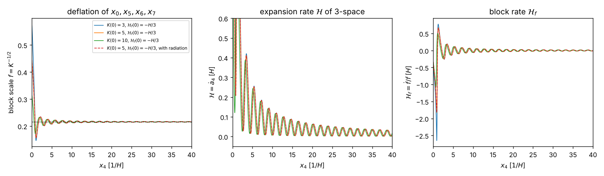
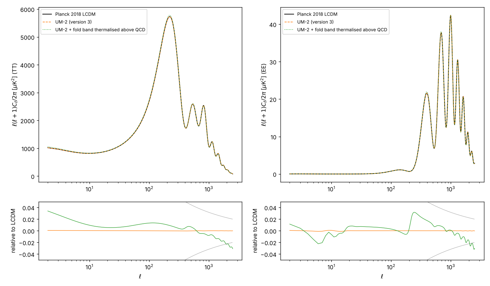
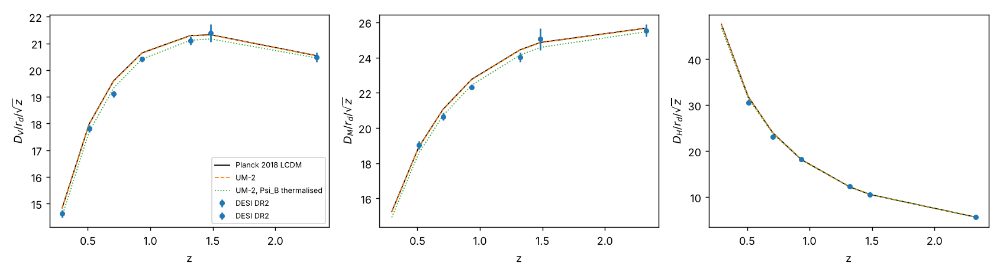

# How to read this document

This document presents the approximate solution of the coupled field equations of UM-2 and the verification of each
step. It is self-contained: every equation it uses is written here. Labels: AUTHOR, RECORD, STANDARD, ASSUMED,
INVENTED, DERIVED (computed and verified; the verification is stated), ESTIMATE, OPEN. Units $\hbar = c = 1$; in the
numerical work $H = 1$ and $m = H$ unless a physical unit is given. The coordinates are the author's
$x_0, x_1, \dots, x_7$ ($x_0$ the hidden space direction, $x_1, x_2, x_3$ space, $x_4$ the time, $x_5, x_6, x_7$ the extra
times); $W^+$ carries the electric charge $+e$ and $W^-$ the charge $-e$.

Symbols with more than one use: $k$ is the block variable $1/f^2$ ($k_*$, $\delta k$, $G(k)$), the Lovelock order as the index of
$\alpha_k$, $E_{(k)}$, $\mathcal L_{(k)}$ (written $p$ where the block variable appears in the same formula), the momentum of a mode
along $x_1, x_2, x_3$ in $h_j$, $\vec k$, $\Delta k$ and $\varepsilon = e^{-a_4}\lvert k\rvert$, and the comoving Fourier wavenumber in the
perturbation equations of step 5. $\Lambda = -10H^2$ is the eight-dimensional cosmological constant and $\Lambda_4$ the
four-dimensional one; in the $x_0$ eigenvalue problems of step 2, $\Lambda = (m\,fL)^2$ is a dimensionless eigenvalue;
$\Lambda_\star$ is the scale of the effective interactions. $n$ is a number density, except as a level number ($n\pi$) and in
the lattice vector $\vec n \in \mathbb Z^3$ of a momentum shell; $N$ is a particle number. The subscript $t$ ($p_t$, $v_t$)
refers to the extra times $x_5, x_6, x_7$; $\xi = y/L$ is the scaled hidden coordinate; primes denote $d/d\xi$ in step 2 and
$d/d\tau$ (conformal time) in step 5. $f$ is the block scale and $f_o$ an occupation number.

# The equations being solved

The action of UM-2 is
$$ S = \frac{1}{2\kappa}\int d^8x\sqrt{\lvert g\rvert}\Big(\sum_{k=1}^3\alpha_k\mathcal L_{(k)} - 2\Lambda\Big) - \int d^8x\sqrt{\lvert g\rvert}\,\rho_b(f) + S_\Psi + S_{gauge} + S_f + S_{tip} + S_{I9} + S_{I11} + S_{I12},$$
with the author's $\alpha_k = w_kH^{2-2k}$, $w = (1, \frac1{32}, \frac1{1152})$, $\Lambda = -10H^2$; the stabiliser
$\kappa\rho_b = \kappa\rho_b^*(f_*/f)^8$; the dirac16complex Lagrangian
$\sqrt{\lvert g\rvert}[\frac12(\bar\Psi\gamma^MD_M\Psi - (D_M\bar\Psi)\gamma^M\Psi) - m\bar\Psi\Psi - \frac{\lambda}{2}(\bar\Psi\Psi)^2]$ with the canonical spin
connection; the eight-dimensional $SU(3)_c\times SU(2)_L\times U(1)_Y$ gauge fields and one generation of fermions; the tip
sigma field $\Sigma \in SU(2)$ (no Higgs particle); and the portals
$$ S_{I9} = \int_{y=-L}d^7x\sqrt{\lvert g_{tip}\rvert}\,(c_Z + c'_Z\varsigma)(i\bar\Psi\gamma^\mu P_+\Psi)\mathcal Z_\mu,\qquad
   S_{I11} = \int d^8x\sqrt{\lvert g\rvert}\,\frac{c_V}{\Lambda_\star^6}(i\bar\Psi\gamma^M\Psi)\sum_\psi q_\psi(i\bar\psi\gamma_M\psi),$$
$$ S_{I12} = -\int d^8x\sqrt{\lvert g\rvert}\,\frac{\bar\Psi\Psi}{\Lambda_\star^3}\big(c_GG^\alpha_{MN}G^{\alpha MN} + c_WW^a_{MN}W^{aMN} + c_BB_{MN}B^{MN}\big),$$
$\mathcal Z_\mu = \frac{iv_\Sigma^2}{2}\mathrm{tr}(\Sigma^\dagger D_\mu\Sigma\tau^3) \to \frac{v_\Sigma^2}{2}\sqrt{\hat g^2 + \hat g'^2}Z_\mu$, $P_+ = (1 + \Gamma_4)/2$. The field equations are
$$ \sum_k\alpha_kE_{(k)}{}^M{}_N + \Lambda\delta^M_N = \kappa T^M{}_N,\qquad
   \gamma^MD_M\Psi = \Big[m + \lambda\bar\Psi\Psi + \frac{\mathcal F}{\Lambda_\star^3}\Big]\Psi - i\frac{c_V}{\Lambda_\star^6}\mathcal J_M\gamma^M\Psi - i\delta_{tip}(c_Z + c'_Z\varsigma)\mathcal Z_\mu\gamma^\mu P_+\Psi ,$$
together with the Yang-Mills equations with fermion, tip and portal currents, the Dirac equations of the fermions with
the tip Yukawa terms, and the boundary conditions at the fold and the tip.

# The approximation scheme

The solution uses the small parameters of the problem:

* $\epsilon \sim 10^{-5}$: the metric is $g = \bar g + \epsilon h^{(1)} + \dots$ (order 0: the background; order 1: the CMB, CNB, BAO);
* $(A/H)^2 \ll 1$ after the primordial era: the matter sources are tiny compared with the stabiliser (today $10^{-92}$),
  so the block responds adiabatically and linearly;
* the Standard-Model masses are far below the gap $3H/(2f)$ of the $x_0$ operators: four-dimensional effective fields;
* dirac16complex is treated by Kohn-Sham density-functional theory on the static block, with the portal couplings as
  external mean fields (the Standard-Model fields enter through their densities and condensates).

The hierarchy: (1) the background and the primordial era; (2) the $x_0$ spectra, i.e. all masses; (3) the Kohn-Sham states
of $\Psi$ coupled to gravity and to the Standard-Model fields, and their back-reaction on the block; (4) the electroweak
sector, $N_{eff}$ and the CNB; (5) the linear cosmology; (6) the dark-matter relic.

# Step 1: the background

## The static block

The order-0 metric is
$$ ds^2 = e^{2a_4}d\vec x^{\,2} - dx_4^2 + f^2\big[dy^2 - e^{2Hy}d\vec x_t^{\,2}\big],\qquad y = \frac{\ln\lvert\sin 6Hx_0\rvert}{6H},\quad f = e^{-a_4}b_4^{1/2},$$
periodic in $x_0$ with period $\pi/(6H)$ (two halves joined at the fold $y = 0$, a regular tip at $y = -L$, $\eta = HL = 3$).
With $k = 1/f^2$, $A = \dot a_4$, $h = \dot f/f$, a static block ($h = 0$, $A = 0$) with the stabiliser
($p_3 = -\rho_b$, $p_0 = p_t = \rho_b$) requires (DERIVED)
$$ \kappa\rho_b = 10H^2 - 6H^2k + \tfrac38H^2k^2 = 3H^2k - 10H^2 \;\Longrightarrow\; k_* = 12 + \tfrac43\sqrt{51} = 21.5219,$$
$$ f_* = 0.215556,\qquad G(k_*) = 1 - 24w_2k_* + 72w_3k_*^2 = \tfrac{20}{3} + \sqrt{51} = 13.8081 > 0,$$
$$ \kappa\rho_b^* = (26 + 4\sqrt{51})H^2 = 54.566H^2 .$$
$G(k_*) > 0$: four-dimensional gravity is attractive with the author's weights and $\Lambda$ unchanged. (Without the
stabiliser the only static block with $A = 0$ is $k_0 = 8$ with $G = -1$, repulsive.) The linearised system has the
eigenvalues $0, \pm i\omega_r$,
$$ \omega_r^2 = \Big(\frac{31552}{2249} - \frac{2416\sqrt{51}}{6747}\Big)H^2,\qquad \omega_r = 3.38705H,$$
so the block is stable; the radion mass is $m_r = 3.387H = 48.38$ TeV. The whole stabiliser family $p_0 = \nu\rho_b$
($\nu = 1/4$ to $3$) gives stable blocks with $\omega_r = 3.33H$ to $4.10H$ (DERIVED).

## The primordial era: the deflating extra times

The full nonlinear equations (all three components, the constraint preserved to $6\times10^{-10}$) were integrated from an
expanding 3-space and a block larger than the stabilised one ($k_0 < k_*$) that deflates at $h_0 = -H/2, -H/3, -H/10$, for
$k_0$ from $1.5$ to $20$ (DERIVED):

| start $k_0$ | $h_0 = -H/10$ | $h_0 = -H/3$ | $h_0 = -H/2$ |
| --- | --- | --- | --- |
| 1.5 | singular at $x_4 = 1.44/H$ | singular at $1.26/H$ | singular at $1.14/H$ |
| 2.3 | singular at $0.33/H$ | singular at $0.31/H$ | no expanding start |
| 2.7 | $k(60/H) = 21.415$ | $21.435$ | $21.451$ |
| 3 | $21.412$ | $21.434$ | $21.455$ |
| 6 | $21.405$ | $21.453$ | $21.500$ |
| 10 | $21.446$ | $21.541$ | $21.584$ |
| 20 | $21.634$ | $21.640$ | $21.638$ |

Every start above the separatrix $k_c = 2.5301, 2.5991, 2.6983$ (for $h_0 = -H/10, -H/3, -H/2$; just above the unstable
static block $k_- = 2.4781$) ends at the stable block: the extra times $x_5, x_6, x_7$ and the hidden direction $x_0$ deflate
at rates up to $\lvert h\rvert = 2.63H$ (in the stored runs $k_0 = 3, 5, 10$), by up to $f(k_c)/f_* = 2.917$, reach $k_*$ within $x_4 < 1/H$, and then oscillate about it
with the radion frequency ($3.3868H$ measured, $3.3870H$ linear), while 3-space keeps expanding; the oscillation energy
redshifts like dust ($A\,x_4 \to 0.667$ to $0.670$; $2/3$ for dust). The extra times therefore deflate exponentially only in a
short primordial era and are then frozen: the masses, all of which depend on $f$, become constant.

## The response of the block to matter, and four-dimensional gravity

To first order about the static block with block-averaged matter sources ($\bar p = (p_0 + 3p_t)/4$; $A^2$ of first order, $3G(k_*)A^2 = \kappa\delta\rho$) (DERIVED):
$$ \delta\ddot k + \omega_r^2\,\delta k = -2k_*\big(s_{h3}\,\kappa\delta p_3 + s_{hp}\,\kappa\delta\bar p + q_h\,\kappa\delta\rho\big),\qquad
   s_{h3} = 0.028666,\quad s_{hp} = 0.037320,\quad q_h = -0.009555;$$
the adiabatic shift is $\delta k = (-0.107556\,\kappa\delta p_3 - 0.140028\,\kappa\delta\bar p + 0.035852\,\kappa\delta\rho)/H^2$, and 3-space obeys
$\delta\dot A = -\kappa(\delta\rho + \delta p_3)/(2G(k_*))$. Together with the constraint $3G(k_*)A^2 = \kappa\rho$ and the dimensional
reduction ($\sum_p\alpha_p\mathcal L_{(p)} - 2\Lambda - 2\kappa\rho_b = G(k)R^{(4)} + \text{topological} - 2G(k)\Lambda_4$, $p$ the Lovelock order), the four-dimensional
gravity of UM-2 is general relativity,
$$ G^{(4)}_{\mu\nu} + \Lambda_4g_{\mu\nu} = 8\pi G_NT^{(4)}_{\mu\nu},\qquad 8\pi G_N = \frac{\kappa}{G(k_*)V_\perp},\qquad V_\perp = \frac{2f_*^4v_t(1 - e^{-3\eta})}{3H},$$
with $\Lambda_4 = [6H^2k(1 - 2w_2k) + \Lambda + \kappa\rho_b]/G(k) = 0$ at the static point; the observed dark energy needs
$\Lambda_4/H^2 \sim (H_0/H)^2 = 1.0\times10^{-92}$ (tuned; OPEN).

# Step 2: the masses from the $x_0$ dependence of the wave functions

Every four-dimensional mass is an eigenvalue of the $x_0$ operator of its field on the static block; the eigenfunctions
depend on $x_0$ through $y(6Hx_0)$ and are periodic with period $\pi/(6H)$ (the author's requirement). With $\xi = y/L$:

## Gauge bosons and the graviton

$$ -e^{-3\eta\xi}\big(e^{3\eta\xi}u'\big)' = \Lambda u,\qquad \Lambda = (m\,fL)^2,\qquad u'(0) = 0 \text{ (even) or } u(0) = 0 \text{ (odd)},\qquad u'(-1) = \beta u(-1),$$
$$ \text{even: } \Big[q^2 + \frac{3\eta}{2}\Big(\beta + \frac{3\eta}{2}\Big)\Big]\sin q - \beta q\cos q = 0,\qquad \text{odd: } q\cos q + \Big(\beta + \frac{3\eta}{2}\Big)\sin q = 0,\qquad q^2 = \Lambda - \frac{9\eta^2}{4}.$$

| mode ($\eta = 3$) | $\Lambda = (m\,fL)^2$ | status |
| --- | --- | --- |
| photon, gluons, graviton ($\beta = 0$, flat profile) | $0$ exactly | DERIVED |
| first even Kaluza-Klein level | $9\eta^2/4 + \pi^2 = 30.1196$ | DERIVED (finite elements $1.9\times10^{-10}$) |
| first odd level | $27.0890$ ($q\cot q = -9/2$) | DERIVED (finite elements $4.5\times10^{-10}$) |
| gap | $9\eta^2/4 = 20.25$ | DERIVED |
| $W^+$, $W^-$ ($\beta_W = 0.011932$) | $1.32374\times10^{-5}$ | DERIVED (fit, finite elements $3\times10^{-14}$) |
| $Z$ ($\beta_Z = \beta_W/\cos^2\theta_W = 0.015364$, on-shell $\cos^2\theta_W = m_W^2/m_Z^2 = 0.77666$) | $1.70374\times10^{-5}$ | DERIVED |
| Dirichlet bound ($\beta \to \infty$) | $0.010016$: $m_W \le 0.01824\,m_{KK}$ | DERIVED |

$\beta_W$ is fixed by the measured $\rho_0 - 1 = 0.00038$: the bending of the tip-localised profiles moves the model's mass
ratio $m_W^2/m_Z^2 = \Lambda_W/\Lambda_Z$ away from the on-shell $\cos^2\theta_W$ of the measured masses, and the electroweak parameter
$\rho = \Lambda_W/(\Lambda_Z\cos^2\theta_W)$ exceeds 1 ($\rho - 1 = 3.2\times10^{-8}$ at $\beta_W = 10^{-6}$: custodial symmetry at leading
order; $6.4\times10^{-5}$ at $\beta_W = 0.002$, $3.2\times10^{-3}$ at $0.1$). With $m_W = 80.3625$ GeV this gives the scales
(DERIVED)

| quantity | value |
| --- | --- |
| Kaluza-Klein mass $m_{KK} = m_W\sqrt{\Lambda_1/\Lambda_W}$ | $121.22$ TeV |
| $H = m_{KK}f_*\eta/\sqrt{\Lambda_1}$ | $14.283$ TeV |
| proper half cell $fL$; period of $x_0$, $\pi/(6H)$ | $8.934\times10^{-21}$ m; $7.234\times10^{-21}$ m |
| gap $3H/(2f_*)$ | $99.40$ TeV |
| radion mass $3.387H$ | $48.38$ TeV |
| model $m_Z = m_W\sqrt{\Lambda_Z/\Lambda_W}$ | $91.171$ GeV (measured $91.188$) |

## Fermions

$$ h_j = j\Big[-\frac{i}{f}\sigma_1\partial_y + \mu\,\sigma_2 + e^{-a_4}k\,\sigma_3\Big],$$
$$ D(e) = e^2s_Ls_R - \kappa_f^2(C_L - c_Ls_L)(C_R + c_Rs_R) = 0,\qquad s = \frac{\sinh w}{w},\quad C = \cosh w,\quad w = \sqrt{c^2 - e^2},$$
with $k$ the momentum of the mode along $x_1$ (not the block variable) and $c = f\mu L$; the first-order solution $e = \kappa_f\zeta(c_L)\zeta(-c_R)$, $\zeta(c)^2 = c\,e^{-c}/\sinh c$ ($c_L > 0$, $c_R < 0$: both
zero modes at the fold), agrees with the exact root to $1.2\times10^{-8}$, and direct shooting of the coupled Dirac system
agrees with the determinant to $3.5\times10^{-10}$. With
$\kappa_f = 1$ and $c_L = -c_R = c$ (DERIVED):

| fermion | mass | $c$ | $\mu/H$ | proper width $fL/(2c)$ | $e = m\,fL$ |
| --- | --- | --- | --- | --- | --- |
| $\nu$ | $0.05$ eV | $18.6709$ | $28.873$ | $2.39\times10^{-22}$ m | $2.264\times10^{-15}$ |
| $e$ | $0.511$ MeV | $10.3038$ | $15.934$ | $4.34\times10^{-22}$ m | $2.313\times10^{-8}$ |
| $u$ | $2.16$ MeV | $9.5448$ | $14.760$ | $4.68\times10^{-22}$ m | $9.779\times10^{-8}$ |
| $d$ | $4.70$ MeV | $9.1341$ | $14.125$ | $4.89\times10^{-22}$ m | $2.128\times10^{-7}$ |

## dirac16complex

With $M = m$, fold condition $\chi_2(0) = 0$ (even) or $\chi_1(0) = 0$ (odd), tip $\chi_2(-L) = 0$ and $c_\psi = f_*mL = 0.646667$, the exact
$k = 0$ spectrum is: the fold zero mode ($\varepsilon = 0$, all eight blocks); even bulk levels $\sqrt{m^2 + (n\pi/(fL))^2}$, the lowest
$4.959981\,m$; odd levels $\sqrt{m^2 + p^2}$ with $\tan(p\,fL) = -p/m$, the lowest $3.102204\,m$ ($p = 2.93661\,m$,
$p\,fL = 1.89901$); and the fold band $\varepsilon = e^{-a_4}\lvert k\rvert$ (massless, $\varepsilon/\lvert k\rvert = 1$ to $6\times10^{-14}$) (DERIVED).

# Step 3: Kohn-Sham states of dirac16complex coupled to all fields

## The Kohn-Sham equations

$$ h_j\chi_o = \varepsilon_o\chi_o,\qquad M_{eff} = m + \frac{15}{16}\lambda S + \frac{\langle\mathcal F\rangle}{\Lambda_\star^3},\qquad
   v = -\frac{\lambda}{16}n + \frac{c_V}{\Lambda_\star^6}\sum_\psi q_\psi n_\psi + v_{I9},$$
$$ n = \sum wgf_on_o,\quad S = \sum wgf_os_o,\quad n_o = P\chi_o^\dagger\chi_o,\quad s_o = P\chi_o^\dagger j\sigma_2\chi_o,\quad t_o = P\chi_o^\dagger j\sigma_3\chi_o,\quad P = \frac{e^{-3Hy}}{\mathrm{Vol}_7},$$
$$ E_{KS} = \sum gf_o\varepsilon_o - 2\mathrm{Vol}_7\int e^{3Hy}e_{int}dy,\qquad e_{int} = \frac{15}{32}\lambda S^2 - \frac{1}{32}\lambda n^2,$$
$$ \rho = \sum wgf_o\varepsilon_on_o - e_{int},\qquad p_3 = \sum wgf_o\tfrac{e^{-a_4}\lvert k\rvert}{3}t_o + e_{int},\qquad p_t = e_{int},$$
$$ p_0 = \sum wgf_o[(\varepsilon_o - v)n_o - M_{eff}s_o - e^{-a_4}\lvert k\rvert t_o] + e_{int},$$
with $w = 1/2$ per fold parity, $g = 4r_3(\lvert\vec n\rvert^2)$ for the momentum shell $\vec k = \Delta k\,\vec n$ ($\vec n \in \mathbb Z^3$, $r_3(\lvert\vec n\rvert^2)$ the
number of representations of $\lvert\vec n\rvert^2$ as a sum of three squares, $\Delta k = 0.25$; here $k$ is the momentum, not the block
variable), occupations $f_o$, and $\mathrm{Vol}_7 = (2\pi/\Delta k)^3v_tf_*^4 = 34.27$ ($v_t = 1$, $a_4 = 0$; the proper seven-volume of a
cell is $2\,\mathrm{Vol}_7(1 - e^{-3\eta})/(3H)$). The orbitals are expanded in the exact free eigenfunctions of each
sector (60, 120, 240 per sector), iterated to self-consistency (tolerance $10^{-13}$, safeguarded Anderson mixing), and
extrapolated in the basis size (Richardson).

## Validation

The independent solver reproduces the record's two reference states (at $f = 1$, $a_4 = 0$): $N = 8$, $\lambda = 157.7$:
$E_{KS} = -0.037786682923$ (reference $-0.037786682923$), HOMO and LUMO to $10^{-14}$, integrated $p_0 = -0.08860537545$ (reference
$-0.08860537548$); $N = 592$, $\lambda = 2.131$: $E_{KS} = 358.30104644787$ (identical), integrated $p_0 = -6.7691415097$ (reference
$-6.7691415108$) (DERIVED).

## Ground states on the stabilised block

Two families of states (the eight $k = 0$ fold zero modes, $N = 8$; a fold-band gas, $N = 592$) with $\lambda = 0$, the benchmark
$\pm\lambda_B$ ($\lambda_B = 7\times10^{-5}H^{-6}$: mean fields below 5 % of $m$) and the record's coupling scaled to the block
(stress test, $\lambda = 157.7f_*^4 = 0.3405$ and $2.131f_*^4 = 0.00460$) (DERIVED; 120 functions per sector, Richardson errors
below $1.5\times10^{-9}$):

| state | $E_{KS}$ | $E_{int}$ | HOMO | LUMO | iterations |
| --- | --- | --- | --- | --- | --- |
| $N = 8$, $\lambda = 0$ | $0$ | $0$ | $0$ | $0.25$ | 1 |
| $N = 8$, $+\lambda_B$ | $-2.053\times10^{-4}$ | $-2.053\times10^{-4}$ | $-5.13\times10^{-5}$ | $0.24995$ | 14 |
| $N = 8$, $-\lambda_B$ | $2.053\times10^{-4}$ | $2.053\times10^{-4}$ | $5.13\times10^{-5}$ | $0.25005$ | 14 |
| $N = 8$, stress | $-0.70123$ | $-0.42170$ | $-0.14037$ | $0.10859$ | 61 |
| $N = 592$, $\lambda = 0$ | $361.11614$ | $0$ | $0.79057$ | $0.82916$ | 1 |
| $N = 592$, $+\lambda_B$ | $359.99060$ | $-1.12646$ | $0.78676$ | $0.82535$ | 14 |
| $N = 592$, $-\lambda_B$ | $362.23906$ | $1.12121$ | $0.79436$ | $0.83295$ | 13 |
| $N = 592$, stress | $307.67139$ | $-32.2217$ | $0.64506$ | $0.68347$ | 56 |

| state | $\int p_3$ | $\int p_t$ | $\int p_0$ | max $\lvert\delta M\rvert$ | max $\lvert v\rvert$ |
| --- | --- | --- | --- | --- | --- |
| $N = 8$, $+\lambda_B$ | $-2.05\times10^{-4}$ | $-2.05\times10^{-4}$ | $-4.447\times10^{-4}$ | $2.4\times10^{-7}$ | $6.7\times10^{-4}$ |
| $N = 8$, $-\lambda_B$ | $2.05\times10^{-4}$ | $2.05\times10^{-4}$ | $4.447\times10^{-4}$ | $2.4\times10^{-7}$ | $6.7\times10^{-4}$ |
| $N = 8$, stress | $-0.4217$ | $-0.4217$ | $-1.30076$ | $1.98$ | $1.83$ |
| $N = 592$, $\lambda = 0$ | $120.372$ | $0$ | $8.6\times10^{-12}$ | $0$ | $0$ |
| $N = 592$, $+\lambda_B$ | $119.245$ | $-1.1265$ | $-2.43688$ | $1.3\times10^{-3}$ | $0.050$ |
| $N = 592$, $-\lambda_B$ | $121.493$ | $1.1212$ | $2.43174$ | $1.3\times10^{-3}$ | $0.050$ |
| $N = 592$, stress | $87.614$ | $-32.222$ | $-97.8188$ | $2.09$ | $1.88$ |

(The integrals are $2\mathrm{Vol}_7\int e^{3Hy}(\cdot)\,dy$; the $N = 8$, $\lambda = 0$ state has all of them zero.)

Checks (DERIVED): $E_{KS} = 2\mathrm{Vol}_7\int e^{3Hy}\rho\,dy$ to $4\times10^{-15}$; the $y$-conservation law
$[e^{3Hy}p_0]_{-L}^0 = 3H\int e^{3Hy}p_tdy$ to $9\times10^{-8}$ (Richardson; the raw residual falls like $n_b^{-3}$); observed basis
orders 4.95 (energy) and 2.97 (hidden pressure); the free gas has $w = \int p_3/\int\rho = 1/3$ exactly (four-dimensional
radiation). The self-interaction shifts the fold-band levels almost rigidly (the spacing between $k = 0$ and the first
shell is $0.25$ free, $0.25000$ at $\lambda_B$, $0.2490$ in the $N = 8$ stress state). A scalar mean field cannot gap the fold
band at $k = 0$: $\chi = (e^{f\int M_{eff}dy}, 0)$ solves $j[-\frac{i}{f}\sigma_1\partial_y + M_{eff}\sigma_2]\chi = 0$ with both boundary conditions
for every $M_{eff}(y)$.

## Dark-matter quanta

Eight quanta in the lowest odd level at $k = 0$ on the $N = 8$ ground state add exactly $8\varepsilon_{DM} = 24.817633063$ (computed
$24.817633063$) at $\lambda = 0$ and $24.81833$ at $+\lambda_B$; they are cold, $w = p_3/\rho = 0$ ($2.8\times10^{-5}$ with $\lambda_B$); their
hidden pressure is $p_0/\rho = 0.772034343$, equal to $-d\ln\varepsilon_{DM}/d\ln f = 0.772034343$ obtained independently from the
$x_0$ eigenvalue (DERIVED): the dark-matter mass is an $x_0$ eigenvalue, and it pushes on the block.

## The Standard-Model fields acting on dirac16complex

The portal mean fields were applied with amplitude $e$ and shapes given by the sources (the electron and up-quark zero-mode
densities times $P$ for I11; a uniform gluon condensate for I12; a tip-localised $Z$ charge on the upper component for I9).
Linear responses of the lowest odd level (DERIVED; equal to the Hellmann-Feynman expectation
$d\varepsilon/de = \langle\chi\vert\partial h/\partial e\vert\chi\rangle$ to $10^{-8}$):

| portal mean field | $d\varepsilon_{odd}/de$ | change of the fold-band gap |
| --- | --- | --- |
| I11, electron density ($v$) | $0.507981$ | $1.2\times10^{-10}$ |
| I11, up-quark density ($v$) | $0.548555$ | $1.6\times10^{-10}$ |
| I12, gluon condensate (uniform $M$) | $0.707196$ | $2.9\times10^{-11}$ |
| I9, tip $Z$ charge (upper component): $\Psi_A$ odd level; $\Psi_B$ (the dark matter) | $0.259489$; exactly $0$ | $7.9\times10^{-11}$ |

The fold band stays massless under every portal. Every orbital has $\chi_2(-L) = 0$, so the scalar density
$\bar\Psi\Psi = 2s_2ab$ vanishes at the tip: no tip operator built on $\bar\Psi\Psi$ reaches dirac16complex, and I9 acts on the upper
component only. For $\Psi_B$ ($B = +1$) the tip projector $P_+ = (1 - B\gamma^{x_0})/2$ annihilates every orbital at the tip, so
the $\Psi_B$ dark matter has no I9 coupling at all (section 7). The I12 response defines the four-dimensional coefficient
of the dark-matter operator: $G_i = \mathcal O\,c_ig_i^2/\Lambda_\star^3$ with $\mathcal O = 0.7072$.

## Back-reaction on the block

The block-averaged hidden pressure $\bar p = (p_0 + 3p_t)/4$ of a Kohn-Sham state displaces the block by
$\delta k = \kappa\bar p/(3H^2 - 4\kappa\rho_b^*/k_*) = -0.140028\,\kappa\bar p/H^2$ (stiffness $-7.1414H^2$), without changing the
four-dimensional cosmological term at linear order ($\frac{d}{dk}[6H^2k(1 - 2w_2k) + \kappa\rho_b] = -6\times10^{-12}$ at $k_*$). Cell
averages (units of the Kohn-Sham calculation, $H = 1$): $\bar p = -1.16\times10^{-5}$ ($N = 8$, $+\lambda_B$), $-0.0636$
($N = 592$, $+\lambda_B$), $\approx 0$ (free gas); the shift is negligible for any realistic density (relative size $(A/H)^2$). The difference $p_0 - p_t$
($-0.0574$ for $N = 592$, $+\lambda_B$) drives a block-shape mode outside the order-0 metric (OPEN).

# Step 4: the electroweak sector, $N_{eff}$ and the CNB

**Charges and couplings** (DERIVED): $Q = T_3 + Y$ gives $(u, d)_L = (2/3, -1/3)$, $(\nu, e)_L = (0, -1)$, $u_R = 2/3$, $d_R = -1/3$,
$e_R = -1$, $\nu_R = 0$; $[T_3, T_\pm] = \pm T_\pm$ with $Y(W) = 0$: **$W^+ = (W^1 - iW^2)/\sqrt2$ carries $+e$, $W^- = (W^1 + iW^2)/\sqrt2$
carries $-e$**, and $W^-$ is the antiparticle of $W^+$; the photon couples with $e = gg'/\sqrt{g^2 + g'^2}$ times $Q$, the $Z$ with
$\sqrt{g^2 + g'^2}(T_3 - Q\sin^2\theta_W)$; the one generation is anomaly free ($SU(3)^2U(1)$, $SU(2)^2U(1)$, $U(1)^3$,
gravitational, $SU(3)^3$ all vanish; four doublets, no Witten anomaly).

**The two halves of dirac16complex.** $B$ commutes with the four-dimensional Lorentz generators and with $C$, so
$\Psi = \Psi_A + \Psi_B$ ($B = -1$, $B = +1$) splits into Lorentz-invariant halves and $\bar\Psi\Psi = \bar\Psi_A\Psi_A + \bar\Psi_B\Psi_B$; the
identity $\Gamma_4 = -B\gamma^{x_0}$ (DERIVED, $16\times16$) gives $P_+ = (1 - B\gamma^{x_0})/2$, which equals $(1 + \gamma^{x_0})/2$ on $\Psi_A$ and
$(1 - \gamma^{x_0})/2$ on $\Psi_B$; the latter annihilates every orbital at the tip. Hence the tip $Z$ charge densities (DERIVED):
$\Psi_A$ fold band $a_0(-L)^2 = 0.163$ per unit length in each of its four blocks, $\Psi_B$ fold band $0$; $\Psi_A$ odd (heavy)
states $0.257$, $\Psi_B$ odd (dark-matter) states $0$, and every transition current $\bar\Psi_A\gamma^\mu P_+\Psi_B$ vanishes at the tip.

**The $Z$ invisible width.** With one neutrino and the two $\Psi_A$ Weyl species of $Z$-coupling $r$ times the neutrino's,
$$ N_\nu = \frac{\Gamma_{inv}}{\Gamma(Z\to\nu\bar\nu)} = 1 + 2r^2 = 2.9840 \pm 0.0082 \;\Longrightarrow\; r^2 = 0.9920 \pm 0.0041,\qquad r = 0.99599 .$$

**$N_{eff}$ and the CNB.** The neutral-current rate scales as $r^2G_F^2T^5$ against $H \propto T^2/M_{Pl}$, so $\Psi_A$ decouples at
$T \approx 2.6\,\text{MeV}\times r^{-2/3} = 2.61$ MeV, after the QCD and pion entropy releases; $T_{\Psi_A} = T_\nu$ for every $r^2 > 2.2\times10^{-3}$,
and
$$ N_{eff} = 3.044,\qquad T_\nu = \Big(\frac{4}{11}\Big)^{1/3}T_\gamma = 1.9454\ \text{K},\qquad n = \frac34\frac{\zeta(3)}{\pi^2}\,2T_\nu^3 = 112.0\ \text{cm}^{-3}\ \text{per Weyl species}.$$
The cosmic neutrino background of UM-2: $\nu_e$ ($0.05$ eV, non-relativistic today) and two massless $\Psi_A$ species, $336$ cm$^{-3}$
in all (DERIVED). The $\Psi_B$ fold band has no tip coupling and no scalar density and, with $c_V = 0$, is never thermalised.

**The $Z$ width of one generation** (tree level, $\Gamma(Z \to f\bar f) = N_cG_Fm_Z^3(g_V^2 + g_A^2)/(6\sqrt2\pi)$, $g_V = T_3 - 2Q\sin^2\theta_W$
with the $\overline{MS}$ value $\sin^2\theta_W = 0.23122$, $g_A = T_3$):

| channel | $\nu_e$ | $e$ | $u$ | $d$ | $\Psi_A$ (2 Weyl) | total | measured |
| --- | --- | --- | --- | --- | --- | --- | --- |
| width (MeV) | $165.9$ | $83.4$ | $285.4$ | $367.9$ | $329.1$ | $1231.7$ | $2495.5$ |

The invisible width is reproduced through the fit of $N_\nu$ (tree level $495$ MeV against the measured $499.0 \pm 1.5$ MeV);
the total is not, because the order restricts the particle content to one
generation (the $\mu$, $\tau$, $s$, $c$, $b$ channels are missing): an inherent conflict of the specified content with data.

# Step 5: the CMB, the CNB and the BAO

The four-dimensional effective theory is general relativity (step 1) with photons, baryons, $\nu_e$, the two $\Psi_A$ species,
the $\Psi_B$ dark matter and $\Lambda_4$. Its linear perturbations obey the standard Einstein-Boltzmann equations (Newtonian
gauge, conformal time, $ds^2 = a^2[-(1 + 2\psi)d\tau^2 + (1 - 2\phi)d\vec x^{\,2}]$):
$$ k^2\phi + 3\mathcal H(\phi' + \mathcal H\psi) = -4\pi G_Na^2\delta\rho,\qquad k^2(\phi' + \mathcal H\psi) = 4\pi G_Na^2(\bar\rho + \bar P)\theta,$$
$$ \phi'' + \mathcal H(\psi' + 2\phi') + (2\mathcal H' + \mathcal H^2)\psi + \frac{k^2}{3}(\phi - \psi) = 4\pi G_Na^2\delta P,\qquad k^2(\phi - \psi) = 12\pi G_Na^2(\bar\rho + \bar P)\sigma,$$
with the cold dark matter $\delta_c' = -\theta_c + 3\phi'$, $\theta_c' = -\mathcal H\theta_c + k^2\psi$, the baryon-photon fluid with Thomson
scattering, the massless hierarchy for $\Psi_A$ and the massive hierarchy for $\nu_e$. They were solved with CAMB 2.0.5 at the
Planck 2018 values $\omega_b = 0.02237$, $\omega_c = 0.1200$, $100\theta_{MC} = 1.04092$, $\tau_{reio} = 0.0544$ (the optical depth to reionisation), $\ln(10^{10}A_s) = 3.044$,
$n_s = 0.9649$ ($\theta$ held fixed, so $H_0$ is an output; $H_0$ in km/s/Mpc). The models are Planck 2018 $\Lambda$CDM (three
neutrinos, $\sum m_\nu = 0.06$ eV), UM-2 ($\nu_e$ of $0.05$ eV and two massless $\Psi_A$ species) and the UM-2 variant with the $\Psi_B$
fold band thermalised above the QCD crossover (DERIVED):

| model | $H_0$ | $\Omega_m$ | $N_{eff}$ | $Y_{He}$ | age (Gyr) | $z_*$ | $r_{drag}$ (Mpc) | BAO $\chi^2$ (13 points) |
| --- | --- | --- | --- | --- | --- | --- | --- | --- |
| $\Lambda$CDM | $67.34$ | $0.3154$ | $3.044$ | $0.24566$ | $13.799$ | $1089.91$ | $147.103$ | $32.55$ |
| UM-2 | $67.43$ | $0.3143$ | $3.044$ | $0.24566$ | $13.793$ | $1089.91$ | $147.105$ | $30.31$ |
| UM-2, $\Psi_B$ hot | $70.62$ | $0.2865$ | $3.318$ | $0.24925$ | $13.515$ | $1090.17$ | $145.750$ | $15.97$ |

The UM-2 TT and EE spectra agree with Planck $\Lambda$CDM to $2.2\times10^{-4}$ and $3.7\times10^{-4}$ ($30 \le \ell \le 2500$), at most
$0.011$ of the cosmic variance $\sqrt{2/(2\ell + 1)}$ of a single multipole: UM-2 reproduces the CMB of $\Lambda$CDM. If the
$\Psi_B$ fold band were thermalised and decoupled just above the QCD crossover, it would add
$\Delta N_{eff} = 2(10.75/g_s)^{4/3} = 0.274$, with $g_s = 47.75$ counting the plasma it leaves (photons, gluons, $u$, $d$, $e$, $\nu_e$
and the two $\Psi_A$ species) and $10.75$ the same count at neutrino decoupling ($0.218$ for decoupling above the electroweak
scale, $g_s = 56.75$). At fixed Planck parameters this variant changes TT by up to $4.2$ % for $30 \le \ell \le 2500$ ($4.9$ % at $\ell = 2$, where the
cosmic variance of one multipole is $63$ %; $2.1$ cosmic-variance units of a single multipole; the full-sky cosmic-variance $\chi^2 = \sum_b(\bar\delta_b/\sigma_b)^2$ over bins $b$ of $\Delta\ell = 50$, with $\bar\delta_b$ the
mean relative deviation and $\sigma_b = \sqrt{2/\sum_{\ell\in b}(2\ell + 1)}$, is $2314$); it is not a fit to the CMB, and a joint CMB and
BAO fit of it is OPEN (it is not excluded by this computation). The CNB enters through $N_{eff} = 3.044$ and the $\nu_e$ mass.

# Step 6: the dark-matter relic and its detection

The lightest odd state of $\Psi_B$ is a Dirac fermion of mass $M_{DM} = 3.102204\,m = 44.31$ TeV ($m = H$), cold, neutral, with no
tree-level $Z$ coupling. Through I12 it annihilates in the p-wave into gauge-boson pairs: for $\mathcal L = G\,\bar\chi\chi F_{\mu\nu}F^{\mu\nu}$
per abelian channel, $\sigma v = G^2s(s - 4M^2)/(4\pi) \to G^2M^4v^2/\pi$, in total $\sigma v = (M^4v^2/\pi)(8G_g^2 + 3G_W^2 + G_B^2)$
(the polarisation sum $\sum\lvert(k_1\cdot k_2)(e_1\cdot e_2) - (k_1\cdot e_2)(k_2\cdot e_1)\rvert^2 = s^2/2$ and the spin trace
$\mathrm{Tr}[(\not p_1 + M)(\not p_2 - M)] = 2(s - 4M^2)$ checked numerically). Freeze-out (Dirac fermion, $g_* = 56.75$:
the gauge bosons without a Higgs, $e$, $\nu_L$, $u$, $d$ and the two $\Psi_A$ species; $\nu_R$ never thermalised):
$$ x_f = \ln\Big[0.038\,c(c+2)\,g\,M_{Pl}M\langle\sigma v\rangle/\sqrt{g_*x_f}\Big] = 30.31,\qquad \Omega h^2 = \frac{2\times1.07\times10^9\,\text{GeV}^{-1}\,x_f}{\sqrt{g_*}\,M_{Pl}\,3b/x_f} = 0.120$$
($\langle\sigma v\rangle = 6b/x$, $c = 1/2$, $g = 2$, $M_{Pl} = G_N^{-1/2} = 1.22\times10^{19}$ GeV, standard radiation-dominated freeze-out) requires
$\langle\sigma v\rangle(x_f) = 1.37\times10^{-25}$ cm$^3$/s, below the s-wave thermal unitarity estimate $(4\pi/M^2)\sqrt{x_f/\pi} = 2.3\times10^{-25}$ cm$^3$/s
(an estimate made for an s-wave process, applied here to a p-wave one), i.e.
$$ (8G_g^2 + 3G_W^2 + G_B^2)^{1/2} = (16.6\ \text{TeV})^{-3},\qquad G_i = \mathcal O\,c_ig_i^2/\Lambda_\star^3,\quad \mathcal O = 0.7072 .$$
Direct detection (ESTIMATE): even if the whole annihilation went into gluons, the trace anomaly
($\langle N\vert G^\alpha G^\alpha\vert N\rangle = -\frac{8\pi}{9\alpha_s}m_Nf_{TG}$) gives $\sigma_{SI} = \mu^2f_N^2/\pi = 4.3\times10^{-53}$ cm$^2$, eight
orders below the LZ limit extrapolated to $44$ TeV ($2.4\times10^{-45}$ cm$^2$); the electroweak channels have no tree-level
nucleon coupling. The relic value is conditional: if the radion oscillation left over from the deflation (which redshifts
like dust) dominated the Universe until it decayed, it would dilute the dark matter after freeze-out (the moduli problem,
below).

# Accuracy of the solution

* Exact (symbolic): the background equations, the static block, $G(k_*)$, the radion frequency, the first-order block
  response, the dimensional reduction, the field reductions and the zero modes.
* Numerical, with measured errors: boson levels (mpmath, 30 digits; finite elements $\le 5\times10^{-10}$); fermion masses
  (exact roots; first order $1.2\times10^{-8}$; shooting $3.5\times10^{-10}$); Kohn-Sham energies (Richardson errors below
  $1.5\times10^{-9}$ relative; conservation $9\times10^{-8}$); primordial integrations (constraint below $6\times10^{-10}$);
  CMB (CAMB default accuracy, lensing included).
* Approximations: the static block with an assumed stabiliser; the good sector (no extra-time momenta); the Kohn-Sham
  mean-field treatment (local exchange of the contact interaction); portal couplings as external mean fields; tree level
  for the electroweak widths; the freeze-out formula; order $\epsilon$ for the cosmology. A fresh-clone rerun reproduced
  every stored number to $10^{-9}$ relative.

# What the solution does not reproduce, and what is open

* **Conflicts with data, inherent in the order**: no Higgs boson (one is observed at 125 GeV), and without it the
  longitudinal $W^+W^-$ scattering violates perturbative unitarity near $\sqrt{8\pi}\,v \approx 1.2$ TeV, far below the
  Kaluza-Klein modes; the total $Z$ width of one generation, $1.23$ GeV against $2.4955$ GeV.
* **Open**: the origin of the stabiliser; the extra-time modes outside the good sector (tachyonic for momentum $q > fM$);
  the closed time-like curves implied by compact extra times; the radion left over from the deflation (ESTIMATE: a
  Planck-suppressed decay $\Gamma = C_r\,m_r^3/(4\pi\bar M_{Pl}^2)$, with the reduced Planck mass $\bar M_{Pl} = 2.435\times10^{18}$ GeV and an
  order-one coupling factor $C_r$, gives the lifetime $0.43\,\text{s}/C_r$ and the reheating temperature
  $T_{RH} = (90/(\pi^2g_*))^{1/4}\sqrt{\Gamma\bar M_{Pl}} = 1.85\sqrt{C_r}$ MeV, $g_* = 10.75$, below the 4.7 MeV that nucleosynthesis needs
  unless $C_r > 6.5$: a moduli problem); the block-shape mode driven by $p_0 - p_t$; the
  tuning of $\Lambda_4$ ($10^{-92}H^2$); the Kaluza-Klein graviton spectrum with the Lovelock corrections; the
  electroweak $S$ parameter of the Higgsless tip; anomalies of the eight-dimensional bulk theory; the joint fit of the
  thermalised-$\Psi_B$ variant.
