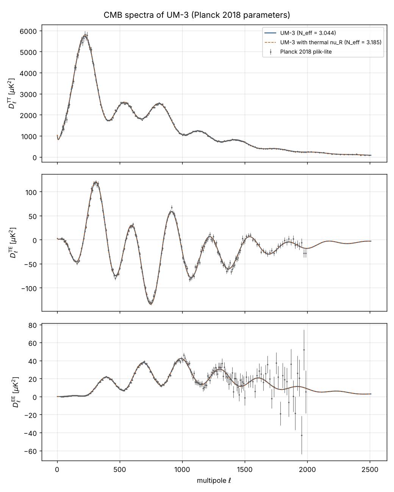

# The fold: definition and examples

<!-- begin fold definition -->
**Definition.** The *fold* is the seven-dimensional surface of the author's eight-dimensional spacetime on which the
cosine of the angle $z = 6Hx_0$ of the hidden direction vanishes:

$$
\mathcal{F} = \big\{X = (x_0, x_1, \dots, x_7):\ \cos(6Hx_0) = 0\big\},\qquad
\text{in one period } 0 < z < \pi\text{ of the metric: } z = \frac{\pi}{2},\quad x_0 = \frac{\pi}{12H} \tag{FD-1}
$$
<!-- symbols: foldF, Xcoord, x0, x1, x7, Hconst, zvar, pi -->
<!-- begin generated symbol list -->
**Symbols in (FD-1).**

- $\mathcal{F}$: The fold: the seven-dimensional surface $\cos(6Hx_0) = 0$ of the eight-dimensional spacetime (FD-1), in one period $0 < z < \pi$ the surface $z = \pi/2$, $x_0 = \pi/(12H)$, where $\sigma = 0$; $\vert_{\mathcal{F}}$ means restricted to the fold. Status: DERIVED.
- $X = \{x_0, \dots, x_7\}$: The author's coordinates of the eight-dimensional spacetime, $X = \{x_0, x_1, \dots, x_7\}$ with the hidden direction first (Dirac_Einstein-Lovelock_4+4_Nash.nb, section DEFCHART); $X^M$ is the coordinate with the index $M$ and $\mathrm{d}^8X = \mathrm{d}x_0\,\mathrm{d}x_1\cdots\mathrm{d}x_7$ the coordinate volume element. Unit: length (each coordinate). Status: AUTHOR.
- $x_0$: The hidden space-like coordinate (listed first); the metric depends on it through $z = 6Hx_0$, periodically with the period $\pi/(6H)$. Unit: length. Status: AUTHOR.
- $x_1$: The first coordinate of ordinary 3-space. Unit: length. Status: AUTHOR.
- $x_7$: The third of the three extra time-like coordinates. Unit: length. Status: AUTHOR.
- $H$: The author's constant (an inverse length) that fixes the period $\pi/(6H)$ of $x_0$, the Lovelock couplings $\alpha_{(p)} = w_{(p)}H^{2-2p}$ and the cosmological constant $\Lambda = -7H^2$ (the author's original value $-10H^2$ was corrected on 2026-10-25); in UM-3 a free parameter. Unit: GeV (1/length). Status: AUTHOR.
- $z$: The angle variable of the hidden direction, $z = 6Hx_0$; one period of $x_0$ is $0 < z < \pi$, the fold is $z = \pi/2$. Unit: dimensionless. Status: AUTHOR.
- $\pi$: The number pi, the ratio of the circumference of a circle to its diameter. Unit: dimensionless. Value: 3.141592654. Status: STANDARD.

<!-- end generated symbol list -->

$X = \{x_0, \dots, x_7\}$ are the author's coordinates: $x_0$ the hidden space-like direction, $x_1, x_2, x_3$ ordinary space,
$x_4$ the time, $x_5, x_6, x_7$ the three extra times; $H$ is the author's constant (an inverse length). The author's metric
depends on $x_0$ only through $\cot^2z$ and $(\sin^2z)^{1/6}$, so it repeats with the period $\pi/(6H)$ of $x_0$, and every
period $0 < z < \pi$ contains exactly one surface of $\mathcal{F}$, at $z = \pi/2$: $\mathcal{F}$ is the union of these copies,
one per period (example 2), and "the fold" without a qualifier is the copy in the period that contains our world. A point of
the fold is labelled by the seven coordinates $x_1, \dots, x_7$, and the metric restricted to the fold ($\mathrm{d}x_0 = 0$,
$z = \pi/2$) is

$$
g_{MN}\,\mathrm{d}X^M\mathrm{d}X^N\big\vert_{\mathcal{F}} = \mathrm{e}^{2a_4}\big(\mathrm{d}x_1^2 + \mathrm{d}x_2^2 + \mathrm{d}x_3^2\big)
 - \mathrm{d}x_4^2 - \mathrm{e}^{-2a_4}b_4^2\big(\mathrm{d}x_5^2 + \mathrm{d}x_6^2 + \mathrm{d}x_7^2\big) \tag{FD-2}
$$
<!-- symbols: metric, iM, iN, diff, Xcoord, foldF, euler, a4, b4, x1, x2, x3, x4, x5, x6, x7 -->
<!-- begin generated symbol list -->
**Symbols in (FD-2).**

- $g_{MN}$: The metric tensor of the eight-dimensional spacetime (signature $+,+,+,+,-,-,-,-$ in the order $x_0, \dots, x_7$): $g_{MN}\,\mathrm{d}X^M\mathrm{d}X^N$ is the squared interval, $g^{MN}$ its inverse, $\lvert g\rvert$ the absolute value of its determinant ($\sqrt{\lvert g\rvert}\,\mathrm{d}^8X$ is the proper volume element). Unit: dimensionless. Status: AUTHOR.
- $M$: A coordinate index of eight dimensions (also with a numbered copy $M_1, M_2, \dots$): it runs over $x_0, x_1, \dots, x_7$; a repeated index is summed. Status: STANDARD.
- $N$: A coordinate index of eight dimensions (also $N_1, N_2, \dots$), running over $x_0, \dots, x_7$; a repeated index is summed. Status: STANDARD.
- $\mathrm{d}$: The differential: $\mathrm{d}X$ is an infinitesimal change of $X$, $\mathrm{d}X/\mathrm{d}Y$ the derivative of $X$ with respect to $Y$, $\mathrm{d}^nX$ the volume element of $n$ variables. Status: STANDARD.
- $X = \{x_0, \dots, x_7\}$: The author's coordinates of the eight-dimensional spacetime, $X = \{x_0, x_1, \dots, x_7\}$ with the hidden direction first (Dirac_Einstein-Lovelock_4+4_Nash.nb, section DEFCHART); $X^M$ is the coordinate with the index $M$ and $\mathrm{d}^8X = \mathrm{d}x_0\,\mathrm{d}x_1\cdots\mathrm{d}x_7$ the coordinate volume element. Unit: length (each coordinate). Status: AUTHOR.
- $\mathcal{F}$: The fold: the seven-dimensional surface $\cos(6Hx_0) = 0$ of the eight-dimensional spacetime (FD-1), in one period $0 < z < \pi$ the surface $z = \pi/2$, $x_0 = \pi/(12H)$, where $\sigma = 0$; $\vert_{\mathcal{F}}$ means restricted to the fold. Status: DERIVED.
- $\mathrm{e}$: Euler's number, the base of the natural logarithm; $\mathrm{e}^{X}$ is the exponential of $X$. Unit: dimensionless. Value: 2.718281828. Status: STANDARD.
- $a_4$: The author's metric function of the time $x_4$ that scales ordinary 3-space: on the fold $\mathrm{e}^{a_4}$ is the scale factor of cosmology and $a_4'$ the Hubble rate. Unit: dimensionless. Status: AUTHOR.
- $b_4$: The author's metric function of the time $x_4$ in the extra-time components, $b_4 > 0$, never identically 1 (the author's order of 2026-10-24); the scale factor (the factor of the lengths) of the extra times is $\mathrm{e}^{-a_4}b_4$ on the fold and $\mathrm{e}^{-a_4}b_4\,\mathrm{e}^{-H\lvert\sigma\rvert}$ at the distance $\sigma$ from it (the square root of the warp factor times $\mathrm{e}^{-a_4}b_4$). Unit: dimensionless. Status: AUTHOR.
- $x_1$: The first coordinate of ordinary 3-space. Unit: length. Status: AUTHOR.
- $x_2$: The second coordinate of ordinary 3-space. Unit: length. Status: AUTHOR.
- $x_3$: The third coordinate of ordinary 3-space. Unit: length. Status: AUTHOR.
- $x_4$: The time; a prime on a function of $x_4$ alone is $\mathrm{d}/\mathrm{d}x_4$. Unit: length (= time, $c = 1$). Status: AUTHOR.
- $x_5$: The first of the three extra time-like coordinates. Unit: length. Status: AUTHOR.
- $x_6$: The second of the three extra time-like coordinates. Unit: length. Status: AUTHOR.
- $x_7$: The third of the three extra time-like coordinates. Unit: length. Status: AUTHOR.

<!-- end generated symbol list -->

with three space-like and four time-like directions; $a_4$ and $b_4$ are the author's two functions of the time $x_4$.
Notation: $\ln$ is the natural logarithm, $\mathrm{e}$ Euler's number, $\exp(y) = \mathrm{e}^y$, $\sin$, $\cos$ and
$\cot = \cos/\sin$ the trigonometric functions, $\tanh$ the hyperbolic tangent, $\lvert y\rvert$ the absolute value;
$f(0^+)$ and $f(0^-)$ are the limits of $f(\sigma)$ as $\sigma$ approaches 0 from above and from below.

**Why this surface is called a fold.** Measured by the proper distance along the hidden direction,

$$
\sigma = \mathrm{sgn}\Big(\frac{\pi}{2} - z\Big)\frac{\ln\sin z}{6H},\qquad \mathrm{d}\sigma = \lvert\cot z\rvert\,\mathrm{d}x_0,\qquad
\sin z = \mathrm{e}^{-6H\lvert\sigma\rvert} \tag{FD-3}
$$
<!-- symbols: sigma, sgn, pi, zvar, Hconst, diff, x0, euler -->
<!-- begin generated symbol list -->
**Symbols in (FD-3).**

- $\sigma$: The proper coordinate of the hidden direction: $\mathrm{d}\sigma = \lvert\cot z\rvert\,\mathrm{d}x_0$, $\sigma = \mathrm{sgn}(\pi/2 - z)\ln(\sin z)/(6H)$ on one period $0 < z < \pi$; $\sigma = 0$ is the fold $z = \pi/2$, $\sigma \to \mp\infty$ the tips $z \to 0, \pi$; one period of $x_0$ is the whole line $-\infty < \sigma < \infty$. Unit: length. Status: DERIVED.
- $\mathrm{sgn}$: The sign function: $\mathrm{sgn}(y) = +1$ for $y > 0$, $-1$ for $y < 0$. Status: STANDARD.
- $\pi$: The number pi, the ratio of the circumference of a circle to its diameter. Unit: dimensionless. Value: 3.141592654. Status: STANDARD.
- $z$: The angle variable of the hidden direction, $z = 6Hx_0$; one period of $x_0$ is $0 < z < \pi$, the fold is $z = \pi/2$. Unit: dimensionless. Status: AUTHOR.
- $H$: The author's constant (an inverse length) that fixes the period $\pi/(6H)$ of $x_0$, the Lovelock couplings $\alpha_{(p)} = w_{(p)}H^{2-2p}$ and the cosmological constant $\Lambda = -7H^2$ (the author's original value $-10H^2$ was corrected on 2026-10-25); in UM-3 a free parameter. Unit: GeV (1/length). Status: AUTHOR.
- $\mathrm{d}$: The differential: $\mathrm{d}X$ is an infinitesimal change of $X$, $\mathrm{d}X/\mathrm{d}Y$ the derivative of $X$ with respect to $Y$, $\mathrm{d}^nX$ the volume element of $n$ variables. Status: STANDARD.
- $x_0$: The hidden space-like coordinate (listed first); the metric depends on it through $z = 6Hx_0$, periodically with the period $\pi/(6H)$. Unit: length. Status: AUTHOR.
- $\mathrm{e}$: Euler's number, the base of the natural logarithm; $\mathrm{e}^{X}$ is the exponential of $X$. Unit: dimensionless. Value: 2.718281828. Status: STANDARD.

<!-- end generated symbol list -->

(the fold is $\sigma = 0$; the half-period $0 < z < \pi/2$ is $\sigma < 0$, the half-period $\pi/2 < z < \pi$ is $\sigma > 0$; the
two ends of the period, the tips $z \to 0$ and $z \to \pi$, lie at $\sigma \to -\infty$ and $\sigma \to +\infty$), the author's metric is

$$
g_{MN}\,\mathrm{d}X^M\mathrm{d}X^N = \mathrm{d}\sigma^2 + \mathrm{e}^{-2H\lvert\sigma\rvert}\Big[\mathrm{e}^{2a_4}\big(\mathrm{d}x_1^2
 + \mathrm{d}x_2^2 + \mathrm{d}x_3^2\big) - \mathrm{e}^{-2a_4}b_4^2\big(\mathrm{d}x_5^2 + \mathrm{d}x_6^2 + \mathrm{d}x_7^2\big)\Big]
 - \mathrm{d}x_4^2 \tag{FD-4}
$$
<!-- symbols: metric, iM, iN, diff, Xcoord, sigma, euler, Hconst, a4, b4, x1, x2, x3, x4, x5, x6, x7 -->
<!-- begin generated symbol list -->
**Symbols in (FD-4).**

- $g_{MN}$: The metric tensor of the eight-dimensional spacetime (signature $+,+,+,+,-,-,-,-$ in the order $x_0, \dots, x_7$): $g_{MN}\,\mathrm{d}X^M\mathrm{d}X^N$ is the squared interval, $g^{MN}$ its inverse, $\lvert g\rvert$ the absolute value of its determinant ($\sqrt{\lvert g\rvert}\,\mathrm{d}^8X$ is the proper volume element). Unit: dimensionless. Status: AUTHOR.
- $M$: A coordinate index of eight dimensions (also with a numbered copy $M_1, M_2, \dots$): it runs over $x_0, x_1, \dots, x_7$; a repeated index is summed. Status: STANDARD.
- $N$: A coordinate index of eight dimensions (also $N_1, N_2, \dots$), running over $x_0, \dots, x_7$; a repeated index is summed. Status: STANDARD.
- $\mathrm{d}$: The differential: $\mathrm{d}X$ is an infinitesimal change of $X$, $\mathrm{d}X/\mathrm{d}Y$ the derivative of $X$ with respect to $Y$, $\mathrm{d}^nX$ the volume element of $n$ variables. Status: STANDARD.
- $X = \{x_0, \dots, x_7\}$: The author's coordinates of the eight-dimensional spacetime, $X = \{x_0, x_1, \dots, x_7\}$ with the hidden direction first (Dirac_Einstein-Lovelock_4+4_Nash.nb, section DEFCHART); $X^M$ is the coordinate with the index $M$ and $\mathrm{d}^8X = \mathrm{d}x_0\,\mathrm{d}x_1\cdots\mathrm{d}x_7$ the coordinate volume element. Unit: length (each coordinate). Status: AUTHOR.
- $\sigma$: The proper coordinate of the hidden direction: $\mathrm{d}\sigma = \lvert\cot z\rvert\,\mathrm{d}x_0$, $\sigma = \mathrm{sgn}(\pi/2 - z)\ln(\sin z)/(6H)$ on one period $0 < z < \pi$; $\sigma = 0$ is the fold $z = \pi/2$, $\sigma \to \mp\infty$ the tips $z \to 0, \pi$; one period of $x_0$ is the whole line $-\infty < \sigma < \infty$. Unit: length. Status: DERIVED.
- $\mathrm{e}$: Euler's number, the base of the natural logarithm; $\mathrm{e}^{X}$ is the exponential of $X$. Unit: dimensionless. Value: 2.718281828. Status: STANDARD.
- $H$: The author's constant (an inverse length) that fixes the period $\pi/(6H)$ of $x_0$, the Lovelock couplings $\alpha_{(p)} = w_{(p)}H^{2-2p}$ and the cosmological constant $\Lambda = -7H^2$ (the author's original value $-10H^2$ was corrected on 2026-10-25); in UM-3 a free parameter. Unit: GeV (1/length). Status: AUTHOR.
- $a_4$: The author's metric function of the time $x_4$ that scales ordinary 3-space: on the fold $\mathrm{e}^{a_4}$ is the scale factor of cosmology and $a_4'$ the Hubble rate. Unit: dimensionless. Status: AUTHOR.
- $b_4$: The author's metric function of the time $x_4$ in the extra-time components, $b_4 > 0$, never identically 1 (the author's order of 2026-10-24); the scale factor (the factor of the lengths) of the extra times is $\mathrm{e}^{-a_4}b_4$ on the fold and $\mathrm{e}^{-a_4}b_4\,\mathrm{e}^{-H\lvert\sigma\rvert}$ at the distance $\sigma$ from it (the square root of the warp factor times $\mathrm{e}^{-a_4}b_4$). Unit: dimensionless. Status: AUTHOR.
- $x_1$: The first coordinate of ordinary 3-space. Unit: length. Status: AUTHOR.
- $x_2$: The second coordinate of ordinary 3-space. Unit: length. Status: AUTHOR.
- $x_3$: The third coordinate of ordinary 3-space. Unit: length. Status: AUTHOR.
- $x_4$: The time; a prime on a function of $x_4$ alone is $\mathrm{d}/\mathrm{d}x_4$. Unit: length (= time, $c = 1$). Status: AUTHOR.
- $x_5$: The first of the three extra time-like coordinates. Unit: length. Status: AUTHOR.
- $x_6$: The second of the three extra time-like coordinates. Unit: length. Status: AUTHOR.
- $x_7$: The third of the three extra time-like coordinates. Unit: length. Status: AUTHOR.

<!-- end generated symbol list -->

It depends on $\sigma$ only through $\lvert\sigma\rvert$. The function $\mathcal{W}(\sigma) = \mathrm{e}^{-2H\lvert\sigma\rvert}$,
which multiplies the squared steps of ordinary space and of the extra times, is the warp factor of the metric (its square
root $\mathrm{e}^{-H\lvert\sigma\rvert}$ multiplies the lengths); the time $x_4$ is not warped. Four properties make the surface
$\sigma = 0$ a fold, and together they single it out within the period:

1. *It is a mirror.* The reflection $\sigma \to -\sigma$ (that is $z \to \pi - z$, or $x_0 \to \pi/(6H) - x_0$) maps the metric
   to itself, and the fold is the only surface of the period that the reflection leaves in place: the two halves of the
   period are mirror images of each other, joined along the fold, as the two halves of a folded sheet of paper are joined
   along the crease.
2. *The warp factor is largest on it.* The warp factor $(\sin^2z)^{1/6} = \mathrm{e}^{-2H\lvert\sigma\rvert}$ equals 1 on the
   fold and decreases on both sides.
3. *The metric has a kink on it.* The metric is continuous across the fold, but its first derivative along $\sigma$ jumps.
   The extrinsic curvature of the surfaces $\sigma = \text{const}$ changes sign across the fold,

$$
K^a{}_b = \frac12\,g^{ac}\,\partial_\sigma g_{cb}:\qquad
K^{1}{}_{1} = K^{2}{}_{2} = K^{3}{}_{3} = K^{5}{}_{5} = K^{6}{}_{6} = K^{7}{}_{7} = -H\,\mathrm{sgn}(\sigma),\qquad K^{4}{}_{4} = 0 \tag{FD-5}
$$
<!-- symbols: Kextr, ia, ib, ic, metric, partial, isigma, sigma, Hconst, sgn -->
<!-- begin generated symbol list -->
**Symbols in (FD-5).**

- $K^a{}_b$: The extrinsic curvature of a surface $\sigma = \mathrm{const}$ of the hidden direction, $K^a{}_b = \frac12 g^{ac}\partial_\sigma g_{cb}$ for $a, b$ along the surface (FD-5): $-H\,\mathrm{sgn}(\sigma)$ along ordinary space and the extra times, 0 along the time. Unit: GeV (1/length). Status: DERIVED.
- $a$: A frame (orthonormal) index running over $0, 1, \dots, 7$ (frame direction $(0)$ along $\sigma$, $(1), (2), (3)$ along ordinary space, $(4)$ along the time, $(5), (6), (7)$ along the extra times); raised and lowered with the frame metric $\eta_{ab} = \mathrm{diag}(1, 1, 1, 1, -1, -1, -1, -1)$; on the fold ($a, b \in \{1, \dots, 7\}$) the frame of the fold; a repeated index is summed. Status: STANDARD.
- $b$: A frame index (as $a$). Status: STANDARD.
- $c$: A frame index (as $a$). Status: STANDARD.
- $g_{MN}$: The metric tensor of the eight-dimensional spacetime (signature $+,+,+,+,-,-,-,-$ in the order $x_0, \dots, x_7$): $g_{MN}\,\mathrm{d}X^M\mathrm{d}X^N$ is the squared interval, $g^{MN}$ its inverse, $\lvert g\rvert$ the absolute value of its determinant ($\sqrt{\lvert g\rvert}\,\mathrm{d}^8X$ is the proper volume element). Unit: dimensionless. Status: AUTHOR.
- $\partial$: A partial derivative: $\partial_M$ with respect to the coordinate $X^M$, $\partial_\mu$ with respect to $x^\mu$, $\partial_\sigma$ with respect to $\sigma$, $\partial X/\partial Y$ the derivative of $X$ with respect to $Y$ at fixed other variables. Status: STANDARD.
- $\sigma$: The label $\sigma$ in $\partial_\sigma$: the derivative with respect to the proper hidden coordinate $\sigma$. Status: STANDARD.
- $\sigma$: The proper coordinate of the hidden direction: $\mathrm{d}\sigma = \lvert\cot z\rvert\,\mathrm{d}x_0$, $\sigma = \mathrm{sgn}(\pi/2 - z)\ln(\sin z)/(6H)$ on one period $0 < z < \pi$; $\sigma = 0$ is the fold $z = \pi/2$, $\sigma \to \mp\infty$ the tips $z \to 0, \pi$; one period of $x_0$ is the whole line $-\infty < \sigma < \infty$. Unit: length. Status: DERIVED.
- $H$: The author's constant (an inverse length) that fixes the period $\pi/(6H)$ of $x_0$, the Lovelock couplings $\alpha_{(p)} = w_{(p)}H^{2-2p}$ and the cosmological constant $\Lambda = -7H^2$ (the author's original value $-10H^2$ was corrected on 2026-10-25); in UM-3 a free parameter. Unit: GeV (1/length). Status: AUTHOR.
- $\mathrm{sgn}$: The sign function: $\mathrm{sgn}(y) = +1$ for $y > 0$, $-1$ for $y < 0$. Status: STANDARD.

<!-- end generated symbol list -->

   ($a, b$ frame indices along the fold); it jumps by $-2H$ along ordinary space and along the extra times. The
   Einstein-Lovelock equations of UM-3, $\sum_p\alpha_{(p)}\mathcal{E}_{(p)}{}^a{}_b + \Lambda\delta^a{}_b = \kappa\mathcal{T}^a{}_b$
   ($\mathcal{E}_{(p)}$ the Lovelock tensor of order $p = 1, 2, 3$, $\alpha_{(p)} = w_{(p)}H^{2-2p}$ its coupling with the weights
   $w = (1, 1/20, 1/360)$, $\Lambda = -7H^2$ the cosmological constant, $\kappa = 8\pi G_8$ the gravitational coupling of eight
   dimensions, $\mathcal{T}^a{}_b$ the energy-momentum tensor, $\delta^a{}_b$ the Kronecker delta), are linear in the second
   $\sigma$-derivatives of the metric, so the jump puts a Dirac delta function $\delta_{\mathrm{D}}(\sigma)$ into them: the
   metric solves them only if the fold carries a thin source $\mathcal{S}^a{}_b$, an energy-momentum tensor concentrated on
   $\sigma = 0$, given by the integral of the equations across the fold (the junction conditions),

$$
\kappa\,\mathcal{S}^a{}_b = \int_{0^-}^{0^+}\mathrm{d}\sigma\,\sum_{p=1}^{3}\alpha_{(p)}\,\mathcal{E}_{(p)}{}^a{}_b \tag{FD-11}
$$
<!-- symbols: kappa, Sfoldsrc, ia, ib, diff, sigma, ip, alphaL, LovE -->
<!-- begin generated symbol list -->
**Symbols in (FD-11).**

- $\kappa$: The eight-dimensional gravitational coupling, $\kappa = 8\pi G_8$. Unit: GeV$^{-6}$. Status: AUTHOR.
- $\mathcal{S}^a{}_b$: The thin source of the fold: the energy-momentum tensor concentrated on the fold, integrated across it, $\kappa\mathcal{S}^a{}_b = \int_{0^-}^{0^+}\mathrm{d}\sigma\sum_p\alpha_{(p)}\mathcal{E}_{(p)}{}^a{}_b$ (FD-11, the junction conditions); $\mathcal{S}^4{}_4$ is minus its energy density, $\mathcal{S}^1{}_1$ and $\mathcal{S}^5{}_5$ its pressures along ordinary space and along the extra times (frame components along the fold, eight-dimensional normalisation: an energy per unit volume of the six other directions of the fold). Unit: GeV$^7$. Value: $\kappa\mathcal{S}^a{}_b = -\frac{32}{5}H\delta^a{}_b$ at the static block. Status: DERIVED.
- $a$: A frame (orthonormal) index running over $0, 1, \dots, 7$ (frame direction $(0)$ along $\sigma$, $(1), (2), (3)$ along ordinary space, $(4)$ along the time, $(5), (6), (7)$ along the extra times); raised and lowered with the frame metric $\eta_{ab} = \mathrm{diag}(1, 1, 1, 1, -1, -1, -1, -1)$; on the fold ($a, b \in \{1, \dots, 7\}$) the frame of the fold; a repeated index is summed. Status: STANDARD.
- $b$: A frame index (as $a$). Status: STANDARD.
- $\mathrm{d}$: The differential: $\mathrm{d}X$ is an infinitesimal change of $X$, $\mathrm{d}X/\mathrm{d}Y$ the derivative of $X$ with respect to $Y$, $\mathrm{d}^nX$ the volume element of $n$ variables. Status: STANDARD.
- $\sigma$: The proper coordinate of the hidden direction: $\mathrm{d}\sigma = \lvert\cot z\rvert\,\mathrm{d}x_0$, $\sigma = \mathrm{sgn}(\pi/2 - z)\ln(\sin z)/(6H)$ on one period $0 < z < \pi$; $\sigma = 0$ is the fold $z = \pi/2$, $\sigma \to \mp\infty$ the tips $z \to 0, \pi$; one period of $x_0$ is the whole line $-\infty < \sigma < \infty$. Unit: length. Status: DERIVED.
- $p$: The Lovelock order $p = 1, 2, 3$ (Einstein, Gauss-Bonnet, cubic), as an index and as a number; in the Kohn-Sham equations a second label of a Kohn-Sham orbital (as $o$, with $\delta_{op}$ the Kronecker delta of the two labels). Status: STANDARD.
- $\alpha_{(p)}$: The Lovelock coupling of order $p$, $\alpha_{(p)} = w_{(p)}H^{2-2p}$ ($\alpha_{(1)} = 1$). Unit: GeV$^{2-2p}$. Status: AUTHOR.
- $\mathcal{E}_{(p)}{}^M{}_N$: The Lovelock tensor of order $p$: the variation of $\sqrt{\lvert g\rvert}\,\mathcal{L}_{(p)}$ with respect to the metric ($\mathcal{E}_{(1)}$ the Einstein tensor, $\mathcal{E}_{(2)}$ the Gauss-Bonnet tensor); with frame indices its frame components. Unit: 1/length$^{2p}$. Status: STANDARD.

<!-- end generated symbol list -->

   with $\mathcal{S}^4{}_4 = -(\text{its energy density})$, $\mathcal{S}^1{}_1 = \mathcal{S}^2{}_2 = \mathcal{S}^3{}_3$ its pressure
   along ordinary space and $\mathcal{S}^5{}_5 = \mathcal{S}^6{}_6 = \mathcal{S}^7{}_7$ its pressure along the extra times;
   $\mathcal{S}$ is $\mathcal{T}$ integrated across the fold, an energy per unit volume of the six other directions of the fold
   (unit GeV$^7$). On the static block ($a_4$ and $b_4$ constant) and on an expanding fold whose extra times are frozen
   ($b_4$ proportional to $\mathrm{e}^{a_4}$; $\mathsf{A} = a_4'/H$, $\mathsf{A}_1 = a_4''/H^2$)

$$
\begin{aligned}
&\text{static block:}\quad \kappa\mathcal{S}^a{}_b = -\frac{32}{5}H\,\delta^a{}_b\quad\text{(a pure tension)},\\
&\text{frozen extra times:}\quad \kappa\mathcal{S}^1{}_1 = -\frac{16}{15}\big(6 + 3\mathsf{A}^2 + 2\mathsf{A}_1\big)H,\quad
 \kappa\mathcal{S}^4{}_4 = -\frac{16}{5}\big(2 + \mathsf{A}^2\big)H,\\
&\qquad\qquad \kappa\mathcal{S}^5{}_5 = -\frac45\big(8 + 8\mathsf{A}^2 + \mathsf{A}^4 + 4\mathsf{A}_1 + \mathsf{A}^2\mathsf{A}_1\big)H
\end{aligned} \tag{FD-12}
$$
<!-- symbols: kappa, Sfoldsrc, ia, ib, Hconst, delta, Asf, A1sf -->
<!-- begin generated symbol list -->
**Symbols in (FD-12).**

- $\kappa$: The eight-dimensional gravitational coupling, $\kappa = 8\pi G_8$. Unit: GeV$^{-6}$. Status: AUTHOR.
- $\mathcal{S}^a{}_b$: The thin source of the fold: the energy-momentum tensor concentrated on the fold, integrated across it, $\kappa\mathcal{S}^a{}_b = \int_{0^-}^{0^+}\mathrm{d}\sigma\sum_p\alpha_{(p)}\mathcal{E}_{(p)}{}^a{}_b$ (FD-11, the junction conditions); $\mathcal{S}^4{}_4$ is minus its energy density, $\mathcal{S}^1{}_1$ and $\mathcal{S}^5{}_5$ its pressures along ordinary space and along the extra times (frame components along the fold, eight-dimensional normalisation: an energy per unit volume of the six other directions of the fold). Unit: GeV$^7$. Value: $\kappa\mathcal{S}^a{}_b = -\frac{32}{5}H\delta^a{}_b$ at the static block. Status: DERIVED.
- $a$: A frame (orthonormal) index running over $0, 1, \dots, 7$ (frame direction $(0)$ along $\sigma$, $(1), (2), (3)$ along ordinary space, $(4)$ along the time, $(5), (6), (7)$ along the extra times); raised and lowered with the frame metric $\eta_{ab} = \mathrm{diag}(1, 1, 1, 1, -1, -1, -1, -1)$; on the fold ($a, b \in \{1, \dots, 7\}$) the frame of the fold; a repeated index is summed. Status: STANDARD.
- $b$: A frame index (as $a$). Status: STANDARD.
- $H$: The author's constant (an inverse length) that fixes the period $\pi/(6H)$ of $x_0$, the Lovelock couplings $\alpha_{(p)} = w_{(p)}H^{2-2p}$ and the cosmological constant $\Lambda = -7H^2$ (the author's original value $-10H^2$ was corrected on 2026-10-25); in UM-3 a free parameter. Unit: GeV (1/length). Status: AUTHOR.
- $\delta$: The Kronecker delta: with two indices $\delta^M_N = 1$ if $M = N$ and 0 otherwise (likewise $\delta_{X\mathrm{L}}$ is 1 if the label $X$ of a half of dirac16complex is L and 0 otherwise); with upper and lower index strings the generalised Kronecker delta $\delta^{M_1\cdots M_n}_{N_1\cdots N_n}$, the determinant of the $n \times n$ matrix of the Kronecker deltas $\delta^{M_a}_{N_b}$ ($+1$ or $-1$ if the upper indices are an even or odd permutation of the lower ones, 0 otherwise). Status: STANDARD.
- $\mathsf{A}$: The expansion rate of ordinary space in units of $H$, $\mathsf{A} = a_4'/H$. Unit: dimensionless. Value: 0 at the static block; $H_4^{(0)}/H$ today ($H_4^{(0)}$ the Hubble constant); 1 at the author's vacuum, which is not a solution with the corrected weights.
- $\mathsf{A}_1$: The time derivative of $\mathsf{A}$ in units of $H$, $\mathsf{A}_1 = \mathsf{A}'/H = a_4''/H^2$. Unit: dimensionless.

<!-- end generated symbol list -->

   the tension plus matter that obeys the Friedmann equations of general relativity. The fold is therefore not only a place
   but a physical object: a thin layer that carries energy and momentum (a brane).
4. *The author's coordinate $x_0$ degenerates on it.* The metric component $g_{x_0x_0} = \cot^2(6Hx_0)$ vanishes on the fold
   and nowhere else in the period; near the fold the proper distance grows with the square of the coordinate distance,

$$
\lvert\sigma\rvert = 3H\Big(x_0 - \frac{\pi}{12H}\Big)^2\Big[1 + 6H^2\Big(x_0 - \frac{\pi}{12H}\Big)^2 + \dots\Big] \tag{FD-6}
$$
<!-- symbols: sigma, Hconst, x0, pi -->
<!-- begin generated symbol list -->
**Symbols in (FD-6).**

- $\sigma$: The proper coordinate of the hidden direction: $\mathrm{d}\sigma = \lvert\cot z\rvert\,\mathrm{d}x_0$, $\sigma = \mathrm{sgn}(\pi/2 - z)\ln(\sin z)/(6H)$ on one period $0 < z < \pi$; $\sigma = 0$ is the fold $z = \pi/2$, $\sigma \to \mp\infty$ the tips $z \to 0, \pi$; one period of $x_0$ is the whole line $-\infty < \sigma < \infty$. Unit: length. Status: DERIVED.
- $H$: The author's constant (an inverse length) that fixes the period $\pi/(6H)$ of $x_0$, the Lovelock couplings $\alpha_{(p)} = w_{(p)}H^{2-2p}$ and the cosmological constant $\Lambda = -7H^2$ (the author's original value $-10H^2$ was corrected on 2026-10-25); in UM-3 a free parameter. Unit: GeV (1/length). Status: AUTHOR.
- $x_0$: The hidden space-like coordinate (listed first); the metric depends on it through $z = 6Hx_0$, periodically with the period $\pi/(6H)$. Unit: length. Status: AUTHOR.
- $\pi$: The number pi, the ratio of the circumference of a circle to its diameter. Unit: dimensionless. Value: 3.141592654. Status: STANDARD.

<!-- end generated symbol list -->

   so the two coordinate values on either side of $x_0 = \pi/(12H)$ at the same coordinate distance lie at the same proper
   distance from the fold: the coordinate line of $x_0$ is folded onto the line of proper distances (a fold map, example 5).

**What lives on the fold.** In UM-3 the Standard Model (the Higgs doublet with the author's ad hoc vacuum, a time-dependent
choice of its vacuum value; the gauge fields of $SU(3)_C \times SU(2)_L \times U(1)_Y$; three generations of quarks and
leptons and three right-handed neutrinos) and the fold fluid (its tension and the pressure along the extra times that keeps
their volume fixed) live on the fold: they are fields at $\sigma = 0$, functions of $x_1, \dots, x_4$ (no field depends on
the extra times). Integrated over the extra times, the fold is the four-dimensional universe that we observe, with the
metric $\mathrm{diag}(\mathrm{e}^{2a_4}, \mathrm{e}^{2a_4}, \mathrm{e}^{2a_4}, -1)$ in $x_1, \dots, x_4$. dirac16complex (the
author's spinor field of eight dimensions) and gravity live in the bulk $\sigma \ne 0$ as well as on the fold; the bound
states $\chi$ of dirac16complex are the part of it that the fold holds, and the portals (couplings between dirac16complex and
Standard-Model fields) act at $\sigma = 0$. In UM-3 files "the fold" means this surface; the examples below use the word
for other surfaces with the same properties. The word is not used in its other senses: a set of equal energy levels is
called degenerate, and a growth by the factor $\mathrm{e}$ is called an e-folding.

**Examples of folds that are meaningful for UM-3.**

1. *Our fold.* The fold $z = \pi/2$ of the period that contains our world (FD-1): the seven-dimensional world-volume of the
   Standard Model, and after the integration over the extra times the four-dimensional universe that we observe.
2. *The copies of the fold.* Because the metric repeats with the period $\pi/(6H)$, every surface
   $x_0 = \pi/(12H) + (\text{an integer multiple of } \pi/(6H))$ is a copy of the fold, one per period. Neighbouring copies are
   separated by a tip ($z$ a multiple of $\pi$), where the warp factor $(\sin^2z)^{1/6}$ vanishes and $g_{x_0x_0} = \cot^2z$
   diverges, and which lies at an infinite proper distance from both: in proper distance every copy has its own complete
   line $-\infty < \sigma < \infty$. A compact direction of length $L$ would give every field a tower of particles with the
   masses $2\pi n/L$, $n = 1, 2, \dots$ (a Kaluza-Klein tower); because the copies are infinitely far apart, the period
   $\pi/(6H)$ of $x_0$ produces no such tower with the spacing $12H$, and the $x_0$ mass of the bound states is their binding
   to the fold.
3. *A folded sheet of paper.* The crease of a folded sheet is a fold in this sense: the two halves are mirror images
   (property 1) joined along the crease, the sheet is continuous there and its direction changes abruptly (property 3).
   In UM-3 the direction across the crease is the hidden direction $\sigma$, the seven directions along the crease are
   $x_1, \dots, x_7$, and the crease is the fold.
4. *A folded function.* The warp factor $\mathrm{e}^{-2H\lvert\sigma\rvert}$ is the simplest folded function: continuous,
   mirror symmetric, largest at $\sigma = 0$, with a jump of its derivative,

$$
\frac{\mathrm{d}}{\mathrm{d}\sigma}\mathrm{e}^{-2H\lvert\sigma\rvert} = -2H\,\mathrm{sgn}(\sigma)\,\mathrm{e}^{-2H\lvert\sigma\rvert},\qquad
\frac{\mathrm{d}^2}{\mathrm{d}\sigma^2}\mathrm{e}^{-2H\lvert\sigma\rvert} = 4H^2\,\mathrm{e}^{-2H\lvert\sigma\rvert} - 4H\,\delta_{\mathrm{D}}(\sigma) \tag{FD-7}
$$
<!-- symbols: diff, sigma, euler, Hconst, sgn, deltaD -->
<!-- begin generated symbol list -->
**Symbols in (FD-7).**

- $\mathrm{d}$: The differential: $\mathrm{d}X$ is an infinitesimal change of $X$, $\mathrm{d}X/\mathrm{d}Y$ the derivative of $X$ with respect to $Y$, $\mathrm{d}^nX$ the volume element of $n$ variables. Status: STANDARD.
- $\sigma$: The proper coordinate of the hidden direction: $\mathrm{d}\sigma = \lvert\cot z\rvert\,\mathrm{d}x_0$, $\sigma = \mathrm{sgn}(\pi/2 - z)\ln(\sin z)/(6H)$ on one period $0 < z < \pi$; $\sigma = 0$ is the fold $z = \pi/2$, $\sigma \to \mp\infty$ the tips $z \to 0, \pi$; one period of $x_0$ is the whole line $-\infty < \sigma < \infty$. Unit: length. Status: DERIVED.
- $\mathrm{e}$: Euler's number, the base of the natural logarithm; $\mathrm{e}^{X}$ is the exponential of $X$. Unit: dimensionless. Value: 2.718281828. Status: STANDARD.
- $H$: The author's constant (an inverse length) that fixes the period $\pi/(6H)$ of $x_0$, the Lovelock couplings $\alpha_{(p)} = w_{(p)}H^{2-2p}$ and the cosmological constant $\Lambda = -7H^2$ (the author's original value $-10H^2$ was corrected on 2026-10-25); in UM-3 a free parameter. Unit: GeV (1/length). Status: AUTHOR.
- $\mathrm{sgn}$: The sign function: $\mathrm{sgn}(y) = +1$ for $y > 0$, $-1$ for $y < 0$. Status: STANDARD.
- $\delta_{\mathrm{D}}$: The Dirac delta function: $\int\mathrm{d}\sigma\,\delta_{\mathrm{D}}(\sigma)F(\sigma) = F(0)$. Unit: 1/length (for $\delta_{\mathrm{D}}(\sigma)$). Status: STANDARD.

<!-- end generated symbol list -->

   whose delta function is the origin of the thin source of property 3. Every metric function of FD-4 depends on $\sigma$
   through $\lvert\sigma\rvert$ and is folded at $\sigma = 0$ in this sense.
5. *A fold map.* In the mathematics of smooth maps the fold (Whitney's fold singularity) is the map $u \mapsto u^2$ of a line
   onto a half-line: it folds the line at $u = 0$, two points $\pm u$ land on the same point, and the derivative of the map
   vanishes on the fold. Near the fold the map from the author's coordinate $x_0$ to the distance $\lvert\sigma\rvert$ from the
   fold is of this kind (FD-6), and $g_{x_0x_0} = \cot^2z$, the square of the derivative $\mathrm{d}\sigma/\mathrm{d}x_0$,
   vanishes there.
6. *The brane of Randall and Sundrum.* The five-dimensional metric

$$
\mathrm{d}y_{\mathrm{RS}}^2 + \mathrm{e}^{-2k_{\mathrm{RS}}\lvert y_{\mathrm{RS}}\rvert}\big(\mathrm{d}x_1^2 + \mathrm{d}x_2^2 + \mathrm{d}x_3^2
 - \mathrm{d}x_4^2\big),\qquad \lambda_{\mathrm{RS}} = \frac{6k_{\mathrm{RS}}}{\kappa_5},\qquad \Lambda_{\mathrm{RS}} = -\frac{6k_{\mathrm{RS}}^2}{\kappa_5} \tag{FD-8}
$$
<!-- symbols: diff, yRS, euler, kRS, x1, x2, x3, x4, lambdaRS, kappa5, LambdaRS -->
<!-- begin generated symbol list -->
**Symbols in (FD-8).**

- $\mathrm{d}$: The differential: $\mathrm{d}X$ is an infinitesimal change of $X$, $\mathrm{d}X/\mathrm{d}Y$ the derivative of $X$ with respect to $Y$, $\mathrm{d}^nX$ the volume element of $n$ variables. Status: STANDARD.
- $y_{\mathrm{RS}}$: The proper coordinate across the brane of the five-dimensional model of Randall and Sundrum (FD-8, an example, not UM-3). Unit: length. Status: STANDARD.
- $\mathrm{e}$: Euler's number, the base of the natural logarithm; $\mathrm{e}^{X}$ is the exponential of $X$. Unit: dimensionless. Value: 2.718281828. Status: STANDARD.
- $k_{\mathrm{RS}}$: The inverse curvature length of the bulk of the model of Randall and Sundrum: the warp factor of the brane is $\mathrm{e}^{-2k_{\mathrm{RS}}\lvert y_{\mathrm{RS}}\rvert}$ (FD-8, an example, not UM-3). Unit: GeV (1/length). Status: STANDARD.
- $x_1$: The first coordinate of ordinary 3-space. Unit: length. Status: AUTHOR.
- $x_2$: The second coordinate of ordinary 3-space. Unit: length. Status: AUTHOR.
- $x_3$: The third coordinate of ordinary 3-space. Unit: length. Status: AUTHOR.
- $x_4$: The time; a prime on a function of $x_4$ alone is $\mathrm{d}/\mathrm{d}x_4$. Unit: length (= time, $c = 1$). Status: AUTHOR.
- $\lambda_{\mathrm{RS}}$: The tension (energy per unit volume of ordinary space) of the brane of the model of Randall and Sundrum, $\lambda_{\mathrm{RS}} = 6k_{\mathrm{RS}}/\kappa_5$ (FD-8, an example, not UM-3). Unit: GeV$^4$. Status: STANDARD.
- $\kappa_5$: The gravitational coupling of five dimensions in the model of Randall and Sundrum, $\kappa_5 = 8\pi G_5$ (FD-8, an example, not UM-3). Unit: GeV$^{-3}$. Status: STANDARD.
- $\Lambda_{\mathrm{RS}}$: The vacuum energy density of the bulk of the model of Randall and Sundrum, $\Lambda_{\mathrm{RS}} = -6k_{\mathrm{RS}}^2/\kappa_5$ (FD-8, an example, not UM-3). Unit: GeV$^5$. Status: STANDARD.

<!-- end generated symbol list -->

   has a fold at $y_{\mathrm{RS}} = 0$ with the properties 1 to 3 (its coordinate $y_{\mathrm{RS}}$ is already the proper
   distance, so property 4 does not arise); Einstein's equations require there a brane of the tension $\lambda_{\mathrm{RS}}$
   (Israel's junction condition) and in the bulk the vacuum energy $\Lambda_{\mathrm{RS}}$, and the bulk is otherwise empty. The
   fold of UM-3 is of the same kind: its static block is a vacuum of the bulk with a fold of pure tension (FD-12). It differs
   in that the time $x_4$ is not warped, three extra times are warped together with ordinary space, the Lovelock terms add to
   the junction conditions, and the space is not cut at the brane: Randall and Sundrum identify the two sides of their brane
   (one physical side), while the fold of UM-3 has two distinct sides (example 7).
7. *A particle bound to a thin layer.* A particle held by an attractive thin layer has a wave function that falls off
   exponentially with the distance on both sides, and the layer makes its derivative jump (for the first-order Dirac
   equation, the wave function itself). In UM-3 the particles $\chi$ of dark matter are the states of dirac16complex bound to
   the fold; at rest and without their self-interaction (the field is
   $\Psi = \mathrm{e}^{3H\lvert\sigma\rvert}\chi(\sigma)\mathrm{e}^{-\mathrm{i}\omega_{\mathrm{b}}x_4}$)

$$
\begin{aligned}
&\chi(\sigma) = \mathrm{e}^{-q_{\mathrm{b}}\lvert\sigma\rvert}\chi(0^+)\ \ (\sigma > 0),\qquad
\chi(\sigma) = \mathrm{e}^{-q_{\mathrm{b}}\lvert\sigma\rvert}\chi(0^-)\ \ (\sigma < 0),\\
&\chi(0^+) = \exp\Big(\gamma^{(0)}\big(\mu_{\mathrm{L}}P_{\mathrm{L}} + \mu_{\mathrm{R}}P_{\mathrm{R}}\big)\Big)\chi(0^-),\qquad
\omega_{\mathrm{b}} = \sqrt{m_\Psi^2 - q_{\mathrm{b}}^2}
\end{aligned} \tag{FD-9}
$$
<!-- symbols: chiprof, sigma, euler, qb, gammaM, muX, PL, PR, Gamma8, identity, omegab, mPsi -->
<!-- begin generated symbol list -->
**Symbols in (FD-9).**

- $\chi(\sigma)$: The profile of a mode of dirac16complex along the hidden direction, $\Psi = \mathrm{e}^{3H\lvert\sigma\rvert}\chi(\sigma)\mathrm{e}^{\mathrm{i}(\vec k\cdot\vec x - \omega x_4)}$ (a 16-component spinor function of $\sigma$); as a four-dimensional field, $\chi$ denotes the particle of a bound state. Unit: GeV$^{2}$ (with the $V_*$ normalisation). Status: DERIVED.
- $\sigma$: The proper coordinate of the hidden direction: $\mathrm{d}\sigma = \lvert\cot z\rvert\,\mathrm{d}x_0$, $\sigma = \mathrm{sgn}(\pi/2 - z)\ln(\sin z)/(6H)$ on one period $0 < z < \pi$; $\sigma = 0$ is the fold $z = \pi/2$, $\sigma \to \mp\infty$ the tips $z \to 0, \pi$; one period of $x_0$ is the whole line $-\infty < \sigma < \infty$. Unit: length. Status: DERIVED.
- $\mathrm{e}$: Euler's number, the base of the natural logarithm; $\mathrm{e}^{X}$ is the exponential of $X$. Unit: dimensionless. Value: 2.718281828. Status: STANDARD.
- $q_{\mathrm{b}}$: The inverse width of a state of dirac16complex bound to the fold: its profile falls as $\mathrm{e}^{-q_{\mathrm{b}}\lvert\sigma\rvert}$. Unit: GeV. Status: DERIVED.
- $\gamma^M,\ \gamma^{(a)}$: The Dirac matrices of dirac16complex along the coordinates, $\gamma^M = \mathbf{e}_a{}^MT^a$, $\gamma_M = g_{MN}\gamma^N$; $\gamma^{(a)} = T^a$ along the frame direction $(a)$ ($\gamma^{(0)}$ along $\sigma$, $\gamma^{(4)}$ along the time). Unit: dimensionless. Status: AUTHOR.
- $\mu_X,\ \mu_{\mathrm{L}},\ \mu_{\mathrm{R}}$: The dimensionless strengths of the fold for the left-handed and right-handed halves of dirac16complex, set by the mean fields of the Standard Model at the fold: the jump of the profile across the fold is the exponential of $\gamma^{(0)}(\mu_{\mathrm{L}}P_{\mathrm{L}} + \mu_{\mathrm{R}}P_{\mathrm{R}})$; negative values attract. Unit: dimensionless. Status: DERIVED.
- $P_{\mathrm{L}}$: The author's left-handed chiral projector, $P_{\mathrm{L}} = (\mathbf{1} - \Gamma_8)/2$. Unit: dimensionless. Status: AUTHOR.
- $P_{\mathrm{R}}$: The author's right-handed chiral projector, $P_{\mathrm{R}} = (\mathbf{1} + \Gamma_8)/2$. Unit: dimensionless. Status: AUTHOR.
- $\Gamma_8$: The chirality matrix of eight dimensions, $\Gamma_8 = T_0T_1\cdots T_7$ (the author's T16^A[8]) $= \mathrm{diag}(-\mathbf{1}_8, \mathbf{1}_8)$; $\Gamma_8^2 = \mathbf{1}$; it anticommutes with every $T_a$. Unit: dimensionless. Status: AUTHOR.
- $\mathbf{1},\ \mathbf{1}_8$: The identity matrix of the size fixed by the context ($16 \times 16$ on dirac16complex, $4 \times 4$ on a four-dimensional spinor, $3 \times 3$ in generation or flavour space); $\mathbf{1}_8$ is the $8 \times 8$ identity matrix. Unit: dimensionless. Status: STANDARD.
- $\omega_{\mathrm{b}}$: The energy of a state of dirac16complex bound to the fold at zero momentum: the four-dimensional mass of the particle $\chi$. Unit: GeV. Status: DERIVED.
- $m_\Psi$: The mass parameter of dirac16complex in the bulk. Unit: GeV. Status: RECORD.

<!-- end generated symbol list -->

   where $\mu_{\mathrm{L}}$, $\mu_{\mathrm{R}}$ are the strengths of the fold for the left- and right-handed halves of
   dirac16complex (set by the Standard-Model fields on the fold) and $q_{\mathrm{b}} = -m_\Psi(\mu_{\mathrm{L}} + \mu_{\mathrm{R}})\tanh\varsigma/(2\varsigma)$,
   $\varsigma = \sqrt{\mu_{\mathrm{L}}\mu_{\mathrm{R}}}$ ($q_{\mathrm{b}} = -m_\Psi\mu_{\mathrm{L}}/2$ for $\mu_{\mathrm{R}} = 0$). The profile
   is not a function of $\lvert\sigma\rvert$: it jumps at the fold, $\chi(0^+) \ne \chi(0^-)$.
8. *The fold as a mirror for dirac16complex.* The reflection across the fold acts on the profiles $\chi(\sigma)$ in two ways,

$$
(\mathsf{R}_1\chi)(\sigma) = T_0T_1T_2T_3\,\chi(-\sigma),\qquad (\mathsf{R}_2\chi)(\sigma) = T_0T_5T_6T_7\,\chi(-\sigma) \tag{FD-10}
$$
<!-- symbols: R1refl, R2refl, chiprof, sigma, Tmat -->
<!-- begin generated symbol list -->
**Symbols in (FD-10).**

- $\mathsf{R}_1$: The reflection across the fold acting on a profile of dirac16complex together with the reflection of ordinary space, $(\mathsf{R}_1\chi)(\sigma) = T_0T_1T_2T_3\,\chi(-\sigma)$ (FD-10): a symmetry of dirac16complex, of gravity and of the mean field of the gas of the particles $\chi$; the bound states of Krein charge $-1$ are even, those of Krein charge $+1$ odd. Unit: dimensionless. Status: DERIVED.
- $\mathsf{R}_2$: The reflection across the fold acting on a profile of dirac16complex together with the reflection of the extra times, $(\mathsf{R}_2\chi)(\sigma) = T_0T_5T_6T_7\,\chi(-\sigma)$ (FD-10): it maps the bound states of one Krein charge onto those of the other. Unit: dimensionless. Status: DERIVED.
- $\chi(\sigma)$: The profile of a mode of dirac16complex along the hidden direction, $\Psi = \mathrm{e}^{3H\lvert\sigma\rvert}\chi(\sigma)\mathrm{e}^{\mathrm{i}(\vec k\cdot\vec x - \omega x_4)}$ (a 16-component spinor function of $\sigma$); as a four-dimensional field, $\chi$ denotes the particle of a bound state. Unit: GeV$^{2}$ (with the $V_*$ normalisation). Status: DERIVED.
- $\sigma$: The proper coordinate of the hidden direction: $\mathrm{d}\sigma = \lvert\cot z\rvert\,\mathrm{d}x_0$, $\sigma = \mathrm{sgn}(\pi/2 - z)\ln(\sin z)/(6H)$ on one period $0 < z < \pi$; $\sigma = 0$ is the fold $z = \pi/2$, $\sigma \to \mp\infty$ the tips $z \to 0, \pi$; one period of $x_0$ is the whole line $-\infty < \sigma < \infty$. Unit: length. Status: DERIVED.
- $T_a,\ T^a$: The author's eight real $16 \times 16$ Dirac matrices T16^A[a] of 4+4.nb ($a = 0, \dots, 7$; $T_0, \dots, T_7$), with $\{T_a, T_b\} = 2\eta_{ab}\mathbf{1}$; $T^a = \eta^{ab}T_b$. Unit: dimensionless. Status: AUTHOR.

<!-- end generated symbol list -->

   ($T_a$ the author's Dirac matrices; for states at rest $\mathsf{R}_1$ is the reflection across the fold combined with the
   reflection of ordinary space, $\mathsf{R}_2$ the reflection across the fold combined with the reflection of the extra
   times). The Krein charge of a state is its share of the conserved charge of dirac16complex, which is indefinite: a
   state can carry the charge $-1$ or $+1$. $\mathsf{R}_1$ is a symmetry of dirac16complex, of gravity and of the mean
   field of a gas of the particles $\chi$ (the average field that the particles of the gas create and feel): the four bound
   states of Krein charge $-1$ (the particles $\chi$) are even under it and the four of Krein charge $+1$ are odd, so the
   mean field of the gas cannot mix the two signs of the indefinite charge. $\mathsf{R}_2$ maps the bound states of one
   Krein charge onto those of the other and makes the two sets degenerate without the self-interaction.
9. *The planes of Horava and Witten.* In M-theory (the eleven-dimensional theory whose limits include the superstring
   theories) on an interval (a circle whose points are identified with their mirror images), the two ten-dimensional planes
   left in place by the reflection are mirror surfaces (property 1); each carries one $E_8$ gauge group while gravity fills
   the bulk. As in UM-3, the gauge fields live on the mirror surface and gravity in the bulk; unlike UM-3, the two sides of
   each plane are identified (one physical side).

**What is not a fold.**

* *The tips* $z = 0$ and $z = \pi$ (mod $\pi$): the mirror exchanges them within a period, but there the warp factor vanishes,
  $g_{x_0x_0}$ diverges, and they lie at an infinite proper distance; they carry no thin source.
* *A smooth maximum of a warp factor*, such as $1/\cosh^2(H\sigma)$: mirror symmetric and largest at $\sigma = 0$, but without a
  kink and without a thin source.
<!-- end fold definition -->

# How to read this document

## What this document contains

This document solves, approximately and step by step, the coupled field equations of the universe model UM-3: Einstein-Lovelock
gravity in eight dimensions with the author's metric, the author's field dirac16complex (a 16-component complex spinor field
in the bulk), and the Standard Model with three right-handed neutrinos on the fold of the author's metric. It is
self-contained: every equation that is solved is written out here (with the tag it carries in every UM-3 document), every
new equation of the solution carries a tag S-1, S-2, ..., and every symbol of every display equation is defined right after
it. The sections are:

* **The Lovelock weights and the cosmological constant**: why UM-3 uses the weights $1, 1/20, 1/360$ and $\Lambda = -7H^2$ (the
  only weights for which gravitons travel at the speed of light, at the author's order of 2026-10-25), and the record of the
  author's original values and of the stabiliser that they required.
* **The background** (order 0 of the power series of the metric): the two branches on which the bulk is a vacuum, the static block,
  the frozen extra times on which the fold obeys the Friedmann equations of general relativity exactly, and the primordial era.
* **The power series of the metric**: the degenerate static block and its strongly coupled perturbations, the fold as a
  seven-dimensional Einstein brane, and the volume of the extra times, which must be held fixed.
* **The sources of the fold**: the gravitational waves of the fold, which travel at the speed of light at every wavelength, the
  gravity that the fields of the fold may induce in addition, and the fold fluid (a tension and the pressure that holds the volume of
  the extra times).
* **The Higgs field in the ad hoc vacuum**: the author's ad hoc vacuum written as a gauge rotation, the field of $W^2$ that the
  Gauss law requires, and the one residual that remains.
* **The spectra along the hidden direction**: the zero modes and the speeds of the bulk fields, the continuum and the bound
  states of dirac16complex (the $x_0$ mass), the speed of the bound particles $\chi$ and the shortcut through the bulk.
* **The Kohn-Sham states of dirac16complex**: the self-consistent states of a gas of the bound particles $\chi$ with the
  self-interaction, gravity and the mean fields of the Standard Model, in three regimes, with their residuals, and the stability
  of the gas against the partner states of the other Krein charge.
* **The residuals of every field equation**: how well the approximate solution satisfies each equation.
* **The three neutrino flavours**: the Sun, the envelope of a supernova, the fast instability and the flavour equipartition, and
  what the newer global fit, the Dirac phase and the lightest mass change.
* **The thermal history**: the degrees of freedom, the relic density of $\chi$, its portals to the Standard Model, the
  right-handed neutrinos and the ad hoc vacuum before nucleosynthesis.
* **The CMB, the CNB and the BAO** (the cosmic microwave background, the cosmic neutrino background and the baryon acoustic
  oscillations): the cosmological perturbations of the metric of the fold, against the measurements of Planck, of DESI DR2 (the
  second data release of the Dark Energy Spectroscopic Instrument) and of ACT DR6 (the sixth data release of the Atacama
  Cosmology Telescope).
* **What the solution does not settle**, and **what was verified**.

## The status labels

Every equation and every result carries one of the labels

* **AUTHOR**: from the author (his notebooks `4+4.nb` and `Dirac_Einstein-Lovelock_4+4_Nash.nb`, and his orders of 2026-10-24
  and 2026-10-25: the coordinates, the metric, the Einstein-Lovelock action, the Dirac matrices, the chiral projectors, the list
  of fields, the Higgs potential and the ad hoc vacuum; the values of the Lovelock weights and of the cosmological constant are the
  corrected ones that his order of 2026-10-25 requires, DERIVED);
* **RECORD**: from the record of this repository (the Lagrangian of dirac16complex with its canonical spin connection and its
  contact self-interaction, the Kohn-Sham treatment);
* **STANDARD**: textbook physics, or a published measurement (the source is named);
* **ASSUMED**: a choice made in UM-3 without derivation;
* **INVENTED**: a new interaction of UM-3 (the portals of dirac16complex);
* **DERIVED**: computed and verified in UM-3 (the verification is stated);
* **ESTIMATE**: an order-of-magnitude evaluation;
* **OPEN**: not settled.

## Every equation is followed by its symbols

Every display equation is followed by the list "Symbols in (S-n)" or "Symbols in (FE-n)" of EVERY symbol that appears in it:
every quantity, field, coupling, constant and operator, every index letter with the values it takes, every mark (prime,
dagger, transpose, star), the imaginary unit, Euler's number and the differential. Each item gives the meaning, the unit
(natural units $\hbar = c = 1$), the value where one exists, and the status. A field equation of UM-3 carries a tag FE-$n$ and
a term of the action a tag IN-$n$, the same in every UM-3 document; it is written here exactly as everywhere else. A new
equation of this document carries a tag S-$n$.

## Coordinates, signature and units

The author's coordinates are $X = \{x_0, x_1, \dots, x_7\}$, always with the hidden direction first: $x_0$ is the hidden
space-like coordinate, on which the metric depends periodically with the period $\pi/(6H)$ through the angle $z = 6Hx_0$;
$x_1, x_2, x_3$ are ordinary space, $x_4$ is the time, and $x_5, x_6, x_7$ are three extra time-like coordinates. The
signature is $(+,+,+,+,-,-,-,-)$ in this order; the four observable coordinates $x_1, \dots, x_4$ have the signature
$(+,+,+,-)$. $H$ is the author's constant (an inverse length), a free parameter of UM-3. Units are natural, $\hbar = c = 1$
(1 GeV$^{-1}$ = $1.973\times10^{-14}$ cm = $6.582\times10^{-25}$ s; 1 GeV$^{-2}$ = $3.894\times10^{-28}$ cm$^2$). A prime on a
function of the time $x_4$ alone is its derivative $\mathrm{d}/\mathrm{d}x_4$, and on a profile (a function of $\sigma$
alone) its derivative $\mathrm{d}/\mathrm{d}\sigma$. The proper coordinate of the hidden direction is $\sigma$ (FE-27):
$\sigma = 0$ is the fold $z = \pi/2$. The fields live as follows: gravity in the bulk and on the fold; dirac16complex in the bulk
(with the corrected Lovelock weights the static bulk is a vacuum and needs no other source); the Standard Model with three
right-handed neutrinos, a thin fluid (the fold fluid) and, possibly, an Einstein-Hilbert term that the fields of the fold induce
(with the coupling $\kappa_{\mathrm{ind}}$) on the fold $\sigma = 0$.

## The solution at a glance

| part | result | status |
| ---------------- | ------------------------------------------------------------ | -------------- |
| Lovelock weights | gravitons travel at the speed of light in the bulk and on the fold only for the weights $1, 1/20, 1/360$; with them the static block is a vacuum for $\Lambda = -7H^2$, and the stabiliser that the author's original weights required vanishes | DERIVED |
| background | the bulk is a vacuum on exactly two branches, static ordinary space (any $b_4$) and frozen extra times (any $a_4$); on the second the fold obeys the Friedmann equations of general relativity exactly, with $8\pi G_{\mathrm{N}} = \kappa_7/V_*$; the author's vacuum is not a solution, and the primordial era is an inflation of the fold | DERIVED |
| power series | the static block is a degenerate vacuum: the bulk equations have no linear part, static deformations grow like $\mathrm{e}^{3H\lvert\sigma\rvert}$, and the response of the strongly coupled bulk is OPEN; the fold is a seven-dimensional Einstein brane; a free volume of the extra times would change Newton's constant 6800 times faster than lunar laser ranging allows, so the fold fluid holds it fixed | DERIVED, ASSUMED (the holding pressure), OPEN (the bulk response) |
| Higgs field | the ad hoc vacuum is an $SU(2)$ rotation of the radial field $\sqrt{v^2 + \mathcal{A}^2}$ with a pure-gauge $W^2$; one radial residual remains, which vanishes as $\mathcal{A} \to 0$ | DERIVED |
| spectra | bulk scalars, photons and fermions have zero modes that move faster than light on the fold, the graviton has no bulk term and travels at the speed of light; dirac16complex has a continuum above $m_\Psi$ and eight bound states at $\omega_{\mathrm{b}} = \sqrt{m_\Psi^2 - q_{\mathrm{b}}^2}$, the $x_0$ mass | DERIVED |
| Kohn-Sham | self-consistent states of a homogeneous gas of the particles $\chi$ (S-14 to S-19) in three regimes up to $G_{\mathrm{KS}} = 1$: first-order perturbation theory in the dilute limit, saturation of the proper density far from the fold, the level raised through $\omega = m_\Psi$ without unbinding, a positive pressure that vanishes in the dilute limit (cold dark matter); the Higgs-portal loop converges; a weakly bound point compatible with direct detection | DERIVED |
| residuals | every field equation is satisfied to the stated accuracy, except the radial residual of the ad hoc vacuum and the extra-time component of the junction, which are carried by stated assumptions | DERIVED |
| neutrinos | the flavour conversion of UM-3 is that of the Standard Model with three Dirac neutrinos: solar survival 0.55 at low and 0.30 at high energy (Borexino 0.57, 0.53, 0.43, 0.37); adiabatic supernova resonances; fast instabilities within centimetres wherever the electron lepton number crosses; equipartition raises or lowers the heating behind the shock depending on the spectra | DERIVED, ESTIMATE |
| thermal history | $\chi$ is a thermal relic for $\langle\sigma_{\mathrm{ann}}\mathsf{v}\rangle = 2.2\times10^{-26}$ cm$^3$/s in the normalisation of FE-61 (one $\chi$ with one $\bar\chi$: $9\times10^{-26}$ cm$^3$/s); quark portals cannot provide it (direct detection); lepton portals can above about 1.5 TeV; the Higgs portal requires $q_{\mathrm{b}}/\omega_{\mathrm{b}} \lesssim 0.06$ at 100 GeV to $0.02$ at 10 TeV; the right-handed neutrinos must not thermalise | DERIVED, ESTIMATE |
| sources of the fold | the Gauss-Bonnet and cubic terms give the fold its own Einstein-Hilbert term: gravitational waves travel at the speed of light at every wavelength (GW170817 is satisfied for every $H$), with the Planck mass of the expansion; an induced term is optional; the fold fluid is a pure tension plus the pressure $q_{\mathrm{hold}} = -0.793\rho_{\mathrm{c}}^{(0)}$ today along the extra times | DERIVED, ASSUMED, ESTIMATE |
| speed of $\chi$ | speed coefficient $c_{\mathrm{b}}^2 = 1.190$ (S-13: 1.2); group velocity above 1 for $\lvert\vec k\rvert$ above about $6m_\Psi$, at most 1.0046, front velocity that of light; the bulk is a shortcut for signals; the four time-like directions allow closed time-like curves | DERIVED |
| Krein norm | the vacuum is stable; whether the gas of $\chi$ is classically stable is not decided (exact flat directions, a truncated response of the size of its error, complex partner levels not converged in the size of the box); chiral couplings at the fold produce ghosts, so UM-3 with them is not unitary | DERIVED, OPEN |
| CMB, CNB, BAO | with the Planck 2018 parameters UM-3 reproduces the CMB ($\chi^2 = 584$ for 613 high-$l$ bins) and its derived quantities; the BAO of DESI DR2 show the same tension as the cosmological-constant model (2.3 standard deviations, DESI's number), since the dark energy of UM-3 has $w = -1$ (its pressure is minus its energy density); the CNB of Dirac neutrinos has one helicity per state | DERIVED, STANDARD (the DESI tension) |
| neutrino parameters | NuFIT 6.0 changes the results by at most 1.5 per cent; the Dirac phase drops out of every result of UM-3 (it enters only the appearance channels); DESI DR2 with NuFIT 6.0 disfavours the inverted ordering and bounds the lightest mass below 23 meV, which lowers the CNB capture rate from 6.9 to 4.2 per year at most | DERIVED |

# The Lovelock weights and the cosmological constant

Gravity in UM-3 is the Einstein-Lovelock theory in eight dimensions: the Einstein-Hilbert term and the two higher Lovelock terms
(Gauss-Bonnet and cubic), each with a weight, and a cosmological constant. The author's notebook used the weights
$w_{(2)} = 1/32$, $w_{(3)} = 1/1152$ and the cosmological constant $\Lambda = -10H^2$. With them gravitational waves in the bulk
are faster than light, and the static bulk is not a vacuum. The author's order of 2026-10-25 reads: "Gravitons must travel at c. If
these incorrect claims come from my choice of the Lovelock couplings and my choice of the cosmological constant $\Lambda$ THEN my
choices are wrong, and you MUST correct them." This section derives the correction: the only weights for which gravitons travel
at the speed of light, and the cosmological constant that makes the static block a vacuum with them. Every later section of this
document uses the corrected values; the results of the original values are kept as records and labelled so.

$$
\begin{aligned}
S_{\mathrm{EL}} &= \frac{1}{2\kappa}\int\mathrm{d}^8X\,\sqrt{\lvert g\rvert}\,\Big(\sum_{p=1}^{3}\alpha_{(p)}\,\mathcal{L}_{(p)}
 - 2\Lambda\Big),\qquad \kappa = 8\pi G_8,\\
\alpha_{(p)} &= w_{(p)}\,H^{2-2p},\qquad w_{(1)} = 1,\quad w_{(2)} = \frac{1}{20},\quad w_{(3)} = \frac{1}{360},
 \qquad \Lambda = -7H^2
\end{aligned} \tag{IN-2}
$$
<!-- symbols: SEL, kappa, diff, Xcoord, metric, ip, alphaL, LovL, Lambda, pi, G8, wL, Hconst -->
<!-- begin generated symbol list -->
**Symbols in (IN-2).**

- $S_{\mathrm{EL}}$: The Einstein-Lovelock action of gravity in eight dimensions. Unit: dimensionless. Status: AUTHOR.
- $\kappa$: The eight-dimensional gravitational coupling, $\kappa = 8\pi G_8$. Unit: GeV$^{-6}$. Status: AUTHOR.
- $\mathrm{d}$: The differential: $\mathrm{d}X$ is an infinitesimal change of $X$, $\mathrm{d}X/\mathrm{d}Y$ the derivative of $X$ with respect to $Y$, $\mathrm{d}^nX$ the volume element of $n$ variables. Status: STANDARD.
- $X = \{x_0, \dots, x_7\}$: The author's coordinates of the eight-dimensional spacetime, $X = \{x_0, x_1, \dots, x_7\}$ with the hidden direction first (Dirac_Einstein-Lovelock_4+4_Nash.nb, section DEFCHART); $X^M$ is the coordinate with the index $M$ and $\mathrm{d}^8X = \mathrm{d}x_0\,\mathrm{d}x_1\cdots\mathrm{d}x_7$ the coordinate volume element. Unit: length (each coordinate). Status: AUTHOR.
- $g_{MN}$: The metric tensor of the eight-dimensional spacetime (signature $+,+,+,+,-,-,-,-$ in the order $x_0, \dots, x_7$): $g_{MN}\,\mathrm{d}X^M\mathrm{d}X^N$ is the squared interval, $g^{MN}$ its inverse, $\lvert g\rvert$ the absolute value of its determinant ($\sqrt{\lvert g\rvert}\,\mathrm{d}^8X$ is the proper volume element). Unit: dimensionless. Status: AUTHOR.
- $p$: The Lovelock order $p = 1, 2, 3$ (Einstein, Gauss-Bonnet, cubic), as an index and as a number; in the Kohn-Sham equations a second label of a Kohn-Sham orbital (as $o$, with $\delta_{op}$ the Kronecker delta of the two labels). Status: STANDARD.
- $\alpha_{(p)}$: The Lovelock coupling of order $p$, $\alpha_{(p)} = w_{(p)}H^{2-2p}$ ($\alpha_{(1)} = 1$). Unit: GeV$^{2-2p}$. Status: AUTHOR.
- $\mathcal{L}_{(p)}$: The Lovelock density of order $p$ (a scalar built from $p$ Riemann tensors): $\mathcal{L}_{(1)} = R$ (Einstein-Hilbert), $\mathcal{L}_{(2)}$ the Gauss-Bonnet density, $\mathcal{L}_{(3)}$ the cubic Lovelock density. Unit: 1/length$^{2p}$. Status: STANDARD.
- $\Lambda$: The eight-dimensional cosmological constant, $\Lambda = -7H^2$: with the corrected weights the value for which the static block is a vacuum (its Lovelock tensors add to $7H^2$ in every direction). The author's original value was $\Lambda = -10H^2$ (he writes the pure number $\Lambda_{\mathrm{N}} = 10$ in $0 = -\Lambda_{\mathrm{N}} + \sum_p H^{-2p}w_{(p)}\mathcal{E}_{(p)}$). Unit: GeV$^2$. Value: $-7H^2$; the author's original $-10H^2$. Status: AUTHOR (the term), DERIVED (the value).
- $\pi$: The number pi, the ratio of the circumference of a circle to its diameter. Unit: dimensionless. Value: 3.141592654. Status: STANDARD.
- $G_8$: The eight-dimensional Newton constant ($\kappa = 8\pi G_8$). Unit: GeV$^{-6}$. Status: AUTHOR.
- $w_{(p)}$: The Lovelock weights, $w_{(1)} = 1$, $w_{(2)} = 1/20$, $w_{(3)} = 1/360$: the only weights for which gravitational waves travel at the speed of light in the bulk and on the fold (both coefficients of the bulk wave, $1 - 40w_{(2)} + 360w_{(3)}$ and $1 - 24w_{(2)} + 72w_{(3)}$, vanish). The author's original weights $w_{(2)} = 1/32$, $w_{(3)} = 1/1152$ (Dirac_Einstein-Lovelock_4+4_Nash.nb, In[134]) made bulk gravitons faster than light; they were corrected at the author's order of 2026-10-25. Unit: dimensionless. Value: $(1, 1/20, 1/360)$; the author's original $(1, 1/32, 1/1152)$. Status: AUTHOR (the form), DERIVED (the values).
- $H$: The author's constant (an inverse length) that fixes the period $\pi/(6H)$ of $x_0$, the Lovelock couplings $\alpha_{(p)} = w_{(p)}H^{2-2p}$ and the cosmological constant $\Lambda = -7H^2$ (the author's original value $-10H^2$ was corrected on 2026-10-25); in UM-3 a free parameter. Unit: GeV (1/length). Status: AUTHOR.

<!-- end generated symbol list -->

The gravitational action of UM-3 with the corrected weights. The weights multiply the Lovelock densities in units of the author's
constant $H$ ($\alpha_{(p)} = w_{(p)}H^{2-2p}$), so that every term of the field equations FE-1 is $H^2$ times a pure number on the
backgrounds of UM-3. Status: AUTHOR (the action and its form), DERIVED (the values $w_{(2)} = 1/20$, $w_{(3)} = 1/360$,
$\Lambda = -7H^2$, below).

$$
\begin{aligned}
&\frac{c_{\mathrm{t}}}{2}\,\frac{\partial^2h_{\mathrm{gw}}}{\partial x_4^2}
 - \frac{c_{\mathrm{x}}}{2}\Big(\mathrm{e}^{2H\lvert\sigma\rvert}\,\frac{\partial^2h_{\mathrm{gw}}}{\partial x_3^2}
 + \frac{\partial^2h_{\mathrm{gw}}}{\partial\sigma^2} - 6H\,\mathrm{sgn}(\sigma)\,\frac{\partial h_{\mathrm{gw}}}{\partial\sigma}\Big) = 0,\\
&c_{\mathrm{t}} = 1 - 40w_{(2)} + 360w_{(3)},\qquad c_{\mathrm{x}} = 1 - 24w_{(2)} + 72w_{(3)}
\end{aligned} \tag{FE-68}
$$
<!-- symbols: ctw, partial, hgw, x4, cxw, euler, Hconst, sigma, x3, sgn, wL -->
<!-- begin generated symbol list -->
**Symbols in (FE-68).**

- $c_{\mathrm{t}}$: The coefficient of the second time derivative of a transverse traceless gravitational wave in the bulk at the static block, in units of its value with Einstein gravity alone: $c_{\mathrm{t}} = 1 - 40w_{(2)} + 360w_{(3)}$ (FE-68). Unit: dimensionless. Value: 0 with the corrected weights; $1/16$ with the author's original weights. Status: DERIVED.
- $\partial$: A partial derivative: $\partial_M$ with respect to the coordinate $X^M$, $\partial_\mu$ with respect to $x^\mu$, $\partial_\sigma$ with respect to $\sigma$, $\partial X/\partial Y$ the derivative of $X$ with respect to $Y$ at fixed other variables. Status: STANDARD.
- $h_{\mathrm{gw}}$: The amplitude of a gravitational wave of the + polarisation travelling along $x_3$: the metric components along $x_1$ and $x_2$ multiplied by $\mathrm{e}^{h_{\mathrm{gw}}}$ and $\mathrm{e}^{-h_{\mathrm{gw}}}$; a function of $\sigma$, $x_3$ and $x_4$ in the bulk, and on the fold the gravitational wave of the four-dimensional world. Unit: dimensionless. Status: STANDARD.
- $x_4$: The time; a prime on a function of $x_4$ alone is $\mathrm{d}/\mathrm{d}x_4$. Unit: length (= time, $c = 1$). Status: AUTHOR.
- $c_{\mathrm{x}}$: The coefficient of the second derivatives along ordinary space and along $\sigma$ of the same wave, in the same units: $c_{\mathrm{x}} = 1 - 24w_{(2)} + 72w_{(3)}$ (FE-68); bulk gravitons move with the local speed $\sqrt{c_{\mathrm{x}}/c_{\mathrm{t}}}$. Unit: dimensionless. Value: 0 with the corrected weights; $5/16$ with the author's original weights. Status: DERIVED.
- $\mathrm{e}$: Euler's number, the base of the natural logarithm; $\mathrm{e}^{X}$ is the exponential of $X$. Unit: dimensionless. Value: 2.718281828. Status: STANDARD.
- $H$: The author's constant (an inverse length) that fixes the period $\pi/(6H)$ of $x_0$, the Lovelock couplings $\alpha_{(p)} = w_{(p)}H^{2-2p}$ and the cosmological constant $\Lambda = -7H^2$ (the author's original value $-10H^2$ was corrected on 2026-10-25); in UM-3 a free parameter. Unit: GeV (1/length). Status: AUTHOR.
- $\sigma$: The proper coordinate of the hidden direction: $\mathrm{d}\sigma = \lvert\cot z\rvert\,\mathrm{d}x_0$, $\sigma = \mathrm{sgn}(\pi/2 - z)\ln(\sin z)/(6H)$ on one period $0 < z < \pi$; $\sigma = 0$ is the fold $z = \pi/2$, $\sigma \to \mp\infty$ the tips $z \to 0, \pi$; one period of $x_0$ is the whole line $-\infty < \sigma < \infty$. Unit: length. Status: DERIVED.
- $x_3$: The third coordinate of ordinary 3-space. Unit: length. Status: AUTHOR.
- $\mathrm{sgn}$: The sign function: $\mathrm{sgn}(y) = +1$ for $y > 0$, $-1$ for $y < 0$. Status: STANDARD.
- $w_{(p)}$: The Lovelock weights, $w_{(1)} = 1$, $w_{(2)} = 1/20$, $w_{(3)} = 1/360$: the only weights for which gravitational waves travel at the speed of light in the bulk and on the fold (both coefficients of the bulk wave, $1 - 40w_{(2)} + 360w_{(3)}$ and $1 - 24w_{(2)} + 72w_{(3)}$, vanish). The author's original weights $w_{(2)} = 1/32$, $w_{(3)} = 1/1152$ (Dirac_Einstein-Lovelock_4+4_Nash.nb, In[134]) made bulk gravitons faster than light; they were corrected at the author's order of 2026-10-25. Unit: dimensionless. Value: $(1, 1/20, 1/360)$; the author's original $(1, 1/32, 1/1152)$. Status: AUTHOR (the form), DERIVED (the values).

<!-- end generated symbol list -->

The solution, step 1: a gravitational wave in the bulk. The wave $h_{\mathrm{gw}}$ (the + polarisation along $x_1, x_2$, travelling
along $x_3$) on the static block was put into the exact field equations of the general warped metric and expanded to first order;
the coefficients of its second derivatives (the principal symbol) were computed order by order in the Lovelock series and then
added with general weights. In units of the Einstein term the time-kinetic coefficient is $c_{\mathrm{t}}$ and the gradient
coefficient $c_{\mathrm{x}}$; per unit weight, the Einstein, Gauss-Bonnet and cubic terms contribute $(1, 1)$, $(-40, -24)$ and
$(360, 72)$ to $(c_{\mathrm{t}}, c_{\mathrm{x}})$. A wave of the bulk moves with the local speed $\sqrt{c_{\mathrm{x}}/c_{\mathrm{t}}}$. With the
author's original weights $c_{\mathrm{t}} = 1 - 40/32 + 360/1152 = 1/16$ and $c_{\mathrm{x}} = 1 - 24/32 + 72/1152 = 5/16$: the local speed
was $\sqrt5 = 2.24$ times the speed of light. Status: DERIVED (`um3_weights.py`, W1; `um3_bulk.py`, B5, by an independent principal
symbol).

$$
\begin{aligned}
&\int_{0^-}^{0^+}\mathrm{d}\sigma\,(\dots) = \frac{16\big(w_{(2)} - 6w_{(3)}\big)}{H}\,\frac{\partial^2h_{\mathrm{gw}}}{\partial x_4^2}
 - \frac{12\big(w_{(2)} - 2w_{(3)}\big)}{H}\,\frac{\partial^2h_{\mathrm{gw}}}{\partial x_3^2}
 - \frac{c_{\mathrm{x}}}{2}\Big(\frac{\partial h_{\mathrm{gw}}}{\partial\sigma}\Big\vert_{0^+} - \frac{\partial h_{\mathrm{gw}}}{\partial\sigma}\Big\vert_{0^-}\Big)
 = \kappa\,\Pi_{\mathrm{gw}},\\
&\kappa K_{44} = \frac{c_{\mathrm{t}}}{6H} + \frac{16\big(w_{(2)} - 6w_{(3)}\big)}{H},\qquad
 \kappa K_{33} = \frac{c_{\mathrm{x}}}{4H} + \frac{12\big(w_{(2)} - 2w_{(3)}\big)}{H},\qquad
 \kappa\big(K_{44} - K_{33}\big) = -\frac{c_{\mathrm{t}}}{12H},\qquad c_{\mathrm{g}}^2 = \frac{K_{33}}{K_{44}}
\end{aligned} \tag{FE-69}
$$
<!-- symbols: diff, sigma, wL, Hconst, partial, hgw, x4, x3, cxw, kappa, Pigw, K44, ctw, K33, cgrav -->
<!-- begin generated symbol list -->
**Symbols in (FE-69).**

- $\mathrm{d}$: The differential: $\mathrm{d}X$ is an infinitesimal change of $X$, $\mathrm{d}X/\mathrm{d}Y$ the derivative of $X$ with respect to $Y$, $\mathrm{d}^nX$ the volume element of $n$ variables. Status: STANDARD.
- $\sigma$: The proper coordinate of the hidden direction: $\mathrm{d}\sigma = \lvert\cot z\rvert\,\mathrm{d}x_0$, $\sigma = \mathrm{sgn}(\pi/2 - z)\ln(\sin z)/(6H)$ on one period $0 < z < \pi$; $\sigma = 0$ is the fold $z = \pi/2$, $\sigma \to \mp\infty$ the tips $z \to 0, \pi$; one period of $x_0$ is the whole line $-\infty < \sigma < \infty$. Unit: length. Status: DERIVED.
- $w_{(p)}$: The Lovelock weights, $w_{(1)} = 1$, $w_{(2)} = 1/20$, $w_{(3)} = 1/360$: the only weights for which gravitational waves travel at the speed of light in the bulk and on the fold (both coefficients of the bulk wave, $1 - 40w_{(2)} + 360w_{(3)}$ and $1 - 24w_{(2)} + 72w_{(3)}$, vanish). The author's original weights $w_{(2)} = 1/32$, $w_{(3)} = 1/1152$ (Dirac_Einstein-Lovelock_4+4_Nash.nb, In[134]) made bulk gravitons faster than light; they were corrected at the author's order of 2026-10-25. Unit: dimensionless. Value: $(1, 1/20, 1/360)$; the author's original $(1, 1/32, 1/1152)$. Status: AUTHOR (the form), DERIVED (the values).
- $H$: The author's constant (an inverse length) that fixes the period $\pi/(6H)$ of $x_0$, the Lovelock couplings $\alpha_{(p)} = w_{(p)}H^{2-2p}$ and the cosmological constant $\Lambda = -7H^2$ (the author's original value $-10H^2$ was corrected on 2026-10-25); in UM-3 a free parameter. Unit: GeV (1/length). Status: AUTHOR.
- $\partial$: A partial derivative: $\partial_M$ with respect to the coordinate $X^M$, $\partial_\mu$ with respect to $x^\mu$, $\partial_\sigma$ with respect to $\sigma$, $\partial X/\partial Y$ the derivative of $X$ with respect to $Y$ at fixed other variables. Status: STANDARD.
- $h_{\mathrm{gw}}$: The amplitude of a gravitational wave of the + polarisation travelling along $x_3$: the metric components along $x_1$ and $x_2$ multiplied by $\mathrm{e}^{h_{\mathrm{gw}}}$ and $\mathrm{e}^{-h_{\mathrm{gw}}}$; a function of $\sigma$, $x_3$ and $x_4$ in the bulk, and on the fold the gravitational wave of the four-dimensional world. Unit: dimensionless. Status: STANDARD.
- $x_4$: The time; a prime on a function of $x_4$ alone is $\mathrm{d}/\mathrm{d}x_4$. Unit: length (= time, $c = 1$). Status: AUTHOR.
- $x_3$: The third coordinate of ordinary 3-space. Unit: length. Status: AUTHOR.
- $c_{\mathrm{x}}$: The coefficient of the second derivatives along ordinary space and along $\sigma$ of the same wave, in the same units: $c_{\mathrm{x}} = 1 - 24w_{(2)} + 72w_{(3)}$ (FE-68); bulk gravitons move with the local speed $\sqrt{c_{\mathrm{x}}/c_{\mathrm{t}}}$. Unit: dimensionless. Value: 0 with the corrected weights; $5/16$ with the author's original weights. Status: DERIVED.
- $\kappa$: The eight-dimensional gravitational coupling, $\kappa = 8\pi G_8$. Unit: GeV$^{-6}$. Status: AUTHOR.
- $\Pi_{\mathrm{gw}}$: The transverse traceless stress of the matter of the fold that drives the gravitational wave $h_{\mathrm{gw}}$ (half the difference of its components along $x_1$ and $x_2$), integrated across the fold (eight-dimensional normalisation). Unit: GeV$^7$. Status: STANDARD.
- $K_{44}$: The coefficient of $\partial^2h_{\mathrm{gw}}/\partial x_4^2$ in the equation of the long-wavelength gravitational wave (the same at every $\sigma$) at the static block, integrated across the hidden direction with the volume factor $\mathrm{e}^{-6H\lvert\sigma\rvert}$: the part of the bulk plus the thin part at the fold. Unit: GeV$^5$ ($\kappa K_{44}$ is a length). Status: DERIVED.
- $c_{\mathrm{t}}$: The coefficient of the second time derivative of a transverse traceless gravitational wave in the bulk at the static block, in units of its value with Einstein gravity alone: $c_{\mathrm{t}} = 1 - 40w_{(2)} + 360w_{(3)}$ (FE-68). Unit: dimensionless. Value: 0 with the corrected weights; $1/16$ with the author's original weights. Status: DERIVED.
- $K_{33}$: The coefficient of $-\partial^2h_{\mathrm{gw}}/\partial x_3^2$ in the same equation, with the same two parts; the wave travels at $c_{\mathrm{g}}^2 = K_{33}/K_{44}$. Unit: GeV$^5$. Status: DERIVED.
- $c_{\mathrm{g}}$: The speed of gravitational waves on the fold, in units of the speed of light. Unit: dimensionless. Value: 1 at every wavelength with the corrected weights; with the author's original weights the long-wavelength mode had $c_{\mathrm{g}}^2 = 83/82$ and shorter waves were slower than light. Status: DERIVED.

<!-- end generated symbol list -->

The solution, step 2: the same wave at the fold. Integrating the linearised equation across the kink gives the thin part (first
line); a wave of long wavelength, with the same amplitude at every $\sigma$, collects the bulk part with the volume factor
$\mathrm{e}^{-6H\lvert\sigma\rvert}$ and the thin part into the coefficients of the second line. For every pair of weights
$\kappa(K_{44} - K_{33}) = -c_{\mathrm{t}}/(12H)$, so the wave of the fold travels at the speed of light only if $c_{\mathrm{t}} = 0$; and
$c_{\mathrm{t}} = 0$ with $c_{\mathrm{x}} \ne 0$ would leave the bulk graviton a gradient term without a time-kinetic term, an infinite local
speed. Gravitons that travel at the speed of light in the bulk and on the fold therefore need $c_{\mathrm{t}} = c_{\mathrm{x}} = 0$:
$1 - 40w_{(2)} + 360w_{(3)} = 0$ and $1 - 24w_{(2)} + 72w_{(3)} = 0$, whose only solution is $w_{(2)} = 1/20$, $w_{(3)} = 1/360$. With these
weights the bulk part of the wave vanishes, $\kappa K_{44} = \kappa K_{33} = 16(1/20 - 6/360)/H = 12(1/20 - 2/360)/H = 8/(15H)$, and
$c_{\mathrm{g}} = 1$. Status: DERIVED (`um3_weights.py`, W2 and W3).

$$
\begin{aligned}
&\sum_{p=1}^{3}\alpha_{(p)}\,\mathcal{E}_{(p)}{}^1{}_1 + \Lambda = \big(15 - 180w_{(2)} + 360w_{(3)}\big)H^2 + \Lambda,\\
&\sum_{p=1}^{3}\alpha_{(p)}\,\mathcal{E}_{(p)}{}^4{}_4 + \Lambda = \big(21 - 420w_{(2)} + 2520w_{(3)}\big)H^2 + \Lambda,\\
&w_{(2)} = \frac{1}{20},\ w_{(3)} = \frac{1}{360}:\quad \text{both } 7H^2 + \Lambda,\qquad \Lambda = -7H^2;\\
&\text{curvature } -\mathsf{y}H^2:\quad (\mathsf{y} - 1)^2(\mathsf{y} - 7)\,H^2,\quad 7(\mathsf{y} - 1)^3H^2
\end{aligned} \tag{FE-70}
$$
<!-- symbols: ip, alphaL, LovE, Lambda, wL, Hconst, ycurv -->
<!-- begin generated symbol list -->
**Symbols in (FE-70).**

- $p$: The Lovelock order $p = 1, 2, 3$ (Einstein, Gauss-Bonnet, cubic), as an index and as a number; in the Kohn-Sham equations a second label of a Kohn-Sham orbital (as $o$, with $\delta_{op}$ the Kronecker delta of the two labels). Status: STANDARD.
- $\alpha_{(p)}$: The Lovelock coupling of order $p$, $\alpha_{(p)} = w_{(p)}H^{2-2p}$ ($\alpha_{(1)} = 1$). Unit: GeV$^{2-2p}$. Status: AUTHOR.
- $\mathcal{E}_{(p)}{}^M{}_N$: The Lovelock tensor of order $p$: the variation of $\sqrt{\lvert g\rvert}\,\mathcal{L}_{(p)}$ with respect to the metric ($\mathcal{E}_{(1)}$ the Einstein tensor, $\mathcal{E}_{(2)}$ the Gauss-Bonnet tensor); with frame indices its frame components. Unit: 1/length$^{2p}$. Status: STANDARD.
- $\Lambda$: The eight-dimensional cosmological constant, $\Lambda = -7H^2$: with the corrected weights the value for which the static block is a vacuum (its Lovelock tensors add to $7H^2$ in every direction). The author's original value was $\Lambda = -10H^2$ (he writes the pure number $\Lambda_{\mathrm{N}} = 10$ in $0 = -\Lambda_{\mathrm{N}} + \sum_p H^{-2p}w_{(p)}\mathcal{E}_{(p)}$). Unit: GeV$^2$. Value: $-7H^2$; the author's original $-10H^2$. Status: AUTHOR (the term), DERIVED (the value).
- $w_{(p)}$: The Lovelock weights, $w_{(1)} = 1$, $w_{(2)} = 1/20$, $w_{(3)} = 1/360$: the only weights for which gravitational waves travel at the speed of light in the bulk and on the fold (both coefficients of the bulk wave, $1 - 40w_{(2)} + 360w_{(3)}$ and $1 - 24w_{(2)} + 72w_{(3)}$, vanish). The author's original weights $w_{(2)} = 1/32$, $w_{(3)} = 1/1152$ (Dirac_Einstein-Lovelock_4+4_Nash.nb, In[134]) made bulk gravitons faster than light; they were corrected at the author's order of 2026-10-25. Unit: dimensionless. Value: $(1, 1/20, 1/360)$; the author's original $(1, 1/32, 1/1152)$. Status: AUTHOR (the form), DERIVED (the values).
- $H$: The author's constant (an inverse length) that fixes the period $\pi/(6H)$ of $x_0$, the Lovelock couplings $\alpha_{(p)} = w_{(p)}H^{2-2p}$ and the cosmological constant $\Lambda = -7H^2$ (the author's original value $-10H^2$ was corrected on 2026-10-25); in UM-3 a free parameter. Unit: GeV (1/length). Status: AUTHOR.
- $\mathsf{y}$: The curvature of a seven-dimensional space of constant curvature $-\mathsf{y}H^2$ (in units of $-H^2$), times the time line: $\mathsf{y} = 1$ is the static block. Unit: dimensionless.

<!-- end generated symbol list -->

The solution, step 3: the cosmological constant. The static block (FE-32 below) is a space of constant curvature $-H^2$ in the seven
directions other than the time, times the time line, so its Lovelock tensors are pure numbers times $H^2$, different along the warped
directions and along the time. A cosmological constant alone can make it a vacuum only if the two numbers of FE-70 are equal; with
$w_{(2)} = 1/20$, $w_{(3)} = 1/360$ both are $7H^2 + \Lambda$ (Einstein $(15, 21)$, Gauss-Bonnet $(-9, -21)$, cubic $(1, 7)$), so
$\Lambda = -7H^2$, the cosmological constant of UM-3. The vacuum is degenerate: on the family of spaces of constant curvature
$-\mathsf{y}H^2$ the left-hand side has a double root ($(\mathsf{y} - 1)^2(\mathsf{y} - 7)$ along the warped directions) and a triple root
($7(\mathsf{y} - 1)^3$ along the time) at $\mathsf{y} = 1$, which is why the bulk equations have no linear part around the static block (S-5).
Status: DERIVED (`um3_weights.py`, W4; `um3_stabiliser.py`, ST9).

$$
\begin{aligned}
&\kappa\,\mathcal{T}_{\mathrm{stab}}{}^a{}_b = \Big(\sum_{p=1}^{3}\alpha_{(p)}\,\mathcal{E}_{(p)}{}^a{}_b + \Lambda\,\delta^a{}_b\Big)\Big\vert_{\text{static block}} = 0:\\
&\qquad (15 - 9 + 1 - 7)H^2 = 0\ \text{(warped directions)},\qquad (21 - 21 + 7 - 7)H^2 = 0\ \text{(the time)}
\end{aligned} \tag{IN-7}
$$
<!-- symbols: kappa, Tstab, ia, ib, ip, alphaL, LovE, Lambda, delta, Hconst -->
<!-- begin generated symbol list -->
**Symbols in (IN-7).**

- $\kappa$: The eight-dimensional gravitational coupling, $\kappa = 8\pi G_8$. Unit: GeV$^{-6}$. Status: AUTHOR.
- $\mathcal{T}_{\mathrm{stab}}{}^a{}_b$: The energy-momentum tensor of the stabiliser of the bulk (frame components): the source that a static bulk of the author's metric required with the author's original Lovelock weights, found and named by Claude (Anthropic) on 2026-10-24; with the corrected weights and $\Lambda = -7H^2$ it is zero (IN-7). Unit: GeV$^8$. Value: 0 with the corrected weights. Status: DERIVED.
- $a$: A frame (orthonormal) index running over $0, 1, \dots, 7$ (frame direction $(0)$ along $\sigma$, $(1), (2), (3)$ along ordinary space, $(4)$ along the time, $(5), (6), (7)$ along the extra times); raised and lowered with the frame metric $\eta_{ab} = \mathrm{diag}(1, 1, 1, 1, -1, -1, -1, -1)$; on the fold ($a, b \in \{1, \dots, 7\}$) the frame of the fold; a repeated index is summed. Status: STANDARD.
- $b$: A frame index (as $a$). Status: STANDARD.
- $p$: The Lovelock order $p = 1, 2, 3$ (Einstein, Gauss-Bonnet, cubic), as an index and as a number; in the Kohn-Sham equations a second label of a Kohn-Sham orbital (as $o$, with $\delta_{op}$ the Kronecker delta of the two labels). Status: STANDARD.
- $\alpha_{(p)}$: The Lovelock coupling of order $p$, $\alpha_{(p)} = w_{(p)}H^{2-2p}$ ($\alpha_{(1)} = 1$). Unit: GeV$^{2-2p}$. Status: AUTHOR.
- $\mathcal{E}_{(p)}{}^M{}_N$: The Lovelock tensor of order $p$: the variation of $\sqrt{\lvert g\rvert}\,\mathcal{L}_{(p)}$ with respect to the metric ($\mathcal{E}_{(1)}$ the Einstein tensor, $\mathcal{E}_{(2)}$ the Gauss-Bonnet tensor); with frame indices its frame components. Unit: 1/length$^{2p}$. Status: STANDARD.
- $\Lambda$: The eight-dimensional cosmological constant, $\Lambda = -7H^2$: with the corrected weights the value for which the static block is a vacuum (its Lovelock tensors add to $7H^2$ in every direction). The author's original value was $\Lambda = -10H^2$ (he writes the pure number $\Lambda_{\mathrm{N}} = 10$ in $0 = -\Lambda_{\mathrm{N}} + \sum_p H^{-2p}w_{(p)}\mathcal{E}_{(p)}$). Unit: GeV$^2$. Value: $-7H^2$; the author's original $-10H^2$. Status: AUTHOR (the term), DERIVED (the value).
- $\delta$: The Kronecker delta: with two indices $\delta^M_N = 1$ if $M = N$ and 0 otherwise (likewise $\delta_{X\mathrm{L}}$ is 1 if the label $X$ of a half of dirac16complex is L and 0 otherwise); with upper and lower index strings the generalised Kronecker delta $\delta^{M_1\cdots M_n}_{N_1\cdots N_n}$, the determinant of the $n \times n$ matrix of the Kronecker deltas $\delta^{M_a}_{N_b}$ ($+1$ or $-1$ if the upper indices are an even or odd permutation of the lower ones, 0 otherwise). Status: STANDARD.
- $H$: The author's constant (an inverse length) that fixes the period $\pi/(6H)$ of $x_0$, the Lovelock couplings $\alpha_{(p)} = w_{(p)}H^{2-2p}$ and the cosmological constant $\Lambda = -7H^2$ (the author's original value $-10H^2$ was corrected on 2026-10-25); in UM-3 a free parameter. Unit: GeV (1/length). Status: AUTHOR.

<!-- end generated symbol list -->

The record of the stabiliser. With the author's original weights and $\Lambda = -10H^2$ the left-hand side of the bulk equations at the
static block was $H^2\,\mathrm{diag}(-5/16, -5/16, -5/16, -5/16, 1/16, -5/16, -5/16, -5/16)$ (order by order along the warped directions
and the time, in units of $H^2$: Einstein $(15, 21)$, Gauss-Bonnet $(-45/8, -105/8)$, cubic $(5/16, 35/16)$, $\Lambda$ $(-10, -10)$): a
static bulk needed a medium at rest with the energy density $\kappa\rho_{\mathrm{s}} = -H^2/16$ and the pressure
$\kappa p_{\mathrm{s}} = -5H^2/16$ in every direction other than the time. Claude (Anthropic) found it while deriving the field equations of
UM-3 on 2026-10-24 and named it the stabiliser of the bulk; it had a negative energy density, violated the null energy condition
($\kappa(\rho_{\mathrm{s}} + p_{\mathrm{s}}) = -3H^2/8$), and among the scalar fields only one with a negative kinetic energy (a ghost)
reproduced it. The stabiliser was a consequence of the original weights: with the corrected weights the same four numbers add to zero
in every direction (IN-7), the static bulk is a vacuum, and UM-3 has no stabiliser. Status: DERIVED (`um3_stabiliser.py`, ST1 to ST9,
the record and its removal).

Where the speed 2.74 came from. An earlier version of this document stated that gravitons in the bulk travel $\sqrt{15/2} = 2.74$
times faster than light. The figure was not an assumption of the author; it was a deduction of Claude from the author's original
weights: a wave of long wavelength in the bulk alone has the coefficients $c_{\mathrm{t}}/(6H)$ and $c_{\mathrm{x}}/(4H)$ (FE-69, without the
thin part), whose ratio is $\frac32 \cdot c_{\mathrm{x}}/c_{\mathrm{t}} = \frac32 \cdot 5 = 15/2$; together with the thin part the wave had
$c_{\mathrm{g}}^2 = 83/82$ (S-30). With the corrected weights the bulk part is zero and the wave of the fold is luminal at every wavelength
(FE-63).

# The background

The order 0 of the power series of the metric is the author's metric itself, with his two functions of the time, $a_4$ and
$b_4$ ($b_4$ is a function of $x_4$ and never identically 1, by the author's order). Its exact curvature and its exact field
equations in the bulk and at the fold are restated here, with the corrected weights; the solution asks which functions
$a_4(x_4)$ and $b_4(x_4)$ they admit and what they require.

$$
\begin{aligned}
&g_{MN} = \mathrm{diag}\Big(\cot^2z,\ \mathrm{e}^{2a_4}(\sin^2z)^{1/6},\ \mathrm{e}^{2a_4}(\sin^2z)^{1/6},
 \ \mathrm{e}^{2a_4}(\sin^2z)^{1/6},\ -1,\\
&\qquad\qquad -\mathrm{e}^{-2a_4}b_4^2(\sin^2z)^{1/6},\ -\mathrm{e}^{-2a_4}b_4^2(\sin^2z)^{1/6},
 \ -\mathrm{e}^{-2a_4}b_4^2(\sin^2z)^{1/6}\Big),\qquad z = 6Hx_0,\\
&\sigma = \mathrm{sgn}\Big(\frac{\pi}{2} - z\Big)\frac{\ln\sin z}{6H},\qquad \mathrm{d}\sigma = \lvert\cot z\rvert\,\mathrm{d}x_0,\\
&g_{MN}\,\mathrm{d}X^M\mathrm{d}X^N = \mathrm{d}\sigma^2 + \mathrm{e}^{-2H\lvert\sigma\rvert}\Big[\mathrm{e}^{2a_4}\big(\mathrm{d}x_1^2
 + \mathrm{d}x_2^2 + \mathrm{d}x_3^2\big) - \mathrm{e}^{-2a_4}b_4^2\big(\mathrm{d}x_5^2 + \mathrm{d}x_6^2 + \mathrm{d}x_7^2\big)\Big]
 - \mathrm{d}x_4^2
\end{aligned} \tag{FE-27}
$$
<!-- symbols: metric, iM, iN, diag, zvar, euler, a4, b4, Hconst, x0, sigma, sgn, pi, diff, Xcoord, x1, x2, x3, x4, x5, x6, x7 -->
<!-- begin generated symbol list -->
**Symbols in (FE-27).**

- $g_{MN}$: The metric tensor of the eight-dimensional spacetime (signature $+,+,+,+,-,-,-,-$ in the order $x_0, \dots, x_7$): $g_{MN}\,\mathrm{d}X^M\mathrm{d}X^N$ is the squared interval, $g^{MN}$ its inverse, $\lvert g\rvert$ the absolute value of its determinant ($\sqrt{\lvert g\rvert}\,\mathrm{d}^8X$ is the proper volume element). Unit: dimensionless. Status: AUTHOR.
- $M$: A coordinate index of eight dimensions (also with a numbered copy $M_1, M_2, \dots$): it runs over $x_0, x_1, \dots, x_7$; a repeated index is summed. Status: STANDARD.
- $N$: A coordinate index of eight dimensions (also $N_1, N_2, \dots$), running over $x_0, \dots, x_7$; a repeated index is summed. Status: STANDARD.
- $\mathrm{diag}$: A diagonal matrix with the listed entries on its diagonal (in the order of the coordinates $x_0, x_1, \dots, x_7$ for a tensor of eight dimensions, $x_1, \dots, x_7$ for a tensor of the fold, $x_1, \dots, x_4$ for a four-dimensional tensor). Status: STANDARD.
- $z$: The angle variable of the hidden direction, $z = 6Hx_0$; one period of $x_0$ is $0 < z < \pi$, the fold is $z = \pi/2$. Unit: dimensionless. Status: AUTHOR.
- $\mathrm{e}$: Euler's number, the base of the natural logarithm; $\mathrm{e}^{X}$ is the exponential of $X$. Unit: dimensionless. Value: 2.718281828. Status: STANDARD.
- $a_4$: The author's metric function of the time $x_4$ that scales ordinary 3-space: on the fold $\mathrm{e}^{a_4}$ is the scale factor of cosmology and $a_4'$ the Hubble rate. Unit: dimensionless. Status: AUTHOR.
- $b_4$: The author's metric function of the time $x_4$ in the extra-time components, $b_4 > 0$, never identically 1 (the author's order of 2026-10-24); the scale factor (the factor of the lengths) of the extra times is $\mathrm{e}^{-a_4}b_4$ on the fold and $\mathrm{e}^{-a_4}b_4\,\mathrm{e}^{-H\lvert\sigma\rvert}$ at the distance $\sigma$ from it (the square root of the warp factor times $\mathrm{e}^{-a_4}b_4$). Unit: dimensionless. Status: AUTHOR.
- $H$: The author's constant (an inverse length) that fixes the period $\pi/(6H)$ of $x_0$, the Lovelock couplings $\alpha_{(p)} = w_{(p)}H^{2-2p}$ and the cosmological constant $\Lambda = -7H^2$ (the author's original value $-10H^2$ was corrected on 2026-10-25); in UM-3 a free parameter. Unit: GeV (1/length). Status: AUTHOR.
- $x_0$: The hidden space-like coordinate (listed first); the metric depends on it through $z = 6Hx_0$, periodically with the period $\pi/(6H)$. Unit: length. Status: AUTHOR.
- $\sigma$: The proper coordinate of the hidden direction: $\mathrm{d}\sigma = \lvert\cot z\rvert\,\mathrm{d}x_0$, $\sigma = \mathrm{sgn}(\pi/2 - z)\ln(\sin z)/(6H)$ on one period $0 < z < \pi$; $\sigma = 0$ is the fold $z = \pi/2$, $\sigma \to \mp\infty$ the tips $z \to 0, \pi$; one period of $x_0$ is the whole line $-\infty < \sigma < \infty$. Unit: length. Status: DERIVED.
- $\mathrm{sgn}$: The sign function: $\mathrm{sgn}(y) = +1$ for $y > 0$, $-1$ for $y < 0$. Status: STANDARD.
- $\pi$: The number pi, the ratio of the circumference of a circle to its diameter. Unit: dimensionless. Value: 3.141592654. Status: STANDARD.
- $\mathrm{d}$: The differential: $\mathrm{d}X$ is an infinitesimal change of $X$, $\mathrm{d}X/\mathrm{d}Y$ the derivative of $X$ with respect to $Y$, $\mathrm{d}^nX$ the volume element of $n$ variables. Status: STANDARD.
- $X = \{x_0, \dots, x_7\}$: The author's coordinates of the eight-dimensional spacetime, $X = \{x_0, x_1, \dots, x_7\}$ with the hidden direction first (Dirac_Einstein-Lovelock_4+4_Nash.nb, section DEFCHART); $X^M$ is the coordinate with the index $M$ and $\mathrm{d}^8X = \mathrm{d}x_0\,\mathrm{d}x_1\cdots\mathrm{d}x_7$ the coordinate volume element. Unit: length (each coordinate). Status: AUTHOR.
- $x_1$: The first coordinate of ordinary 3-space. Unit: length. Status: AUTHOR.
- $x_2$: The second coordinate of ordinary 3-space. Unit: length. Status: AUTHOR.
- $x_3$: The third coordinate of ordinary 3-space. Unit: length. Status: AUTHOR.
- $x_4$: The time; a prime on a function of $x_4$ alone is $\mathrm{d}/\mathrm{d}x_4$. Unit: length (= time, $c = 1$). Status: AUTHOR.
- $x_5$: The first of the three extra time-like coordinates. Unit: length. Status: AUTHOR.
- $x_6$: The second of the three extra time-like coordinates. Unit: length. Status: AUTHOR.
- $x_7$: The third of the three extra time-like coordinates. Unit: length. Status: AUTHOR.

<!-- end generated symbol list -->

The author's metric (in his coordinates $X = \{x_0, \dots, x_7\}$ of the section DEFCHART of his notebook, with the factor $b_4^2$
of his order of 2026-10-24) and the proper chart: in the proper coordinate $\sigma$ of the hidden direction
one period of $x_0$ is the whole line, the fold $z = \pi/2$ is $\sigma = 0$, and ordinary space and the extra times are warped by
$\mathrm{e}^{-H\lvert\sigma\rvert}$. Status: AUTHOR (the metric), DERIVED (the chart).

$$
\begin{aligned}
&\mathbf{e}^{(0)} = \mathrm{d}\sigma,\quad \mathbf{e}^{(i)} = \mathrm{e}^{a_4 - H\lvert\sigma\rvert}\mathrm{d}x_i,\quad
 \mathbf{e}^{(4)} = \mathrm{d}x_4,\quad \mathbf{e}^{(r)} = b_4\,\mathrm{e}^{-a_4 - H\lvert\sigma\rvert}\mathrm{d}x_r,\\
&\sqrt{\lvert g\rvert} = b_4^3\,\mathrm{e}^{-6H\lvert\sigma\rvert},\qquad
 \mathsf{A} = \frac{a_4'}{H},\qquad \mathsf{U} = \frac{b_4'}{Hb_4},\qquad \mathsf{A}_1 = \frac{\mathsf{A}'}{H},\qquad
 \mathsf{U}_1 = \frac{\mathsf{U}'}{H},\\
&R^{(0)(i)}{}_{(0)(i)} = R^{(0)(r)}{}_{(0)(r)} = -H^2,\qquad R^{(0)(4)}{}_{(0)(4)} = 0,\qquad
 R^{(i)(j)}{}_{(i)(j)} = (\mathsf{A}^2 - 1)H^2,\\
&R^{(i)(4)}{}_{(i)(4)} = (\mathsf{A}^2 + \mathsf{A}_1)H^2,\qquad
 R^{(i)(r)}{}_{(i)(r)} = -(1 + \mathsf{A}^2 - \mathsf{A}\mathsf{U})H^2,\\
&R^{(4)(r)}{}_{(4)(r)} = \big((\mathsf{U} - \mathsf{A})^2 + \mathsf{U}_1 - \mathsf{A}_1\big)H^2,\qquad
 R^{(r)(s)}{}_{(r)(s)} = \big((\mathsf{U} - \mathsf{A})^2 - 1\big)H^2,\\
&R^{(0)(i)}{}_{(4)(i)} = \mathrm{sgn}(\sigma)\,\mathsf{A}H^2,\qquad
 R^{(0)(r)}{}_{(4)(r)} = \mathrm{sgn}(\sigma)\,(\mathsf{U} - \mathsf{A})H^2
\end{aligned} \tag{FE-28}
$$
<!-- symbols: vielbein, diff, sigma, euler, a4, Hconst, xfour, ii, x4, b4, ir, metric, Asf, Usf, A1sf, U1sf, prime, Riemann, ij, is, sgn -->
<!-- begin generated symbol list -->
**Symbols in (FE-28).**

- $\mathbf{e}_a{}^M,\ \mathbf{e}^a{}_M$: The vielbein (frame field) of the metric: $g_{MN} = \eta_{ab}\,\mathbf{e}^a{}_M\mathbf{e}^b{}_N$; $\mathbf{e}_a{}^M$ is its inverse; $\mathbf{e}_{bN} = \eta_{bc}\mathbf{e}^c{}_N$; $\mathbf{e}^{(a)}$ is the frame one-form $\mathbf{e}^a{}_M\,\mathrm{d}X^M$. Unit: dimensionless. Status: STANDARD.
- $\mathrm{d}$: The differential: $\mathrm{d}X$ is an infinitesimal change of $X$, $\mathrm{d}X/\mathrm{d}Y$ the derivative of $X$ with respect to $Y$, $\mathrm{d}^nX$ the volume element of $n$ variables. Status: STANDARD.
- $\sigma$: The proper coordinate of the hidden direction: $\mathrm{d}\sigma = \lvert\cot z\rvert\,\mathrm{d}x_0$, $\sigma = \mathrm{sgn}(\pi/2 - z)\ln(\sin z)/(6H)$ on one period $0 < z < \pi$; $\sigma = 0$ is the fold $z = \pi/2$, $\sigma \to \mp\infty$ the tips $z \to 0, \pi$; one period of $x_0$ is the whole line $-\infty < \sigma < \infty$. Unit: length. Status: DERIVED.
- $\mathrm{e}$: Euler's number, the base of the natural logarithm; $\mathrm{e}^{X}$ is the exponential of $X$. Unit: dimensionless. Value: 2.718281828. Status: STANDARD.
- $a_4$: The author's metric function of the time $x_4$ that scales ordinary 3-space: on the fold $\mathrm{e}^{a_4}$ is the scale factor of cosmology and $a_4'$ the Hubble rate. Unit: dimensionless. Status: AUTHOR.
- $H$: The author's constant (an inverse length) that fixes the period $\pi/(6H)$ of $x_0$, the Lovelock couplings $\alpha_{(p)} = w_{(p)}H^{2-2p}$ and the cosmological constant $\Lambda = -7H^2$ (the author's original value $-10H^2$ was corrected on 2026-10-25); in UM-3 a free parameter. Unit: GeV (1/length). Status: AUTHOR.
- $x$: The coordinates of the fold: $x_i$ ($i = 1, 2, 3$) of ordinary space, $x_4$ the time, $x_r$ ($r = 5, 6, 7$) the extra times; a field of the fold is a function of the four observable coordinates $x = (x_1, x_2, x_3, x_4)$, and $\mathrm{d}^4x = \mathrm{d}x_1\,\mathrm{d}x_2\,\mathrm{d}x_3\,\mathrm{d}x_4$. Unit: length (each coordinate). Status: AUTHOR.
- $i$: A generation index ($i = 1, 2, 3$), which also labels the neutrino mass states $\nu_1, \nu_2, \nu_3$; in a frame component such as $\mathcal{S}^{(i)}{}_{(i)}$ a direction $x_i$ of ordinary space (the three components are equal); a repeated index is not summed unless a sum sign is written. Status: STANDARD.
- $x_4$: The time; a prime on a function of $x_4$ alone is $\mathrm{d}/\mathrm{d}x_4$. Unit: length (= time, $c = 1$). Status: AUTHOR.
- $b_4$: The author's metric function of the time $x_4$ in the extra-time components, $b_4 > 0$, never identically 1 (the author's order of 2026-10-24); the scale factor (the factor of the lengths) of the extra times is $\mathrm{e}^{-a_4}b_4$ on the fold and $\mathrm{e}^{-a_4}b_4\,\mathrm{e}^{-H\lvert\sigma\rvert}$ at the distance $\sigma$ from it (the square root of the warp factor times $\mathrm{e}^{-a_4}b_4$). Unit: dimensionless. Status: AUTHOR.
- $r$: An extra-time direction of the fold: $r \in \{5, 6, 7\}$ ($x_5, x_6, x_7$); not summed (the three components are equal). Status: STANDARD.
- $g_{MN}$: The metric tensor of the eight-dimensional spacetime (signature $+,+,+,+,-,-,-,-$ in the order $x_0, \dots, x_7$): $g_{MN}\,\mathrm{d}X^M\mathrm{d}X^N$ is the squared interval, $g^{MN}$ its inverse, $\lvert g\rvert$ the absolute value of its determinant ($\sqrt{\lvert g\rvert}\,\mathrm{d}^8X$ is the proper volume element). Unit: dimensionless. Status: AUTHOR.
- $\mathsf{A}$: The expansion rate of ordinary space in units of $H$, $\mathsf{A} = a_4'/H$. Unit: dimensionless. Value: 0 at the static block; $H_4^{(0)}/H$ today ($H_4^{(0)}$ the Hubble constant); 1 at the author's vacuum, which is not a solution with the corrected weights.
- $\mathsf{U}$: The rate of change of $b_4$ in units of $H$, $\mathsf{U} = b_4'/(Hb_4)$. Unit: dimensionless. Value: $\mathsf{U} = \mathsf{A}$ with frozen extra times.
- $\mathsf{A}_1$: The time derivative of $\mathsf{A}$ in units of $H$, $\mathsf{A}_1 = \mathsf{A}'/H = a_4''/H^2$. Unit: dimensionless.
- $\mathsf{U}_1$: The time derivative of $\mathsf{U}$ in units of $H$, $\mathsf{U}_1 = \mathsf{U}'/H$. Unit: dimensionless. Status: DERIVED.
- ${}'$: The derivative of a function of the time $x_4$ alone with respect to $x_4$ ($a_4' = \mathrm{d}a_4/\mathrm{d}x_4$; two primes the second derivative); on a function of $\sigma$ alone (a profile) the derivative with respect to $\sigma$. Status: STANDARD.
- $R^{MN}{}_{PQ},\ R_{MN},\ R$: The curvature of the metric $g_{MN}$: with four indices the Riemann tensor (convention $[\nabla_P, \nabla_Q]V^M = R^M{}_{NPQ}V^N$), with two indices the Ricci tensor $R_{MN} = R^P{}_{MPN}$, without indices the scalar curvature $R = g^{MN}R_{MN}$; with frame indices $R^{(a)(b)}{}_{(c)(d)}$ its frame components, $R^{(a)(b)}{}_{(a)(b)}$ (no sum) the sectional curvature of the frame plane $(a, b)$. Unit: 1/length$^2$. Status: STANDARD.
- $j$: A second generation or mass-state index (as $i$). Status: STANDARD.
- $s$: A second extra-time direction of the fold (as $r$, different from it). Status: STANDARD.
- $\mathrm{sgn}$: The sign function: $\mathrm{sgn}(y) = +1$ for $y > 0$, $-1$ for $y < 0$. Status: STANDARD.

<!-- end generated symbol list -->

The orthonormal frame, the volume element, the dimensionless rates $\mathsf{A}$, $\mathsf{U}$ of the two functions of the time, and the
exact frame curvature of the author's metric; the components with the extra times follow from the listed ones. The curvature does
not depend on the Lovelock weights. Status: DERIVED.

$$
\begin{aligned}
\frac{\kappa\,\mathcal{T}_{\mathrm{bulk}}{}^{(0)}{}_{(0)}}{H^2} &= -\frac15\,\mathsf{A}(\mathsf{A} - \mathsf{U})\big(\mathsf{A}^4 - 2\mathsf{A}^3\mathsf{U}
 + 10\mathsf{A}^2\mathsf{U}^2 + 3\mathsf{A}^2\mathsf{U}_1 + 6\mathsf{A}^2 + 12\mathsf{A}\mathsf{A}_1\mathsf{U}\\
&\qquad - 9\mathsf{A}\mathsf{U}^3 - 9\mathsf{A}\mathsf{U}\mathsf{U}_1 - 6\mathsf{A}\mathsf{U} - 6\mathsf{A}_1\mathsf{U}^2 - 6\mathsf{U}^2\big),\\
\frac{\kappa\,\mathcal{T}_{\mathrm{bulk}}{}^{(i)}{}_{(i)}}{H^2} &= -\frac15\,\mathsf{A}(\mathsf{A} - \mathsf{U})^2\big(\mathsf{A}^3 - 4\mathsf{A}^2\mathsf{U}
 - 5\mathsf{A}\mathsf{A}_1 + 3\mathsf{A}\mathsf{U}^2 + 3\mathsf{A}\mathsf{U}_1 + 6\mathsf{A} + 2\mathsf{A}_1\mathsf{U} + 12\mathsf{U}\big),\\
\frac{\kappa\,\mathcal{T}_{\mathrm{bulk}}{}^{(4)}{}_{(4)}}{H^2} &= \mathsf{A}^3(\mathsf{A} - \mathsf{U})^3,\\
\frac{\kappa\,\mathcal{T}_{\mathrm{bulk}}{}^{(r)}{}_{(r)}}{H^2} &= -\frac15\,\mathsf{A}^2(\mathsf{A} - \mathsf{U})\big(\mathsf{A}^3 + \mathsf{A}^2\mathsf{U}
 + 5\mathsf{A}\mathsf{A}_1 - 2\mathsf{A}\mathsf{U}^2 - 2\mathsf{A}\mathsf{U}_1 + 6\mathsf{A} - 3\mathsf{A}_1\mathsf{U} - 18\mathsf{U}\big),\\
\frac{\kappa\,\mathcal{T}_{\mathrm{bulk}}{}^{(0)}{}_{(4)}}{H^2} &= \mathrm{sgn}(\sigma)\,3\mathsf{A}^2\mathsf{U}(\mathsf{A} - \mathsf{U})^2
\end{aligned} \tag{FE-29}
$$
<!-- symbols: kappa, Tbulk, ii, ir, Hconst, Asf, Usf, A1sf, U1sf, sgn, sigma -->
<!-- begin generated symbol list -->
**Symbols in (FE-29).**

- $\kappa$: The eight-dimensional gravitational coupling, $\kappa = 8\pi G_8$. Unit: GeV$^{-6}$. Status: AUTHOR.
- $\mathcal{T}_{\mathrm{bulk}}$: The energy-momentum tensor of all sources of the bulk (with the corrected weights dirac16complex alone, $\mathcal{T}_\Psi$; with the author’s original weights also the stabiliser); $\mathcal{T}_{\mathrm{bulk}}{}^{(0)}{}_b$ is its flux along $\sigma$ (frame components). Unit: GeV$^8$. Status: STANDARD.
- $i$: A generation index ($i = 1, 2, 3$), which also labels the neutrino mass states $\nu_1, \nu_2, \nu_3$; in a frame component such as $\mathcal{S}^{(i)}{}_{(i)}$ a direction $x_i$ of ordinary space (the three components are equal); a repeated index is not summed unless a sum sign is written. Status: STANDARD.
- $r$: An extra-time direction of the fold: $r \in \{5, 6, 7\}$ ($x_5, x_6, x_7$); not summed (the three components are equal). Status: STANDARD.
- $H$: The author's constant (an inverse length) that fixes the period $\pi/(6H)$ of $x_0$, the Lovelock couplings $\alpha_{(p)} = w_{(p)}H^{2-2p}$ and the cosmological constant $\Lambda = -7H^2$ (the author's original value $-10H^2$ was corrected on 2026-10-25); in UM-3 a free parameter. Unit: GeV (1/length). Status: AUTHOR.
- $\mathsf{A}$: The expansion rate of ordinary space in units of $H$, $\mathsf{A} = a_4'/H$. Unit: dimensionless. Value: 0 at the static block; $H_4^{(0)}/H$ today ($H_4^{(0)}$ the Hubble constant); 1 at the author's vacuum, which is not a solution with the corrected weights.
- $\mathsf{U}$: The rate of change of $b_4$ in units of $H$, $\mathsf{U} = b_4'/(Hb_4)$. Unit: dimensionless. Value: $\mathsf{U} = \mathsf{A}$ with frozen extra times.
- $\mathsf{A}_1$: The time derivative of $\mathsf{A}$ in units of $H$, $\mathsf{A}_1 = \mathsf{A}'/H = a_4''/H^2$. Unit: dimensionless.
- $\mathsf{U}_1$: The time derivative of $\mathsf{U}$ in units of $H$, $\mathsf{U}_1 = \mathsf{U}'/H$. Unit: dimensionless. Status: DERIVED.
- $\mathrm{sgn}$: The sign function: $\mathrm{sgn}(y) = +1$ for $y > 0$, $-1$ for $y < 0$. Status: STANDARD.
- $\sigma$: The proper coordinate of the hidden direction: $\mathrm{d}\sigma = \lvert\cot z\rvert\,\mathrm{d}x_0$, $\sigma = \mathrm{sgn}(\pi/2 - z)\ln(\sin z)/(6H)$ on one period $0 < z < \pi$; $\sigma = 0$ is the fold $z = \pi/2$, $\sigma \to \mp\infty$ the tips $z \to 0, \pi$; one period of $x_0$ is the whole line $-\infty < \sigma < \infty$. Unit: length. Status: DERIVED.

<!-- end generated symbol list -->

The bulk equations of the author's metric: the energy-momentum tensor $\mathcal{T}_{\mathrm{bulk}}$ that the sources of the bulk must
have for the metric to solve the Einstein-Lovelock equations with the corrected weights and $\Lambda = -7H^2$, as exact polynomials in
the rates. Every component carries the factor $\mathsf{A}$ and a power of $\mathsf{A} - \mathsf{U}$. Status: AUTHOR (the metric),
DERIVED (the polynomials).

$$
\begin{aligned}
\frac{\kappa\,\mathcal{S}^{(i)}{}_{(i)}}{H} &= \frac{2}{15}\big(9\mathsf{A}^4 - 24\mathsf{A}^3\mathsf{U} - 12\mathsf{A}^2\mathsf{A}_1
 + 27\mathsf{A}^2\mathsf{U}^2 + 12\mathsf{A}^2\mathsf{U}_1 - 24\mathsf{A}^2 + 24\mathsf{A}\mathsf{A}_1\mathsf{U} - 6\mathsf{A}\mathsf{U}^3
 - 12\mathsf{A}\mathsf{U}\mathsf{U}_1 + 48\mathsf{A}\mathsf{U}\\
&\qquad - 6\mathsf{A}_1\mathsf{U}^2 + 8\mathsf{A}_1 - 6\mathsf{U}^4 - 6\mathsf{U}^2\mathsf{U}_1 - 48\mathsf{U}^2 - 24\mathsf{U}_1 - 48\big),\\
\frac{\kappa\,\mathcal{S}^{(4)}{}_{(4)}}{H} &= -\frac45\big(3\mathsf{A}^4 - 6\mathsf{A}^3\mathsf{U} - 4\mathsf{A}^2 + 3\mathsf{A}\mathsf{U}^3
 + 4\mathsf{A}\mathsf{U} + 4\mathsf{U}^2 + 8\big),\\
\frac{\kappa\,\mathcal{S}^{(r)}{}_{(r)}}{H} &= \frac{2}{15}\big(9\mathsf{A}^4 - 12\mathsf{A}^3\mathsf{U} + 12\mathsf{A}^2\mathsf{A}_1
 + 9\mathsf{A}^2\mathsf{U}^2 - 24\mathsf{A}^2 - 12\mathsf{A}\mathsf{U}^3 - 12\mathsf{A}\mathsf{U}\mathsf{U}_1 - 6\mathsf{A}_1\mathsf{U}^2 - 8\mathsf{A}_1
 - 24\mathsf{U}^2 - 16\mathsf{U}_1 - 48\big)
\end{aligned} \tag{FE-30}
$$
<!-- symbols: kappa, Sfoldsrc, ii, ir, Hconst, Asf, Usf, A1sf, U1sf -->
<!-- begin generated symbol list -->
**Symbols in (FE-30).**

- $\kappa$: The eight-dimensional gravitational coupling, $\kappa = 8\pi G_8$. Unit: GeV$^{-6}$. Status: AUTHOR.
- $\mathcal{S}^a{}_b$: The thin source of the fold: the energy-momentum tensor concentrated on the fold, integrated across it, $\kappa\mathcal{S}^a{}_b = \int_{0^-}^{0^+}\mathrm{d}\sigma\sum_p\alpha_{(p)}\mathcal{E}_{(p)}{}^a{}_b$ (FD-11, the junction conditions); $\mathcal{S}^4{}_4$ is minus its energy density, $\mathcal{S}^1{}_1$ and $\mathcal{S}^5{}_5$ its pressures along ordinary space and along the extra times (frame components along the fold, eight-dimensional normalisation: an energy per unit volume of the six other directions of the fold). Unit: GeV$^7$. Value: $\kappa\mathcal{S}^a{}_b = -\frac{32}{5}H\delta^a{}_b$ at the static block. Status: DERIVED.
- $i$: A generation index ($i = 1, 2, 3$), which also labels the neutrino mass states $\nu_1, \nu_2, \nu_3$; in a frame component such as $\mathcal{S}^{(i)}{}_{(i)}$ a direction $x_i$ of ordinary space (the three components are equal); a repeated index is not summed unless a sum sign is written. Status: STANDARD.
- $r$: An extra-time direction of the fold: $r \in \{5, 6, 7\}$ ($x_5, x_6, x_7$); not summed (the three components are equal). Status: STANDARD.
- $H$: The author's constant (an inverse length) that fixes the period $\pi/(6H)$ of $x_0$, the Lovelock couplings $\alpha_{(p)} = w_{(p)}H^{2-2p}$ and the cosmological constant $\Lambda = -7H^2$ (the author's original value $-10H^2$ was corrected on 2026-10-25); in UM-3 a free parameter. Unit: GeV (1/length). Status: AUTHOR.
- $\mathsf{A}$: The expansion rate of ordinary space in units of $H$, $\mathsf{A} = a_4'/H$. Unit: dimensionless. Value: 0 at the static block; $H_4^{(0)}/H$ today ($H_4^{(0)}$ the Hubble constant); 1 at the author's vacuum, which is not a solution with the corrected weights.
- $\mathsf{U}$: The rate of change of $b_4$ in units of $H$, $\mathsf{U} = b_4'/(Hb_4)$. Unit: dimensionless. Value: $\mathsf{U} = \mathsf{A}$ with frozen extra times.
- $\mathsf{A}_1$: The time derivative of $\mathsf{A}$ in units of $H$, $\mathsf{A}_1 = \mathsf{A}'/H = a_4''/H^2$. Unit: dimensionless.
- $\mathsf{U}_1$: The time derivative of $\mathsf{U}$ in units of $H$, $\mathsf{U}_1 = \mathsf{U}'/H$. Unit: dimensionless. Status: DERIVED.

<!-- end generated symbol list -->

The junction conditions of the author's metric: the thin source that the fold must carry for given $a_4(x_4)$ and $b_4(x_4)$, with the
corrected weights. They were computed from the junction potential of FE-4 and, independently, by replacing the kink by a smooth step and
integrating the full left-hand side of FE-1 across it; with the bulk flux of FE-29 they satisfy the conservation law FE-11 identically.
Status: DERIVED (`um3_fold.py`, J4 to J6).

$$
\begin{aligned}
&\mathsf{A}_1 = \mathsf{U}_1 = 0:\qquad \mathcal{T}_{\mathrm{bulk}}{}^a{}_b = 0\quad\Leftrightarrow\quad
 \mathsf{A}(\mathsf{A} - \mathsf{U})^2(\mathsf{A} + 2\mathsf{U}) = \mathsf{A}\mathsf{U}(\mathsf{A} - \mathsf{U})(2\mathsf{A} - \mathsf{U})
 = \mathsf{A}\mathsf{U}^3(\mathsf{A} - \mathsf{U}) = 0\\
&\qquad\Leftrightarrow\quad \mathsf{A} = 0\ \ \text{(static ordinary space, any } \mathsf{U})\quad\text{or}\quad
 \mathsf{U} = \mathsf{A}\ \ \text{(frozen extra times, any } \mathsf{A})
\end{aligned} \tag{S-1}
$$
<!-- symbols: A1sf, U1sf, Tbulk, ia, ib, Asf, Usf -->
<!-- begin generated symbol list -->
**Symbols in (S-1).**

- $\mathsf{A}_1$: The time derivative of $\mathsf{A}$ in units of $H$, $\mathsf{A}_1 = \mathsf{A}'/H = a_4''/H^2$. Unit: dimensionless.
- $\mathsf{U}_1$: The time derivative of $\mathsf{U}$ in units of $H$, $\mathsf{U}_1 = \mathsf{U}'/H$. Unit: dimensionless. Status: DERIVED.
- $\mathcal{T}_{\mathrm{bulk}}$: The energy-momentum tensor of all sources of the bulk (with the corrected weights dirac16complex alone, $\mathcal{T}_\Psi$; with the author’s original weights also the stabiliser); $\mathcal{T}_{\mathrm{bulk}}{}^{(0)}{}_b$ is its flux along $\sigma$ (frame components). Unit: GeV$^8$. Status: STANDARD.
- $a$: A frame (orthonormal) index running over $0, 1, \dots, 7$ (frame direction $(0)$ along $\sigma$, $(1), (2), (3)$ along ordinary space, $(4)$ along the time, $(5), (6), (7)$ along the extra times); raised and lowered with the frame metric $\eta_{ab} = \mathrm{diag}(1, 1, 1, 1, -1, -1, -1, -1)$; on the fold ($a, b \in \{1, \dots, 7\}$) the frame of the fold; a repeated index is summed. Status: STANDARD.
- $b$: A frame index (as $a$). Status: STANDARD.
- $\mathsf{A}$: The expansion rate of ordinary space in units of $H$, $\mathsf{A} = a_4'/H$. Unit: dimensionless. Value: 0 at the static block; $H_4^{(0)}/H$ today ($H_4^{(0)}$ the Hubble constant); 1 at the author's vacuum, which is not a solution with the corrected weights.
- $\mathsf{U}$: The rate of change of $b_4$ in units of $H$, $\mathsf{U} = b_4'/(Hb_4)$. Unit: dimensionless. Value: $\mathsf{U} = \mathsf{A}$ with frozen extra times.

<!-- end generated symbol list -->

The histories with constant rates. The first line is the reduced Groebner basis of the polynomial system FE-29 = 0 with
$\mathsf{A}_1 = \mathsf{U}_1 = 0$; its solutions are two whole lines in the plane of $(\mathsf{A}, \mathsf{U})$, not isolated points: a
bulk without any source has either static ordinary space (with any rate of $b_4$) or frozen extra times (with any expansion rate). The
static block $\mathsf{A} = \mathsf{U} = 0$ lies on both lines, the expanding late universe on the second. The author's vacuum
$(\mathsf{A}, \mathsf{U}) = (1, 0)$ lies on neither (FE-31). Status: DERIVED (`um3_background.py`, BG1).

$$
\begin{aligned}
&\kappa\,\mathcal{T}_{\mathrm{bulk}}{}^{(4)}{}_{(4)} = \mathsf{A}^3(\mathsf{A} - \mathsf{U})^3H^2,\qquad
 \kappa\,\mathcal{T}_{\mathrm{bulk}}{}^{(0)}{}_{(4)} = 3\mathsf{A}^2\mathsf{U}(\mathsf{A} - \mathsf{U})^2H^2\,\mathrm{sgn}(\sigma),\\
&\text{no bulk source:}\quad \mathsf{A} = 0\ \ \text{or}\ \ \mathsf{U} = \mathsf{A}\quad\text{at every instant}
\end{aligned} \tag{FE-66}
$$
<!-- symbols: kappa, Tbulk, Asf, Usf, Hconst, sgn, sigma -->
<!-- begin generated symbol list -->
**Symbols in (FE-66).**

- $\kappa$: The eight-dimensional gravitational coupling, $\kappa = 8\pi G_8$. Unit: GeV$^{-6}$. Status: AUTHOR.
- $\mathcal{T}_{\mathrm{bulk}}$: The energy-momentum tensor of all sources of the bulk (with the corrected weights dirac16complex alone, $\mathcal{T}_\Psi$; with the author’s original weights also the stabiliser); $\mathcal{T}_{\mathrm{bulk}}{}^{(0)}{}_b$ is its flux along $\sigma$ (frame components). Unit: GeV$^8$. Status: STANDARD.
- $\mathsf{A}$: The expansion rate of ordinary space in units of $H$, $\mathsf{A} = a_4'/H$. Unit: dimensionless. Value: 0 at the static block; $H_4^{(0)}/H$ today ($H_4^{(0)}$ the Hubble constant); 1 at the author's vacuum, which is not a solution with the corrected weights.
- $\mathsf{U}$: The rate of change of $b_4$ in units of $H$, $\mathsf{U} = b_4'/(Hb_4)$. Unit: dimensionless. Value: $\mathsf{U} = \mathsf{A}$ with frozen extra times.
- $H$: The author's constant (an inverse length) that fixes the period $\pi/(6H)$ of $x_0$, the Lovelock couplings $\alpha_{(p)} = w_{(p)}H^{2-2p}$ and the cosmological constant $\Lambda = -7H^2$ (the author's original value $-10H^2$ was corrected on 2026-10-25); in UM-3 a free parameter. Unit: GeV (1/length). Status: AUTHOR.
- $\mathrm{sgn}$: The sign function: $\mathrm{sgn}(y) = +1$ for $y > 0$, $-1$ for $y < 0$. Status: STANDARD.
- $\sigma$: The proper coordinate of the hidden direction: $\mathrm{d}\sigma = \lvert\cot z\rvert\,\mathrm{d}x_0$, $\sigma = \mathrm{sgn}(\pi/2 - z)\ln(\sin z)/(6H)$ on one period $0 < z < \pi$; $\sigma = 0$ is the fold $z = \pi/2$, $\sigma \to \mp\infty$ the tips $z \to 0, \pi$; one period of $x_0$ is the whole line $-\infty < \sigma < \infty$. Unit: length. Status: DERIVED.

<!-- end generated symbol list -->

The same holds for any histories $a_4(x_4)$, $b_4(x_4)$, not only for constant rates: the energy constraint and the flow of energy along
$\sigma$ contain no second time derivative, so they hold at every instant for the rates of that instant, and without a bulk source the
energy constraint requires $\mathsf{A} = 0$ or $\mathsf{U} = \mathsf{A}$ at every instant; on both branches every other component of FE-29
vanishes too. Status: DERIVED (`um3_background.py`, BG1; `um3_weights.py`, W5).

$$
\begin{aligned}
&\frac{\kappa\,\mathcal{T}_{\mathrm{bulk}}{}^{(0)}{}_{(0)}}{H^2} = -\frac65\,\mathsf{A}(\mathsf{A} - \mathsf{U})\big(\mathsf{A}^2 - \mathsf{A}\mathsf{U} - \mathsf{U}^2\big)
 + (\text{5th order}),\\
&\frac{\kappa\,\mathcal{T}_{\mathrm{bulk}}{}^{(i)}{}_{(i)}}{H^2} = -\frac65\,\mathsf{A}(\mathsf{A} - \mathsf{U})^2(\mathsf{A} + 2\mathsf{U}) + (\text{5th order}),\\
&\frac{\kappa\,\mathcal{T}_{\mathrm{bulk}}{}^{(r)}{}_{(r)}}{H^2} = -\frac65\,\mathsf{A}^2(\mathsf{A} - \mathsf{U})(\mathsf{A} - 3\mathsf{U}) + (\text{5th order}),\\
&\frac{\kappa\,\mathcal{T}_{\mathrm{bulk}}{}^{(4)}{}_{(4)}}{H^2} = \mathsf{A}^3(\mathsf{A} - \mathsf{U})^3,\qquad
 \frac{\kappa\,\mathcal{T}_{\mathrm{bulk}}{}^{(0)}{}_{(4)}}{H^2} = 3\,\mathrm{sgn}(\sigma)\,\mathsf{A}^2\mathsf{U}(\mathsf{A} - \mathsf{U})^2
\end{aligned} \tag{S-2}
$$
<!-- symbols: kappa, Tbulk, ii, ir, Hconst, Asf, Usf, sgn, sigma -->
<!-- begin generated symbol list -->
**Symbols in (S-2).**

- $\kappa$: The eight-dimensional gravitational coupling, $\kappa = 8\pi G_8$. Unit: GeV$^{-6}$. Status: AUTHOR.
- $\mathcal{T}_{\mathrm{bulk}}$: The energy-momentum tensor of all sources of the bulk (with the corrected weights dirac16complex alone, $\mathcal{T}_\Psi$; with the author’s original weights also the stabiliser); $\mathcal{T}_{\mathrm{bulk}}{}^{(0)}{}_b$ is its flux along $\sigma$ (frame components). Unit: GeV$^8$. Status: STANDARD.
- $i$: A generation index ($i = 1, 2, 3$), which also labels the neutrino mass states $\nu_1, \nu_2, \nu_3$; in a frame component such as $\mathcal{S}^{(i)}{}_{(i)}$ a direction $x_i$ of ordinary space (the three components are equal); a repeated index is not summed unless a sum sign is written. Status: STANDARD.
- $r$: An extra-time direction of the fold: $r \in \{5, 6, 7\}$ ($x_5, x_6, x_7$); not summed (the three components are equal). Status: STANDARD.
- $H$: The author's constant (an inverse length) that fixes the period $\pi/(6H)$ of $x_0$, the Lovelock couplings $\alpha_{(p)} = w_{(p)}H^{2-2p}$ and the cosmological constant $\Lambda = -7H^2$ (the author's original value $-10H^2$ was corrected on 2026-10-25); in UM-3 a free parameter. Unit: GeV (1/length). Status: AUTHOR.
- $\mathsf{A}$: The expansion rate of ordinary space in units of $H$, $\mathsf{A} = a_4'/H$. Unit: dimensionless. Value: 0 at the static block; $H_4^{(0)}/H$ today ($H_4^{(0)}$ the Hubble constant); 1 at the author's vacuum, which is not a solution with the corrected weights.
- $\mathsf{U}$: The rate of change of $b_4$ in units of $H$, $\mathsf{U} = b_4'/(Hb_4)$. Unit: dimensionless. Value: $\mathsf{U} = \mathsf{A}$ with frozen extra times.
- $\mathrm{sgn}$: The sign function: $\mathrm{sgn}(y) = +1$ for $y > 0$, $-1$ for $y < 0$. Status: STANDARD.
- $\sigma$: The proper coordinate of the hidden direction: $\mathrm{d}\sigma = \lvert\cot z\rvert\,\mathrm{d}x_0$, $\sigma = \mathrm{sgn}(\pi/2 - z)\ln(\sin z)/(6H)$ on one period $0 < z < \pi$; $\sigma = 0$ is the fold $z = \pi/2$, $\sigma \to \mp\infty$ the tips $z \to 0, \pi$; one period of $x_0$ is the whole line $-\infty < \sigma < \infty$. Unit: length. Status: DERIVED.

<!-- end generated symbol list -->

The histories off the two branches. Counting the rates $\mathsf{A}$ and $\mathsf{U}$ as small quantities of first order and $\mathsf{A}_1$,
$\mathsf{U}_1$ of second order, the bulk source that such a history needs starts at the fourth order in the pressures, at the sixth in the
energy density and at the fifth in the flux along $\sigma$ (S-2, the leading terms of FE-29): for any slowly changing $a_4$ and $b_4$ the
bulk is a vacuum to third order. With the author's original weights the bulk needed a source of the order $H^2/\kappa$ (the stabiliser
and its extension to the expanding fold), which violated the null energy condition; with the corrected weights no bulk medium is needed.
Status: DERIVED (`um3_background.py`, BG2).

$$
\begin{aligned}
&a_4 = Hx_4,\quad b_4 = \text{constant}\ (\mathsf{A} = 1,\ \mathsf{U} = \mathsf{A}_1 = \mathsf{U}_1 = 0):\qquad
 \frac{\kappa\,\mathcal{T}_{\mathrm{bulk}}{}^a{}_b}{H^2} = \mathrm{diag}\Big(-\frac75, -\frac75, -\frac75, -\frac75, 1, -\frac75, -\frac75, -\frac75\Big),\\
&\kappa\rho_{\mathrm{bulk}} = -H^2,\qquad \kappa\,\mathcal{S}^{(i)}{}_{(i)} = \kappa\,\mathcal{S}^{(r)}{}_{(r)} = -\frac{42}{5}H,\qquad
 \kappa\,\mathcal{S}^{(4)}{}_{(4)} = -\frac{28}{5}H
\end{aligned} \tag{FE-31}
$$
<!-- symbols: a4, Hconst, x4, b4, Asf, Usf, A1sf, U1sf, kappa, Tbulk, ia, ib, diag, rhobulk, Sfoldsrc, ii, ir -->
<!-- begin generated symbol list -->
**Symbols in (FE-31).**

- $a_4$: The author's metric function of the time $x_4$ that scales ordinary 3-space: on the fold $\mathrm{e}^{a_4}$ is the scale factor of cosmology and $a_4'$ the Hubble rate. Unit: dimensionless. Status: AUTHOR.
- $H$: The author's constant (an inverse length) that fixes the period $\pi/(6H)$ of $x_0$, the Lovelock couplings $\alpha_{(p)} = w_{(p)}H^{2-2p}$ and the cosmological constant $\Lambda = -7H^2$ (the author's original value $-10H^2$ was corrected on 2026-10-25); in UM-3 a free parameter. Unit: GeV (1/length). Status: AUTHOR.
- $x_4$: The time; a prime on a function of $x_4$ alone is $\mathrm{d}/\mathrm{d}x_4$. Unit: length (= time, $c = 1$). Status: AUTHOR.
- $b_4$: The author's metric function of the time $x_4$ in the extra-time components, $b_4 > 0$, never identically 1 (the author's order of 2026-10-24); the scale factor (the factor of the lengths) of the extra times is $\mathrm{e}^{-a_4}b_4$ on the fold and $\mathrm{e}^{-a_4}b_4\,\mathrm{e}^{-H\lvert\sigma\rvert}$ at the distance $\sigma$ from it (the square root of the warp factor times $\mathrm{e}^{-a_4}b_4$). Unit: dimensionless. Status: AUTHOR.
- $\mathsf{A}$: The expansion rate of ordinary space in units of $H$, $\mathsf{A} = a_4'/H$. Unit: dimensionless. Value: 0 at the static block; $H_4^{(0)}/H$ today ($H_4^{(0)}$ the Hubble constant); 1 at the author's vacuum, which is not a solution with the corrected weights.
- $\mathsf{U}$: The rate of change of $b_4$ in units of $H$, $\mathsf{U} = b_4'/(Hb_4)$. Unit: dimensionless. Value: $\mathsf{U} = \mathsf{A}$ with frozen extra times.
- $\mathsf{A}_1$: The time derivative of $\mathsf{A}$ in units of $H$, $\mathsf{A}_1 = \mathsf{A}'/H = a_4''/H^2$. Unit: dimensionless.
- $\mathsf{U}_1$: The time derivative of $\mathsf{U}$ in units of $H$, $\mathsf{U}_1 = \mathsf{U}'/H$. Unit: dimensionless. Status: DERIVED.
- $\kappa$: The eight-dimensional gravitational coupling, $\kappa = 8\pi G_8$. Unit: GeV$^{-6}$. Status: AUTHOR.
- $\mathcal{T}_{\mathrm{bulk}}$: The energy-momentum tensor of all sources of the bulk (with the corrected weights dirac16complex alone, $\mathcal{T}_\Psi$; with the author’s original weights also the stabiliser); $\mathcal{T}_{\mathrm{bulk}}{}^{(0)}{}_b$ is its flux along $\sigma$ (frame components). Unit: GeV$^8$. Status: STANDARD.
- $a$: A frame (orthonormal) index running over $0, 1, \dots, 7$ (frame direction $(0)$ along $\sigma$, $(1), (2), (3)$ along ordinary space, $(4)$ along the time, $(5), (6), (7)$ along the extra times); raised and lowered with the frame metric $\eta_{ab} = \mathrm{diag}(1, 1, 1, 1, -1, -1, -1, -1)$; on the fold ($a, b \in \{1, \dots, 7\}$) the frame of the fold; a repeated index is summed. Status: STANDARD.
- $b$: A frame index (as $a$). Status: STANDARD.
- $\mathrm{diag}$: A diagonal matrix with the listed entries on its diagonal (in the order of the coordinates $x_0, x_1, \dots, x_7$ for a tensor of eight dimensions, $x_1, \dots, x_7$ for a tensor of the fold, $x_1, \dots, x_4$ for a four-dimensional tensor). Status: STANDARD.
- $\rho_{\mathrm{bulk}}$: The energy density of the bulk sources, $\rho_{\mathrm{bulk}} = -\mathcal{T}_{\mathrm{bulk}}{}^{(4)}{}_{(4)}$. Unit: GeV$^8$. Status: DERIVED.
- $\mathcal{S}^a{}_b$: The thin source of the fold: the energy-momentum tensor concentrated on the fold, integrated across it, $\kappa\mathcal{S}^a{}_b = \int_{0^-}^{0^+}\mathrm{d}\sigma\sum_p\alpha_{(p)}\mathcal{E}_{(p)}{}^a{}_b$ (FD-11, the junction conditions); $\mathcal{S}^4{}_4$ is minus its energy density, $\mathcal{S}^1{}_1$ and $\mathcal{S}^5{}_5$ its pressures along ordinary space and along the extra times (frame components along the fold, eight-dimensional normalisation: an energy per unit volume of the six other directions of the fold). Unit: GeV$^7$. Value: $\kappa\mathcal{S}^a{}_b = -\frac{32}{5}H\delta^a{}_b$ at the static block. Status: DERIVED.
- $i$: A generation index ($i = 1, 2, 3$), which also labels the neutrino mass states $\nu_1, \nu_2, \nu_3$; in a frame component such as $\mathcal{S}^{(i)}{}_{(i)}$ a direction $x_i$ of ordinary space (the three components are equal); a repeated index is not summed unless a sum sign is written. Status: STANDARD.
- $r$: An extra-time direction of the fold: $r \in \{5, 6, 7\}$ ($x_5, x_6, x_7$); not summed (the three components are equal). Status: STANDARD.

<!-- end generated symbol list -->

The author's vacuum. With the original weights it was an exact vacuum solution of the bulk for every constant $b_4$ (ordinary space
inflating with the rate $H$, the extra times deflating), and the earlier versions of UM-3 took it as the primordial era. With the
corrected weights it would need a bulk source of negative energy density, so the primordial era of UM-3 is an era of the fold on the
branch of frozen extra times (S-3). Status: DERIVED (`um3_primordial.py`, PR0; `um3_background.py`, BG3).

$$
\mathsf{A} = \mathsf{U} = \mathsf{A}_1 = \mathsf{U}_1 = 0:\qquad \kappa\,\mathcal{T}_{\mathrm{bulk}}{}^a{}_b = 0,\qquad
\kappa\,\mathcal{S}^{(i)}{}_{(i)} = \kappa\,\mathcal{S}^{(4)}{}_{(4)} = \kappa\,\mathcal{S}^{(r)}{}_{(r)} = -\frac{32}{5}H \tag{FE-32}
$$
<!-- symbols: Asf, Usf, A1sf, U1sf, kappa, Tbulk, ia, ib, Sfoldsrc, ii, ir, Hconst -->
<!-- begin generated symbol list -->
**Symbols in (FE-32).**

- $\mathsf{A}$: The expansion rate of ordinary space in units of $H$, $\mathsf{A} = a_4'/H$. Unit: dimensionless. Value: 0 at the static block; $H_4^{(0)}/H$ today ($H_4^{(0)}$ the Hubble constant); 1 at the author's vacuum, which is not a solution with the corrected weights.
- $\mathsf{U}$: The rate of change of $b_4$ in units of $H$, $\mathsf{U} = b_4'/(Hb_4)$. Unit: dimensionless. Value: $\mathsf{U} = \mathsf{A}$ with frozen extra times.
- $\mathsf{A}_1$: The time derivative of $\mathsf{A}$ in units of $H$, $\mathsf{A}_1 = \mathsf{A}'/H = a_4''/H^2$. Unit: dimensionless.
- $\mathsf{U}_1$: The time derivative of $\mathsf{U}$ in units of $H$, $\mathsf{U}_1 = \mathsf{U}'/H$. Unit: dimensionless. Status: DERIVED.
- $\kappa$: The eight-dimensional gravitational coupling, $\kappa = 8\pi G_8$. Unit: GeV$^{-6}$. Status: AUTHOR.
- $\mathcal{T}_{\mathrm{bulk}}$: The energy-momentum tensor of all sources of the bulk (with the corrected weights dirac16complex alone, $\mathcal{T}_\Psi$; with the author’s original weights also the stabiliser); $\mathcal{T}_{\mathrm{bulk}}{}^{(0)}{}_b$ is its flux along $\sigma$ (frame components). Unit: GeV$^8$. Status: STANDARD.
- $a$: A frame (orthonormal) index running over $0, 1, \dots, 7$ (frame direction $(0)$ along $\sigma$, $(1), (2), (3)$ along ordinary space, $(4)$ along the time, $(5), (6), (7)$ along the extra times); raised and lowered with the frame metric $\eta_{ab} = \mathrm{diag}(1, 1, 1, 1, -1, -1, -1, -1)$; on the fold ($a, b \in \{1, \dots, 7\}$) the frame of the fold; a repeated index is summed. Status: STANDARD.
- $b$: A frame index (as $a$). Status: STANDARD.
- $\mathcal{S}^a{}_b$: The thin source of the fold: the energy-momentum tensor concentrated on the fold, integrated across it, $\kappa\mathcal{S}^a{}_b = \int_{0^-}^{0^+}\mathrm{d}\sigma\sum_p\alpha_{(p)}\mathcal{E}_{(p)}{}^a{}_b$ (FD-11, the junction conditions); $\mathcal{S}^4{}_4$ is minus its energy density, $\mathcal{S}^1{}_1$ and $\mathcal{S}^5{}_5$ its pressures along ordinary space and along the extra times (frame components along the fold, eight-dimensional normalisation: an energy per unit volume of the six other directions of the fold). Unit: GeV$^7$. Value: $\kappa\mathcal{S}^a{}_b = -\frac{32}{5}H\delta^a{}_b$ at the static block. Status: DERIVED.
- $i$: A generation index ($i = 1, 2, 3$), which also labels the neutrino mass states $\nu_1, \nu_2, \nu_3$; in a frame component such as $\mathcal{S}^{(i)}{}_{(i)}$ a direction $x_i$ of ordinary space (the three components are equal); a repeated index is not summed unless a sum sign is written. Status: STANDARD.
- $r$: An extra-time direction of the fold: $r \in \{5, 6, 7\}$ ($x_5, x_6, x_7$); not summed (the three components are equal). Status: STANDARD.
- $H$: The author's constant (an inverse length) that fixes the period $\pi/(6H)$ of $x_0$, the Lovelock couplings $\alpha_{(p)} = w_{(p)}H^{2-2p}$ and the cosmological constant $\Lambda = -7H^2$ (the author's original value $-10H^2$ was corrected on 2026-10-25); in UM-3 a free parameter. Unit: GeV (1/length). Status: AUTHOR.

<!-- end generated symbol list -->

The static block of the late universe ($a_4$ and $b_4$ constant): a vacuum bulk with a fold of pure tension, the arrangement of Randall
and Sundrum (FD-8). With the original weights the fold carried a tension plus a pressureless part, $(-61/8, -31/4, -61/8)H/\kappa$, and the
bulk the stabiliser. Status: DERIVED.

$$
\begin{aligned}
&\mathsf{U} = \mathsf{A},\quad \mathsf{U}_1 = \mathsf{A}_1\ \ \big(\mathrm{e}^{-a_4}b_4 = \text{constant},\ \mathcal{Z} = 1\big):\qquad
 \kappa\,\mathcal{T}_{\mathrm{bulk}}{}^a{}_b = 0\ \ \text{for any } a_4(x_4),\\
&\frac{\kappa\,\mathcal{S}^{(i)}{}_{(i)}}{H} = -\frac{16}{15}\big(6 + 3\mathsf{A}^2 + 2\mathsf{A}_1\big),\qquad
 \frac{\kappa\,\mathcal{S}^{(4)}{}_{(4)}}{H} = -\frac{16}{5}\big(2 + \mathsf{A}^2\big),\qquad
 \frac{\kappa\,\mathcal{S}^{(r)}{}_{(r)}}{H} = -\frac45\big(8 + 8\mathsf{A}^2 + \mathsf{A}^4 + 4\mathsf{A}_1 + \mathsf{A}^2\mathsf{A}_1\big),\\
&3a_4'^2 = -\kappa_7\Big(\mathcal{S}^{(4)}{}_{(4)} + \frac{32H}{5\kappa}\Big),\qquad
 -\big(2a_4'' + 3a_4'^2\big) = \kappa_7\Big(\mathcal{S}^{(i)}{}_{(i)} + \frac{32H}{5\kappa}\Big),\qquad \kappa_7 = \frac{15}{16}\,\kappa H
\end{aligned} \tag{FE-33}
$$
<!-- symbols: Usf, Asf, U1sf, A1sf, euler, a4, b4, Zfold, kappa, Tbulk, ia, ib, x4, Sfoldsrc, ii, ir, Hconst, prime, kappa7 -->
<!-- begin generated symbol list -->
**Symbols in (FE-33).**

- $\mathsf{U}$: The rate of change of $b_4$ in units of $H$, $\mathsf{U} = b_4'/(Hb_4)$. Unit: dimensionless. Value: $\mathsf{U} = \mathsf{A}$ with frozen extra times.
- $\mathsf{A}$: The expansion rate of ordinary space in units of $H$, $\mathsf{A} = a_4'/H$. Unit: dimensionless. Value: 0 at the static block; $H_4^{(0)}/H$ today ($H_4^{(0)}$ the Hubble constant); 1 at the author's vacuum, which is not a solution with the corrected weights.
- $\mathsf{U}_1$: The time derivative of $\mathsf{U}$ in units of $H$, $\mathsf{U}_1 = \mathsf{U}'/H$. Unit: dimensionless. Status: DERIVED.
- $\mathsf{A}_1$: The time derivative of $\mathsf{A}$ in units of $H$, $\mathsf{A}_1 = \mathsf{A}'/H = a_4''/H^2$. Unit: dimensionless.
- $\mathrm{e}$: Euler's number, the base of the natural logarithm; $\mathrm{e}^{X}$ is the exponential of $X$. Unit: dimensionless. Value: 2.718281828. Status: STANDARD.
- $a_4$: The author's metric function of the time $x_4$ that scales ordinary 3-space: on the fold $\mathrm{e}^{a_4}$ is the scale factor of cosmology and $a_4'$ the Hubble rate. Unit: dimensionless. Status: AUTHOR.
- $b_4$: The author's metric function of the time $x_4$ in the extra-time components, $b_4 > 0$, never identically 1 (the author's order of 2026-10-24); the scale factor (the factor of the lengths) of the extra times is $\mathrm{e}^{-a_4}b_4$ on the fold and $\mathrm{e}^{-a_4}b_4\,\mathrm{e}^{-H\lvert\sigma\rvert}$ at the distance $\sigma$ from it (the square root of the warp factor times $\mathrm{e}^{-a_4}b_4$). Unit: dimensionless. Status: AUTHOR.
- $\mathcal{Z}$: The fold factor, $\mathcal{Z}(x_4) = V_{\mathrm{t}}(\mathrm{e}^{-a_4}b_4)^3/V_*$: the factor by which the size of the extra times multiplies every term of the fold; $\mathcal{Z} = 1$ when the extra times are frozen at their late value. Unit: dimensionless. Value: 1 in the late universe. Status: DERIVED.
- $\kappa$: The eight-dimensional gravitational coupling, $\kappa = 8\pi G_8$. Unit: GeV$^{-6}$. Status: AUTHOR.
- $\mathcal{T}_{\mathrm{bulk}}$: The energy-momentum tensor of all sources of the bulk (with the corrected weights dirac16complex alone, $\mathcal{T}_\Psi$; with the author’s original weights also the stabiliser); $\mathcal{T}_{\mathrm{bulk}}{}^{(0)}{}_b$ is its flux along $\sigma$ (frame components). Unit: GeV$^8$. Status: STANDARD.
- $a$: A frame (orthonormal) index running over $0, 1, \dots, 7$ (frame direction $(0)$ along $\sigma$, $(1), (2), (3)$ along ordinary space, $(4)$ along the time, $(5), (6), (7)$ along the extra times); raised and lowered with the frame metric $\eta_{ab} = \mathrm{diag}(1, 1, 1, 1, -1, -1, -1, -1)$; on the fold ($a, b \in \{1, \dots, 7\}$) the frame of the fold; a repeated index is summed. Status: STANDARD.
- $b$: A frame index (as $a$). Status: STANDARD.
- $x_4$: The time; a prime on a function of $x_4$ alone is $\mathrm{d}/\mathrm{d}x_4$. Unit: length (= time, $c = 1$). Status: AUTHOR.
- $\mathcal{S}^a{}_b$: The thin source of the fold: the energy-momentum tensor concentrated on the fold, integrated across it, $\kappa\mathcal{S}^a{}_b = \int_{0^-}^{0^+}\mathrm{d}\sigma\sum_p\alpha_{(p)}\mathcal{E}_{(p)}{}^a{}_b$ (FD-11, the junction conditions); $\mathcal{S}^4{}_4$ is minus its energy density, $\mathcal{S}^1{}_1$ and $\mathcal{S}^5{}_5$ its pressures along ordinary space and along the extra times (frame components along the fold, eight-dimensional normalisation: an energy per unit volume of the six other directions of the fold). Unit: GeV$^7$. Value: $\kappa\mathcal{S}^a{}_b = -\frac{32}{5}H\delta^a{}_b$ at the static block. Status: DERIVED.
- $i$: A generation index ($i = 1, 2, 3$), which also labels the neutrino mass states $\nu_1, \nu_2, \nu_3$; in a frame component such as $\mathcal{S}^{(i)}{}_{(i)}$ a direction $x_i$ of ordinary space (the three components are equal); a repeated index is not summed unless a sum sign is written. Status: STANDARD.
- $r$: An extra-time direction of the fold: $r \in \{5, 6, 7\}$ ($x_5, x_6, x_7$); not summed (the three components are equal). Status: STANDARD.
- $H$: The author's constant (an inverse length) that fixes the period $\pi/(6H)$ of $x_0$, the Lovelock couplings $\alpha_{(p)} = w_{(p)}H^{2-2p}$ and the cosmological constant $\Lambda = -7H^2$ (the author's original value $-10H^2$ was corrected on 2026-10-25); in UM-3 a free parameter. Unit: GeV (1/length). Status: AUTHOR.
- ${}'$: The derivative of a function of the time $x_4$ alone with respect to $x_4$ ($a_4' = \mathrm{d}a_4/\mathrm{d}x_4$; two primes the second derivative); on a function of $\sigma$ alone (a profile) the derivative with respect to $\sigma$. Status: STANDARD.
- $\kappa_7$: The gravitational coupling of the fold: with the corrected Lovelock weights the thin source of the fold equals, to second order in the rates of expansion, the Einstein tensor of the seven-dimensional metric of the fold divided by $\kappa_7 = 15\kappa H/16$, and exactly so in the Friedmann equations of a fold with frozen extra times; four-dimensional gravity on the fold has $8\pi G_{\mathrm{N}} = \kappa_7/V_*$ (plus the induced term, if the fields of the fold induce one). Unit: GeV$^{-5}$. Value: $15\kappa H/16$. Status: DERIVED.

<!-- end generated symbol list -->

The branch with frozen extra times ($\mathrm{e}^{-a_4}b_4$ constant), on which ordinary space expands while the proper size of the extra
times at the fold stays fixed. The bulk is an exact vacuum for every expansion history, and the two components of the junction along
ordinary space and the time are exactly the two Friedmann equations of four-dimensional general relativity, with the coupling
$\kappa_7 = 15\kappa H/16$: the late universe of UM-3 expands as in general relativity, with no correction from the bulk at any order in
$\mathsf{A}$. Status: DERIVED (`um3_fold.py`, J7; `um3_weights.py`, W6; `um3_stabiliser.py`, ST9).

$$
\mathsf{U} = \mathsf{A},\quad \mathsf{A}_1 = 0:\qquad 3a_4'^2 = 8\pi G_{\mathrm{N}}\,\rho_{\mathrm{inf}},\qquad
p_{\mathrm{inf}} = -\rho_{\mathrm{inf}},\qquad q_{\mathrm{hold}} = -\rho_{\mathrm{inf}}\Big(1 + \frac{\mathsf{A}^2}{4}\Big) \tag{S-3}
$$
<!-- symbols: Usf, Asf, A1sf, a4, prime, pi, GN, rhoinf, pinf, qhold -->
<!-- begin generated symbol list -->
**Symbols in (S-3).**

- $\mathsf{U}$: The rate of change of $b_4$ in units of $H$, $\mathsf{U} = b_4'/(Hb_4)$. Unit: dimensionless. Value: $\mathsf{U} = \mathsf{A}$ with frozen extra times.
- $\mathsf{A}$: The expansion rate of ordinary space in units of $H$, $\mathsf{A} = a_4'/H$. Unit: dimensionless. Value: 0 at the static block; $H_4^{(0)}/H$ today ($H_4^{(0)}$ the Hubble constant); 1 at the author's vacuum, which is not a solution with the corrected weights.
- $\mathsf{A}_1$: The time derivative of $\mathsf{A}$ in units of $H$, $\mathsf{A}_1 = \mathsf{A}'/H = a_4''/H^2$. Unit: dimensionless.
- $a_4$: The author's metric function of the time $x_4$ that scales ordinary 3-space: on the fold $\mathrm{e}^{a_4}$ is the scale factor of cosmology and $a_4'$ the Hubble rate. Unit: dimensionless. Status: AUTHOR.
- ${}'$: The derivative of a function of the time $x_4$ alone with respect to $x_4$ ($a_4' = \mathrm{d}a_4/\mathrm{d}x_4$; two primes the second derivative); on a function of $\sigma$ alone (a profile) the derivative with respect to $\sigma$. Status: STANDARD.
- $\pi$: The number pi, the ratio of the circumference of a circle to its diameter. Unit: dimensionless. Value: 3.141592654. Status: STANDARD.
- $G_{\mathrm{N}}$: Newton’s constant of four-dimensional gravity (the gravity of our world, on the fold), $G_{\mathrm{N}} = 1/M_{\mathrm{Pl}}^2$ with the Planck mass $M_{\mathrm{Pl}} = 1.221\times10^{19}$ GeV. Unit: GeV$^{-2}$. Value: $6.708\times10^{-39}$ GeV$^{-2}$. Status: STANDARD.
- $\rho_{\mathrm{inf}}$: The vacuum energy density that drives an inflation of the fold: the potential energy of a field of the fold (four-dimensional normalisation), with the pressure $-\rho_{\mathrm{inf}}$ along ordinary space and along the extra times. Unit: GeV$^4$. Status: ASSUMED.
- $p_{\mathrm{inf}}$: The pressure along ordinary space of the vacuum energy that drives an inflation of the fold. Unit: GeV$^4$. Value: $-\rho_{\mathrm{inf}}$. Status: STANDARD.
- $q_{\mathrm{hold}}$: The pressure along the extra times that the fold fluid adds to its tension to hold the volume of the extra times fixed (four-dimensional normalisation). Unit: GeV$^4$. Value: $-\Delta_{\mathrm{r}} = -0.793\,\rho_{\mathrm{c}}^{(0)}$ today. Status: DERIVED (the value), ASSUMED (that the fold fluid supplies it).

<!-- end generated symbol list -->

The primordial era. A vacuum energy $\rho_{\mathrm{inf}}$ of the fold (the potential energy of a field of the fold, with the pressure
$-\rho_{\mathrm{inf}}$ along ordinary space and along the extra times) on the branch of frozen extra times expands ordinary space
exponentially with the constant rate $a_4' = \mathsf{A}H$, exactly as in four-dimensional general relativity (FE-33 with
$\mathsf{A}_1 = 0$), provided the fold fluid adds the pressure $q_{\mathrm{hold}}$ along the extra times that holds their volume fixed
(FE-65). Such an era is an inflation of the fold, and its fields have the spectrum of four-dimensional inflation: a slowly rolling field
gives the observed nearly scale-invariant spectrum, the bound $r < 0.032$ on the ratio of tensor to scalar perturbations limits its
expansion rate to $H_{\mathrm{inf}} < \pi M_{\mathrm{red}}\sqrt{rA_{\mathrm{s}}/2} = 4.43\times10^{13}$ GeV (with $A_{\mathrm{s}} = 2.1\times10^{-9}$,
$M_{\mathrm{red}}$ the reduced Planck mass), and since the fold has its own Einstein-Hilbert term the Higgs field may be the inflaton:
with the curvature coupling $\xi_{\mathrm{H}} = 16195$ ($\lambda = 0.1294$) or 4502 ($\lambda = 0.01$, the running value near the scale of
inflation) and 55 e-foldings, $n_{\mathrm{S}} = 0.9636$ and $r = 0.0040$, $0.3$ standard deviations below Planck 2018 ($0.9649 \pm 0.0042$)
and 3.5 below ACT DR6 combined with Planck, CMB lensing and DESI ($0.974 \pm 0.003$; ESTIMATE). With a free volume the extra times would
inflate too: a vacuum energy of the fold has the same source in all seven directions, and at constant rates the junction (FE-30) then
requires $(\mathsf{A} - \mathsf{U})(9\mathsf{A}^3 - 11\mathsf{A}^2\mathsf{U} - 2\mathsf{A}\mathsf{U}^2 - 16\mathsf{A} + 2\mathsf{U}^3 + 8\mathsf{U}) = 0$ and
$\mathsf{A}(9\mathsf{A}^3 - 16\mathsf{A}^2\mathsf{U} + 3\mathsf{A}\mathsf{U}^2 - 16\mathsf{A} + 2\mathsf{U}^3 + 8\mathsf{U}) = 0$, which near the static
block hold to second order for $\mathsf{U} = 2\mathsf{A}$ (a seven-dimensional de Sitter fold; exactly only at
$(\mathsf{A}, \mathsf{U}) = (\pm\frac43, 0)$ and $(0, 0)$): the volume of the extra times would then grow as $\mathrm{e}^{3N}$ over $N$ e-foldings,
and every coupling of the fold and Newton's constant would fall by $\mathrm{e}^{-3N}$ ($6.7\times10^{-79}$ after 60 e-foldings), so UM-3 needs
the volume held fixed during inflation as well. As a record: in the author's vacuum with the original weights a field of the fold felt no
Hubble friction, and its spectrum had the index $n_{\mathrm{S}} - 1 \ge 3 - 2/\pi = 2.363$ instead of the observed $-0.035$. Status:
DERIVED (`um3_background.py`, BG3; `um3_primordial.py`, PR1 to PR4 and PR6), ESTIMATE (Higgs inflation, PR5).

$$
\begin{aligned}
&g_{1,\mathrm{eff}} = \frac{g_1}{\sqrt{\mathcal{Z}}},\quad g_{2,\mathrm{eff}} = \frac{g_2}{\sqrt{\mathcal{Z}}},\quad g_{3,\mathrm{eff}} = \frac{g_3}{\sqrt{\mathcal{Z}}},\qquad \lambda_{\mathrm{eff}} = \frac{\lambda}{\mathcal{Z}},\\
&\mathcal{Y}_{\mathrm{eff}} = \frac{\mathcal{Y}}{\sqrt{\mathcal{Z}}},\qquad G_{\mathrm{N,eff}} = \frac{G_{\mathrm{N}}}{\mathcal{Z}},\qquad
\mathcal{Z} = \frac{V_{\mathrm{t}}\big(\mathrm{e}^{-a_4}b_4\big)^3}{V_*}
\end{aligned} \tag{FE-44}
$$
<!-- symbols: geff, g1, g2, g3, Zfold, lameff, lamH, Yeff, Yuk, GNeff, GN, Vt, euler, a4, b4, Vstar -->
<!-- begin generated symbol list -->
**Symbols in (FE-44).**

- $g_{k,\mathrm{eff}}$: The effective (canonically normalised) gauge couplings of the fold when the fold factor is $\mathcal{Z}$, $g_{k,\mathrm{eff}} = g_k/\sqrt{\mathcal{Z}}$ ($k = 1, 2, 3$). Unit: dimensionless. Status: DERIVED.
- $g_1$: The $U(1)_Y$ gauge coupling (usually $g'$; not normalised for grand unification). Unit: dimensionless. Value: $g_1(m_Z) = 0.3574$. Status: STANDARD.
- $g_2$: The $SU(2)_L$ gauge coupling (usually $g$). Unit: dimensionless. Value: $g_2(m_Z) = 0.6517$. Status: STANDARD.
- $g_3$: The $SU(3)_C$ gauge coupling (the strong coupling $g_s$). Unit: dimensionless. Value: $g_3(m_Z) = 1.2177$ ($\alpha_s = 0.1180$). Status: STANDARD.
- $\mathcal{Z}$: The fold factor, $\mathcal{Z}(x_4) = V_{\mathrm{t}}(\mathrm{e}^{-a_4}b_4)^3/V_*$: the factor by which the size of the extra times multiplies every term of the fold; $\mathcal{Z} = 1$ when the extra times are frozen at their late value. Unit: dimensionless. Value: 1 in the late universe. Status: DERIVED.
- $\lambda_{\mathrm{eff}}$: The effective quartic Higgs coupling, $\lambda/\mathcal{Z}$. Unit: dimensionless. Status: DERIVED.
- $\lambda$: The quartic coupling of the Higgs potential, $\lambda > 0$. Unit: dimensionless. Value: $\lambda = m_h^2/(2v^2) = 0.129$. Status: AUTHOR.
- $\mathcal{Y}_{\mathrm{eff}}$: The effective Yukawa matrices, $\mathcal{Y}/\sqrt{\mathcal{Z}}$ (for each of $\mathcal{Y}^{u}, \mathcal{Y}^{d}, \mathcal{Y}^{e}, \mathcal{Y}^{\nu}$). Unit: dimensionless. Status: DERIVED.
- $\mathcal{Y}^{u},\ \mathcal{Y}^{d},\ \mathcal{Y}^{e},\ \mathcal{Y}^{\nu}$: The Yukawa matrices ($3 \times 3$ complex matrices in generation space) of the up quarks, the down quarks, the charged leptons and the neutrinos. Unit: dimensionless. Status: STANDARD.
- $G_{\mathrm{N,eff}}$: The effective Newton constant of the fold, $G_{\mathrm{N}}/\mathcal{Z}$. Unit: GeV$^{-2}$. Status: DERIVED.
- $G_{\mathrm{N}}$: Newton’s constant of four-dimensional gravity (the gravity of our world, on the fold), $G_{\mathrm{N}} = 1/M_{\mathrm{Pl}}^2$ with the Planck mass $M_{\mathrm{Pl}} = 1.221\times10^{19}$ GeV. Unit: GeV$^{-2}$. Value: $6.708\times10^{-39}$ GeV$^{-2}$. Status: STANDARD.
- $V_{\mathrm{t}}$: The coordinate volume of the (compact) extra times, $V_{\mathrm{t}} = \int\mathrm{d}x_5\,\mathrm{d}x_6\,\mathrm{d}x_7$. Unit: length$^3$. Status: ASSUMED.
- $\mathrm{e}$: Euler's number, the base of the natural logarithm; $\mathrm{e}^{X}$ is the exponential of $X$. Unit: dimensionless. Value: 2.718281828. Status: STANDARD.
- $a_4$: The author's metric function of the time $x_4$ that scales ordinary 3-space: on the fold $\mathrm{e}^{a_4}$ is the scale factor of cosmology and $a_4'$ the Hubble rate. Unit: dimensionless. Status: AUTHOR.
- $b_4$: The author's metric function of the time $x_4$ in the extra-time components, $b_4 > 0$, never identically 1 (the author's order of 2026-10-24); the scale factor (the factor of the lengths) of the extra times is $\mathrm{e}^{-a_4}b_4$ on the fold and $\mathrm{e}^{-a_4}b_4\,\mathrm{e}^{-H\lvert\sigma\rvert}$ at the distance $\sigma$ from it (the square root of the warp factor times $\mathrm{e}^{-a_4}b_4$). Unit: dimensionless. Status: AUTHOR.
- $V_*$: The physical volume of the extra times $x_5, x_6, x_7$ on the fold in the late universe, $V_* = V_{\mathrm{t}}(\mathrm{e}^{-a_4}b_4)^3$ (with $V_{\mathrm{t}} = \int\mathrm{d}x_5\,\mathrm{d}x_6\,\mathrm{d}x_7$ the coordinate volume of the extra times) at a time when $\mathrm{e}^{-a_4}b_4$ is constant; it converts the eight-dimensional normalisation into the four-dimensional one. Unit: length$^3$ (GeV$^{-3}$). Status: ASSUMED.

<!-- end generated symbol list -->

$$
\frac{\mathrm{d}\ln\mathcal{Z}}{\mathrm{d}x_4} = 3H\big(\mathsf{U} - \mathsf{A}\big) = 3H\mathsf{V} \tag{S-4}
$$
<!-- symbols: diff, Zfold, x4, Hconst, Usf, Asf, Vsf -->
<!-- begin generated symbol list -->
**Symbols in (S-4).**

- $\mathrm{d}$: The differential: $\mathrm{d}X$ is an infinitesimal change of $X$, $\mathrm{d}X/\mathrm{d}Y$ the derivative of $X$ with respect to $Y$, $\mathrm{d}^nX$ the volume element of $n$ variables. Status: STANDARD.
- $\mathcal{Z}$: The fold factor, $\mathcal{Z}(x_4) = V_{\mathrm{t}}(\mathrm{e}^{-a_4}b_4)^3/V_*$: the factor by which the size of the extra times multiplies every term of the fold; $\mathcal{Z} = 1$ when the extra times are frozen at their late value. Unit: dimensionless. Value: 1 in the late universe. Status: DERIVED.
- $x_4$: The time; a prime on a function of $x_4$ alone is $\mathrm{d}/\mathrm{d}x_4$. Unit: length (= time, $c = 1$). Status: AUTHOR.
- $H$: The author's constant (an inverse length) that fixes the period $\pi/(6H)$ of $x_0$, the Lovelock couplings $\alpha_{(p)} = w_{(p)}H^{2-2p}$ and the cosmological constant $\Lambda = -7H^2$ (the author's original value $-10H^2$ was corrected on 2026-10-25); in UM-3 a free parameter. Unit: GeV (1/length). Status: AUTHOR.
- $\mathsf{U}$: The rate of change of $b_4$ in units of $H$, $\mathsf{U} = b_4'/(Hb_4)$. Unit: dimensionless. Value: $\mathsf{U} = \mathsf{A}$ with frozen extra times.
- $\mathsf{A}$: The expansion rate of ordinary space in units of $H$, $\mathsf{A} = a_4'/H$. Unit: dimensionless. Value: 0 at the static block; $H_4^{(0)}/H$ today ($H_4^{(0)}$ the Hubble constant); 1 at the author's vacuum, which is not a solution with the corrected weights.
- $\mathsf{V}$: The rate of change of the scale factor $\mathrm{e}^{-a_4}b_4$ of the extra times on the fold in units of $H$, $\mathsf{V} = \mathsf{U} - \mathsf{A}$; zero with frozen extra times. Unit: dimensionless.

<!-- end generated symbol list -->

The factor $\mathcal{Z}$ that the volume of the extra times gives the four-dimensional couplings of the fold (FE-44) changes at the
rate S-4, three times the rate $\mathsf{V}H$ of the scale factor $\mathrm{e}^{-a_4}b_4$ of the extra times: zero with frozen extra times, so
every coupling of the fold is then constant, as observation requires; $3H_{\mathrm{inf}}$ during an inflation with a free volume
($\mathsf{U} = 2\mathsf{A}$, S-3); $-3H$ in the author's vacuum (a record). Status: DERIVED (`um3_background.py`, BG4).

# The power series of the metric

The matter of the fold and dirac16complex perturb the background. The metric is written as a power series of terms of decreasing
size, and each order is solved with the sources of that order. With the corrected weights the static block is a degenerate vacuum,
and the series behaves differently from an ordinary perturbation series; this section states how, and why the cosmology of the fold
does not depend on it.

$$
\begin{aligned}
&g_{MN}\,\mathrm{d}X^M\mathrm{d}X^N = \mathrm{d}\sigma^2 + \mathrm{e}^{2\mathfrak{a}}\big(\mathrm{d}x_1^2 + \mathrm{d}x_2^2 + \mathrm{d}x_3^2\big)
 - \mathrm{e}^{2\mathfrak{n}}\,\mathrm{d}x_4^2 - \mathrm{e}^{2\mathfrak{b}}\big(\mathrm{d}x_5^2 + \mathrm{d}x_6^2 + \mathrm{d}x_7^2\big),\\
&R^{(0)(i)}{}_{(0)(i)} = -\partial_\sigma^2\mathfrak{a} - (\partial_\sigma\mathfrak{a})^2,\qquad
 R^{(0)(4)}{}_{(0)(4)} = -\partial_\sigma^2\mathfrak{n} - (\partial_\sigma\mathfrak{n})^2,\qquad
 R^{(i)(j)}{}_{(i)(j)} = -(\partial_\sigma\mathfrak{a})^2 + \mathrm{e}^{-2\mathfrak{n}}(\partial_{x_4}\mathfrak{a})^2,\\
&R^{(i)(r)}{}_{(i)(r)} = -\partial_\sigma\mathfrak{a}\,\partial_\sigma\mathfrak{b} + \mathrm{e}^{-2\mathfrak{n}}\,\partial_{x_4}\mathfrak{a}\,\partial_{x_4}\mathfrak{b},\qquad
 R^{(i)(4)}{}_{(i)(4)} = -\partial_\sigma\mathfrak{a}\,\partial_\sigma\mathfrak{n} + \mathrm{e}^{-2\mathfrak{n}}\big(\partial_{x_4}^2\mathfrak{a}
 + (\partial_{x_4}\mathfrak{a})^2 - \partial_{x_4}\mathfrak{a}\,\partial_{x_4}\mathfrak{n}\big),\\
&R^{(0)(i)}{}_{(4)(i)} = -\mathrm{e}^{-\mathfrak{n}}\big(\partial_\sigma\partial_{x_4}\mathfrak{a} + \partial_\sigma\mathfrak{a}\,\partial_{x_4}\mathfrak{a}
 - \partial_{x_4}\mathfrak{a}\,\partial_\sigma\mathfrak{n}\big)
\end{aligned} \tag{FE-34}
$$
<!-- symbols: metric, iM, iN, diff, Xcoord, sigma, euler, awarp, x1, x2, x3, nwarp, x4, bwarp, x5, x6, x7, Riemann, ii, ij, ir, partial, isigma -->
<!-- begin generated symbol list -->
**Symbols in (FE-34).**

- $g_{MN}$: The metric tensor of the eight-dimensional spacetime (signature $+,+,+,+,-,-,-,-$ in the order $x_0, \dots, x_7$): $g_{MN}\,\mathrm{d}X^M\mathrm{d}X^N$ is the squared interval, $g^{MN}$ its inverse, $\lvert g\rvert$ the absolute value of its determinant ($\sqrt{\lvert g\rvert}\,\mathrm{d}^8X$ is the proper volume element). Unit: dimensionless. Status: AUTHOR.
- $M$: A coordinate index of eight dimensions (also with a numbered copy $M_1, M_2, \dots$): it runs over $x_0, x_1, \dots, x_7$; a repeated index is summed. Status: STANDARD.
- $N$: A coordinate index of eight dimensions (also $N_1, N_2, \dots$), running over $x_0, \dots, x_7$; a repeated index is summed. Status: STANDARD.
- $\mathrm{d}$: The differential: $\mathrm{d}X$ is an infinitesimal change of $X$, $\mathrm{d}X/\mathrm{d}Y$ the derivative of $X$ with respect to $Y$, $\mathrm{d}^nX$ the volume element of $n$ variables. Status: STANDARD.
- $X = \{x_0, \dots, x_7\}$: The author's coordinates of the eight-dimensional spacetime, $X = \{x_0, x_1, \dots, x_7\}$ with the hidden direction first (Dirac_Einstein-Lovelock_4+4_Nash.nb, section DEFCHART); $X^M$ is the coordinate with the index $M$ and $\mathrm{d}^8X = \mathrm{d}x_0\,\mathrm{d}x_1\cdots\mathrm{d}x_7$ the coordinate volume element. Unit: length (each coordinate). Status: AUTHOR.
- $\sigma$: The proper coordinate of the hidden direction: $\mathrm{d}\sigma = \lvert\cot z\rvert\,\mathrm{d}x_0$, $\sigma = \mathrm{sgn}(\pi/2 - z)\ln(\sin z)/(6H)$ on one period $0 < z < \pi$; $\sigma = 0$ is the fold $z = \pi/2$, $\sigma \to \mp\infty$ the tips $z \to 0, \pi$; one period of $x_0$ is the whole line $-\infty < \sigma < \infty$. Unit: length. Status: DERIVED.
- $\mathrm{e}$: Euler's number, the base of the natural logarithm; $\mathrm{e}^{X}$ is the exponential of $X$. Unit: dimensionless. Value: 2.718281828. Status: STANDARD.
- $\mathfrak{a},\ \mathfrak{a}_1$: The logarithm of the scale factor of ordinary space in the general warped metric FE-34, a function of $\sigma$ and $x_4$; for the author’s metric $\mathfrak{a} = a_4 - H\lvert\sigma\rvert$; $\mathfrak{a}_n$ its term of order $n$ in the power series FE-35 ($\mathfrak{a}_1$ the first-order term). Unit: dimensionless. Status: DERIVED.
- $x_1$: The first coordinate of ordinary 3-space. Unit: length. Status: AUTHOR.
- $x_2$: The second coordinate of ordinary 3-space. Unit: length. Status: AUTHOR.
- $x_3$: The third coordinate of ordinary 3-space. Unit: length. Status: AUTHOR.
- $\mathfrak{n},\ \mathfrak{n}_1$: The logarithm of the lapse in the general warped metric FE-34 ($g_{x_4x_4} = -\mathrm{e}^{2\mathfrak{n}}$); for the author’s metric $\mathfrak{n} = 0$; $\mathfrak{n}_n$ its term of order $n$ ($\mathfrak{n}_1$ the first-order term). Unit: dimensionless. Status: DERIVED.
- $x_4$: The time; a prime on a function of $x_4$ alone is $\mathrm{d}/\mathrm{d}x_4$. Unit: length (= time, $c = 1$). Status: AUTHOR.
- $\mathfrak{b},\ \mathfrak{b}_1$: The logarithm of the scale factor of the extra times in the general warped metric FE-34; for the author’s metric $\mathfrak{b} = \ln b_4 - a_4 - H\lvert\sigma\rvert$; $\mathfrak{b}_n$ its term of order $n$ ($\mathfrak{b}_1$ the first-order term). Unit: dimensionless. Status: DERIVED.
- $x_5$: The first of the three extra time-like coordinates. Unit: length. Status: AUTHOR.
- $x_6$: The second of the three extra time-like coordinates. Unit: length. Status: AUTHOR.
- $x_7$: The third of the three extra time-like coordinates. Unit: length. Status: AUTHOR.
- $R^{MN}{}_{PQ},\ R_{MN},\ R$: The curvature of the metric $g_{MN}$: with four indices the Riemann tensor (convention $[\nabla_P, \nabla_Q]V^M = R^M{}_{NPQ}V^N$), with two indices the Ricci tensor $R_{MN} = R^P{}_{MPN}$, without indices the scalar curvature $R = g^{MN}R_{MN}$; with frame indices $R^{(a)(b)}{}_{(c)(d)}$ its frame components, $R^{(a)(b)}{}_{(a)(b)}$ (no sum) the sectional curvature of the frame plane $(a, b)$. Unit: 1/length$^2$. Status: STANDARD.
- $i$: A generation index ($i = 1, 2, 3$), which also labels the neutrino mass states $\nu_1, \nu_2, \nu_3$; in a frame component such as $\mathcal{S}^{(i)}{}_{(i)}$ a direction $x_i$ of ordinary space (the three components are equal); a repeated index is not summed unless a sum sign is written. Status: STANDARD.
- $j$: A second generation or mass-state index (as $i$). Status: STANDARD.
- $r$: An extra-time direction of the fold: $r \in \{5, 6, 7\}$ ($x_5, x_6, x_7$); not summed (the three components are equal). Status: STANDARD.
- $\partial$: A partial derivative: $\partial_M$ with respect to the coordinate $X^M$, $\partial_\mu$ with respect to $x^\mu$, $\partial_\sigma$ with respect to $\sigma$, $\partial X/\partial Y$ the derivative of $X$ with respect to $Y$ at fixed other variables. Status: STANDARD.
- $\sigma$: The label $\sigma$ in $\partial_\sigma$: the derivative with respect to the proper hidden coordinate $\sigma$. Status: STANDARD.

<!-- end generated symbol list -->

$$
\begin{aligned}
&\mathfrak{a} = a_4 - H\lvert\sigma\rvert + \sum_{n\ge1}\epsilon_{\mathrm{b}}^{\,n}\,\mathfrak{a}_n(\sigma, x_4),\qquad
 \mathfrak{b} = \ln b_4 - a_4 - H\lvert\sigma\rvert + \sum_{n\ge1}\epsilon_{\mathrm{b}}^{\,n}\,\mathfrak{b}_n(\sigma, x_4),\\
&\mathfrak{n} = \sum_{n\ge1}\epsilon_{\mathrm{b}}^{\,n}\,\mathfrak{n}_n(\sigma, x_4),\qquad
 \hat h_{\mu\nu} \to \hat h_{\mu\nu} + \epsilon_{\mathrm{c}}\,\hat h^{(1)}_{\mu\nu} + \dots
\end{aligned} \tag{FE-35}
$$
<!-- symbols: awarp, a4, Hconst, sigma, inn, epsb, x4, bwarp, b4, nwarp, hhat, imu, inu, epsc -->
<!-- begin generated symbol list -->
**Symbols in (FE-35).**

- $\mathfrak{a},\ \mathfrak{a}_1$: The logarithm of the scale factor of ordinary space in the general warped metric FE-34, a function of $\sigma$ and $x_4$; for the author’s metric $\mathfrak{a} = a_4 - H\lvert\sigma\rvert$; $\mathfrak{a}_n$ its term of order $n$ in the power series FE-35 ($\mathfrak{a}_1$ the first-order term). Unit: dimensionless. Status: DERIVED.
- $a_4$: The author's metric function of the time $x_4$ that scales ordinary 3-space: on the fold $\mathrm{e}^{a_4}$ is the scale factor of cosmology and $a_4'$ the Hubble rate. Unit: dimensionless. Status: AUTHOR.
- $H$: The author's constant (an inverse length) that fixes the period $\pi/(6H)$ of $x_0$, the Lovelock couplings $\alpha_{(p)} = w_{(p)}H^{2-2p}$ and the cosmological constant $\Lambda = -7H^2$ (the author's original value $-10H^2$ was corrected on 2026-10-25); in UM-3 a free parameter. Unit: GeV (1/length). Status: AUTHOR.
- $\sigma$: The proper coordinate of the hidden direction: $\mathrm{d}\sigma = \lvert\cot z\rvert\,\mathrm{d}x_0$, $\sigma = \mathrm{sgn}(\pi/2 - z)\ln(\sin z)/(6H)$ on one period $0 < z < \pi$; $\sigma = 0$ is the fold $z = \pi/2$, $\sigma \to \mp\infty$ the tips $z \to 0, \pi$; one period of $x_0$ is the whole line $-\infty < \sigma < \infty$. Unit: length. Status: DERIVED.
- $n$: The order $n = 1, 2, \dots$ of a term of the power series of the metric (also its exponent of $\epsilon_{\mathrm{r}}$); $\mathfrak{a}_n$, $\mathfrak{b}_n$, $\mathfrak{n}_n$ are the terms of order $n$. Status: STANDARD.
- $\epsilon_{\mathrm{b}}$: The bookkeeping parameter of the deformations of the metric along $\sigma$ that sources depending on $\sigma$ require (their amplitude relative to the order-0 metric of the author). Unit: dimensionless.
- $x_4$: The time; a prime on a function of $x_4$ alone is $\mathrm{d}/\mathrm{d}x_4$. Unit: length (= time, $c = 1$). Status: AUTHOR.
- $\mathfrak{b},\ \mathfrak{b}_1$: The logarithm of the scale factor of the extra times in the general warped metric FE-34; for the author’s metric $\mathfrak{b} = \ln b_4 - a_4 - H\lvert\sigma\rvert$; $\mathfrak{b}_n$ its term of order $n$ ($\mathfrak{b}_1$ the first-order term). Unit: dimensionless. Status: DERIVED.
- $b_4$: The author's metric function of the time $x_4$ in the extra-time components, $b_4 > 0$, never identically 1 (the author's order of 2026-10-24); the scale factor (the factor of the lengths) of the extra times is $\mathrm{e}^{-a_4}b_4$ on the fold and $\mathrm{e}^{-a_4}b_4\,\mathrm{e}^{-H\lvert\sigma\rvert}$ at the distance $\sigma$ from it (the square root of the warp factor times $\mathrm{e}^{-a_4}b_4$). Unit: dimensionless. Status: AUTHOR.
- $\mathfrak{n},\ \mathfrak{n}_1$: The logarithm of the lapse in the general warped metric FE-34 ($g_{x_4x_4} = -\mathrm{e}^{2\mathfrak{n}}$); for the author’s metric $\mathfrak{n} = 0$; $\mathfrak{n}_n$ its term of order $n$ ($\mathfrak{n}_1$ the first-order term). Unit: dimensionless. Status: DERIVED.
- $\hat h_{\mu\nu}$: The four-dimensional metric of the fold, $\hat h_{\mu\nu} = \mathrm{diag}(\mathrm{e}^{2a_4}, \mathrm{e}^{2a_4}, \mathrm{e}^{2a_4}, -1)$ in the coordinates $x_1, \dots, x_4$ (the induced metric at $\sigma = 0$ without the extra times); $\hat h^{\mu\nu}$ its inverse, $\hat h$ its determinant, $\sqrt{-\hat h} = \mathrm{e}^{3a_4}$; $\hat h^{(1)}_{\mu\nu}$ its first-order cosmological perturbation. Unit: dimensionless. Status: DERIVED.
- $\mu$: A four-dimensional coordinate index running over the observable coordinates $x_1, x_2, x_3, x_4$ of the fold (signature $+,+,+,-$); a repeated index is summed. Status: STANDARD.
- $\nu$: A four-dimensional coordinate index (as $\mu$). Status: STANDARD.
- $\epsilon_{\mathrm{c}}$: The bookkeeping parameter of the cosmological perturbations of the metric of the fold (the size of the CMB anisotropies). Unit: dimensionless. Value: $\sim 10^{-5}$. Status: STANDARD.

<!-- end generated symbol list -->

The general warped metric with the symmetries of the author's metric (FE-34) and its power series (FE-35): $\epsilon_{\mathrm{b}}$ counts the
deformations of the metric along $\sigma$, $\epsilon_{\mathrm{c}}$ the cosmological perturbations of the fold. Status: ASSUMED (the form of
the series, an ansatz), DERIVED (its symmetries and its degeneracy).

$$
\begin{aligned}
&\mathfrak{a} = -H\lvert\sigma\rvert + \epsilon_{\mathrm{b}}\,\mathfrak{a}_1(\sigma),\quad \mathfrak{b} = -H\lvert\sigma\rvert + \epsilon_{\mathrm{b}}\,\mathfrak{b}_1(\sigma),\quad
 \mathfrak{n} = \epsilon_{\mathrm{b}}\,\mathfrak{n}_1(\sigma):\qquad
 \kappa\,\mathcal{T}_{\mathrm{bulk}}{}^a{}_b = \epsilon_{\mathrm{b}}^2\,\mathcal{X}^a{}_b + (\text{third order}),\\
&\mathcal{X}^{(0)}{}_{(0)} = -\frac{24}{5}\big(\mathfrak{a}_1'^2 + 3\mathfrak{a}_1'\mathfrak{b}_1' + \mathfrak{b}_1'^2\big),\qquad \mathcal{X}^{(4)}{}_{(4)} = 0,\\
&\mathcal{X}^{(i)}{}_{(i)} = -\frac{4}{5H}\big(3H\mathfrak{a}_1'^2 + 18H\mathfrak{a}_1'\mathfrak{b}_1' + 9H\mathfrak{b}_1'^2 - \mathfrak{a}_1'\mathfrak{a}_1''
 - 3\mathfrak{a}_1'\mathfrak{b}_1'' - 3\mathfrak{a}_1''\mathfrak{b}_1' - 3\mathfrak{b}_1'\mathfrak{b}_1''\big),\\
&\mathcal{X}^{(r)}{}_{(r)} = -\frac{4}{5H}\big(9H\mathfrak{a}_1'^2 + 18H\mathfrak{a}_1'\mathfrak{b}_1' + 3H\mathfrak{b}_1'^2 - 3\mathfrak{a}_1'\mathfrak{a}_1''
 - 3\mathfrak{a}_1'\mathfrak{b}_1'' - 3\mathfrak{a}_1''\mathfrak{b}_1' - \mathfrak{b}_1'\mathfrak{b}_1''\big)\qquad(\sigma > 0)
\end{aligned} \tag{S-5}
$$
<!-- symbols: awarp, Hconst, sigma, epsb, bwarp, nwarp, kappa, Tbulk, ia, ib, Xsec, ii, ir, prime -->
<!-- begin generated symbol list -->
**Symbols in (S-5).**

- $\mathfrak{a},\ \mathfrak{a}_1$: The logarithm of the scale factor of ordinary space in the general warped metric FE-34, a function of $\sigma$ and $x_4$; for the author’s metric $\mathfrak{a} = a_4 - H\lvert\sigma\rvert$; $\mathfrak{a}_n$ its term of order $n$ in the power series FE-35 ($\mathfrak{a}_1$ the first-order term). Unit: dimensionless. Status: DERIVED.
- $H$: The author's constant (an inverse length) that fixes the period $\pi/(6H)$ of $x_0$, the Lovelock couplings $\alpha_{(p)} = w_{(p)}H^{2-2p}$ and the cosmological constant $\Lambda = -7H^2$ (the author's original value $-10H^2$ was corrected on 2026-10-25); in UM-3 a free parameter. Unit: GeV (1/length). Status: AUTHOR.
- $\sigma$: The proper coordinate of the hidden direction: $\mathrm{d}\sigma = \lvert\cot z\rvert\,\mathrm{d}x_0$, $\sigma = \mathrm{sgn}(\pi/2 - z)\ln(\sin z)/(6H)$ on one period $0 < z < \pi$; $\sigma = 0$ is the fold $z = \pi/2$, $\sigma \to \mp\infty$ the tips $z \to 0, \pi$; one period of $x_0$ is the whole line $-\infty < \sigma < \infty$. Unit: length. Status: DERIVED.
- $\epsilon_{\mathrm{b}}$: The bookkeeping parameter of the deformations of the metric along $\sigma$ that sources depending on $\sigma$ require (their amplitude relative to the order-0 metric of the author). Unit: dimensionless.
- $\mathfrak{b},\ \mathfrak{b}_1$: The logarithm of the scale factor of the extra times in the general warped metric FE-34; for the author’s metric $\mathfrak{b} = \ln b_4 - a_4 - H\lvert\sigma\rvert$; $\mathfrak{b}_n$ its term of order $n$ ($\mathfrak{b}_1$ the first-order term). Unit: dimensionless. Status: DERIVED.
- $\mathfrak{n},\ \mathfrak{n}_1$: The logarithm of the lapse in the general warped metric FE-34 ($g_{x_4x_4} = -\mathrm{e}^{2\mathfrak{n}}$); for the author’s metric $\mathfrak{n} = 0$; $\mathfrak{n}_n$ its term of order $n$ ($\mathfrak{n}_1$ the first-order term). Unit: dimensionless. Status: DERIVED.
- $\kappa$: The eight-dimensional gravitational coupling, $\kappa = 8\pi G_8$. Unit: GeV$^{-6}$. Status: AUTHOR.
- $\mathcal{T}_{\mathrm{bulk}}$: The energy-momentum tensor of all sources of the bulk (with the corrected weights dirac16complex alone, $\mathcal{T}_\Psi$; with the author’s original weights also the stabiliser); $\mathcal{T}_{\mathrm{bulk}}{}^{(0)}{}_b$ is its flux along $\sigma$ (frame components). Unit: GeV$^8$. Status: STANDARD.
- $a$: A frame (orthonormal) index running over $0, 1, \dots, 7$ (frame direction $(0)$ along $\sigma$, $(1), (2), (3)$ along ordinary space, $(4)$ along the time, $(5), (6), (7)$ along the extra times); raised and lowered with the frame metric $\eta_{ab} = \mathrm{diag}(1, 1, 1, 1, -1, -1, -1, -1)$; on the fold ($a, b \in \{1, \dots, 7\}$) the frame of the fold; a repeated index is summed. Status: STANDARD.
- $b$: A frame index (as $a$). Status: STANDARD.
- $\mathcal{X}^a{}_b$: The second-order static bulk operator around the static block: the term of second order in $\epsilon_{\mathrm{b}}$ of the bulk equations for static deformations of the metric (frame components; the first-order term vanishes identically). Unit: GeV$^2$. Status: DERIVED.
- $i$: A generation index ($i = 1, 2, 3$), which also labels the neutrino mass states $\nu_1, \nu_2, \nu_3$; in a frame component such as $\mathcal{S}^{(i)}{}_{(i)}$ a direction $x_i$ of ordinary space (the three components are equal); a repeated index is not summed unless a sum sign is written. Status: STANDARD.
- $r$: An extra-time direction of the fold: $r \in \{5, 6, 7\}$ ($x_5, x_6, x_7$); not summed (the three components are equal). Status: STANDARD.
- ${}'$: The derivative of a function of the time $x_4$ alone with respect to $x_4$ ($a_4' = \mathrm{d}a_4/\mathrm{d}x_4$; two primes the second derivative); on a function of $\sigma$ alone (a profile) the derivative with respect to $\sigma$. Status: STANDARD.

<!-- end generated symbol list -->

The bulk equations around the static block for static deformations ($a_4 = 0$ and $b_4 = 1$ by normalisation of the coordinates; the
side $\sigma < 0$ is the mirror image). The term of first order in $\epsilon_{\mathrm{b}}$ vanishes identically, in every component and for
all three functions: around the static block the bulk equations have no linear part, so a first-order deformation obeys no equation at
first order. The equations start at the second order, with the operator $\mathcal{X}$ of S-5; the lapse $\mathfrak{n}_1$ does not enter it,
and its time component vanishes. Status: DERIVED (`um3_series.py`, SR1 and SR2, from the exact equations of the general metric FE-34).

$$
\mathcal{X}^a{}_b = 0:\qquad \frac{\mathfrak{a}_1'}{\mathfrak{b}_1'} = \frac{-3 \pm \sqrt5}{2},\qquad
\mathfrak{a}_1',\ \mathfrak{b}_1' \propto \mathrm{e}^{3H\lvert\sigma\rvert} \tag{S-6}
$$
<!-- symbols: Xsec, ia, ib, awarp, bwarp, prime, euler, Hconst, sigma -->
<!-- begin generated symbol list -->
**Symbols in (S-6).**

- $\mathcal{X}^a{}_b$: The second-order static bulk operator around the static block: the term of second order in $\epsilon_{\mathrm{b}}$ of the bulk equations for static deformations of the metric (frame components; the first-order term vanishes identically). Unit: GeV$^2$. Status: DERIVED.
- $a$: A frame (orthonormal) index running over $0, 1, \dots, 7$ (frame direction $(0)$ along $\sigma$, $(1), (2), (3)$ along ordinary space, $(4)$ along the time, $(5), (6), (7)$ along the extra times); raised and lowered with the frame metric $\eta_{ab} = \mathrm{diag}(1, 1, 1, 1, -1, -1, -1, -1)$; on the fold ($a, b \in \{1, \dots, 7\}$) the frame of the fold; a repeated index is summed. Status: STANDARD.
- $b$: A frame index (as $a$). Status: STANDARD.
- $\mathfrak{a},\ \mathfrak{a}_1$: The logarithm of the scale factor of ordinary space in the general warped metric FE-34, a function of $\sigma$ and $x_4$; for the author’s metric $\mathfrak{a} = a_4 - H\lvert\sigma\rvert$; $\mathfrak{a}_n$ its term of order $n$ in the power series FE-35 ($\mathfrak{a}_1$ the first-order term). Unit: dimensionless. Status: DERIVED.
- $\mathfrak{b},\ \mathfrak{b}_1$: The logarithm of the scale factor of the extra times in the general warped metric FE-34; for the author’s metric $\mathfrak{b} = \ln b_4 - a_4 - H\lvert\sigma\rvert$; $\mathfrak{b}_n$ its term of order $n$ ($\mathfrak{b}_1$ the first-order term). Unit: dimensionless. Status: DERIVED.
- ${}'$: The derivative of a function of the time $x_4$ alone with respect to $x_4$ ($a_4' = \mathrm{d}a_4/\mathrm{d}x_4$; two primes the second derivative); on a function of $\sigma$ alone (a profile) the derivative with respect to $\sigma$. Status: STANDARD.
- $\mathrm{e}$: Euler's number, the base of the natural logarithm; $\mathrm{e}^{X}$ is the exponential of $X$. Unit: dimensionless. Value: 2.718281828. Status: STANDARD.
- $H$: The author's constant (an inverse length) that fixes the period $\pi/(6H)$ of $x_0$, the Lovelock couplings $\alpha_{(p)} = w_{(p)}H^{2-2p}$ and the cosmological constant $\Lambda = -7H^2$ (the author's original value $-10H^2$ was corrected on 2026-10-25); in UM-3 a free parameter. Unit: GeV (1/length). Status: AUTHOR.
- $\sigma$: The proper coordinate of the hidden direction: $\mathrm{d}\sigma = \lvert\cot z\rvert\,\mathrm{d}x_0$, $\sigma = \mathrm{sgn}(\pi/2 - z)\ln(\sin z)/(6H)$ on one period $0 < z < \pi$; $\sigma = 0$ is the fold $z = \pi/2$, $\sigma \to \mp\infty$ the tips $z \to 0, \pi$; one period of $x_0$ is the whole line $-\infty < \sigma < \infty$. Unit: length. Status: DERIVED.

<!-- end generated symbol list -->

The static deformations without a bulk source. The $\sigma$ component of S-5 fixes the ratio of the two derivatives to one of two values
(the roots of $r^2 + 3r + 1 = 0$), and then the components along ordinary space and the extra times both require
$\mathfrak{b}_1''/\mathfrak{b}_1' = 3H$: every non-trivial static deformation grows like $\mathrm{e}^{3H\lvert\sigma\rvert}$ away from the fold, and
no bounded static correction to the metric exists. Status: DERIVED (SR2).

$$
\kappa\,\Delta\mathcal{S}^{(i)}{}_{(i)} = \frac{\epsilon_{\mathrm{b}}^2}{5H}\big(j_{\mathfrak{a}}^2 + 6j_{\mathfrak{a}}j_{\mathfrak{b}} + 3j_{\mathfrak{b}}^2\big),\qquad
\kappa\,\Delta\mathcal{S}^{(4)}{}_{(4)} = 0,\qquad
\kappa\,\Delta\mathcal{S}^{(r)}{}_{(r)} = \frac{\epsilon_{\mathrm{b}}^2}{5H}\big(3j_{\mathfrak{a}}^2 + 6j_{\mathfrak{a}}j_{\mathfrak{b}} + j_{\mathfrak{b}}^2\big) \tag{S-7}
$$
<!-- symbols: kappa, Delta, Sfoldsrc, ii, ir, epsb, Hconst, jumpab -->
<!-- begin generated symbol list -->
**Symbols in (S-7).**

- $\kappa$: The eight-dimensional gravitational coupling, $\kappa = 8\pi G_8$. Unit: GeV$^{-6}$. Status: AUTHOR.
- $\Delta$: A change, difference or small variation of the quantity that follows (for example an interval of the time, a perturbation of a density, a difference of two squared masses, or an addition to an effective number of species). Status: STANDARD.
- $\mathcal{S}^a{}_b$: The thin source of the fold: the energy-momentum tensor concentrated on the fold, integrated across it, $\kappa\mathcal{S}^a{}_b = \int_{0^-}^{0^+}\mathrm{d}\sigma\sum_p\alpha_{(p)}\mathcal{E}_{(p)}{}^a{}_b$ (FD-11, the junction conditions); $\mathcal{S}^4{}_4$ is minus its energy density, $\mathcal{S}^1{}_1$ and $\mathcal{S}^5{}_5$ its pressures along ordinary space and along the extra times (frame components along the fold, eight-dimensional normalisation: an energy per unit volume of the six other directions of the fold). Unit: GeV$^7$. Value: $\kappa\mathcal{S}^a{}_b = -\frac{32}{5}H\delta^a{}_b$ at the static block. Status: DERIVED.
- $i$: A generation index ($i = 1, 2, 3$), which also labels the neutrino mass states $\nu_1, \nu_2, \nu_3$; in a frame component such as $\mathcal{S}^{(i)}{}_{(i)}$ a direction $x_i$ of ordinary space (the three components are equal); a repeated index is not summed unless a sum sign is written. Status: STANDARD.
- $r$: An extra-time direction of the fold: $r \in \{5, 6, 7\}$ ($x_5, x_6, x_7$); not summed (the three components are equal). Status: STANDARD.
- $\epsilon_{\mathrm{b}}$: The bookkeeping parameter of the deformations of the metric along $\sigma$ that sources depending on $\sigma$ require (their amplitude relative to the order-0 metric of the author). Unit: dimensionless.
- $H$: The author's constant (an inverse length) that fixes the period $\pi/(6H)$ of $x_0$, the Lovelock couplings $\alpha_{(p)} = w_{(p)}H^{2-2p}$ and the cosmological constant $\Lambda = -7H^2$ (the author's original value $-10H^2$ was corrected on 2026-10-25); in UM-3 a free parameter. Unit: GeV (1/length). Status: AUTHOR.
- $j_{\mathfrak{a}},\ j_{\mathfrak{b}}$: The jumps at the fold of the first $\sigma$-derivatives of the first-order deformations of the metric: $j_{\mathfrak{a}} = \mathfrak{a}_1'(0^+) - \mathfrak{a}_1'(0^-)$, $j_{\mathfrak{b}} = \mathfrak{b}_1'(0^+) - \mathfrak{b}_1'(0^-)$. Unit: GeV. Status: DERIVED.

<!-- end generated symbol list -->

The junction conditions of the static deformations: the change $\epsilon_{\mathrm{b}}^2\,\Delta\mathcal{S}$ of the thin source of the fold, with
the jumps $j_{\mathfrak{a}}$ and $j_{\mathfrak{b}}$ of the first $\sigma$-derivatives at the fold. Like the bulk equations, the junction does
not respond at first order: the coefficients of the second derivatives in the linear bulk operator, which give the thin part, vanish with
it. The response starts at the second order and contains no energy density. Status: DERIVED (SR3).

The perturbations of the bulk are therefore strongly coupled: the amplitude of a deformation of the metric along $\sigma$ is fixed only at
the second order, and how the bulk responds to a source that depends on $\sigma$ (the profile of the bound states of dirac16complex, or
matter of the fold that leaves the branch of frozen extra times) is OPEN. The cosmology of the fold does not need this response: with
frozen extra times the order 0 of the series is an exact solution of the bulk equations for every expansion history, and the fold obeys
the Friedmann equations exactly (FE-33). The bulk scalar perturbations of the expanding background were not computed. With the original
weights the linear operator was regular, with a difference mode growing like $\mathrm{e}^{6H\lvert\sigma\rvert}$ and a radion mode that the earlier
versions of UM-3 assumed to respond to the matter of the fold; both are gone with the corrected weights.

## The fold as a seven-dimensional Einstein brane

$$
\begin{aligned}
&\kappa\,\mathcal{S}^a{}_b + \frac{32}{5}H\,\delta^a{}_b = \frac{\kappa}{\kappa_7}\,\mathcal{G}_{\mathrm{F}}{}^a{}_b
 + (\text{terms of fourth order in } \mathsf{A}, \mathsf{V}),\qquad \mathsf{V} = \mathsf{U} - \mathsf{A},\\
&\frac{\mathcal{G}_{\mathrm{F}}{}^{(4)}{}_{(4)}}{H^2} = -3\big(\mathsf{A}^2 + 3\mathsf{A}\mathsf{V} + \mathsf{V}^2\big),\qquad
 \frac{\mathcal{G}_{\mathrm{F}}{}^{(i)}{}_{(i)}}{H^2} = -\big(3\mathsf{A}^2 + 6\mathsf{A}\mathsf{V} + 6\mathsf{V}^2 + 2\mathsf{A}_1 + 3\mathsf{V}_1\big),\\
&\frac{\mathcal{G}_{\mathrm{F}}{}^{(r)}{}_{(r)}}{H^2} = -\big(6\mathsf{A}^2 + 6\mathsf{A}\mathsf{V} + 3\mathsf{V}^2 + 3\mathsf{A}_1 + 2\mathsf{V}_1\big)
\end{aligned} \tag{FE-71}
$$
<!-- symbols: kappa, Sfoldsrc, ia, ib, Hconst, delta, kappa7, Gfold7, Asf, Vsf, Usf, ii, A1sf, V1sf, ir -->
<!-- begin generated symbol list -->
**Symbols in (FE-71).**

- $\kappa$: The eight-dimensional gravitational coupling, $\kappa = 8\pi G_8$. Unit: GeV$^{-6}$. Status: AUTHOR.
- $\mathcal{S}^a{}_b$: The thin source of the fold: the energy-momentum tensor concentrated on the fold, integrated across it, $\kappa\mathcal{S}^a{}_b = \int_{0^-}^{0^+}\mathrm{d}\sigma\sum_p\alpha_{(p)}\mathcal{E}_{(p)}{}^a{}_b$ (FD-11, the junction conditions); $\mathcal{S}^4{}_4$ is minus its energy density, $\mathcal{S}^1{}_1$ and $\mathcal{S}^5{}_5$ its pressures along ordinary space and along the extra times (frame components along the fold, eight-dimensional normalisation: an energy per unit volume of the six other directions of the fold). Unit: GeV$^7$. Value: $\kappa\mathcal{S}^a{}_b = -\frac{32}{5}H\delta^a{}_b$ at the static block. Status: DERIVED.
- $a$: A frame (orthonormal) index running over $0, 1, \dots, 7$ (frame direction $(0)$ along $\sigma$, $(1), (2), (3)$ along ordinary space, $(4)$ along the time, $(5), (6), (7)$ along the extra times); raised and lowered with the frame metric $\eta_{ab} = \mathrm{diag}(1, 1, 1, 1, -1, -1, -1, -1)$; on the fold ($a, b \in \{1, \dots, 7\}$) the frame of the fold; a repeated index is summed. Status: STANDARD.
- $b$: A frame index (as $a$). Status: STANDARD.
- $H$: The author's constant (an inverse length) that fixes the period $\pi/(6H)$ of $x_0$, the Lovelock couplings $\alpha_{(p)} = w_{(p)}H^{2-2p}$ and the cosmological constant $\Lambda = -7H^2$ (the author's original value $-10H^2$ was corrected on 2026-10-25); in UM-3 a free parameter. Unit: GeV (1/length). Status: AUTHOR.
- $\delta$: The Kronecker delta: with two indices $\delta^M_N = 1$ if $M = N$ and 0 otherwise (likewise $\delta_{X\mathrm{L}}$ is 1 if the label $X$ of a half of dirac16complex is L and 0 otherwise); with upper and lower index strings the generalised Kronecker delta $\delta^{M_1\cdots M_n}_{N_1\cdots N_n}$, the determinant of the $n \times n$ matrix of the Kronecker deltas $\delta^{M_a}_{N_b}$ ($+1$ or $-1$ if the upper indices are an even or odd permutation of the lower ones, 0 otherwise). Status: STANDARD.
- $\kappa_7$: The gravitational coupling of the fold: with the corrected Lovelock weights the thin source of the fold equals, to second order in the rates of expansion, the Einstein tensor of the seven-dimensional metric of the fold divided by $\kappa_7 = 15\kappa H/16$, and exactly so in the Friedmann equations of a fold with frozen extra times; four-dimensional gravity on the fold has $8\pi G_{\mathrm{N}} = \kappa_7/V_*$ (plus the induced term, if the fields of the fold induce one). Unit: GeV$^{-5}$. Value: $15\kappa H/16$. Status: DERIVED.
- $\mathcal{G}_{\mathrm{F}}{}^a{}_b$: The Einstein tensor of the seven-dimensional metric of the fold (FD-2), frame components along the fold. Unit: 1/length$^2$. Status: STANDARD.
- $\mathsf{A}$: The expansion rate of ordinary space in units of $H$, $\mathsf{A} = a_4'/H$. Unit: dimensionless. Value: 0 at the static block; $H_4^{(0)}/H$ today ($H_4^{(0)}$ the Hubble constant); 1 at the author's vacuum, which is not a solution with the corrected weights.
- $\mathsf{V}$: The rate of change of the scale factor $\mathrm{e}^{-a_4}b_4$ of the extra times on the fold in units of $H$, $\mathsf{V} = \mathsf{U} - \mathsf{A}$; zero with frozen extra times. Unit: dimensionless.
- $\mathsf{U}$: The rate of change of $b_4$ in units of $H$, $\mathsf{U} = b_4'/(Hb_4)$. Unit: dimensionless. Value: $\mathsf{U} = \mathsf{A}$ with frozen extra times.
- $i$: A generation index ($i = 1, 2, 3$), which also labels the neutrino mass states $\nu_1, \nu_2, \nu_3$; in a frame component such as $\mathcal{S}^{(i)}{}_{(i)}$ a direction $x_i$ of ordinary space (the three components are equal); a repeated index is not summed unless a sum sign is written. Status: STANDARD.
- $\mathsf{A}_1$: The time derivative of $\mathsf{A}$ in units of $H$, $\mathsf{A}_1 = \mathsf{A}'/H = a_4''/H^2$. Unit: dimensionless.
- $\mathsf{V}_1$: The time derivative of $\mathsf{V}$ in units of $H$, $\mathsf{V}_1 = \mathsf{V}'/H$. Unit: dimensionless.
- $r$: An extra-time direction of the fold: $r \in \{5, 6, 7\}$ ($x_5, x_6, x_7$); not summed (the three components are equal). Status: STANDARD.

<!-- end generated symbol list -->

The junction conditions of the author's metric for any $a_4(x_4)$ and $b_4(x_4)$, expanded to second order in the rates: the source of
the fold minus its static tension is the Einstein tensor of the seven-dimensional metric of the fold divided by $\kappa_7$. The fold
obeys Einstein's equations in seven dimensions, with the Einstein-Hilbert term that the Gauss-Bonnet and cubic terms of the bulk give
the kink of the metric; Einstein gravity alone in the bulk would give the fold no such term. The remainders start at the fourth order.
Status: DERIVED (`um3_series.py`, SR4).

## The volume of the extra times

$$
H^2\big(\mathsf{V}_1 + 3\mathsf{V}(\mathsf{A} + \mathsf{V})\big) = \frac{8\pi G_{\mathrm{N}}}{5}\big(\rho - 3\mathcal{P} + 2q_{\mathrm{tot}}\big) \tag{FE-72}
$$
<!-- symbols: Hconst, V1sf, Vsf, Asf, pi, GN, rhotot, Ptot, qtot -->
<!-- begin generated symbol list -->
**Symbols in (FE-72).**

- $H$: The author's constant (an inverse length) that fixes the period $\pi/(6H)$ of $x_0$, the Lovelock couplings $\alpha_{(p)} = w_{(p)}H^{2-2p}$ and the cosmological constant $\Lambda = -7H^2$ (the author's original value $-10H^2$ was corrected on 2026-10-25); in UM-3 a free parameter. Unit: GeV (1/length). Status: AUTHOR.
- $\mathsf{V}_1$: The time derivative of $\mathsf{V}$ in units of $H$, $\mathsf{V}_1 = \mathsf{V}'/H$. Unit: dimensionless.
- $\mathsf{V}$: The rate of change of the scale factor $\mathrm{e}^{-a_4}b_4$ of the extra times on the fold in units of $H$, $\mathsf{V} = \mathsf{U} - \mathsf{A}$; zero with frozen extra times. Unit: dimensionless.
- $\mathsf{A}$: The expansion rate of ordinary space in units of $H$, $\mathsf{A} = a_4'/H$. Unit: dimensionless. Value: 0 at the static block; $H_4^{(0)}/H$ today ($H_4^{(0)}$ the Hubble constant); 1 at the author's vacuum, which is not a solution with the corrected weights.
- $\pi$: The number pi, the ratio of the circumference of a circle to its diameter. Unit: dimensionless. Value: 3.141592654. Status: STANDARD.
- $G_{\mathrm{N}}$: Newton’s constant of four-dimensional gravity (the gravity of our world, on the fold), $G_{\mathrm{N}} = 1/M_{\mathrm{Pl}}^2$ with the Planck mass $M_{\mathrm{Pl}} = 1.221\times10^{19}$ GeV. Unit: GeV$^{-2}$. Value: $6.708\times10^{-39}$ GeV$^{-2}$. Status: STANDARD.
- $\rho$: The total energy density of the matter of the fold (all species); $\Delta\rho$ its perturbation. Unit: GeV$^4$. Status: STANDARD.
- $\mathcal{P}$: The total pressure of the matter of the fold; $\Delta\mathcal{P}$ its perturbation. Unit: GeV$^4$. Status: STANDARD.
- $q_{\mathrm{tot}}$: The total pressure along the extra times of the matter of the fold (the Standard Model, the bound states of dirac16complex, the portals and the fold fluid without its tension). Unit: GeV$^4$. Status: STANDARD.

<!-- end generated symbol list -->

The equation of the volume of the extra times (the radion), from FE-71. The rate $\mathsf{V}$ of the scale factor
$\mathrm{e}^{-a_4}b_4$ of the extra times is driven by $\rho - 3\mathcal{P} + 2q_{\mathrm{tot}}$, which vanishes for radiation and not for dust
or vacuum energy. Status: DERIVED (SR4).

$$
\frac{G_{\mathrm{N,eff}}'}{G_{\mathrm{N,eff}}} = \frac{\alpha_{\mathrm{em}}'}{\alpha_{\mathrm{em}}} = -\frac{\mathcal{Z}'}{\mathcal{Z}} = -3H\mathsf{V},\qquad
H\mathsf{V} = 0.316\,H_4^{(0)}\ \ \text{today, with a free volume} \tag{S-8}
$$
<!-- symbols: GNeff, prime, alphaem, Zfold, Hconst, Vsf, H4 -->
<!-- begin generated symbol list -->
**Symbols in (S-8).**

- $G_{\mathrm{N,eff}}$: The effective Newton constant of the fold, $G_{\mathrm{N}}/\mathcal{Z}$. Unit: GeV$^{-2}$. Status: DERIVED.
- ${}'$: The derivative of a function of the time $x_4$ alone with respect to $x_4$ ($a_4' = \mathrm{d}a_4/\mathrm{d}x_4$; two primes the second derivative); on a function of $\sigma$ alone (a profile) the derivative with respect to $\sigma$. Status: STANDARD.
- $\alpha_{\mathrm{em}}$: The fine-structure constant. Unit: dimensionless. Value: 1/137.036. Status: STANDARD.
- $\mathcal{Z}$: The fold factor, $\mathcal{Z}(x_4) = V_{\mathrm{t}}(\mathrm{e}^{-a_4}b_4)^3/V_*$: the factor by which the size of the extra times multiplies every term of the fold; $\mathcal{Z} = 1$ when the extra times are frozen at their late value. Unit: dimensionless. Value: 1 in the late universe. Status: DERIVED.
- $H$: The author's constant (an inverse length) that fixes the period $\pi/(6H)$ of $x_0$, the Lovelock couplings $\alpha_{(p)} = w_{(p)}H^{2-2p}$ and the cosmological constant $\Lambda = -7H^2$ (the author's original value $-10H^2$ was corrected on 2026-10-25); in UM-3 a free parameter. Unit: GeV (1/length). Status: AUTHOR.
- $\mathsf{V}$: The rate of change of the scale factor $\mathrm{e}^{-a_4}b_4$ of the extra times on the fold in units of $H$, $\mathsf{V} = \mathsf{U} - \mathsf{A}$; zero with frozen extra times. Unit: dimensionless.
- $H_4$: The expansion rate (Hubble rate) of the fold, $H_4 = a_4'$, as a function of the time or of the redshift; $H_4^{(0)}$ its value today, the Hubble constant. Unit: GeV (1/time). Value: $H_4^{(0)} = 100\,h_{100}$ km/s/Mpc with $h_{100} = 0.674$ (Planck 2018): 67.4 km/s/Mpc $= 1.44\times10^{-42}$ GeV. Status: STANDARD.

<!-- end generated symbol list -->

A free volume is excluded. Newton's constant and the fine-structure constant of the fold are divided by $\mathcal{Z}$ (FE-44), so they
change at the rate $-3H\mathsf{V}$. FE-72 was integrated in the number of e-foldings $\ln a$ of the fold from the radiation era (where
radiation does not drive the volume) to today, with the observed content: the dark matter $\chi$ ($q = 0$), the baryons ($q = -\rho$, the
on-shell Lagrangian of particles made of fields of the fold) and the vacuum energy ($q = \mathcal{P} = -\rho$). The scale factor of the
extra times grows by $\mathrm{e}^{0.921}$ and today $H\mathsf{V} = 0.316H_4^{(0)} = 0.68\,a_4'$. Then:

| quantity | UM-3 with a free volume | measured | ratio |
| ---------------- | ---------------- | ---------------- | ---------------- |
| $G_{\mathrm{N}}'/G_{\mathrm{N}}$ today | $-6.53\times10^{-11}$ per year | $(-5.0 \pm 9.6)\times10^{-15}$ per year (lunar laser ranging) | 6800 |
| $\alpha_{\mathrm{em}}'/\alpha_{\mathrm{em}}$ today | $-6.53\times10^{-11}$ per year | $(1.8 \pm 2.5)\times10^{-19}$ per year (optical clocks) | $2.6\times10^8$ |
| $\Delta\alpha_{\mathrm{em}}/\alpha_{\mathrm{em}}$ since the Oklo reactor (1.8 Gyr) | $-0.249$ | $\lvert\Delta\alpha_{\mathrm{em}}/\alpha_{\mathrm{em}}\rvert < 1.2\times10^{-7}$ | $2.1\times10^6$ |
| $G_{\mathrm{N}}$ at nucleosynthesis over today | 15.8 | $1.01^{+0.20}_{-0.16}$ | |

(Lunar laser ranging: L. Biskupek, J. Müller and J.-M. Torre, Universe 7 (2021) 34; optical clocks: M. Filzinger et al., Phys. Rev.
Lett. 130 (2023) 253001; nucleosynthesis: C. J. Copi, A. N. Davis and L. M. Krauss, Phys. Rev. Lett. 92 (2004) 171301.) The volume of the
extra times must be held fixed. Status: DERIVED (SR5), STANDARD (the measurements).

$$
\begin{aligned}
&H_4^2 = \frac{8\pi G_{\mathrm{N}}}{3}\big(\rho_{\mathrm{SM}} + \rho_\chi + \rho_\Lambda\big),\qquad
 2H_4' + 3H_4^2 = -8\pi G_{\mathrm{N}}\,\mathcal{P},\qquad
 \frac{1}{8\pi G_{\mathrm{N}}} = \frac{V_*}{\kappa_7} + \frac{1}{\kappa_{\mathrm{ind}}},\qquad \kappa_7 = \frac{15}{16}\,\kappa H,\\
&\rho_\Lambda = \rho_{\mathrm{ff}} + \rho_{\mathrm{vac}} - \lambda_{\mathrm{F}},\qquad
 q_{\mathrm{SM}} + q_\chi + q_{\mathrm{P}} + q_{\mathrm{ff}} + \lambda_{\mathrm{F}} + \frac{\rho - 3\mathcal{P}}{2}
 = -\frac45\big(\mathsf{A}^4 + \mathsf{A}^2\mathsf{A}_1\big)\frac{HV_*}{\kappa},\\
&q_{\mathrm{SM}} = \big\langle\mathcal{L}_{\mathrm{H}} + \mathcal{L}_{\mathrm{gauge}} + \mathcal{L}_{\mathrm{f}} + \mathcal{L}_{\mathrm{Y}}\big\rangle,\qquad
 q_{\mathrm{P}} = \langle\mathcal{L}_{\mathrm{P}}\rangle
\end{aligned} \tag{FE-59}
$$
<!-- symbols: H4, prime, pi, GN, rhoSM, rhochi, rhoL, Ptot, Vstar, kappa7, kappaind, kappa, Hconst, rhoff, rhovac, lambdaF, qSM, qchi, qP, qff, rhotot, Asf, A1sf, mean, LH, Lgauge, Lf, LY, LP -->
<!-- begin generated symbol list -->
**Symbols in (FE-59).**

- $H_4$: The expansion rate (Hubble rate) of the fold, $H_4 = a_4'$, as a function of the time or of the redshift; $H_4^{(0)}$ its value today, the Hubble constant. Unit: GeV (1/time). Value: $H_4^{(0)} = 100\,h_{100}$ km/s/Mpc with $h_{100} = 0.674$ (Planck 2018): 67.4 km/s/Mpc $= 1.44\times10^{-42}$ GeV. Status: STANDARD.
- ${}'$: The derivative of a function of the time $x_4$ alone with respect to $x_4$ ($a_4' = \mathrm{d}a_4/\mathrm{d}x_4$; two primes the second derivative); on a function of $\sigma$ alone (a profile) the derivative with respect to $\sigma$. Status: STANDARD.
- $\pi$: The number pi, the ratio of the circumference of a circle to its diameter. Unit: dimensionless. Value: 3.141592654. Status: STANDARD.
- $G_{\mathrm{N}}$: Newton’s constant of four-dimensional gravity (the gravity of our world, on the fold), $G_{\mathrm{N}} = 1/M_{\mathrm{Pl}}^2$ with the Planck mass $M_{\mathrm{Pl}} = 1.221\times10^{19}$ GeV. Unit: GeV$^{-2}$. Value: $6.708\times10^{-39}$ GeV$^{-2}$. Status: STANDARD.
- $\rho_{\mathrm{SM}}$: The energy density of the Standard-Model particles. Unit: GeV$^4$. Status: STANDARD.
- $\rho_\chi$: The energy density of the dark matter, the bound states $\chi$ of dirac16complex; $\rho_\chi^{(0)}$ its value today. Unit: GeV$^4$. Status: DERIVED.
- $\rho_\Lambda$: The vacuum energy density of the fold above its static tension, the dark energy of UM-3: $\rho_\Lambda = \rho_{\mathrm{ff}} + \rho_{\mathrm{vac}} - \lambda_{\mathrm{F}}$. Unit: GeV$^4$. Value: $0.685\,\rho_{\mathrm{c}}^{(0)} = 2.5\times10^{-47}$ GeV$^4$ (Planck 2018). Status: DERIVED.
- $\mathcal{P}$: The total pressure of the matter of the fold; $\Delta\mathcal{P}$ its perturbation. Unit: GeV$^4$. Status: STANDARD.
- $V_*$: The physical volume of the extra times $x_5, x_6, x_7$ on the fold in the late universe, $V_* = V_{\mathrm{t}}(\mathrm{e}^{-a_4}b_4)^3$ (with $V_{\mathrm{t}} = \int\mathrm{d}x_5\,\mathrm{d}x_6\,\mathrm{d}x_7$ the coordinate volume of the extra times) at a time when $\mathrm{e}^{-a_4}b_4$ is constant; it converts the eight-dimensional normalisation into the four-dimensional one. Unit: length$^3$ (GeV$^{-3}$). Status: ASSUMED.
- $\kappa_7$: The gravitational coupling of the fold: with the corrected Lovelock weights the thin source of the fold equals, to second order in the rates of expansion, the Einstein tensor of the seven-dimensional metric of the fold divided by $\kappa_7 = 15\kappa H/16$, and exactly so in the Friedmann equations of a fold with frozen extra times; four-dimensional gravity on the fold has $8\pi G_{\mathrm{N}} = \kappa_7/V_*$ (plus the induced term, if the fields of the fold induce one). Unit: GeV$^{-5}$. Value: $15\kappa H/16$. Status: DERIVED.
- $\kappa_{\mathrm{ind}}$: The coupling of the Einstein-Hilbert term $\hat R/(2\kappa_{\mathrm{ind}})$ that the quantum fluctuations of the fields of the fold may induce, $\kappa_{\mathrm{ind}} = 8\pi G_{\mathrm{ind}}$; it adds to the gravity of the fold, $1/(8\pi G_{\mathrm{N}}) = V_*/\kappa_7 + 1/\kappa_{\mathrm{ind}}$. Unit: GeV$^{-2}$. Value: not fixed by UM-3. Status: ESTIMATE.
- $\kappa$: The eight-dimensional gravitational coupling, $\kappa = 8\pi G_8$. Unit: GeV$^{-6}$. Status: AUTHOR.
- $H$: The author's constant (an inverse length) that fixes the period $\pi/(6H)$ of $x_0$, the Lovelock couplings $\alpha_{(p)} = w_{(p)}H^{2-2p}$ and the cosmological constant $\Lambda = -7H^2$ (the author's original value $-10H^2$ was corrected on 2026-10-25); in UM-3 a free parameter. Unit: GeV (1/length). Status: AUTHOR.
- $\rho_{\mathrm{ff}}$: The energy density of the fold fluid. Unit: GeV$^4$. Value: $\lambda_{\mathrm{F}} = 32HV_*/(5\kappa)$ (its tension). Status: ASSUMED (the fluid), DERIVED (the value).
- $\rho_{\mathrm{vac}}$: The vacuum energy of the fields of the fold: the minimum of their potential (for the Standard Model the minimum of the Higgs potential with its loop corrections), a tension of the seven-dimensional fold. Unit: GeV$^4$. Status: STANDARD.
- $\lambda_{\mathrm{F}}$: The tension of the fold: the part of the fold fluid whose pressures along ordinary space and along the extra times are minus its energy density (a vacuum energy of the seven-dimensional fold), per unit volume of ordinary space of the fold (four-dimensional normalisation). Unit: GeV$^4$. Value: $32HV_*/(5\kappa)$. Status: DERIVED.
- $q_{\mathrm{SM}}$: The pressure of the Standard Model along the extra times at the fold: the mean on-shell Lagrangian density of the Standard-Model fields (the extra-time component of the energy-momentum tensor of every term of the fold is its Lagrangian, because the fields of the fold do not depend on the extra times). Unit: GeV$^4$. Status: DERIVED.
- $q_\chi$: The pressure of the bound states of dirac16complex along the extra times, integrated across the fold (their on-shell Lagrangian, the self-interaction energy per volume; zero for a dilute gas). Unit: GeV$^4$. Status: DERIVED.
- $q_{\mathrm{P}}$: The pressure of the portals along the extra times: their mean on-shell Lagrangian density. Unit: GeV$^4$. Status: DERIVED.
- $q_{\mathrm{ff}}$: The pressure of the fold fluid along the extra times: minus its tension plus the pressure $q_{\mathrm{hold}}$ that holds the volume of the extra times fixed. Unit: GeV$^4$. Value: $-\lambda_{\mathrm{F}} + q_{\mathrm{hold}}$; $-32HV_*/(5\kappa)$ at the static block. Status: ASSUMED (the fluid), DERIVED (the value).
- $\rho$: The total energy density of the matter of the fold (all species); $\Delta\rho$ its perturbation. Unit: GeV$^4$. Status: STANDARD.
- $\mathsf{A}$: The expansion rate of ordinary space in units of $H$, $\mathsf{A} = a_4'/H$. Unit: dimensionless. Value: 0 at the static block; $H_4^{(0)}/H$ today ($H_4^{(0)}$ the Hubble constant); 1 at the author's vacuum, which is not a solution with the corrected weights.
- $\mathsf{A}_1$: The time derivative of $\mathsf{A}$ in units of $H$, $\mathsf{A}_1 = \mathsf{A}'/H = a_4''/H^2$. Unit: dimensionless.
- $\langle\cdots\rangle$: The mean (expectation) value of an operator in the state of the medium (the vacuum, a plasma, the Kohn-Sham state). Status: STANDARD.
- $\mathcal{L}_{\mathrm{H}}$: The Lagrangian of the Higgs doublet on the fold. Unit: GeV$^4$. Status: AUTHOR.
- $\mathcal{L}_{\mathrm{gauge}}$: The Lagrangian of the gauge fields of $SU(3)_C\times SU(2)_L\times U(1)_Y$ on the fold. Unit: GeV$^4$. Status: STANDARD.
- $\mathcal{L}_{\mathrm{f}}$: The kinetic Lagrangian of the quarks and leptons on the fold. Unit: GeV$^4$. Status: STANDARD.
- $\mathcal{L}_{\mathrm{Y}}$: The Yukawa Lagrangian of the quarks and leptons with the Higgs doublet. Unit: GeV$^4$. Status: STANDARD.
- $\mathcal{L}_{\mathrm{P}}$: The Lagrangian of the portals of dirac16complex at the fold. Unit: GeV$^4$. Status: INVENTED.

<!-- end generated symbol list -->

The four-dimensional equations of the fold with the volume held fixed: the Friedmann equations of general relativity with Newton's
constant $1/(8\pi G_{\mathrm{N}}) = V_*/\kappa_7 + 1/\kappa_{\mathrm{ind}}$ (exact for frozen extra times; $1/\kappa_{\mathrm{ind}}$ the optional
induced term IN-9, zero if the fields of the fold induce none), the dark energy $\rho_\Lambda$, and the condition along the extra times,
which the fold fluid fulfils with $q_{\mathrm{hold}}$ (FE-65). Status: DERIVED.

$$
\Delta_{\mathrm{r}} = \frac{\rho_\chi}{2} - \frac{\rho_{\mathrm{b}}}{2} + \rho_\Lambda = (0.1325 - 0.0245 + 0.685)\,\rho_{\mathrm{c}}^{(0)}
= 0.793\,\rho_{\mathrm{c}}^{(0)}\ \ \text{today},\qquad q_{\mathrm{hold}} = -\Delta_{\mathrm{r}} \tag{S-9}
$$
<!-- symbols: Deltar, rhochi, rhob, rhoL, rhoc, qhold -->
<!-- begin generated symbol list -->
**Symbols in (S-9).**

- $\Delta_{\mathrm{r}}$: The mismatch of the radion condition: the sum over the matter of the fold of its pressure along the extra times and $(\rho - 3\mathcal{P})/2$ (zero for radiation). Unit: GeV$^4$. Value: $0.793\,\rho_{\mathrm{c}}^{(0)}$ today. Status: DERIVED.
- $\rho_\chi$: The energy density of the dark matter, the bound states $\chi$ of dirac16complex; $\rho_\chi^{(0)}$ its value today. Unit: GeV$^4$. Status: DERIVED.
- $\rho_{\mathrm{b}}$: The (rest-mass) energy density of the baryons: in a supernova the local density of the matter (quoted in g/cm$^3$), in cosmology the mean density of the baryons ($\rho_{\mathrm{b}}^{(0)}$ today). Unit: GeV$^4$. Status: STANDARD.
- $\rho_\Lambda$: The vacuum energy density of the fold above its static tension, the dark energy of UM-3: $\rho_\Lambda = \rho_{\mathrm{ff}} + \rho_{\mathrm{vac}} - \lambda_{\mathrm{F}}$. Unit: GeV$^4$. Value: $0.685\,\rho_{\mathrm{c}}^{(0)} = 2.5\times10^{-47}$ GeV$^4$ (Planck 2018). Status: DERIVED.
- $\rho_{\mathrm{c}}$: The critical density, the energy density of a spatially flat fold at the expansion rate $H_4$; $\rho_{\mathrm{c}}^{(0)}$ its value today. Unit: GeV$^4$. Value: $\rho_{\mathrm{c}}^{(0)} = 1.0537\times10^{-5}\,h_{100}^2$ GeV/cm$^3$. Status: STANDARD.
- $q_{\mathrm{hold}}$: The pressure along the extra times that the fold fluid adds to its tension to hold the volume of the extra times fixed (four-dimensional normalisation). Unit: GeV$^4$. Value: $-\Delta_{\mathrm{r}} = -0.793\,\rho_{\mathrm{c}}^{(0)}$ today. Status: DERIVED (the value), ASSUMED (that the fold fluid supplies it).

<!-- end generated symbol list -->

What the fold fluid must supply today: the mismatch $\Delta_{\mathrm{r}}$ of the condition along the extra times (FE-65), species by
species, $q + (\rho - 3\mathcal{P})/2$: $\rho_\chi/2$ for the dark matter ($q = \mathcal{P} = 0$), $-\rho_{\mathrm{b}} + \rho_{\mathrm{b}}/2$ for the
baryons, $-\rho_\Lambda + 2\rho_\Lambda$ for the vacuum energy, and zero for radiation; with the densities of Planck 2018 ($0.265$, $0.049$ and
$0.685$ of the critical density $\rho_{\mathrm{c}}^{(0)}$) it is $0.793\rho_{\mathrm{c}}^{(0)}$, so $q_{\mathrm{hold}} = -0.793\rho_{\mathrm{c}}^{(0)}$
(the term of order $\mathsf{A}^4$ of FE-65 is negligible today). Status: DERIVED (SR6).

# The sources of the fold

The kink of the author's metric at the fold requires a thin source (FE-4; at the static block FE-32), and the gravity of the fold
must carry gravitational waves with the speed of light. This section solves both with the corrected weights: the gravitational waves of
the fold, the gravity that the fields of the fold may induce in addition, and the fold fluid.

## The gravitational waves of the fold

$$
\frac{\kappa}{2\kappa_7}\Big(\frac{\partial^2h_{\mathrm{gw}}}{\partial x_4^2} + 3a_4'\,\frac{\partial h_{\mathrm{gw}}}{\partial x_4}
 - \mathrm{e}^{-2a_4}\,\frac{\partial^2h_{\mathrm{gw}}}{\partial x_3^2}\Big) = \kappa\,\Pi_{\mathrm{gw}},\qquad
\kappa_7 = \frac{15}{16}\,\kappa H,\qquad c_{\mathrm{g}} = 1 \tag{FE-63}
$$
<!-- symbols: kappa, kappa7, partial, hgw, x4, a4, prime, euler, x3, Pigw, Hconst, cgrav -->
<!-- begin generated symbol list -->
**Symbols in (FE-63).**

- $\kappa$: The eight-dimensional gravitational coupling, $\kappa = 8\pi G_8$. Unit: GeV$^{-6}$. Status: AUTHOR.
- $\kappa_7$: The gravitational coupling of the fold: with the corrected Lovelock weights the thin source of the fold equals, to second order in the rates of expansion, the Einstein tensor of the seven-dimensional metric of the fold divided by $\kappa_7 = 15\kappa H/16$, and exactly so in the Friedmann equations of a fold with frozen extra times; four-dimensional gravity on the fold has $8\pi G_{\mathrm{N}} = \kappa_7/V_*$ (plus the induced term, if the fields of the fold induce one). Unit: GeV$^{-5}$. Value: $15\kappa H/16$. Status: DERIVED.
- $\partial$: A partial derivative: $\partial_M$ with respect to the coordinate $X^M$, $\partial_\mu$ with respect to $x^\mu$, $\partial_\sigma$ with respect to $\sigma$, $\partial X/\partial Y$ the derivative of $X$ with respect to $Y$ at fixed other variables. Status: STANDARD.
- $h_{\mathrm{gw}}$: The amplitude of a gravitational wave of the + polarisation travelling along $x_3$: the metric components along $x_1$ and $x_2$ multiplied by $\mathrm{e}^{h_{\mathrm{gw}}}$ and $\mathrm{e}^{-h_{\mathrm{gw}}}$; a function of $\sigma$, $x_3$ and $x_4$ in the bulk, and on the fold the gravitational wave of the four-dimensional world. Unit: dimensionless. Status: STANDARD.
- $x_4$: The time; a prime on a function of $x_4$ alone is $\mathrm{d}/\mathrm{d}x_4$. Unit: length (= time, $c = 1$). Status: AUTHOR.
- $a_4$: The author's metric function of the time $x_4$ that scales ordinary 3-space: on the fold $\mathrm{e}^{a_4}$ is the scale factor of cosmology and $a_4'$ the Hubble rate. Unit: dimensionless. Status: AUTHOR.
- ${}'$: The derivative of a function of the time $x_4$ alone with respect to $x_4$ ($a_4' = \mathrm{d}a_4/\mathrm{d}x_4$; two primes the second derivative); on a function of $\sigma$ alone (a profile) the derivative with respect to $\sigma$. Status: STANDARD.
- $\mathrm{e}$: Euler's number, the base of the natural logarithm; $\mathrm{e}^{X}$ is the exponential of $X$. Unit: dimensionless. Value: 2.718281828. Status: STANDARD.
- $x_3$: The third coordinate of ordinary 3-space. Unit: length. Status: AUTHOR.
- $\Pi_{\mathrm{gw}}$: The transverse traceless stress of the matter of the fold that drives the gravitational wave $h_{\mathrm{gw}}$ (half the difference of its components along $x_1$ and $x_2$), integrated across the fold (eight-dimensional normalisation). Unit: GeV$^7$. Status: STANDARD.
- $H$: The author's constant (an inverse length) that fixes the period $\pi/(6H)$ of $x_0$, the Lovelock couplings $\alpha_{(p)} = w_{(p)}H^{2-2p}$ and the cosmological constant $\Lambda = -7H^2$ (the author's original value $-10H^2$ was corrected on 2026-10-25); in UM-3 a free parameter. Unit: GeV (1/length). Status: AUTHOR.
- $c_{\mathrm{g}}$: The speed of gravitational waves on the fold, in units of the speed of light. Unit: dimensionless. Value: 1 at every wavelength with the corrected weights; with the author's original weights the long-wavelength mode had $c_{\mathrm{g}}^2 = 83/82$ and shorter waves were slower than light. Status: DERIVED.

<!-- end generated symbol list -->

The solution. The field equations of the author's metric were linearised for a gravitational wave of the + polarisation that travels
along $x_3$, $h_{\mathrm{gw}}(\sigma, x_3, x_4)$, on every background with frozen extra times (any $a_4(x_4)$, the static block included).
With the corrected weights every coefficient of the linearised bulk equation vanishes: the bulk carries no gravitational wave at linear
order. The coefficients of the second $\sigma$-derivatives are an exact differential of the first derivatives, so the equation can be
integrated across the kink of the fold; its thin part is
$(8/(15H))(\partial_{x_4}^2h_{\mathrm{gw}} + 3\mathsf{A}H\,\partial_{x_4}h_{\mathrm{gw}} - \partial_{x_3}^2h_{\mathrm{gw}})$ at an instant with $a_4 = 0$, with
no term in the jump of $\partial_\sigma h_{\mathrm{gw}}$. Replacing the kink by a smooth step of width $w$ and integrating the full equation
reproduces it (deviation $9.3\times10^{-4}$ at $w = 10^{-5}/H$, falling linearly with $w$). Einstein gravity alone has no such thin part: the
graviton of the fold comes from the Gauss-Bonnet and cubic terms. The result is FE-63, the wave equation of four-dimensional general
relativity with the coupling $\kappa_7$ of the Friedmann equations (FE-33): $c_{\mathrm{g}} = 1$ at every wavelength, and the Planck mass of the
waves equals that of the expansion. The gravitational waves of the neutron-star merger GW170817 arrived from a distance of about 40 Mpc
within 1.7 s of the gamma rays of its burst GRB 170817A, which bounds $-3\times10^{-15} \le c_{\mathrm{g}} - 1 \le 7\times10^{-16}$ (with the
conservative distance 26 Mpc; B. P. Abbott et al., Astrophys. J. Lett. 848 (2017) L13): UM-3 satisfies it for every value of
$H$. The polarisation along the extra times has, on an expanding fold, a gradient term in the bulk but no time-kinetic term (coefficient
$-2\mathsf{A}^2/15$ of $\partial_{x_3}^2$): it is not a wave. Status: DERIVED (`um3_foldsources.py`, F1 to F3;
`um3_weights.py`, W7; `um3_bulk.py`, B5).

$$
w_{(2)} = \frac{1}{32},\ w_{(3)} = \frac{1}{1152}:\qquad c_{\mathrm{t}} = \frac{1}{16},\qquad c_{\mathrm{x}} = \frac{5}{16},\qquad
\kappa K_{44} = \frac{41}{96H},\qquad \kappa K_{33} = \frac{83}{192H},\qquad c_{\mathrm{g}}^2 = \frac{83}{82} \tag{S-30}
$$
<!-- symbols: wL, ctw, cxw, kappa, K44, Hconst, K33, cgrav -->
<!-- begin generated symbol list -->
**Symbols in (S-30).**

- $w_{(p)}$: The Lovelock weights, $w_{(1)} = 1$, $w_{(2)} = 1/20$, $w_{(3)} = 1/360$: the only weights for which gravitational waves travel at the speed of light in the bulk and on the fold (both coefficients of the bulk wave, $1 - 40w_{(2)} + 360w_{(3)}$ and $1 - 24w_{(2)} + 72w_{(3)}$, vanish). The author's original weights $w_{(2)} = 1/32$, $w_{(3)} = 1/1152$ (Dirac_Einstein-Lovelock_4+4_Nash.nb, In[134]) made bulk gravitons faster than light; they were corrected at the author's order of 2026-10-25. Unit: dimensionless. Value: $(1, 1/20, 1/360)$; the author's original $(1, 1/32, 1/1152)$. Status: AUTHOR (the form), DERIVED (the values).
- $c_{\mathrm{t}}$: The coefficient of the second time derivative of a transverse traceless gravitational wave in the bulk at the static block, in units of its value with Einstein gravity alone: $c_{\mathrm{t}} = 1 - 40w_{(2)} + 360w_{(3)}$ (FE-68). Unit: dimensionless. Value: 0 with the corrected weights; $1/16$ with the author's original weights. Status: DERIVED.
- $c_{\mathrm{x}}$: The coefficient of the second derivatives along ordinary space and along $\sigma$ of the same wave, in the same units: $c_{\mathrm{x}} = 1 - 24w_{(2)} + 72w_{(3)}$ (FE-68); bulk gravitons move with the local speed $\sqrt{c_{\mathrm{x}}/c_{\mathrm{t}}}$. Unit: dimensionless. Value: 0 with the corrected weights; $5/16$ with the author's original weights. Status: DERIVED.
- $\kappa$: The eight-dimensional gravitational coupling, $\kappa = 8\pi G_8$. Unit: GeV$^{-6}$. Status: AUTHOR.
- $K_{44}$: The coefficient of $\partial^2h_{\mathrm{gw}}/\partial x_4^2$ in the equation of the long-wavelength gravitational wave (the same at every $\sigma$) at the static block, integrated across the hidden direction with the volume factor $\mathrm{e}^{-6H\lvert\sigma\rvert}$: the part of the bulk plus the thin part at the fold. Unit: GeV$^5$ ($\kappa K_{44}$ is a length). Status: DERIVED.
- $H$: The author's constant (an inverse length) that fixes the period $\pi/(6H)$ of $x_0$, the Lovelock couplings $\alpha_{(p)} = w_{(p)}H^{2-2p}$ and the cosmological constant $\Lambda = -7H^2$ (the author's original value $-10H^2$ was corrected on 2026-10-25); in UM-3 a free parameter. Unit: GeV (1/length). Status: AUTHOR.
- $K_{33}$: The coefficient of $-\partial^2h_{\mathrm{gw}}/\partial x_3^2$ in the same equation, with the same two parts; the wave travels at $c_{\mathrm{g}}^2 = K_{33}/K_{44}$. Unit: GeV$^5$. Status: DERIVED.
- $c_{\mathrm{g}}$: The speed of gravitational waves on the fold, in units of the speed of light. Unit: dimensionless. Value: 1 at every wavelength with the corrected weights; with the author's original weights the long-wavelength mode had $c_{\mathrm{g}}^2 = 83/82$ and shorter waves were slower than light. Status: DERIVED.

<!-- end generated symbol list -->

The record of the author's original weights. With them the bulk part of the long-wavelength wave alone moved with
$c_{\mathrm{g}}^2 = \frac32\cdot 5 = 15/2$ ($c_{\mathrm{g}} = 2.74$); the fold carried 40/41 of the time-kinetic term and brought the wave to
$c_{\mathrm{g}}^2 = 83/82$ ($c_{\mathrm{g}} = 1.0061$). The exact wave bound to the fold, $h_{\mathrm{gw}} \propto \mathrm{e}^{3H\lvert\sigma\rvert}K_\nu\big((k/H)\mathrm{e}^{H\lvert\sigma\rvert}\big)$
($K_\nu$ the modified Bessel function of order $\nu$, $\nu^2 = 9 - \omega^2/(5H^2)$, $k$ the wavenumber and $\omega$ the frequency), was dispersive:
$c_{\mathrm{g}}^2 = 1.0122$, $0.9989$, $0.903$ and $0.857$ at $k = 10^{-3}H$, $H$, $10H$ and $100H$, faster than light at long and slower at short
wavelengths (towards $17/20$). An induced Einstein-Hilbert term with the coupling $\kappa_{\mathrm{ind}}$ would have brought the waves to
$c_{\mathrm{g}}^2 = (96 + 83\epsilon)/(96 + 82\epsilon)$, $\epsilon = \kappa_{\mathrm{ind}}V_*/(\kappa H)$, and GW170817 required $\epsilon < 1.3\times10^{-13}$: the
induced term would have had to provide all but $10^{-13}$ of four-dimensional gravity. Status: DERIVED (`um3_foldsources.py`, F3 and F4,
records).

## The gravity induced by the fields of the fold

$$
\mathcal{L}_{\mathrm{IG}} = \frac{\hat R}{2\kappa_{\mathrm{ind}}} \tag{IN-9}
$$
<!-- symbols: LIG, Rhat, kappaind -->
<!-- begin generated symbol list -->
**Symbols in (IN-9).**

- $\mathcal{L}_{\mathrm{IG}}$: The Lagrangian of the Einstein-Hilbert term of the four-dimensional metric of the fold that the quantum fluctuations of the fields of the fold induce; it adds to the Einstein-Hilbert term that the Lovelock terms give the fold and does not change the speed of gravitational waves. Unit: GeV$^4$. Status: ESTIMATE.
- $\hat R$: The scalar curvature of the metric $\hat h_{\mu\nu}$ of the fold. Unit: 1/length$^2$. Status: STANDARD.
- $\kappa_{\mathrm{ind}}$: The coupling of the Einstein-Hilbert term $\hat R/(2\kappa_{\mathrm{ind}})$ that the quantum fluctuations of the fields of the fold may induce, $\kappa_{\mathrm{ind}} = 8\pi G_{\mathrm{ind}}$; it adds to the gravity of the fold, $1/(8\pi G_{\mathrm{N}}) = V_*/\kappa_7 + 1/\kappa_{\mathrm{ind}}$. Unit: GeV$^{-2}$. Value: not fixed by UM-3. Status: ESTIMATE.

<!-- end generated symbol list -->

$$
\frac{1}{16\pi G_{\mathrm{ind}}} = \frac{N_{\mathrm{ind}}\,\Lambda_{\mathrm{c}}^2}{192\pi^2},\qquad
N_{\mathrm{ind}} = \sum_{\text{real scalars}}\big(1 - 6\xi\big) + N_{\mathrm{Weyl}} - 4N_{\mathrm{gauge}} = 4\big(1 - 6\xi_{\mathrm{H}}\big) \tag{FE-64}
$$
<!-- symbols: pi, Gind, Nind, Lambdac, xinm, NWeyl, Ngauge, xiH -->
<!-- begin generated symbol list -->
**Symbols in (FE-64).**

- $\pi$: The number pi, the ratio of the circumference of a circle to its diameter. Unit: dimensionless. Value: 3.141592654. Status: STANDARD.
- $G_{\mathrm{ind}}$: The Newton constant of the induced Einstein-Hilbert term of the fold, $\kappa_{\mathrm{ind}} = 8\pi G_{\mathrm{ind}}$. Unit: GeV$^{-2}$. Status: ESTIMATE.
- $N_{\mathrm{ind}}$: The weighted number of the fields of the fold that induce the Einstein-Hilbert term: each real scalar counts $1 - 6\xi$, each Weyl fermion 1, each gauge field $-4$ (with its ghost fields). Unit: dimensionless. Value: $4(1 - 6\xi_{\mathrm{H}})$ for the Standard Model with three right-handed neutrinos. Status: DERIVED.
- $\Lambda_{\mathrm{c}}$: The cutoff of the proper-time integral of the one-loop effective action of the fields of the fold: the highest energy of the quantum fluctuations that induce gravity. Unit: GeV. Value: $\sqrt{24}\,\pi M_{\mathrm{red}} = 3.748\times10^{19}$ GeV $= 3.07M_{\mathrm{Pl}}$ if the induced term alone gave the measured Newton constant at $\xi_{\mathrm{H}} = 0$. Status: ESTIMATE.
- $\xi$: The coupling of a real scalar field to the scalar curvature $\hat R$ of the fold: the term $-\frac12\xi\hat R$ times the square of the field in its Lagrangian ($\xi = 1/6$ is the conformal coupling). Unit: dimensionless. Status: STANDARD.
- $N_{\mathrm{Weyl}}$: The number of Weyl (two-component) fermion fields of the fold. Unit: dimensionless. Value: 48 (three generations of quarks and leptons with three right-handed neutrinos). Status: STANDARD.
- $N_{\mathrm{gauge}}$: The number of gauge fields of the fold. Unit: dimensionless. Value: 12 (eight gluons, three $W$, one $B$). Status: STANDARD.
- $\xi_{\mathrm{H}}$: The coupling $\xi$ of the Higgs doublet to the scalar curvature of the fold. Unit: dimensionless. Value: not fixed by UM-3; about $1.6\times10^4$ if the Higgs field drives inflation (ESTIMATE); it would have to be below $1/6$ only if the whole gravity of the fold were induced by its fields. Status: ASSUMED.

<!-- end generated symbol list -->

The solution. The one-loop effective action of every field of the fold with a proper-time cutoff $\Lambda_{\mathrm{c}}$ contains an
Einstein-Hilbert term; its coefficient follows from the second heat-kernel coefficient of each field, the trace of $E + \hat R/6$ for its
operator $-D^2 - E$ ($E$ the non-derivative part): a real scalar with the curvature coupling $\xi$ gives $1 - 6\xi$, a Weyl fermion 1, a gauge
field with its ghost fields $-4$. In the Standard Model with three right-handed neutrinos the 48 Weyl fermions cancel the 12 gauge fields
exactly and only the four real scalars of the Higgs doublet remain, $N_{\mathrm{ind}} = 4(1 - 6\xi_{\mathrm{H}})$ (without the right-handed neutrinos
$1 - 24\xi_{\mathrm{H}}$). If this term alone gave Newton's constant, it would need the cutoff $\Lambda_{\mathrm{c}} = \sqrt{24}\,\pi M_{\mathrm{red}} =
3.748\times10^{19}$ GeV $= 3.07\,M_{\mathrm{Pl}}$ at $\xi_{\mathrm{H}} = 0$, above the Planck mass where one loop cannot be trusted, and the same loops
would induce a vacuum energy of about $2\times10^{77}$ GeV$^4$. With the corrected weights the fold has its own Einstein-Hilbert term (FE-63,
FE-71), the induced term is an addition with the same light cone, not a requirement, and it does not restrict $\xi_{\mathrm{H}}$ (so the Higgs
field may drive an inflation of the fold, S-3). Status: ESTIMATE (one loop, cutoff-dependent; `um3_foldsources.py`, F4 and F5).

## The fold fluid

$$
\mathcal{T}_{\mathrm{ff}}{}^a{}_b = \mathrm{diag}\big(p_{\mathrm{ff}}, p_{\mathrm{ff}}, p_{\mathrm{ff}}, -\rho_{\mathrm{ff}},
 q_{\mathrm{ff}}, q_{\mathrm{ff}}, q_{\mathrm{ff}}\big) \tag{IN-10}
$$
<!-- symbols: Tff, ia, ib, diag, pff, rhoff, qff -->
<!-- begin generated symbol list -->
**Symbols in (IN-10).**

- $\mathcal{T}_{\mathrm{ff}}{}^a{}_b$: The energy-momentum tensor of the fold fluid (frame components of the fold, four-dimensional normalisation). Unit: GeV$^4$. Status: ASSUMED.
- $a$: A frame (orthonormal) index running over $0, 1, \dots, 7$ (frame direction $(0)$ along $\sigma$, $(1), (2), (3)$ along ordinary space, $(4)$ along the time, $(5), (6), (7)$ along the extra times); raised and lowered with the frame metric $\eta_{ab} = \mathrm{diag}(1, 1, 1, 1, -1, -1, -1, -1)$; on the fold ($a, b \in \{1, \dots, 7\}$) the frame of the fold; a repeated index is summed. Status: STANDARD.
- $b$: A frame index (as $a$). Status: STANDARD.
- $\mathrm{diag}$: A diagonal matrix with the listed entries on its diagonal (in the order of the coordinates $x_0, x_1, \dots, x_7$ for a tensor of eight dimensions, $x_1, \dots, x_7$ for a tensor of the fold, $x_1, \dots, x_4$ for a four-dimensional tensor). Status: STANDARD.
- $p_{\mathrm{ff}}$: The pressure of the fold fluid along ordinary space. Unit: GeV$^4$. Value: $-\lambda_{\mathrm{F}} = -32HV_*/(5\kappa)$. Status: ASSUMED (the fluid), DERIVED (the value).
- $\rho_{\mathrm{ff}}$: The energy density of the fold fluid. Unit: GeV$^4$. Value: $\lambda_{\mathrm{F}} = 32HV_*/(5\kappa)$ (its tension). Status: ASSUMED (the fluid), DERIVED (the value).
- $q_{\mathrm{ff}}$: The pressure of the fold fluid along the extra times: minus its tension plus the pressure $q_{\mathrm{hold}}$ that holds the volume of the extra times fixed. Unit: GeV$^4$. Value: $-\lambda_{\mathrm{F}} + q_{\mathrm{hold}}$; $-32HV_*/(5\kappa)$ at the static block. Status: ASSUMED (the fluid), DERIVED (the value).

<!-- end generated symbol list -->

$$
\begin{aligned}
&p_{\mathrm{ff}} = -\rho_{\mathrm{ff}},\qquad q_{\mathrm{ff}} = -\rho_{\mathrm{ff}} + q_{\mathrm{hold}},\qquad
 \lambda_{\mathrm{F}} = \frac{32HV_*}{5\kappa},\\
&q_{\mathrm{hold}} = -\Delta_{\mathrm{r}} - \frac45\big(\mathsf{A}^4 + \mathsf{A}^2\mathsf{A}_1\big)\frac{HV_*}{\kappa},\qquad
 \Delta_{\mathrm{r}} = q_{\mathrm{SM}} + q_\chi + q_{\mathrm{P}} - \big(\rho_{\mathrm{ff}} - \lambda_{\mathrm{F}}\big) + \frac{\rho - 3\mathcal{P}}{2}
\end{aligned} \tag{FE-65}
$$
<!-- symbols: pff, rhoff, qff, qhold, lambdaF, Hconst, Vstar, kappa, Deltar, Asf, A1sf, qSM, qchi, qP, rhotot, Ptot -->
<!-- begin generated symbol list -->
**Symbols in (FE-65).**

- $p_{\mathrm{ff}}$: The pressure of the fold fluid along ordinary space. Unit: GeV$^4$. Value: $-\lambda_{\mathrm{F}} = -32HV_*/(5\kappa)$. Status: ASSUMED (the fluid), DERIVED (the value).
- $\rho_{\mathrm{ff}}$: The energy density of the fold fluid. Unit: GeV$^4$. Value: $\lambda_{\mathrm{F}} = 32HV_*/(5\kappa)$ (its tension). Status: ASSUMED (the fluid), DERIVED (the value).
- $q_{\mathrm{ff}}$: The pressure of the fold fluid along the extra times: minus its tension plus the pressure $q_{\mathrm{hold}}$ that holds the volume of the extra times fixed. Unit: GeV$^4$. Value: $-\lambda_{\mathrm{F}} + q_{\mathrm{hold}}$; $-32HV_*/(5\kappa)$ at the static block. Status: ASSUMED (the fluid), DERIVED (the value).
- $q_{\mathrm{hold}}$: The pressure along the extra times that the fold fluid adds to its tension to hold the volume of the extra times fixed (four-dimensional normalisation). Unit: GeV$^4$. Value: $-\Delta_{\mathrm{r}} = -0.793\,\rho_{\mathrm{c}}^{(0)}$ today. Status: DERIVED (the value), ASSUMED (that the fold fluid supplies it).
- $\lambda_{\mathrm{F}}$: The tension of the fold: the part of the fold fluid whose pressures along ordinary space and along the extra times are minus its energy density (a vacuum energy of the seven-dimensional fold), per unit volume of ordinary space of the fold (four-dimensional normalisation). Unit: GeV$^4$. Value: $32HV_*/(5\kappa)$. Status: DERIVED.
- $H$: The author's constant (an inverse length) that fixes the period $\pi/(6H)$ of $x_0$, the Lovelock couplings $\alpha_{(p)} = w_{(p)}H^{2-2p}$ and the cosmological constant $\Lambda = -7H^2$ (the author's original value $-10H^2$ was corrected on 2026-10-25); in UM-3 a free parameter. Unit: GeV (1/length). Status: AUTHOR.
- $V_*$: The physical volume of the extra times $x_5, x_6, x_7$ on the fold in the late universe, $V_* = V_{\mathrm{t}}(\mathrm{e}^{-a_4}b_4)^3$ (with $V_{\mathrm{t}} = \int\mathrm{d}x_5\,\mathrm{d}x_6\,\mathrm{d}x_7$ the coordinate volume of the extra times) at a time when $\mathrm{e}^{-a_4}b_4$ is constant; it converts the eight-dimensional normalisation into the four-dimensional one. Unit: length$^3$ (GeV$^{-3}$). Status: ASSUMED.
- $\kappa$: The eight-dimensional gravitational coupling, $\kappa = 8\pi G_8$. Unit: GeV$^{-6}$. Status: AUTHOR.
- $\Delta_{\mathrm{r}}$: The mismatch of the radion condition: the sum over the matter of the fold of its pressure along the extra times and $(\rho - 3\mathcal{P})/2$ (zero for radiation). Unit: GeV$^4$. Value: $0.793\,\rho_{\mathrm{c}}^{(0)}$ today. Status: DERIVED.
- $\mathsf{A}$: The expansion rate of ordinary space in units of $H$, $\mathsf{A} = a_4'/H$. Unit: dimensionless. Value: 0 at the static block; $H_4^{(0)}/H$ today ($H_4^{(0)}$ the Hubble constant); 1 at the author's vacuum, which is not a solution with the corrected weights.
- $\mathsf{A}_1$: The time derivative of $\mathsf{A}$ in units of $H$, $\mathsf{A}_1 = \mathsf{A}'/H = a_4''/H^2$. Unit: dimensionless.
- $q_{\mathrm{SM}}$: The pressure of the Standard Model along the extra times at the fold: the mean on-shell Lagrangian density of the Standard-Model fields (the extra-time component of the energy-momentum tensor of every term of the fold is its Lagrangian, because the fields of the fold do not depend on the extra times). Unit: GeV$^4$. Status: DERIVED.
- $q_\chi$: The pressure of the bound states of dirac16complex along the extra times, integrated across the fold (their on-shell Lagrangian, the self-interaction energy per volume; zero for a dilute gas). Unit: GeV$^4$. Status: DERIVED.
- $q_{\mathrm{P}}$: The pressure of the portals along the extra times: their mean on-shell Lagrangian density. Unit: GeV$^4$. Status: DERIVED.
- $\rho$: The total energy density of the matter of the fold (all species); $\Delta\rho$ its perturbation. Unit: GeV$^4$. Status: STANDARD.
- $\mathcal{P}$: The total pressure of the matter of the fold; $\Delta\mathcal{P}$ its perturbation. Unit: GeV$^4$. Status: STANDARD.

<!-- end generated symbol list -->

The solution for the fold fluid. The source of the fold of the static block, $\kappa\mathcal{S} = -(32/5)H$ in all seven directions (FE-32),
is a pure tension: its pressures are minus its energy density along ordinary space, the time and the extra times, like the tension of the
brane of Randall and Sundrum. The vacuum energy of every field of the fold is a tension of this kind, because the fields do not depend on the
extra times and their pressure along the extra times is their on-shell Lagrangian (FE-5), minus the potential at the minimum, the same as
along ordinary space (DERIVED with the energy-momentum tensor of a field of the fold, F6). The total tension of the fold fluid and of the
vacuum energy of the fields must equal $\lambda_{\mathrm{F}} = 32HV_*/(5\kappa) = 6H^2/(8\pi G_{\mathrm{N}})$ (with $8\pi G_{\mathrm{N}} = \kappa_7/V_*$); its
excess over $\lambda_{\mathrm{F}}$ is the dark energy $\rho_\Lambda$ (FE-59). On the frozen branch the bulk carries no flux, so the matter of the
fold above its tension is conserved by itself. The component of the junction along the extra times (FE-33, third line) is the second
requirement: the fold fluid must add $q_{\mathrm{hold}} = -\Delta_{\mathrm{r}}$ (S-9) to hold the volume of the extra times fixed (FE-72, S-8).
With the original weights the static source had been a tension $61H/8$ plus a pressureless part $H/8$ (1/62 of the energy), fed by the flux of
the stabiliser. Status: DERIVED (`um3_foldsources.py`, F6; `um3_series.py`, SR6), ASSUMED (that the fold fluid supplies $q_{\mathrm{hold}}$), OPEN
(its microscopic origin: it acts as a potential for the volume of the extra times, as the stabilisation of the sizes of compact extra
dimensions does in other theories; and the fine tuning of $\lambda_{\mathrm{F}}$ against the vacuum energy, the cosmological-constant problem of
UM-3).

# The Higgs field in the ad hoc vacuum

$$
\begin{aligned}
&\frac{1}{\sqrt{-\hat h}\,\mathcal{Z}}\,D_\mu\big(\sqrt{-\hat h}\,\mathcal{Z}\,\hat h^{\mu\nu}D_\nu\Phi\big) - \mu^2\Phi
 - 2\lambda\big(\Phi^\dagger\Phi\big)\Phi - c_\Phi\,\bar\Psi P_{\mathrm{L}}\Psi\,\Phi = \Theta,\\
&\Theta = \begin{pmatrix}\bar d_{\mathrm{R}}(\mathcal{Y}^{d})^\dagger u_{\mathrm{L}} + \bar e_{\mathrm{R}}(\mathcal{Y}^{e})^\dagger\nu_{\mathrm{L}}
 - \bar d_{\mathrm{L}}\mathcal{Y}^{u}u_{\mathrm{R}} - \bar e_{\mathrm{L}}\mathcal{Y}^{\nu}\nu_{\mathrm{R}}\\
 \bar d_{\mathrm{R}}(\mathcal{Y}^{d})^\dagger d_{\mathrm{L}} + \bar e_{\mathrm{R}}(\mathcal{Y}^{e})^\dagger e_{\mathrm{L}}
 + \bar u_{\mathrm{L}}\mathcal{Y}^{u}u_{\mathrm{R}} + \bar\nu_{\mathrm{L}}\mathcal{Y}^{\nu}\nu_{\mathrm{R}}\end{pmatrix}
\end{aligned} \tag{FE-15}
$$
<!-- symbols: hhat, Zfold, Dcov, imu, inu, Phi, muH, lamH, dagger, cPhi, Psi, PL, Theta, dR, Yuk, uL, eR, nuL, dL, uR, nuR, eL -->
<!-- begin generated symbol list -->
**Symbols in (FE-15).**

- $\hat h_{\mu\nu}$: The four-dimensional metric of the fold, $\hat h_{\mu\nu} = \mathrm{diag}(\mathrm{e}^{2a_4}, \mathrm{e}^{2a_4}, \mathrm{e}^{2a_4}, -1)$ in the coordinates $x_1, \dots, x_4$ (the induced metric at $\sigma = 0$ without the extra times); $\hat h^{\mu\nu}$ its inverse, $\hat h$ its determinant, $\sqrt{-\hat h} = \mathrm{e}^{3a_4}$; $\hat h^{(1)}_{\mu\nu}$ its first-order cosmological perturbation. Unit: dimensionless. Status: DERIVED.
- $\mathcal{Z}$: The fold factor, $\mathcal{Z}(x_4) = V_{\mathrm{t}}(\mathrm{e}^{-a_4}b_4)^3/V_*$: the factor by which the size of the extra times multiplies every term of the fold; $\mathcal{Z} = 1$ when the extra times are frozen at their late value. Unit: dimensionless. Value: 1 in the late universe. Status: DERIVED.
- $D_M,\ D_\mu$: The covariant derivative: on dirac16complex $D_M = \partial_M + \Omega_M$ (with $D_M\bar\Psi = \partial_M\bar\Psi - \bar\Psi\Omega_M$); on the fields of the fold the gauge and spin covariant derivative $D_\mu$ (the partial derivative plus the spin connection of the fold and the gauge fields times their couplings and generators); $D^\mu = \hat h^{\mu\nu}D_\nu$; on an adjoint field $(D_\mu X)^A = \partial_\mu X^A + g_3f^{ABC}G^B_\mu X^C$ (likewise for $SU(2)$ with $g_2\epsilon^{IJK}$). Unit: 1/length. Status: STANDARD.
- $\mu$: A four-dimensional coordinate index running over the observable coordinates $x_1, x_2, x_3, x_4$ of the fold (signature $+,+,+,-$); a repeated index is summed. Status: STANDARD.
- $\nu$: A four-dimensional coordinate index (as $\mu$). Status: STANDARD.
- $\Phi$: The Higgs doublet (two complex components, hypercharge $1/2$), a field of the fold. Unit: GeV. Status: AUTHOR.
- $\mu^2$: The mass parameter of the Higgs potential, $\mu^2 < 0$ (it enters only as $\mu^2$). Unit: GeV$^2$. Value: $\mu^2 = -\lambda v^2 = -m_h^2/2 = -(88.6\ \mathrm{GeV})^2$. Status: AUTHOR.
- $\lambda$: The quartic coupling of the Higgs potential, $\lambda > 0$. Unit: dimensionless. Value: $\lambda = m_h^2/(2v^2) = 0.129$. Status: AUTHOR.
- ${}^\dagger$: Hermitian conjugation: the complex conjugate of the transpose of a matrix or spinor; for an operator on the space of states, its adjoint with respect to the scalar product of that space (for the quantised dirac16complex the indefinite Krein scalar product). Status: STANDARD.
- $c_\Phi$: The Higgs-portal coupling of the left-handed half of dirac16complex (the right-handed half has none). Unit: GeV$^{-5}$. Status: INVENTED.
- $\Psi,\ \bar\Psi$: dirac16complex: the author's 16-component complex spinor field of eight dimensions; $\bar\Psi = \Psi^\dagger\sigma_{16}$ is its Dirac adjoint; in a term of the fold, $\Psi$ is its value at $\sigma = 0$. Unit: GeV$^{7/2}$. Status: AUTHOR.
- $P_{\mathrm{L}}$: The author's left-handed chiral projector, $P_{\mathrm{L}} = (\mathbf{1} - \Gamma_8)/2$. Unit: dimensionless. Status: AUTHOR.
- $\Theta$: The Yukawa source of the Higgs equation, $\Theta = -\partial\mathcal{L}_{\mathrm{Y}}/\partial\Phi^\dagger$ (a doublet of fermion bilinears). Unit: GeV$^3$. Status: STANDARD.
- $d_{\mathrm{R}}$: The right-handed down-type quarks $d, s, b$ (hypercharge $-1/3$). Unit: GeV$^{3/2}$. Status: STANDARD.
- $\mathcal{Y}^{u},\ \mathcal{Y}^{d},\ \mathcal{Y}^{e},\ \mathcal{Y}^{\nu}$: The Yukawa matrices ($3 \times 3$ complex matrices in generation space) of the up quarks, the down quarks, the charged leptons and the neutrinos. Unit: dimensionless. Status: STANDARD.
- $u_{\mathrm{L}}$: The upper (up-type, left-handed) components of the quark doublets. Unit: GeV$^{3/2}$. Status: STANDARD.
- $e_{\mathrm{R}}$: The right-handed electron, muon and tau (singlets, hypercharge $-1$). Unit: GeV$^{3/2}$. Status: AUTHOR.
- $\nu_{\mathrm{L}}$: The upper (neutral, left-handed) components of the lepton doublets: the left-handed neutrinos. Unit: GeV$^{3/2}$. Status: STANDARD.
- $d_{\mathrm{L}}$: The lower (down-type, left-handed) components of the quark doublets. Unit: GeV$^{3/2}$. Status: STANDARD.
- $u_{\mathrm{R}}$: The right-handed up-type quarks $u, c, t$ (singlets of $SU(2)_L$, hypercharge $2/3$). Unit: GeV$^{3/2}$. Status: STANDARD.
- $\nu_{\mathrm{R}}$: The three right-handed neutrinos (gauge singlets). Unit: GeV$^{3/2}$. Status: ASSUMED.
- $e_{\mathrm{L}}$: The lower (charged, left-handed) components of the lepton doublets. Unit: GeV$^{3/2}$. Status: STANDARD.

<!-- end generated symbol list -->

$$
\begin{aligned}
&\frac{1}{\sqrt{-\hat h}\,\mathcal{Z}}\Big(\partial_\mu\big[\sqrt{-\hat h}\,\mathcal{Z}\,\mathcal{K}_{W}\,W^{I\mu\nu}\big]
 + g_2\,\epsilon^{IJK}W^J_\mu\,\sqrt{-\hat h}\,\mathcal{Z}\,\mathcal{K}_{W}\,W^{K\mu\nu}\Big)
 = -g_2\big(J_{\mathrm{w}}^{I\nu} + J_\Phi^{I\nu}\big),\\
&\mathcal{K}_{W} = 1 + \sum_X c^{W}_X\,\bar\Psi P_X\Psi,\qquad J_{\mathrm{w}}^{I\nu} = \bar Q\,\hat\gamma^\nu\frac{\tau^I}{2}Q + \bar\ell\,\hat\gamma^\nu\frac{\tau^I}{2}\ell,\qquad
 J_\Phi^{I\nu} = \mathrm{i}\Big[(D^\nu\Phi)^\dagger\frac{\tau^I}{2}\Phi - \Phi^\dagger\frac{\tau^I}{2}D^\nu\Phi\Big]
\end{aligned} \tag{FE-17}
$$
<!-- symbols: hhat, Zfold, partial, imu, Kport, Wsu2, iI, inu, g2, epsLC, iJ, iK, Jweak, JPhi, iX, cW, Psi, PX, Qdoub, gammahat, taupauli, ell, imag, Dcov, Phi, dagger -->
<!-- begin generated symbol list -->
**Symbols in (FE-17).**

- $\hat h_{\mu\nu}$: The four-dimensional metric of the fold, $\hat h_{\mu\nu} = \mathrm{diag}(\mathrm{e}^{2a_4}, \mathrm{e}^{2a_4}, \mathrm{e}^{2a_4}, -1)$ in the coordinates $x_1, \dots, x_4$ (the induced metric at $\sigma = 0$ without the extra times); $\hat h^{\mu\nu}$ its inverse, $\hat h$ its determinant, $\sqrt{-\hat h} = \mathrm{e}^{3a_4}$; $\hat h^{(1)}_{\mu\nu}$ its first-order cosmological perturbation. Unit: dimensionless. Status: DERIVED.
- $\mathcal{Z}$: The fold factor, $\mathcal{Z}(x_4) = V_{\mathrm{t}}(\mathrm{e}^{-a_4}b_4)^3/V_*$: the factor by which the size of the extra times multiplies every term of the fold; $\mathcal{Z} = 1$ when the extra times are frozen at their late value. Unit: dimensionless. Value: 1 in the late universe. Status: DERIVED.
- $\partial$: A partial derivative: $\partial_M$ with respect to the coordinate $X^M$, $\partial_\mu$ with respect to $x^\mu$, $\partial_\sigma$ with respect to $\sigma$, $\partial X/\partial Y$ the derivative of $X$ with respect to $Y$ at fixed other variables. Status: STANDARD.
- $\mu$: A four-dimensional coordinate index running over the observable coordinates $x_1, x_2, x_3, x_4$ of the fold (signature $+,+,+,-$); a repeated index is summed. Status: STANDARD.
- $\mathcal{K}_{G},\ \mathcal{K}_{W},\ \mathcal{K}_{B}$: The portal factors of the gauge kinetic terms, $\mathcal{K}_{G} = 1 + \sum_Xc^{G}_X\bar\Psi P_X\Psi$ (likewise for $W$ and $B$): the gauge couplings at the fold are divided by $\sqrt{\mathcal{K}}$. Unit: dimensionless. Value: 1 where dirac16complex vanishes. Status: DERIVED.
- $W^I_\mu,\ W^I_{\mu\nu}$: The gauge field of $SU(2)_L$ on the fold, $W^1_\mu, W^2_\mu, W^3_\mu$, and its field strength. Unit: GeV (field), GeV$^2$ (field strength). Status: AUTHOR.
- $I$: A weak-isospin (adjoint SU(2)) index running over $1, 2, 3$; a repeated index is summed. Status: STANDARD.
- $\nu$: A four-dimensional coordinate index (as $\mu$). Status: STANDARD.
- $g_2$: The $SU(2)_L$ gauge coupling (usually $g$). Unit: dimensionless. Value: $g_2(m_Z) = 0.6517$. Status: STANDARD.
- $\epsilon^{IJK}$: The Levi-Civita symbol of three indices (the structure constants of $SU(2)$), $\epsilon^{123} = 1$. Unit: dimensionless. Status: STANDARD.
- $J$: A weak-isospin (adjoint SU(2)) index (as $I$). Status: STANDARD.
- $K$: A weak-isospin (adjoint SU(2)) index (as $I$). Status: STANDARD.
- $J_{\mathrm{w}}^{I\nu}$: The weak-isospin current of the left-handed fermion doublets. Unit: GeV$^3$. Status: STANDARD.
- $J_\Phi^{I\nu}$: The weak-isospin current of the Higgs doublet (it contains the mass terms of the $W$ fields); $J_\Phi^{2\,x_4}$ its isospin charge density with $I = 2$. Unit: GeV$^3$. Status: STANDARD.
- $X$: The label of a half of dirac16complex: $X \in \{\mathrm{L}, \mathrm{R}\}$ (left-handed or right-handed half); a sum over $X$ runs over both. Status: STANDARD.
- $c^{W}_X$: The $W$-kinetic portal coupling of the half $X$. Unit: GeV$^{-7}$. Status: INVENTED.
- $\Psi,\ \bar\Psi$: dirac16complex: the author's 16-component complex spinor field of eight dimensions; $\bar\Psi = \Psi^\dagger\sigma_{16}$ is its Dirac adjoint; in a term of the fold, $\Psi$ is its value at $\sigma = 0$. Unit: GeV$^{7/2}$. Status: AUTHOR.
- $P_X$: The chiral projector of the half $X$: $P_X = P_{\mathrm{L}}$ for $X = \mathrm{L}$, $P_{\mathrm{R}}$ for $X = \mathrm{R}$. Unit: dimensionless. Status: AUTHOR.
- $Q,\ \bar Q$: The left-handed quark doublets of the three generations, $Q = (u_{\mathrm{L}}, d_{\mathrm{L}})$ (colour triplets, hypercharge $1/6$). Unit: GeV$^{3/2}$. Status: AUTHOR.
- $\hat\gamma^\mu$: The four-dimensional complex $4 \times 4$ Dirac matrices of the fold, $\hat\gamma^\mu = \hat{\mathbf{e}}_a{}^\mu\hat\gamma^{(a)}$, $\{\hat\gamma^\mu, \hat\gamma^\nu\} = -2\hat h^{\mu\nu}\mathbf{1}$; $\hat\gamma_\mu = \hat h_{\mu\nu}\hat\gamma^\nu$. Unit: dimensionless. Status: STANDARD.
- $\tau^I$: The Pauli matrices acting on weak doublets ($\tau^1, \tau^2, \tau^3$; $\tau^2$ is the second one, not a square). Unit: dimensionless. Status: STANDARD.
- $\ell,\ \bar\ell$: The left-handed lepton doublets of the three generations, $\ell = (\nu_{\mathrm{L}}, e_{\mathrm{L}})$ (hypercharge $-1/2$). Unit: GeV$^{3/2}$. Status: AUTHOR.
- $\mathrm{i}$: The imaginary unit, $\mathrm{i}^2 = -1$. Unit: dimensionless. Status: STANDARD.
- $D_M,\ D_\mu$: The covariant derivative: on dirac16complex $D_M = \partial_M + \Omega_M$ (with $D_M\bar\Psi = \partial_M\bar\Psi - \bar\Psi\Omega_M$); on the fields of the fold the gauge and spin covariant derivative $D_\mu$ (the partial derivative plus the spin connection of the fold and the gauge fields times their couplings and generators); $D^\mu = \hat h^{\mu\nu}D_\nu$; on an adjoint field $(D_\mu X)^A = \partial_\mu X^A + g_3f^{ABC}G^B_\mu X^C$ (likewise for $SU(2)$ with $g_2\epsilon^{IJK}$). Unit: 1/length. Status: STANDARD.
- $\Phi$: The Higgs doublet (two complex components, hypercharge $1/2$), a field of the fold. Unit: GeV. Status: AUTHOR.
- ${}^\dagger$: Hermitian conjugation: the complex conjugate of the transpose of a matrix or spinor; for an operator on the space of states, its adjoint with respect to the scalar product of that space (for the quantised dirac16complex the indefinite Krein scalar product). Status: STANDARD.

<!-- end generated symbol list -->

The Higgs equation and the equation of the $SU(2)$ gauge fields on the fold (with the factor $\mathcal{Z}$ of the extra times and the
portal factor $\mathcal{K}_W$). Status: DERIVED.

$$
\begin{aligned}
&\mathcal{R}_{\mathcal{A}} = \mathcal{A}'' + 3\frac{b_4'}{b_4}\mathcal{A}' + \lambda\mathcal{A}^3 + c_\Phi\,\bar\Psi P_{\mathrm{L}}\Psi\,\mathcal{A}
 = \Big(4a_{40}^2 - 6a_{40}\frac{b_4'}{b_4}\Big)\mathcal{A} + \lambda\mathcal{A}^3 + c_\Phi\,\bar\Psi P_{\mathrm{L}}\Psi\,\mathcal{A},\\
&\mathcal{R}_v = \lambda\mathcal{A}^2v + c_\Phi\,\bar\Psi P_{\mathrm{L}}\Psi\,v,\qquad
 J_\Phi^{2\,x_4} = a_{40}\,v\,\mathcal{A},\qquad J_\Phi^{1\,x_4} = J_\Phi^{3\,x_4} = 0
\end{aligned} \tag{FE-26}
$$
<!-- symbols: Rres, Aadhoc, prime, b4, lamH, cPhi, Psi, PL, a40, vev, JPhi, x4 -->
<!-- begin generated symbol list -->
**Symbols in (FE-26).**

- $\mathcal{R}_{\mathcal{A}},\ \mathcal{R}_v$: The residuals of the ad hoc Higgs vacuum in the upper ($\mathcal{R}_{\mathcal{A}}$) and lower ($\mathcal{R}_v$) components of the Higgs equation: what the ad hoc vacuum leaves unbalanced. Unit: GeV$^3$. Status: DERIVED.
- $\mathcal{A}$: The author's ad hoc upper component of the Higgs vacuum, almightyAdHoc, $\mathcal{A}(x_4) = v_{\mathcal{A}}\mathrm{e}^{-2a_{40}x_4}$. Unit: GeV. Status: AUTHOR.
- ${}'$: The derivative of a function of the time $x_4$ alone with respect to $x_4$ ($a_4' = \mathrm{d}a_4/\mathrm{d}x_4$; two primes the second derivative); on a function of $\sigma$ alone (a profile) the derivative with respect to $\sigma$. Status: STANDARD.
- $b_4$: The author's metric function of the time $x_4$ in the extra-time components, $b_4 > 0$, never identically 1 (the author's order of 2026-10-24); the scale factor (the factor of the lengths) of the extra times is $\mathrm{e}^{-a_4}b_4$ on the fold and $\mathrm{e}^{-a_4}b_4\,\mathrm{e}^{-H\lvert\sigma\rvert}$ at the distance $\sigma$ from it (the square root of the warp factor times $\mathrm{e}^{-a_4}b_4$). Unit: dimensionless. Status: AUTHOR.
- $\lambda$: The quartic coupling of the Higgs potential, $\lambda > 0$. Unit: dimensionless. Value: $\lambda = m_h^2/(2v^2) = 0.129$. Status: AUTHOR.
- $c_\Phi$: The Higgs-portal coupling of the left-handed half of dirac16complex (the right-handed half has none). Unit: GeV$^{-5}$. Status: INVENTED.
- $\Psi,\ \bar\Psi$: dirac16complex: the author's 16-component complex spinor field of eight dimensions; $\bar\Psi = \Psi^\dagger\sigma_{16}$ is its Dirac adjoint; in a term of the fold, $\Psi$ is its value at $\sigma = 0$. Unit: GeV$^{7/2}$. Status: AUTHOR.
- $P_{\mathrm{L}}$: The author's left-handed chiral projector, $P_{\mathrm{L}} = (\mathbf{1} - \Gamma_8)/2$. Unit: dimensionless. Status: AUTHOR.
- $a_{40}$: The decay constant of almightyAdHoc, $a_{40} > 0$: $\mathcal{A}$ falls by $\mathrm{e}$ in the time $1/(2a_{40})$. Unit: GeV (1/length). Status: AUTHOR.
- $v$: The vacuum expectation value of the lower component of the Higgs doublet, $v^2 = -\mu^2/\lambda$. Unit: GeV. Value: 246.22 GeV $= (\sqrt2\,G_{\mathrm{F}})^{-1/2}$ with the Fermi constant $G_{\mathrm{F}} = 1.1663788\times10^{-5}$ GeV$^{-2}$ of the muon lifetime (Particle Data Group). Status: STANDARD.
- $J_\Phi^{I\nu}$: The weak-isospin current of the Higgs doublet (it contains the mass terms of the $W$ fields); $J_\Phi^{2\,x_4}$ its isospin charge density with $I = 2$. Unit: GeV$^3$. Status: STANDARD.
- $x_4$: The time; a prime on a function of $x_4$ alone is $\mathrm{d}/\mathrm{d}x_4$. Unit: length (= time, $c = 1$). Status: AUTHOR.

<!-- end generated symbol list -->

The author's ad hoc vacuum $\Phi = (\mathcal{A}, v + h)/\sqrt2$ with $\mathcal{A} = v_{\mathcal{A}}\mathrm{e}^{-2a_{40}x_4}$, inserted literally into FE-15
and FE-17 (with $h = 0$ and no gauge field): it leaves the residuals $\mathcal{R}_{\mathcal{A}}$ and $\mathcal{R}_v$ in the two components of the
Higgs equation, and it carries a homogeneous charge density of the second isospin direction, which the Gauss law of FE-17 forbids
for homogeneous gauge fields. Status: DERIVED.

$$
\begin{aligned}
&\Phi = \frac{1}{\sqrt2}\begin{pmatrix}\mathcal{A}\\ v\end{pmatrix} = \mathcal{O}(\phi_{\mathrm{rot}})\,\frac{1}{\sqrt2}\begin{pmatrix}0\\ V_{\mathrm{rad}}\end{pmatrix},\qquad
 V_{\mathrm{rad}} = \sqrt{v^2 + \mathcal{A}^2},\qquad \tan\frac{\phi_{\mathrm{rot}}}{2} = \frac{\mathcal{A}}{v},\\
&\mathcal{O}(\phi_{\mathrm{rot}}) = \begin{pmatrix}\cos\frac{\phi_{\mathrm{rot}}}{2} & \sin\frac{\phi_{\mathrm{rot}}}{2}\\ -\sin\frac{\phi_{\mathrm{rot}}}{2} & \cos\frac{\phi_{\mathrm{rot}}}{2}\end{pmatrix},\qquad
 W^2_{x_4} = \frac{\phi_{\mathrm{rot}}'}{g_2} = -\frac{4a_{40}\,v\,\mathcal{A}}{g_2\big(v^2 + \mathcal{A}^2\big)},\qquad J_\Phi^{2\,x_4} = 0,\\
&\text{FE-15} \ \Leftrightarrow\ \mathcal{O}(\phi_{\mathrm{rot}})\,\frac{1}{\sqrt2}\begin{pmatrix}0\\ -\mathcal{R}_{\mathrm{rad}}\end{pmatrix} = 0,\qquad
 \mathcal{R}_{\mathrm{rad}} = V_{\mathrm{rad}}'' + 3\,\frac{b_4'}{b_4}\,V_{\mathrm{rad}}' + \lambda\,\mathcal{A}^2\,V_{\mathrm{rad}} + c_\Phi\,\bar\Psi P_{\mathrm{L}}\Psi\,V_{\mathrm{rad}}
\end{aligned} \tag{S-10}
$$
<!-- symbols: Phi, Aadhoc, vev, Orot, Vrad, phirot, Wsu2, x4, prime, g2, a40, JPhi, Rrad, b4, lamH, cPhi, Psi, PL -->
<!-- begin generated symbol list -->
**Symbols in (S-10).**

- $\Phi$: The Higgs doublet (two complex components, hypercharge $1/2$), a field of the fold. Unit: GeV. Status: AUTHOR.
- $\mathcal{A}$: The author's ad hoc upper component of the Higgs vacuum, almightyAdHoc, $\mathcal{A}(x_4) = v_{\mathcal{A}}\mathrm{e}^{-2a_{40}x_4}$. Unit: GeV. Status: AUTHOR.
- $v$: The vacuum expectation value of the lower component of the Higgs doublet, $v^2 = -\mu^2/\lambda$. Unit: GeV. Value: 246.22 GeV $= (\sqrt2\,G_{\mathrm{F}})^{-1/2}$ with the Fermi constant $G_{\mathrm{F}} = 1.1663788\times10^{-5}$ GeV$^{-2}$ of the muon lifetime (Particle Data Group). Status: STANDARD.
- $\mathcal{O}(\phi_{\mathrm{rot}})$: The $2 \times 2$ isospin rotation by the angle $\phi_{\mathrm{rot}}$ about the second isospin axis (a real element of $SU(2)$). Unit: dimensionless. Status: DERIVED.
- $V_{\mathrm{rad}}$: The modulus of the Higgs doublet in the ad hoc vacuum, $V_{\mathrm{rad}} = \sqrt{v^2 + \mathcal{A}^2}$ ($V_{\mathrm{rad}}^2 = 2\Phi^\dagger\Phi$). Unit: GeV. Status: DERIVED.
- $\phi_{\mathrm{rot}}$: The angle of the isospin rotation that turns $(0, V_{\mathrm{rad}})/\sqrt2$ into the ad hoc vacuum: $\tan(\phi_{\mathrm{rot}}/2) = \mathcal{A}/v$. Unit: dimensionless. Status: DERIVED.
- $W^I_\mu,\ W^I_{\mu\nu}$: The gauge field of $SU(2)_L$ on the fold, $W^1_\mu, W^2_\mu, W^3_\mu$, and its field strength. Unit: GeV (field), GeV$^2$ (field strength). Status: AUTHOR.
- $x_4$: The time; a prime on a function of $x_4$ alone is $\mathrm{d}/\mathrm{d}x_4$. Unit: length (= time, $c = 1$). Status: AUTHOR.
- ${}'$: The derivative of a function of the time $x_4$ alone with respect to $x_4$ ($a_4' = \mathrm{d}a_4/\mathrm{d}x_4$; two primes the second derivative); on a function of $\sigma$ alone (a profile) the derivative with respect to $\sigma$. Status: STANDARD.
- $g_2$: The $SU(2)_L$ gauge coupling (usually $g$). Unit: dimensionless. Value: $g_2(m_Z) = 0.6517$. Status: STANDARD.
- $a_{40}$: The decay constant of almightyAdHoc, $a_{40} > 0$: $\mathcal{A}$ falls by $\mathrm{e}$ in the time $1/(2a_{40})$. Unit: GeV (1/length). Status: AUTHOR.
- $J_\Phi^{I\nu}$: The weak-isospin current of the Higgs doublet (it contains the mass terms of the $W$ fields); $J_\Phi^{2\,x_4}$ its isospin charge density with $I = 2$. Unit: GeV$^3$. Status: STANDARD.
- $\mathcal{R}_{\mathrm{rad}}$: The radial residual of the Higgs equation FE-15 in the ad hoc vacuum written as a gauge rotation (S-10): the amount by which $V_{\mathrm{rad}}$ fails to solve the radial equation; zero for a solution. Unit: GeV$^3$. Status: DERIVED.
- $b_4$: The author's metric function of the time $x_4$ in the extra-time components, $b_4 > 0$, never identically 1 (the author's order of 2026-10-24); the scale factor (the factor of the lengths) of the extra times is $\mathrm{e}^{-a_4}b_4$ on the fold and $\mathrm{e}^{-a_4}b_4\,\mathrm{e}^{-H\lvert\sigma\rvert}$ at the distance $\sigma$ from it (the square root of the warp factor times $\mathrm{e}^{-a_4}b_4$). Unit: dimensionless. Status: AUTHOR.
- $\lambda$: The quartic coupling of the Higgs potential, $\lambda > 0$. Unit: dimensionless. Value: $\lambda = m_h^2/(2v^2) = 0.129$. Status: AUTHOR.
- $c_\Phi$: The Higgs-portal coupling of the left-handed half of dirac16complex (the right-handed half has none). Unit: GeV$^{-5}$. Status: INVENTED.
- $\Psi,\ \bar\Psi$: dirac16complex: the author's 16-component complex spinor field of eight dimensions; $\bar\Psi = \Psi^\dagger\sigma_{16}$ is its Dirac adjoint; in a term of the fold, $\Psi$ is its value at $\sigma = 0$. Unit: GeV$^{7/2}$. Status: AUTHOR.
- $P_{\mathrm{L}}$: The author's left-handed chiral projector, $P_{\mathrm{L}} = (\mathbf{1} - \Gamma_8)/2$. Unit: dimensionless. Status: AUTHOR.

<!-- end generated symbol list -->

The ad hoc vacuum is a rotation of the doublet $(0, V_{\mathrm{rad}})/\sqrt2$ by the angle $\phi_{\mathrm{rot}}(x_4)$ about the second isospin axis.
Together with the pure-gauge field $W^2_{x_4} = \phi_{\mathrm{rot}}'/g_2$, which undoes the rotation in the covariant derivative, the isospin
charge density of the Higgs field vanishes, so the Gauss law of FE-17 holds with homogeneous fields; the masses of the $W$ and $Z$
bosons and of the fermions, which depend on the doublet only through $\Phi^\dagger\Phi$
($m_W^2 = g_2^2(v^2 + \mathcal{A}^2)/4$, $m_Z^2 = (g_1^2 + g_2^2)(v^2 + \mathcal{A}^2)/4$, each fermion mass $\propto \sqrt{v^2 + \mathcal{A}^2}$), are
unchanged by the rotation ($v^2 + \mathcal{A}^2 = V_{\mathrm{rad}}^2$). The Higgs equation FE-15 then reduces exactly to one radial residual $\mathcal{R}_{\mathrm{rad}}$ (at 20 random
points of the parameters the reduction holds to $10^{-15}$). With $\mu^2 = -\lambda v^2$ the ad hoc vacuum is a solution only in the
limit $\mathcal{A} \to 0$, which it reaches exponentially. Status: DERIVED (BG5).

| $a_{40}/v$ | $\mathcal{R}_{\mathrm{rad}}(x_4 = 0)/(\lambda v^3)$ | $\rho_{\mathrm{H}}(x_4 = 0)/v^4$ | time until $\mathcal{A} < 10^{-3}v$ |
| ---------- | ---------- | ---------- | ---------- |
| 0.1 | 1.74 | 0.042 | $34.5/v$ |
| 1 | 34.2 | 1.03 | $3.45/v$ |
| 10 | 3280 | 100 | $0.345/v$ |

The radial residual at $x_4 = 0$ and the energy density of the Higgs field, $\rho_{\mathrm{H}} = \frac12V_{\mathrm{rad}}'^2 + \frac{\lambda}{4}\mathcal{A}^4$,
for $v_{\mathcal{A}} = v$, a constant $b_4$ and no dirac16complex at the fold, for three values of $a_{40}$ (in units of $v = 246.22$ GeV);
the ad hoc component is gone after a time of order $3.5/a_{40}$. Before nucleosynthesis the Fermi constant
$G_{\mathrm{F,loc}} = 1/(\sqrt2(v^2 + \mathcal{A}^2))$ must be within one per cent of its value: $\mathcal{A}^2/v^2 < 0.01$ at $x_4 = 1$ s requires
$a_{40} > \ln(v_{\mathcal{A}}/(0.1v))/(2\ \text{s})$, a weak bound ($a_{40} > 2.3$ s$^{-1}$ $= 1.5\times10^{-24}$ GeV for $v_{\mathcal{A}} = 10v$). Status:
DERIVED (BG6, `um3_thermal.py`, T6).

# The spectra along the hidden direction

Every field of the bulk is a superposition of modes along the hidden direction $\sigma$; their frequencies are the masses and
energies that an observer on the fold sees (the "$x_0$ masses"). This section gives the spectra of the bulk fields and of
dirac16complex on the static block ($a_4$, $b_4$ constant, normalised to $\mathrm{e}^{a_4} = b_4 = 1$ at the fold).

## The bulk fields and why the Standard Model lives on the fold

$$
u_{\mathrm{s}}'' + \big(\omega^2 - 9H^2\big)u_{\mathrm{s}} + 6H\,\delta_{\mathrm{D}}(\sigma)\,u_{\mathrm{s}} = 0,\qquad
u_{\mathrm{s}} = \mathrm{e}^{-3H\lvert\sigma\rvert}\ \ (\omega = 0),\qquad \omega \ge 3H\ \ (\text{continuum}) \tag{S-11}
$$
<!-- symbols: us, prime, omegafreq, Hconst, deltaD, sigma, euler -->
<!-- begin generated symbol list -->
**Symbols in (S-11).**

- $u_{\mathrm{s}}$: The rescaled profile of a massless scalar field of the bulk at zero momentum along ordinary space: the field is $\mathrm{e}^{3H\lvert\sigma\rvert}u_{\mathrm{s}}(\sigma)\,\mathrm{e}^{-\mathrm{i}\omega x_4}$. Unit: as the field. Status: DERIVED.
- ${}'$: The derivative of a function of the time $x_4$ alone with respect to $x_4$ ($a_4' = \mathrm{d}a_4/\mathrm{d}x_4$; two primes the second derivative); on a function of $\sigma$ alone (a profile) the derivative with respect to $\sigma$. Status: STANDARD.
- $\omega$: A frequency: the energy of a mode $\propto \mathrm{e}^{-\mathrm{i}\omega x_4}$ ($\omega_o$ of the orbital $o$). Unit: GeV. Status: STANDARD.
- $H$: The author's constant (an inverse length) that fixes the period $\pi/(6H)$ of $x_0$, the Lovelock couplings $\alpha_{(p)} = w_{(p)}H^{2-2p}$ and the cosmological constant $\Lambda = -7H^2$ (the author's original value $-10H^2$ was corrected on 2026-10-25); in UM-3 a free parameter. Unit: GeV (1/length). Status: AUTHOR.
- $\delta_{\mathrm{D}}$: The Dirac delta function: $\int\mathrm{d}\sigma\,\delta_{\mathrm{D}}(\sigma)F(\sigma) = F(0)$. Unit: 1/length (for $\delta_{\mathrm{D}}(\sigma)$). Status: STANDARD.
- $\sigma$: The proper coordinate of the hidden direction: $\mathrm{d}\sigma = \lvert\cot z\rvert\,\mathrm{d}x_0$, $\sigma = \mathrm{sgn}(\pi/2 - z)\ln(\sin z)/(6H)$ on one period $0 < z < \pi$; $\sigma = 0$ is the fold $z = \pi/2$, $\sigma \to \mp\infty$ the tips $z \to 0, \pi$; one period of $x_0$ is the whole line $-\infty < \sigma < \infty$. Unit: length. Status: DERIVED.
- $\mathrm{e}$: Euler's number, the base of the natural logarithm; $\mathrm{e}^{X}$ is the exponential of $X$. Unit: dimensionless. Value: 2.718281828. Status: STANDARD.

<!-- end generated symbol list -->

A massless scalar field of the bulk at zero momentum along ordinary space, with its profile written as $\mathrm{e}^{3H\lvert\sigma\rvert}u_{\mathrm{s}}$
(which removes the first derivative): the kink of the warp acts as an attractive delta function at the fold, which binds exactly
one state, the zero mode (a constant profile, $\omega = 0$), separated by the gap $3H$ from the continuum of the bulk. A gauge field
of the bulk has the same structure with the gap $2H$: at zero momentum its mode equation is
$(\mathrm{e}^{-4H\lvert\sigma\rvert}A')' + \omega^2\mathrm{e}^{-4H\lvert\sigma\rvert}A = 0$ for a component $A$ along ordinary space, which
$A = \mathrm{e}^{2H\lvert\sigma\rvert}u$ turns into $u'' + (\omega^2 - 4H^2)u + 4H\,\delta_{\mathrm{D}}(\sigma)\,u = 0$. A massless fermion of the bulk has
no gap and no normalisable zero mode: once $\mathrm{e}^{3H\lvert\sigma\rvert}$ is taken out, its equation at zero momentum is that of flat
space, whose solutions oscillate for every $\omega \ne 0$. Status: DERIVED (`um3_bulk.py`, B1 for the scalar; the transformations
for the gauge field and the fermion).

$$
c_{\mathrm{sc}}^2 = \big\langle\mathrm{e}^{2H\lvert\sigma\rvert}\big\rangle = \frac32,\qquad c_{\mathrm{gauge}}^2 = 2,\qquad
c_{\mathrm{fer}} = \frac{2M_{\mathrm{k}}}{2M_{\mathrm{k}} - H},\qquad c_{\mathrm{g}} = 1 \tag{S-12}
$$
<!-- symbols: csc, mean, euler, Hconst, sigma, cgauge, cfer, Mkink, cgrav -->
<!-- begin generated symbol list -->
**Symbols in (S-12).**

- $c_{\mathrm{sc}}$: The limiting speed of the zero mode of a scalar field of the bulk along ordinary space, in units of the speed of light on the fold. Unit: dimensionless. Value: $\sqrt{3/2}$. Status: DERIVED.
- $\langle\cdots\rangle$: The mean (expectation) value of an operator in the state of the medium (the vacuum, a plasma, the Kohn-Sham state). Status: STANDARD.
- $\mathrm{e}$: Euler's number, the base of the natural logarithm; $\mathrm{e}^{X}$ is the exponential of $X$. Unit: dimensionless. Value: 2.718281828. Status: STANDARD.
- $H$: The author's constant (an inverse length) that fixes the period $\pi/(6H)$ of $x_0$, the Lovelock couplings $\alpha_{(p)} = w_{(p)}H^{2-2p}$ and the cosmological constant $\Lambda = -7H^2$ (the author's original value $-10H^2$ was corrected on 2026-10-25); in UM-3 a free parameter. Unit: GeV (1/length). Status: AUTHOR.
- $\sigma$: The proper coordinate of the hidden direction: $\mathrm{d}\sigma = \lvert\cot z\rvert\,\mathrm{d}x_0$, $\sigma = \mathrm{sgn}(\pi/2 - z)\ln(\sin z)/(6H)$ on one period $0 < z < \pi$; $\sigma = 0$ is the fold $z = \pi/2$, $\sigma \to \mp\infty$ the tips $z \to 0, \pi$; one period of $x_0$ is the whole line $-\infty < \sigma < \infty$. Unit: length. Status: DERIVED.
- $c_{\mathrm{gauge}}$: The limiting speed of the zero mode of a gauge field (a photon) of the bulk, in units of the speed of light on the fold. Unit: dimensionless. Value: $\sqrt2$. Status: DERIVED.
- $c_{\mathrm{fer}}$: The limiting speed of the zero mode of a fermion of the bulk with the kink mass $M_{\mathrm{k}}\,\mathrm{sgn}(\sigma)$, in units of the speed of light on the fold. Unit: dimensionless. Status: DERIVED.
- $M_{\mathrm{k}}$: The mass of a fermion of the bulk that changes sign at the fold (a kink mass $M_{\mathrm{k}}\,\mathrm{sgn}(\sigma)$), used to illustrate the speeds of bulk fermions. Unit: GeV. Status: ASSUMED.
- $c_{\mathrm{g}}$: The speed of gravitational waves on the fold, in units of the speed of light. Unit: dimensionless. Value: 1 at every wavelength with the corrected weights; with the author's original weights the long-wavelength mode had $c_{\mathrm{g}}^2 = 83/82$ and shorter waves were slower than light. Status: DERIVED.

<!-- end generated symbol list -->

The limiting speeds, in units of the speed of light on the fold, of the zero modes of the bulk fields when they move along
ordinary space: a zero mode samples the square root $\mathrm{e}^{-H\lvert\sigma\rvert}$ of the warp factor of ordinary space over its profile, so the square of its speed is the
average of $\mathrm{e}^{2H\lvert\sigma\rvert}$ (the inverse warp factor) with the weight of its profile. A bulk scalar moves $\sqrt{3/2} = 1.22$ times faster than light
on the fold, a bulk gauge field (photon) $\sqrt2 = 1.41$ times, and a bulk fermion with the kink mass $M_{\mathrm{k}}\,\mathrm{sgn}(\sigma)$ (zero
mode $\propto \mathrm{e}^{(3H - M_{\mathrm{k}})\lvert\sigma\rvert}$, normalisable for $M_{\mathrm{k}} > 0$) $2M_{\mathrm{k}}/(2M_{\mathrm{k}} - H)$ times (2 for
$M_{\mathrm{k}} = H$, 1.0005 for $M_{\mathrm{k}} = 1000H$); the numerical eigenvalues agree with these values to $3\times10^{-3}$ or better
($c_{\mathrm{sc}}^2 = 1.50005$ and 1.49993, $c_{\mathrm{gauge}}^2 = 1.99875$ and 1.99410 at two small momenta). Species in the bulk would therefore
have different limiting speeds, which measurements exclude at the level $10^{-15}$ to $10^{-20}$ for photons, electrons and nucleons, and
three neutrino flavours with three profiles would oscillate with phases proportional to the energy, which is excluded too: the Standard
Model lives on the fold, where every field has the one light cone of the fold. The graviton is different: with the corrected weights the
bulk carries no transverse traceless graviton at linear order (both coefficients of its principal symbol vanish on every background with
frozen extra times), and the gravitational wave of the long wavelengths is carried by the fold alone, with the wave operator of
four-dimensional general relativity (FE-63): $c_{\mathrm{g}} = 1$. With the author's original weights the local cone of the bulk graviton was
$\sqrt5$ times the light cone, its zero mode moved $\sqrt{15/2} = 2.74$ times faster than light, and bulk and fold together gave
$c_{\mathrm{g}}^2 = 83/82$ (S-30). Status: DERIVED (B1 to B6).

## dirac16complex: the continuum and the bound states

$$
\Psi = \mathrm{e}^{3H\lvert\sigma\rvert}\,\chi(\sigma)\,\mathrm{e}^{\mathrm{i}(\vec k\cdot\vec x - \omega x_4)},\qquad
\gamma^{(0)}\chi' - \mathrm{i}\omega\,\gamma^{(4)}\chi + \mathrm{i}\,\mathrm{e}^{H\lvert\sigma\rvert}\,\vec k\cdot\vec\gamma\,\chi
 - m_\Psi\chi = 0\qquad(\sigma \ne 0) \tag{FE-36}
$$
<!-- symbols: Psi, euler, Hconst, sigma, chiprof, imag, kvec, xvec, omegafreq, x4, gammaM, prime, gammavec, mPsi -->
<!-- begin generated symbol list -->
**Symbols in (FE-36).**

- $\Psi,\ \bar\Psi$: dirac16complex: the author's 16-component complex spinor field of eight dimensions; $\bar\Psi = \Psi^\dagger\sigma_{16}$ is its Dirac adjoint; in a term of the fold, $\Psi$ is its value at $\sigma = 0$. Unit: GeV$^{7/2}$. Status: AUTHOR.
- $\mathrm{e}$: Euler's number, the base of the natural logarithm; $\mathrm{e}^{X}$ is the exponential of $X$. Unit: dimensionless. Value: 2.718281828. Status: STANDARD.
- $H$: The author's constant (an inverse length) that fixes the period $\pi/(6H)$ of $x_0$, the Lovelock couplings $\alpha_{(p)} = w_{(p)}H^{2-2p}$ and the cosmological constant $\Lambda = -7H^2$ (the author's original value $-10H^2$ was corrected on 2026-10-25); in UM-3 a free parameter. Unit: GeV (1/length). Status: AUTHOR.
- $\sigma$: The proper coordinate of the hidden direction: $\mathrm{d}\sigma = \lvert\cot z\rvert\,\mathrm{d}x_0$, $\sigma = \mathrm{sgn}(\pi/2 - z)\ln(\sin z)/(6H)$ on one period $0 < z < \pi$; $\sigma = 0$ is the fold $z = \pi/2$, $\sigma \to \mp\infty$ the tips $z \to 0, \pi$; one period of $x_0$ is the whole line $-\infty < \sigma < \infty$. Unit: length. Status: DERIVED.
- $\chi(\sigma)$: The profile of a mode of dirac16complex along the hidden direction, $\Psi = \mathrm{e}^{3H\lvert\sigma\rvert}\chi(\sigma)\mathrm{e}^{\mathrm{i}(\vec k\cdot\vec x - \omega x_4)}$ (a 16-component spinor function of $\sigma$); as a four-dimensional field, $\chi$ denotes the particle of a bound state. Unit: GeV$^{2}$ (with the $V_*$ normalisation). Status: DERIVED.
- $\mathrm{i}$: The imaginary unit, $\mathrm{i}^2 = -1$. Unit: dimensionless. Status: STANDARD.
- $\vec k$: The (comoving) momentum along ordinary space, $\vec k^2$ its square. Unit: GeV. Status: STANDARD.
- $\vec x$: The position in ordinary space, $\vec x = (x_1, x_2, x_3)$. Unit: length. Status: AUTHOR.
- $\omega$: A frequency: the energy of a mode $\propto \mathrm{e}^{-\mathrm{i}\omega x_4}$ ($\omega_o$ of the orbital $o$). Unit: GeV. Status: STANDARD.
- $x_4$: The time; a prime on a function of $x_4$ alone is $\mathrm{d}/\mathrm{d}x_4$. Unit: length (= time, $c = 1$). Status: AUTHOR.
- $\gamma^M,\ \gamma^{(a)}$: The Dirac matrices of dirac16complex along the coordinates, $\gamma^M = \mathbf{e}_a{}^MT^a$, $\gamma_M = g_{MN}\gamma^N$; $\gamma^{(a)} = T^a$ along the frame direction $(a)$ ($\gamma^{(0)}$ along $\sigma$, $\gamma^{(4)}$ along the time). Unit: dimensionless. Status: AUTHOR.
- ${}'$: The derivative of a function of the time $x_4$ alone with respect to $x_4$ ($a_4' = \mathrm{d}a_4/\mathrm{d}x_4$; two primes the second derivative); on a function of $\sigma$ alone (a profile) the derivative with respect to $\sigma$. Status: STANDARD.
- $\vec\gamma$: The three frame Dirac matrices of dirac16complex along ordinary space, $\vec\gamma = (\gamma^{(1)}, \gamma^{(2)}, \gamma^{(3)})$. Unit: dimensionless. Status: AUTHOR.
- $m_\Psi$: The mass parameter of dirac16complex in the bulk. Unit: GeV. Status: RECORD.

<!-- end generated symbol list -->

$$
\chi' = \mathbb{K}\,\chi,\qquad \mathbb{K} = \gamma^{(0)}\big(m_\Psi + \mathrm{i}\omega\gamma^{(4)}\big),\qquad
\mathbb{K}^2 = \big(m_\Psi^2 - \omega^2\big)\mathbf{1},\qquad \chi \propto \mathrm{e}^{\pm q\sigma},\qquad q = \sqrt{m_\Psi^2 - \omega^2} \tag{FE-37}
$$
<!-- symbols: chiprof, prime, Kbulk, gammaM, mPsi, imag, omegafreq, identity, euler, qdecay, sigma -->
<!-- begin generated symbol list -->
**Symbols in (FE-37).**

- $\chi(\sigma)$: The profile of a mode of dirac16complex along the hidden direction, $\Psi = \mathrm{e}^{3H\lvert\sigma\rvert}\chi(\sigma)\mathrm{e}^{\mathrm{i}(\vec k\cdot\vec x - \omega x_4)}$ (a 16-component spinor function of $\sigma$); as a four-dimensional field, $\chi$ denotes the particle of a bound state. Unit: GeV$^{2}$ (with the $V_*$ normalisation). Status: DERIVED.
- ${}'$: The derivative of a function of the time $x_4$ alone with respect to $x_4$ ($a_4' = \mathrm{d}a_4/\mathrm{d}x_4$; two primes the second derivative); on a function of $\sigma$ alone (a profile) the derivative with respect to $\sigma$. Status: STANDARD.
- $\mathbb{K}$: The transfer matrix of the profile equation at zero momentum, $\chi' = \mathbb{K}\chi$. Unit: GeV. Status: DERIVED.
- $\gamma^M,\ \gamma^{(a)}$: The Dirac matrices of dirac16complex along the coordinates, $\gamma^M = \mathbf{e}_a{}^MT^a$, $\gamma_M = g_{MN}\gamma^N$; $\gamma^{(a)} = T^a$ along the frame direction $(a)$ ($\gamma^{(0)}$ along $\sigma$, $\gamma^{(4)}$ along the time). Unit: dimensionless. Status: AUTHOR.
- $m_\Psi$: The mass parameter of dirac16complex in the bulk. Unit: GeV. Status: RECORD.
- $\mathrm{i}$: The imaginary unit, $\mathrm{i}^2 = -1$. Unit: dimensionless. Status: STANDARD.
- $\omega$: A frequency: the energy of a mode $\propto \mathrm{e}^{-\mathrm{i}\omega x_4}$ ($\omega_o$ of the orbital $o$). Unit: GeV. Status: STANDARD.
- $\mathbf{1},\ \mathbf{1}_8$: The identity matrix of the size fixed by the context ($16 \times 16$ on dirac16complex, $4 \times 4$ on a four-dimensional spinor, $3 \times 3$ in generation or flavour space); $\mathbf{1}_8$ is the $8 \times 8$ identity matrix. Unit: dimensionless. Status: STANDARD.
- $\mathrm{e}$: Euler's number, the base of the natural logarithm; $\mathrm{e}^{X}$ is the exponential of $X$. Unit: dimensionless. Value: 2.718281828. Status: STANDARD.
- $q$: The decay rate of a profile along $\sigma$ at frequency $\omega$, $q = \sqrt{m_\Psi^2 - \omega^2}$ (imaginary in the continuum). Unit: GeV. Status: DERIVED.
- $\sigma$: The proper coordinate of the hidden direction: $\mathrm{d}\sigma = \lvert\cot z\rvert\,\mathrm{d}x_0$, $\sigma = \mathrm{sgn}(\pi/2 - z)\ln(\sin z)/(6H)$ on one period $0 < z < \pi$; $\sigma = 0$ is the fold $z = \pi/2$, $\sigma \to \mp\infty$ the tips $z \to 0, \pi$; one period of $x_0$ is the whole line $-\infty < \sigma < \infty$. Unit: length. Status: DERIVED.

<!-- end generated symbol list -->

$$
\omega^2 = m_\Psi^2 + p_\sigma^2 + \mathrm{e}^{2H\lvert\sigma\rvert - 2a_4}\,\vec k^2 - \mathrm{e}^{2H\lvert\sigma\rvert + 2a_4}\,b_4^{-2}\,\vec\kappa^2 \tag{FE-38}
$$
<!-- symbols: omegafreq, mPsi, psigma, euler, Hconst, sigma, a4, kvec, b4, kappavec -->
<!-- begin generated symbol list -->
**Symbols in (FE-38).**

- $\omega$: A frequency: the energy of a mode $\propto \mathrm{e}^{-\mathrm{i}\omega x_4}$ ($\omega_o$ of the orbital $o$). Unit: GeV. Status: STANDARD.
- $m_\Psi$: The mass parameter of dirac16complex in the bulk. Unit: GeV. Status: RECORD.
- $p_\sigma$: The momentum along the hidden direction (local wave number of a profile along $\sigma$). Unit: GeV. Status: DERIVED.
- $\mathrm{e}$: Euler's number, the base of the natural logarithm; $\mathrm{e}^{X}$ is the exponential of $X$. Unit: dimensionless. Value: 2.718281828. Status: STANDARD.
- $H$: The author's constant (an inverse length) that fixes the period $\pi/(6H)$ of $x_0$, the Lovelock couplings $\alpha_{(p)} = w_{(p)}H^{2-2p}$ and the cosmological constant $\Lambda = -7H^2$ (the author's original value $-10H^2$ was corrected on 2026-10-25); in UM-3 a free parameter. Unit: GeV (1/length). Status: AUTHOR.
- $\sigma$: The proper coordinate of the hidden direction: $\mathrm{d}\sigma = \lvert\cot z\rvert\,\mathrm{d}x_0$, $\sigma = \mathrm{sgn}(\pi/2 - z)\ln(\sin z)/(6H)$ on one period $0 < z < \pi$; $\sigma = 0$ is the fold $z = \pi/2$, $\sigma \to \mp\infty$ the tips $z \to 0, \pi$; one period of $x_0$ is the whole line $-\infty < \sigma < \infty$. Unit: length. Status: DERIVED.
- $a_4$: The author's metric function of the time $x_4$ that scales ordinary 3-space: on the fold $\mathrm{e}^{a_4}$ is the scale factor of cosmology and $a_4'$ the Hubble rate. Unit: dimensionless. Status: AUTHOR.
- $\vec k$: The (comoving) momentum along ordinary space, $\vec k^2$ its square. Unit: GeV. Status: STANDARD.
- $b_4$: The author's metric function of the time $x_4$ in the extra-time components, $b_4 > 0$, never identically 1 (the author's order of 2026-10-24); the scale factor (the factor of the lengths) of the extra times is $\mathrm{e}^{-a_4}b_4$ on the fold and $\mathrm{e}^{-a_4}b_4\,\mathrm{e}^{-H\lvert\sigma\rvert}$ at the distance $\sigma$ from it (the square root of the warp factor times $\mathrm{e}^{-a_4}b_4$). Unit: dimensionless. Status: AUTHOR.
- $\vec\kappa$: A momentum along the extra times (three components); the fields of UM-3 have $\vec\kappa = 0$. Unit: GeV. Status: DERIVED.

<!-- end generated symbol list -->

The field equation of dirac16complex on the static block (FE-36), its solutions at zero momentum along ordinary space (FE-37):
the continuum $\lvert\omega\rvert \ge m_\Psi$ and the exponentials below it, and the local dispersion relation (FE-38), which shows
that a dependence on the extra times would make every field tachyonic. Status: DERIVED.

$$
\begin{aligned}
&\chi(0^+) = \exp\Big(\gamma^{(0)}\big(\mu_{\mathrm{L}}P_{\mathrm{L}} + \mu_{\mathrm{R}}P_{\mathrm{R}}\big)\Big)\,\chi(0^-),\\
&\mu_X = \frac{1}{V_*}\Big[c_\Phi\,\langle\Phi^\dagger\Phi\rangle\,\delta_{X\mathrm{L}} + \frac14\big(c^{G}_X\langle G^2\rangle
 + c^{W}_X\langle W^2\rangle + c^{B}_X\langle B^2\rangle\big) + 2\omega\sum_f c^{f}_X\,n_f\Big],\qquad
 \langle\Phi^\dagger\Phi\rangle = \frac{v^2 + \mathcal{A}^2}{2}
\end{aligned} \tag{FE-39}
$$
<!-- symbols: chiprof, gammaM, muX, PL, PR, iX, Vstar, cPhi, Phi, dagger, mean, delta, cG, Gsq, Ggluon, cW, Wsq, Wsu2, cB, Bsq, Bhyp, omegafreq, if, cf, nf, vev, Aadhoc -->
<!-- begin generated symbol list -->
**Symbols in (FE-39).**

- $\chi(\sigma)$: The profile of a mode of dirac16complex along the hidden direction, $\Psi = \mathrm{e}^{3H\lvert\sigma\rvert}\chi(\sigma)\mathrm{e}^{\mathrm{i}(\vec k\cdot\vec x - \omega x_4)}$ (a 16-component spinor function of $\sigma$); as a four-dimensional field, $\chi$ denotes the particle of a bound state. Unit: GeV$^{2}$ (with the $V_*$ normalisation). Status: DERIVED.
- $\gamma^M,\ \gamma^{(a)}$: The Dirac matrices of dirac16complex along the coordinates, $\gamma^M = \mathbf{e}_a{}^MT^a$, $\gamma_M = g_{MN}\gamma^N$; $\gamma^{(a)} = T^a$ along the frame direction $(a)$ ($\gamma^{(0)}$ along $\sigma$, $\gamma^{(4)}$ along the time). Unit: dimensionless. Status: AUTHOR.
- $\mu_X,\ \mu_{\mathrm{L}},\ \mu_{\mathrm{R}}$: The dimensionless strengths of the fold for the left-handed and right-handed halves of dirac16complex, set by the mean fields of the Standard Model at the fold: the jump of the profile across the fold is the exponential of $\gamma^{(0)}(\mu_{\mathrm{L}}P_{\mathrm{L}} + \mu_{\mathrm{R}}P_{\mathrm{R}})$; negative values attract. Unit: dimensionless. Status: DERIVED.
- $P_{\mathrm{L}}$: The author's left-handed chiral projector, $P_{\mathrm{L}} = (\mathbf{1} - \Gamma_8)/2$. Unit: dimensionless. Status: AUTHOR.
- $P_{\mathrm{R}}$: The author's right-handed chiral projector, $P_{\mathrm{R}} = (\mathbf{1} + \Gamma_8)/2$. Unit: dimensionless. Status: AUTHOR.
- $X$: The label of a half of dirac16complex: $X \in \{\mathrm{L}, \mathrm{R}\}$ (left-handed or right-handed half); a sum over $X$ runs over both. Status: STANDARD.
- $V_*$: The physical volume of the extra times $x_5, x_6, x_7$ on the fold in the late universe, $V_* = V_{\mathrm{t}}(\mathrm{e}^{-a_4}b_4)^3$ (with $V_{\mathrm{t}} = \int\mathrm{d}x_5\,\mathrm{d}x_6\,\mathrm{d}x_7$ the coordinate volume of the extra times) at a time when $\mathrm{e}^{-a_4}b_4$ is constant; it converts the eight-dimensional normalisation into the four-dimensional one. Unit: length$^3$ (GeV$^{-3}$). Status: ASSUMED.
- $c_\Phi$: The Higgs-portal coupling of the left-handed half of dirac16complex (the right-handed half has none). Unit: GeV$^{-5}$. Status: INVENTED.
- $\Phi$: The Higgs doublet (two complex components, hypercharge $1/2$), a field of the fold. Unit: GeV. Status: AUTHOR.
- ${}^\dagger$: Hermitian conjugation: the complex conjugate of the transpose of a matrix or spinor; for an operator on the space of states, its adjoint with respect to the scalar product of that space (for the quantised dirac16complex the indefinite Krein scalar product). Status: STANDARD.
- $\langle\cdots\rangle$: The mean (expectation) value of an operator in the state of the medium (the vacuum, a plasma, the Kohn-Sham state). Status: STANDARD.
- $\delta$: The Kronecker delta: with two indices $\delta^M_N = 1$ if $M = N$ and 0 otherwise (likewise $\delta_{X\mathrm{L}}$ is 1 if the label $X$ of a half of dirac16complex is L and 0 otherwise); with upper and lower index strings the generalised Kronecker delta $\delta^{M_1\cdots M_n}_{N_1\cdots N_n}$, the determinant of the $n \times n$ matrix of the Kronecker deltas $\delta^{M_a}_{N_b}$ ($+1$ or $-1$ if the upper indices are an even or odd permutation of the lower ones, 0 otherwise). Status: STANDARD.
- $c^{G}_X$: The gluon-kinetic portal coupling of the half $X$ of dirac16complex. Unit: GeV$^{-7}$. Status: INVENTED.
- $\langle G^2\rangle$: The mean square of the gluon field strength, $\langle G^A_{\mu\nu}G^{A\mu\nu}\rangle$ (the gluon condensate in the QCD vacuum, a thermal value in the plasma). Unit: GeV$^4$. Status: STANDARD.
- $G^A_\mu,\ G^A_{\mu\nu}$: The gluon field of $SU(3)_C$ on the fold ($A = 1, \dots, 8$) and its field strength. Unit: GeV (field), GeV$^2$ (field strength). Status: AUTHOR.
- $c^{W}_X$: The $W$-kinetic portal coupling of the half $X$. Unit: GeV$^{-7}$. Status: INVENTED.
- $\langle W^2\rangle$: The mean square of the $SU(2)$ field strength, $\langle W^I_{\mu\nu}W^{I\mu\nu}\rangle$. Unit: GeV$^4$. Status: STANDARD.
- $W^I_\mu,\ W^I_{\mu\nu}$: The gauge field of $SU(2)_L$ on the fold, $W^1_\mu, W^2_\mu, W^3_\mu$, and its field strength. Unit: GeV (field), GeV$^2$ (field strength). Status: AUTHOR.
- $c^{B}_X$: The $B$-kinetic portal coupling of the half $X$. Unit: GeV$^{-7}$. Status: INVENTED.
- $\langle B^2\rangle$: The mean square of the hypercharge field strength, $\langle B_{\mu\nu}B^{\mu\nu}\rangle$. Unit: GeV$^4$. Status: STANDARD.
- $B_\mu,\ B_{\mu\nu}$: The hypercharge gauge field of $U(1)_Y$ on the fold and its field strength. Unit: GeV (field), GeV$^2$ (field strength). Status: AUTHOR.
- $\omega$: A frequency: the energy of a mode $\propto \mathrm{e}^{-\mathrm{i}\omega x_4}$ ($\omega_o$ of the orbital $o$). Unit: GeV. Status: STANDARD.
- $f$: The label of a kind of Standard-Model multiplet: $f \in \{Q, u, d, \ell, e, \nu\}$ (quark doublets, up-quark singlets, down-quark singlets, lepton doublets, charged-lepton singlets, right-handed neutrinos); a sum over $f$ runs over the six. Status: STANDARD.
- $c^{f}_X$: The current-portal coupling of the half $X$ of dirac16complex with the fermion-number current of the multiplets of kind $f$ (flavour blind); $c^{\ell}_X$ and $c^{\nu}_X$ are those of the lepton doublets and of the right-handed neutrinos. Unit: GeV$^{-7}$. Status: INVENTED.
- $n_f$: The number density of the Standard-Model fermions of kind $f$ (particles minus antiparticles, summed over generations and gauge components), the time component of the mean current $\langle J_f^\mu\rangle$ in the rest frame of the medium. Unit: GeV$^3$. Status: STANDARD.
- $v$: The vacuum expectation value of the lower component of the Higgs doublet, $v^2 = -\mu^2/\lambda$. Unit: GeV. Value: 246.22 GeV $= (\sqrt2\,G_{\mathrm{F}})^{-1/2}$ with the Fermi constant $G_{\mathrm{F}} = 1.1663788\times10^{-5}$ GeV$^{-2}$ of the muon lifetime (Particle Data Group). Status: STANDARD.
- $\mathcal{A}$: The author's ad hoc upper component of the Higgs vacuum, almightyAdHoc, $\mathcal{A}(x_4) = v_{\mathcal{A}}\mathrm{e}^{-2a_{40}x_4}$. Unit: GeV. Status: AUTHOR.

<!-- end generated symbol list -->

$$
q_{\mathrm{b}} = -m_\Psi\,\big(\mu_{\mathrm{L}} + \mu_{\mathrm{R}}\big)\,\frac{\tanh\varsigma}{2\varsigma},\qquad \varsigma = \sqrt{\mu_{\mathrm{L}}\mu_{\mathrm{R}}},\qquad
\omega_{\mathrm{b}} = \sqrt{m_\Psi^2 - q_{\mathrm{b}}^2},\qquad \lvert\chi_{\mathrm{b}}(\sigma)\rvert \propto \mathrm{e}^{-q_{\mathrm{b}}\lvert\sigma\rvert} \tag{FE-40}
$$
<!-- symbols: qb, mPsi, muX, varsigma, omegab, chib, euler, sigma -->
<!-- begin generated symbol list -->
**Symbols in (FE-40).**

- $q_{\mathrm{b}}$: The inverse width of a state of dirac16complex bound to the fold: its profile falls as $\mathrm{e}^{-q_{\mathrm{b}}\lvert\sigma\rvert}$. Unit: GeV. Status: DERIVED.
- $m_\Psi$: The mass parameter of dirac16complex in the bulk. Unit: GeV. Status: RECORD.
- $\mu_X,\ \mu_{\mathrm{L}},\ \mu_{\mathrm{R}}$: The dimensionless strengths of the fold for the left-handed and right-handed halves of dirac16complex, set by the mean fields of the Standard Model at the fold: the jump of the profile across the fold is the exponential of $\gamma^{(0)}(\mu_{\mathrm{L}}P_{\mathrm{L}} + \mu_{\mathrm{R}}P_{\mathrm{R}})$; negative values attract. Unit: dimensionless. Status: DERIVED.
- $\varsigma$: The auxiliary variable of the bound-state condition, $\varsigma = \sqrt{\mu_{\mathrm{L}}\mu_{\mathrm{R}}}$ ($\varsigma_- = \sqrt{-\mu_{\mathrm{L}}\mu_{\mathrm{R}}}$ when $\mu_{\mathrm{L}}\mu_{\mathrm{R}} < 0$). Unit: dimensionless. Status: DERIVED.
- $\omega_{\mathrm{b}}$: The energy of a state of dirac16complex bound to the fold at zero momentum: the four-dimensional mass of the particle $\chi$. Unit: GeV. Status: DERIVED.
- $\chi_{\mathrm{b}}$: The profile of a state of dirac16complex bound to the fold. Unit: GeV$^{2}$. Status: DERIVED.
- $\mathrm{e}$: Euler's number, the base of the natural logarithm; $\mathrm{e}^{X}$ is the exponential of $X$. Unit: dimensionless. Value: 2.718281828. Status: STANDARD.
- $\sigma$: The proper coordinate of the hidden direction: $\mathrm{d}\sigma = \lvert\cot z\rvert\,\mathrm{d}x_0$, $\sigma = \mathrm{sgn}(\pi/2 - z)\ln(\sin z)/(6H)$ on one period $0 < z < \pi$; $\sigma = 0$ is the fold $z = \pi/2$, $\sigma \to \mp\infty$ the tips $z \to 0, \pi$; one period of $x_0$ is the whole line $-\infty < \sigma < \infty$. Unit: length. Status: DERIVED.

<!-- end generated symbol list -->

The fold acts on dirac16complex as a chirality-dependent mass concentrated at $\sigma = 0$, with strengths $\mu_{\mathrm{L}}$ and
$\mu_{\mathrm{R}}$ set by the mean fields of the Standard Model (FE-39); the bound states (FE-40) exist for an attractive fold. Status:
DERIVED.

| $(\mu_{\mathrm{L}}, \mu_{\mathrm{R}})$ | $(-0.4, 0)$ | $(-1, 0)$ | $(-0.6, -0.3)$ | $(-0.5, 0.2)$ | $(-1.5, -0.5)$ | $(0.4, 0)$ | $(0.3, 0.2)$ |
| ----------- | ----------- | ----------- | ----------- | ----------- | ----------- | ----------- | ----------- |
| $\omega_{\mathrm{b}}/m_\Psi$ | 0.979796 | 0.866025 | 0.905282 | 0.987882 | 0.589814 | none | none |

$$
Q_\Psi = \int\mathrm{d}\sigma\,\mathrm{d}^3x\,\sqrt{\lvert g\rvert}\;\Psi^\dagger\mathfrak{B}\Psi,\qquad
\mathfrak{B} = \mathrm{i}\,\sigma_{16}\,\gamma^{(4)},\qquad \mathfrak{B}^\dagger = \mathfrak{B},\qquad \mathfrak{B}^2 = \mathbf{1},\qquad
E_o = -\omega_o\,\mathcal{Q}_o \tag{FE-43}
$$
<!-- symbols: QPsi, diff, sigma, xfour, metric, Psi, dagger, Bkrein, imag, sigma16, gammaM, identity, Eorb, io, omegafreq, Qorb -->
<!-- begin generated symbol list -->
**Symbols in (FE-43).**

- $Q_\Psi$: The conserved charge of dirac16complex (the Noether charge of a change of the phase of $\Psi$ by a constant), a Krein form (indefinite); as written it is the charge per unit coordinate volume of the extra times, on which no field depends. Unit: GeV$^3$. Status: DERIVED.
- $\mathrm{d}$: The differential: $\mathrm{d}X$ is an infinitesimal change of $X$, $\mathrm{d}X/\mathrm{d}Y$ the derivative of $X$ with respect to $Y$, $\mathrm{d}^nX$ the volume element of $n$ variables. Status: STANDARD.
- $\sigma$: The proper coordinate of the hidden direction: $\mathrm{d}\sigma = \lvert\cot z\rvert\,\mathrm{d}x_0$, $\sigma = \mathrm{sgn}(\pi/2 - z)\ln(\sin z)/(6H)$ on one period $0 < z < \pi$; $\sigma = 0$ is the fold $z = \pi/2$, $\sigma \to \mp\infty$ the tips $z \to 0, \pi$; one period of $x_0$ is the whole line $-\infty < \sigma < \infty$. Unit: length. Status: DERIVED.
- $x$: The coordinates of the fold: $x_i$ ($i = 1, 2, 3$) of ordinary space, $x_4$ the time, $x_r$ ($r = 5, 6, 7$) the extra times; a field of the fold is a function of the four observable coordinates $x = (x_1, x_2, x_3, x_4)$, and $\mathrm{d}^4x = \mathrm{d}x_1\,\mathrm{d}x_2\,\mathrm{d}x_3\,\mathrm{d}x_4$. Unit: length (each coordinate). Status: AUTHOR.
- $g_{MN}$: The metric tensor of the eight-dimensional spacetime (signature $+,+,+,+,-,-,-,-$ in the order $x_0, \dots, x_7$): $g_{MN}\,\mathrm{d}X^M\mathrm{d}X^N$ is the squared interval, $g^{MN}$ its inverse, $\lvert g\rvert$ the absolute value of its determinant ($\sqrt{\lvert g\rvert}\,\mathrm{d}^8X$ is the proper volume element). Unit: dimensionless. Status: AUTHOR.
- $\Psi,\ \bar\Psi$: dirac16complex: the author's 16-component complex spinor field of eight dimensions; $\bar\Psi = \Psi^\dagger\sigma_{16}$ is its Dirac adjoint; in a term of the fold, $\Psi$ is its value at $\sigma = 0$. Unit: GeV$^{7/2}$. Status: AUTHOR.
- ${}^\dagger$: Hermitian conjugation: the complex conjugate of the transpose of a matrix or spinor; for an operator on the space of states, its adjoint with respect to the scalar product of that space (for the quantised dirac16complex the indefinite Krein scalar product). Status: STANDARD.
- $\mathfrak{B}$: The Krein operator, $\mathfrak{B} = \mathrm{i}\sigma_{16}\gamma^{(4)}$: a Hermitian involution with the signature (8, 8); $\Psi^\dagger\mathfrak{B}\Psi$ is the charge density. Unit: dimensionless. Status: DERIVED.
- $\mathrm{i}$: The imaginary unit, $\mathrm{i}^2 = -1$. Unit: dimensionless. Status: STANDARD.
- $\sigma_{16}$: The matrix of the Dirac adjoint, $\sigma_{16} = T_0T_1T_2T_3$, real and symmetric; $\sigma_{16}T_a$ is real and antisymmetric. Unit: dimensionless. Status: AUTHOR.
- $\gamma^M,\ \gamma^{(a)}$: The Dirac matrices of dirac16complex along the coordinates, $\gamma^M = \mathbf{e}_a{}^MT^a$, $\gamma_M = g_{MN}\gamma^N$; $\gamma^{(a)} = T^a$ along the frame direction $(a)$ ($\gamma^{(0)}$ along $\sigma$, $\gamma^{(4)}$ along the time). Unit: dimensionless. Status: AUTHOR.
- $\mathbf{1},\ \mathbf{1}_8$: The identity matrix of the size fixed by the context ($16 \times 16$ on dirac16complex, $4 \times 4$ on a four-dimensional spinor, $3 \times 3$ in generation or flavour space); $\mathbf{1}_8$ is the $8 \times 8$ identity matrix. Unit: dimensionless. Status: STANDARD.
- $E$: An energy: $E_o$ the energy of the Kohn-Sham orbital $o$; in the neutrino sector the energy of a neutrino. Unit: GeV. Status: STANDARD.
- $o$: The label of a single-particle state of dirac16complex: a Kohn-Sham orbital, or a mode of the quantised field; a sum over $o$ runs over the orbitals or the modes. Status: STANDARD.
- $\omega$: A frequency: the energy of a mode $\propto \mathrm{e}^{-\mathrm{i}\omega x_4}$ ($\omega_o$ of the orbital $o$). Unit: GeV. Status: STANDARD.
- $\mathcal{Q}_o$: The charge $Q_\Psi$ (the Krein charge) of the single-particle state $o$ of dirac16complex, a Kohn-Sham orbital or a mode: $+1$ or $-1$ for a normalised state. Unit: dimensionless. Status: DERIVED.

<!-- end generated symbol list -->

The conserved charge of dirac16complex (the Noether charge of a constant change of its phase) and the energy of a mode: the charge
density is $\Psi^\dagger\mathfrak{B}\Psi$ with the Krein operator $\mathfrak{B}$, which is indefinite because the author's matrices have the
signature (4, 4), and a mode of frequency $\omega_o$ and charge $\mathcal{Q}_o$ carries the energy $E_o = -\omega_o\mathcal{Q}_o$. Status: DERIVED.

The bound states computed with the author's exact $16 \times 16$ matrices: the roots of the $8 \times 8$ matching determinant agree
with FE-40 to $10^{-7}$ in all seven cases, each bound level consists of eight degenerate states, and there is none for a repulsive fold. Of
the eight states at $+\omega_{\mathrm{b}}$, four have the Krein charge $+1$ and four $-1$ (no null states), so four carry positive and four
negative energy (FE-43). The bound-state energy $\omega_{\mathrm{b}} = \sqrt{m_\Psi^2 - q_{\mathrm{b}}^2}$ is the $x_0$ mass of dirac16complex: the
rest mass of a particle $\chi$ that lives near the fold with the profile $\mathrm{e}^{-q_{\mathrm{b}}\lvert\sigma\rvert}$ of width
$1/q_{\mathrm{b}}$; the more tightly it is bound, the lighter it is. Status: DERIVED (`um3_spectra.py`, S1 to S4).

$$
c_{\mathrm{b}}^2 = \big\langle\mathrm{e}^{2H\lvert\sigma\rvert}\big\rangle = \frac{q_{\mathrm{b}}}{q_{\mathrm{b}} - H}\qquad(q_{\mathrm{b}} > H) \tag{S-13}
$$
<!-- symbols: cb, mean, euler, Hconst, sigma, qb -->
<!-- begin generated symbol list -->
**Symbols in (S-13).**

- $c_{\mathrm{b}}$: The speed coefficient of the bound particles $\chi$ of dirac16complex along ordinary space, in units of the speed of light on the fold: at small momentum their energy is $\omega^2 = \omega_{\mathrm{b}}^2 + c_{\mathrm{b}}^2\vec k^2$ (it is not a speed that the particles reach: at large momenta $\omega/\lvert\vec k\rvert$ tends to 1, the speed of light). Unit: dimensionless. Status: DERIVED.
- $\langle\cdots\rangle$: The mean (expectation) value of an operator in the state of the medium (the vacuum, a plasma, the Kohn-Sham state). Status: STANDARD.
- $\mathrm{e}$: Euler's number, the base of the natural logarithm; $\mathrm{e}^{X}$ is the exponential of $X$. Unit: dimensionless. Value: 2.718281828. Status: STANDARD.
- $H$: The author's constant (an inverse length) that fixes the period $\pi/(6H)$ of $x_0$, the Lovelock couplings $\alpha_{(p)} = w_{(p)}H^{2-2p}$ and the cosmological constant $\Lambda = -7H^2$ (the author's original value $-10H^2$ was corrected on 2026-10-25); in UM-3 a free parameter. Unit: GeV (1/length). Status: AUTHOR.
- $\sigma$: The proper coordinate of the hidden direction: $\mathrm{d}\sigma = \lvert\cot z\rvert\,\mathrm{d}x_0$, $\sigma = \mathrm{sgn}(\pi/2 - z)\ln(\sin z)/(6H)$ on one period $0 < z < \pi$; $\sigma = 0$ is the fold $z = \pi/2$, $\sigma \to \mp\infty$ the tips $z \to 0, \pi$; one period of $x_0$ is the whole line $-\infty < \sigma < \infty$. Unit: length. Status: DERIVED.
- $q_{\mathrm{b}}$: The inverse width of a state of dirac16complex bound to the fold: its profile falls as $\mathrm{e}^{-q_{\mathrm{b}}\lvert\sigma\rvert}$. Unit: GeV. Status: DERIVED.

<!-- end generated symbol list -->

The speed coefficient of the bound particles $\chi$ along ordinary space: at small momentum their energy is
$\omega^2 = \omega_{\mathrm{b}}^2 + c_{\mathrm{b}}^2\vec k^2$, and to first order in the momentum $c_{\mathrm{b}}^2$ is the average of the inverse warp factor
$\mathrm{e}^{2H\lvert\sigma\rvert}$ over the density $\mathrm{e}^{-2q_{\mathrm{b}}\lvert\sigma\rvert}$ of their profile ($c_{\mathrm{b}}^2 = 1.25$, 2 and 5 for
$H = 0.1m_\Psi$, $0.25m_\Psi$ and $0.4m_\Psi$ with $q_{\mathrm{b}} = m_\Psi/2$). It is not a speed that the particles reach: a slow particle $\chi$
has the group velocity $c_{\mathrm{b}}^2\lvert\vec k\rvert/\omega_{\mathrm{b}}$, as if its light cone were $c_{\mathrm{b}}$, and at large momenta the speed
approaches that of light (S-31). For $q_{\mathrm{b}} \le H$ the average diverges: a bound state of dirac16complex has a sensible dispersion
relation only if it is bound more tightly than the warp, $q_{\mathrm{b}} > H$. Status: DERIVED (S5), ESTIMATE (first order in the
momentum).

The computed coefficient. The dispersion of the bound states moving along $x_1$, computed from the profile equation at each
momentum, confirms S-13 and measures its error: $c_{\mathrm{b}}^2 = 1.190$, 1.440 and 1.069 for $(H, q_{\mathrm{b}}) = (0.05, 0.3)$,
$(0.1, 0.3)$ and $(0.002, 0.03)$ in units of $m_\Psi$, against 1.2, 1.5 and 1.071 from S-13, which therefore slightly overestimates the
coefficient. Status: DERIVED (`um3_superluminal.py`, SL1).

$$
\omega^2 = \omega_{\mathrm{b}}^2 + c_{\mathrm{b}}^2\,\vec k^2 + \dots\ \ \big(\lvert\vec k\rvert \ll m_\Psi\big),\qquad
v_{\mathrm{g}} = \frac{\mathrm{d}\omega}{\mathrm{d}\lvert\vec k\rvert},\qquad
\frac{\omega}{\lvert\vec k\rvert} \to 1\ \ \big(\lvert\vec k\rvert \to \infty\big) \tag{S-31}
$$
<!-- symbols: omegafreq, omegab, cb, kvec, mPsi, vg, diff, infty -->
<!-- begin generated symbol list -->
**Symbols in (S-31).**

- $\omega$: A frequency: the energy of a mode $\propto \mathrm{e}^{-\mathrm{i}\omega x_4}$ ($\omega_o$ of the orbital $o$). Unit: GeV. Status: STANDARD.
- $\omega_{\mathrm{b}}$: The energy of a state of dirac16complex bound to the fold at zero momentum: the four-dimensional mass of the particle $\chi$. Unit: GeV. Status: DERIVED.
- $c_{\mathrm{b}}$: The speed coefficient of the bound particles $\chi$ of dirac16complex along ordinary space, in units of the speed of light on the fold: at small momentum their energy is $\omega^2 = \omega_{\mathrm{b}}^2 + c_{\mathrm{b}}^2\vec k^2$ (it is not a speed that the particles reach: at large momenta $\omega/\lvert\vec k\rvert$ tends to 1, the speed of light). Unit: dimensionless. Status: DERIVED.
- $\vec k$: The (comoving) momentum along ordinary space, $\vec k^2$ its square. Unit: GeV. Status: STANDARD.
- $m_\Psi$: The mass parameter of dirac16complex in the bulk. Unit: GeV. Status: RECORD.
- $v_{\mathrm{g}}$: The group velocity of a particle $\chi$ along ordinary space, $\mathrm{d}\omega/\mathrm{d}\lvert\vec k\rvert$, in units of the speed of light on the fold. Unit: dimensionless. Status: DERIVED.
- $\mathrm{d}$: The differential: $\mathrm{d}X$ is an infinitesimal change of $X$, $\mathrm{d}X/\mathrm{d}Y$ the derivative of $X$ with respect to $Y$, $\mathrm{d}^nX$ the volume element of $n$ variables. Status: STANDARD.
- $\infty$: Infinity: as a limit of an integral or a sum it means that the range has no bound. Status: STANDARD.

<!-- end generated symbol list -->

At large momenta the ratio $\omega/\lvert\vec k\rvert$ falls towards 1 from above (1.0252 at $\lvert\vec k\rvert = 10\,m_\Psi$ and 1.0112 at
$30\,m_\Psi$ for $H = 0.05$, $q_{\mathrm{b}} = 0.3$; $\omega - \lvert\vec k\rvert$ grows as $\lvert\vec k\rvert^{0.26}$, close to the $\lvert\vec k\rvert^{1/3}$ of a
particle in a linear confining potential, which the warp provides). The group velocity $v_{\mathrm{g}}$ (central differences) is 0.99918 at
$\lvert\vec k\rvert = 5.5\,m_\Psi$ and 1.00161 at $6.5\,m_\Psi$: it exceeds 1 from about $6\,m_\Psi$ on, is largest near $13\,m_\Psi$ (1.0046) and
falls slowly towards 1 (1.0038 at $25\,m_\Psi$). Ultrarelativistic particles $\chi$ therefore move up to about 0.46 per cent faster than light on
the fold in this regime; with the stronger warp $H = 0.1\,m_\Psi$ ($H/q_{\mathrm{b}} = 1/3$) the excess is about twice as large (1.0088, 1.0093 and
1.0091 at $\lvert\vec k\rvert = 7$, 9 and $11\,m_\Psi$): it grows with $H/q_{\mathrm{b}}$. Their front velocity, the limit of $\omega/\lvert\vec k\rvert$ at infinite
momentum, is the speed of light. The particles $\chi$ of the halo of the Galaxy ($\lvert\vec k\rvert = 10^{-3}\omega_{\mathrm{b}}$) move at $1.19\times10^{-3}$,
and at the freeze-out of their relic density (temperature $\omega_{\mathrm{b}}/25$) at 0.371: the group velocity exceeds 1 only for ultrarelativistic
particles $\chi$, which existed only long before the freeze-out. Status: DERIVED (SL2, SL3).

$$
\mathrm{d}\sigma^2 + \mathrm{e}^{-2H\lvert\sigma\rvert}\,\mathrm{d}x_1^2,\qquad
\sinh\Big(\frac{H\,\Delta x_4}{2}\Big) = \frac{H\,\Delta x_1}{2} \tag{S-32}
$$
<!-- symbols: diff, sigma, euler, Hconst, x1, Delta, x4 -->
<!-- begin generated symbol list -->
**Symbols in (S-32).**

- $\mathrm{d}$: The differential: $\mathrm{d}X$ is an infinitesimal change of $X$, $\mathrm{d}X/\mathrm{d}Y$ the derivative of $X$ with respect to $Y$, $\mathrm{d}^nX$ the volume element of $n$ variables. Status: STANDARD.
- $\sigma$: The proper coordinate of the hidden direction: $\mathrm{d}\sigma = \lvert\cot z\rvert\,\mathrm{d}x_0$, $\sigma = \mathrm{sgn}(\pi/2 - z)\ln(\sin z)/(6H)$ on one period $0 < z < \pi$; $\sigma = 0$ is the fold $z = \pi/2$, $\sigma \to \mp\infty$ the tips $z \to 0, \pi$; one period of $x_0$ is the whole line $-\infty < \sigma < \infty$. Unit: length. Status: DERIVED.
- $\mathrm{e}$: Euler's number, the base of the natural logarithm; $\mathrm{e}^{X}$ is the exponential of $X$. Unit: dimensionless. Value: 2.718281828. Status: STANDARD.
- $H$: The author's constant (an inverse length) that fixes the period $\pi/(6H)$ of $x_0$, the Lovelock couplings $\alpha_{(p)} = w_{(p)}H^{2-2p}$ and the cosmological constant $\Lambda = -7H^2$ (the author's original value $-10H^2$ was corrected on 2026-10-25); in UM-3 a free parameter. Unit: GeV (1/length). Status: AUTHOR.
- $x_1$: The first coordinate of ordinary 3-space. Unit: length. Status: AUTHOR.
- $\Delta$: A change, difference or small variation of the quantity that follows (for example an interval of the time, a perturbation of a density, a difference of two squared masses, or an addition to an effective number of species). Status: STANDARD.
- $x_4$: The time; a prime on a function of $x_4$ alone is $\mathrm{d}/\mathrm{d}x_4$. Unit: length (= time, $c = 1$). Status: AUTHOR.

<!-- end generated symbol list -->

The shortcut through the bulk. A signal that leaves the fold travels in the bulk, where the warp factor shortens the distances along ordinary
space. On the static block, at fixed extra times, the earliest signal between two points of the fold at the distance $\Delta x_1$ follows
the shortest path of the optical metric (the first expression: the metric whose lengths are the travel times of light), which is the
hyperbolic plane of radius $1/H$, with the fold as a horocycle. It arrives after the time $\Delta x_4$ of the second expression, shorter than
$\Delta x_1$: $H\Delta x_4 = 0.4949$, 1.7627, 4.6249 and 9.2105 for $H\Delta x_1 = 0.5$, 2, 10 and 100 (a direct numerical minimisation of the
travel time gives 0.4949, 1.7629, 4.6296 and 9.2953, upper bounds), against 0.5, 2, 10 and 100 along the fold. For large distances the time
grows only with the logarithm of the distance, $\Delta x_4 \approx (2/H)\ln(H\Delta x_1)$: over one light year along the fold a signal through the
bulk needs $6.9\times10^{-14}$ s for $H = 10^{-9}$ GeV and $1.5\times10^{-10}$ s for $H = 4\times10^{-13}$ GeV. The fields of the Standard Model are
confined to the fold and cannot use the shortcut; bulk fields (the continuum of dirac16complex) can. Causality. With four time-like
directions the eight-dimensional metric has closed time-like curves through every point: the metric restricted to the plane of $x_4$ and
one extra time, $-\mathrm{d}x_4^2 - \mathrm{e}^{-2H\lvert\sigma\rvert - 2a_4}b_4^2\,\mathrm{d}x_5^2$, is negative definite, so every circle in this plane is a
closed time-like curve (checked numerically along circles for the factor $\mathrm{e}^{-2H\lvert\sigma\rvert - 2a_4}b_4^2$ from $10^{-6}$ to 7).
The time $x_4$ is a time function only on the section of fixed extra times, where the shortcut above is the earliest signal. Through loops of
the particles $\chi$ the portals would carry the Lorentz violation of the bulk to the Standard Model: with lepton portals at the strength of the
relic density, a loop of $\chi$ changes the maximal speed of the electron by about $(g\,\omega_{\mathrm{b}}^2/(16\pi^2))^2(c_{\mathrm{b}}^2 - 1)$
($g$ the portal coupling) $= 4.9\times10^{-7}$, $1.9\times10^{-6}$ and $2.2\times10^{-5}$ times $c_{\mathrm{b}}^2 - 1$ for $\omega_{\mathrm{b}} = 1.5$, 3 and 10 TeV,
with a sign that is not computed. The bounds $c_{\mathrm{e}} - 1 < 5\times10^{-21}$ (faster: no vacuum Cherenkov radiation of the 5 PeV electrons of
the Crab flare of 2010) and $1 - c_{\mathrm{e}} < 5.6\times10^{-20}$ (slower: synchrotron electrons with the Lorentz factor $3\times10^9$) then require
$q_{\mathrm{b}}/H$ above $9.7\times10^{13}$, $3.9\times10^{14}$ and $4.3\times10^{15}$ (faster) or $8.7\times10^{12}$, $3.5\times10^{13}$ and $3.9\times10^{14}$
(slower); with $q_{\mathrm{b}}$ about $0.03\,\omega_{\mathrm{b}}$ this means $H$ below $5\times10^{-13}$, $2\times10^{-13}$ and $7\times10^{-14}$ GeV. Status:
DERIVED (SL4), ESTIMATE (the loop, SL5).

# The Kohn-Sham states of dirac16complex

dirac16complex is a quantised field. Its states with many particles are described here with the Kohn-Sham equations of the record
(FE-41, FE-42): single-particle orbitals in the mean fields of everything else, iterated until the orbitals reproduce the fields
they move in. The metric is held fixed (the back-reaction of the gas on the warp is left out, ASSUMED); the fields that are
iterated are the mean field of the self-interaction and, for the Higgs loop, the strength $\mu_{\mathrm{L}}$ of the fold. The state solved is a homogeneous gas of the bound particles $\chi$ at rest on the static block of the late universe
($a_4$ and $b_4$ constant), with their self-interaction, with gravity (the warp of the metric and the canonical spin connection) and
with every field of the Standard Model, which acts through its mean values at the fold (the strengths $\mu_{\mathrm{L}}$ and $\mu_{\mathrm{R}}$
of FE-39); the Higgs portal also feeds back, because the left-handed half of the gas shifts the local electroweak vacuum
$v_{\mathrm{loc}}$ of FE-49. The equations of dirac16complex itself come first.

$$
\gamma^MD_M\Psi - m_\Psi\Psi - \lambda_\Psi\big(\bar\Psi\Psi\big)\Psi = 0\qquad (\sigma \ne 0) \tag{FE-12}
$$
<!-- symbols: gammaM, iM, Dcov, Psi, mPsi, lamPsi, sigma -->
<!-- begin generated symbol list -->
**Symbols in (FE-12).**

- $\gamma^M,\ \gamma^{(a)}$: The Dirac matrices of dirac16complex along the coordinates, $\gamma^M = \mathbf{e}_a{}^MT^a$, $\gamma_M = g_{MN}\gamma^N$; $\gamma^{(a)} = T^a$ along the frame direction $(a)$ ($\gamma^{(0)}$ along $\sigma$, $\gamma^{(4)}$ along the time). Unit: dimensionless. Status: AUTHOR.
- $M$: A coordinate index of eight dimensions (also with a numbered copy $M_1, M_2, \dots$): it runs over $x_0, x_1, \dots, x_7$; a repeated index is summed. Status: STANDARD.
- $D_M,\ D_\mu$: The covariant derivative: on dirac16complex $D_M = \partial_M + \Omega_M$ (with $D_M\bar\Psi = \partial_M\bar\Psi - \bar\Psi\Omega_M$); on the fields of the fold the gauge and spin covariant derivative $D_\mu$ (the partial derivative plus the spin connection of the fold and the gauge fields times their couplings and generators); $D^\mu = \hat h^{\mu\nu}D_\nu$; on an adjoint field $(D_\mu X)^A = \partial_\mu X^A + g_3f^{ABC}G^B_\mu X^C$ (likewise for $SU(2)$ with $g_2\epsilon^{IJK}$). Unit: 1/length. Status: STANDARD.
- $\Psi,\ \bar\Psi$: dirac16complex: the author's 16-component complex spinor field of eight dimensions; $\bar\Psi = \Psi^\dagger\sigma_{16}$ is its Dirac adjoint; in a term of the fold, $\Psi$ is its value at $\sigma = 0$. Unit: GeV$^{7/2}$. Status: AUTHOR.
- $m_\Psi$: The mass parameter of dirac16complex in the bulk. Unit: GeV. Status: RECORD.
- $\lambda_\Psi$: The coupling of the contact self-interaction of dirac16complex. Unit: GeV$^{-6}$. Status: RECORD.
- $\sigma$: The proper coordinate of the hidden direction: $\mathrm{d}\sigma = \lvert\cot z\rvert\,\mathrm{d}x_0$, $\sigma = \mathrm{sgn}(\pi/2 - z)\ln(\sin z)/(6H)$ on one period $0 < z < \pi$; $\sigma = 0$ is the fold $z = \pi/2$, $\sigma \to \mp\infty$ the tips $z \to 0, \pi$; one period of $x_0$ is the whole line $-\infty < \sigma < \infty$. Unit: length. Status: DERIVED.

<!-- end generated symbol list -->

$$
\begin{aligned}
&\Psi\big\vert_{\sigma=0^+} = \exp\Big(\frac{1}{V_*}\,\gamma^{(0)}\,\mathbb{M}\Big)\,\Psi\big\vert_{\sigma=0^-},\\
&\mathbb{M} = c_\Phi\big(\Phi^\dagger\Phi\big)P_{\mathrm{L}} + \sum_X\Big[\frac14\big(c^{G}_X\,G^A_{\mu\nu}G^{A\mu\nu}
 + c^{W}_X\,W^I_{\mu\nu}W^{I\mu\nu} + c^{B}_X\,B_{\mu\nu}B^{\mu\nu}\big)P_X + \frac{d_X}{2}\,B_{\mu\nu}\,\mathrm{i}\Sigma^{\mu\nu}P_X\\
&\qquad\qquad + \sum_f c^{f}_X\big(2\mathrm{i}\,J_f^\mu P_XD_\mu + \mathrm{i}(\hat\nabla_\mu J_f^\mu)P_X\big)\Big]
\end{aligned} \tag{FE-13}
$$
<!-- symbols: Psi, sigma, Vstar, gammaM, Mfold, cPhi, Phi, dagger, PL, iX, cG, Ggluon, iA, imu, inu, cW, Wsu2, iI, cB, Bhyp, PX, ddip, imag, SigmaGen, if, cf, Jcur, Dcov, nablahat -->
<!-- begin generated symbol list -->
**Symbols in (FE-13).**

- $\Psi,\ \bar\Psi$: dirac16complex: the author's 16-component complex spinor field of eight dimensions; $\bar\Psi = \Psi^\dagger\sigma_{16}$ is its Dirac adjoint; in a term of the fold, $\Psi$ is its value at $\sigma = 0$. Unit: GeV$^{7/2}$. Status: AUTHOR.
- $\sigma$: The proper coordinate of the hidden direction: $\mathrm{d}\sigma = \lvert\cot z\rvert\,\mathrm{d}x_0$, $\sigma = \mathrm{sgn}(\pi/2 - z)\ln(\sin z)/(6H)$ on one period $0 < z < \pi$; $\sigma = 0$ is the fold $z = \pi/2$, $\sigma \to \mp\infty$ the tips $z \to 0, \pi$; one period of $x_0$ is the whole line $-\infty < \sigma < \infty$. Unit: length. Status: DERIVED.
- $V_*$: The physical volume of the extra times $x_5, x_6, x_7$ on the fold in the late universe, $V_* = V_{\mathrm{t}}(\mathrm{e}^{-a_4}b_4)^3$ (with $V_{\mathrm{t}} = \int\mathrm{d}x_5\,\mathrm{d}x_6\,\mathrm{d}x_7$ the coordinate volume of the extra times) at a time when $\mathrm{e}^{-a_4}b_4$ is constant; it converts the eight-dimensional normalisation into the four-dimensional one. Unit: length$^3$ (GeV$^{-3}$). Status: ASSUMED.
- $\gamma^M,\ \gamma^{(a)}$: The Dirac matrices of dirac16complex along the coordinates, $\gamma^M = \mathbf{e}_a{}^MT^a$, $\gamma_M = g_{MN}\gamma^N$; $\gamma^{(a)} = T^a$ along the frame direction $(a)$ ($\gamma^{(0)}$ along $\sigma$, $\gamma^{(4)}$ along the time). Unit: dimensionless. Status: AUTHOR.
- $\mathbb{M}$: The fold operator of dirac16complex: the $16 \times 16$ matrix (with a derivative along the fold) built from the Standard-Model fields at the fold by varying the portals with respect to $\bar\Psi$ (FE-13). Unit: GeV$^{-3}$ (so that $\mathbb{M}/V_*$ is dimensionless). Status: DERIVED.
- $c_\Phi$: The Higgs-portal coupling of the left-handed half of dirac16complex (the right-handed half has none). Unit: GeV$^{-5}$. Status: INVENTED.
- $\Phi$: The Higgs doublet (two complex components, hypercharge $1/2$), a field of the fold. Unit: GeV. Status: AUTHOR.
- ${}^\dagger$: Hermitian conjugation: the complex conjugate of the transpose of a matrix or spinor; for an operator on the space of states, its adjoint with respect to the scalar product of that space (for the quantised dirac16complex the indefinite Krein scalar product). Status: STANDARD.
- $P_{\mathrm{L}}$: The author's left-handed chiral projector, $P_{\mathrm{L}} = (\mathbf{1} - \Gamma_8)/2$. Unit: dimensionless. Status: AUTHOR.
- $X$: The label of a half of dirac16complex: $X \in \{\mathrm{L}, \mathrm{R}\}$ (left-handed or right-handed half); a sum over $X$ runs over both. Status: STANDARD.
- $c^{G}_X$: The gluon-kinetic portal coupling of the half $X$ of dirac16complex. Unit: GeV$^{-7}$. Status: INVENTED.
- $G^A_\mu,\ G^A_{\mu\nu}$: The gluon field of $SU(3)_C$ on the fold ($A = 1, \dots, 8$) and its field strength. Unit: GeV (field), GeV$^2$ (field strength). Status: AUTHOR.
- $A$: A colour (adjoint SU(3)) index running over $1, \dots, 8$; a repeated index is summed. Status: STANDARD.
- $\mu$: A four-dimensional coordinate index running over the observable coordinates $x_1, x_2, x_3, x_4$ of the fold (signature $+,+,+,-$); a repeated index is summed. Status: STANDARD.
- $\nu$: A four-dimensional coordinate index (as $\mu$). Status: STANDARD.
- $c^{W}_X$: The $W$-kinetic portal coupling of the half $X$. Unit: GeV$^{-7}$. Status: INVENTED.
- $W^I_\mu,\ W^I_{\mu\nu}$: The gauge field of $SU(2)_L$ on the fold, $W^1_\mu, W^2_\mu, W^3_\mu$, and its field strength. Unit: GeV (field), GeV$^2$ (field strength). Status: AUTHOR.
- $I$: A weak-isospin (adjoint SU(2)) index running over $1, 2, 3$; a repeated index is summed. Status: STANDARD.
- $c^{B}_X$: The $B$-kinetic portal coupling of the half $X$. Unit: GeV$^{-7}$. Status: INVENTED.
- $B_\mu,\ B_{\mu\nu}$: The hypercharge gauge field of $U(1)_Y$ on the fold and its field strength. Unit: GeV (field), GeV$^2$ (field strength). Status: AUTHOR.
- $P_X$: The chiral projector of the half $X$: $P_X = P_{\mathrm{L}}$ for $X = \mathrm{L}$, $P_{\mathrm{R}}$ for $X = \mathrm{R}$. Unit: dimensionless. Status: AUTHOR.
- $d_X$: The dipole-portal coupling of the half $X$ of dirac16complex with the hypercharge field strength. Unit: GeV$^{-5}$. Status: INVENTED.
- $\mathrm{i}$: The imaginary unit, $\mathrm{i}^2 = -1$. Unit: dimensionless. Status: STANDARD.
- $\Sigma^{ab},\ \Sigma^{\mu\nu}$: The generators of Spin(4,4) on dirac16complex, $\Sigma^{ab} = \frac14[T^a, T^b]$ (the scaled commutators of the author's matrices); $\Sigma^{\mu\nu} = \mathbf{e}_a{}^\mu\mathbf{e}_b{}^\nu\Sigma^{ab}$ along the fold. Unit: dimensionless. Status: AUTHOR.
- $f$: The label of a kind of Standard-Model multiplet: $f \in \{Q, u, d, \ell, e, \nu\}$ (quark doublets, up-quark singlets, down-quark singlets, lepton doublets, charged-lepton singlets, right-handed neutrinos); a sum over $f$ runs over the six. Status: STANDARD.
- $c^{f}_X$: The current-portal coupling of the half $X$ of dirac16complex with the fermion-number current of the multiplets of kind $f$ (flavour blind); $c^{\ell}_X$ and $c^{\nu}_X$ are those of the lepton doublets and of the right-handed neutrinos. Unit: GeV$^{-7}$. Status: INVENTED.
- $J_f^\mu$: The fermion-number current of the Standard-Model multiplets of kind $f$, $J_f^\mu = \bar\psi_f\hat\gamma^\mu\psi_f$ summed over the three generations and the gauge components; with other labels the currents that are the sources of the gauge fields. Unit: GeV$^3$. Status: STANDARD.
- $D_M,\ D_\mu$: The covariant derivative: on dirac16complex $D_M = \partial_M + \Omega_M$ (with $D_M\bar\Psi = \partial_M\bar\Psi - \bar\Psi\Omega_M$); on the fields of the fold the gauge and spin covariant derivative $D_\mu$ (the partial derivative plus the spin connection of the fold and the gauge fields times their couplings and generators); $D^\mu = \hat h^{\mu\nu}D_\nu$; on an adjoint field $(D_\mu X)^A = \partial_\mu X^A + g_3f^{ABC}G^B_\mu X^C$ (likewise for $SU(2)$ with $g_2\epsilon^{IJK}$). Unit: 1/length. Status: STANDARD.
- $\hat\nabla$: The covariant derivative of the fold: with the Levi-Civita connection of the metric of the fold (for four-dimensional tensors of its metric $\hat h_{\mu\nu} = \mathrm{diag}(\mathrm{e}^{2a_4}, \mathrm{e}^{2a_4}, \mathrm{e}^{2a_4}, -1)$ in the observable coordinates $x_1, \dots, x_4$; for $\hat\nabla_a\mathcal{S}^a{}_b$ of the induced metric of the seven-dimensional fold). Status: STANDARD.

<!-- end generated symbol list -->

$$
\gamma^M\Omega_M = -3H\,\mathrm{sgn}(\sigma)\,\gamma^{(0)} + \frac32\,\frac{b_4'}{b_4}\,\gamma^{(4)} \ne 0 \tag{FE-14}
$$
<!-- symbols: gammaM, iM, Omega, Hconst, sgn, sigma, b4, prime -->
<!-- begin generated symbol list -->
**Symbols in (FE-14).**

- $\gamma^M,\ \gamma^{(a)}$: The Dirac matrices of dirac16complex along the coordinates, $\gamma^M = \mathbf{e}_a{}^MT^a$, $\gamma_M = g_{MN}\gamma^N$; $\gamma^{(a)} = T^a$ along the frame direction $(a)$ ($\gamma^{(0)}$ along $\sigma$, $\gamma^{(4)}$ along the time). Unit: dimensionless. Status: AUTHOR.
- $M$: A coordinate index of eight dimensions (also with a numbered copy $M_1, M_2, \dots$): it runs over $x_0, x_1, \dots, x_7$; a repeated index is summed. Status: STANDARD.
- $\Omega_M$: The spin connection acting on dirac16complex, $\Omega_M = \frac12\varpi_{Mab}\Sigma^{ab}$. Unit: 1/length. Status: RECORD.
- $H$: The author's constant (an inverse length) that fixes the period $\pi/(6H)$ of $x_0$, the Lovelock couplings $\alpha_{(p)} = w_{(p)}H^{2-2p}$ and the cosmological constant $\Lambda = -7H^2$ (the author's original value $-10H^2$ was corrected on 2026-10-25); in UM-3 a free parameter. Unit: GeV (1/length). Status: AUTHOR.
- $\mathrm{sgn}$: The sign function: $\mathrm{sgn}(y) = +1$ for $y > 0$, $-1$ for $y < 0$. Status: STANDARD.
- $\sigma$: The proper coordinate of the hidden direction: $\mathrm{d}\sigma = \lvert\cot z\rvert\,\mathrm{d}x_0$, $\sigma = \mathrm{sgn}(\pi/2 - z)\ln(\sin z)/(6H)$ on one period $0 < z < \pi$; $\sigma = 0$ is the fold $z = \pi/2$, $\sigma \to \mp\infty$ the tips $z \to 0, \pi$; one period of $x_0$ is the whole line $-\infty < \sigma < \infty$. Unit: length. Status: DERIVED.
- $b_4$: The author's metric function of the time $x_4$ in the extra-time components, $b_4 > 0$, never identically 1 (the author's order of 2026-10-24); the scale factor (the factor of the lengths) of the extra times is $\mathrm{e}^{-a_4}b_4$ on the fold and $\mathrm{e}^{-a_4}b_4\,\mathrm{e}^{-H\lvert\sigma\rvert}$ at the distance $\sigma$ from it (the square root of the warp factor times $\mathrm{e}^{-a_4}b_4$). Unit: dimensionless. Status: AUTHOR.
- ${}'$: The derivative of a function of the time $x_4$ alone with respect to $x_4$ ($a_4' = \mathrm{d}a_4/\mathrm{d}x_4$; two primes the second derivative); on a function of $\sigma$ alone (a profile) the derivative with respect to $\sigma$. Status: STANDARD.

<!-- end generated symbol list -->

The field equation of dirac16complex in the bulk (FE-12, with its contact self-interaction), the matching condition at the fold
(FE-13: the values on the two sides of the fold differ by the exponential of $\gamma^{(0)}\mathbb{M}/V_*$, where the fold operator
$\mathbb{M}$ is built from the Standard-Model fields through the portals) and the spin connection of the author's metric (FE-14),
which couples dirac16complex to gravity and never vanishes: its first term comes from the warp of the six directions of ordinary
space and of the extra times, its second from the time dependence of $b_4$. Status: RECORD (FE-12), DERIVED (FE-13, FE-14).

$$
\begin{aligned}
&\big[\gamma^MD_M - m_\Psi - \lambda_\Psi\,n_{\mathrm{s}} + \lambda_\Psi\,\mathcal{N}\big]\varphi_o
 = \delta_{\mathrm{D}}(\sigma)\,\frac{1}{V_*}\,\langle\mathbb{M}\rangle\,\varphi_o,\\
&\mathcal{N} = \sum_o\mathsf{n}_o\,\varphi_o\bar\varphi_o,\qquad n_{\mathrm{s}} = \mathrm{tr}\,\mathcal{N} = \sum_o\mathsf{n}_o\,\bar\varphi_o\varphi_o,\qquad
 \mathsf{n}_o = \frac{1}{\mathrm{e}^{(E_o - \mu_\Psi)/\mathsf{T}_\Psi} + 1}
\end{aligned} \tag{FE-41}
$$
<!-- symbols: gammaM, iM, Dcov, mPsi, lamPsi, ns, Nmat, KSorb, io, deltaD, sigma, Vstar, mean, Mfold, nocc, trace, euler, Eorb, muPsi, TPsiT -->
<!-- begin generated symbol list -->
**Symbols in (FE-41).**

- $\gamma^M,\ \gamma^{(a)}$: The Dirac matrices of dirac16complex along the coordinates, $\gamma^M = \mathbf{e}_a{}^MT^a$, $\gamma_M = g_{MN}\gamma^N$; $\gamma^{(a)} = T^a$ along the frame direction $(a)$ ($\gamma^{(0)}$ along $\sigma$, $\gamma^{(4)}$ along the time). Unit: dimensionless. Status: AUTHOR.
- $M$: A coordinate index of eight dimensions (also with a numbered copy $M_1, M_2, \dots$): it runs over $x_0, x_1, \dots, x_7$; a repeated index is summed. Status: STANDARD.
- $D_M,\ D_\mu$: The covariant derivative: on dirac16complex $D_M = \partial_M + \Omega_M$ (with $D_M\bar\Psi = \partial_M\bar\Psi - \bar\Psi\Omega_M$); on the fields of the fold the gauge and spin covariant derivative $D_\mu$ (the partial derivative plus the spin connection of the fold and the gauge fields times their couplings and generators); $D^\mu = \hat h^{\mu\nu}D_\nu$; on an adjoint field $(D_\mu X)^A = \partial_\mu X^A + g_3f^{ABC}G^B_\mu X^C$ (likewise for $SU(2)$ with $g_2\epsilon^{IJK}$). Unit: 1/length. Status: STANDARD.
- $m_\Psi$: The mass parameter of dirac16complex in the bulk. Unit: GeV. Status: RECORD.
- $\lambda_\Psi$: The coupling of the contact self-interaction of dirac16complex. Unit: GeV$^{-6}$. Status: RECORD.
- $n_{\mathrm{s}}$: The scalar density of dirac16complex in the Kohn-Sham state, $n_{\mathrm{s}} = \langle\bar\Psi\Psi\rangle = \mathrm{tr}\,\mathcal{N}$. Unit: GeV$^7$. Status: DERIVED.
- $\mathcal{N}$: The one-body density matrix of dirac16complex, $\mathcal{N} = \sum_o\mathsf{n}_o\varphi_o\bar\varphi_o$ (a $16 \times 16$ matrix at each point). Unit: GeV$^7$. Status: DERIVED.
- $\varphi_o,\ \bar\varphi_o$: A Kohn-Sham orbital of dirac16complex (a single-particle solution of FE-41) and its Dirac adjoint. Unit: GeV$^{7/2}$. Status: RECORD.
- $o$: The label of a single-particle state of dirac16complex: a Kohn-Sham orbital, or a mode of the quantised field; a sum over $o$ runs over the orbitals or the modes. Status: STANDARD.
- $\delta_{\mathrm{D}}$: The Dirac delta function: $\int\mathrm{d}\sigma\,\delta_{\mathrm{D}}(\sigma)F(\sigma) = F(0)$. Unit: 1/length (for $\delta_{\mathrm{D}}(\sigma)$). Status: STANDARD.
- $\sigma$: The proper coordinate of the hidden direction: $\mathrm{d}\sigma = \lvert\cot z\rvert\,\mathrm{d}x_0$, $\sigma = \mathrm{sgn}(\pi/2 - z)\ln(\sin z)/(6H)$ on one period $0 < z < \pi$; $\sigma = 0$ is the fold $z = \pi/2$, $\sigma \to \mp\infty$ the tips $z \to 0, \pi$; one period of $x_0$ is the whole line $-\infty < \sigma < \infty$. Unit: length. Status: DERIVED.
- $V_*$: The physical volume of the extra times $x_5, x_6, x_7$ on the fold in the late universe, $V_* = V_{\mathrm{t}}(\mathrm{e}^{-a_4}b_4)^3$ (with $V_{\mathrm{t}} = \int\mathrm{d}x_5\,\mathrm{d}x_6\,\mathrm{d}x_7$ the coordinate volume of the extra times) at a time when $\mathrm{e}^{-a_4}b_4$ is constant; it converts the eight-dimensional normalisation into the four-dimensional one. Unit: length$^3$ (GeV$^{-3}$). Status: ASSUMED.
- $\langle\cdots\rangle$: The mean (expectation) value of an operator in the state of the medium (the vacuum, a plasma, the Kohn-Sham state). Status: STANDARD.
- $\mathbb{M}$: The fold operator of dirac16complex: the $16 \times 16$ matrix (with a derivative along the fold) built from the Standard-Model fields at the fold by varying the portals with respect to $\bar\Psi$ (FE-13). Unit: GeV$^{-3}$ (so that $\mathbb{M}/V_*$ is dimensionless). Status: DERIVED.
- $\mathsf{n}_o$: The occupation of the Kohn-Sham orbital $o$ (between 0 and 1). Unit: dimensionless. Status: RECORD.
- $\mathrm{tr}$: The trace of a matrix: the sum of its diagonal entries. Status: STANDARD.
- $\mathrm{e}$: Euler's number, the base of the natural logarithm; $\mathrm{e}^{X}$ is the exponential of $X$. Unit: dimensionless. Value: 2.718281828. Status: STANDARD.
- $E$: An energy: $E_o$ the energy of the Kohn-Sham orbital $o$; in the neutrino sector the energy of a neutrino. Unit: GeV. Status: STANDARD.
- $\mu_\Psi$: The chemical potential of dirac16complex. Unit: GeV. Status: DERIVED.
- $\mathsf{T}_\Psi$: The temperature of dirac16complex. Unit: GeV. Status: DERIVED.

<!-- end generated symbol list -->

$$
\langle{\mathcal{T}_\Psi}_{MN}\rangle = -\frac14\sum_o\mathsf{n}_o\Big(\bar\varphi_o\gamma_MD_N\varphi_o + \bar\varphi_o\gamma_ND_M\varphi_o
 - (D_M\bar\varphi_o)\gamma_N\varphi_o - (D_N\bar\varphi_o)\gamma_M\varphi_o\Big) + \frac{\lambda_\Psi}{2}\,g_{MN}\big(n_{\mathrm{s}}^2 - \mathrm{tr}\,\mathcal{N}^2\big) \tag{FE-42}
$$
<!-- symbols: mean, TPsi, iM, iN, io, nocc, KSorb, gammaM, Dcov, lamPsi, metric, ns, trace, Nmat -->
<!-- begin generated symbol list -->
**Symbols in (FE-42).**

- $\langle\cdots\rangle$: The mean (expectation) value of an operator in the state of the medium (the vacuum, a plasma, the Kohn-Sham state). Status: STANDARD.
- $\mathcal{T}_\Psi$: The energy-momentum tensor of dirac16complex, $\mathcal{T}_{MN} = -(2/\sqrt{\lvert g\rvert})\,\delta S_\Psi/\delta g^{MN}$. Unit: GeV$^8$. Status: STANDARD.
- $M$: A coordinate index of eight dimensions (also with a numbered copy $M_1, M_2, \dots$): it runs over $x_0, x_1, \dots, x_7$; a repeated index is summed. Status: STANDARD.
- $N$: A coordinate index of eight dimensions (also $N_1, N_2, \dots$), running over $x_0, \dots, x_7$; a repeated index is summed. Status: STANDARD.
- $o$: The label of a single-particle state of dirac16complex: a Kohn-Sham orbital, or a mode of the quantised field; a sum over $o$ runs over the orbitals or the modes. Status: STANDARD.
- $\mathsf{n}_o$: The occupation of the Kohn-Sham orbital $o$ (between 0 and 1). Unit: dimensionless. Status: RECORD.
- $\varphi_o,\ \bar\varphi_o$: A Kohn-Sham orbital of dirac16complex (a single-particle solution of FE-41) and its Dirac adjoint. Unit: GeV$^{7/2}$. Status: RECORD.
- $\gamma^M,\ \gamma^{(a)}$: The Dirac matrices of dirac16complex along the coordinates, $\gamma^M = \mathbf{e}_a{}^MT^a$, $\gamma_M = g_{MN}\gamma^N$; $\gamma^{(a)} = T^a$ along the frame direction $(a)$ ($\gamma^{(0)}$ along $\sigma$, $\gamma^{(4)}$ along the time). Unit: dimensionless. Status: AUTHOR.
- $D_M,\ D_\mu$: The covariant derivative: on dirac16complex $D_M = \partial_M + \Omega_M$ (with $D_M\bar\Psi = \partial_M\bar\Psi - \bar\Psi\Omega_M$); on the fields of the fold the gauge and spin covariant derivative $D_\mu$ (the partial derivative plus the spin connection of the fold and the gauge fields times their couplings and generators); $D^\mu = \hat h^{\mu\nu}D_\nu$; on an adjoint field $(D_\mu X)^A = \partial_\mu X^A + g_3f^{ABC}G^B_\mu X^C$ (likewise for $SU(2)$ with $g_2\epsilon^{IJK}$). Unit: 1/length. Status: STANDARD.
- $\lambda_\Psi$: The coupling of the contact self-interaction of dirac16complex. Unit: GeV$^{-6}$. Status: RECORD.
- $g_{MN}$: The metric tensor of the eight-dimensional spacetime (signature $+,+,+,+,-,-,-,-$ in the order $x_0, \dots, x_7$): $g_{MN}\,\mathrm{d}X^M\mathrm{d}X^N$ is the squared interval, $g^{MN}$ its inverse, $\lvert g\rvert$ the absolute value of its determinant ($\sqrt{\lvert g\rvert}\,\mathrm{d}^8X$ is the proper volume element). Unit: dimensionless. Status: AUTHOR.
- $n_{\mathrm{s}}$: The scalar density of dirac16complex in the Kohn-Sham state, $n_{\mathrm{s}} = \langle\bar\Psi\Psi\rangle = \mathrm{tr}\,\mathcal{N}$. Unit: GeV$^7$. Status: DERIVED.
- $\mathrm{tr}$: The trace of a matrix: the sum of its diagonal entries. Status: STANDARD.
- $\mathcal{N}$: The one-body density matrix of dirac16complex, $\mathcal{N} = \sum_o\mathsf{n}_o\varphi_o\bar\varphi_o$ (a $16 \times 16$ matrix at each point). Unit: GeV$^7$. Status: DERIVED.

<!-- end generated symbol list -->

The Kohn-Sham equations of dirac16complex coupled to itself, to gravity and to every Standard-Model field (FE-41) and the
energy-momentum tensor of the Kohn-Sham state (FE-42): each orbital $\varphi_o$ obeys the field equation with the mean fields, the
self-interaction contributes the Hartree term $\lambda_\Psi n_{\mathrm{s}}$ and the exact exchange term $-\lambda_\Psi\mathcal{N}$, and every
Standard-Model field enters through the mean fold operator $\langle\mathbb{M}\rangle$; correlation beyond exchange and the sea of
negative-energy states are left out. Status: RECORD (the Kohn-Sham treatment), DERIVED (the exchange term), ASSUMED (no correlation,
no sea).

## The equations of the gas of bound particles

$$
\begin{aligned}
&\Psi = \mathrm{e}^{3H\lvert\sigma\rvert}\,\chi_o(\sigma)\,\mathrm{e}^{-\mathrm{i}\omega x_4},\qquad
 \chi_o' = \gamma^{(0)}\Big(\mathrm{i}\omega\,\gamma^{(4)} + m_\Psi + \mathcal{M}(\sigma)\Big)\chi_o\qquad(\sigma \ne 0),\\
&\mathcal{M}(\sigma) = G_{\mathrm{KS}}\,\mathrm{e}^{6H\lvert\sigma\rvert}\Big(\hat\rho(\sigma)\,\mathbf{1} - \hat{\mathcal{N}}(\sigma)\Big),\qquad
 \hat\rho = \frac14\sum_{o=1}^{4}\bar\chi_o\chi_o,\qquad \hat{\mathcal{N}} = \frac14\sum_{o=1}^{4}\chi_o\bar\chi_o,\\
&\chi_o(0^+) = \exp\Big(\gamma^{(0)}\big(\mu_{\mathrm{L}}P_{\mathrm{L}} + \mu_{\mathrm{R}}P_{\mathrm{R}}\big)\Big)\chi_o(0^-),\qquad
 \int_{-\infty}^{\infty}\mathrm{d}\sigma\,\chi_o^\dagger\mathfrak{B}\chi_p = -\delta_{op},\qquad G_{\mathrm{KS}} = \frac{\lambda_\Psi\,n_\chi}{V_*}
\end{aligned} \tag{S-14}
$$
<!-- symbols: Psi, euler, Hconst, sigma, chiKS, io, ip, imag, omegafreq, x4, prime, gammaM, mPsi, Mmean, GKS, rhohat, identity, Nhat, muX, PL, PR, infty, diff, dagger, Bkrein, delta, lamPsi, nchi, Vstar -->
<!-- begin generated symbol list -->
**Symbols in (S-14).**

- $\Psi,\ \bar\Psi$: dirac16complex: the author's 16-component complex spinor field of eight dimensions; $\bar\Psi = \Psi^\dagger\sigma_{16}$ is its Dirac adjoint; in a term of the fold, $\Psi$ is its value at $\sigma = 0$. Unit: GeV$^{7/2}$. Status: AUTHOR.
- $\mathrm{e}$: Euler's number, the base of the natural logarithm; $\mathrm{e}^{X}$ is the exponential of $X$. Unit: dimensionless. Value: 2.718281828. Status: STANDARD.
- $H$: The author's constant (an inverse length) that fixes the period $\pi/(6H)$ of $x_0$, the Lovelock couplings $\alpha_{(p)} = w_{(p)}H^{2-2p}$ and the cosmological constant $\Lambda = -7H^2$ (the author's original value $-10H^2$ was corrected on 2026-10-25); in UM-3 a free parameter. Unit: GeV (1/length). Status: AUTHOR.
- $\sigma$: The proper coordinate of the hidden direction: $\mathrm{d}\sigma = \lvert\cot z\rvert\,\mathrm{d}x_0$, $\sigma = \mathrm{sgn}(\pi/2 - z)\ln(\sin z)/(6H)$ on one period $0 < z < \pi$; $\sigma = 0$ is the fold $z = \pi/2$, $\sigma \to \mp\infty$ the tips $z \to 0, \pi$; one period of $x_0$ is the whole line $-\infty < \sigma < \infty$. Unit: length. Status: DERIVED.
- $\chi_o(\sigma),\ \bar\chi_o$: The profile of the occupied Kohn-Sham orbital $o$ ($o = 1, \dots, 4$, the four positive-energy states of the bound level) of a homogeneous gas of the particles $\chi$ at rest on the static block: a 16-component spinor function of $\sigma$; the orbital of each particle is $\mathrm{e}^{3H\lvert\sigma\rvert}\chi_o(\sigma)\mathrm{e}^{-\mathrm{i}\omega x_4}$ divided by the square root of the volume of ordinary space and of $V_*$; normalised to the Krein charge $-1$, $\int\mathrm{d}\sigma\,\chi_o^\dagger\mathfrak{B}\chi_o = -1$; $\bar\chi_o = \chi_o^\dagger\sigma_{16}$ is its Dirac adjoint. Unit: GeV$^{1/2}$. Status: DERIVED.
- $o$: The label of a single-particle state of dirac16complex: a Kohn-Sham orbital, or a mode of the quantised field; a sum over $o$ runs over the orbitals or the modes. Status: STANDARD.
- $p$: The Lovelock order $p = 1, 2, 3$ (Einstein, Gauss-Bonnet, cubic), as an index and as a number; in the Kohn-Sham equations a second label of a Kohn-Sham orbital (as $o$, with $\delta_{op}$ the Kronecker delta of the two labels). Status: STANDARD.
- $\mathrm{i}$: The imaginary unit, $\mathrm{i}^2 = -1$. Unit: dimensionless. Status: STANDARD.
- $\omega$: A frequency: the energy of a mode $\propto \mathrm{e}^{-\mathrm{i}\omega x_4}$ ($\omega_o$ of the orbital $o$). Unit: GeV. Status: STANDARD.
- $x_4$: The time; a prime on a function of $x_4$ alone is $\mathrm{d}/\mathrm{d}x_4$. Unit: length (= time, $c = 1$). Status: AUTHOR.
- ${}'$: The derivative of a function of the time $x_4$ alone with respect to $x_4$ ($a_4' = \mathrm{d}a_4/\mathrm{d}x_4$; two primes the second derivative); on a function of $\sigma$ alone (a profile) the derivative with respect to $\sigma$. Status: STANDARD.
- $\gamma^M,\ \gamma^{(a)}$: The Dirac matrices of dirac16complex along the coordinates, $\gamma^M = \mathbf{e}_a{}^MT^a$, $\gamma_M = g_{MN}\gamma^N$; $\gamma^{(a)} = T^a$ along the frame direction $(a)$ ($\gamma^{(0)}$ along $\sigma$, $\gamma^{(4)}$ along the time). Unit: dimensionless. Status: AUTHOR.
- $m_\Psi$: The mass parameter of dirac16complex in the bulk. Unit: GeV. Status: RECORD.
- $\mathcal{M}(\sigma)$: The mean field of the self-interaction in the Kohn-Sham equation of the gas: the $16 \times 16$ matrix $\lambda_\Psi(n_{\mathrm{s}}\mathbf{1} - \mathcal{N})$ at each $\sigma$, which adds to the mass $m_\Psi$; positive (repulsive) for $\lambda_\Psi > 0$. Unit: GeV. Status: DERIVED.
- $G_{\mathrm{KS}}$: The dimensionless strength of the self-interaction of the gas of particles $\chi$ in the Kohn-Sham states: the self-coupling $\lambda_\Psi$ times the number density $n_\chi$ of the particles on the fold divided by the volume $V_*$ of the extra times, $G_{\mathrm{KS}} = \lambda_\Psi n_\chi/V_*$ (in units of $m_\Psi$ when numbers are given). Unit: dimensionless. Value: $10^{-6}$ to 1 in the solutions. Status: DERIVED.
- $\hat\rho(\sigma)$: The scalar density of the occupied orbitals, $\hat\rho = \frac14\sum_o\bar\chi_o\chi_o$ (per particle); the scalar density of the gas is $n_{\mathrm{s}} = (n_\chi/V_*)\,\mathrm{e}^{6H\lvert\sigma\rvert}\hat\rho$. Unit: GeV. Status: DERIVED.
- $\mathbf{1},\ \mathbf{1}_8$: The identity matrix of the size fixed by the context ($16 \times 16$ on dirac16complex, $4 \times 4$ on a four-dimensional spinor, $3 \times 3$ in generation or flavour space); $\mathbf{1}_8$ is the $8 \times 8$ identity matrix. Unit: dimensionless. Status: STANDARD.
- $\hat{\mathcal{N}}(\sigma)$: The one-body density matrix of the occupied orbitals, $\hat{\mathcal{N}} = \frac14\sum_o\chi_o\bar\chi_o$ (a $16 \times 16$ matrix at each $\sigma$, per particle); the density matrix of the gas is $\mathcal{N} = (n_\chi/V_*)\,\mathrm{e}^{6H\lvert\sigma\rvert}\hat{\mathcal{N}}$. Unit: GeV. Status: DERIVED.
- $\mu_X,\ \mu_{\mathrm{L}},\ \mu_{\mathrm{R}}$: The dimensionless strengths of the fold for the left-handed and right-handed halves of dirac16complex, set by the mean fields of the Standard Model at the fold: the jump of the profile across the fold is the exponential of $\gamma^{(0)}(\mu_{\mathrm{L}}P_{\mathrm{L}} + \mu_{\mathrm{R}}P_{\mathrm{R}})$; negative values attract. Unit: dimensionless. Status: DERIVED.
- $P_{\mathrm{L}}$: The author's left-handed chiral projector, $P_{\mathrm{L}} = (\mathbf{1} - \Gamma_8)/2$. Unit: dimensionless. Status: AUTHOR.
- $P_{\mathrm{R}}$: The author's right-handed chiral projector, $P_{\mathrm{R}} = (\mathbf{1} + \Gamma_8)/2$. Unit: dimensionless. Status: AUTHOR.
- $\infty$: Infinity: as a limit of an integral or a sum it means that the range has no bound. Status: STANDARD.
- $\mathrm{d}$: The differential: $\mathrm{d}X$ is an infinitesimal change of $X$, $\mathrm{d}X/\mathrm{d}Y$ the derivative of $X$ with respect to $Y$, $\mathrm{d}^nX$ the volume element of $n$ variables. Status: STANDARD.
- ${}^\dagger$: Hermitian conjugation: the complex conjugate of the transpose of a matrix or spinor; for an operator on the space of states, its adjoint with respect to the scalar product of that space (for the quantised dirac16complex the indefinite Krein scalar product). Status: STANDARD.
- $\mathfrak{B}$: The Krein operator, $\mathfrak{B} = \mathrm{i}\sigma_{16}\gamma^{(4)}$: a Hermitian involution with the signature (8, 8); $\Psi^\dagger\mathfrak{B}\Psi$ is the charge density. Unit: dimensionless. Status: DERIVED.
- $\delta$: The Kronecker delta: with two indices $\delta^M_N = 1$ if $M = N$ and 0 otherwise (likewise $\delta_{X\mathrm{L}}$ is 1 if the label $X$ of a half of dirac16complex is L and 0 otherwise); with upper and lower index strings the generalised Kronecker delta $\delta^{M_1\cdots M_n}_{N_1\cdots N_n}$, the determinant of the $n \times n$ matrix of the Kronecker deltas $\delta^{M_a}_{N_b}$ ($+1$ or $-1$ if the upper indices are an even or odd permutation of the lower ones, 0 otherwise). Status: STANDARD.
- $\lambda_\Psi$: The coupling of the contact self-interaction of dirac16complex. Unit: GeV$^{-6}$. Status: RECORD.
- $n_\chi$: The number density of the dark-matter particles $\chi$ (particles plus antiparticles). Unit: GeV$^3$. Status: DERIVED.
- $V_*$: The physical volume of the extra times $x_5, x_6, x_7$ on the fold in the late universe, $V_* = V_{\mathrm{t}}(\mathrm{e}^{-a_4}b_4)^3$ (with $V_{\mathrm{t}} = \int\mathrm{d}x_5\,\mathrm{d}x_6\,\mathrm{d}x_7$ the coordinate volume of the extra times) at a time when $\mathrm{e}^{-a_4}b_4$ is constant; it converts the eight-dimensional normalisation into the four-dimensional one. Unit: length$^3$ (GeV$^{-3}$). Status: ASSUMED.

<!-- end generated symbol list -->

FE-41 for this state, with $m_\Psi = 1$ as the unit wherever numbers are given. The factor $\mathrm{e}^{3H\lvert\sigma\rvert}$ removes the first
term of the spin connection FE-14 exactly ($\gamma^{(0)}\partial_\sigma\mathrm{e}^{3H\lvert\sigma\rvert} = 3H\,\mathrm{sgn}(\sigma)\gamma^{(0)}\mathrm{e}^{3H\lvert\sigma\rvert}$),
and the second vanishes on the static block, so the four occupied orbitals $\chi_o(\sigma)$ obey a Dirac equation of one variable.
Gravity enters through the warp: the proper scalar density of the gas at $\sigma$ is $\mathrm{e}^{6H\lvert\sigma\rvert}$ times the density of the
profiles, so the mean field $\mathcal{M}$ of the self-interaction (the Hartree part $\hat\rho\,\mathbf{1}$ and the exchange part $\hat{\mathcal{N}}$, the
one-body density matrix) carries that factor. The Standard Model acts through the matching at the fold (FE-39). The occupied
orbitals are the four states of the bound level with positive energy: Krein charge $-1$ each, energy $-\omega\mathcal{Q}_o = \omega$ (FE-43),
mutually Krein-orthogonal. $G_{\mathrm{KS}}$ is the dimensionless strength of the self-interaction: the self-coupling $\lambda_\Psi$ times the
number density $n_\chi$ of the particles on the fold, divided by the volume $V_*$ of the extra times (the orbital of each particle is
$\mathrm{e}^{3H\lvert\sigma\rvert}\chi_o$ divided by the square root of the volume of ordinary space and of $V_*$, so that
$\lambda_\Psi n_{\mathrm{s}} = G_{\mathrm{KS}}\,\mathrm{e}^{6H\lvert\sigma\rvert}\hat\rho$). Status: DERIVED (from FE-41, FE-14, FE-39).

$$
\Sigma^{12}\chi_1 = \Sigma^{56}\chi_1 = \frac{\mathrm{i}}{2}\,\chi_1 \tag{S-15}
$$
<!-- symbols: SigmaGen, chiKS, imag, Tmat -->
<!-- begin generated symbol list -->
**Symbols in (S-15).**

- $\Sigma^{ab},\ \Sigma^{\mu\nu}$: The generators of Spin(4,4) on dirac16complex, $\Sigma^{ab} = \frac14[T^a, T^b]$ (the scaled commutators of the author's matrices); $\Sigma^{\mu\nu} = \mathbf{e}_a{}^\mu\mathbf{e}_b{}^\nu\Sigma^{ab}$ along the fold. Unit: dimensionless. Status: AUTHOR.
- $\chi_o(\sigma),\ \bar\chi_o$: The profile of the occupied Kohn-Sham orbital $o$ ($o = 1, \dots, 4$, the four positive-energy states of the bound level) of a homogeneous gas of the particles $\chi$ at rest on the static block: a 16-component spinor function of $\sigma$; the orbital of each particle is $\mathrm{e}^{3H\lvert\sigma\rvert}\chi_o(\sigma)\mathrm{e}^{-\mathrm{i}\omega x_4}$ divided by the square root of the volume of ordinary space and of $V_*$; normalised to the Krein charge $-1$, $\int\mathrm{d}\sigma\,\chi_o^\dagger\mathfrak{B}\chi_o = -1$; $\bar\chi_o = \chi_o^\dagger\sigma_{16}$ is its Dirac adjoint. Unit: GeV$^{1/2}$. Status: DERIVED.
- $\mathrm{i}$: The imaginary unit, $\mathrm{i}^2 = -1$. Unit: dimensionless. Status: STANDARD.
- $T_a,\ T^a$: The author's eight real $16 \times 16$ Dirac matrices T16^A[a] of 4+4.nb ($a = 0, \dots, 7$; $T_0, \dots, T_7$), with $\{T_a, T_b\} = 2\eta_{ab}\mathbf{1}$; $T^a = \eta^{ab}T_b$. Unit: dimensionless. Status: AUTHOR.

<!-- end generated symbol list -->

The symmetry that makes the problem small. The author's $T_0, \dots, T_3$ are symmetric and $T_4, \dots, T_7$ antisymmetric, so the
rotations of ordinary space ($\Sigma^{ij}$, $i, j = 1, 2, 3$) and of the extra times ($\Sigma^{rs}$, $r, s = 5, 6, 7$) form a compact group
$SU(2) \times SU(2)$ of real orthogonal matrices, and $\gamma^{(0)}$, $\gamma^{(4)}$, $P_{\mathrm{L}}$, $P_{\mathrm{R}}$, $\sigma_{16}$ and the Krein operator
$\mathfrak{B}$ commute with it: the 16 components split into four copies of the representation $(2, 2)$ of this group. The four occupied
orbitals form one $(2, 2)$ multiplet, the mean field is invariant, and the equations reduce exactly to the four-dimensional weight
space S-15 (the states with the eigenvalue $\mathrm{i}/2$ of both $\Sigma^{12}$ and $\Sigma^{56}$, which hold the orbital $o = 1$): one orbital
of four components, from which the multiplet is recovered by rotations by $\pi$ (the orbitals $o = 2, 3, 4$ have the eigenvalues
$(-\mathrm{i}/2, \mathrm{i}/2)$, $(\mathrm{i}/2, -\mathrm{i}/2)$ and $(-\mathrm{i}/2, -\mathrm{i}/2)$ of $\Sigma^{12}$ and $\Sigma^{56}$) and checked in sixteen components. Status: DERIVED
(`um3_kohnsham.py`, K1).

$$
\begin{aligned}
&\mathsf{E}_{\mathrm{int}} = \frac{G_{\mathrm{KS}}}{2}\int_{-\infty}^{\infty}\mathrm{d}\sigma\,\mathrm{e}^{6H\lvert\sigma\rvert}\Big(\hat\rho^2 - \mathrm{tr}\,\hat{\mathcal{N}}^2\Big),\qquad
 \epsilon_{\mathrm{p}} = \omega - \mathsf{E}_{\mathrm{int}},\qquad P_{\mathrm{KS}} = q_\chi = n_\chi\,\mathsf{E}_{\mathrm{int}},\\
&\Delta\omega = G_{\mathrm{KS}}\int_{-\infty}^{\infty}\mathrm{d}\sigma\,\mathrm{e}^{6H\lvert\sigma\rvert}\Big(\hat\rho^2 - \mathrm{tr}\,\hat{\mathcal{N}}^2\Big)\Big\vert_{G_{\mathrm{KS}} = 0}\qquad\big(q_{\mathrm{b}} > 3H/2\big)
\end{aligned} \tag{S-16}
$$
<!-- symbols: Eint, GKS, diff, sigma, infty, euler, Hconst, rhohat, trace, Nhat, epsp, omegafreq, PKS, qchi, nchi, Delta, qb -->
<!-- begin generated symbol list -->
**Symbols in (S-16).**

- $\mathsf{E}_{\mathrm{int}}$: The interaction energy per particle of the gas of $\chi$: the mean self-interaction energy $\frac{\lambda_\Psi}{2}(n_{\mathrm{s}}^2 - \mathrm{tr}\,\mathcal{N}^2)$ integrated across the hidden direction, per particle. Unit: GeV. Status: DERIVED.
- $G_{\mathrm{KS}}$: The dimensionless strength of the self-interaction of the gas of particles $\chi$ in the Kohn-Sham states: the self-coupling $\lambda_\Psi$ times the number density $n_\chi$ of the particles on the fold divided by the volume $V_*$ of the extra times, $G_{\mathrm{KS}} = \lambda_\Psi n_\chi/V_*$ (in units of $m_\Psi$ when numbers are given). Unit: dimensionless. Value: $10^{-6}$ to 1 in the solutions. Status: DERIVED.
- $\mathrm{d}$: The differential: $\mathrm{d}X$ is an infinitesimal change of $X$, $\mathrm{d}X/\mathrm{d}Y$ the derivative of $X$ with respect to $Y$, $\mathrm{d}^nX$ the volume element of $n$ variables. Status: STANDARD.
- $\sigma$: The proper coordinate of the hidden direction: $\mathrm{d}\sigma = \lvert\cot z\rvert\,\mathrm{d}x_0$, $\sigma = \mathrm{sgn}(\pi/2 - z)\ln(\sin z)/(6H)$ on one period $0 < z < \pi$; $\sigma = 0$ is the fold $z = \pi/2$, $\sigma \to \mp\infty$ the tips $z \to 0, \pi$; one period of $x_0$ is the whole line $-\infty < \sigma < \infty$. Unit: length. Status: DERIVED.
- $\infty$: Infinity: as a limit of an integral or a sum it means that the range has no bound. Status: STANDARD.
- $\mathrm{e}$: Euler's number, the base of the natural logarithm; $\mathrm{e}^{X}$ is the exponential of $X$. Unit: dimensionless. Value: 2.718281828. Status: STANDARD.
- $H$: The author's constant (an inverse length) that fixes the period $\pi/(6H)$ of $x_0$, the Lovelock couplings $\alpha_{(p)} = w_{(p)}H^{2-2p}$ and the cosmological constant $\Lambda = -7H^2$ (the author's original value $-10H^2$ was corrected on 2026-10-25); in UM-3 a free parameter. Unit: GeV (1/length). Status: AUTHOR.
- $\hat\rho(\sigma)$: The scalar density of the occupied orbitals, $\hat\rho = \frac14\sum_o\bar\chi_o\chi_o$ (per particle); the scalar density of the gas is $n_{\mathrm{s}} = (n_\chi/V_*)\,\mathrm{e}^{6H\lvert\sigma\rvert}\hat\rho$. Unit: GeV. Status: DERIVED.
- $\mathrm{tr}$: The trace of a matrix: the sum of its diagonal entries. Status: STANDARD.
- $\hat{\mathcal{N}}(\sigma)$: The one-body density matrix of the occupied orbitals, $\hat{\mathcal{N}} = \frac14\sum_o\chi_o\bar\chi_o$ (a $16 \times 16$ matrix at each $\sigma$, per particle); the density matrix of the gas is $\mathcal{N} = (n_\chi/V_*)\,\mathrm{e}^{6H\lvert\sigma\rvert}\hat{\mathcal{N}}$. Unit: GeV. Status: DERIVED.
- $\epsilon_{\mathrm{p}}$: The energy per particle of the gas of $\chi$: the orbital energy minus the interaction energy per particle, which the orbital energy counts twice. Unit: GeV. Status: DERIVED.
- $\omega$: A frequency: the energy of a mode $\propto \mathrm{e}^{-\mathrm{i}\omega x_4}$ ($\omega_o$ of the orbital $o$). Unit: GeV. Status: STANDARD.
- $P_{\mathrm{KS}}$: The pressure of the gas of $\chi$ along ordinary space in the Kohn-Sham state: the particles are at rest, so it is the mean self-interaction, $P_{\mathrm{KS}} = n_\chi\mathsf{E}_{\mathrm{int}}$. Unit: GeV$^4$. Status: DERIVED.
- $q_\chi$: The pressure of the bound states of dirac16complex along the extra times, integrated across the fold (their on-shell Lagrangian, the self-interaction energy per volume; zero for a dilute gas). Unit: GeV$^4$. Status: DERIVED.
- $n_\chi$: The number density of the dark-matter particles $\chi$ (particles plus antiparticles). Unit: GeV$^3$. Status: DERIVED.
- $\Delta$: A change, difference or small variation of the quantity that follows (for example an interval of the time, a perturbation of a density, a difference of two squared masses, or an addition to an effective number of species). Status: STANDARD.
- $q_{\mathrm{b}}$: The inverse width of a state of dirac16complex bound to the fold: its profile falls as $\mathrm{e}^{-q_{\mathrm{b}}\lvert\sigma\rvert}$. Unit: GeV. Status: DERIVED.

<!-- end generated symbol list -->

The energy of the state (FE-42 for the gas). $\mathsf{E}_{\mathrm{int}}$ is the interaction energy per particle, the mean value
$\frac{\lambda_\Psi}{2}(n_{\mathrm{s}}^2 - \mathrm{tr}\,\mathcal{N}^2)$ of the self-interaction per particle (the trace runs over the sixteen
components). The energy per particle is $\epsilon_{\mathrm{p}} = \omega - \mathsf{E}_{\mathrm{int}}$, because the orbital energy $\omega$ counts the
interaction twice. The particles are at rest and do not depend on the extra times, so their kinetic terms contribute nothing to
the pressure along ordinary space or along the extra times, and both pressures are the mean self-interaction,
$P_{\mathrm{KS}} = q_\chi = n_\chi\mathsf{E}_{\mathrm{int}}$. $\Delta\omega$ is the first-order shift of the level, the mean of the mean field over the
orbitals without the self-interaction (with the charge $-1$ of an orbital, a perturbation $\delta\mathcal{M}$ shifts its frequency by
$\int\bar\chi_o\,\delta\mathcal{M}\,\chi_o\,\mathrm{d}\sigma$, and the average over the four orbitals gives S-16): it equals
$2\mathsf{E}_{\mathrm{int}}$ to first order, and it is finite when the integrand, which behaves as $\mathrm{e}^{(6H - 4q_{\mathrm{b}})\lvert\sigma\rvert}$, decays,
that is for $q_{\mathrm{b}} > 3H/2$. Status: DERIVED.

$$
\omega - \omega_{\mathrm{b}} \propto G_{\mathrm{KS}}\quad\big(q_{\mathrm{b}} > 3H/2\big),\qquad
\omega - \omega_{\mathrm{b}} \propto \big(G_{\mathrm{KS}}\big)^{q_{\mathrm{b}}/(3H - q_{\mathrm{b}})}\quad\big(q_{\mathrm{b}} < 3H/2\big)\qquad(G_{\mathrm{KS}} \to 0) \tag{S-17}
$$
<!-- symbols: omegafreq, omegab, GKS, qb, Hconst -->
<!-- begin generated symbol list -->
**Symbols in (S-17).**

- $\omega$: A frequency: the energy of a mode $\propto \mathrm{e}^{-\mathrm{i}\omega x_4}$ ($\omega_o$ of the orbital $o$). Unit: GeV. Status: STANDARD.
- $\omega_{\mathrm{b}}$: The energy of a state of dirac16complex bound to the fold at zero momentum: the four-dimensional mass of the particle $\chi$. Unit: GeV. Status: DERIVED.
- $G_{\mathrm{KS}}$: The dimensionless strength of the self-interaction of the gas of particles $\chi$ in the Kohn-Sham states: the self-coupling $\lambda_\Psi$ times the number density $n_\chi$ of the particles on the fold divided by the volume $V_*$ of the extra times, $G_{\mathrm{KS}} = \lambda_\Psi n_\chi/V_*$ (in units of $m_\Psi$ when numbers are given). Unit: dimensionless. Value: $10^{-6}$ to 1 in the solutions. Status: DERIVED.
- $q_{\mathrm{b}}$: The inverse width of a state of dirac16complex bound to the fold: its profile falls as $\mathrm{e}^{-q_{\mathrm{b}}\lvert\sigma\rvert}$. Unit: GeV. Status: DERIVED.
- $H$: The author's constant (an inverse length) that fixes the period $\pi/(6H)$ of $x_0$, the Lovelock couplings $\alpha_{(p)} = w_{(p)}H^{2-2p}$ and the cosmological constant $\Lambda = -7H^2$ (the author's original value $-10H^2$ was corrected on 2026-10-25); in UM-3 a free parameter. Unit: GeV (1/length). Status: AUTHOR.

<!-- end generated symbol list -->

The dilute limit. For $q_{\mathrm{b}} < 3H/2$ the first-order integral diverges: the proper density of the orbital without the
self-interaction grows as $\mathrm{e}^{(6H - 2q_{\mathrm{b}})\lvert\sigma\rvert}$, and the mean field becomes of order one at the distance
$\sigma_* = \ln(1/G_{\mathrm{KS}})/(6H - 2q_{\mathrm{b}})$, beyond which it saturates (S-18). The shift is dominated by $\lvert\sigma\rvert < \sigma_*$ and
scales as $G_{\mathrm{KS}}\,\mathrm{e}^{(6H - 4q_{\mathrm{b}})\sigma_*} = (G_{\mathrm{KS}})^{q_{\mathrm{b}}/(3H - q_{\mathrm{b}})}$, a power below 1. Status: DERIVED (the
scaling), verified numerically (K4).

$$
\mathrm{e}^{6H\lvert\sigma\rvert}\,\hat\rho(\sigma) \to \hat\rho_\infty,\qquad \lvert\chi_o\rvert \propto \mathrm{e}^{-3H\lvert\sigma\rvert},\qquad
\det\Big(\gamma^{(0)}\big(\mathrm{i}\omega\gamma^{(4)} + m_\Psi + \mathcal{M}_\infty\big) \pm 3H\,\mathbf{1}\Big) = 0\qquad(\pm\sigma \to \infty) \tag{S-18}
$$
<!-- symbols: euler, Hconst, sigma, rhohat, rhohatinf, chiKS, io, gammaM, imag, omegafreq, mPsi, Minf, identity, infty -->
<!-- begin generated symbol list -->
**Symbols in (S-18).**

- $\mathrm{e}$: Euler's number, the base of the natural logarithm; $\mathrm{e}^{X}$ is the exponential of $X$. Unit: dimensionless. Value: 2.718281828. Status: STANDARD.
- $H$: The author's constant (an inverse length) that fixes the period $\pi/(6H)$ of $x_0$, the Lovelock couplings $\alpha_{(p)} = w_{(p)}H^{2-2p}$ and the cosmological constant $\Lambda = -7H^2$ (the author's original value $-10H^2$ was corrected on 2026-10-25); in UM-3 a free parameter. Unit: GeV (1/length). Status: AUTHOR.
- $\sigma$: The proper coordinate of the hidden direction: $\mathrm{d}\sigma = \lvert\cot z\rvert\,\mathrm{d}x_0$, $\sigma = \mathrm{sgn}(\pi/2 - z)\ln(\sin z)/(6H)$ on one period $0 < z < \pi$; $\sigma = 0$ is the fold $z = \pi/2$, $\sigma \to \mp\infty$ the tips $z \to 0, \pi$; one period of $x_0$ is the whole line $-\infty < \sigma < \infty$. Unit: length. Status: DERIVED.
- $\hat\rho(\sigma)$: The scalar density of the occupied orbitals, $\hat\rho = \frac14\sum_o\bar\chi_o\chi_o$ (per particle); the scalar density of the gas is $n_{\mathrm{s}} = (n_\chi/V_*)\,\mathrm{e}^{6H\lvert\sigma\rvert}\hat\rho$. Unit: GeV. Status: DERIVED.
- $\hat\rho_\infty$: The constant that the proper scalar density $\mathrm{e}^{6H\lvert\sigma\rvert}\hat\rho$ approaches far from the fold where it saturates. Unit: GeV. Status: DERIVED.
- $\chi_o(\sigma),\ \bar\chi_o$: The profile of the occupied Kohn-Sham orbital $o$ ($o = 1, \dots, 4$, the four positive-energy states of the bound level) of a homogeneous gas of the particles $\chi$ at rest on the static block: a 16-component spinor function of $\sigma$; the orbital of each particle is $\mathrm{e}^{3H\lvert\sigma\rvert}\chi_o(\sigma)\mathrm{e}^{-\mathrm{i}\omega x_4}$ divided by the square root of the volume of ordinary space and of $V_*$; normalised to the Krein charge $-1$, $\int\mathrm{d}\sigma\,\chi_o^\dagger\mathfrak{B}\chi_o = -1$; $\bar\chi_o = \chi_o^\dagger\sigma_{16}$ is its Dirac adjoint. Unit: GeV$^{1/2}$. Status: DERIVED.
- $o$: The label of a single-particle state of dirac16complex: a Kohn-Sham orbital, or a mode of the quantised field; a sum over $o$ runs over the orbitals or the modes. Status: STANDARD.
- $\gamma^M,\ \gamma^{(a)}$: The Dirac matrices of dirac16complex along the coordinates, $\gamma^M = \mathbf{e}_a{}^MT^a$, $\gamma_M = g_{MN}\gamma^N$; $\gamma^{(a)} = T^a$ along the frame direction $(a)$ ($\gamma^{(0)}$ along $\sigma$, $\gamma^{(4)}$ along the time). Unit: dimensionless. Status: AUTHOR.
- $\mathrm{i}$: The imaginary unit, $\mathrm{i}^2 = -1$. Unit: dimensionless. Status: STANDARD.
- $\omega$: A frequency: the energy of a mode $\propto \mathrm{e}^{-\mathrm{i}\omega x_4}$ ($\omega_o$ of the orbital $o$). Unit: GeV. Status: STANDARD.
- $m_\Psi$: The mass parameter of dirac16complex in the bulk. Unit: GeV. Status: RECORD.
- $\mathcal{M}_\infty$: The limit of the mean field far from the fold where the proper density of the gas has saturated: the matrix for which the local equation has a solution decaying exactly at the rate $3H$. Unit: GeV. Status: DERIVED.
- $\mathbf{1},\ \mathbf{1}_8$: The identity matrix of the size fixed by the context ($16 \times 16$ on dirac16complex, $4 \times 4$ on a four-dimensional spinor, $3 \times 3$ in generation or flavour space); $\mathbf{1}_8$ is the $8 \times 8$ identity matrix. Unit: dimensionless. Status: STANDARD.
- $\infty$: Infinity: as a limit of an integral or a sum it means that the range has no bound. Status: STANDARD.

<!-- end generated symbol list -->

Saturation. Where the proper density of the orbital would grow, a repulsive self-interaction stops it: if the orbital decayed
more slowly than $\mathrm{e}^{-3H\lvert\sigma\rvert}$ the mean field would grow and raise the local mass, so that the orbital decays faster;
if it decayed faster the mean field would vanish. The self-consistent orbital therefore decays exactly at the rate $3H$ far from the
fold, its proper density approaches a constant $\hat\rho_\infty$, and the far mean field $\mathcal{M}_\infty$ is the one for which the local
equation has a solution decaying at the rate $3H$ (S-18, the upper sign for $\sigma > 0$). The particles fill the bulk at a constant
proper density there, but their number per area of the fold stays finite, because the proper volume of the bulk shrinks as
$\mathrm{e}^{-6H\lvert\sigma\rvert}$. Saturation happens far from the fold for every $G_{\mathrm{KS}} > 0$ when $q_{\mathrm{b}} < 3H$, and, when
$q_{\mathrm{b}} > 3H$, once the self-interaction has lowered the decay rate of the orbital below $3H$. Status: DERIVED, verified
numerically (K5, K8).

$$
\mu_{\mathrm{L}} = \mu_{\mathrm{L}0}\Big(1 - \kappa_{\mathrm{H}}\,\frac{\hat\rho_{\mathrm{L}}(0)}{\hat\rho_{\mathrm{L}0}(0)}\Big),\qquad
\hat\rho_{\mathrm{L}} = \frac14\sum_{o=1}^{4}\bar\chi_oP_{\mathrm{L}}\chi_o,\qquad
\kappa_{\mathrm{H}} = \frac{c_\Phi\,n_\chi\,\hat\rho_{\mathrm{L}0}(0)}{\lambda\,v^2\,V_*} \tag{S-19}
$$
<!-- symbols: muX, muL0, kappaH, rhohatL, rhohatL0, chiKS, io, PL, cPhi, nchi, lamH, vev, Vstar -->
<!-- begin generated symbol list -->
**Symbols in (S-19).**

- $\mu_X,\ \mu_{\mathrm{L}},\ \mu_{\mathrm{R}}$: The dimensionless strengths of the fold for the left-handed and right-handed halves of dirac16complex, set by the mean fields of the Standard Model at the fold: the jump of the profile across the fold is the exponential of $\gamma^{(0)}(\mu_{\mathrm{L}}P_{\mathrm{L}} + \mu_{\mathrm{R}}P_{\mathrm{R}})$; negative values attract. Unit: dimensionless. Status: DERIVED.
- $\mu_{\mathrm{L}0}$: The strength $\mu_{\mathrm{L}}$ of the fold for the left-handed half without the feedback of the gas on the Higgs field. Unit: dimensionless. Value: $-0.6$ in the solutions. Status: DERIVED.
- $\kappa_{\mathrm{H}}$: The strength of the Higgs-portal loop of the gas: the gas without the feedback changes the local $v_{\mathrm{loc}}^2$ at the fold by the factor $1 - \kappa_{\mathrm{H}}$, $\kappa_{\mathrm{H}} = c_\Phi n_\chi\hat\rho_{\mathrm{L}0}(0)/(\lambda v^2V_*)$; negative where the Higgs portal binds the fold ($c_\Phi < 0$, $\hat\rho_{\mathrm{L}0}(0) > 0$): the gas raises $v_{\mathrm{loc}}^2$. Unit: dimensionless. Value: $-0.3$ in the test of the loop. Status: ASSUMED (the value), DERIVED (the sign).
- $\hat\rho_{\mathrm{L}}$: The scalar density of the left-handed half of the occupied orbitals, $\hat\rho_{\mathrm{L}} = \frac14\sum_o\bar\chi_oP_{\mathrm{L}}\chi_o$; at the fold the mean of its values on the two sides. Unit: GeV. Status: DERIVED.
- $\hat\rho_{\mathrm{L}0}$: The left-handed scalar density $\hat\rho_{\mathrm{L}}$ of the bound state without the self-interaction and without the Higgs feedback. Unit: GeV. Status: DERIVED.
- $\chi_o(\sigma),\ \bar\chi_o$: The profile of the occupied Kohn-Sham orbital $o$ ($o = 1, \dots, 4$, the four positive-energy states of the bound level) of a homogeneous gas of the particles $\chi$ at rest on the static block: a 16-component spinor function of $\sigma$; the orbital of each particle is $\mathrm{e}^{3H\lvert\sigma\rvert}\chi_o(\sigma)\mathrm{e}^{-\mathrm{i}\omega x_4}$ divided by the square root of the volume of ordinary space and of $V_*$; normalised to the Krein charge $-1$, $\int\mathrm{d}\sigma\,\chi_o^\dagger\mathfrak{B}\chi_o = -1$; $\bar\chi_o = \chi_o^\dagger\sigma_{16}$ is its Dirac adjoint. Unit: GeV$^{1/2}$. Status: DERIVED.
- $o$: The label of a single-particle state of dirac16complex: a Kohn-Sham orbital, or a mode of the quantised field; a sum over $o$ runs over the orbitals or the modes. Status: STANDARD.
- $P_{\mathrm{L}}$: The author's left-handed chiral projector, $P_{\mathrm{L}} = (\mathbf{1} - \Gamma_8)/2$. Unit: dimensionless. Status: AUTHOR.
- $c_\Phi$: The Higgs-portal coupling of the left-handed half of dirac16complex (the right-handed half has none). Unit: GeV$^{-5}$. Status: INVENTED.
- $n_\chi$: The number density of the dark-matter particles $\chi$ (particles plus antiparticles). Unit: GeV$^3$. Status: DERIVED.
- $\lambda$: The quartic coupling of the Higgs potential, $\lambda > 0$. Unit: dimensionless. Value: $\lambda = m_h^2/(2v^2) = 0.129$. Status: AUTHOR.
- $v$: The vacuum expectation value of the lower component of the Higgs doublet, $v^2 = -\mu^2/\lambda$. Unit: GeV. Value: 246.22 GeV $= (\sqrt2\,G_{\mathrm{F}})^{-1/2}$ with the Fermi constant $G_{\mathrm{F}} = 1.1663788\times10^{-5}$ GeV$^{-2}$ of the muon lifetime (Particle Data Group). Status: STANDARD.
- $V_*$: The physical volume of the extra times $x_5, x_6, x_7$ on the fold in the late universe, $V_* = V_{\mathrm{t}}(\mathrm{e}^{-a_4}b_4)^3$ (with $V_{\mathrm{t}} = \int\mathrm{d}x_5\,\mathrm{d}x_6\,\mathrm{d}x_7$ the coordinate volume of the extra times) at a time when $\mathrm{e}^{-a_4}b_4$ is constant; it converts the eight-dimensional normalisation into the four-dimensional one. Unit: length$^3$ (GeV$^{-3}$). Status: ASSUMED.

<!-- end generated symbol list -->

The Higgs-portal loop. Where the Higgs portal alone sets the strength of the fold for the left-handed half (the condensates of the
gauge fields and the fermion densities of FE-39 negligible), $\mu_{\mathrm{L}}$ is proportional to $\langle\Phi^\dagger\Phi\rangle = v_{\mathrm{loc}}^2/2$, and the left-handed scalar
density of the gas at the fold shifts $v_{\mathrm{loc}}^2$ (FE-49: $v_{\mathrm{loc}}^2 = v^2 - c_\Phi\langle\bar\Psi P_{\mathrm{L}}\Psi\rangle/\lambda$, with
$\langle\bar\Psi P_{\mathrm{L}}\Psi\rangle = n_\chi\hat\rho_{\mathrm{L}}(0)/V_*$ at the fold). $\mu_{\mathrm{L}0}$ and $\hat\rho_{\mathrm{L}0}(0)$ are the values without the
feedback, $\hat\rho_{\mathrm{L}}(0)$ is the mean of the values on the two sides of the fold, and $\kappa_{\mathrm{H}}$ measures the strength of the
loop: the gas without feedback changes $v_{\mathrm{loc}}^2$ by the factor $1 - \kappa_{\mathrm{H}}$. The sign of $\kappa_{\mathrm{H}}$ is fixed. Where the Higgs portal
alone binds the fold ($\mu_{\mathrm{R}} = 0$), $\mu_{\mathrm{L}0} = c_\Phi v^2/(2V_*) < 0$, so $c_\Phi < 0$; and the occupied orbitals have
$\hat\rho_{\mathrm{L}0}(0) = \partial\omega_{\mathrm{b}}/\partial\mu_{\mathrm{L}} = -m_\Psi^2\mu_{\mathrm{L}0}/(4\omega_{\mathrm{b}}) > 0$ (the Hellmann-Feynman theorem: with the Krein charge
$-1$, the shift of the level is the mean value of the perturbation $\delta\mu_{\mathrm{L}}P_{\mathrm{L}}$ at the fold; FE-40 for the derivative). Hence
$\kappa_{\mathrm{H}} = 2\mu_{\mathrm{L}0}n_\chi\hat\rho_{\mathrm{L}0}(0)/(\lambda v^4) < 0$: the gas raises $v_{\mathrm{loc}}^2$, the fold binds more strongly, and the level
falls, in agreement with the coupling $\mathfrak{g}_{h\chi} < 0$ of FE-47. If $\hat\rho_{\mathrm{L}}(0)$ were proportional to $q_{\mathrm{b}}$, and $q_{\mathrm{b}}$ to
$\mu_{\mathrm{L}}$, the loop would end at $\mu_{\mathrm{L}} = \mu_{\mathrm{L}0}/(1 + \kappa_{\mathrm{H}})$, which does not exist for $\kappa_{\mathrm{H}} \le -1$: a gas dense enough
would deepen its own binding until $q_{\mathrm{b}}$ approaches $m_\Psi$, where this proportionality fails (ESTIMATE). The orbitals and $\mu_{\mathrm{L}}$ are iterated together. Status: DERIVED (from FE-39,
FE-40 and FE-49), ASSUMED (the value of $\kappa_{\mathrm{H}}$ used below).

## The method

The bound level is found by shooting. On each side of the fold the equation S-14 is integrated inward from $\lvert\sigma\rvert = L$ with
the classical fourth-order Runge-Kutta method of step $h$ (the step written as a matrix and the solutions re-orthonormalised every
eight steps), starting with the solutions that decay at $\lvert\sigma\rvert = L$; the frequency is the zero of the residual of the matching
at the fold for a matching vector of negative Krein norm, searched within $0.05m_\Psi$ of the previous level (a frequency beyond the
local threshold at the far end, or a mean field so large that the integration overflows, has no bound level). The orbital gives the
densities, the densities the mean field, and the mean field (with $\mu_{\mathrm{L}}$ for the Higgs loop) is iterated with Anderson mixing.
Plain mixing would need a very small weight: far from the fold, where the density saturates, a small change of the mean field
changes the decay rate of the orbital and with it the far density by a large factor of the opposite sign, so the linearised
Kohn-Sham map has large negative eigenvalues (an argument; the eigenvalues are not computed). The mixing (the weight $\beta$ of the new field and the depth of the history) is $\beta = 0.5$ with six
previous iterates, or, where this does not converge (above the free threshold, where the saturated region is long), $\beta = 0.2$ with
ten; the extrapolated field is held to the same bound as the computed one. An iteration has converged when the largest relative
change of the mean field is below $10^{-8}$ and the level changes by less than $10^{-10}$; where the precision of the level sets a floor
of a few $10^{-8}$, the best iterate below $10^{-7}$ is taken. The coupling is raised by continuation, with intermediate couplings
inserted where a step fails. Every converged solution is lifted to sixteen components and checked there: the Kohn-Sham equation by
central differences on the grid, with the mean field rebuilt in sixteen components from the lifted orbitals, the matching at the
fold, the Krein charges and the Krein orthogonality; the residual of self-consistency is that of the reduced problem, evaluated
once more with the accepted field. Status: DERIVED (`um3_kohnsham.py`).

## The solution in three regimes

| regime | $H$ | box $L$ | step $h$ | the orbital without self-interaction |
| ------ | ------ | ------ | ------ | ------ |
| I | 0.05 | 60 | 0.03 | $q_{\mathrm{b}} > 3H$: its proper density decays away from the fold |
| II | 0.15 | 60 | 0.02 | $3H/2 < q_{\mathrm{b}} < 3H$: its proper density grows, the first-order shift is finite |
| III | 0.3 | 20 | 0.02 | $q_{\mathrm{b}} < 3H/2$: its proper density grows, the first-order shift diverges |

The three regimes, all with the Higgs portal of the vacuum alone, $\mu_{\mathrm{L}} = -0.6$ and $\mu_{\mathrm{R}} = 0$, so that $q_{\mathrm{b}} = 0.3$ and
$\omega_{\mathrm{b}} = \sqrt{1 - 0.09} = 0.953939$ (units of $m_\Psi$). In each the coupling $G_{\mathrm{KS}}$ is raised from $10^{-6}$ (regime I) or from a coupling so small that the proper density does not saturate inside the box ($2.5\times10^{-9}$ in regime II, $6.3\times10^{-12}$ in regime III) to 1. Status:
ASSUMED (the parameters), DERIVED (the solutions).

Regime I ($H = 0.05$, $6H = 0.3$):

| $G_{\mathrm{KS}}$ | $\omega$ | $\omega - \omega_{\mathrm{b}}$ | $\mathsf{E}_{\mathrm{int}}$ | $P_{\mathrm{KS}}/(n_\chi\epsilon_{\mathrm{p}})$ | iterations | decay rate of $\hat\rho$ at $0.85L$ |
| ------ | ------ | ------ | ------ | ------ | ------ | ------ |
| $10^{-6}$ | 0.95393934 | $1.36\times10^{-7}$ | $6.83\times10^{-8}$ | $7.2\times10^{-8}$ | 4 | 0.6000 |
| $10^{-5}$ | 0.95394057 | $1.36\times10^{-6}$ | $6.83\times10^{-7}$ | $7.2\times10^{-7}$ | 4 | 0.6000 |
| $10^{-4}$ | 0.95395285 | $1.36\times10^{-5}$ | $6.82\times10^{-6}$ | $7.2\times10^{-6}$ | 5 | 0.5999 |
| $10^{-3}$ | 0.95407566 | $1.36\times10^{-4}$ | $6.82\times10^{-5}$ | $7.2\times10^{-5}$ | 6 | 0.5991 |
| 0.01 | 0.95530069 | $0.00136$ | $6.80\times10^{-4}$ | $7.1\times10^{-4}$ | 7 | 0.5913 |
| 0.1 | 0.96723519 | $0.0133$ | $0.00659$ | $0.0069$ | 10 | 0.5078 |
| 1 | 1.07039318 | $0.116$ | $0.0564$ | $0.056$ | 42 | 0.3000 |

Regime II ($H = 0.15$, $6H = 0.9$):

| $G_{\mathrm{KS}}$ | $\omega$ | $\omega - \omega_{\mathrm{b}}$ | $\mathsf{E}_{\mathrm{int}}$ | $P_{\mathrm{KS}}/(n_\chi\epsilon_{\mathrm{p}})$ | iterations | decay rate of $\hat\rho$ at $0.85L$ |
| ------ | ------ | ------ | ------ | ------ | ------ | ------ |
| $10^{-6}$ | 0.95393961 | $4.09\times10^{-7}$ | $2.05\times10^{-7}$ | $2.1\times10^{-7}$ | 20 | 0.8677 |
| $10^{-5}$ | 0.95394329 | $4.09\times10^{-6}$ | $2.05\times10^{-6}$ | $2.1\times10^{-6}$ | 35 | 0.8929 |
| $10^{-4}$ | 0.95397992 | $4.07\times10^{-5}$ | $2.03\times10^{-5}$ | $2.1\times10^{-5}$ | 46 | 0.8986 |
| $10^{-3}$ | 0.95433722 | $3.98\times10^{-4}$ | $1.98\times10^{-4}$ | $2.1\times10^{-4}$ | 42 | 0.8997 |
| 0.01 | 0.95764791 | $0.00371$ | $0.00182$ | $0.0019$ | 42 | 0.9000 |
| 0.1 | 0.98687286 | $0.0329$ | $0.0160$ | $0.016$ | 43 | 0.9000 |
| 1 | 1.25973443 | $0.306$ | $0.152$ | $0.14$ | 132 | 0.9000 |

Regime III ($H = 0.3$, $6H = 1.8$):

| $G_{\mathrm{KS}}$ | $\omega$ | $\omega - \omega_{\mathrm{b}}$ | $\mathsf{E}_{\mathrm{int}}$ | $P_{\mathrm{KS}}/(n_\chi\epsilon_{\mathrm{p}})$ | iterations | decay rate of $\hat\rho$ at $0.85L$ |
| ------ | ------ | ------ | ------ | ------ | ------ | ------ |
| $10^{-6}$ | 0.95407252 | $1.33\times10^{-4}$ | $4.47\times10^{-5}$ | $4.7\times10^{-5}$ | 31 | 1.7559 |
| $10^{-5}$ | 0.95436976 | $4.31\times10^{-4}$ | $1.46\times10^{-4}$ | $1.5\times10^{-4}$ | 38 | 1.7874 |
| $10^{-4}$ | 0.95536905 | $0.00143$ | $4.92\times10^{-4}$ | $5.2\times10^{-4}$ | 35 | 1.7966 |
| $10^{-3}$ | 0.95896972 | $0.00503$ | $0.00179$ | $0.0019$ | 34 | 1.7992 |
| 0.01 | 0.97368303 | $0.0197$ | $0.00747$ | $0.0077$ | 39 | 1.7999 |
| 0.1 | 1.04743537 | $0.0935$ | $0.0385$ | $0.038$ | 35 | 1.8000 |
| 1 | 1.57066625 | $0.617$ | $0.288$ | $0.22$ | 78 | 1.8000 |

The self-consistent states. $\omega$ is the orbital energy of the occupied level, $\mathsf{E}_{\mathrm{int}}$ the interaction energy per
particle, $P_{\mathrm{KS}}/(n_\chi\epsilon_{\mathrm{p}})$ the pressure divided by the energy density, and the last column the decay rate of the scalar
density at $0.85L$ ($6H$ where the proper density has saturated). Status: DERIVED (`um3_kohnsham.py`, K3).

The free level and the symmetry. Without the self-interaction the shooting with the author's $16 \times 16$ matrices gives $\omega = 0.9539392014$, which is FE-40 ($\sqrt{1 - q_{\mathrm{b}}^2} = 0.9539392014$) to $10^{-10}$; the level consists of eight degenerate states, four of each Krein sign, and the reduced four-dimensional problem of S-15 has the same level with two degenerate states (one of each sign). Status: DERIVED (K1).

The dilute limit. In regime I the shift of the level divided by the first-order shift of S-16 (the coefficient $\Delta\omega/G_{\mathrm{KS}} = 0.136501$, computed in sixteen components with the four occupied orbitals of the level of eight degenerate states) is 0.99997, 0.99997, 0.99995, 0.99972 for $G_{\mathrm{KS}} = 10^{-6}$, $10^{-5}$, $10^{-4}$ and $10^{-3}$: the Kohn-Sham states reduce to first-order perturbation theory (the remaining $3\times10^{-5}$ is of the size of the quadrature error on the grid). Fitted for $G_{\mathrm{KS}} \le 10^{-4}$, the shift grows as $G_{\mathrm{KS}}^{\,p}$ with $p = 1.000$, $0.999$ and $0.515$ in the three regimes, against S-17: 1, 1 and $q_{\mathrm{b}}/(3H - q_{\mathrm{b}}) = 0.500$. Status: DERIVED (K2, K4).

Saturation. At $G_{\mathrm{KS}} = 0.01$ the scalar density decays far from the fold at 0.9000 in regime II and 1.7999 in regime III, the rates $6H = 0.9$ and $1.8$ of S-18: the proper density has saturated, and the far mean field is the one that gives the orbital the decay rate $3H$. An attractive self-interaction behaves differently in the two kinds of regime: for $G_{\mathrm{KS}} = -10^{-4}$ and $-10^{-2}$ the iteration, started from the free state, converges in regime I (where the proper density decays and the attraction only lowers the level, to $\omega = 0.95392555$ and $0.95257077$); in regimes II and III, where the proper density of the free state grows away from the fold, the level search finds no Krein-negative level near the previous one: the attraction grows with the proper density and would close the local gap. That no self-consistent state exists there at all is not proven by this (OPEN). Status: DERIVED (K5).

Through the free threshold. The repulsive mean field raises the level through the threshold $\omega = m_\Psi$ of the free continuum: at $G_{\mathrm{KS}} = 0.371$ in regime I and at $G_{\mathrm{KS}} = 0.142$ in regime II. The state stays bound up to $G_{\mathrm{KS}} = 1$ ($\omega = 1.070393$ and $1.259734$ there): far from the fold the proper density saturates (in regime I once the decay rate of the orbital has fallen below $3H$, at $\omega > \sqrt{1 - 9H^2} = 0.9887$), the density decays at $6H$ (to within $5\times10^{-4}$ and $1\times10^{-8}$ above the threshold), and the far mean field keeps the local mass above $\omega$. In the computed cases a repulsive self-interaction therefore does not dissolve the particles $\chi$ into the bulk: it makes them heavier and spreads them, and their energy may exceed $m_\Psi$; the mechanism, the saturation of the proper density, rests on the warp and needs $H > 0$. Status: DERIVED (K8).

The Higgs-portal loop. The occupied orbitals without the self-interaction have $\hat\rho_{\mathrm{L}0}(0) = 0.15723848$, equal to $\partial\omega_{\mathrm{b}}/\partial\mu_{\mathrm{L}} = -\mu_{\mathrm{L}0}/(4\omega_{\mathrm{b}}) = 0.15724273$ up to the relative difference $2.7\times10^{-5}$, which is the error $(2q_{\mathrm{b}}h)^2/12 = 2.7\times10^{-5}$ of the trapezoidal normalisation on the grid; so $\kappa_{\mathrm{H}} < 0$. With $\kappa_{\mathrm{H}} = -0.3$ and $G_{\mathrm{KS}} = 0.1$ in regime I the orbitals and $\mu_{\mathrm{L}}$ of S-19 converge together in 12 iterations: $\mu_{\mathrm{L}} = -0.874681$ (from $-0.6$; the estimate $\mu_{\mathrm{L}0}/(1 + \kappa_{\mathrm{H}})$ gives $-0.8571$): the gas raises the local electroweak vacuum, the fold binds more strongly, and the level falls to $\omega = 0.91512441$ (0.96723519 without the feedback). Status: DERIVED (K6), ASSUMED (the value of $\kappa_{\mathrm{H}}$).

The equation of state. The pressure is positive for the repulsive self-interaction and vanishes in the dilute limit: $P_{\mathrm{KS}}/(n_\chi\epsilon_{\mathrm{p}}) = 7.2\times10^{-8}$, $2.1\times10^{-7}$ and $4.7\times10^{-5}$ at $G_{\mathrm{KS}} = 10^{-6}$ in the three regimes, and 0.056, 0.137 and 0.224 at $G_{\mathrm{KS}} = 1$. A dilute gas of the particles $\chi$ is pressureless: cold dark matter. Status: DERIVED (K7).

The residuals. Each of the 83 converged solutions (the three regimes from the smallest coupling to 1, with the continuation between) was lifted to sixteen components and checked there: the largest relative residual of the Kohn-Sham equation by central differences on the grid is $2\times10^{-4}$ (the error of the difference formula, of order $h^2$), of the matching at the fold $4\times10^{-9}$, of self-consistency (in the reduced problem, evaluated once more with the accepted field) $2\times10^{-7}$; the four orbitals have the Krein charge $-1$ to $4\times10^{-16}$ and are Krein-orthogonal to $5\times10^{-17}$, and the bound on the mean field is never active. Status: DERIVED (K3).

## A weakly bound gas

The direct-detection bound on the Higgs portal requires a weakly bound $\chi$, $q_{\mathrm{b}}/\omega_{\mathrm{b}} \lesssim 0.03$ at a few TeV, and a nearly luminal one needs $q_{\mathrm{b}} \gg H$ (S-13). A point of this kind is solved as well: $\mu_{\mathrm{L}} = -0.06$ ($q_{\mathrm{b}} = 0.03$, $q_{\mathrm{b}}/\omega_{\mathrm{b}} = 0.0300$), $H = 0.002$ (so $q_{\mathrm{b}} = 15H$, regime I, and $c_{\mathrm{b}}^2 = q_{\mathrm{b}}/(q_{\mathrm{b}} - H) = 1.071$), with the box $L = 500$ and the step $h = 0.25$. The shooting in sixteen components gives $\omega = 0.9995498987$ (FE-40: $0.9995498987$) with four Krein-negative orbitals, and the first-order coefficient of S-16 is $\Delta\omega/G_{\mathrm{KS}} = 0.012489$. The self-consistent shift divided by the first-order shift is 0.99940, 0.99429, 0.94309 for $G_{\mathrm{KS}} = 10^{-4}$, $10^{-3}$ and $10^{-2}$ (approaching 1 as $G_{\mathrm{KS}} \to 0$), with $P_{\mathrm{KS}}/(n_\chi\epsilon_{\mathrm{p}}) = 6.2\times10^{-7}$, $6.2\times10^{-6}$, $5.8\times10^{-5}$: a dilute gas of weakly bound particles $\chi$ is cold, and its self-interaction raises the orbital energy by about $0.012\,m_\Psi$ per unit of $G_{\mathrm{KS}}$ and the energy per particle, the mass of $\chi$ in the gas, by half of it. Status: DERIVED (K9).

## The Krein partner and the stability of the gas

$$
\big\{\mathsf{a}_o, \mathsf{a}_o^\dagger\big\} = -\mathcal{Q}_o,\qquad
\mathsf{H}_\Psi = \sum_o\big(-\mathcal{Q}_o\,\omega_o\big)\,\mathsf{a}_o^\dagger\mathsf{a}_o,\qquad
\big[\mathsf{H}_\Psi, \mathsf{a}_o^\dagger\big] = \omega_o\,\mathsf{a}_o^\dagger \tag{FE-67}
$$
<!-- symbols: amode, io, dagger, Qorb, HPsi, omegafreq -->
<!-- begin generated symbol list -->
**Symbols in (FE-67).**

- $\mathsf{a}_o,\ \mathsf{a}_o^\dagger$: The annihilation and the creation operator of the mode $o$ of the quantised dirac16complex (frequency $\omega_o$, Krein charge $\mathcal{Q}_o$); the dagger is the adjoint with respect to the indefinite (Krein) scalar product. Unit: dimensionless. Status: STANDARD.
- $o$: The label of a single-particle state of dirac16complex: a Kohn-Sham orbital, or a mode of the quantised field; a sum over $o$ runs over the orbitals or the modes. Status: STANDARD.
- ${}^\dagger$: Hermitian conjugation: the complex conjugate of the transpose of a matrix or spinor; for an operator on the space of states, its adjoint with respect to the scalar product of that space (for the quantised dirac16complex the indefinite Krein scalar product). Status: STANDARD.
- $\mathcal{Q}_o$: The charge $Q_\Psi$ (the Krein charge) of the single-particle state $o$ of dirac16complex, a Kohn-Sham orbital or a mode: $+1$ or $-1$ for a normalised state. Unit: dimensionless. Status: DERIVED.
- $\mathsf{H}_\Psi$: The Hamiltonian (the energy operator) of the quantised dirac16complex. Unit: GeV. Status: DERIVED.
- $\omega$: A frequency: the energy of a mode $\propto \mathrm{e}^{-\mathrm{i}\omega x_4}$ ($\omega_o$ of the orbital $o$). Unit: GeV. Status: STANDARD.

<!-- end generated symbol list -->

The quantised dirac16complex: a mode $o$ of the frequency $\omega_o$ and the Krein charge $\mathcal{Q}_o = \pm1$ (FE-43) has the anticommutator
$-\mathcal{Q}_o$, and every quantum raises the energy by its frequency. In the positive-energy quantisation every particle and every hole
carries a positive energy and the norm $-\mathcal{Q}_o$ of its mode: the particles and the holes of the modes of charge $-1$ are physical,
those of the modes of charge $+1$ are ghosts (negative norm), and no choice of the vacuum removes them. The Kohn-Sham states above
occupy four orbitals of charge $-1$: they are physical states, and the questions are whether they are stable and whether the
couplings of the fold produce ghosts. Status: DERIVED (`um3_krein.py`, KR1).

The symmetry of the bound states and its mirrors. At rest, the transformations of the sixteen components that keep the bound states of
the fold (they commute with $\gamma^{(0)}$, $\gamma^{(4)}$ and $\Gamma_8$ and preserve the Dirac adjoint) form a Lie algebra of dimension 32: 16
compact generators keep the two Krein charges apart, and 16 boosts mix them, among them the nine boosts $\Sigma^{ir}$ between ordinary
space and the extra times; for a moving particle only four compact generators remain. The mirror $\mathsf{R}_1$ of the fold (FD-10) keeps
the charges: the four bound states of charge $-1$ are even, the four of charge $+1$ odd, and the self-consistent orbital and its mean
field are even; $\mathsf{R}_2$ exchanges the two charges. Status: DERIVED (KR2, KR3).

The stability of the gas is not decided. The boosts that mix the charges map the self-consistent gas onto self-consistent gases (in
regime I at $G_{\mathrm{KS}} = 0.1$ the residual of the Kohn-Sham equation stays $2.43\times10^{-5}$, as without the boost, and the charges stay $-1$,
while the orbitals acquire admixtures of charge $+1$ whose positive-definite norm grows up to 2.43 times): these directions are exactly flat,
and exact zero modes would give the frequency 0 in the linear response. The linear response truncated to the bound level (the 16 admixtures
of the four empty orbitals of charge $+1$, split from the occupied level by $4.815\times10^{-3}$) has frequencies of the order $10^{-4}$, two of
them imaginary (up to $1.83\times10^{-4}$): the truncation error is as large as these frequencies, so the truncated response does not decide
whether the dilute gas is stable. Status: DERIVED (KR4).

The partner level. In the self-consistent mean field the level of charge $+1$ next to the occupied one, its partner, is real and bound in the
dilute gas of all three regimes ($G_{\mathrm{KS}} = 0.01$ and 0.1), and it moves away from the occupied level as $G_{\mathrm{KS}}$ grows (the gap grows
from 0.0005 to 0.038 in regime I, from 0.0013 to 0.114 in regime II and from 0.0052 to 0.230 in regime III between $G_{\mathrm{KS}} = 0.01$ and 1, in
units of $m_\Psi$): the two cannot mix, because they have opposite parity under the mirror $\mathsf{R}_1$ of the fold in a mirror-even mean field.
In the denser gases the partner becomes complex, $\omega \pm \mathrm{i}\Gamma_{\mathrm{K}}$:

| regime | partner real and bound up to | $\Gamma_{\mathrm{K}}$ of the complex partner (units of $m_\Psi$) | where it turns complex |
| ------ | ------ | ------ | ------ |
| I ($H = 0.05$) | $G_{\mathrm{KS}} = 0.2$ | $5.1\times10^{-6}$ at $G_{\mathrm{KS}} = 0.3$, $1.2\times10^{-4}$ at 0.5, $3.5\times10^{-4}$ at 0.7, $6.1\times10^{-4}$ at 1 | where it reaches the continuum at the end of the computational box |
| II ($H = 0.15$) | $G_{\mathrm{KS}} = 0.5$ | $3.9\times10^{-3}$ at 0.7, $9.7\times10^{-3}$ at 1 | where it meets another level of the discrete spectrum |
| III ($H = 0.3$) | $G_{\mathrm{KS}} = 0.7$ | $1.5\times10^{-2}$ at 1 | where it meets another level of the discrete spectrum |

In regime I the complex partner lies in the continuum of the end of the box, so it depends on the size of the box, which was not varied;
whether these complex levels are growing modes of the gas is therefore not established. Status: DERIVED (KR5), OPEN (the convergence in the
size of the box and the stability of the gas).

The couplings of the fold decide unitarity. At rest none of the 16 chirality-blind operators of the fold (the products of
$\gamma^{(1)}, \dots, \gamma^{(4)}$) connects a physical state with a ghost, and each of the 16 chiral ones (the same times $\Gamma_8$) does. The
left-handed Higgs portal $P_{\mathrm{L}}$ of the author has the elastic amplitude 0.157, no conversion of a particle into a ghost, no physical pair
at rest (a p-wave), and the amplitude 0.140 (an s-wave) for a physical particle $\chi$ with a ghost antiparticle, 0.89 times the elastic one.
For moving particles the scalar, the density and the vector currents still do not mix (below $10^{-9}$), but the magnetic dipole $\Sigma^{12}$
does, in proportion to the momentum ($6.6\times10^{-4}$ and $2.1\times10^{-3}$ at $\lvert\vec k\rvert = 0.05$ and $0.15\,m_\Psi$). The vacuum cannot decay
(every quantum has a positive energy), but with chiral couplings at the fold ghosts are produced wherever the portals act: UM-3 with the
author's left-handed Higgs portal is not a unitary quantum theory. Chirality-blind couplings are necessary for a unitary UM-3, but they are not
shown to be sufficient, since the magnetic dipole connects the two sectors for moving particles. Status: DERIVED (KR6, KR7), OPEN (a unitary
set of couplings).

# The residuals of every field equation

The approximate solution of UM-3 consists of the parts above and below. The field equations that the other sections do not write
out are restated first, so that the table at the end of this section can refer to each of them: the field equations of the bulk,
the junction conditions and the thin source of the fold, the conservation law at the fold, the field equations of the gluons and of
the hypercharge field, and those of the quarks and leptons.

$$
\sum_{p=1}^{3}\alpha_{(p)}\,\mathcal{E}_{(p)}{}^M{}_N + \Lambda\,\delta^M_N
 = \kappa\,\mathcal{T}_\Psi{}^M{}_N\qquad (\sigma \ne 0) \tag{FE-1}
$$
<!-- symbols: ip, alphaL, LovE, iM, iN, Lambda, delta, kappa, TPsi, sigma -->
<!-- begin generated symbol list -->
**Symbols in (FE-1).**

- $p$: The Lovelock order $p = 1, 2, 3$ (Einstein, Gauss-Bonnet, cubic), as an index and as a number; in the Kohn-Sham equations a second label of a Kohn-Sham orbital (as $o$, with $\delta_{op}$ the Kronecker delta of the two labels). Status: STANDARD.
- $\alpha_{(p)}$: The Lovelock coupling of order $p$, $\alpha_{(p)} = w_{(p)}H^{2-2p}$ ($\alpha_{(1)} = 1$). Unit: GeV$^{2-2p}$. Status: AUTHOR.
- $\mathcal{E}_{(p)}{}^M{}_N$: The Lovelock tensor of order $p$: the variation of $\sqrt{\lvert g\rvert}\,\mathcal{L}_{(p)}$ with respect to the metric ($\mathcal{E}_{(1)}$ the Einstein tensor, $\mathcal{E}_{(2)}$ the Gauss-Bonnet tensor); with frame indices its frame components. Unit: 1/length$^{2p}$. Status: STANDARD.
- $M$: A coordinate index of eight dimensions (also with a numbered copy $M_1, M_2, \dots$): it runs over $x_0, x_1, \dots, x_7$; a repeated index is summed. Status: STANDARD.
- $N$: A coordinate index of eight dimensions (also $N_1, N_2, \dots$), running over $x_0, \dots, x_7$; a repeated index is summed. Status: STANDARD.
- $\Lambda$: The eight-dimensional cosmological constant, $\Lambda = -7H^2$: with the corrected weights the value for which the static block is a vacuum (its Lovelock tensors add to $7H^2$ in every direction). The author's original value was $\Lambda = -10H^2$ (he writes the pure number $\Lambda_{\mathrm{N}} = 10$ in $0 = -\Lambda_{\mathrm{N}} + \sum_p H^{-2p}w_{(p)}\mathcal{E}_{(p)}$). Unit: GeV$^2$. Value: $-7H^2$; the author's original $-10H^2$. Status: AUTHOR (the term), DERIVED (the value).
- $\delta$: The Kronecker delta: with two indices $\delta^M_N = 1$ if $M = N$ and 0 otherwise (likewise $\delta_{X\mathrm{L}}$ is 1 if the label $X$ of a half of dirac16complex is L and 0 otherwise); with upper and lower index strings the generalised Kronecker delta $\delta^{M_1\cdots M_n}_{N_1\cdots N_n}$, the determinant of the $n \times n$ matrix of the Kronecker deltas $\delta^{M_a}_{N_b}$ ($+1$ or $-1$ if the upper indices are an even or odd permutation of the lower ones, 0 otherwise). Status: STANDARD.
- $\kappa$: The eight-dimensional gravitational coupling, $\kappa = 8\pi G_8$. Unit: GeV$^{-6}$. Status: AUTHOR.
- $\mathcal{T}_\Psi$: The energy-momentum tensor of dirac16complex, $\mathcal{T}_{MN} = -(2/\sqrt{\lvert g\rvert})\,\delta S_\Psi/\delta g^{MN}$. Unit: GeV$^8$. Status: STANDARD.
- $\sigma$: The proper coordinate of the hidden direction: $\mathrm{d}\sigma = \lvert\cot z\rvert\,\mathrm{d}x_0$, $\sigma = \mathrm{sgn}(\pi/2 - z)\ln(\sin z)/(6H)$ on one period $0 < z < \pi$; $\sigma = 0$ is the fold $z = \pi/2$, $\sigma \to \mp\infty$ the tips $z \to 0, \pi$; one period of $x_0$ is the whole line $-\infty < \sigma < \infty$. Unit: length. Status: DERIVED.

<!-- end generated symbol list -->

The Einstein-Lovelock equations of the bulk, away from the fold: the Lovelock tensor of the author's theory with the corrected weights
equals $\kappa$ times the energy-momentum tensor of the field of the bulk, dirac16complex; with the corrected weights the bulk needs no
other source (IN-7). Status: AUTHOR (the theory), STANDARD (the variation).

$$
\begin{aligned}
&\kappa\,\mathcal{S}^a{}_b = \lim_{\varepsilon\to0}\int_{-\varepsilon}^{\varepsilon}\mathrm{d}\sigma\,
 \sum_{p=1}^{3}\alpha_{(p)}\,\mathcal{E}_{(p)}{}^a{}_b
 = \mathfrak{F}^a{}_b\big\vert_{\sigma=0^+} - \mathfrak{F}^a{}_b\big\vert_{\sigma=0^-},\\
&\frac{\partial\mathfrak{F}^a{}_b}{\partial(\partial_\sigma\mathfrak{f})}
 = \frac{\partial}{\partial(\partial_\sigma^2\mathfrak{f})}\sum_{p=1}^{3}\alpha_{(p)}\,\mathcal{E}_{(p)}{}^a{}_b,
 \qquad \mathfrak{f} \in \{\mathfrak{a}, \mathfrak{b}, \mathfrak{n}\}
\end{aligned} \tag{FE-4}
$$
<!-- symbols: kappa, Sfoldsrc, ia, ib, varepsilon, diff, sigma, ip, alphaL, LovE, Fpot, partial, isigma, fwarp, awarp, bwarp, nwarp -->
<!-- begin generated symbol list -->
**Symbols in (FE-4).**

- $\kappa$: The eight-dimensional gravitational coupling, $\kappa = 8\pi G_8$. Unit: GeV$^{-6}$. Status: AUTHOR.
- $\mathcal{S}^a{}_b$: The thin source of the fold: the energy-momentum tensor concentrated on the fold, integrated across it, $\kappa\mathcal{S}^a{}_b = \int_{0^-}^{0^+}\mathrm{d}\sigma\sum_p\alpha_{(p)}\mathcal{E}_{(p)}{}^a{}_b$ (FD-11, the junction conditions); $\mathcal{S}^4{}_4$ is minus its energy density, $\mathcal{S}^1{}_1$ and $\mathcal{S}^5{}_5$ its pressures along ordinary space and along the extra times (frame components along the fold, eight-dimensional normalisation: an energy per unit volume of the six other directions of the fold). Unit: GeV$^7$. Value: $\kappa\mathcal{S}^a{}_b = -\frac{32}{5}H\delta^a{}_b$ at the static block. Status: DERIVED.
- $a$: A frame (orthonormal) index running over $0, 1, \dots, 7$ (frame direction $(0)$ along $\sigma$, $(1), (2), (3)$ along ordinary space, $(4)$ along the time, $(5), (6), (7)$ along the extra times); raised and lowered with the frame metric $\eta_{ab} = \mathrm{diag}(1, 1, 1, 1, -1, -1, -1, -1)$; on the fold ($a, b \in \{1, \dots, 7\}$) the frame of the fold; a repeated index is summed. Status: STANDARD.
- $b$: A frame index (as $a$). Status: STANDARD.
- $\varepsilon$: The half-thickness of a layer around the fold, taken to zero. Unit: length. Status: STANDARD.
- $\mathrm{d}$: The differential: $\mathrm{d}X$ is an infinitesimal change of $X$, $\mathrm{d}X/\mathrm{d}Y$ the derivative of $X$ with respect to $Y$, $\mathrm{d}^nX$ the volume element of $n$ variables. Status: STANDARD.
- $\sigma$: The proper coordinate of the hidden direction: $\mathrm{d}\sigma = \lvert\cot z\rvert\,\mathrm{d}x_0$, $\sigma = \mathrm{sgn}(\pi/2 - z)\ln(\sin z)/(6H)$ on one period $0 < z < \pi$; $\sigma = 0$ is the fold $z = \pi/2$, $\sigma \to \mp\infty$ the tips $z \to 0, \pi$; one period of $x_0$ is the whole line $-\infty < \sigma < \infty$. Unit: length. Status: DERIVED.
- $p$: The Lovelock order $p = 1, 2, 3$ (Einstein, Gauss-Bonnet, cubic), as an index and as a number; in the Kohn-Sham equations a second label of a Kohn-Sham orbital (as $o$, with $\delta_{op}$ the Kronecker delta of the two labels). Status: STANDARD.
- $\alpha_{(p)}$: The Lovelock coupling of order $p$, $\alpha_{(p)} = w_{(p)}H^{2-2p}$ ($\alpha_{(1)} = 1$). Unit: GeV$^{2-2p}$. Status: AUTHOR.
- $\mathcal{E}_{(p)}{}^M{}_N$: The Lovelock tensor of order $p$: the variation of $\sqrt{\lvert g\rvert}\,\mathcal{L}_{(p)}$ with respect to the metric ($\mathcal{E}_{(1)}$ the Einstein tensor, $\mathcal{E}_{(2)}$ the Gauss-Bonnet tensor); with frame indices its frame components. Unit: 1/length$^{2p}$. Status: STANDARD.
- $\mathfrak{F}^a{}_b$: The junction potential: a function of the first $\sigma$-derivatives of the metric functions whose derivatives are the coefficients of the second $\sigma$-derivatives in $\sum_p\alpha_{(p)}\mathcal{E}_{(p)}{}^a{}_b$ (FE-4). Unit: GeV. Status: DERIVED.
- $\partial$: A partial derivative: $\partial_M$ with respect to the coordinate $X^M$, $\partial_\mu$ with respect to $x^\mu$, $\partial_\sigma$ with respect to $\sigma$, $\partial X/\partial Y$ the derivative of $X$ with respect to $Y$ at fixed other variables. Status: STANDARD.
- $\sigma$: The label $\sigma$ in $\partial_\sigma$: the derivative with respect to the proper hidden coordinate $\sigma$. Status: STANDARD.
- $\mathfrak{f}$: Any one of the three metric functions $\mathfrak{a}, \mathfrak{b}, \mathfrak{n}$ of the general warped metric (FE-34). Unit: dimensionless. Status: DERIVED.
- $\mathfrak{a},\ \mathfrak{a}_1$: The logarithm of the scale factor of ordinary space in the general warped metric FE-34, a function of $\sigma$ and $x_4$; for the author’s metric $\mathfrak{a} = a_4 - H\lvert\sigma\rvert$; $\mathfrak{a}_n$ its term of order $n$ in the power series FE-35 ($\mathfrak{a}_1$ the first-order term). Unit: dimensionless. Status: DERIVED.
- $\mathfrak{b},\ \mathfrak{b}_1$: The logarithm of the scale factor of the extra times in the general warped metric FE-34; for the author’s metric $\mathfrak{b} = \ln b_4 - a_4 - H\lvert\sigma\rvert$; $\mathfrak{b}_n$ its term of order $n$ ($\mathfrak{b}_1$ the first-order term). Unit: dimensionless. Status: DERIVED.
- $\mathfrak{n},\ \mathfrak{n}_1$: The logarithm of the lapse in the general warped metric FE-34 ($g_{x_4x_4} = -\mathrm{e}^{2\mathfrak{n}}$); for the author’s metric $\mathfrak{n} = 0$; $\mathfrak{n}_n$ its term of order $n$ ($\mathfrak{n}_1$ the first-order term). Unit: dimensionless. Status: DERIVED.

<!-- end generated symbol list -->

The field equations at the fold: the metric has a kink at $\sigma = 0$, so its second derivatives along $\sigma$ contain a delta
function, and the jump of the junction potential across the fold equals $\kappa$ times the thin source $\mathcal{S}$ of the fold.
Status: DERIVED.

$$
\mathcal{S}^a{}_b = \frac{1}{V_*}\Big(\mathcal{T}_{\mathrm{H}}{}^a{}_b + \mathcal{T}_{\mathrm{gauge}}{}^a{}_b + \mathcal{T}_{\mathrm{f}}{}^a{}_b
 + \mathcal{T}_{\mathrm{P}}{}^a{}_b + \mathcal{T}_{\mathrm{ff}}{}^a{}_b + \mathcal{T}_{\mathrm{IG}}{}^a{}_b\Big),\qquad
\mathcal{T}_{\mathrm{IG}}{}^\mu{}_\nu = -\frac{1}{\kappa_{\mathrm{ind}}}\,\hat G^\mu{}_\nu,\qquad
\mathcal{T}^r{}_r = \mathcal{L}_{\mathrm{fold}} \tag{FE-5}
$$
<!-- symbols: Sfoldsrc, ia, ib, Vstar, TH, Tgauge, Tf, TP, Tff, TIG, imu, inu, kappaind, Ghat, ir, Tany, Lfold -->
<!-- begin generated symbol list -->
**Symbols in (FE-5).**

- $\mathcal{S}^a{}_b$: The thin source of the fold: the energy-momentum tensor concentrated on the fold, integrated across it, $\kappa\mathcal{S}^a{}_b = \int_{0^-}^{0^+}\mathrm{d}\sigma\sum_p\alpha_{(p)}\mathcal{E}_{(p)}{}^a{}_b$ (FD-11, the junction conditions); $\mathcal{S}^4{}_4$ is minus its energy density, $\mathcal{S}^1{}_1$ and $\mathcal{S}^5{}_5$ its pressures along ordinary space and along the extra times (frame components along the fold, eight-dimensional normalisation: an energy per unit volume of the six other directions of the fold). Unit: GeV$^7$. Value: $\kappa\mathcal{S}^a{}_b = -\frac{32}{5}H\delta^a{}_b$ at the static block. Status: DERIVED.
- $a$: A frame (orthonormal) index running over $0, 1, \dots, 7$ (frame direction $(0)$ along $\sigma$, $(1), (2), (3)$ along ordinary space, $(4)$ along the time, $(5), (6), (7)$ along the extra times); raised and lowered with the frame metric $\eta_{ab} = \mathrm{diag}(1, 1, 1, 1, -1, -1, -1, -1)$; on the fold ($a, b \in \{1, \dots, 7\}$) the frame of the fold; a repeated index is summed. Status: STANDARD.
- $b$: A frame index (as $a$). Status: STANDARD.
- $V_*$: The physical volume of the extra times $x_5, x_6, x_7$ on the fold in the late universe, $V_* = V_{\mathrm{t}}(\mathrm{e}^{-a_4}b_4)^3$ (with $V_{\mathrm{t}} = \int\mathrm{d}x_5\,\mathrm{d}x_6\,\mathrm{d}x_7$ the coordinate volume of the extra times) at a time when $\mathrm{e}^{-a_4}b_4$ is constant; it converts the eight-dimensional normalisation into the four-dimensional one. Unit: length$^3$ (GeV$^{-3}$). Status: ASSUMED.
- $\mathcal{T}_{\mathrm{H}}$: The energy-momentum tensor of the Higgs doublet (four-dimensional normalisation). Unit: GeV$^4$. Status: STANDARD.
- $\mathcal{T}_{\mathrm{gauge}}$: The energy-momentum tensor of the gauge fields. Unit: GeV$^4$. Status: STANDARD.
- $\mathcal{T}_{\mathrm{f}}$: The energy-momentum tensor of the quarks and leptons. Unit: GeV$^4$. Status: STANDARD.
- $\mathcal{T}_{\mathrm{P}}$: The energy-momentum tensor of the portals of dirac16complex. Unit: GeV$^4$. Status: DERIVED.
- $\mathcal{T}_{\mathrm{ff}}{}^a{}_b$: The energy-momentum tensor of the fold fluid (frame components of the fold, four-dimensional normalisation). Unit: GeV$^4$. Status: ASSUMED.
- $\mathcal{T}_{\mathrm{IG}}$: The energy-momentum tensor of the induced Einstein-Hilbert term of the fold, $\mathcal{T}_{\mathrm{IG}}{}^\mu{}_\nu = -\hat G^\mu{}_\nu/\kappa_{\mathrm{ind}}$. Unit: GeV$^4$. Status: ESTIMATE.
- $\mu$: A four-dimensional coordinate index running over the observable coordinates $x_1, x_2, x_3, x_4$ of the fold (signature $+,+,+,-$); a repeated index is summed. Status: STANDARD.
- $\nu$: A four-dimensional coordinate index (as $\mu$). Status: STANDARD.
- $\kappa_{\mathrm{ind}}$: The coupling of the Einstein-Hilbert term $\hat R/(2\kappa_{\mathrm{ind}})$ that the quantum fluctuations of the fields of the fold may induce, $\kappa_{\mathrm{ind}} = 8\pi G_{\mathrm{ind}}$; it adds to the gravity of the fold, $1/(8\pi G_{\mathrm{N}}) = V_*/\kappa_7 + 1/\kappa_{\mathrm{ind}}$. Unit: GeV$^{-2}$. Value: not fixed by UM-3. Status: ESTIMATE.
- $\hat G^\mu{}_\nu$: The Einstein tensor of the four-dimensional metric $\hat h_{\mu\nu}$ of the fold. Unit: 1/length$^2$. Status: STANDARD.
- $r$: An extra-time direction of the fold: $r \in \{5, 6, 7\}$ ($x_5, x_6, x_7$); not summed (the three components are equal). Status: STANDARD.
- $\mathcal{T}$: The energy-momentum tensor of any one term of the fold (in $\mathcal{T}^r{}_r = \mathcal{L}_{\mathrm{fold}}$). Unit: GeV$^4$. Status: STANDARD.
- $\mathcal{L}_{\mathrm{fold}}$: The Lagrangian of any one term of the fold (four-dimensional normalisation). Unit: GeV$^4$. Status: STANDARD.

<!-- end generated symbol list -->

The thin source of the fold: the energy-momentum tensor of everything that lives on the fold (the Standard Model, the portals, the
fold fluid and, if the fields of the fold induce one, the induced gravity) divided by the volume $V_*$ of the extra times; along each extra time its component is the
Lagrangian of the term, because the fields of the fold do not depend on the extra times. Status: DERIVED.

$$
\begin{aligned}
&\nabla_M\,\mathcal{T}_\Psi{}^M{}_N = 0\qquad (\sigma \ne 0),\\
&\hat\nabla_a\,\mathcal{S}^a{}_b = -\Big(\mathcal{T}_{\mathrm{bulk}}{}^{(0)}{}_b\big\vert_{\sigma=0^+}
 - \mathcal{T}_{\mathrm{bulk}}{}^{(0)}{}_b\big\vert_{\sigma=0^-}\Big)
\end{aligned} \tag{FE-11}
$$
<!-- symbols: nabla, TPsi, iM, iN, sigma, nablahat, Sfoldsrc, ia, ib, Tbulk -->
<!-- begin generated symbol list -->
**Symbols in (FE-11).**

- $\nabla$: The covariant derivative of a tensor with the Levi-Civita connection of the metric $g_{MN}$ (Christoffel symbols $\Gamma^P{}_{MN}$). Status: STANDARD.
- $\mathcal{T}_\Psi$: The energy-momentum tensor of dirac16complex, $\mathcal{T}_{MN} = -(2/\sqrt{\lvert g\rvert})\,\delta S_\Psi/\delta g^{MN}$. Unit: GeV$^8$. Status: STANDARD.
- $M$: A coordinate index of eight dimensions (also with a numbered copy $M_1, M_2, \dots$): it runs over $x_0, x_1, \dots, x_7$; a repeated index is summed. Status: STANDARD.
- $N$: A coordinate index of eight dimensions (also $N_1, N_2, \dots$), running over $x_0, \dots, x_7$; a repeated index is summed. Status: STANDARD.
- $\sigma$: The proper coordinate of the hidden direction: $\mathrm{d}\sigma = \lvert\cot z\rvert\,\mathrm{d}x_0$, $\sigma = \mathrm{sgn}(\pi/2 - z)\ln(\sin z)/(6H)$ on one period $0 < z < \pi$; $\sigma = 0$ is the fold $z = \pi/2$, $\sigma \to \mp\infty$ the tips $z \to 0, \pi$; one period of $x_0$ is the whole line $-\infty < \sigma < \infty$. Unit: length. Status: DERIVED.
- $\hat\nabla$: The covariant derivative of the fold: with the Levi-Civita connection of the metric of the fold (for four-dimensional tensors of its metric $\hat h_{\mu\nu} = \mathrm{diag}(\mathrm{e}^{2a_4}, \mathrm{e}^{2a_4}, \mathrm{e}^{2a_4}, -1)$ in the observable coordinates $x_1, \dots, x_4$; for $\hat\nabla_a\mathcal{S}^a{}_b$ of the induced metric of the seven-dimensional fold). Status: STANDARD.
- $\mathcal{S}^a{}_b$: The thin source of the fold: the energy-momentum tensor concentrated on the fold, integrated across it, $\kappa\mathcal{S}^a{}_b = \int_{0^-}^{0^+}\mathrm{d}\sigma\sum_p\alpha_{(p)}\mathcal{E}_{(p)}{}^a{}_b$ (FD-11, the junction conditions); $\mathcal{S}^4{}_4$ is minus its energy density, $\mathcal{S}^1{}_1$ and $\mathcal{S}^5{}_5$ its pressures along ordinary space and along the extra times (frame components along the fold, eight-dimensional normalisation: an energy per unit volume of the six other directions of the fold). Unit: GeV$^7$. Value: $\kappa\mathcal{S}^a{}_b = -\frac{32}{5}H\delta^a{}_b$ at the static block. Status: DERIVED.
- $a$: A frame (orthonormal) index running over $0, 1, \dots, 7$ (frame direction $(0)$ along $\sigma$, $(1), (2), (3)$ along ordinary space, $(4)$ along the time, $(5), (6), (7)$ along the extra times); raised and lowered with the frame metric $\eta_{ab} = \mathrm{diag}(1, 1, 1, 1, -1, -1, -1, -1)$; on the fold ($a, b \in \{1, \dots, 7\}$) the frame of the fold; a repeated index is summed. Status: STANDARD.
- $b$: A frame index (as $a$). Status: STANDARD.
- $\mathcal{T}_{\mathrm{bulk}}$: The energy-momentum tensor of all sources of the bulk (with the corrected weights dirac16complex alone, $\mathcal{T}_\Psi$; with the author’s original weights also the stabiliser); $\mathcal{T}_{\mathrm{bulk}}{}^{(0)}{}_b$ is its flux along $\sigma$ (frame components). Unit: GeV$^8$. Status: STANDARD.

<!-- end generated symbol list -->

The conservation law at the fold: the covariant divergence of the thin source along the fold equals minus the jump of the energy and
momentum flux of the bulk along $\sigma$, so the fold loses exactly what the bulk carries away. On the branch of frozen extra times the bulk
carries no flux, and the matter of the fold is conserved by itself. Status: DERIVED.

$$
\begin{aligned}
&\frac{1}{\sqrt{-\hat h}\,\mathcal{Z}}\Big(\partial_\mu\big[\sqrt{-\hat h}\,\mathcal{Z}\,\mathcal{K}_{G}\,G^{A\mu\nu}\big]
 + g_3\,f^{ABC}G^B_\mu\,\sqrt{-\hat h}\,\mathcal{Z}\,\mathcal{K}_{G}\,G^{C\mu\nu}\Big) = -g_3\,J_{\mathrm{c}}^{A\nu},\qquad
 \mathcal{K}_{G} = 1 + \sum_X c^{G}_X\,\bar\Psi P_X\Psi,\\
&J_{\mathrm{c}}^{A\nu} = \bar Q\,\hat\gamma^\nu t^AQ + \bar u_{\mathrm{R}}\,\hat\gamma^\nu t^Au_{\mathrm{R}}
 + \bar d_{\mathrm{R}}\,\hat\gamma^\nu t^Ad_{\mathrm{R}}
\end{aligned} \tag{FE-16}
$$
<!-- symbols: hhat, Zfold, partial, imu, Kport, Ggluon, iA, inu, g3, fabc, iB, iC, Jcolour, iX, cG, Psi, PX, Qdoub, gammahat, tgen, uR, dR -->
<!-- begin generated symbol list -->
**Symbols in (FE-16).**

- $\hat h_{\mu\nu}$: The four-dimensional metric of the fold, $\hat h_{\mu\nu} = \mathrm{diag}(\mathrm{e}^{2a_4}, \mathrm{e}^{2a_4}, \mathrm{e}^{2a_4}, -1)$ in the coordinates $x_1, \dots, x_4$ (the induced metric at $\sigma = 0$ without the extra times); $\hat h^{\mu\nu}$ its inverse, $\hat h$ its determinant, $\sqrt{-\hat h} = \mathrm{e}^{3a_4}$; $\hat h^{(1)}_{\mu\nu}$ its first-order cosmological perturbation. Unit: dimensionless. Status: DERIVED.
- $\mathcal{Z}$: The fold factor, $\mathcal{Z}(x_4) = V_{\mathrm{t}}(\mathrm{e}^{-a_4}b_4)^3/V_*$: the factor by which the size of the extra times multiplies every term of the fold; $\mathcal{Z} = 1$ when the extra times are frozen at their late value. Unit: dimensionless. Value: 1 in the late universe. Status: DERIVED.
- $\partial$: A partial derivative: $\partial_M$ with respect to the coordinate $X^M$, $\partial_\mu$ with respect to $x^\mu$, $\partial_\sigma$ with respect to $\sigma$, $\partial X/\partial Y$ the derivative of $X$ with respect to $Y$ at fixed other variables. Status: STANDARD.
- $\mu$: A four-dimensional coordinate index running over the observable coordinates $x_1, x_2, x_3, x_4$ of the fold (signature $+,+,+,-$); a repeated index is summed. Status: STANDARD.
- $\mathcal{K}_{G},\ \mathcal{K}_{W},\ \mathcal{K}_{B}$: The portal factors of the gauge kinetic terms, $\mathcal{K}_{G} = 1 + \sum_Xc^{G}_X\bar\Psi P_X\Psi$ (likewise for $W$ and $B$): the gauge couplings at the fold are divided by $\sqrt{\mathcal{K}}$. Unit: dimensionless. Value: 1 where dirac16complex vanishes. Status: DERIVED.
- $G^A_\mu,\ G^A_{\mu\nu}$: The gluon field of $SU(3)_C$ on the fold ($A = 1, \dots, 8$) and its field strength. Unit: GeV (field), GeV$^2$ (field strength). Status: AUTHOR.
- $A$: A colour (adjoint SU(3)) index running over $1, \dots, 8$; a repeated index is summed. Status: STANDARD.
- $\nu$: A four-dimensional coordinate index (as $\mu$). Status: STANDARD.
- $g_3$: The $SU(3)_C$ gauge coupling (the strong coupling $g_s$). Unit: dimensionless. Value: $g_3(m_Z) = 1.2177$ ($\alpha_s = 0.1180$). Status: STANDARD.
- $f^{ABC}$: The structure constants of $SU(3)$, $[t^A, t^B] = \mathrm{i}f^{ABC}t^C$. Unit: dimensionless. Status: STANDARD.
- $B$: A colour (adjoint SU(3)) index (as $A$). Status: STANDARD.
- $C$: A colour (adjoint SU(3)) index (as $A$). Status: STANDARD.
- $J_{\mathrm{c}}^{A\nu}$: The colour current of the quarks. Unit: GeV$^3$. Status: STANDARD.
- $X$: The label of a half of dirac16complex: $X \in \{\mathrm{L}, \mathrm{R}\}$ (left-handed or right-handed half); a sum over $X$ runs over both. Status: STANDARD.
- $c^{G}_X$: The gluon-kinetic portal coupling of the half $X$ of dirac16complex. Unit: GeV$^{-7}$. Status: INVENTED.
- $\Psi,\ \bar\Psi$: dirac16complex: the author's 16-component complex spinor field of eight dimensions; $\bar\Psi = \Psi^\dagger\sigma_{16}$ is its Dirac adjoint; in a term of the fold, $\Psi$ is its value at $\sigma = 0$. Unit: GeV$^{7/2}$. Status: AUTHOR.
- $P_X$: The chiral projector of the half $X$: $P_X = P_{\mathrm{L}}$ for $X = \mathrm{L}$, $P_{\mathrm{R}}$ for $X = \mathrm{R}$. Unit: dimensionless. Status: AUTHOR.
- $Q,\ \bar Q$: The left-handed quark doublets of the three generations, $Q = (u_{\mathrm{L}}, d_{\mathrm{L}})$ (colour triplets, hypercharge $1/6$). Unit: GeV$^{3/2}$. Status: AUTHOR.
- $\hat\gamma^\mu$: The four-dimensional complex $4 \times 4$ Dirac matrices of the fold, $\hat\gamma^\mu = \hat{\mathbf{e}}_a{}^\mu\hat\gamma^{(a)}$, $\{\hat\gamma^\mu, \hat\gamma^\nu\} = -2\hat h^{\mu\nu}\mathbf{1}$; $\hat\gamma_\mu = \hat h_{\mu\nu}\hat\gamma^\nu$. Unit: dimensionless. Status: STANDARD.
- $t^A$: The generators of $SU(3)$ on colour triplets, $t^A = \lambda_{\mathrm{GM}}^A/2$ (the Gell-Mann matrices halved), $\mathrm{tr}(t^At^B) = \delta^{AB}/2$. Unit: dimensionless. Status: STANDARD.
- $u_{\mathrm{R}}$: The right-handed up-type quarks $u, c, t$ (singlets of $SU(2)_L$, hypercharge $2/3$). Unit: GeV$^{3/2}$. Status: STANDARD.
- $d_{\mathrm{R}}$: The right-handed down-type quarks $d, s, b$ (hypercharge $-1/3$). Unit: GeV$^{3/2}$. Status: STANDARD.

<!-- end generated symbol list -->

The Yang-Mills equation of the gluons, with the factor of the gluon-kinetic portals and the colour current of the quarks as the
source. Status: STANDARD (INVENTED portal factor).

$$
\begin{aligned}
&\frac{1}{\sqrt{-\hat h}\,\mathcal{Z}}\,\partial_\mu\Big[\sqrt{-\hat h}\,\mathcal{Z}\Big(\mathcal{K}_{B}\,B^{\mu\nu}
 + \sum_X d_X\,\mathcal{D}_X^{\mu\nu}\Big)\Big] = -g_1\,J_Y^\nu,\qquad \mathcal{K}_{B} = 1 + \sum_X c^{B}_X\,\bar\Psi P_X\Psi,\\
&J_Y^\nu = \sum_\psi Y_\psi\,\bar\psi\,\hat\gamma^\nu\psi + \frac{\mathrm{i}}{2}\big[(D^\nu\Phi)^\dagger\Phi - \Phi^\dagger D^\nu\Phi\big]
\end{aligned} \tag{FE-18}
$$
<!-- symbols: hhat, Zfold, partial, imu, Kport, Bhyp, inu, iX, ddip, Ddip, g1, JY, cB, Psi, PX, ipsi, Yhyp, psiSM, gammahat, imag, Dcov, Phi, dagger -->
<!-- begin generated symbol list -->
**Symbols in (FE-18).**

- $\hat h_{\mu\nu}$: The four-dimensional metric of the fold, $\hat h_{\mu\nu} = \mathrm{diag}(\mathrm{e}^{2a_4}, \mathrm{e}^{2a_4}, \mathrm{e}^{2a_4}, -1)$ in the coordinates $x_1, \dots, x_4$ (the induced metric at $\sigma = 0$ without the extra times); $\hat h^{\mu\nu}$ its inverse, $\hat h$ its determinant, $\sqrt{-\hat h} = \mathrm{e}^{3a_4}$; $\hat h^{(1)}_{\mu\nu}$ its first-order cosmological perturbation. Unit: dimensionless. Status: DERIVED.
- $\mathcal{Z}$: The fold factor, $\mathcal{Z}(x_4) = V_{\mathrm{t}}(\mathrm{e}^{-a_4}b_4)^3/V_*$: the factor by which the size of the extra times multiplies every term of the fold; $\mathcal{Z} = 1$ when the extra times are frozen at their late value. Unit: dimensionless. Value: 1 in the late universe. Status: DERIVED.
- $\partial$: A partial derivative: $\partial_M$ with respect to the coordinate $X^M$, $\partial_\mu$ with respect to $x^\mu$, $\partial_\sigma$ with respect to $\sigma$, $\partial X/\partial Y$ the derivative of $X$ with respect to $Y$ at fixed other variables. Status: STANDARD.
- $\mu$: A four-dimensional coordinate index running over the observable coordinates $x_1, x_2, x_3, x_4$ of the fold (signature $+,+,+,-$); a repeated index is summed. Status: STANDARD.
- $\mathcal{K}_{G},\ \mathcal{K}_{W},\ \mathcal{K}_{B}$: The portal factors of the gauge kinetic terms, $\mathcal{K}_{G} = 1 + \sum_Xc^{G}_X\bar\Psi P_X\Psi$ (likewise for $W$ and $B$): the gauge couplings at the fold are divided by $\sqrt{\mathcal{K}}$. Unit: dimensionless. Value: 1 where dirac16complex vanishes. Status: DERIVED.
- $B_\mu,\ B_{\mu\nu}$: The hypercharge gauge field of $U(1)_Y$ on the fold and its field strength. Unit: GeV (field), GeV$^2$ (field strength). Status: AUTHOR.
- $\nu$: A four-dimensional coordinate index (as $\mu$). Status: STANDARD.
- $X$: The label of a half of dirac16complex: $X \in \{\mathrm{L}, \mathrm{R}\}$ (left-handed or right-handed half); a sum over $X$ runs over both. Status: STANDARD.
- $d_X$: The dipole-portal coupling of the half $X$ of dirac16complex with the hypercharge field strength. Unit: GeV$^{-5}$. Status: INVENTED.
- $\mathcal{D}_X^{\mu\nu}$: The dipole (antisymmetric tensor) density of the half $X$ of dirac16complex at the fold, $\mathcal{D}_X^{\mu\nu} = \mathrm{i}\bar\Psi\Sigma^{\mu\nu}P_X\Psi$ (real, DERIVED). Unit: GeV$^7$. Status: DERIVED.
- $g_1$: The $U(1)_Y$ gauge coupling (usually $g'$; not normalised for grand unification). Unit: dimensionless. Value: $g_1(m_Z) = 0.3574$. Status: STANDARD.
- $J_Y^\nu$: The hypercharge current of the fermions and of the Higgs doublet. Unit: GeV$^3$. Status: STANDARD.
- $c^{B}_X$: The $B$-kinetic portal coupling of the half $X$. Unit: GeV$^{-7}$. Status: INVENTED.
- $\Psi,\ \bar\Psi$: dirac16complex: the author's 16-component complex spinor field of eight dimensions; $\bar\Psi = \Psi^\dagger\sigma_{16}$ is its Dirac adjoint; in a term of the fold, $\Psi$ is its value at $\sigma = 0$. Unit: GeV$^{7/2}$. Status: AUTHOR.
- $P_X$: The chiral projector of the half $X$: $P_X = P_{\mathrm{L}}$ for $X = \mathrm{L}$, $P_{\mathrm{R}}$ for $X = \mathrm{R}$. Unit: dimensionless. Status: AUTHOR.
- $\psi$: The label of a Standard-Model fermion field in a sum: $\psi$ runs over $Q, u_{\mathrm{R}}, d_{\mathrm{R}}, \ell, e_{\mathrm{R}}, \nu_{\mathrm{R}}$. Status: STANDARD.
- $Y_f$: The hypercharge of a field, the charge of its coupling $g_1Y_fB_\mu$ to the hypercharge field in the covariant derivative ($1/6$, $2/3$, $-1/3$, $-1/2$, $-1$, $0$ for $Q, u_{\mathrm{R}}, d_{\mathrm{R}}, \ell, e_{\mathrm{R}}, \nu_{\mathrm{R}}$, $1/2$ for $\Phi$). Unit: dimensionless. Status: STANDARD.
- $\psi,\ \bar\psi$: A Standard-Model fermion field (a four-dimensional Weyl field of the fold with three generations, written as a four-component spinor of fixed chirality); $\bar\psi = \psi^\dagger\beta$; $\psi_f$ the fields of the kind $f$. Unit: GeV$^{3/2}$. Status: STANDARD.
- $\hat\gamma^\mu$: The four-dimensional complex $4 \times 4$ Dirac matrices of the fold, $\hat\gamma^\mu = \hat{\mathbf{e}}_a{}^\mu\hat\gamma^{(a)}$, $\{\hat\gamma^\mu, \hat\gamma^\nu\} = -2\hat h^{\mu\nu}\mathbf{1}$; $\hat\gamma_\mu = \hat h_{\mu\nu}\hat\gamma^\nu$. Unit: dimensionless. Status: STANDARD.
- $\mathrm{i}$: The imaginary unit, $\mathrm{i}^2 = -1$. Unit: dimensionless. Status: STANDARD.
- $D_M,\ D_\mu$: The covariant derivative: on dirac16complex $D_M = \partial_M + \Omega_M$ (with $D_M\bar\Psi = \partial_M\bar\Psi - \bar\Psi\Omega_M$); on the fields of the fold the gauge and spin covariant derivative $D_\mu$ (the partial derivative plus the spin connection of the fold and the gauge fields times their couplings and generators); $D^\mu = \hat h^{\mu\nu}D_\nu$; on an adjoint field $(D_\mu X)^A = \partial_\mu X^A + g_3f^{ABC}G^B_\mu X^C$ (likewise for $SU(2)$ with $g_2\epsilon^{IJK}$). Unit: 1/length. Status: STANDARD.
- $\Phi$: The Higgs doublet (two complex components, hypercharge $1/2$), a field of the fold. Unit: GeV. Status: AUTHOR.
- ${}^\dagger$: Hermitian conjugation: the complex conjugate of the transpose of a matrix or spinor; for an operator on the space of states, its adjoint with respect to the scalar product of that space (for the quantised dirac16complex the indefinite Krein scalar product). Status: STANDARD.

<!-- end generated symbol list -->

The Maxwell equation of the hypercharge field, with the dipole density of dirac16complex added to the field strength and the
hypercharge current of the fermions and the Higgs doublet as the source. Status: STANDARD (INVENTED portal terms).

$$
\mathrm{i}\hat\gamma^\mu\big(D_\mu + \mathrm{i}\,\mathcal{V}^{Q}_\mu\big)Q = \mathcal{Y}^{u}\tilde\Phi\,u_{\mathrm{R}}
 + \mathcal{Y}^{d}\Phi\,d_{\mathrm{R}},\qquad \mathcal{V}^{f}_\mu = \sum_X c^{f}_X\,j_{X\mu} \tag{FE-19}
$$
<!-- symbols: imag, gammahat, imu, Dcov, Vport, Qdoub, Yuk, Phitilde, uR, Phi, dR, iX, cf, jcur, if -->
<!-- begin generated symbol list -->
**Symbols in (FE-19).**

- $\mathrm{i}$: The imaginary unit, $\mathrm{i}^2 = -1$. Unit: dimensionless. Status: STANDARD.
- $\hat\gamma^\mu$: The four-dimensional complex $4 \times 4$ Dirac matrices of the fold, $\hat\gamma^\mu = \hat{\mathbf{e}}_a{}^\mu\hat\gamma^{(a)}$, $\{\hat\gamma^\mu, \hat\gamma^\nu\} = -2\hat h^{\mu\nu}\mathbf{1}$; $\hat\gamma_\mu = \hat h_{\mu\nu}\hat\gamma^\nu$. Unit: dimensionless. Status: STANDARD.
- $\mu$: A four-dimensional coordinate index running over the observable coordinates $x_1, x_2, x_3, x_4$ of the fold (signature $+,+,+,-$); a repeated index is summed. Status: STANDARD.
- $D_M,\ D_\mu$: The covariant derivative: on dirac16complex $D_M = \partial_M + \Omega_M$ (with $D_M\bar\Psi = \partial_M\bar\Psi - \bar\Psi\Omega_M$); on the fields of the fold the gauge and spin covariant derivative $D_\mu$ (the partial derivative plus the spin connection of the fold and the gauge fields times their couplings and generators); $D^\mu = \hat h^{\mu\nu}D_\nu$; on an adjoint field $(D_\mu X)^A = \partial_\mu X^A + g_3f^{ABC}G^B_\mu X^C$ (likewise for $SU(2)$ with $g_2\epsilon^{IJK}$). Unit: 1/length. Status: STANDARD.
- $\mathcal{V}^{f}_\mu$: The vector potential that dirac16complex exerts on the Standard-Model fermions of kind $f$ through the current portals, $\mathcal{V}^{f}_\mu = \sum_Xc^{f}_Xj_{X\mu}$ ($\mathcal{V}^{Q}, \mathcal{V}^{u}, \dots, \mathcal{V}^{\nu}$ for the six kinds); flavour blind. Unit: GeV. Status: DERIVED.
- $Q,\ \bar Q$: The left-handed quark doublets of the three generations, $Q = (u_{\mathrm{L}}, d_{\mathrm{L}})$ (colour triplets, hypercharge $1/6$). Unit: GeV$^{3/2}$. Status: AUTHOR.
- $\mathcal{Y}^{u},\ \mathcal{Y}^{d},\ \mathcal{Y}^{e},\ \mathcal{Y}^{\nu}$: The Yukawa matrices ($3 \times 3$ complex matrices in generation space) of the up quarks, the down quarks, the charged leptons and the neutrinos. Unit: dimensionless. Status: STANDARD.
- $\tilde\Phi$: The conjugate Higgs doublet, $\tilde\Phi = \mathrm{i}\tau^2\Phi^*$ (hypercharge $-1/2$). Unit: GeV. Status: STANDARD.
- $u_{\mathrm{R}}$: The right-handed up-type quarks $u, c, t$ (singlets of $SU(2)_L$, hypercharge $2/3$). Unit: GeV$^{3/2}$. Status: STANDARD.
- $\Phi$: The Higgs doublet (two complex components, hypercharge $1/2$), a field of the fold. Unit: GeV. Status: AUTHOR.
- $d_{\mathrm{R}}$: The right-handed down-type quarks $d, s, b$ (hypercharge $-1/3$). Unit: GeV$^{3/2}$. Status: STANDARD.
- $X$: The label of a half of dirac16complex: $X \in \{\mathrm{L}, \mathrm{R}\}$ (left-handed or right-handed half); a sum over $X$ runs over both. Status: STANDARD.
- $c^{f}_X$: The current-portal coupling of the half $X$ of dirac16complex with the fermion-number current of the multiplets of kind $f$ (flavour blind); $c^{\ell}_X$ and $c^{\nu}_X$ are those of the lepton doublets and of the right-handed neutrinos. Unit: GeV$^{-7}$. Status: INVENTED.
- $j_X^\mu$: The convective current of the half $X$ of dirac16complex, $j_X^\mu = \mathrm{i}(\bar\Psi P_XD^\mu\Psi - (D^\mu\bar\Psi)P_X\Psi)$ (real and joining the half with itself, DERIVED). Unit: GeV$^8$. Status: DERIVED.
- $f$: The label of a kind of Standard-Model multiplet: $f \in \{Q, u, d, \ell, e, \nu\}$ (quark doublets, up-quark singlets, down-quark singlets, lepton doublets, charged-lepton singlets, right-handed neutrinos); a sum over $f$ runs over the six. Status: STANDARD.

<!-- end generated symbol list -->

$$
\mathrm{i}\hat\gamma^\mu\big(D_\mu + \mathrm{i}\,\mathcal{V}^{u}_\mu\big)u_{\mathrm{R}} = (\mathcal{Y}^{u})^\dagger\tilde\Phi^\dagger Q \tag{FE-20}
$$
<!-- symbols: imag, gammahat, imu, Dcov, Vport, uR, Yuk, dagger, Phitilde, Qdoub -->
<!-- begin generated symbol list -->
**Symbols in (FE-20).**

- $\mathrm{i}$: The imaginary unit, $\mathrm{i}^2 = -1$. Unit: dimensionless. Status: STANDARD.
- $\hat\gamma^\mu$: The four-dimensional complex $4 \times 4$ Dirac matrices of the fold, $\hat\gamma^\mu = \hat{\mathbf{e}}_a{}^\mu\hat\gamma^{(a)}$, $\{\hat\gamma^\mu, \hat\gamma^\nu\} = -2\hat h^{\mu\nu}\mathbf{1}$; $\hat\gamma_\mu = \hat h_{\mu\nu}\hat\gamma^\nu$. Unit: dimensionless. Status: STANDARD.
- $\mu$: A four-dimensional coordinate index running over the observable coordinates $x_1, x_2, x_3, x_4$ of the fold (signature $+,+,+,-$); a repeated index is summed. Status: STANDARD.
- $D_M,\ D_\mu$: The covariant derivative: on dirac16complex $D_M = \partial_M + \Omega_M$ (with $D_M\bar\Psi = \partial_M\bar\Psi - \bar\Psi\Omega_M$); on the fields of the fold the gauge and spin covariant derivative $D_\mu$ (the partial derivative plus the spin connection of the fold and the gauge fields times their couplings and generators); $D^\mu = \hat h^{\mu\nu}D_\nu$; on an adjoint field $(D_\mu X)^A = \partial_\mu X^A + g_3f^{ABC}G^B_\mu X^C$ (likewise for $SU(2)$ with $g_2\epsilon^{IJK}$). Unit: 1/length. Status: STANDARD.
- $\mathcal{V}^{f}_\mu$: The vector potential that dirac16complex exerts on the Standard-Model fermions of kind $f$ through the current portals, $\mathcal{V}^{f}_\mu = \sum_Xc^{f}_Xj_{X\mu}$ ($\mathcal{V}^{Q}, \mathcal{V}^{u}, \dots, \mathcal{V}^{\nu}$ for the six kinds); flavour blind. Unit: GeV. Status: DERIVED.
- $u_{\mathrm{R}}$: The right-handed up-type quarks $u, c, t$ (singlets of $SU(2)_L$, hypercharge $2/3$). Unit: GeV$^{3/2}$. Status: STANDARD.
- $\mathcal{Y}^{u},\ \mathcal{Y}^{d},\ \mathcal{Y}^{e},\ \mathcal{Y}^{\nu}$: The Yukawa matrices ($3 \times 3$ complex matrices in generation space) of the up quarks, the down quarks, the charged leptons and the neutrinos. Unit: dimensionless. Status: STANDARD.
- ${}^\dagger$: Hermitian conjugation: the complex conjugate of the transpose of a matrix or spinor; for an operator on the space of states, its adjoint with respect to the scalar product of that space (for the quantised dirac16complex the indefinite Krein scalar product). Status: STANDARD.
- $\tilde\Phi$: The conjugate Higgs doublet, $\tilde\Phi = \mathrm{i}\tau^2\Phi^*$ (hypercharge $-1/2$). Unit: GeV. Status: STANDARD.
- $Q,\ \bar Q$: The left-handed quark doublets of the three generations, $Q = (u_{\mathrm{L}}, d_{\mathrm{L}})$ (colour triplets, hypercharge $1/6$). Unit: GeV$^{3/2}$. Status: AUTHOR.

<!-- end generated symbol list -->

$$
\mathrm{i}\hat\gamma^\mu\big(D_\mu + \mathrm{i}\,\mathcal{V}^{d}_\mu\big)d_{\mathrm{R}} = (\mathcal{Y}^{d})^\dagger\Phi^\dagger Q \tag{FE-21}
$$
<!-- symbols: imag, gammahat, imu, Dcov, Vport, dR, Yuk, dagger, Phi, Qdoub -->
<!-- begin generated symbol list -->
**Symbols in (FE-21).**

- $\mathrm{i}$: The imaginary unit, $\mathrm{i}^2 = -1$. Unit: dimensionless. Status: STANDARD.
- $\hat\gamma^\mu$: The four-dimensional complex $4 \times 4$ Dirac matrices of the fold, $\hat\gamma^\mu = \hat{\mathbf{e}}_a{}^\mu\hat\gamma^{(a)}$, $\{\hat\gamma^\mu, \hat\gamma^\nu\} = -2\hat h^{\mu\nu}\mathbf{1}$; $\hat\gamma_\mu = \hat h_{\mu\nu}\hat\gamma^\nu$. Unit: dimensionless. Status: STANDARD.
- $\mu$: A four-dimensional coordinate index running over the observable coordinates $x_1, x_2, x_3, x_4$ of the fold (signature $+,+,+,-$); a repeated index is summed. Status: STANDARD.
- $D_M,\ D_\mu$: The covariant derivative: on dirac16complex $D_M = \partial_M + \Omega_M$ (with $D_M\bar\Psi = \partial_M\bar\Psi - \bar\Psi\Omega_M$); on the fields of the fold the gauge and spin covariant derivative $D_\mu$ (the partial derivative plus the spin connection of the fold and the gauge fields times their couplings and generators); $D^\mu = \hat h^{\mu\nu}D_\nu$; on an adjoint field $(D_\mu X)^A = \partial_\mu X^A + g_3f^{ABC}G^B_\mu X^C$ (likewise for $SU(2)$ with $g_2\epsilon^{IJK}$). Unit: 1/length. Status: STANDARD.
- $\mathcal{V}^{f}_\mu$: The vector potential that dirac16complex exerts on the Standard-Model fermions of kind $f$ through the current portals, $\mathcal{V}^{f}_\mu = \sum_Xc^{f}_Xj_{X\mu}$ ($\mathcal{V}^{Q}, \mathcal{V}^{u}, \dots, \mathcal{V}^{\nu}$ for the six kinds); flavour blind. Unit: GeV. Status: DERIVED.
- $d_{\mathrm{R}}$: The right-handed down-type quarks $d, s, b$ (hypercharge $-1/3$). Unit: GeV$^{3/2}$. Status: STANDARD.
- $\mathcal{Y}^{u},\ \mathcal{Y}^{d},\ \mathcal{Y}^{e},\ \mathcal{Y}^{\nu}$: The Yukawa matrices ($3 \times 3$ complex matrices in generation space) of the up quarks, the down quarks, the charged leptons and the neutrinos. Unit: dimensionless. Status: STANDARD.
- ${}^\dagger$: Hermitian conjugation: the complex conjugate of the transpose of a matrix or spinor; for an operator on the space of states, its adjoint with respect to the scalar product of that space (for the quantised dirac16complex the indefinite Krein scalar product). Status: STANDARD.
- $\Phi$: The Higgs doublet (two complex components, hypercharge $1/2$), a field of the fold. Unit: GeV. Status: AUTHOR.
- $Q,\ \bar Q$: The left-handed quark doublets of the three generations, $Q = (u_{\mathrm{L}}, d_{\mathrm{L}})$ (colour triplets, hypercharge $1/6$). Unit: GeV$^{3/2}$. Status: AUTHOR.

<!-- end generated symbol list -->

$$
\mathrm{i}\hat\gamma^\mu\big(D_\mu + \mathrm{i}\,\mathcal{V}^{\ell}_\mu\big)\ell = \mathcal{Y}^{e}\Phi\,e_{\mathrm{R}}
 + \mathcal{Y}^{\nu}\tilde\Phi\,\nu_{\mathrm{R}} \tag{FE-22}
$$
<!-- symbols: imag, gammahat, imu, Dcov, Vport, ell, Yuk, Phi, eR, Phitilde, nuR -->
<!-- begin generated symbol list -->
**Symbols in (FE-22).**

- $\mathrm{i}$: The imaginary unit, $\mathrm{i}^2 = -1$. Unit: dimensionless. Status: STANDARD.
- $\hat\gamma^\mu$: The four-dimensional complex $4 \times 4$ Dirac matrices of the fold, $\hat\gamma^\mu = \hat{\mathbf{e}}_a{}^\mu\hat\gamma^{(a)}$, $\{\hat\gamma^\mu, \hat\gamma^\nu\} = -2\hat h^{\mu\nu}\mathbf{1}$; $\hat\gamma_\mu = \hat h_{\mu\nu}\hat\gamma^\nu$. Unit: dimensionless. Status: STANDARD.
- $\mu$: A four-dimensional coordinate index running over the observable coordinates $x_1, x_2, x_3, x_4$ of the fold (signature $+,+,+,-$); a repeated index is summed. Status: STANDARD.
- $D_M,\ D_\mu$: The covariant derivative: on dirac16complex $D_M = \partial_M + \Omega_M$ (with $D_M\bar\Psi = \partial_M\bar\Psi - \bar\Psi\Omega_M$); on the fields of the fold the gauge and spin covariant derivative $D_\mu$ (the partial derivative plus the spin connection of the fold and the gauge fields times their couplings and generators); $D^\mu = \hat h^{\mu\nu}D_\nu$; on an adjoint field $(D_\mu X)^A = \partial_\mu X^A + g_3f^{ABC}G^B_\mu X^C$ (likewise for $SU(2)$ with $g_2\epsilon^{IJK}$). Unit: 1/length. Status: STANDARD.
- $\mathcal{V}^{f}_\mu$: The vector potential that dirac16complex exerts on the Standard-Model fermions of kind $f$ through the current portals, $\mathcal{V}^{f}_\mu = \sum_Xc^{f}_Xj_{X\mu}$ ($\mathcal{V}^{Q}, \mathcal{V}^{u}, \dots, \mathcal{V}^{\nu}$ for the six kinds); flavour blind. Unit: GeV. Status: DERIVED.
- $\ell,\ \bar\ell$: The left-handed lepton doublets of the three generations, $\ell = (\nu_{\mathrm{L}}, e_{\mathrm{L}})$ (hypercharge $-1/2$). Unit: GeV$^{3/2}$. Status: AUTHOR.
- $\mathcal{Y}^{u},\ \mathcal{Y}^{d},\ \mathcal{Y}^{e},\ \mathcal{Y}^{\nu}$: The Yukawa matrices ($3 \times 3$ complex matrices in generation space) of the up quarks, the down quarks, the charged leptons and the neutrinos. Unit: dimensionless. Status: STANDARD.
- $\Phi$: The Higgs doublet (two complex components, hypercharge $1/2$), a field of the fold. Unit: GeV. Status: AUTHOR.
- $e_{\mathrm{R}}$: The right-handed electron, muon and tau (singlets, hypercharge $-1$). Unit: GeV$^{3/2}$. Status: AUTHOR.
- $\tilde\Phi$: The conjugate Higgs doublet, $\tilde\Phi = \mathrm{i}\tau^2\Phi^*$ (hypercharge $-1/2$). Unit: GeV. Status: STANDARD.
- $\nu_{\mathrm{R}}$: The three right-handed neutrinos (gauge singlets). Unit: GeV$^{3/2}$. Status: ASSUMED.

<!-- end generated symbol list -->

$$
\mathrm{i}\hat\gamma^\mu\big(D_\mu + \mathrm{i}\,\mathcal{V}^{e}_\mu\big)e_{\mathrm{R}} = (\mathcal{Y}^{e})^\dagger\Phi^\dagger\ell \tag{FE-23}
$$
<!-- symbols: imag, gammahat, imu, Dcov, Vport, eR, Yuk, dagger, Phi, ell -->
<!-- begin generated symbol list -->
**Symbols in (FE-23).**

- $\mathrm{i}$: The imaginary unit, $\mathrm{i}^2 = -1$. Unit: dimensionless. Status: STANDARD.
- $\hat\gamma^\mu$: The four-dimensional complex $4 \times 4$ Dirac matrices of the fold, $\hat\gamma^\mu = \hat{\mathbf{e}}_a{}^\mu\hat\gamma^{(a)}$, $\{\hat\gamma^\mu, \hat\gamma^\nu\} = -2\hat h^{\mu\nu}\mathbf{1}$; $\hat\gamma_\mu = \hat h_{\mu\nu}\hat\gamma^\nu$. Unit: dimensionless. Status: STANDARD.
- $\mu$: A four-dimensional coordinate index running over the observable coordinates $x_1, x_2, x_3, x_4$ of the fold (signature $+,+,+,-$); a repeated index is summed. Status: STANDARD.
- $D_M,\ D_\mu$: The covariant derivative: on dirac16complex $D_M = \partial_M + \Omega_M$ (with $D_M\bar\Psi = \partial_M\bar\Psi - \bar\Psi\Omega_M$); on the fields of the fold the gauge and spin covariant derivative $D_\mu$ (the partial derivative plus the spin connection of the fold and the gauge fields times their couplings and generators); $D^\mu = \hat h^{\mu\nu}D_\nu$; on an adjoint field $(D_\mu X)^A = \partial_\mu X^A + g_3f^{ABC}G^B_\mu X^C$ (likewise for $SU(2)$ with $g_2\epsilon^{IJK}$). Unit: 1/length. Status: STANDARD.
- $\mathcal{V}^{f}_\mu$: The vector potential that dirac16complex exerts on the Standard-Model fermions of kind $f$ through the current portals, $\mathcal{V}^{f}_\mu = \sum_Xc^{f}_Xj_{X\mu}$ ($\mathcal{V}^{Q}, \mathcal{V}^{u}, \dots, \mathcal{V}^{\nu}$ for the six kinds); flavour blind. Unit: GeV. Status: DERIVED.
- $e_{\mathrm{R}}$: The right-handed electron, muon and tau (singlets, hypercharge $-1$). Unit: GeV$^{3/2}$. Status: AUTHOR.
- $\mathcal{Y}^{u},\ \mathcal{Y}^{d},\ \mathcal{Y}^{e},\ \mathcal{Y}^{\nu}$: The Yukawa matrices ($3 \times 3$ complex matrices in generation space) of the up quarks, the down quarks, the charged leptons and the neutrinos. Unit: dimensionless. Status: STANDARD.
- ${}^\dagger$: Hermitian conjugation: the complex conjugate of the transpose of a matrix or spinor; for an operator on the space of states, its adjoint with respect to the scalar product of that space (for the quantised dirac16complex the indefinite Krein scalar product). Status: STANDARD.
- $\Phi$: The Higgs doublet (two complex components, hypercharge $1/2$), a field of the fold. Unit: GeV. Status: AUTHOR.
- $\ell,\ \bar\ell$: The left-handed lepton doublets of the three generations, $\ell = (\nu_{\mathrm{L}}, e_{\mathrm{L}})$ (hypercharge $-1/2$). Unit: GeV$^{3/2}$. Status: AUTHOR.

<!-- end generated symbol list -->

$$
\mathrm{i}\hat\gamma^\mu\big(D_\mu + \mathrm{i}\,\mathcal{V}^{\nu}_\mu\big)\nu_{\mathrm{R}} = (\mathcal{Y}^{\nu})^\dagger\tilde\Phi^\dagger\ell \tag{FE-24}
$$
<!-- symbols: imag, gammahat, imu, Dcov, Vport, nuR, Yuk, dagger, Phitilde, ell -->
<!-- begin generated symbol list -->
**Symbols in (FE-24).**

- $\mathrm{i}$: The imaginary unit, $\mathrm{i}^2 = -1$. Unit: dimensionless. Status: STANDARD.
- $\hat\gamma^\mu$: The four-dimensional complex $4 \times 4$ Dirac matrices of the fold, $\hat\gamma^\mu = \hat{\mathbf{e}}_a{}^\mu\hat\gamma^{(a)}$, $\{\hat\gamma^\mu, \hat\gamma^\nu\} = -2\hat h^{\mu\nu}\mathbf{1}$; $\hat\gamma_\mu = \hat h_{\mu\nu}\hat\gamma^\nu$. Unit: dimensionless. Status: STANDARD.
- $\mu$: A four-dimensional coordinate index running over the observable coordinates $x_1, x_2, x_3, x_4$ of the fold (signature $+,+,+,-$); a repeated index is summed. Status: STANDARD.
- $D_M,\ D_\mu$: The covariant derivative: on dirac16complex $D_M = \partial_M + \Omega_M$ (with $D_M\bar\Psi = \partial_M\bar\Psi - \bar\Psi\Omega_M$); on the fields of the fold the gauge and spin covariant derivative $D_\mu$ (the partial derivative plus the spin connection of the fold and the gauge fields times their couplings and generators); $D^\mu = \hat h^{\mu\nu}D_\nu$; on an adjoint field $(D_\mu X)^A = \partial_\mu X^A + g_3f^{ABC}G^B_\mu X^C$ (likewise for $SU(2)$ with $g_2\epsilon^{IJK}$). Unit: 1/length. Status: STANDARD.
- $\mathcal{V}^{f}_\mu$: The vector potential that dirac16complex exerts on the Standard-Model fermions of kind $f$ through the current portals, $\mathcal{V}^{f}_\mu = \sum_Xc^{f}_Xj_{X\mu}$ ($\mathcal{V}^{Q}, \mathcal{V}^{u}, \dots, \mathcal{V}^{\nu}$ for the six kinds); flavour blind. Unit: GeV. Status: DERIVED.
- $\nu_{\mathrm{R}}$: The three right-handed neutrinos (gauge singlets). Unit: GeV$^{3/2}$. Status: ASSUMED.
- $\mathcal{Y}^{u},\ \mathcal{Y}^{d},\ \mathcal{Y}^{e},\ \mathcal{Y}^{\nu}$: The Yukawa matrices ($3 \times 3$ complex matrices in generation space) of the up quarks, the down quarks, the charged leptons and the neutrinos. Unit: dimensionless. Status: STANDARD.
- ${}^\dagger$: Hermitian conjugation: the complex conjugate of the transpose of a matrix or spinor; for an operator on the space of states, its adjoint with respect to the scalar product of that space (for the quantised dirac16complex the indefinite Krein scalar product). Status: STANDARD.
- $\tilde\Phi$: The conjugate Higgs doublet, $\tilde\Phi = \mathrm{i}\tau^2\Phi^*$ (hypercharge $-1/2$). Unit: GeV. Status: STANDARD.
- $\ell,\ \bar\ell$: The left-handed lepton doublets of the three generations, $\ell = (\nu_{\mathrm{L}}, e_{\mathrm{L}})$ (hypercharge $-1/2$). Unit: GeV$^{3/2}$. Status: AUTHOR.

<!-- end generated symbol list -->

The Dirac equations of the quark doublets (FE-19), the up-quark and down-quark singlets (FE-20, FE-21), the lepton doublets
(FE-22), the charged-lepton singlets (FE-23) and the right-handed neutrinos (FE-24): every fermion sees the gauge fields, the Higgs
doublet through its Yukawa matrix and dirac16complex through the flavour-blind vector potential of the current portals; the
right-handed neutrinos see no gauge field. Status: STANDARD (INVENTED potentials).

The table states, for every field equation, how the solution satisfies it.

| equation | how it is solved | residual | status |
| ---------------- | ---------------------------------------- | ---------------------------------------- | -------------- |
| bulk gravity FE-1, order 0 | the bulk equations of the author's metric are solved exactly (FE-29, S-1, S-2, FE-66): on the branch of frozen extra times the bulk is a vacuum for every expansion history, the late universe and the inflation of the fold included | 0 (exact polynomials) | DERIVED |
| bulk gravity FE-1, higher orders in $\epsilon_{\mathrm{b}}$ | S-5 to S-7: no linear part around the static block; static deformations grow like $\mathrm{e}^{3H\lvert\sigma\rvert}$ | the response of the strongly coupled bulk to sources that depend on $\sigma$ is not computed | DERIVED, OPEN |
| junction FE-4, FE-5: time and space components | FE-33, FE-59: the Friedmann equations of general relativity with $8\pi G_{\mathrm{N}} = \kappa_7/V_*$ | 0 (exact for frozen extra times) | DERIVED |
| junction FE-4: extra-time component | FE-65, FE-72, S-9: the volume of the extra times held fixed | the mismatch $\Delta_{\mathrm{r}} = 0.793\rho_{\mathrm{c}}^{(0)}$ today, carried by the pressure $q_{\mathrm{hold}}$ of the fold fluid | DERIVED, ASSUMED |
| conservation at the fold FE-11 | the fold loses exactly the energy that the bulk flux carries away; no flux on the frozen branch | 0 (an identity for every $a_4$, $b_4$) | DERIVED |
| dirac16complex FE-12 to FE-14, Kohn-Sham FE-41 | the Kohn-Sham states (S-14 to S-19), lifted to sixteen components | Kohn-Sham equation $2\times10^{-4}$ (central differences), fold matching $4\times10^{-9}$, self-consistency $2\times10^{-7}$; Krein charges $-1$ to $4\times10^{-16}$ | DERIVED |
| Higgs doublet FE-15 | S-10: the ad hoc vacuum as a gauge rotation | the radial residual $\mathcal{R}_{\mathrm{rad}}$ (table of S-10), zero once $\mathcal{A} = 0$ | DERIVED |
| $SU(2)$ gauge fields FE-17 | S-10: the pure-gauge $W^2_{x_4}$ | 0: the isospin charge density vanishes exactly | DERIVED |
| gluons FE-16 and hypercharge field FE-18 | no mean field strengths (the gluon condensate enters FE-39 as a mean value) | 0 | DERIVED |
| quarks and leptons FE-19 to FE-24 | no mean fermion fields; the plasma and the neutrinos are treated statistically (FE-48 to FE-62) | 0 in the vacuum | STANDARD |
| neutrino flavours FE-48 to FE-50 | the Sun and the supernova envelope (S-20, S-21) | halving the step changes $\mathsf{P}_{\mathrm{ee}}$ by less than $10^{-6}$ (Sun) and $10^{-9}$ (envelope) | DERIVED |
| fast instability FE-51 | S-22 | the dispersion relation holds to $10^{-14}$ at the computed frequencies | DERIVED |
| relic density FE-61 | S-24 | relative tolerance $10^{-8}$ of the implicit integration | DERIVED |
| cosmological perturbations FE-54, FE-55 | CAMB with the content of UM-3 | the accuracy of CAMB (about $10^{-3}$ in $C_l$); background and ruler checked independently to $10^{-6}$ | STANDARD, DERIVED |

# The three neutrino flavours

The author asks for a correct flavour conversion in UM-3, because the flavour conversion of neutrinos shapes the explosion
of massive stars (Gogilashvili and Tamborra, "Neutrino Flavor Conversion Shapes the Rate of Failed Core-collapse Supernovae",
arXiv:2605.16504). This section solves the flavour equations of UM-3 in the Sun and in core-collapse supernovae.

$$
\begin{aligned}
&\mathrm{i}\big(\partial_{x_4} + \hat v\cdot\vec\nabla\big)\varrho_{\vec p} = \big[\mathsf{H}_{\vec p},\ \varrho_{\vec p}\big] + \mathrm{i}\,\mathcal{C}_{\vec p},\qquad
 \mathrm{i}\big(\partial_{x_4} + \hat v\cdot\vec\nabla\big)\bar\varrho_{\vec p} = \big[\bar{\mathsf{H}}_{\vec p},\ \bar\varrho_{\vec p}\big] + \mathrm{i}\,\bar{\mathcal{C}}_{\vec p},\\
&\mathsf{H}_{\vec p} = \frac{v_{\mathrm{loc}}^2}{v^2}\,\frac{U_{\mathrm{PMNS}}\,\mathsf{M}^2\,U_{\mathrm{PMNS}}^\dagger}{2E} + \mathsf{V}_{\mathrm{m}} + \mathsf{V}_{\nu\nu} + V_\Psi\mathbf{1},\qquad
 \mathsf{M}^2 = \mathrm{diag}\big(m_1^2,\ m_2^2,\ m_3^2\big),\\
&\bar{\mathsf{H}}_{\vec p} = -\frac{v_{\mathrm{loc}}^2}{v^2}\,\frac{U_{\mathrm{PMNS}}\,\mathsf{M}^2\,U_{\mathrm{PMNS}}^\dagger}{2E} + \mathsf{V}_{\mathrm{m}} + \mathsf{V}_{\nu\nu} + V_\Psi\mathbf{1}
\end{aligned} \tag{FE-48}
$$
<!-- symbols: imag, partial, x4, vhat, nablavec, rhoflav, pvec, Hflav, Ccoll, vloc, vev, Pmns, dagger, Mmass, Eorb, Vm, Vnunu, VPsi, identity, diag, mferm -->
<!-- begin generated symbol list -->
**Symbols in (FE-48).**

- $\mathrm{i}$: The imaginary unit, $\mathrm{i}^2 = -1$. Unit: dimensionless. Status: STANDARD.
- $\partial$: A partial derivative: $\partial_M$ with respect to the coordinate $X^M$, $\partial_\mu$ with respect to $x^\mu$, $\partial_\sigma$ with respect to $\sigma$, $\partial X/\partial Y$ the derivative of $X$ with respect to $Y$ at fixed other variables. Status: STANDARD.
- $x_4$: The time; a prime on a function of $x_4$ alone is $\mathrm{d}/\mathrm{d}x_4$. Unit: length (= time, $c = 1$). Status: AUTHOR.
- $\hat v,\ \hat v^\mu$: The direction of motion of a neutrino: the unit vector $\hat v = \vec p/\lvert\vec p\rvert$ ($\hat v_{\vec p}$, $\hat v_{\vec q}$ for the momenta $\vec p$, $\vec q$), and the four-vector $\hat v^\mu = (1, \hat v)$ in the order $(x_4; x_1, x_2, x_3)$; $\mathrm{d}^2\hat v$ is the element of solid angle of the directions. Unit: dimensionless. Status: STANDARD.
- $\vec\nabla$: The gradient along ordinary space, $\vec\nabla = (\partial_{x_1}, \partial_{x_2}, \partial_{x_3})$ (in the local frame of the medium). Unit: 1/length. Status: STANDARD.
- $\varrho_{\vec p},\ \bar\varrho_{\vec p}$: The $3 \times 3$ flavour density matrices of the neutrinos and of the antineutrinos of momentum $\vec p$ in the basis $e, \mu, \tau$: the diagonal entries are the occupation numbers of the three flavours, the off-diagonal entries the coherence between the flavours; $\bar\varrho$ is defined with the flavour indices in the reversed order, so that it obeys an equation of the same form. Unit: dimensionless. Status: STANDARD.
- $\vec p$: The momentum of a neutrino (three components along ordinary space, in the rest frame of the medium); $\lvert\vec p\rvert = E$ for a neutrino of negligible mass. Unit: GeV. Status: STANDARD.
- $\mathsf{H}_{\vec p},\ \bar{\mathsf{H}}_{\vec p}$: The flavour Hamiltonians ($3 \times 3$ Hermitian matrices) of the neutrinos and of the antineutrinos of momentum $\vec p$. Unit: GeV. Status: STANDARD.
- $\mathcal{C}_{\vec p},\ \bar{\mathcal{C}}_{\vec p}$: The collision terms ($3 \times 3$ matrices) of the neutrinos and the antineutrinos of momentum $\vec p$: the rates of change of $\varrho_{\vec p}$ and $\bar\varrho_{\vec p}$ by emission, absorption, scattering and pair processes with the matter. Unit: GeV. Status: STANDARD.
- $v_{\mathrm{loc}}$: The local value of the electroweak vacuum, $v_{\mathrm{loc}}^2 = 2\langle\Phi^\dagger\Phi\rangle$: it sets the local masses of the quarks and leptons (each mass times $v_{\mathrm{loc}}/v$) and the local Fermi constant; $v_{\mathrm{loc}} = v$ in the Standard-Model vacuum. Unit: GeV. Value: $v$ in the late universe outside dense dirac16complex. Status: DERIVED.
- $v$: The vacuum expectation value of the lower component of the Higgs doublet, $v^2 = -\mu^2/\lambda$. Unit: GeV. Value: 246.22 GeV $= (\sqrt2\,G_{\mathrm{F}})^{-1/2}$ with the Fermi constant $G_{\mathrm{F}} = 1.1663788\times10^{-5}$ GeV$^{-2}$ of the muon lifetime (Particle Data Group). Status: STANDARD.
- $U_{\mathrm{PMNS}}$: The lepton mixing matrix (Pontecorvo-Maki-Nakagawa-Sakata) of the three Dirac neutrinos; $U_{\alpha i}$ are its entries. Unit: dimensionless. Value: $\theta_{12} = 33.40^\circ$, $\theta_{23} = 49.14^\circ$, $\theta_{13} = 8.54^\circ$ (NuFIT 5.2, November 2022, normal ordering, the fit without the Super-Kamiokande atmospheric data); the Dirac phase is set to zero (ASSUMED; the fit prefers $197^\circ$). Status: STANDARD, ASSUMED (the phase).
- ${}^\dagger$: Hermitian conjugation: the complex conjugate of the transpose of a matrix or spinor; for an operator on the space of states, its adjoint with respect to the scalar product of that space (for the quantised dirac16complex the indefinite Krein scalar product). Status: STANDARD.
- $\mathsf{M}^2$: The diagonal matrix of the squared masses of the three neutrino mass states, $\mathsf{M}^2 = \mathrm{diag}(m_1^2, m_2^2, m_3^2)$ ($\mathsf{M}$ appears only squared). Unit: GeV$^2$ (of $\mathsf{M}^2$). Status: STANDARD.
- $E$: An energy: $E_o$ the energy of the Kohn-Sham orbital $o$; in the neutrino sector the energy of a neutrino. Unit: GeV. Status: STANDARD.
- $\mathsf{V}_{\mathrm{m}}$: The matter potential of the neutrinos (a $3 \times 3$ matrix in flavour space) from their forward scattering on the electrons, positrons and neutrons of the medium. Unit: GeV. Status: STANDARD.
- $\mathsf{V}_{\nu\nu}$: The neutrino-neutrino potential (a $3 \times 3$ matrix in flavour space) from the forward scattering of a neutrino on the other neutrinos and antineutrinos of the medium; it depends on their flavour content and their directions. Unit: GeV. Status: STANDARD.
- $V_\Psi$: The potential energy that dirac16complex gives every neutrino through the current portal of the lepton doublets, $V_\Psi = \mathcal{V}^{\ell}_{x_4}$ (the same for the three flavours). Unit: GeV. Status: DERIVED.
- $\mathbf{1},\ \mathbf{1}_8$: The identity matrix of the size fixed by the context ($16 \times 16$ on dirac16complex, $4 \times 4$ on a four-dimensional spinor, $3 \times 3$ in generation or flavour space); $\mathbf{1}_8$ is the $8 \times 8$ identity matrix. Unit: dimensionless. Status: STANDARD.
- $\mathrm{diag}$: A diagonal matrix with the listed entries on its diagonal (in the order of the coordinates $x_0, x_1, \dots, x_7$ for a tensor of eight dimensions, $x_1, \dots, x_7$ for a tensor of the fold, $x_1, \dots, x_4$ for a four-dimensional tensor). Status: STANDARD.
- $m_u, \dots, m_3$: The masses of the quarks ($m_u, m_c, m_t$; $m_d, m_s, m_b$), of the charged leptons ($m_e, m_\mu, m_\tau$) and of the three neutrino mass states ($m_1, m_2, m_3$, Dirac masses). Unit: GeV. Value: measured values; $\Delta m_{21}^2 = 7.41\times10^{-5}$ eV$^2$, $\lvert\Delta m_{31}^2\rvert = 2.511\times10^{-3}$ eV$^2$ in the computations of UM-3 (the global fit NuFIT 5.2 of the oscillation data, November 2022), $7.49\times10^{-5}$ and $2.513\times10^{-3}$ eV$^2$ in NuFIT 6.0 (2024); the lightest mass $m_1 = 0$ in the computations, below 23 meV by DESI DR2 with the CMB and NuFIT 6.0. Status: STANDARD.

<!-- end generated symbol list -->

$$
\begin{aligned}
&\mathsf{V}_{\mathrm{m}} = \sqrt2\,G_{\mathrm{F,loc}}\,\mathrm{diag}\big(n_e - n_{\bar e},\ 0,\ 0\big) - \frac{G_{\mathrm{F,loc}}}{\sqrt2}\,n_n\mathbf{1},\qquad
 \mathsf{V}_{\nu\nu} = \sqrt2\,G_{\mathrm{F,loc}}\int\frac{\mathrm{d}^3\vec q}{(2\pi)^3}\big(1 - \hat v_{\vec p}\cdot\hat v_{\vec q}\big)\big(\varrho_{\vec q} - \bar\varrho_{\vec q}\big),\\
&V_\Psi = \mathcal{V}^{\ell}_{x_4} = \sum_X c^{\ell}_X\,j_{X\,x_4},\qquad G_{\mathrm{F,loc}} = \frac{1}{\sqrt2\,v_{\mathrm{loc}}^2},\\
&v_{\mathrm{loc}}^2 = 2\langle\Phi^\dagger\Phi\rangle,\qquad v_{\mathrm{loc}}^2 = v^2 + \mathcal{A}^2\ \ \text{(the ad hoc vacuum)},\\
&v_{\mathrm{loc}}^2 = v^2 - \frac{c_\Phi}{\lambda}\,\langle\bar\Psi P_{\mathrm{L}}\Psi\rangle\ \ \text{(the relaxed vacuum with dirac16complex)}
\end{aligned} \tag{FE-49}
$$
<!-- symbols: Vm, GFloc, diag, ne, nebar, nn, identity, Vnunu, diff, qvec, pi, vhat, pvec, rhoflav, VPsi, Vport, x4, iX, cf, jcur, vloc, Phi, dagger, mean, vev, Aadhoc, cPhi, lamH, Psi, PL -->
<!-- begin generated symbol list -->
**Symbols in (FE-49).**

- $\mathsf{V}_{\mathrm{m}}$: The matter potential of the neutrinos (a $3 \times 3$ matrix in flavour space) from their forward scattering on the electrons, positrons and neutrons of the medium. Unit: GeV. Status: STANDARD.
- $G_{\mathrm{F,loc}}$: The local Fermi constant, $G_{\mathrm{F,loc}} = 1/(\sqrt2\,v_{\mathrm{loc}}^2)$ ($= G_{\mathrm{F}}$ where $v_{\mathrm{loc}} = v$). Unit: GeV$^{-2}$. Status: DERIVED.
- $\mathrm{diag}$: A diagonal matrix with the listed entries on its diagonal (in the order of the coordinates $x_0, x_1, \dots, x_7$ for a tensor of eight dimensions, $x_1, \dots, x_7$ for a tensor of the fold, $x_1, \dots, x_4$ for a four-dimensional tensor). Status: STANDARD.
- $n_e$: The number density of electrons (bound and free; in a supernova all are free, in the recombining universe $x_{\mathrm{e}}n_e$ is the density of the free electrons). Unit: GeV$^3$ (cm$^{-3}$). Status: STANDARD.
- $n_{\bar e}$: The number density of positrons. Unit: GeV$^3$. Status: STANDARD.
- $n_n$: The number density of neutrons. Unit: GeV$^3$. Status: STANDARD.
- $\mathbf{1},\ \mathbf{1}_8$: The identity matrix of the size fixed by the context ($16 \times 16$ on dirac16complex, $4 \times 4$ on a four-dimensional spinor, $3 \times 3$ in generation or flavour space); $\mathbf{1}_8$ is the $8 \times 8$ identity matrix. Unit: dimensionless. Status: STANDARD.
- $\mathsf{V}_{\nu\nu}$: The neutrino-neutrino potential (a $3 \times 3$ matrix in flavour space) from the forward scattering of a neutrino on the other neutrinos and antineutrinos of the medium; it depends on their flavour content and their directions. Unit: GeV. Status: STANDARD.
- $\mathrm{d}$: The differential: $\mathrm{d}X$ is an infinitesimal change of $X$, $\mathrm{d}X/\mathrm{d}Y$ the derivative of $X$ with respect to $Y$, $\mathrm{d}^nX$ the volume element of $n$ variables. Status: STANDARD.
- $\vec q$: The momentum of another neutrino of the medium (the integration variable of the neutrino-neutrino potential); $\mathrm{d}^3\vec q$ its volume element. Unit: GeV. Status: STANDARD.
- $\pi$: The number pi, the ratio of the circumference of a circle to its diameter. Unit: dimensionless. Value: 3.141592654. Status: STANDARD.
- $\hat v,\ \hat v^\mu$: The direction of motion of a neutrino: the unit vector $\hat v = \vec p/\lvert\vec p\rvert$ ($\hat v_{\vec p}$, $\hat v_{\vec q}$ for the momenta $\vec p$, $\vec q$), and the four-vector $\hat v^\mu = (1, \hat v)$ in the order $(x_4; x_1, x_2, x_3)$; $\mathrm{d}^2\hat v$ is the element of solid angle of the directions. Unit: dimensionless. Status: STANDARD.
- $\vec p$: The momentum of a neutrino (three components along ordinary space, in the rest frame of the medium); $\lvert\vec p\rvert = E$ for a neutrino of negligible mass. Unit: GeV. Status: STANDARD.
- $\varrho_{\vec p},\ \bar\varrho_{\vec p}$: The $3 \times 3$ flavour density matrices of the neutrinos and of the antineutrinos of momentum $\vec p$ in the basis $e, \mu, \tau$: the diagonal entries are the occupation numbers of the three flavours, the off-diagonal entries the coherence between the flavours; $\bar\varrho$ is defined with the flavour indices in the reversed order, so that it obeys an equation of the same form. Unit: dimensionless. Status: STANDARD.
- $V_\Psi$: The potential energy that dirac16complex gives every neutrino through the current portal of the lepton doublets, $V_\Psi = \mathcal{V}^{\ell}_{x_4}$ (the same for the three flavours). Unit: GeV. Status: DERIVED.
- $\mathcal{V}^{f}_\mu$: The vector potential that dirac16complex exerts on the Standard-Model fermions of kind $f$ through the current portals, $\mathcal{V}^{f}_\mu = \sum_Xc^{f}_Xj_{X\mu}$ ($\mathcal{V}^{Q}, \mathcal{V}^{u}, \dots, \mathcal{V}^{\nu}$ for the six kinds); flavour blind. Unit: GeV. Status: DERIVED.
- $x_4$: The time; a prime on a function of $x_4$ alone is $\mathrm{d}/\mathrm{d}x_4$. Unit: length (= time, $c = 1$). Status: AUTHOR.
- $X$: The label of a half of dirac16complex: $X \in \{\mathrm{L}, \mathrm{R}\}$ (left-handed or right-handed half); a sum over $X$ runs over both. Status: STANDARD.
- $c^{f}_X$: The current-portal coupling of the half $X$ of dirac16complex with the fermion-number current of the multiplets of kind $f$ (flavour blind); $c^{\ell}_X$ and $c^{\nu}_X$ are those of the lepton doublets and of the right-handed neutrinos. Unit: GeV$^{-7}$. Status: INVENTED.
- $j_X^\mu$: The convective current of the half $X$ of dirac16complex, $j_X^\mu = \mathrm{i}(\bar\Psi P_XD^\mu\Psi - (D^\mu\bar\Psi)P_X\Psi)$ (real and joining the half with itself, DERIVED). Unit: GeV$^8$. Status: DERIVED.
- $v_{\mathrm{loc}}$: The local value of the electroweak vacuum, $v_{\mathrm{loc}}^2 = 2\langle\Phi^\dagger\Phi\rangle$: it sets the local masses of the quarks and leptons (each mass times $v_{\mathrm{loc}}/v$) and the local Fermi constant; $v_{\mathrm{loc}} = v$ in the Standard-Model vacuum. Unit: GeV. Value: $v$ in the late universe outside dense dirac16complex. Status: DERIVED.
- $\Phi$: The Higgs doublet (two complex components, hypercharge $1/2$), a field of the fold. Unit: GeV. Status: AUTHOR.
- ${}^\dagger$: Hermitian conjugation: the complex conjugate of the transpose of a matrix or spinor; for an operator on the space of states, its adjoint with respect to the scalar product of that space (for the quantised dirac16complex the indefinite Krein scalar product). Status: STANDARD.
- $\langle\cdots\rangle$: The mean (expectation) value of an operator in the state of the medium (the vacuum, a plasma, the Kohn-Sham state). Status: STANDARD.
- $v$: The vacuum expectation value of the lower component of the Higgs doublet, $v^2 = -\mu^2/\lambda$. Unit: GeV. Value: 246.22 GeV $= (\sqrt2\,G_{\mathrm{F}})^{-1/2}$ with the Fermi constant $G_{\mathrm{F}} = 1.1663788\times10^{-5}$ GeV$^{-2}$ of the muon lifetime (Particle Data Group). Status: STANDARD.
- $\mathcal{A}$: The author's ad hoc upper component of the Higgs vacuum, almightyAdHoc, $\mathcal{A}(x_4) = v_{\mathcal{A}}\mathrm{e}^{-2a_{40}x_4}$. Unit: GeV. Status: AUTHOR.
- $c_\Phi$: The Higgs-portal coupling of the left-handed half of dirac16complex (the right-handed half has none). Unit: GeV$^{-5}$. Status: INVENTED.
- $\lambda$: The quartic coupling of the Higgs potential, $\lambda > 0$. Unit: dimensionless. Value: $\lambda = m_h^2/(2v^2) = 0.129$. Status: AUTHOR.
- $\Psi,\ \bar\Psi$: dirac16complex: the author's 16-component complex spinor field of eight dimensions; $\bar\Psi = \Psi^\dagger\sigma_{16}$ is its Dirac adjoint; in a term of the fold, $\Psi$ is its value at $\sigma = 0$. Unit: GeV$^{7/2}$. Status: AUTHOR.
- $P_{\mathrm{L}}$: The author's left-handed chiral projector, $P_{\mathrm{L}} = (\mathbf{1} - \Gamma_8)/2$. Unit: dimensionless. Status: AUTHOR.

<!-- end generated symbol list -->

The flavour equations of the neutrinos of momentum $\vec p$ and the potentials (FE-48, FE-49). Two facts make them those of the
Standard Model with three Dirac neutrinos wherever $v_{\mathrm{loc}} = v$: the portal potential $V_\Psi$ is the same for the three
flavours and drops out of every commutator, and the Higgs portal moves $v_{\mathrm{loc}}$ by only
$\Delta v^2/v^2 = -\mathfrak{g}_{h\chi}\rho_\chi/(\lambda v^3\omega_{\mathrm{b}}) \approx -10^{-50}\,\mathfrak{g}_{h\chi}$ at the local dark-matter density
$\rho_\chi = 0.3$ GeV/cm$^3$ for $\omega_{\mathrm{b}} = 100$ GeV (the value grows as $1/\omega_{\mathrm{b}}$ for lighter $\chi$; $\mathfrak{g}_{h\chi}$ is the coupling of the
Higgs boson to $\chi$ of FE-47, negative where the Higgs portal binds, so the gas raises $v_{\mathrm{loc}}$). Status: DERIVED (`um3_neutrino.py`, N1: $V_\Psi\mathbf{1}$ changes the evolution by at most
$7\times10^{-13}$, a change of $v_{\mathrm{loc}}$ leaves the mixing matrix unchanged to $10^{-15}$ and scales the masses by $v_{\mathrm{loc}}/v$).
For a single neutrino along its path (no collisions, no neutrino-neutrino potential) FE-48 is a Schrodinger equation
$\mathrm{i}\,\mathrm{d}\psi_\nu/\mathrm{d}r = \mathsf{H}\psi_\nu$ for the flavour amplitudes $\psi_\nu$; for antineutrinos the vacuum term has
$U_{\mathrm{PMNS}}^*$ and the matter potential the opposite sign (the convention of FE-48, with the flavour indices of
$\bar\varrho$ reversed, gives the same probabilities). It is integrated here with the fourth-order commutator-free Magnus method
(the exponentials of the Hamiltonian at the two Gauss points of each step, exact for a constant density), and every result is
recomputed with half the step.

$$
\begin{aligned}
&\tan2\theta_{\mathrm{m}} = \frac{\sin2\theta}{\cos2\theta - 2EV_{\mathrm{CC}}/\Delta m^2},\qquad
 V_{\mathrm{CC}} = \sqrt2\,G_{\mathrm{F,loc}}\,n_e,\qquad
 n_{e,\mathrm{res}} = \frac{\Delta m^2\cos2\theta}{2\sqrt2\,G_{\mathrm{F,loc}}\,E},\\
&P_{\mathrm{LZ}} = \exp\Big(-\frac{\pi}{2}\,\frac{\Delta m^2\sin^22\theta}{2E\cos2\theta}\,\Big\lvert\frac{\mathrm{d}\ln n_e}{\mathrm{d}r}\Big\rvert^{-1}_{\mathrm{res}}\Big)
\end{aligned} \tag{FE-50}
$$
<!-- symbols: thetam, thetamix, Eorb, VCC, Delta, mmass, GFloc, ne, neres, PLZ, pi, diff, rrad, res -->
<!-- begin generated symbol list -->
**Symbols in (FE-50).**

- $\theta_{\mathrm{m}}$: The mixing angle of two neutrino flavours in matter. Unit: dimensionless. Status: STANDARD.
- $\theta$: The vacuum mixing angle of two neutrino flavours (in the two-flavour description of a resonance, one of the three angles $\theta_{12}, \theta_{13}, \theta_{23}$ of $U_{\mathrm{PMNS}}$). Unit: dimensionless. Status: STANDARD.
- $E$: An energy: $E_o$ the energy of the Kohn-Sham orbital $o$; in the neutrino sector the energy of a neutrino. Unit: GeV. Status: STANDARD.
- $V_{\mathrm{CC}}$: The charged-current matter potential of the electron neutrinos (forward scattering on electrons through $W$ exchange). Unit: GeV. Status: STANDARD.
- $\Delta$: A change, difference or small variation of the quantity that follows (for example an interval of the time, a perturbation of a density, a difference of two squared masses, or an addition to an effective number of species). Status: STANDARD.
- $m$: A mass: $m_i$ the mass of the neutrino mass state $i$; in $\Delta m^2$ the squared-mass difference of two neutrino mass states ($m_2^2 - m_1^2$ for the two states of a resonance, multiplied by $v_{\mathrm{loc}}^2/v^2$ where this differs from 1). Unit: GeV. Status: STANDARD.
- $G_{\mathrm{F,loc}}$: The local Fermi constant, $G_{\mathrm{F,loc}} = 1/(\sqrt2\,v_{\mathrm{loc}}^2)$ ($= G_{\mathrm{F}}$ where $v_{\mathrm{loc}} = v$). Unit: GeV$^{-2}$. Status: DERIVED.
- $n_e$: The number density of electrons (bound and free; in a supernova all are free, in the recombining universe $x_{\mathrm{e}}n_e$ is the density of the free electrons). Unit: GeV$^3$ (cm$^{-3}$). Status: STANDARD.
- $n_{e,\mathrm{res}}$: The electron density at which the flavour conversion in matter is resonant (the Mikheyev-Smirnov-Wolfenstein resonance). Unit: GeV$^3$. Status: STANDARD.
- $P_{\mathrm{LZ}}$: The probability that a neutrino jumps between the eigenstates of matter at the resonance (Landau-Zener); $P_{\mathrm{LZ}} = 0$ is an adiabatic resonance. Unit: dimensionless. Status: STANDARD.
- $\pi$: The number pi, the ratio of the circumference of a circle to its diameter. Unit: dimensionless. Value: 3.141592654. Status: STANDARD.
- $\mathrm{d}$: The differential: $\mathrm{d}X$ is an infinitesimal change of $X$, $\mathrm{d}X/\mathrm{d}Y$ the derivative of $X$ with respect to $Y$, $\mathrm{d}^nX$ the volume element of $n$ variables. Status: STANDARD.
- $r$: The distance from the centre of the star along the path of a neutrino. Unit: length. Status: STANDARD.
- $\mathrm{res}$: The label of a quantity evaluated at the resonance, where $n_e = n_{e,\mathrm{res}}$. Status: STANDARD.

<!-- end generated symbol list -->

The mixing angle in matter, the resonance density and the Landau-Zener jump probability (FE-50). Status: STANDARD
(`um3_neutrino.py`, N2: the formula for $\theta_{\mathrm{m}}$ agrees with an exact diagonalisation to $10^{-16}$, the Landau-Zener
formula with an exact integration through a linear profile to $10^{-6}$).

## The Sun

$$
\begin{aligned}
&\mathsf{H}_{2} = \frac12\begin{pmatrix}-\frac{\Delta m^2_{21}}{2E}\cos2\theta_{12} + \cos^2\theta_{13}\,V_{\mathrm{CC}} & \frac{\Delta m^2_{21}}{2E}\sin2\theta_{12}\\
 \frac{\Delta m^2_{21}}{2E}\sin2\theta_{12} & \frac{\Delta m^2_{21}}{2E}\cos2\theta_{12} - \cos^2\theta_{13}\,V_{\mathrm{CC}}\end{pmatrix},\qquad
 n_e(r) = 245\,N_{\mathrm{A}}\,\mathrm{e}^{-10.54\,r/R_\odot}\ \text{cm}^{-3},\\
&\mathsf{P}_{\mathrm{ee}} = \cos^4\theta_{13}\,\mathsf{P}_{2} + \sin^4\theta_{13},\qquad
 \mathsf{P}_{2} = \frac12 + \Big(\frac12 - \mathsf{P}_{\mathrm{c}}\Big)\cos2\theta_{12}\cos2\theta_{\mathrm{m}}(r_{\mathrm{p}}),\\
&\mathsf{P}_{\mathrm{c}} = \frac{\mathrm{e}^{-2\pi r_{\odot}\frac{\Delta m^2_{21}}{2E}\sin^2\theta_{12}} - \mathrm{e}^{-2\pi r_{\odot}\frac{\Delta m^2_{21}}{2E}}}
 {1 - \mathrm{e}^{-2\pi r_{\odot}\frac{\Delta m^2_{21}}{2E}}},\qquad r_{\odot} = \frac{R_\odot}{10.54}
\end{aligned} \tag{S-20}
$$
<!-- symbols: H2flav, Delta, mmass, Eorb, thetaij, VCC, ne, rrad, NA, euler, Rsun, Pee, P2, Pc, thetam, rprod, pi, rsunscale -->
<!-- begin generated symbol list -->
**Symbols in (S-20).**

- $\mathsf{H}_{2}$: The two-flavour Hamiltonian of the electron neutrinos in the Sun (the mass states 1 and 2 with the potential $\cos^2\theta_{13}V_{\mathrm{CC}}$; the third state decouples). Unit: GeV (or 1/km). Status: STANDARD.
- $\Delta$: A change, difference or small variation of the quantity that follows (for example an interval of the time, a perturbation of a density, a difference of two squared masses, or an addition to an effective number of species). Status: STANDARD.
- $m$: A mass: $m_i$ the mass of the neutrino mass state $i$; in $\Delta m^2$ the squared-mass difference of two neutrino mass states ($m_2^2 - m_1^2$ for the two states of a resonance, multiplied by $v_{\mathrm{loc}}^2/v^2$ where this differs from 1). Unit: GeV. Status: STANDARD.
- $E$: An energy: $E_o$ the energy of the Kohn-Sham orbital $o$; in the neutrino sector the energy of a neutrino. Unit: GeV. Status: STANDARD.
- $\theta_{12},\ \theta_{13},\ \theta_{23}$: The three mixing angles of $U_{\mathrm{PMNS}}$ (its fourth parameter is the Dirac phase, which does not enter the electron-flavour results of UM-3). Unit: dimensionless. Value: $33.40^\circ$, $8.54^\circ$, $49.14^\circ$ in the computations of UM-3 ($\sin^2\theta_{12} = 0.303$, $\sin^2\theta_{13} = 0.02203$, $\sin^2\theta_{23} = 0.572$: NuFIT 5.2, November 2022, normal ordering, the fit without the Super-Kamiokande atmospheric data); $33.71^\circ$, $8.56^\circ$, $43.28^\circ$ in NuFIT 6.0 (2024, with the Super-Kamiokande atmospheric data; $\sin^2\theta_{12} = 0.308$, $\sin^2\theta_{13} = 0.02215$, $\sin^2\theta_{23} = 0.470$). Status: STANDARD.
- $V_{\mathrm{CC}}$: The charged-current matter potential of the electron neutrinos (forward scattering on electrons through $W$ exchange). Unit: GeV. Status: STANDARD.
- $n_e$: The number density of electrons (bound and free; in a supernova all are free, in the recombining universe $x_{\mathrm{e}}n_e$ is the density of the free electrons). Unit: GeV$^3$ (cm$^{-3}$). Status: STANDARD.
- $r$: The distance from the centre of the star along the path of a neutrino. Unit: length. Status: STANDARD.
- $N_{\mathrm{A}}$: Avogadro's number: $245N_{\mathrm{A}}$ cm$^{-3}$ is 245 moles of electrons per cubic centimetre. Unit: per mole. Value: $6.02214076\times10^{23}$. Status: STANDARD.
- $\mathrm{e}$: Euler's number, the base of the natural logarithm; $\mathrm{e}^{X}$ is the exponential of $X$. Unit: dimensionless. Value: 2.718281828. Status: STANDARD.
- $R_\odot$: The radius of the Sun. Unit: length. Value: $6.957\times10^5$ km. Status: STANDARD.
- $\mathsf{P}_{\mathrm{ee}}$: The survival probability of electron neutrinos: the probability that an electron neutrino is detected as an electron neutrino. Unit: dimensionless. Status: DERIVED.
- $\mathsf{P}_{2}$: The survival probability of the two-flavour problem of the mass states 1 and 2 (S-20). Unit: dimensionless. Status: DERIVED.
- $\mathsf{P}_{\mathrm{c}}$: The crossing probability: the probability that a neutrino jumps from one eigenstate of matter to the other on its way through the Sun (exact for an exponential profile, Petcov). Unit: dimensionless. Status: STANDARD.
- $\theta_{\mathrm{m}}$: The mixing angle of two neutrino flavours in matter. Unit: dimensionless. Status: STANDARD.
- $r_{\mathrm{p}}$: The radius at which the solar neutrinos of a given reaction are produced. Unit: length. Value: $0.05R_\odot$ to $0.10R_\odot$. Status: STANDARD.
- $\pi$: The number pi, the ratio of the circumference of a circle to its diameter. Unit: dimensionless. Value: 3.141592654. Status: STANDARD.
- $r_\odot$: The scale height of the electron density of the Sun, $r_\odot = R_\odot/10.54$. Unit: length. Value: $6.6\times10^4$ km. Status: STANDARD.

<!-- end generated symbol list -->

The solar neutrinos: the third mass state decouples (it oscillates too fast and mixes only through $\theta_{13}$), so the electron
neutrinos evolve with the two-flavour Hamiltonian $\mathsf{H}_{2}$ (with the potential $\cos^2\theta_{13}V_{\mathrm{CC}}$) through the electron
density of the Sun in its exponential approximation (Bahcall), from the radius $r_{\mathrm{p}}$ of their production to the surface; the
phases average out over the production region and the distance to the Earth, so the survival probability $\mathsf{P}_{\mathrm{ee}}$ follows from
the probabilities of the mass states at the surface. The second line is the adiabatic solution with the exact crossing
probability $\mathsf{P}_{\mathrm{c}}$ of an exponential profile (Petcov). Status: STANDARD (the equations), DERIVED (the solution below).

| source | $E$ (MeV) | $r_{\mathrm{p}}/R_\odot$ | $\mathsf{P}_{\mathrm{ee}}$ (exact integration) | $\mathsf{P}_{\mathrm{ee}}$ (S-20) | Borexino |
| ------ | ------ | ------ | ------ | ------ | ------ |
| pp | 0.267 | 0.10 | 0.5454 | 0.5454 | $0.57 \pm 0.09$ |
| $^7$Be | 0.862 | 0.06 | 0.5126 | 0.5126 | $0.53 \pm 0.05$ |
| pep | 1.44 | 0.10 | 0.5083 | 0.5083 | $0.43 \pm 0.11$ |
| $^8$B | 5.0 | 0.05 | 0.3362 | 0.3362 | |
| $^8$B | 8.1 | 0.05 | 0.3080 | 0.3080 | $0.37 \pm 0.08$ |
| $^8$B | 10.0 | 0.05 | 0.3017 | 0.3017 | |
| $^8$B | 15.0 | 0.05 | 0.2951 | 0.2951 | |

The survival probability of solar electron neutrinos in UM-3 (with $\theta_{12} = 33.40^\circ$, $\theta_{13} = 8.54^\circ$,
$\Delta m^2_{21} = 7.41\times10^{-5}$ eV$^2$): the exact integration and the adiabatic formula agree to $10^{-6}$, $\mathsf{P}_{\mathrm{c}} < 10^{-10}$ at
every energy (the Sun is adiabatic), and halving the step changes nothing at the level $10^{-6}$. At low energy $\mathsf{P}_{\mathrm{ee}}$ approaches
the vacuum average $\cos^4\theta_{13}(1 - \frac12\sin^22\theta_{12}) + \sin^4\theta_{13} = 0.553$, at high energy the full matter conversion
$\cos^4\theta_{13}\sin^2\theta_{12} + \sin^4\theta_{13} = 0.290$; the Borexino measurements (Nature 562, 505 (2018), with the high-metallicity
solar model) lie within one standard deviation. Status: DERIVED (`um3_flavour.py`, F1).

## The envelope of a supernova

$$
\rho_{\mathrm{b}}(r) = 10^4\ \text{g/cm}^3\Big(\frac{r}{10^9\ \text{cm}}\Big)^{-3},\qquad n_e = \frac{Y_{\mathrm{e}}\,\rho_{\mathrm{b}}}{m_{\mathrm{u}}},\qquad
\gamma_{\mathrm{LZ}} = \frac{\Delta m^2\sin^22\theta}{2E\cos2\theta}\,\frac{r_{\mathrm{res}}}{3} \tag{S-21}
$$
<!-- symbols: rhob, rrad, ne, Ye, mamu, gammaLZ, Delta, mmass, thetamix, Eorb, rres -->
<!-- begin generated symbol list -->
**Symbols in (S-21).**

- $\rho_{\mathrm{b}}$: The (rest-mass) energy density of the baryons: in a supernova the local density of the matter (quoted in g/cm$^3$), in cosmology the mean density of the baryons ($\rho_{\mathrm{b}}^{(0)}$ today). Unit: GeV$^4$. Status: STANDARD.
- $r$: The distance from the centre of the star along the path of a neutrino. Unit: length. Status: STANDARD.
- $n_e$: The number density of electrons (bound and free; in a supernova all are free, in the recombining universe $x_{\mathrm{e}}n_e$ is the density of the free electrons). Unit: GeV$^3$ (cm$^{-3}$). Status: STANDARD.
- $Y_{\mathrm{e}}$: The electron fraction of stellar matter: the number of electrons per nucleon. Unit: dimensionless. Value: 0.5 in the envelope. Status: STANDARD.
- $m_{\mathrm{u}}$: The atomic mass unit, the mass per nucleon of stellar matter to within one per cent: $n_e = Y_e\rho/m_{\mathrm{u}}$. Unit: g. Value: $1.66054\times10^{-24}$ g. Status: STANDARD.
- $\gamma_{\mathrm{LZ}}$: The adiabaticity parameter of a resonance: the jump probability of FE-50 is $\exp(-\pi\gamma_{\mathrm{LZ}}/2)$; $\gamma_{\mathrm{LZ}} \gg 1$ is adiabatic. Unit: dimensionless. Status: STANDARD.
- $\Delta$: A change, difference or small variation of the quantity that follows (for example an interval of the time, a perturbation of a density, a difference of two squared masses, or an addition to an effective number of species). Status: STANDARD.
- $m$: A mass: $m_i$ the mass of the neutrino mass state $i$; in $\Delta m^2$ the squared-mass difference of two neutrino mass states ($m_2^2 - m_1^2$ for the two states of a resonance, multiplied by $v_{\mathrm{loc}}^2/v^2$ where this differs from 1). Unit: GeV. Status: STANDARD.
- $\theta$: The vacuum mixing angle of two neutrino flavours (in the two-flavour description of a resonance, one of the three angles $\theta_{12}, \theta_{13}, \theta_{23}$ of $U_{\mathrm{PMNS}}$). Unit: dimensionless. Status: STANDARD.
- $E$: An energy: $E_o$ the energy of the Kohn-Sham orbital $o$; in the neutrino sector the energy of a neutrino. Unit: GeV. Status: STANDARD.
- $r_{\mathrm{res}}$: The radius of a resonance: where the electron density equals $n_{e,\mathrm{res}}$ of FE-50 ($r_{\mathrm{H}}$ for $\Delta m^2_{31}$, $r_{\mathrm{L}}$ for $\Delta m^2_{21}$). Unit: length. Status: STANDARD.

<!-- end generated symbol list -->

The outer layers of the progenitor star (density $\rho_{\mathrm{b}} \propto r^{-3}$, electron fraction $Y_{\mathrm{e}} = 0.5$, $m_{\mathrm{u}}$ the atomic mass unit),
through which the neutrinos of a supernova pass after they have left the dense core; $\gamma_{\mathrm{LZ}}$ is the adiabaticity of a resonance
at the radius $r_{\mathrm{res}}$ (the exponent of FE-50 is $-\frac{\pi}{2}\gamma_{\mathrm{LZ}}$, since $\lvert\mathrm{d}\ln n_e/\mathrm{d}r\rvert = 3/r$). The
three-flavour equation with the full mixing matrix ($\theta_{23} = 49.14^\circ$, $\Delta m^2_{31} = 2.511\times10^{-3}$ eV$^2$ in the normal ordering) is integrated from
$0.2r_{\mathrm{H}}$ to $5r_{\mathrm{L}}$ at $E = 15$ MeV, starting with an electron neutrino (antineutrino). Status: STANDARD (the profile and the
equations), DERIVED (the solution).

| ordering | particle | $\mathsf{P}_{\mathrm{ee}}$ | expected for adiabatic resonances | probabilities of the mass states at the surface |
| ------ | ------ | ------ | ------ | ------ |
| normal | $\nu_e$ | 0.022030 | $\lvert U_{\mathrm{e}3}\rvert^2 = 0.022030$ | $\nu_3$: $1 - 1.5\times10^{-6}$ |
| normal | $\bar\nu_e$ | 0.681644 | $\lvert U_{\mathrm{e}1}\rvert^2 = 0.681645$ | $\bar\nu_1$: $1 - 1.5\times10^{-6}$ |
| inverted | $\nu_e$ | 0.296325 | $\lvert U_{\mathrm{e}2}\rvert^2 = 0.296325$ | $\nu_2$: $1 - 1.5\times10^{-6}$ |
| inverted | $\bar\nu_e$ | 0.022031 | $\lvert U_{\mathrm{e}3}\rvert^2 = 0.022030$ | $\bar\nu_3$: $1 - 1.6\times10^{-6}$ |

The resonance of $\Delta m^2_{31}$ lies at $r_{\mathrm{H}} = 16\,833$ km in the normal ordering and at $17\,002$ km in the inverted one (which
keeps $\lvert m_3^2 - m_2^2\rvert = 2.511\times10^{-3}$ eV$^2$, so that $m_3^2 - m_1^2 = -(\Delta m^2_{31} - \Delta m^2_{21}) = -2.437\times10^{-3}$ eV$^2$), and
that of $\Delta m^2_{21}$ at $r_{\mathrm{L}} = 73\,195$ km; all are adiabatic ($\gamma_{\mathrm{LZ}} = 215$, 210 and 655, so $P_{\mathrm{LZ}} = 0$). An electron neutrino, produced in the heaviest state of matter, leaves the star as
$\nu_3$ in the normal ordering and as $\nu_2$ in the inverted one; an electron antineutrino leaves as $\bar\nu_1$ or $\bar\nu_3$. The exact
integration agrees with these limits to $1.1\times10^{-6}$ (and with half the step to $10^{-9}$). Shock waves and turbulence in the envelope,
which can make the high resonance non-adiabatic, and the collective conversion deeper inside are not included in this static
profile. Status: DERIVED (F2).

## The fast instability near the neutrinosphere

$$
\begin{aligned}
&\mathcal{G}_{\mathrm{ELN}}(\hat v) = \sqrt2\,G_{\mathrm{F,loc}}\int_0^\infty\frac{E^2\,\mathrm{d}E}{(2\pi)^3}\Big[\mathcal{F}_{e} - \bar{\mathcal{F}}_{e}
 - \big(\mathcal{F}_{x} - \bar{\mathcal{F}}_{x}\big)\Big],\\
&\det\Big[\eta_{\mathrm{M}}^{\mu\nu} + \int\mathrm{d}^2\hat v\;\mathcal{G}_{\mathrm{ELN}}(\hat v)\,
 \frac{\hat v^\mu\hat v^\nu}{\Omega_{\mathrm{fw}} - \vec K\cdot\hat v}\Big] = 0,\qquad \hat v^\mu = (1,\ \hat v)
\end{aligned} \tag{FE-51}
$$
<!-- symbols: GELN, vhat, GFloc, infty, Eorb, diff, pi, Focc, etaM, imu, inu, Omegafw, Kvec -->
<!-- begin generated symbol list -->
**Symbols in (FE-51).**

- $\mathcal{G}_{\mathrm{ELN}}(\hat v)$: The angular distribution of the electron lepton number carried by the neutrinos minus that carried by the heavy-lepton neutrinos, per unit solid angle of the direction $\hat v$, multiplied by $\sqrt2G_{\mathrm{F,loc}}$. Unit: GeV. Status: STANDARD.
- $\hat v,\ \hat v^\mu$: The direction of motion of a neutrino: the unit vector $\hat v = \vec p/\lvert\vec p\rvert$ ($\hat v_{\vec p}$, $\hat v_{\vec q}$ for the momenta $\vec p$, $\vec q$), and the four-vector $\hat v^\mu = (1, \hat v)$ in the order $(x_4; x_1, x_2, x_3)$; $\mathrm{d}^2\hat v$ is the element of solid angle of the directions. Unit: dimensionless. Status: STANDARD.
- $G_{\mathrm{F,loc}}$: The local Fermi constant, $G_{\mathrm{F,loc}} = 1/(\sqrt2\,v_{\mathrm{loc}}^2)$ ($= G_{\mathrm{F}}$ where $v_{\mathrm{loc}} = v$). Unit: GeV$^{-2}$. Status: DERIVED.
- $\infty$: Infinity: as a limit of an integral or a sum it means that the range has no bound. Status: STANDARD.
- $E$: An energy: $E_o$ the energy of the Kohn-Sham orbital $o$; in the neutrino sector the energy of a neutrino. Unit: GeV. Status: STANDARD.
- $\mathrm{d}$: The differential: $\mathrm{d}X$ is an infinitesimal change of $X$, $\mathrm{d}X/\mathrm{d}Y$ the derivative of $X$ with respect to $Y$, $\mathrm{d}^nX$ the volume element of $n$ variables. Status: STANDARD.
- $\pi$: The number pi, the ratio of the circumference of a circle to its diameter. Unit: dimensionless. Value: 3.141592654. Status: STANDARD.
- $\mathcal{F}_{e},\ \bar{\mathcal{F}}_{e},\ \mathcal{F}_{x},\ \bar{\mathcal{F}}_{x}$: The occupation numbers of the electron neutrinos, of the electron antineutrinos, and of one heavy-lepton neutrino and antineutrino ($x = \mu$ or $\tau$), as functions of the energy $E$ and the direction $\hat v$ (the diagonal entries of $\varrho_{\vec p}$ and $\bar\varrho_{\vec p}$); in a transport code, the same for the number of particles in an energy bin. Unit: dimensionless. Status: STANDARD.
- $\eta_{\mathrm{M}}^{\mu\nu}$: The Minkowski metric of the four-vectors $\hat v^\mu$, $\eta_{\mathrm{M}} = \mathrm{diag}(1, -1, -1, -1)$ in the order $(x_4; x_1, x_2, x_3)$. Unit: dimensionless. Status: STANDARD.
- $\mu$: A four-dimensional coordinate index running over the observable coordinates $x_1, x_2, x_3, x_4$ of the fold (signature $+,+,+,-$); a repeated index is summed. Status: STANDARD.
- $\nu$: A four-dimensional coordinate index (as $\mu$). Status: STANDARD.
- $\Omega_{\mathrm{fw}}$: The (complex) frequency of a flavour wave of the neutrino gas, measured from the shift caused by the potentials; an imaginary part greater than zero is an instability. Unit: GeV. Status: STANDARD.
- $\vec K$: The (real) wave vector of a flavour wave of the neutrino gas, measured from the shift caused by the potentials. Unit: GeV. Status: STANDARD.

<!-- end generated symbol list -->

$$
\begin{aligned}
&\Big(\Omega_{\mathrm{fw}} - K_{\mathrm{r}}\,\mathsf{u}\Big)\mathsf{Q}(\mathsf{u}) = -2\pi\int_{-1}^{1}\mathrm{d}\mathsf{u}'\,\big(1 - \mathsf{u}\mathsf{u}'\big)\,\mathcal{G}_{\mathrm{ELN}}(\mathsf{u}')\,\mathsf{Q}(\mathsf{u}')\qquad(\text{axially symmetric mode}),\\
&\Big(\Omega_{\mathrm{fw}} - K_{\mathrm{r}}\,\mathsf{u}\Big)\mathsf{Q}(\mathsf{u}) = \pi\int_{-1}^{1}\mathrm{d}\mathsf{u}'\,\sqrt{1 - \mathsf{u}^2}\sqrt{1 - \mathsf{u}'^2}\,\mathcal{G}_{\mathrm{ELN}}(\mathsf{u}')\,\mathsf{Q}(\mathsf{u}')\qquad(\text{first azimuthal mode})
\end{aligned} \tag{S-22}
$$
<!-- symbols: Omegafw, Kr, ucos, Qflav, pi, diff, prime, GELN -->
<!-- begin generated symbol list -->
**Symbols in (S-22).**

- $\Omega_{\mathrm{fw}}$: The (complex) frequency of a flavour wave of the neutrino gas, measured from the shift caused by the potentials; an imaginary part greater than zero is an instability. Unit: GeV. Status: STANDARD.
- $K_{\mathrm{r}}$: The wave number of a flavour wave along the radial direction (the radial component of $\vec K$). Unit: GeV (1/length). Status: STANDARD.
- $\mathsf{u}$: The cosine of the angle between the direction of motion of a neutrino and the radial direction ($\mathsf{u}_e$, $\mathsf{u}_{\bar e}$ the edges of the emission cones of the electron neutrinos and antineutrinos). Unit: dimensionless. Status: STANDARD.
- $\mathsf{Q}(\mathsf{u})$: The amplitude of a small flavour coherence (the off-diagonal entry of $\varrho$) of the neutrinos moving with the direction cosine $\mathsf{u}$, in a flavour wave. Unit: dimensionless. Status: STANDARD.
- $\pi$: The number pi, the ratio of the circumference of a circle to its diameter. Unit: dimensionless. Value: 3.141592654. Status: STANDARD.
- $\mathrm{d}$: The differential: $\mathrm{d}X$ is an infinitesimal change of $X$, $\mathrm{d}X/\mathrm{d}Y$ the derivative of $X$ with respect to $Y$, $\mathrm{d}^nX$ the volume element of $n$ variables. Status: STANDARD.
- ${}'$: The derivative of a function of the time $x_4$ alone with respect to $x_4$ ($a_4' = \mathrm{d}a_4/\mathrm{d}x_4$; two primes the second derivative); on a function of $\sigma$ alone (a profile) the derivative with respect to $\sigma$. Status: STANDARD.
- $\mathcal{G}_{\mathrm{ELN}}(\hat v)$: The angular distribution of the electron lepton number carried by the neutrinos minus that carried by the heavy-lepton neutrinos, per unit solid angle of the direction $\hat v$, multiplied by $\sqrt2G_{\mathrm{F,loc}}$. Unit: GeV. Status: STANDARD.

<!-- end generated symbol list -->

The fast instability as an eigenvalue problem: for an electron-lepton-number distribution that depends only on the cosine
$\mathsf{u}$ of the angle to the radial direction, a flavour wave with the wave number $K_{\mathrm{r}}$ along the radius and the amplitude
$\mathsf{Q}(\mathsf{u})$ (axially symmetric, or proportional to the cosine of the azimuth) has the frequencies $\Omega_{\mathrm{fw}}$ that are the
eigenvalues of S-22 (FE-48 linearised; equivalent to the dispersion relation FE-51, which the solutions satisfy to $10^{-14}$). The
distribution is taken from the neutrinospheres: electron neutrinos emitted uniformly (half-isotropically) from a sphere of
radius $R_e = 30$ km and antineutrinos from $R_{\bar e} = 27$ km (they decouple deeper and are more forward peaked), seen at
$r = 40$ km, where each fills the cone $\mathsf{u} > \sqrt{1 - (R/r)^2}$ ($R = R_e$ or $R_{\bar e}$); $\alpha$ is the ratio of their number densities, the heavy flavours
cancel in the electron lepton number, and 200 Gauss-Legendre nodes discretise the angle. Status: STANDARD (the equations),
DERIVED (the solution).

| $\alpha = n_{\bar\nu_e}/n_{\nu_e}$ | 0.50 | 0.75 | 0.80 | 0.95 | 1.20 |
| ------ | ------ | ------ | ------ | ------ | ------ |
| angular crossing | no | no | yes | yes | yes |
| growth rate $\mathrm{Im}\,\Omega_{\mathrm{fw}}$ ($\sqrt2G_{\mathrm{F}}n_{\nu_e}$) | 0 | 0 | 0.0137 | 0.0556 | 0.0925 |
| growth length, factor e (cm) | -- | -- | 22 | 5.4 | 3.2 |

The electron lepton number crosses zero as a function of the angle exactly when $\alpha > (1 - \mathsf{u}_{\bar e})/(1 - \mathsf{u}_e) = 0.7744$
($\mathsf{u}_e$, $\mathsf{u}_{\bar e}$ the edges of the two cones); without a crossing every frequency is real (growth below $10^{-17}$), with a
crossing the axially symmetric mode grows. For a luminosity $L = 5\times10^{52}$ erg/s and a mean energy $\langle E\rangle = 12$ MeV of the
electron neutrinos, emitted half-isotropically from the neutrinosphere at $R_e = 30$ km as in S-22, their density at 40 km is
$n_{\nu_e} = L(1 - \mathsf{u}_e)/(2\pi R_e^2c\langle E\rangle) = 5.2\times10^{32}$ cm$^{-3}$ ($c$ the speed of light), so $\sqrt2G_{\mathrm{F}}n_{\nu_e} = 3.34$ cm$^{-1}$
(with the Fermi constant $G_{\mathrm{F}}$ of the vacuum, $v_{\mathrm{loc}} = v$ there); the growth length of the table (the length over which the instability grows by the factor $\mathrm{e}$) is the inverse of
the growth rate in cm$^{-1}$, $1/(\mathrm{Im}\,\Omega_{\mathrm{fw}}\cdot3.34\ \text{cm}^{-1})$. The instability grows within centimetres:
much faster than anything else in the star, it drives the flavours toward equipartition wherever the crossing exists. Status:
DERIVED (F3; N3 of `um3_neutrino.py` for the crossing criterion with general distributions).

## The flavour equipartition and the heating behind the shock

$$
\begin{aligned}
&\mathcal{F}_{e} \to \mathcal{F}_{e} - \delta_{\mathrm{FC}},\qquad \bar{\mathcal{F}}_{e} \to \bar{\mathcal{F}}_{e} - \delta_{\mathrm{FC}},\qquad
 \mathcal{F}_{x} = \bar{\mathcal{F}}_{x} \to \mathcal{F}_{x} + \frac{\delta_{\mathrm{FC}}}{2},\\
&\delta_{\mathrm{FC}} = \max\Big(\frac23\Big(\min\big(\mathcal{F}_{e},\ \bar{\mathcal{F}}_{e}\big) - \mathcal{F}_{x}\Big),\ \max\big(\mathcal{F}_{e},\ \bar{\mathcal{F}}_{e}\big) - 1\Big),\\
&\text{applied where}\ \ \rho_{\mathrm{b}} < \rho_{\mathrm{FC}}\ \ \text{and}\ \ x_4 - x_{4,\mathrm{b}} > t_{\mathrm{FC}}
\end{aligned} \tag{FE-52}
$$
<!-- symbols: Focc, deltaFC, rhob, rhoFC, x4, x4b, tFC -->
<!-- begin generated symbol list -->
**Symbols in (FE-52).**

- $\mathcal{F}_{e},\ \bar{\mathcal{F}}_{e},\ \mathcal{F}_{x},\ \bar{\mathcal{F}}_{x}$: The occupation numbers of the electron neutrinos, of the electron antineutrinos, and of one heavy-lepton neutrino and antineutrino ($x = \mu$ or $\tau$), as functions of the energy $E$ and the direction $\hat v$ (the diagonal entries of $\varrho_{\vec p}$ and $\bar\varrho_{\vec p}$); in a transport code, the same for the number of particles in an energy bin. Unit: dimensionless. Status: STANDARD.
- $\delta_{\mathrm{FC}}$: The occupation (or number per energy bin) of electron neutrino-antineutrino pairs converted into heavy-lepton pairs by the flavour equipartition FE-52; a negative value converts heavy-lepton pairs into electron pairs. Unit: dimensionless. Status: ASSUMED.
- $\rho_{\mathrm{b}}$: The (rest-mass) energy density of the baryons: in a supernova the local density of the matter (quoted in g/cm$^3$), in cosmology the mean density of the baryons ($\rho_{\mathrm{b}}^{(0)}$ today). Unit: GeV$^4$. Status: STANDARD.
- $\rho_{\mathrm{FC}}$: The baryon density below which the flavour equipartition FE-52 is applied (the critical density $\rho_{\mathrm{c}}$ of Gogilashvili and Tamborra). Unit: GeV$^4$ (g/cm$^3$). Value: $10^9$, $10^{10}$, $10^{11}$ or $10^{13}$ g/cm$^3$. Status: STANDARD.
- $x_4$: The time; a prime on a function of $x_4$ alone is $\mathrm{d}/\mathrm{d}x_4$. Unit: length (= time, $c = 1$). Status: AUTHOR.
- $x_{4,\mathrm{b}}$: The time of the bounce of the collapsing stellar core. Unit: length (= time). Status: STANDARD.
- $t_{\mathrm{FC}}$: The time after the bounce from which the flavour equipartition FE-52 is applied. Unit: time. Value: 0.02 s. Status: STANDARD.

<!-- end generated symbol list -->

The flavour equipartition of Gogilashvili and Tamborra (FE-52), applied in every energy bin. Status: STANDARD (the constraints),
ASSUMED (this form). On $10^5$ random occupations in $[0, 1]^3$ it conserves the electron lepton number and the numbers of neutrinos
and of antineutrinos to $10^{-15}$, keeps every occupation between 0 and 1 (the Pauli bound acts in 22% of the cases), and a second
application changes nothing ($10^{-16}$). Status: DERIVED (F4, N4).

$$
\dot Q_{\mathrm{heat}} \propto \int_0^\infty\mathrm{d}E\,E^3\big(\mathcal{F}_{e} + \bar{\mathcal{F}}_{e}\big),\qquad
\mathcal{F}_{e},\ \bar{\mathcal{F}}_{e},\ \mathcal{F}_{x} \propto \frac{L_{\mathrm{s}}}{E_{\mathrm{s}}^2}\Big(\frac{E}{E_{\mathrm{s}}}\Big)^{\alpha_{\mathrm{s}}}\mathrm{e}^{-(\alpha_{\mathrm{s}} + 1)E/E_{\mathrm{s}}} \tag{S-23}
$$
<!-- symbols: Qheat, diff, Eorb, infty, Focc, Lspec, Espec, alphas, euler -->
<!-- begin generated symbol list -->
**Symbols in (S-23).**

- $\dot Q_{\mathrm{heat}}$: The rate at which the absorption of electron neutrinos and antineutrinos heats the matter of the gain region (energy per time and mass). Unit: energy per time and mass. Status: STANDARD.
- $\mathrm{d}$: The differential: $\mathrm{d}X$ is an infinitesimal change of $X$, $\mathrm{d}X/\mathrm{d}Y$ the derivative of $X$ with respect to $Y$, $\mathrm{d}^nX$ the volume element of $n$ variables. Status: STANDARD.
- $E$: An energy: $E_o$ the energy of the Kohn-Sham orbital $o$; in the neutrino sector the energy of a neutrino. Unit: GeV. Status: STANDARD.
- $\infty$: Infinity: as a limit of an integral or a sum it means that the range has no bound. Status: STANDARD.
- $\mathcal{F}_{e},\ \bar{\mathcal{F}}_{e},\ \mathcal{F}_{x},\ \bar{\mathcal{F}}_{x}$: The occupation numbers of the electron neutrinos, of the electron antineutrinos, and of one heavy-lepton neutrino and antineutrino ($x = \mu$ or $\tau$), as functions of the energy $E$ and the direction $\hat v$ (the diagonal entries of $\varrho_{\vec p}$ and $\bar\varrho_{\vec p}$); in a transport code, the same for the number of particles in an energy bin. Unit: dimensionless. Status: STANDARD.
- $L_{\mathrm{s}}$: The luminosity (energy per time) of one neutrino species leaving the neutrinosphere. Unit: erg/s. Value: $(2$ to $5)\times10^{52}$ erg/s. Status: STANDARD.
- $E_{\mathrm{s}}$: The mean energy of one neutrino species. Unit: GeV (MeV). Value: 10 to 16 MeV. Status: STANDARD.
- $\alpha_{\mathrm{s}}$: The shape (pinching) parameter of a neutrino spectrum (Keil, Raffelt and Janka). Unit: dimensionless. Value: 3. Status: STANDARD.
- $\mathrm{e}$: Euler's number, the base of the natural logarithm; $\mathrm{e}^{X}$ is the exponential of $X$. Unit: dimensionless. Value: 2.718281828. Status: STANDARD.

<!-- end generated symbol list -->

The charged-current heating of the gain region behind the stalled shock ($\nu_e n \to e^- p$ and $\bar\nu_e p \to e^+ n$: the cross-section
grows as $E^2$ and the deposited energy is about $E$), with the number spectra S-23 of the neutrinos (the number per energy of each
species, whose integral is its number flux $L_{\mathrm{s}}/E_{\mathrm{s}}$ times a common factor: $L_{\mathrm{s}}$ and $E_{\mathrm{s}}$ the luminosity and the
mean energy of the species, $\alpha_{\mathrm{s}} = 3$ the shape parameter). In the table the species are the electron
neutrinos $\nu_e$, the electron antineutrinos $\bar\nu_e$ and each of the four heavy-lepton species $\nu_x$ ($\nu_\mu$, $\nu_\tau$ and their
antiparticles); the mean energies after the equipartition are those of the mixed spectra. Status: STANDARD, ESTIMATE (equal
weights of the two reactions).

| phase | $L_{\mathrm{s}}$ of $\nu_e$, $\bar\nu_e$, $\nu_x$ ($10^{52}$ erg/s) | $E_{\mathrm{s}}$ (MeV) | $E_{\mathrm{s}}$ after (MeV) | heating after / before |
| ------ | ------ | ------ | ------ | ------ |
| accretion (0.2 s) | 5, 5, 2 | 11, 14, 16 | 11.3, 16.1, 14.1 | 0.96 |
| accretion, softer $\nu_x$ | 5, 5, 2 | 11, 14, 14 | 10.9, 15.3, 13.2 | 0.86 |
| end of accretion | 4, 4, 2.5 | 11, 13, 15 | 11.9, 14.7, 13.6 | 1.12 |
| cooling (comparable luminosities) | 3, 3, 3 | 10, 12, 14 | 11.4, 13.8, 13.0 | 1.55 |

Equipartition removes absorbable electron neutrinos and antineutrinos; it hardens the spectrum of the electron antineutrinos in every
case and that of the electron neutrinos unless the heavy-lepton spectra are as soft as in the second row. When the heavy-lepton
luminosity is well below the electron-flavour one (the accretion phase) the loss of numbers wins and the heating falls; when they
are comparable the harder spectra win and it rises. In the transport simulations of Gogilashvili and Tamborra (195 progenitor
models; arXiv:2605.16504 version 3) the flavour equipartition, applied wherever the baryon density falls below a critical value,
raises the fraction of failed explosions from 25.6% without conversion to 50.8%, 77.4%, 93.3% and 96.4% for the critical densities
$10^9$, $10^{10}$, $10^{11}$ and $10^{13}$ g/cm$^3$: the deeper the equilibration, the stronger the suppression of the revival of the shock,
and the progenitors of 16 to 30 solar masses are the most sensitive; in the models that still explode, conversion near the stalled
shock speeds up the revival and leaves lighter neutron stars. This
estimate includes neither the feedback on the cooling nor the hydrodynamics. Since the flavour physics of UM-3 is that of the
Standard Model with three Dirac neutrinos (FE-49), their results apply to UM-3 unchanged. Status: ESTIMATE (F4).

## The newer global fit, the Dirac phase and the lightest mass

The computations above use the global fit NuFIT 5.2 (November 2022; normal ordering, the fit without the atmospheric data of
Super-Kamiokande: $\sin^2\theta_{12} = 0.303$, $\sin^2\theta_{23} = 0.572$, $\sin^2\theta_{13} = 0.02203$, $\Delta m^2_{21} = 7.41\times10^{-5}$ eV$^2$,
$\Delta m^2_{31} = 2.511\times10^{-3}$ eV$^2$) with the Dirac phase $\delta_{\mathrm{CP}} = 0$ (the fit has $197^\circ$) and the lightest mass $m_1 = 0$.
The newer fit NuFIT 6.0 (I. Esteban, M. C. Gonzalez-Garcia, M. Maltoni, I. Martinez-Soler, J. P. Pinheiro and T. Schwetz, JHEP 12 (2024)
216) has two data sets. With the atmospheric data of Super-Kamiokande (the normal ordering preferred by $\Delta\chi^2 = 6.1$):
$\sin^2\theta_{12} = 0.308$, $\sin^2\theta_{23} = 0.470$, $\sin^2\theta_{13} = 0.02215$, $\delta_{\mathrm{CP}} = 212^\circ$,
$\Delta m^2_{21} = 7.49\times10^{-5}$ eV$^2$ and $\Delta m^2_{31} = 2.513\times10^{-3}$ eV$^2$ in the normal ordering ($\sin^2\theta_{23} = 0.550$,
$\sin^2\theta_{13} = 0.02231$, $\delta_{\mathrm{CP}} = 274^\circ$ and $\Delta m^2_{32} = -2.484\times10^{-3}$ eV$^2$ in the inverted one). Without them (the
data set of the record's fit; the inverted ordering fits better by $\Delta\chi^2 = 0.6$): $\sin^2\theta_{12} = 0.307$, $\sin^2\theta_{23} = 0.561$,
$\sin^2\theta_{13} = 0.02195$, $\delta_{\mathrm{CP}} = 177^\circ$, $\Delta m^2_{21} = 7.49\times10^{-5}$ eV$^2$, $\Delta m^2_{31} = 2.534\times10^{-3}$ eV$^2$ in
the normal ordering.

$$
\big(\lvert U_{\mathrm{e}i}\rvert^2\big)_{i = 1, 2, 3} = \big(\cos^2\theta_{12}\cos^2\theta_{13},\ \sin^2\theta_{12}\cos^2\theta_{13},\ \sin^2\theta_{13}\big) \tag{S-33}
$$
<!-- symbols: Uei, ii, thetaij -->
<!-- begin generated symbol list -->
**Symbols in (S-33).**

- $U_{\mathrm{e}i}$: The electron row of the mixing matrix, $U_{\mathrm{e}i} = (U_{\mathrm{PMNS}})_{ei}$: $\lvert U_{\mathrm{e}i}\rvert^2$ is the electron-flavour fraction of the mass state $i$. Unit: dimensionless. Value: $\lvert U_{\mathrm{e}i}\rvert^2 = 0.682$, 0.296 and 0.022 for $i = 1, 2, 3$ (NuFIT 5.2, the fit without the Super-Kamiokande atmospheric data: the values of the record; NuFIT 6.0 with them gives 0.677, 0.301 and 0.022). Status: STANDARD.
- $i$: A generation index ($i = 1, 2, 3$), which also labels the neutrino mass states $\nu_1, \nu_2, \nu_3$; in a frame component such as $\mathcal{S}^{(i)}{}_{(i)}$ a direction $x_i$ of ordinary space (the three components are equal); a repeated index is not summed unless a sum sign is written. Status: STANDARD.
- $\theta_{12},\ \theta_{13},\ \theta_{23}$: The three mixing angles of $U_{\mathrm{PMNS}}$ (its fourth parameter is the Dirac phase, which does not enter the electron-flavour results of UM-3). Unit: dimensionless. Value: $33.40^\circ$, $8.54^\circ$, $49.14^\circ$ in the computations of UM-3 ($\sin^2\theta_{12} = 0.303$, $\sin^2\theta_{13} = 0.02203$, $\sin^2\theta_{23} = 0.572$: NuFIT 5.2, November 2022, normal ordering, the fit without the Super-Kamiokande atmospheric data); $33.71^\circ$, $8.56^\circ$, $43.28^\circ$ in NuFIT 6.0 (2024, with the Super-Kamiokande atmospheric data; $\sin^2\theta_{12} = 0.308$, $\sin^2\theta_{13} = 0.02215$, $\sin^2\theta_{23} = 0.470$). Status: STANDARD.

<!-- end generated symbol list -->

The Dirac phase drops out of every result of UM-3. The mixing matrix is $U_{\mathrm{PMNS}} = R_{23}U_{13}(\delta_{\mathrm{CP}})R_{12}$ (rotations by the
three angles, the phase attached to the middle one), and its electron row contains only $\theta_{12}$ and $\theta_{13}$ (S-33; computed for
$\delta_{\mathrm{CP}} = 0$, $177^\circ$, $212^\circ$ and $274^\circ$, identical to $7\times10^{-18}$). Every flavour result of UM-3 is a result for electron
neutrinos in matter: the matter potential acts on $\nu_e$ only, so the phase can be moved into $\nu_\mu$ and $\nu_\tau$, and the
three-flavour evolution through the envelope of a supernova gives the same survival probability for $\delta_{\mathrm{CP}} = 0$ and $212^\circ$
(largest difference $6.0\times10^{-14}$ at 10 and 20 MeV, for neutrinos and antineutrinos). The phase enters only the appearance channels,
which UM-3 does not compute: the vacuum probability of $\nu_\mu \to \nu_e$ at 295 km and 0.6 GeV (the baseline and the peak energy of T2K) is
0.0421 for $\delta_{\mathrm{CP}} = 0$, 0.0478 for $212^\circ$ and 0.0541 for $270^\circ$, that of $\bar\nu_\mu \to \bar\nu_e$ 0.0421, 0.0346 and 0.0291, and
the Jarlskog invariant of CP violation is $-0.0178$ at $212^\circ$. Setting the phase to zero was therefore without consequence for UM-3.
Status: DERIVED (`um3_numass.py`, NM3).

$$
m_2 = \sqrt{m_1^2 + \Delta m^2_{21}},\qquad m_3 = \sqrt{m_1^2 + \Delta m^2_{31}},\qquad
m_1 < 23\ \text{meV}\ \ (\text{95 per cent}),\qquad
m_{\mathrm{eff}}^2 = \sum_i\lvert U_{\mathrm{e}i}\rvert^2m_i^2 \tag{S-34}
$$
<!-- symbols: mferm, Delta, mmass, ii, meff, Uei -->
<!-- begin generated symbol list -->
**Symbols in (S-34).**

- $m_u, \dots, m_3$: The masses of the quarks ($m_u, m_c, m_t$; $m_d, m_s, m_b$), of the charged leptons ($m_e, m_\mu, m_\tau$) and of the three neutrino mass states ($m_1, m_2, m_3$, Dirac masses). Unit: GeV. Value: measured values; $\Delta m_{21}^2 = 7.41\times10^{-5}$ eV$^2$, $\lvert\Delta m_{31}^2\rvert = 2.511\times10^{-3}$ eV$^2$ in the computations of UM-3 (the global fit NuFIT 5.2 of the oscillation data, November 2022), $7.49\times10^{-5}$ and $2.513\times10^{-3}$ eV$^2$ in NuFIT 6.0 (2024); the lightest mass $m_1 = 0$ in the computations, below 23 meV by DESI DR2 with the CMB and NuFIT 6.0. Status: STANDARD.
- $\Delta$: A change, difference or small variation of the quantity that follows (for example an interval of the time, a perturbation of a density, a difference of two squared masses, or an addition to an effective number of species). Status: STANDARD.
- $m$: A mass: $m_i$ the mass of the neutrino mass state $i$; in $\Delta m^2$ the squared-mass difference of two neutrino mass states ($m_2^2 - m_1^2$ for the two states of a resonance, multiplied by $v_{\mathrm{loc}}^2/v^2$ where this differs from 1). Unit: GeV. Status: STANDARD.
- $i$: A generation index ($i = 1, 2, 3$), which also labels the neutrino mass states $\nu_1, \nu_2, \nu_3$; in a frame component such as $\mathcal{S}^{(i)}{}_{(i)}$ a direction $x_i$ of ordinary space (the three components are equal); a repeated index is not summed unless a sum sign is written. Status: STANDARD.
- $m_{\mathrm{eff}}$: The effective mass of the electron neutrino measured in the beta decay of tritium, $m_{\mathrm{eff}}^2 = \sum_i\lvert U_{\mathrm{e}i}\rvert^2m_i^2$. Unit: eV. Value: below 0.45 eV (KATRIN 2025, 90 per cent). Status: STANDARD.
- $U_{\mathrm{e}i}$: The electron row of the mixing matrix, $U_{\mathrm{e}i} = (U_{\mathrm{PMNS}})_{ei}$: $\lvert U_{\mathrm{e}i}\rvert^2$ is the electron-flavour fraction of the mass state $i$. Unit: dimensionless. Value: $\lvert U_{\mathrm{e}i}\rvert^2 = 0.682$, 0.296 and 0.022 for $i = 1, 2, 3$ (NuFIT 5.2, the fit without the Super-Kamiokande atmospheric data: the values of the record; NuFIT 6.0 with them gives 0.677, 0.301 and 0.022). Status: STANDARD.

<!-- end generated symbol list -->

The lightest mass. The smallest sums of the masses are 0.0588 eV in the normal and 0.0989 eV in the inverted ordering. DESI DR2 (the
BAO) with the CMB, combined with NuFIT 6.0 (W. Elbers et al., arXiv:2503.14744; the cosmological-constant model, 95 per cent), bounds the
lightest mass to $m_1 < 23$ meV in the normal ordering (24 meV in the inverted) and the sum of the masses to 0.101 eV (normal) and 0.133 eV
(inverted); the inverted ordering is disfavoured (the probability of the normal ordering is 0.91) but not excluded, since its smallest sum
is allowed. The bound $\sum_i m_i < 0.0642$ eV of the same data holds for three equal masses with a positive prior on the sum and is not a
bound on $m_1$ (an earlier version of this document applied it to $m_1$). At $m_1 = 23$ meV the masses are 23.00, 24.57 and 55.15 meV, their sum
0.1027 eV; the effective mass of the beta decay of tritium is $m_{\mathrm{eff}} = 8.84$ to 24.64 meV in this range, far below the limit 0.45 eV of
KATRIN (2025). Within the range the lightest mass changes one result of UM-3, the capture of the cosmic neutrinos (S-29): on 100 g of tritium
the rate falls from 6.88 per year at $m_1 = 0$ to 4.41 at 5 meV, 4.25 at 10 meV and 4.15 per year at 23 meV, because $\nu_1$ becomes slow (mean
speed 0.023 today at 23 meV) and loses the doubling of the capture of relativistic neutrinos (4.06 per year if all states were at rest); and
the sum of the masses, which enters the CMB and BAO calculation through $\Omega_\nu h_{100}^2 = \sum_i m_i/(93.14\ \text{eV})$, rises from 0.0588
to 0.1027 eV ($\Omega_\nu h_{100}^2$ from $6.31\times10^{-4}$ to $1.10\times10^{-3}$). The record (NuFIT 5.2 without the atmospheric data of
Super-Kamiokande, $\delta_{\mathrm{CP}} = 0$, $m_1 = 0$) gives the solar survival probabilities 0.5454, 0.5126, 0.5083 and 0.3080 at the energies of the
pp, $^7$Be, pep and $^8$B neutrinos; NuFIT 6.0 gives 0.5427, 0.5108, 0.5066 and 0.3119 in the same data set and 0.5418, 0.5100, 0.5059 and 0.3126
in the preferred one; the envelope probabilities agree to one per cent and the CNB rates are 6.896 (record), 6.881 and 6.876 per year: the
largest relative change is 1.3 per cent like with like and 1.5 per cent against the preferred data set. Status: DERIVED (NM1, NM2, NM4, NM5),
STANDARD (the fits and the bounds).

# The thermal history

$$
\rho_{\mathrm{SM}} = \frac{\pi^2}{30}\,g_\rho(\mathsf{T})\,\mathsf{T}^4,\qquad s = \frac{2\pi^2}{45}\,g_{\mathrm{s}}(\mathsf{T})\,\mathsf{T}^3,\qquad
H_4 = \sqrt{\frac{8\pi^3g_\rho}{90}}\,\frac{\mathsf{T}^2}{M_{\mathrm{Pl}}},\qquad M_{\mathrm{Pl}} = G_{\mathrm{N}}^{-1/2} \tag{FE-60}
$$
<!-- symbols: rhoSM, pi, grho, Ttemp, sent, gs, H4, MPl, GN -->
<!-- begin generated symbol list -->
**Symbols in (FE-60).**

- $\rho_{\mathrm{SM}}$: The energy density of the Standard-Model particles. Unit: GeV$^4$. Status: STANDARD.
- $\pi$: The number pi, the ratio of the circumference of a circle to its diameter. Unit: dimensionless. Value: 3.141592654. Status: STANDARD.
- $g_\rho$: The effective number of relativistic degrees of freedom of the energy density. Unit: dimensionless. Value: 106.75 in the Standard Model above the electroweak scale. Status: STANDARD.
- $\mathsf{T}$: The temperature of the Standard-Model plasma (of the photons after the annihilation of electrons and positrons). Unit: GeV. Status: STANDARD.
- $s$: The entropy density of the Standard-Model plasma. Unit: GeV$^3$. Status: STANDARD.
- $g_{\mathrm{s}}$: The effective number of relativistic degrees of freedom of the entropy density. Unit: dimensionless. Value: 3.909 today. Status: STANDARD.
- $H_4$: The expansion rate (Hubble rate) of the fold, $H_4 = a_4'$, as a function of the time or of the redshift; $H_4^{(0)}$ its value today, the Hubble constant. Unit: GeV (1/time). Value: $H_4^{(0)} = 100\,h_{100}$ km/s/Mpc with $h_{100} = 0.674$ (Planck 2018): 67.4 km/s/Mpc $= 1.44\times10^{-42}$ GeV. Status: STANDARD.
- $M_{\mathrm{Pl}}$: The Planck mass, $M_{\mathrm{Pl}} = G_{\mathrm{N}}^{-1/2}$. Unit: GeV. Value: $1.221\times10^{19}$ GeV. Status: STANDARD.
- $G_{\mathrm{N}}$: Newton’s constant of four-dimensional gravity (the gravity of our world, on the fold), $G_{\mathrm{N}} = 1/M_{\mathrm{Pl}}^2$ with the Planck mass $M_{\mathrm{Pl}} = 1.221\times10^{19}$ GeV. Unit: GeV$^{-2}$. Value: $6.708\times10^{-39}$ GeV$^{-2}$. Status: STANDARD.

<!-- end generated symbol list -->

The radiation of the Standard Model in thermal equilibrium and the expansion rate of the radiation era (FE-60). The effective
numbers of degrees of freedom are computed here from the exact Bose and Fermi integrals of every particle of the Standard Model
with its mass (quarks and gluons above the QCD transition, taken at $\mathsf{T} = 0.155$ GeV, the light hadrons below; the neutrinos
decouple at 1 MeV and afterwards have the temperature $(4/11)^{1/3}\mathsf{T}$): $g_\rho = g_{\mathrm{s}} = 106.75$ above the electroweak scale,
97.4 and 96.6 at 50 GeV, 85.6 and 85.4 at 5 GeV, 76.4 and 75.5 at 1 GeV, 10.76 at 10 MeV, and today $g_{\mathrm{s}} = 3.909$, $g_\rho = 3.363$
(the transition region near 0.155 GeV and the annihilation of electrons and positrons are approximated). Status: STANDARD,
DERIVED (`um3_thermal.py`, T1).

## The relic density of the particles $\chi$

$$
\frac{\mathrm{d}n_\chi}{\mathrm{d}x_4} + 3H_4\,n_\chi = -\langle\sigma_{\mathrm{ann}}\mathsf{v}\rangle\big(n_\chi^2 - n_{\chi,\mathrm{eq}}^2\big),\qquad
n_{\chi,\mathrm{eq}} = g_\chi\Big(\frac{\omega_{\mathrm{b}}\mathsf{T}}{2\pi}\Big)^{3/2}\mathrm{e}^{-\omega_{\mathrm{b}}/\mathsf{T}},\qquad
\Omega_\chi h_{100}^2 \simeq \frac{1.07\times10^9\ \text{GeV}^{-1}\,x_{\mathrm{f}}}{\sqrt{g_*}\,M_{\mathrm{Pl}}\,\langle\sigma_{\mathrm{ann}}\mathsf{v}\rangle} \tag{FE-61}
$$
<!-- symbols: diff, nchi, x4, H4, sigmaann, vrel, mean, nchieq, gchi, omegab, Ttemp, pi, euler, Omegachi, h100, xf, gstar, MPl -->
<!-- begin generated symbol list -->
**Symbols in (FE-61).**

- $\mathrm{d}$: The differential: $\mathrm{d}X$ is an infinitesimal change of $X$, $\mathrm{d}X/\mathrm{d}Y$ the derivative of $X$ with respect to $Y$, $\mathrm{d}^nX$ the volume element of $n$ variables. Status: STANDARD.
- $n_\chi$: The number density of the dark-matter particles $\chi$ (particles plus antiparticles). Unit: GeV$^3$. Status: DERIVED.
- $x_4$: The time; a prime on a function of $x_4$ alone is $\mathrm{d}/\mathrm{d}x_4$. Unit: length (= time, $c = 1$). Status: AUTHOR.
- $H_4$: The expansion rate (Hubble rate) of the fold, $H_4 = a_4'$, as a function of the time or of the redshift; $H_4^{(0)}$ its value today, the Hubble constant. Unit: GeV (1/time). Value: $H_4^{(0)} = 100\,h_{100}$ km/s/Mpc with $h_{100} = 0.674$ (Planck 2018): 67.4 km/s/Mpc $= 1.44\times10^{-42}$ GeV. Status: STANDARD.
- $\sigma_{\mathrm{ann}}$: The annihilation cross-section of the particles $\chi$ into Standard-Model particles (through the portals) in the normalisation of FE-61, where $n_\chi$ counts the four particle and the four antiparticle states of the bound level: $\langle\sigma_{\mathrm{ann}}\mathsf{v}\rangle$ is a quarter of the annihilation rate $(\sigma\mathsf{v})_{\chi\bar\chi}$ of one particle $\chi_a$ with one antiparticle $\bar\chi_a$. Unit: GeV$^{-2}$. Status: DERIVED.
- $\mathsf{v}$: The relative velocity of two annihilating particles; $\langle\sigma_{\mathrm{ann}}\mathsf{v}\rangle$ is the thermal average of the product. Unit: dimensionless. Status: STANDARD.
- $\langle\cdots\rangle$: The mean (expectation) value of an operator in the state of the medium (the vacuum, a plasma, the Kohn-Sham state). Status: STANDARD.
- $n_{\chi,\mathrm{eq}}$: The number density of $\chi$ in thermal equilibrium with the plasma (non-relativistic). Unit: GeV$^3$. Status: STANDARD.
- $g_\chi$: The number of internal states of the bound level of $\chi$ that are in thermal equilibrium. Unit: dimensionless. Status: DERIVED.
- $\omega_{\mathrm{b}}$: The energy of a state of dirac16complex bound to the fold at zero momentum: the four-dimensional mass of the particle $\chi$. Unit: GeV. Status: DERIVED.
- $\mathsf{T}$: The temperature of the Standard-Model plasma (of the photons after the annihilation of electrons and positrons). Unit: GeV. Status: STANDARD.
- $\pi$: The number pi, the ratio of the circumference of a circle to its diameter. Unit: dimensionless. Value: 3.141592654. Status: STANDARD.
- $\mathrm{e}$: Euler's number, the base of the natural logarithm; $\mathrm{e}^{X}$ is the exponential of $X$. Unit: dimensionless. Value: 2.718281828. Status: STANDARD.
- $\Omega_\chi$: The density parameter of the dark matter today. Unit: dimensionless. Value: $\Omega_\chi h_{100}^2 = 0.120$ (Planck 2018). Status: DERIVED.
- $h_{100}$: The present expansion rate of the fold in units of 100 km/s/Mpc. Unit: dimensionless. Value: 0.674 (Planck 2018). Status: STANDARD.
- $x_{\mathrm{f}}$: The ratio of the mass of $\chi$ to the temperature at which its annihilations stop (freeze-out). Unit: dimensionless. Value: 23 to 30 (for $\omega_{\mathrm{b}}$ = 10 GeV to 10 TeV). Status: STANDARD.
- $g_*$: The effective number of relativistic degrees of freedom at the freeze-out ($g_\rho$ there). Unit: dimensionless. Status: STANDARD.
- $M_{\mathrm{Pl}}$: The Planck mass, $M_{\mathrm{Pl}} = G_{\mathrm{N}}^{-1/2}$. Unit: GeV. Value: $1.221\times10^{19}$ GeV. Status: STANDARD.

<!-- end generated symbol list -->

$$
\begin{aligned}
&\frac{\mathrm{d}\mathsf{Y}}{\mathrm{d}\mathsf{x}} = -\frac{s\,\langle\sigma_{\mathrm{ann}}\mathsf{v}\rangle}{\mathsf{x}\,H_4}\Big(1 + \frac13\frac{\mathrm{d}\ln g_{\mathrm{s}}}{\mathrm{d}\ln\mathsf{T}}\Big)
 \big(\mathsf{Y}^2 - \mathsf{Y}_{\mathrm{eq}}^2\big),\qquad \mathsf{Y} = \frac{n_\chi}{s},\qquad \mathsf{Y}_{\mathrm{eq}} = \frac{n_{\chi,\mathrm{eq}}}{s},\qquad \mathsf{x} = \frac{\omega_{\mathrm{b}}}{\mathsf{T}},\\
&n_{\chi,\mathrm{eq}} = \frac{g_\chi\,\omega_{\mathrm{b}}^2\,\mathsf{T}}{2\pi^2}\,K_2\Big(\frac{\omega_{\mathrm{b}}}{\mathsf{T}}\Big),\qquad
 \Omega_\chi h_{100}^2 = \frac{\omega_{\mathrm{b}}\,\mathsf{Y}(\infty)\,s^{(0)}}{\rho_{\mathrm{c}}^{(0)}/h_{100}^2}
\end{aligned} \tag{S-24}
$$
<!-- symbols: diff, Yield, xmass, sent, sigmaann, vrel, mean, H4, gs, Ttemp, Yieldeq, nchi, nchieq, omegab, gchi, pi, Kbessel, Omegachi, h100, infty, rhoc -->
<!-- begin generated symbol list -->
**Symbols in (S-24).**

- $\mathrm{d}$: The differential: $\mathrm{d}X$ is an infinitesimal change of $X$, $\mathrm{d}X/\mathrm{d}Y$ the derivative of $X$ with respect to $Y$, $\mathrm{d}^nX$ the volume element of $n$ variables. Status: STANDARD.
- $\mathsf{Y}$: The yield of the particles $\chi$: their number density divided by the entropy density, $\mathsf{Y} = n_\chi/s$ (constant when they neither annihilate nor are produced). Unit: dimensionless. Status: STANDARD.
- $\mathsf{x}$: The ratio of the mass of $\chi$ to the temperature, $\mathsf{x} = \omega_{\mathrm{b}}/\mathsf{T}$ (the time variable of the freeze-out). Unit: dimensionless. Status: STANDARD.
- $s$: The entropy density of the Standard-Model plasma. Unit: GeV$^3$. Status: STANDARD.
- $\sigma_{\mathrm{ann}}$: The annihilation cross-section of the particles $\chi$ into Standard-Model particles (through the portals) in the normalisation of FE-61, where $n_\chi$ counts the four particle and the four antiparticle states of the bound level: $\langle\sigma_{\mathrm{ann}}\mathsf{v}\rangle$ is a quarter of the annihilation rate $(\sigma\mathsf{v})_{\chi\bar\chi}$ of one particle $\chi_a$ with one antiparticle $\bar\chi_a$. Unit: GeV$^{-2}$. Status: DERIVED.
- $\mathsf{v}$: The relative velocity of two annihilating particles; $\langle\sigma_{\mathrm{ann}}\mathsf{v}\rangle$ is the thermal average of the product. Unit: dimensionless. Status: STANDARD.
- $\langle\cdots\rangle$: The mean (expectation) value of an operator in the state of the medium (the vacuum, a plasma, the Kohn-Sham state). Status: STANDARD.
- $H_4$: The expansion rate (Hubble rate) of the fold, $H_4 = a_4'$, as a function of the time or of the redshift; $H_4^{(0)}$ its value today, the Hubble constant. Unit: GeV (1/time). Value: $H_4^{(0)} = 100\,h_{100}$ km/s/Mpc with $h_{100} = 0.674$ (Planck 2018): 67.4 km/s/Mpc $= 1.44\times10^{-42}$ GeV. Status: STANDARD.
- $g_{\mathrm{s}}$: The effective number of relativistic degrees of freedom of the entropy density. Unit: dimensionless. Value: 3.909 today. Status: STANDARD.
- $\mathsf{T}$: The temperature of the Standard-Model plasma (of the photons after the annihilation of electrons and positrons). Unit: GeV. Status: STANDARD.
- $\mathsf{Y}_{\mathrm{eq}}$: The yield of $\chi$ in thermal equilibrium, $n_{\chi,\mathrm{eq}}/s$. Unit: dimensionless. Status: STANDARD.
- $n_\chi$: The number density of the dark-matter particles $\chi$ (particles plus antiparticles). Unit: GeV$^3$. Status: DERIVED.
- $n_{\chi,\mathrm{eq}}$: The number density of $\chi$ in thermal equilibrium with the plasma (non-relativistic). Unit: GeV$^3$. Status: STANDARD.
- $\omega_{\mathrm{b}}$: The energy of a state of dirac16complex bound to the fold at zero momentum: the four-dimensional mass of the particle $\chi$. Unit: GeV. Status: DERIVED.
- $g_\chi$: The number of internal states of the bound level of $\chi$ that are in thermal equilibrium. Unit: dimensionless. Status: DERIVED.
- $\pi$: The number pi, the ratio of the circumference of a circle to its diameter. Unit: dimensionless. Value: 3.141592654. Status: STANDARD.
- $K_2$: The modified Bessel function of the second kind of order 2 ($K_2(y) \approx \sqrt{\pi/(2y)}\,\mathrm{e}^{-y}$ for large $y$). Unit: dimensionless. Status: STANDARD.
- $\Omega_\chi$: The density parameter of the dark matter today. Unit: dimensionless. Value: $\Omega_\chi h_{100}^2 = 0.120$ (Planck 2018). Status: DERIVED.
- $h_{100}$: The present expansion rate of the fold in units of 100 km/s/Mpc. Unit: dimensionless. Value: 0.674 (Planck 2018). Status: STANDARD.
- $\infty$: Infinity: as a limit of an integral or a sum it means that the range has no bound. Status: STANDARD.
- $\rho_{\mathrm{c}}$: The critical density, the energy density of a spatially flat fold at the expansion rate $H_4$; $\rho_{\mathrm{c}}^{(0)}$ its value today. Unit: GeV$^4$. Value: $\rho_{\mathrm{c}}^{(0)} = 1.0537\times10^{-5}\,h_{100}^2$ GeV/cm$^3$. Status: STANDARD.

<!-- end generated symbol list -->

FE-61 rewritten for the yield $\mathsf{Y}$ (the number density per entropy, constant without annihilation) as a function of
$\mathsf{x} = \omega_{\mathrm{b}}/\mathsf{T}$, with the equilibrium density valid also for relativistic $\chi$ ($K_2$ the modified Bessel function of the second
kind), and the relic density from the yield after freeze-out ($s^{(0)} = 2891.2$ cm$^{-3}$ the entropy density today,
$\rho_{\mathrm{c}}^{(0)}/h_{100}^2 = 1.0537\times10^{-5}$ GeV/cm$^3$). The bound level of dirac16complex holds four particle states (one multiplet of the
rotations of ordinary space and of the extra times: two Dirac fermions $\chi_a$, $a = 1, 2$) and four antiparticle states, so
$g_\chi = 8$ and FE-61, written for the total density, has $\langle\sigma_{\mathrm{ann}}\mathsf{v}\rangle = (\sigma\mathsf{v})_{\chi\bar\chi}/4$, where $(\sigma\mathsf{v})_{\chi\bar\chi}$
is the annihilation of one $\chi_a$ with one $\bar\chi_a$ summed over the final states. The equation is integrated from $\mathsf{x} = 1$ to
$\mathsf{x} = 1000$ with an implicit method. Status: STANDARD (the equation), DERIVED (the solution).

| $\omega_{\mathrm{b}}$ (GeV) | 10 | 30 | 100 | 300 | 1000 | 3000 | 10000 |
| ------ | ------ | ------ | ------ | ------ | ------ | ------ | ------ |
| $\langle\sigma_{\mathrm{ann}}\mathsf{v}\rangle$ for $\Omega_\chi h_{100}^2 = 0.120$ ($10^{-26}$ cm$^3$/s) | 2.31 | 2.19 | 2.17 | 2.25 | 2.28 | 2.26 | 2.31 |
| freeze-out $x_{\mathrm{f}}$ | 23.1 | 24.0 | 25.1 | 26.2 | 27.4 | 28.4 | 29.6 |
| $g_*$ at freeze-out | 67.9 | 78.6 | 85.2 | 86.4 | 93.8 | 103.9 | 106.5 |
| estimate of FE-61 ($\Omega_\chi h_{100}^2$) | 0.124 | 0.127 | 0.128 | 0.128 | 0.127 | 0.126 | 0.127 |

The particles $\chi$ are a thermal relic with the measured dark-matter density (Planck 2018: $\Omega_\chi h_{100}^2 = 0.1200$) if their
annihilation, in the normalisation of FE-61, is $\langle\sigma_{\mathrm{ann}}\mathsf{v}\rangle \approx 2.2\times10^{-26}$ cm$^3$/s for every mass from 10 GeV to
10 TeV (so $(\sigma\mathsf{v})_{\chi\bar\chi} \approx 9\times10^{-26}$ cm$^3$/s); the analytic estimate of FE-61 agrees within 7%. Status: DERIVED (T2).

## The portals of $\chi$ to the Standard Model

$$
\begin{aligned}
&\mathfrak{g}_{\Phi} = \frac{\partial\omega_{\mathrm{b}}}{\partial\mu_{\mathrm{L}}}\,\frac{c_\Phi}{V_*},\qquad
 \mathfrak{g}_{G} = \sum_X\frac{\partial\omega_{\mathrm{b}}}{\partial\mu_X}\,\frac{c^{G}_X}{4V_*},\qquad
 \mathfrak{g}_{f} = \sum_X\frac{\partial\omega_{\mathrm{b}}}{\partial\mu_X}\,\frac{2\omega_{\mathrm{b}}\,c^{f}_X}{V_*},\qquad
 \frac{\partial\omega_{\mathrm{b}}}{\partial\mu_X} = -\frac{q_{\mathrm{b}}}{\omega_{\mathrm{b}}}\,\frac{\partial q_{\mathrm{b}}}{\partial\mu_X},\\
&\Delta\omega_{\mathrm{b}} = \mathfrak{g}_{\Phi}\,\Delta\langle\Phi^\dagger\Phi\rangle + \mathfrak{g}_{G}\,\Delta\langle G^2\rangle + \sum_f\mathfrak{g}_{f}\,\Delta n_f,\qquad
 \mathfrak{g}_{h\chi} = \mathfrak{g}_{\Phi}\,v = -\frac{m_\Psi^2\,\mu_{\mathrm{L}}^2}{2\,\omega_{\mathrm{b}}\,v}\quad(\mu_{\mathrm{R}} = 0)
\end{aligned} \tag{FE-47}
$$
<!-- symbols: gport, partial, omegab, muX, cPhi, Vstar, cG, iX, cf, if, qb, Delta, Phi, dagger, mean, Gsq, Ggluon, nf, vev, mPsi -->
<!-- begin generated symbol list -->
**Symbols in (FE-47).**

- $\mathfrak{g}_{\Phi},\ \mathfrak{g}_{G},\ \mathfrak{g}_{f},\ \mathfrak{g}_{h\chi}$: The four-dimensional couplings of the bound states $\chi$ of dirac16complex to the Standard Model (FE-47): to $\Phi^\dagger\Phi$, to the gluon kinetic density, to the number densities of the fermions of kind $f$, and the Yukawa coupling of the Higgs boson to $\chi$. Unit: $\mathfrak{g}_{\Phi}$: GeV$^{-1}$; $\mathfrak{g}_{G}$: GeV$^{-3}$; $\mathfrak{g}_{f}$: GeV$^{-2}$; $\mathfrak{g}_{h\chi}$: dimensionless. Status: DERIVED.
- $\partial$: A partial derivative: $\partial_M$ with respect to the coordinate $X^M$, $\partial_\mu$ with respect to $x^\mu$, $\partial_\sigma$ with respect to $\sigma$, $\partial X/\partial Y$ the derivative of $X$ with respect to $Y$ at fixed other variables. Status: STANDARD.
- $\omega_{\mathrm{b}}$: The energy of a state of dirac16complex bound to the fold at zero momentum: the four-dimensional mass of the particle $\chi$. Unit: GeV. Status: DERIVED.
- $\mu_X,\ \mu_{\mathrm{L}},\ \mu_{\mathrm{R}}$: The dimensionless strengths of the fold for the left-handed and right-handed halves of dirac16complex, set by the mean fields of the Standard Model at the fold: the jump of the profile across the fold is the exponential of $\gamma^{(0)}(\mu_{\mathrm{L}}P_{\mathrm{L}} + \mu_{\mathrm{R}}P_{\mathrm{R}})$; negative values attract. Unit: dimensionless. Status: DERIVED.
- $c_\Phi$: The Higgs-portal coupling of the left-handed half of dirac16complex (the right-handed half has none). Unit: GeV$^{-5}$. Status: INVENTED.
- $V_*$: The physical volume of the extra times $x_5, x_6, x_7$ on the fold in the late universe, $V_* = V_{\mathrm{t}}(\mathrm{e}^{-a_4}b_4)^3$ (with $V_{\mathrm{t}} = \int\mathrm{d}x_5\,\mathrm{d}x_6\,\mathrm{d}x_7$ the coordinate volume of the extra times) at a time when $\mathrm{e}^{-a_4}b_4$ is constant; it converts the eight-dimensional normalisation into the four-dimensional one. Unit: length$^3$ (GeV$^{-3}$). Status: ASSUMED.
- $c^{G}_X$: The gluon-kinetic portal coupling of the half $X$ of dirac16complex. Unit: GeV$^{-7}$. Status: INVENTED.
- $X$: The label of a half of dirac16complex: $X \in \{\mathrm{L}, \mathrm{R}\}$ (left-handed or right-handed half); a sum over $X$ runs over both. Status: STANDARD.
- $c^{f}_X$: The current-portal coupling of the half $X$ of dirac16complex with the fermion-number current of the multiplets of kind $f$ (flavour blind); $c^{\ell}_X$ and $c^{\nu}_X$ are those of the lepton doublets and of the right-handed neutrinos. Unit: GeV$^{-7}$. Status: INVENTED.
- $f$: The label of a kind of Standard-Model multiplet: $f \in \{Q, u, d, \ell, e, \nu\}$ (quark doublets, up-quark singlets, down-quark singlets, lepton doublets, charged-lepton singlets, right-handed neutrinos); a sum over $f$ runs over the six. Status: STANDARD.
- $q_{\mathrm{b}}$: The inverse width of a state of dirac16complex bound to the fold: its profile falls as $\mathrm{e}^{-q_{\mathrm{b}}\lvert\sigma\rvert}$. Unit: GeV. Status: DERIVED.
- $\Delta$: A change, difference or small variation of the quantity that follows (for example an interval of the time, a perturbation of a density, a difference of two squared masses, or an addition to an effective number of species). Status: STANDARD.
- $\Phi$: The Higgs doublet (two complex components, hypercharge $1/2$), a field of the fold. Unit: GeV. Status: AUTHOR.
- ${}^\dagger$: Hermitian conjugation: the complex conjugate of the transpose of a matrix or spinor; for an operator on the space of states, its adjoint with respect to the scalar product of that space (for the quantised dirac16complex the indefinite Krein scalar product). Status: STANDARD.
- $\langle\cdots\rangle$: The mean (expectation) value of an operator in the state of the medium (the vacuum, a plasma, the Kohn-Sham state). Status: STANDARD.
- $\langle G^2\rangle$: The mean square of the gluon field strength, $\langle G^A_{\mu\nu}G^{A\mu\nu}\rangle$ (the gluon condensate in the QCD vacuum, a thermal value in the plasma). Unit: GeV$^4$. Status: STANDARD.
- $G^A_\mu,\ G^A_{\mu\nu}$: The gluon field of $SU(3)_C$ on the fold ($A = 1, \dots, 8$) and its field strength. Unit: GeV (field), GeV$^2$ (field strength). Status: AUTHOR.
- $n_f$: The number density of the Standard-Model fermions of kind $f$ (particles minus antiparticles, summed over generations and gauge components), the time component of the mean current $\langle J_f^\mu\rangle$ in the rest frame of the medium. Unit: GeV$^3$. Status: STANDARD.
- $v$: The vacuum expectation value of the lower component of the Higgs doublet, $v^2 = -\mu^2/\lambda$. Unit: GeV. Value: 246.22 GeV $= (\sqrt2\,G_{\mathrm{F}})^{-1/2}$ with the Fermi constant $G_{\mathrm{F}} = 1.1663788\times10^{-5}$ GeV$^{-2}$ of the muon lifetime (Particle Data Group). Status: STANDARD.
- $m_\Psi$: The mass parameter of dirac16complex in the bulk. Unit: GeV. Status: RECORD.

<!-- end generated symbol list -->

The couplings of the bound states $\chi$ to the Standard Model (FE-47): the Higgs-portal Yukawa coupling $\mathfrak{g}_{h\chi}$ is fixed by
the binding, the current-portal couplings $\mathfrak{g}_f$ are free (through the INVENTED $c^{f}_X$). Status: DERIVED.

$$
\begin{aligned}
&\sigma_{\mathrm{pair}}\mathsf{v} = \sum_f\frac{\mathfrak{g}_f^2\,\omega_{\mathrm{b}}^2}{2\pi},\qquad
 \langle\sigma_{\mathrm{ann}}\mathsf{v}\rangle = \frac{\sigma_{\mathrm{pair}}\mathsf{v}}{4},\qquad
 \sigma_{\mathrm{SI}} = \frac{\mu_{\mathrm{red}}^2\,f_{\mathrm{N}}^2}{\pi},\qquad f_{\mathrm{N}} = 3\,\mathfrak{g}_{\mathrm{q}}\ \ (\text{quark portals}),\\
&f_{\mathrm{N}} = \mathfrak{g}_{\mathrm{p}} = \frac{\alpha_{\mathrm{em}}}{3\pi}\,\mathfrak{g}_{\mathrm{l}}\sum_{l}\ln\frac{\omega_{\mathrm{b}}^2}{\max\big(m_l^2,\ q_{\mathrm{t}}^2\big)}\ \ (\text{lepton portals}),\qquad
 f_{\mathrm{N}} = \frac{\mathfrak{g}_{h\chi}\,f_{\mathrm{H}}\,m_{\mathrm{N}}}{v\,m_h^2}\ \ (\text{Higgs portal})
\end{aligned} \tag{S-25}
$$
<!-- symbols: sigmapair, vrel, gport, if, omegab, pi, sigmaann, mean, sigmaSI, mured, fN, gportql, alphaem, il, mmass, qtransfer, mN, vev, mh, fH -->
<!-- begin generated symbol list -->
**Symbols in (S-25).**

- $\sigma_{\mathrm{pair}}$: The cross-section of the annihilation of one particle $\chi_a$ with one antiparticle $\bar\chi_a$ of the same species, summed over the final states; $\sigma_{\mathrm{pair}}\mathsf{v}$ its product with the relative velocity (a constant for s-wave annihilation). Unit: GeV$^{-2}$. Status: DERIVED.
- $\mathsf{v}$: The relative velocity of two annihilating particles; $\langle\sigma_{\mathrm{ann}}\mathsf{v}\rangle$ is the thermal average of the product. Unit: dimensionless. Status: STANDARD.
- $\mathfrak{g}_{\Phi},\ \mathfrak{g}_{G},\ \mathfrak{g}_{f},\ \mathfrak{g}_{h\chi}$: The four-dimensional couplings of the bound states $\chi$ of dirac16complex to the Standard Model (FE-47): to $\Phi^\dagger\Phi$, to the gluon kinetic density, to the number densities of the fermions of kind $f$, and the Yukawa coupling of the Higgs boson to $\chi$. Unit: $\mathfrak{g}_{\Phi}$: GeV$^{-1}$; $\mathfrak{g}_{G}$: GeV$^{-3}$; $\mathfrak{g}_{f}$: GeV$^{-2}$; $\mathfrak{g}_{h\chi}$: dimensionless. Status: DERIVED.
- $f$: The label of a kind of Standard-Model multiplet: $f \in \{Q, u, d, \ell, e, \nu\}$ (quark doublets, up-quark singlets, down-quark singlets, lepton doublets, charged-lepton singlets, right-handed neutrinos); a sum over $f$ runs over the six. Status: STANDARD.
- $\omega_{\mathrm{b}}$: The energy of a state of dirac16complex bound to the fold at zero momentum: the four-dimensional mass of the particle $\chi$. Unit: GeV. Status: DERIVED.
- $\pi$: The number pi, the ratio of the circumference of a circle to its diameter. Unit: dimensionless. Value: 3.141592654. Status: STANDARD.
- $\sigma_{\mathrm{ann}}$: The annihilation cross-section of the particles $\chi$ into Standard-Model particles (through the portals) in the normalisation of FE-61, where $n_\chi$ counts the four particle and the four antiparticle states of the bound level: $\langle\sigma_{\mathrm{ann}}\mathsf{v}\rangle$ is a quarter of the annihilation rate $(\sigma\mathsf{v})_{\chi\bar\chi}$ of one particle $\chi_a$ with one antiparticle $\bar\chi_a$. Unit: GeV$^{-2}$. Status: DERIVED.
- $\langle\cdots\rangle$: The mean (expectation) value of an operator in the state of the medium (the vacuum, a plasma, the Kohn-Sham state). Status: STANDARD.
- $\sigma_{\mathrm{SI}}$: The spin-independent cross-section of the scattering of $\chi$ on a nucleon (normalised per nucleon, as the direct-detection limits are quoted). Unit: GeV$^{-2}$ (cm$^2$). Status: ESTIMATE.
- $\mu_{\mathrm{red}}$: The reduced mass of $\chi$ and a nucleon, $\omega_{\mathrm{b}}m_{\mathrm{N}}/(\omega_{\mathrm{b}} + m_{\mathrm{N}})$. Unit: GeV. Status: STANDARD.
- $f_{\mathrm{N}}$: The effective coupling of $\chi$ to a nucleon in the coherent scattering (a vector or scalar contact interaction). Unit: GeV$^{-2}$. Status: ESTIMATE.
- $\mathfrak{g}_{\mathrm{q}},\ \mathfrak{g}_{\mathrm{l}},\ \mathfrak{g}_{\mathrm{p}}$: The current-portal couplings $\mathfrak{g}_f$ of FE-47 taken equal for all chiral quark states ($\mathfrak{g}_{\mathrm{q}}$) or for the nine chiral lepton states that take part, the six of the lepton doublets and the three right-handed charged leptons ($\mathfrak{g}_{\mathrm{l}}$), and the coupling to the proton that the lepton loop induces ($\mathfrak{g}_{\mathrm{p}}$). Unit: GeV$^{-2}$. Status: ESTIMATE.
- $\alpha_{\mathrm{em}}$: The fine-structure constant. Unit: dimensionless. Value: 1/137.036. Status: STANDARD.
- $l$: The multipole index and number ($l = 0, 1, 2, \dots$) of an expansion in Legendre polynomials of the direction of a photon or a neutrino relative to the wave vector, or of the CMB sky in spherical harmonics. Status: STANDARD.
- $m$: A mass: $m_i$ the mass of the neutrino mass state $i$; in $\Delta m^2$ the squared-mass difference of two neutrino mass states ($m_2^2 - m_1^2$ for the two states of a resonance, multiplied by $v_{\mathrm{loc}}^2/v^2$ where this differs from 1). Unit: GeV. Status: STANDARD.
- $q_{\mathrm{t}}$: The momentum transfer of the scattering of $\chi$ on a xenon nucleus in a detector. Unit: GeV. Value: 0.05 GeV. Status: STANDARD.
- $m_{\mathrm{N}}$: The mass of a nucleon. Unit: GeV. Value: 0.939 GeV. Status: STANDARD.
- $v$: The vacuum expectation value of the lower component of the Higgs doublet, $v^2 = -\mu^2/\lambda$. Unit: GeV. Value: 246.22 GeV $= (\sqrt2\,G_{\mathrm{F}})^{-1/2}$ with the Fermi constant $G_{\mathrm{F}} = 1.1663788\times10^{-5}$ GeV$^{-2}$ of the muon lifetime (Particle Data Group). Status: STANDARD.
- $m_h$: The mass of the Higgs boson. Unit: GeV. Value: 125.25 GeV (Particle Data Group 2022). Status: STANDARD.
- $f_{\mathrm{H}}$: The nucleon matrix element of the Higgs coupling: the fraction of the nucleon mass carried by the quark masses and, through the trace anomaly, by the gluons. Unit: dimensionless. Value: 0.30. Status: STANDARD.

<!-- end generated symbol list -->

The annihilation and the scattering on nucleons through the portals, for a vector contact interaction
$\mathfrak{g}_f(\bar\chi\hat\gamma^\mu\chi)(\bar\psi_f\hat\gamma_\mu\psi_f)$ of $\chi$ (its four-dimensional field, with the Dirac matrices
$\hat\gamma^\mu$ of the fold) with a chiral fermion state $f$ of the Standard Model (its field $\psi_f$):
$\sigma_{\mathrm{pair}}\mathsf{v}$ is the annihilation of one $\chi_a$ with one $\bar\chi_a$ into massless final states (s-wave, summed over the
chiral states $f$), and FE-61 has a quarter of it because $n_\chi$ counts the four particle and the four antiparticle states. The
coherent spin-independent cross-section per nucleon $\sigma_{\mathrm{SI}}$ has the reduced mass $\mu_{\mathrm{red}}$ of $\chi$ and the nucleon and the
nucleon coupling $f_{\mathrm{N}}$: for quark portals of equal strength $\mathfrak{g}_{\mathrm{q}}$ the vector charge of the nucleon is three times the
quark coupling; for lepton portals ($\mathfrak{g}_{\mathrm{l}}$ for the nine chiral lepton states that take part: six of the doublets and
the three right-handed charged leptons; the right-handed neutrinos must not take part, as the last part of this section shows) the
scattering arises at one loop through the photon, with the coupling
$\mathfrak{g}_{\mathrm{p}}$ to the proton (the sum runs over $l = e, \mu, \tau$ with their masses $m_l$; $\alpha_{\mathrm{em}} = 1/137.036$, the
momentum transfer $q_{\mathrm{t}} = 50$ MeV of a xenon detector, the cut-off of the logarithm taken at $\omega_{\mathrm{b}}$; per nucleon of xenon
$\sigma_{\mathrm{SI}}$ carries the factor $(54/131)^2$); for the Higgs portal the nucleon (mass $m_{\mathrm{N}} = 0.939$ GeV) couples through
$f_{\mathrm{H}} = 0.30$, the nucleon matrix element of the quark masses and the gluons. Status: STANDARD (the formulas), ESTIMATE (the loop
and the matrix elements).

| $\omega_{\mathrm{b}}$ (GeV) | 10 | 30 | 100 | 300 | 1000 | 3000 | 10000 |
| ------ | ------ | ------ | ------ | ------ | ------ | ------ | ------ |
| quark portals: $\sigma_{\mathrm{SI}}$ (cm$^2$) | $1.1\times10^{-38}$ | $1.3\times10^{-39}$ | $1.3\times10^{-40}$ | $1.5\times10^{-41}$ | $1.3\times10^{-42}$ | $1.5\times10^{-43}$ | $1.4\times10^{-44}$ |
| lepton portals: $\sigma_{\mathrm{SI}}$ (cm$^2$) | $2.8\times10^{-43}$ | $5.4\times10^{-44}$ | $7.7\times10^{-45}$ | $1.3\times10^{-45}$ | $1.6\times10^{-46}$ | $2.2\times10^{-47}$ | $2.6\times10^{-48}$ |
| limit of the LUX-ZEPLIN experiment (cm$^2$) | not compared | not compared | $5.5\times10^{-48}$ | $1.7\times10^{-47}$ | $5.5\times10^{-47}$ | $1.7\times10^{-46}$ | $5.5\times10^{-46}$ |
| Higgs portal: largest $q_{\mathrm{b}}/\omega_{\mathrm{b}}$ | | | 0.062 | 0.047 | 0.035 | 0.026 | 0.019 |

The direct-detection test of a thermal relic $\chi$ against the limit of the LUX-ZEPLIN experiment (4.2 tonne-years of xenon,
Phys. Rev. Lett. 135, 011802 (2025), arXiv:2410.17036 version 3: $2.2\times10^{-48}$ cm$^2$ at its minimum, 40 GeV, at 90% confidence).
Above the minimum the limit is scaled in proportion to the mass, which is weaker than the measured curve between the minimum and a
few hundred GeV, so the exclusions drawn here are conservative; below the minimum the measured limit rises steeply, and no
comparison is made at 10 and 30 GeV. Quark portals that set the relic density are excluded at every mass from 100 GeV to 10 TeV, by
factors from $2\times10^7$ (100 GeV) to 25 (10 TeV): the quark couplings must be smaller than the relic value by the square roots of
these factors. Lepton portals give a loop-suppressed scattering that the LUX-ZEPLIN limit excludes below about 1.5 TeV and allows
above: a leptophilic $\chi$ of a few TeV can be the thermal relic. The Higgs-portal coupling of FE-47,
$\lvert\mathfrak{g}_{h\chi}\rvert = 2q_{\mathrm{b}}^2/(\omega_{\mathrm{b}}v)$, must stay below $3.1\times10^{-3}$ (100 GeV) to $3.1\times10^{-2}$ (10 TeV), so the
binding must be weak: $q_{\mathrm{b}} \lesssim 0.06\,\omega_{\mathrm{b}}$ (100 GeV) to $0.02\,\omega_{\mathrm{b}}$ (10 TeV). Together with S-13 ($q_{\mathrm{b}} > H$) this
requires a bulk scale $H$ well below the mass of $\chi$. Status: ESTIMATE (T3, T4).

## The right-handed neutrinos

$$
\frac{\mathrm{d}\rho_{\nu_{\mathrm{R}}}}{\mathrm{d}x_4} + 4H_4\,\rho_{\nu_{\mathrm{R}}} = \mathcal{C}_{\nu_{\mathrm{R}}},\qquad
\Delta N_{\mathrm{eff}} = 3\Big(\frac{10.75}{g_{\mathrm{s}}(\mathsf{T}_{\mathrm{dec}})}\Big)^{4/3}\ \ \text{(three right-handed neutrinos decoupling at } \mathsf{T}_{\mathrm{dec}}) \tag{FE-62}
$$
<!-- symbols: diff, rhonuR, x4, H4, CnuR, Delta, Neff, gs, Tdec -->
<!-- begin generated symbol list -->
**Symbols in (FE-62).**

- $\mathrm{d}$: The differential: $\mathrm{d}X$ is an infinitesimal change of $X$, $\mathrm{d}X/\mathrm{d}Y$ the derivative of $X$ with respect to $Y$, $\mathrm{d}^nX$ the volume element of $n$ variables. Status: STANDARD.
- $\rho_{\nu_{\mathrm{R}}}$: The energy density of the three right-handed neutrinos. Unit: GeV$^4$. Status: STANDARD.
- $x_4$: The time; a prime on a function of $x_4$ alone is $\mathrm{d}/\mathrm{d}x_4$. Unit: length (= time, $c = 1$). Status: AUTHOR.
- $H_4$: The expansion rate (Hubble rate) of the fold, $H_4 = a_4'$, as a function of the time or of the redshift; $H_4^{(0)}$ its value today, the Hubble constant. Unit: GeV (1/time). Value: $H_4^{(0)} = 100\,h_{100}$ km/s/Mpc with $h_{100} = 0.674$ (Planck 2018): 67.4 km/s/Mpc $= 1.44\times10^{-42}$ GeV. Status: STANDARD.
- $\mathcal{C}_{\nu_{\mathrm{R}}}$: The collision term of the right-handed neutrinos: the rate at which collisions produce (or remove) their energy density. Unit: GeV$^5$. Status: STANDARD.
- $\Delta$: A change, difference or small variation of the quantity that follows (for example an interval of the time, a perturbation of a density, a difference of two squared masses, or an addition to an effective number of species). Status: STANDARD.
- $N_{\mathrm{eff}}$: The effective number of neutrino species: the energy density of the relativistic particles other than photons in units of that of one neutrino species whose temperature is $(4/11)^{1/3}$ times that of the photons. Unit: dimensionless. Value: 3.044 (Standard Model); measured $2.99 \pm 0.17$ (Planck 2018). Status: STANDARD.
- $g_{\mathrm{s}}$: The effective number of relativistic degrees of freedom of the entropy density. Unit: dimensionless. Value: 3.909 today. Status: STANDARD.
- $\mathsf{T}_{\mathrm{dec}}$: The temperature at which the right-handed neutrinos decouple from the plasma. Unit: GeV. Status: STANDARD.

<!-- end generated symbol list -->

$$
\frac{n_{\chi,\mathrm{eq}}^2\,\sigma_{\mathrm{pair}}\mathsf{v}}{16\,n_{\nu_{\mathrm{R}},\mathrm{eq}}}\Big\vert_{\mathsf{T} = \mathsf{T}_{\mathrm{dec}}}
= H_4\big(\mathsf{T}_{\mathrm{dec}}\big),\qquad n_{\nu_{\mathrm{R}},\mathrm{eq}} = \frac{9\,\zeta(3)}{2\pi^2}\,\mathsf{T}^3 \tag{S-26}
$$
<!-- symbols: nchieq, sigmapair, vrel, nnuReq, Ttemp, Tdec, H4, zeta, pi -->
<!-- begin generated symbol list -->
**Symbols in (S-26).**

- $n_{\chi,\mathrm{eq}}$: The number density of $\chi$ in thermal equilibrium with the plasma (non-relativistic). Unit: GeV$^3$. Status: STANDARD.
- $\sigma_{\mathrm{pair}}$: The cross-section of the annihilation of one particle $\chi_a$ with one antiparticle $\bar\chi_a$ of the same species, summed over the final states; $\sigma_{\mathrm{pair}}\mathsf{v}$ its product with the relative velocity (a constant for s-wave annihilation). Unit: GeV$^{-2}$. Status: DERIVED.
- $\mathsf{v}$: The relative velocity of two annihilating particles; $\langle\sigma_{\mathrm{ann}}\mathsf{v}\rangle$ is the thermal average of the product. Unit: dimensionless. Status: STANDARD.
- $n_{\nu_{\mathrm{R}},\mathrm{eq}}$: The number density of the three right-handed neutrinos and their antiparticles in thermal equilibrium at the temperature $\mathsf{T}$. Unit: GeV$^3$. Status: STANDARD.
- $\mathsf{T}$: The temperature of the Standard-Model plasma (of the photons after the annihilation of electrons and positrons). Unit: GeV. Status: STANDARD.
- $\mathsf{T}_{\mathrm{dec}}$: The temperature at which the right-handed neutrinos decouple from the plasma. Unit: GeV. Status: STANDARD.
- $H_4$: The expansion rate (Hubble rate) of the fold, $H_4 = a_4'$, as a function of the time or of the redshift; $H_4^{(0)}$ its value today, the Hubble constant. Unit: GeV (1/time). Value: $H_4^{(0)} = 100\,h_{100}$ km/s/Mpc with $h_{100} = 0.674$ (Planck 2018): 67.4 km/s/Mpc $= 1.44\times10^{-42}$ GeV. Status: STANDARD.
- $\zeta$: The Riemann zeta function; $\zeta(3) = 1.2020569$. Unit: dimensionless. Status: STANDARD.
- $\pi$: The number pi, the ratio of the circumference of a circle to its diameter. Unit: dimensionless. Value: 3.141592654. Status: STANDARD.

<!-- end generated symbol list -->

The right-handed neutrinos. Their production by the neutrino Yukawa couplings is negligible: the rate $\Gamma$ of their production
divided by the expansion rate is $\Gamma/H_4 \sim y_\nu^2M_{\mathrm{Pl}}/\mathsf{T} = 5\times10^{-9}$ at 100 GeV, for the Yukawa coupling
$y_\nu = 0.05$ eV$/v$ of the heaviest neutrino (its mass divided by $v$). If the lepton portal includes them ($c^{\nu}_X \ne 0$), they stay in equilibrium with $\chi$ as long as
the rate per right-handed neutrino of $\nu_{\mathrm{R}}\bar\nu_{\mathrm{R}} \to \chi\bar\chi$ (the left-hand side of S-26, by detailed balance: the three
right-handed neutrinos take a quarter of $\sigma_{\mathrm{pair}}\mathsf{v}$, and $n_{\nu_{\mathrm{R}},\mathrm{eq}}$ counts them with their antiparticles)
exceeds the expansion rate, and decouple at $\mathsf{T}_{\mathrm{dec}}$. Status:
STANDARD, ESTIMATE (the case of equal couplings of the twelve chiral lepton states, the right-handed neutrinos included).

| $\omega_{\mathrm{b}}$ (GeV) | 10 | 30 | 100 | 300 | 1000 | 3000 | 10000 |
| ------ | ------ | ------ | ------ | ------ | ------ | ------ | ------ |
| $\omega_{\mathrm{b}}/\mathsf{T}_{\mathrm{dec}}$ | 13.4 | 14.0 | 14.6 | 15.2 | 15.8 | 16.4 | 17.0 |
| $\Delta N_{\mathrm{eff}}$ (FE-62) | 0.236 | 0.199 | 0.188 | 0.182 | 0.155 | 0.143 | 0.141 |
| $N_{\mathrm{eff}}$ | 3.28 | 3.24 | 3.23 | 3.23 | 3.20 | 3.19 | 3.18 |
| standard deviations above ACT DR6 ($2.89 \pm 0.11$) | 3.5 | 3.2 | 3.1 | 3.1 | 2.8 | 2.7 | 2.7 |

Thermalised right-handed neutrinos would add $\Delta N_{\mathrm{eff}} = 0.14$ to $0.24$, which is 1.1 to 1.7 standard deviations above Planck 2018
($N_{\mathrm{eff}} = 2.99 \pm 0.17$) and 2.7 to 3.5 above the combination of ACT DR6 with Planck, lensing, DESI BAO and nucleosynthesis
($2.89 \pm 0.11$; without nucleosynthesis $2.86 \pm 0.13$). The CMB alone (the refit below) gives $\Delta\chi^2 = +1.6$ for $\Delta N_{\mathrm{eff}} = 0.141$.
UM-3 therefore requires that the right-handed neutrinos never thermalise: their portal couplings must be much smaller than those
of the lepton doublets, and then $N_{\mathrm{eff}} = 3.044$ as in the Standard Model. Status: DERIVED (T5), ESTIMATE (the rates).

# The CMB, the CNB and the BAO

The CMB, the CNB and the BAO are computed with the metric of the fold as the power series FE-35: the expanding background
(order 0, with frozen extra times) and the cosmological perturbations (order $\epsilon_{\mathrm{c}} \sim 10^{-5}$); the terms of order
$\epsilon_{\mathrm{c}}^2$ are dropped. With the corrected weights and the volume of the extra times held fixed (FE-65) the fold obeys the Friedmann
equations of general relativity exactly, with Newton's constant $8\pi G_{\mathrm{N}} = \kappa_7/V_*$ (FE-59, above), and the bulk adds no correction
to the expansion. The content of the fold is that of UM-3: the bound states $\chi$ of dirac16complex as cold dark matter (pressureless
in the dilute limit, as the Kohn-Sham equation of state shows), the vacuum energy $\rho_\Lambda$ of the fold as dark energy (with the equation of
state $w = -1$, $w$ the ratio of its pressure to its energy density, to the order computed), the baryons and photons of
the Standard Model, and three Dirac neutrinos of the normal ordering with the lightest mass zero ($m_1 = 0$,
$m_2 = \sqrt{\Delta m^2_{21}} = 8.61$ meV, $m_3 = \sqrt{\Delta m^2_{31}} = 50.1$ meV, $\sum_im_i = 0.0587$ eV; ASSUMED: the lightest mass is not
fixed by any measurement; DESI DR2 with the CMB and NuFIT 6.0 bounds it below 23 meV, S-34) whose right-handed states are not populated
($N_{\mathrm{eff}} = 3.044$). The primordial spectrum, the optical
depth and the densities are the Planck 2018 values (TT,TE,EE+lowE+lensing: $\Omega_{\mathrm{b}}h_{100}^2 = 0.02237$, $\Omega_\chi h_{100}^2 = 0.1200$,
$H_4^{(0)} = 67.36$ km/s/Mpc, the optical depth $\tau_{\mathrm{reion}} = 0.0544$ of the reionised universe to the CMB photons,
$\ln(10^{10}A_{\mathrm{s}}) = 3.044$, $n_{\mathrm{S}} = 0.9649$; ASSUMED: UM-3 does not compute its primordial era to this precision). The
particles $\chi$ do not drag the baryons: at the direct-detection limits of the table of the portals
($\sigma_{\mathrm{SI}} \le 2.2\times10^{-48}$ cm$^2\,(\omega_{\mathrm{b}}/40\ \text{GeV})$ for $\omega_{\mathrm{b}} \ge 40$ GeV), a nucleon at recombination
($\mathsf{z} \approx 1100$, thermal speed about $3\times10^{-5}$) receives momentum from them at the rate $n_\chi\sigma_{\mathrm{SI}}\mathsf{v} \approx 10^{-40}$ s$^{-1}$
for every mass ($n_\chi$ falls as $1/\omega_{\mathrm{b}}$ while the limit grows as $\omega_{\mathrm{b}}$), 26 orders of magnitude below the expansion
rate $5\times10^{-14}$ s$^{-1}$ there; the scattering on electrons through the lepton portals is weaker still. Status: ESTIMATE. The Boltzmann hierarchy and the line-of-sight integrals are solved by the code
CAMB (Lewis, Challinor and Lasenby 2000); the background and the BAO ruler are computed a second time here, independently.

$$
\begin{aligned}
&\Big(\partial_{x_4} - a_4'\,\lvert\vec p\rvert\,\frac{\partial}{\partial\lvert\vec p\rvert}\Big)\varrho_{\vec p}
 = -\mathrm{i}\big[\mathsf{H}_{\vec p},\ \varrho_{\vec p}\big] + \mathcal{C}_{\vec p},\\
&N_{\mathrm{eff}} = \frac87\Big(\frac{11}{4}\Big)^{4/3}\frac{\rho_\nu}{\rho_\gamma},\qquad
 \mathsf{T}_\nu^{(0)} = \Big(\frac{4}{11}\Big)^{1/3}\mathsf{T}_\gamma^{(0)},\qquad
 n_\nu^{(0)} = \frac{3\zeta(3)}{2\pi^2}\big(\mathsf{T}_\nu^{(0)}\big)^3
\end{aligned} \tag{FE-53}
$$
<!-- symbols: partial, x4, a4, prime, pvec, rhoflav, imag, Hflav, Ccoll, Neff, rhonu, rhogamma, Tnu, Tgamma, nnu, zeta, pi -->
<!-- begin generated symbol list -->
**Symbols in (FE-53).**

- $\partial$: A partial derivative: $\partial_M$ with respect to the coordinate $X^M$, $\partial_\mu$ with respect to $x^\mu$, $\partial_\sigma$ with respect to $\sigma$, $\partial X/\partial Y$ the derivative of $X$ with respect to $Y$ at fixed other variables. Status: STANDARD.
- $x_4$: The time; a prime on a function of $x_4$ alone is $\mathrm{d}/\mathrm{d}x_4$. Unit: length (= time, $c = 1$). Status: AUTHOR.
- $a_4$: The author's metric function of the time $x_4$ that scales ordinary 3-space: on the fold $\mathrm{e}^{a_4}$ is the scale factor of cosmology and $a_4'$ the Hubble rate. Unit: dimensionless. Status: AUTHOR.
- ${}'$: The derivative of a function of the time $x_4$ alone with respect to $x_4$ ($a_4' = \mathrm{d}a_4/\mathrm{d}x_4$; two primes the second derivative); on a function of $\sigma$ alone (a profile) the derivative with respect to $\sigma$. Status: STANDARD.
- $\vec p$: The momentum of a neutrino (three components along ordinary space, in the rest frame of the medium); $\lvert\vec p\rvert = E$ for a neutrino of negligible mass. Unit: GeV. Status: STANDARD.
- $\varrho_{\vec p},\ \bar\varrho_{\vec p}$: The $3 \times 3$ flavour density matrices of the neutrinos and of the antineutrinos of momentum $\vec p$ in the basis $e, \mu, \tau$: the diagonal entries are the occupation numbers of the three flavours, the off-diagonal entries the coherence between the flavours; $\bar\varrho$ is defined with the flavour indices in the reversed order, so that it obeys an equation of the same form. Unit: dimensionless. Status: STANDARD.
- $\mathrm{i}$: The imaginary unit, $\mathrm{i}^2 = -1$. Unit: dimensionless. Status: STANDARD.
- $\mathsf{H}_{\vec p},\ \bar{\mathsf{H}}_{\vec p}$: The flavour Hamiltonians ($3 \times 3$ Hermitian matrices) of the neutrinos and of the antineutrinos of momentum $\vec p$. Unit: GeV. Status: STANDARD.
- $\mathcal{C}_{\vec p},\ \bar{\mathcal{C}}_{\vec p}$: The collision terms ($3 \times 3$ matrices) of the neutrinos and the antineutrinos of momentum $\vec p$: the rates of change of $\varrho_{\vec p}$ and $\bar\varrho_{\vec p}$ by emission, absorption, scattering and pair processes with the matter. Unit: GeV. Status: STANDARD.
- $N_{\mathrm{eff}}$: The effective number of neutrino species: the energy density of the relativistic particles other than photons in units of that of one neutrino species whose temperature is $(4/11)^{1/3}$ times that of the photons. Unit: dimensionless. Value: 3.044 (Standard Model); measured $2.99 \pm 0.17$ (Planck 2018). Status: STANDARD.
- $\rho_\nu$: The energy density of the neutrinos and antineutrinos of all flavours. Unit: GeV$^4$. Status: STANDARD.
- $\rho_\gamma$: The energy density of the photons. Unit: GeV$^4$. Status: STANDARD.
- $\mathsf{T}_\nu$: The temperature of the cosmic neutrino background; $\mathsf{T}_\nu^{(0)}$ its value today. Unit: GeV (or K). Value: 1.945 K today. Status: STANDARD.
- $\mathsf{T}_\gamma$: The temperature of the photons (of the CMB); $\mathsf{T}_\gamma^{(0)}$ its value today. Unit: GeV (or K). Value: 2.7255 K today. Status: STANDARD.
- $n_\nu$: The number density of the cosmic neutrino background per flavour (neutrinos plus antineutrinos, one helicity each); $n_\nu^{(0)}$ its value today. Unit: GeV$^3$. Value: 112 cm$^{-3}$ today. Status: STANDARD.
- $\zeta$: The Riemann zeta function; $\zeta(3) = 1.2020569$. Unit: dimensionless. Status: STANDARD.
- $\pi$: The number pi, the ratio of the circumference of a circle to its diameter. Unit: dimensionless. Value: 3.141592654. Status: STANDARD.

<!-- end generated symbol list -->

$$
\begin{aligned}
&\hat h_{\mu\nu}\,\mathrm{d}x^\mu\mathrm{d}x^\nu = a^2\Big[-(1 + 2\psi_{\mathrm{B}})\,\mathrm{d}\tau_{\mathrm{c}}^2
 + (1 - 2\phi_{\mathrm{B}})\big(\mathrm{d}x_1^2 + \mathrm{d}x_2^2 + \mathrm{d}x_3^2\big)\Big],\\
&a = \mathrm{e}^{a_4},\qquad \mathrm{d}\tau_{\mathrm{c}} = \frac{\mathrm{d}x_4}{a},\qquad \mathcal{H} = \frac{\dot a}{a},\\
&k^2\phi_{\mathrm{B}} + 3\mathcal{H}\big(\dot\phi_{\mathrm{B}} + \mathcal{H}\psi_{\mathrm{B}}\big) = -4\pi G_{\mathrm{N}}a^2\,\Delta\rho,\qquad
 k^2\big(\dot\phi_{\mathrm{B}} + \mathcal{H}\psi_{\mathrm{B}}\big) = 4\pi G_{\mathrm{N}}a^2(\rho + \mathcal{P})\,\vartheta,\\
&\ddot\phi_{\mathrm{B}} + \mathcal{H}\big(\dot\psi_{\mathrm{B}} + 2\dot\phi_{\mathrm{B}}\big) + \Big(2\frac{\ddot a}{a} - \mathcal{H}^2\Big)\psi_{\mathrm{B}}
 + \frac{k^2}{3}\big(\phi_{\mathrm{B}} - \psi_{\mathrm{B}}\big) = 4\pi G_{\mathrm{N}}a^2\,\Delta\mathcal{P},\\
&k^2\big(\phi_{\mathrm{B}} - \psi_{\mathrm{B}}\big) = 12\pi G_{\mathrm{N}}a^2(\rho + \mathcal{P})\,\Sigma_{\mathrm{s}}
\end{aligned} \tag{FE-54}
$$
<!-- symbols: hhat, imu, inu, diff, xfour, ascale, psiB, tauc, phiB, x1, x2, x3, euler, a4, x4, Hconf, kwave, pi, GN, Delta, rhotot, Ptot, varthetatot, Sigmas -->
<!-- begin generated symbol list -->
**Symbols in (FE-54).**

- $\hat h_{\mu\nu}$: The four-dimensional metric of the fold, $\hat h_{\mu\nu} = \mathrm{diag}(\mathrm{e}^{2a_4}, \mathrm{e}^{2a_4}, \mathrm{e}^{2a_4}, -1)$ in the coordinates $x_1, \dots, x_4$ (the induced metric at $\sigma = 0$ without the extra times); $\hat h^{\mu\nu}$ its inverse, $\hat h$ its determinant, $\sqrt{-\hat h} = \mathrm{e}^{3a_4}$; $\hat h^{(1)}_{\mu\nu}$ its first-order cosmological perturbation. Unit: dimensionless. Status: DERIVED.
- $\mu$: A four-dimensional coordinate index running over the observable coordinates $x_1, x_2, x_3, x_4$ of the fold (signature $+,+,+,-$); a repeated index is summed. Status: STANDARD.
- $\nu$: A four-dimensional coordinate index (as $\mu$). Status: STANDARD.
- $\mathrm{d}$: The differential: $\mathrm{d}X$ is an infinitesimal change of $X$, $\mathrm{d}X/\mathrm{d}Y$ the derivative of $X$ with respect to $Y$, $\mathrm{d}^nX$ the volume element of $n$ variables. Status: STANDARD.
- $x$: The coordinates of the fold: $x_i$ ($i = 1, 2, 3$) of ordinary space, $x_4$ the time, $x_r$ ($r = 5, 6, 7$) the extra times; a field of the fold is a function of the four observable coordinates $x = (x_1, x_2, x_3, x_4)$, and $\mathrm{d}^4x = \mathrm{d}x_1\,\mathrm{d}x_2\,\mathrm{d}x_3\,\mathrm{d}x_4$. Unit: length (each coordinate). Status: AUTHOR.
- $a,\ \dot a,\ \ddot a$: The scale factor of the fold, $a = \mathrm{e}^{a_4}$ (normalised to 1 today by the choice of the comoving coordinates $x_1, x_2, x_3$), and its first and second derivatives with respect to the conformal time $\tau_{\mathrm{c}}$. Unit: dimensionless. Status: STANDARD.
- $\psi_{\mathrm{B}},\ \dot\psi_{\mathrm{B}}$: The Bardeen potential of the time-time part of the perturbed metric of the fold (the Newtonian potential) in the conformal Newtonian gauge, a function of $\tau_{\mathrm{c}}$ and of the wave number $k$, and its derivative with respect to $\tau_{\mathrm{c}}$. Unit: dimensionless. Status: STANDARD.
- $\tau_{\mathrm{c}}$: The conformal time of the fold, $\mathrm{d}\tau_{\mathrm{c}} = \mathrm{e}^{-a_4}\mathrm{d}x_4$ (the time divided by the scale factor $\mathrm{e}^{a_4}$ of the fold); a dot on a quantity of the cosmological perturbations is $\mathrm{d}/\mathrm{d}\tau_{\mathrm{c}}$. Unit: length (= time). Status: STANDARD.
- $\phi_{\mathrm{B}},\ \dot\phi_{\mathrm{B}},\ \ddot\phi_{\mathrm{B}}$: The Bardeen potential of the space-space part of the perturbed metric of the fold (the curvature potential) in the conformal Newtonian gauge, and its first and second derivatives with respect to $\tau_{\mathrm{c}}$. Unit: dimensionless. Status: STANDARD.
- $x_1$: The first coordinate of ordinary 3-space. Unit: length. Status: AUTHOR.
- $x_2$: The second coordinate of ordinary 3-space. Unit: length. Status: AUTHOR.
- $x_3$: The third coordinate of ordinary 3-space. Unit: length. Status: AUTHOR.
- $\mathrm{e}$: Euler's number, the base of the natural logarithm; $\mathrm{e}^{X}$ is the exponential of $X$. Unit: dimensionless. Value: 2.718281828. Status: STANDARD.
- $a_4$: The author's metric function of the time $x_4$ that scales ordinary 3-space: on the fold $\mathrm{e}^{a_4}$ is the scale factor of cosmology and $a_4'$ the Hubble rate. Unit: dimensionless. Status: AUTHOR.
- $x_4$: The time; a prime on a function of $x_4$ alone is $\mathrm{d}/\mathrm{d}x_4$. Unit: length (= time, $c = 1$). Status: AUTHOR.
- $\mathcal{H}$: The conformal expansion rate, $\mathcal{H} = \dot a/a = a\,a_4'$. Unit: 1/length. Status: STANDARD.
- $k$: The comoving wave number of a Fourier mode of the perturbations, $k = \lvert\vec k\rvert$. Unit: GeV (1/length). Status: STANDARD.
- $\pi$: The number pi, the ratio of the circumference of a circle to its diameter. Unit: dimensionless. Value: 3.141592654. Status: STANDARD.
- $G_{\mathrm{N}}$: Newton’s constant of four-dimensional gravity (the gravity of our world, on the fold), $G_{\mathrm{N}} = 1/M_{\mathrm{Pl}}^2$ with the Planck mass $M_{\mathrm{Pl}} = 1.221\times10^{19}$ GeV. Unit: GeV$^{-2}$. Value: $6.708\times10^{-39}$ GeV$^{-2}$. Status: STANDARD.
- $\Delta$: A change, difference or small variation of the quantity that follows (for example an interval of the time, a perturbation of a density, a difference of two squared masses, or an addition to an effective number of species). Status: STANDARD.
- $\rho$: The total energy density of the matter of the fold (all species); $\Delta\rho$ its perturbation. Unit: GeV$^4$. Status: STANDARD.
- $\mathcal{P}$: The total pressure of the matter of the fold; $\Delta\mathcal{P}$ its perturbation. Unit: GeV$^4$. Status: STANDARD.
- $\vartheta$: The divergence of the velocity of the total matter: $(\rho + \mathcal{P})\vartheta$ is the sum over the species of their energy density plus pressure times the divergence of their velocity. Unit: 1/length. Status: STANDARD.
- $\Sigma_{\mathrm{s}}$: The anisotropic stress (shear) of the total matter: $(\rho + \mathcal{P})\Sigma_{\mathrm{s}}$ is the sum over the species (photons and neutrinos) of their energy density plus pressure times their shear. Unit: dimensionless. Status: STANDARD.

<!-- end generated symbol list -->

$$
\begin{aligned}
&\dot\delta_\chi = -\vartheta_\chi + 3\dot\phi_{\mathrm{B}},\qquad
 \dot\vartheta_\chi = -\mathcal{H}\vartheta_\chi + k^2\psi_{\mathrm{B}} + \Gamma_{\chi\mathrm{b}}\big(\vartheta_{\mathrm{b}} - \vartheta_\chi\big),\\
&\dot\delta_{\mathrm{b}} = -\vartheta_{\mathrm{b}} + 3\dot\phi_{\mathrm{B}},\qquad
 \dot\vartheta_{\mathrm{b}} = -\mathcal{H}\vartheta_{\mathrm{b}} + c_{\mathrm{s}}^2k^2\delta_{\mathrm{b}} + k^2\psi_{\mathrm{B}}
 + \frac{a\,x_{\mathrm{e}}n_e\sigma_{\mathrm{T}}}{\mathsf{R}}\big(\vartheta_\gamma - \vartheta_{\mathrm{b}}\big)
 + \frac{\rho_\chi}{\rho_{\mathrm{b}}}\,\Gamma_{\chi\mathrm{b}}\big(\vartheta_\chi - \vartheta_{\mathrm{b}}\big),\qquad
 \mathsf{R} = \frac{3\rho_{\mathrm{b}}}{4\rho_\gamma},\\
&\dot\delta_\gamma = -\frac43\vartheta_\gamma + 4\dot\phi_{\mathrm{B}},\qquad
 \dot\vartheta_\gamma = k^2\Big(\frac{\delta_\gamma}{4} - \Sigma_\gamma\Big) + k^2\psi_{\mathrm{B}} + a\,x_{\mathrm{e}}n_e\sigma_{\mathrm{T}}\big(\vartheta_{\mathrm{b}} - \vartheta_\gamma\big),\\
&\dot{\mathsf{F}}_l = \frac{k}{2l + 1}\big(l\,\mathsf{F}_{l-1} - (l + 1)\,\mathsf{F}_{l+1}\big)
 - a\,x_{\mathrm{e}}n_e\sigma_{\mathrm{T}}\Big(\mathsf{F}_l - \frac{\mathsf{G}_0 + \mathsf{F}_2 + \mathsf{G}_2}{10}\,\delta_{l2}\Big)\quad(l \ge 2),\\
&\dot{\mathsf{G}}_l = \frac{k}{2l + 1}\big(l\,\mathsf{G}_{l-1} - (l + 1)\,\mathsf{G}_{l+1}\big)
 - a\,x_{\mathrm{e}}n_e\sigma_{\mathrm{T}}\Big(\mathsf{G}_l - \frac{\mathsf{G}_0 + \mathsf{F}_2 + \mathsf{G}_2}{2}\Big(\delta_{l0} + \frac{\delta_{l2}}{5}\Big)\Big)\quad(l \ge 0),\\
&\mathsf{F}_0 = \delta_\gamma,\qquad \mathsf{F}_1 = \frac{4\vartheta_\gamma}{3k},\qquad \mathsf{F}_2 = 2\Sigma_\gamma,\\
&\dot\delta_\nu = -\frac43\vartheta_\nu + 4\dot\phi_{\mathrm{B}},\qquad \dot\vartheta_\nu = k^2\Big(\frac{\delta_\nu}{4} - \Sigma_\nu\Big) + k^2\psi_{\mathrm{B}},\qquad
 \dot{\mathsf{N}}_l = \frac{k}{2l + 1}\big(l\,\mathsf{N}_{l-1} - (l + 1)\,\mathsf{N}_{l+1}\big)\quad(l \ge 2),\\
&\mathsf{N}_1 = \frac{4\vartheta_\nu}{3k},\qquad \mathsf{N}_2 = 2\Sigma_\nu,\\
&\dot\Upsilon_0 = -\frac{\mathsf{q}k}{\mathsf{E}}\Upsilon_1 - \dot\phi_{\mathrm{B}}\frac{\mathrm{d}\ln\mathcal{F}_0}{\mathrm{d}\ln\mathsf{q}},\qquad
 \dot\Upsilon_1 = \frac{\mathsf{q}k}{3\mathsf{E}}\big(\Upsilon_0 - 2\Upsilon_2\big) - \frac{\mathsf{E}k}{3\mathsf{q}}\,\psi_{\mathrm{B}}\frac{\mathrm{d}\ln\mathcal{F}_0}{\mathrm{d}\ln\mathsf{q}},\\
&\dot\Upsilon_l = \frac{\mathsf{q}k}{(2l + 1)\mathsf{E}}\big(l\,\Upsilon_{l-1} - (l + 1)\,\Upsilon_{l+1}\big)\quad(l \ge 2),\qquad
 \mathsf{E} = \sqrt{\mathsf{q}^2 + a^2m_i^2},\qquad \mathcal{F}_0 = \frac{1}{\mathrm{e}^{\mathsf{q}/\mathsf{T}_\nu^{(0)}} + 1}
\end{aligned} \tag{FE-55}
$$
<!-- symbols: deltachi, varthetachi, phiB, Hconf, kwave, psiB, Gammachib, varthetab, deltab, cs, ascale, xe, ne, sigmaT, Rbg, varthetagamma, rhochi, rhob, rhogamma, deltagamma, Sigmagamma, Fgamma, il, Ggamma, delta, deltanu, varthetanu, Sigmanu, Nnu, Upsilonnu, qcom, Ecom, diff, Fzero, mmass, ii, euler, Tnu -->
<!-- begin generated symbol list -->
**Symbols in (FE-55).**

- $\delta_\chi,\ \dot\delta_\chi$: The density contrast of the dark matter (the bound states $\chi$ of dirac16complex), the perturbation of its energy density divided by its mean, and its derivative with respect to $\tau_{\mathrm{c}}$. Unit: dimensionless. Status: STANDARD.
- $\vartheta_\chi,\ \dot\vartheta_\chi$: The divergence of the velocity of the dark matter (for a Fourier mode, $\mathrm{i}k$ times its velocity along the wave vector), and its derivative. Unit: 1/length. Status: STANDARD.
- $\phi_{\mathrm{B}},\ \dot\phi_{\mathrm{B}},\ \ddot\phi_{\mathrm{B}}$: The Bardeen potential of the space-space part of the perturbed metric of the fold (the curvature potential) in the conformal Newtonian gauge, and its first and second derivatives with respect to $\tau_{\mathrm{c}}$. Unit: dimensionless. Status: STANDARD.
- $\mathcal{H}$: The conformal expansion rate, $\mathcal{H} = \dot a/a = a\,a_4'$. Unit: 1/length. Status: STANDARD.
- $k$: The comoving wave number of a Fourier mode of the perturbations, $k = \lvert\vec k\rvert$. Unit: GeV (1/length). Status: STANDARD.
- $\psi_{\mathrm{B}},\ \dot\psi_{\mathrm{B}}$: The Bardeen potential of the time-time part of the perturbed metric of the fold (the Newtonian potential) in the conformal Newtonian gauge, a function of $\tau_{\mathrm{c}}$ and of the wave number $k$, and its derivative with respect to $\tau_{\mathrm{c}}$. Unit: dimensionless. Status: STANDARD.
- $\Gamma_{\chi\mathrm{b}}$: The rate (per conformal time) at which the dark matter exchanges momentum with the baryons through the portal couplings of FE-47 (elastic scattering of $\chi$ on nuclei and electrons). Unit: 1/length. Value: negligible for the couplings that direct detection allows. Status: DERIVED.
- $\vartheta_{\mathrm{b}},\ \dot\vartheta_{\mathrm{b}}$: The divergence of the velocity of the baryons and its derivative. Unit: 1/length. Status: STANDARD.
- $\delta_{\mathrm{b}},\ \dot\delta_{\mathrm{b}}$: The density contrast of the baryons and its derivative. Unit: dimensionless. Status: STANDARD.
- $c_{\mathrm{s}}$: The sound speed of the baryon gas: its square is the temperature of the gas divided by the mean mass per particle, times one minus a third of the logarithmic derivative of that temperature with respect to $a$. Unit: dimensionless. Status: STANDARD.
- $a,\ \dot a,\ \ddot a$: The scale factor of the fold, $a = \mathrm{e}^{a_4}$ (normalised to 1 today by the choice of the comoving coordinates $x_1, x_2, x_3$), and its first and second derivatives with respect to the conformal time $\tau_{\mathrm{c}}$. Unit: dimensionless. Status: STANDARD.
- $x_{\mathrm{e}}$: The ionisation fraction: the fraction of the electrons that are free. Unit: dimensionless. Status: STANDARD.
- $n_e$: The number density of electrons (bound and free; in a supernova all are free, in the recombining universe $x_{\mathrm{e}}n_e$ is the density of the free electrons). Unit: GeV$^3$ (cm$^{-3}$). Status: STANDARD.
- $\sigma_{\mathrm{T}}$: The Thomson cross-section of the scattering of photons on free electrons. Unit: GeV$^{-2}$. Value: $6.6524587\times10^{-25}$ cm$^2$. Status: STANDARD.
- $\mathsf{R}$: The ratio of the inertia of the baryons to that of the photons, $\mathsf{R} = 3\rho_{\mathrm{b}}/(4\rho_\gamma)$. Unit: dimensionless. Status: STANDARD.
- $\vartheta_\gamma,\ \dot\vartheta_\gamma$: The divergence of the velocity of the photons and its derivative. Unit: 1/length. Status: STANDARD.
- $\rho_\chi$: The energy density of the dark matter, the bound states $\chi$ of dirac16complex; $\rho_\chi^{(0)}$ its value today. Unit: GeV$^4$. Status: DERIVED.
- $\rho_{\mathrm{b}}$: The (rest-mass) energy density of the baryons: in a supernova the local density of the matter (quoted in g/cm$^3$), in cosmology the mean density of the baryons ($\rho_{\mathrm{b}}^{(0)}$ today). Unit: GeV$^4$. Status: STANDARD.
- $\rho_\gamma$: The energy density of the photons. Unit: GeV$^4$. Status: STANDARD.
- $\delta_\gamma,\ \dot\delta_\gamma$: The density contrast of the photons and its derivative. Unit: dimensionless. Status: STANDARD.
- $\Sigma_\gamma$: The anisotropic stress (shear) of the photons. Unit: dimensionless. Status: STANDARD.
- $\mathsf{F}_l,\ \dot{\mathsf{F}}_l$: The multipoles of the temperature perturbation of the photons ($\mathsf{F}_0 = \delta_\gamma$, $\mathsf{F}_1 = 4\vartheta_\gamma/(3k)$, $\mathsf{F}_2 = 2\Sigma_\gamma$; the $F_{\gamma l}$ of Ma and Bertschinger) and their derivatives with respect to $\tau_{\mathrm{c}}$. Unit: dimensionless. Status: STANDARD.
- $l$: The multipole index and number ($l = 0, 1, 2, \dots$) of an expansion in Legendre polynomials of the direction of a photon or a neutrino relative to the wave vector, or of the CMB sky in spherical harmonics. Status: STANDARD.
- $\mathsf{G}_l,\ \dot{\mathsf{G}}_l$: The multipoles of the polarisation perturbation of the photons (the $G_{\gamma l}$ of Ma and Bertschinger) and their derivatives. Unit: dimensionless. Status: STANDARD.
- $\delta$: The Kronecker delta: with two indices $\delta^M_N = 1$ if $M = N$ and 0 otherwise (likewise $\delta_{X\mathrm{L}}$ is 1 if the label $X$ of a half of dirac16complex is L and 0 otherwise); with upper and lower index strings the generalised Kronecker delta $\delta^{M_1\cdots M_n}_{N_1\cdots N_n}$, the determinant of the $n \times n$ matrix of the Kronecker deltas $\delta^{M_a}_{N_b}$ ($+1$ or $-1$ if the upper indices are an even or odd permutation of the lower ones, 0 otherwise). Status: STANDARD.
- $\delta_\nu,\ \dot\delta_\nu$: The density contrast of the relativistic neutrinos and its derivative. Unit: dimensionless. Status: STANDARD.
- $\vartheta_\nu,\ \dot\vartheta_\nu$: The divergence of the velocity of the relativistic neutrinos and its derivative. Unit: 1/length. Status: STANDARD.
- $\Sigma_\nu$: The anisotropic stress (shear) of the relativistic neutrinos. Unit: dimensionless. Status: STANDARD.
- $\mathsf{N}_l,\ \dot{\mathsf{N}}_l$: The multipoles of the perturbation of the relativistic neutrinos ($\mathsf{N}_0 = \delta_\nu$, $\mathsf{N}_1 = 4\vartheta_\nu/(3k)$, $\mathsf{N}_2 = 2\Sigma_\nu$) and their derivatives. Unit: dimensionless. Status: STANDARD.
- $\Upsilon_l(\mathsf{q}),\ \dot\Upsilon_l$: The multipoles of the relative perturbation of the distribution of a massive neutrino state at the comoving momentum $\mathsf{q}$ (the $\Psi_l$ of Ma and Bertschinger) and their derivatives. Unit: dimensionless. Status: STANDARD.
- $\mathsf{q}$: The comoving momentum of a neutrino, $a\lvert\vec p\rvert$. Unit: GeV. Status: STANDARD.
- $\mathsf{E}$: The comoving energy of a massive neutrino ($a$ times its energy). Unit: GeV. Status: STANDARD.
- $\mathrm{d}$: The differential: $\mathrm{d}X$ is an infinitesimal change of $X$, $\mathrm{d}X/\mathrm{d}Y$ the derivative of $X$ with respect to $Y$, $\mathrm{d}^nX$ the volume element of $n$ variables. Status: STANDARD.
- $\mathcal{F}_0(\mathsf{q})$: The unperturbed (Fermi-Dirac) occupation number of the cosmic neutrino background at the comoving momentum $\mathsf{q}$. Unit: dimensionless. Status: STANDARD.
- $m$: A mass: $m_i$ the mass of the neutrino mass state $i$; in $\Delta m^2$ the squared-mass difference of two neutrino mass states ($m_2^2 - m_1^2$ for the two states of a resonance, multiplied by $v_{\mathrm{loc}}^2/v^2$ where this differs from 1). Unit: GeV. Status: STANDARD.
- $i$: A generation index ($i = 1, 2, 3$), which also labels the neutrino mass states $\nu_1, \nu_2, \nu_3$; in a frame component such as $\mathcal{S}^{(i)}{}_{(i)}$ a direction $x_i$ of ordinary space (the three components are equal); a repeated index is not summed unless a sum sign is written. Status: STANDARD.
- $\mathrm{e}$: Euler's number, the base of the natural logarithm; $\mathrm{e}^{X}$ is the exponential of $X$. Unit: dimensionless. Value: 2.718281828. Status: STANDARD.
- $\mathsf{T}_\nu$: The temperature of the cosmic neutrino background; $\mathsf{T}_\nu^{(0)}$ its value today. Unit: GeV (or K). Value: 1.945 K today. Status: STANDARD.

<!-- end generated symbol list -->

$$
\begin{aligned}
&r_{\mathrm{s}} = \int_0^{\tau_{\mathrm{d}}}c_{\gamma\mathrm{b}}\,\mathrm{d}\tau_{\mathrm{c}},\qquad c_{\gamma\mathrm{b}} = \frac{1}{\sqrt{3(1 + \mathsf{R})}},\\
&D_{\mathrm{M}}(\mathsf{z}) = \int_0^{\mathsf{z}}\frac{\mathrm{d}\mathsf{z}'}{H_4(\mathsf{z}')},\qquad
 D_{\mathrm{H}}(\mathsf{z}) = \frac{1}{H_4(\mathsf{z})},\qquad
 D_{\mathrm{V}}(\mathsf{z}) = \big(\mathsf{z}\,D_{\mathrm{M}}^2(\mathsf{z})\,D_{\mathrm{H}}(\mathsf{z})\big)^{1/3}
\end{aligned} \tag{FE-56}
$$
<!-- symbols: rs, taud, csgb, diff, tauc, Rbg, DM, zred, prime, H4, DH, DV -->
<!-- begin generated symbol list -->
**Symbols in (FE-56).**

- $r_{\mathrm{s}}$: The comoving sound horizon at the drag epoch: the comoving distance that a sound wave of the photon-baryon fluid travels until the baryons are released from the photons. Unit: length. Value: about 147 Mpc (Planck 2018). Status: STANDARD.
- $\tau_{\mathrm{d}}$: The conformal time of the drag epoch, when the baryons are released from the photons (redshift about 1060). Unit: length (= time). Status: STANDARD.
- $c_{\gamma\mathrm{b}}$: The sound speed of the tightly coupled photon-baryon fluid. Unit: dimensionless. Status: STANDARD.
- $\mathrm{d}$: The differential: $\mathrm{d}X$ is an infinitesimal change of $X$, $\mathrm{d}X/\mathrm{d}Y$ the derivative of $X$ with respect to $Y$, $\mathrm{d}^nX$ the volume element of $n$ variables. Status: STANDARD.
- $\tau_{\mathrm{c}}$: The conformal time of the fold, $\mathrm{d}\tau_{\mathrm{c}} = \mathrm{e}^{-a_4}\mathrm{d}x_4$ (the time divided by the scale factor $\mathrm{e}^{a_4}$ of the fold); a dot on a quantity of the cosmological perturbations is $\mathrm{d}/\mathrm{d}\tau_{\mathrm{c}}$. Unit: length (= time). Status: STANDARD.
- $\mathsf{R}$: The ratio of the inertia of the baryons to that of the photons, $\mathsf{R} = 3\rho_{\mathrm{b}}/(4\rho_\gamma)$. Unit: dimensionless. Status: STANDARD.
- $D_{\mathrm{M}}(\mathsf{z})$: The transverse comoving distance (comoving angular-diameter distance) to the redshift $\mathsf{z}$, for a spatially flat fold. Unit: length. Status: STANDARD.
- $\mathsf{z}$: The redshift, $1 + \mathsf{z} = 1/a$; $\mathsf{z}'$ an integration variable. Unit: dimensionless. Status: STANDARD.
- ${}'$: The derivative of a function of the time $x_4$ alone with respect to $x_4$ ($a_4' = \mathrm{d}a_4/\mathrm{d}x_4$; two primes the second derivative); on a function of $\sigma$ alone (a profile) the derivative with respect to $\sigma$. Status: STANDARD.
- $H_4$: The expansion rate (Hubble rate) of the fold, $H_4 = a_4'$, as a function of the time or of the redshift; $H_4^{(0)}$ its value today, the Hubble constant. Unit: GeV (1/time). Value: $H_4^{(0)} = 100\,h_{100}$ km/s/Mpc with $h_{100} = 0.674$ (Planck 2018): 67.4 km/s/Mpc $= 1.44\times10^{-42}$ GeV. Status: STANDARD.
- $D_{\mathrm{H}}(\mathsf{z})$: The Hubble distance at the redshift $\mathsf{z}$. Unit: length. Status: STANDARD.
- $D_{\mathrm{V}}(\mathsf{z})$: The volume-averaged distance to the redshift $\mathsf{z}$. Unit: length. Status: STANDARD.

<!-- end generated symbol list -->

$$
\begin{aligned}
&C_l^{\mathrm{TT}} = 4\pi\int\frac{\mathrm{d}k}{k}\,\mathcal{P}_{\mathcal{R}}(k)\,\big(\mathcal{I}_l^{\mathrm{T}}(k)\big)^2,\qquad
 C_l^{\mathrm{TE}} = 4\pi\int\frac{\mathrm{d}k}{k}\,\mathcal{P}_{\mathcal{R}}(k)\,\mathcal{I}_l^{\mathrm{T}}(k)\,\mathcal{I}_l^{\mathrm{E}}(k),\\
&C_l^{\mathrm{EE}} = 4\pi\int\frac{\mathrm{d}k}{k}\,\mathcal{P}_{\mathcal{R}}(k)\,\big(\mathcal{I}_l^{\mathrm{E}}(k)\big)^2,\qquad
 \mathcal{P}_{\mathcal{R}}(k) = A_{\mathrm{s}}\Big(\frac{k}{k_*}\Big)^{n_{\mathrm{S}} - 1}
\end{aligned} \tag{FE-57}
$$
<!-- symbols: Cl, il, CMBlab, pi, diff, kwave, PRspec, Itrans, As, kstar, nS -->
<!-- begin generated symbol list -->
**Symbols in (FE-57).**

- $C_l^{\mathrm{TT}},\ C_l^{\mathrm{TE}},\ C_l^{\mathrm{EE}}$: The angular power spectra of the CMB at the multipole $l$: temperature with temperature, temperature with E-mode polarisation, E-mode polarisation with itself. Unit: dimensionless. Status: STANDARD.
- $l$: The multipole index and number ($l = 0, 1, 2, \dots$) of an expansion in Legendre polynomials of the direction of a photon or a neutrino relative to the wave vector, or of the CMB sky in spherical harmonics. Status: STANDARD.
- $\mathrm{T},\ \mathrm{E}$: The labels of the CMB observables: $\mathrm{T}$ the temperature anisotropy, $\mathrm{E}$ the E-mode (gradient) polarisation; $\mathrm{TT}$, $\mathrm{TE}$, $\mathrm{EE}$ label the spectra of their products. Status: STANDARD.
- $\pi$: The number pi, the ratio of the circumference of a circle to its diameter. Unit: dimensionless. Value: 3.141592654. Status: STANDARD.
- $\mathrm{d}$: The differential: $\mathrm{d}X$ is an infinitesimal change of $X$, $\mathrm{d}X/\mathrm{d}Y$ the derivative of $X$ with respect to $Y$, $\mathrm{d}^nX$ the volume element of $n$ variables. Status: STANDARD.
- $k$: The comoving wave number of a Fourier mode of the perturbations, $k = \lvert\vec k\rvert$. Unit: GeV (1/length). Status: STANDARD.
- $\mathcal{P}_{\mathcal{R}}(k)$: The primordial power spectrum of the comoving curvature perturbation, per logarithmic interval of $k$. Unit: dimensionless. Status: ASSUMED.
- $\mathcal{I}_l^{\mathrm{T}}(k),\ \mathcal{I}_l^{\mathrm{E}}(k)$: The transfer functions of the CMB: the multipole $l$ of the temperature or E-mode anisotropy today produced by a Fourier mode $k$ of unit primordial curvature perturbation, computed from FE-54 and FE-55 (the line-of-sight integral). Unit: dimensionless. Status: STANDARD.
- $A_{\mathrm{s}}$: The amplitude of the primordial curvature spectrum at the pivot $k_*$. Unit: dimensionless. Value: $2.10\times10^{-9}$ (Planck 2018). Status: ASSUMED.
- $k_*$: The pivot wave number of the primordial spectrum. Unit: GeV (1/length). Value: 0.05 Mpc$^{-1}$. Status: STANDARD.
- $n_{\mathrm{S}}$: The spectral index of the primordial curvature spectrum. Unit: dimensionless. Value: 0.965 (Planck 2018). Status: ASSUMED.

<!-- end generated symbol list -->

$$
\begin{aligned}
&\Omega_\chi = \frac{\rho_\chi^{(0)}}{\rho_{\mathrm{c}}^{(0)}},\qquad \Omega_{\mathrm{b}} = \frac{\rho_{\mathrm{b}}^{(0)}}{\rho_{\mathrm{c}}^{(0)}},\qquad
 \Omega_\Lambda = \frac{\rho_\Lambda}{\rho_{\mathrm{c}}^{(0)}},\qquad \Omega_\nu h_{100}^2 = \frac{\sum_im_i}{93.14\ \text{eV}},\\
&\rho_{\mathrm{c}}^{(0)} = \frac{3\big(H_4^{(0)}\big)^2}{8\pi G_{\mathrm{N}}},\qquad H_4^{(0)} = 100\,h_{100}\ \text{km/s/Mpc}
\end{aligned} \tag{FE-58}
$$
<!-- symbols: Omegachi, rhochi, rhoc, Omegab, rhob, OmegaL, rhoL, Omeganu, h100, ii, mmass, H4, pi, GN -->
<!-- begin generated symbol list -->
**Symbols in (FE-58).**

- $\Omega_\chi$: The density parameter of the dark matter today. Unit: dimensionless. Value: $\Omega_\chi h_{100}^2 = 0.120$ (Planck 2018). Status: DERIVED.
- $\rho_\chi$: The energy density of the dark matter, the bound states $\chi$ of dirac16complex; $\rho_\chi^{(0)}$ its value today. Unit: GeV$^4$. Status: DERIVED.
- $\rho_{\mathrm{c}}$: The critical density, the energy density of a spatially flat fold at the expansion rate $H_4$; $\rho_{\mathrm{c}}^{(0)}$ its value today. Unit: GeV$^4$. Value: $\rho_{\mathrm{c}}^{(0)} = 1.0537\times10^{-5}\,h_{100}^2$ GeV/cm$^3$. Status: STANDARD.
- $\Omega_{\mathrm{b}}$: The density parameter of the baryons today. Unit: dimensionless. Value: $\Omega_{\mathrm{b}}h_{100}^2 = 0.0224$ (Planck 2018). Status: STANDARD.
- $\rho_{\mathrm{b}}$: The (rest-mass) energy density of the baryons: in a supernova the local density of the matter (quoted in g/cm$^3$), in cosmology the mean density of the baryons ($\rho_{\mathrm{b}}^{(0)}$ today). Unit: GeV$^4$. Status: STANDARD.
- $\Omega_\Lambda$: The density parameter of the dark energy (the vacuum energy of the fold) today. Unit: dimensionless. Value: 0.685 (Planck 2018). Status: DERIVED.
- $\rho_\Lambda$: The vacuum energy density of the fold above its static tension, the dark energy of UM-3: $\rho_\Lambda = \rho_{\mathrm{ff}} + \rho_{\mathrm{vac}} - \lambda_{\mathrm{F}}$. Unit: GeV$^4$. Value: $0.685\,\rho_{\mathrm{c}}^{(0)} = 2.5\times10^{-47}$ GeV$^4$ (Planck 2018). Status: DERIVED.
- $\Omega_\nu,\ \Omega_\nu^{(i)}$: The density parameter of the neutrinos of the CNB: $\Omega_\nu$ that of the massive states today; $\Omega_\nu^{(i)}(\mathsf{z})$ the energy density of the mass state $i$ at the redshift $\mathsf{z}$ in units of the critical density today. Unit: dimensionless. Status: STANDARD.
- $h_{100}$: The present expansion rate of the fold in units of 100 km/s/Mpc. Unit: dimensionless. Value: 0.674 (Planck 2018). Status: STANDARD.
- $i$: A generation index ($i = 1, 2, 3$), which also labels the neutrino mass states $\nu_1, \nu_2, \nu_3$; in a frame component such as $\mathcal{S}^{(i)}{}_{(i)}$ a direction $x_i$ of ordinary space (the three components are equal); a repeated index is not summed unless a sum sign is written. Status: STANDARD.
- $m$: A mass: $m_i$ the mass of the neutrino mass state $i$; in $\Delta m^2$ the squared-mass difference of two neutrino mass states ($m_2^2 - m_1^2$ for the two states of a resonance, multiplied by $v_{\mathrm{loc}}^2/v^2$ where this differs from 1). Unit: GeV. Status: STANDARD.
- $H_4$: The expansion rate (Hubble rate) of the fold, $H_4 = a_4'$, as a function of the time or of the redshift; $H_4^{(0)}$ its value today, the Hubble constant. Unit: GeV (1/time). Value: $H_4^{(0)} = 100\,h_{100}$ km/s/Mpc with $h_{100} = 0.674$ (Planck 2018): 67.4 km/s/Mpc $= 1.44\times10^{-42}$ GeV. Status: STANDARD.
- $\pi$: The number pi, the ratio of the circumference of a circle to its diameter. Unit: dimensionless. Value: 3.141592654. Status: STANDARD.
- $G_{\mathrm{N}}$: Newton’s constant of four-dimensional gravity (the gravity of our world, on the fold), $G_{\mathrm{N}} = 1/M_{\mathrm{Pl}}^2$ with the Planck mass $M_{\mathrm{Pl}} = 1.221\times10^{19}$ GeV. Unit: GeV$^{-2}$. Value: $6.708\times10^{-39}$ GeV$^{-2}$. Status: STANDARD.

<!-- end generated symbol list -->

The neutrinos in the expanding universe (FE-53), the scalar perturbations of the metric of the fold in the conformal Newtonian
gauge and the Einstein equations of the fold to first order (FE-54), the Boltzmann equations of the species (FE-55), the BAO
ruler and distances (FE-56), the angular power spectra of the CMB (FE-57) and the density parameters (FE-58). Status: STANDARD
(UM-3: the dark matter is $\chi$, the dark energy is the vacuum energy of the fold).

## The background and the BAO ruler

$$
\begin{aligned}
&\Big(\frac{H_4(\mathsf{z})}{H_4^{(0)}}\Big)^2 = \Omega_{\gamma}(1 + \mathsf{z})^4 + \sum_{i=1}^{3}\Omega_{\nu}^{(i)}(\mathsf{z}) + \big(\Omega_{\mathrm{b}} + \Omega_\chi\big)(1 + \mathsf{z})^3 + \Omega_\Lambda,\\
&\Omega_{\nu}^{(i)}(\mathsf{z}) = \frac78\Big(\frac{\mathsf{T}_{\nu,\mathrm{eff}}}{\mathsf{T}_\gamma}\Big)^4\,\Omega_{\gamma}\,(1 + \mathsf{z})^4\,
 \frac{\mathsf{I}\big(m_i/\mathsf{T}_{\nu,\mathrm{eff}}\big)}{\mathsf{I}(0)},\qquad
 \mathsf{I}(y) = \int_0^\infty\mathrm{d}\mathsf{q}\,\frac{\mathsf{q}^2\sqrt{\mathsf{q}^2 + y^2}}{\mathrm{e}^{\mathsf{q}} + 1},\qquad
 \mathsf{T}_{\nu,\mathrm{eff}} = \Big(\frac{N_{\mathrm{eff}}}{3}\Big)^{1/4}\Big(\frac{4}{11}\Big)^{1/3}\mathsf{T}_\gamma
\end{aligned} \tag{S-27}
$$
<!-- symbols: H4, zred, Omegagamma, ii, Omeganu, Omegab, Omegachi, OmegaL, Tnueff, Tgamma, Ifd, mmass, yarg, diff, qcom, euler, infty, Neff -->
<!-- begin generated symbol list -->
**Symbols in (S-27).**

- $H_4$: The expansion rate (Hubble rate) of the fold, $H_4 = a_4'$, as a function of the time or of the redshift; $H_4^{(0)}$ its value today, the Hubble constant. Unit: GeV (1/time). Value: $H_4^{(0)} = 100\,h_{100}$ km/s/Mpc with $h_{100} = 0.674$ (Planck 2018): 67.4 km/s/Mpc $= 1.44\times10^{-42}$ GeV. Status: STANDARD.
- $\mathsf{z}$: The redshift, $1 + \mathsf{z} = 1/a$; $\mathsf{z}'$ an integration variable. Unit: dimensionless. Status: STANDARD.
- $\Omega_\gamma$: The density parameter of the photons today. Unit: dimensionless. Value: $5.450\times10^{-5}$ (for $h_{100} = 0.6736$). Status: STANDARD.
- $i$: A generation index ($i = 1, 2, 3$), which also labels the neutrino mass states $\nu_1, \nu_2, \nu_3$; in a frame component such as $\mathcal{S}^{(i)}{}_{(i)}$ a direction $x_i$ of ordinary space (the three components are equal); a repeated index is not summed unless a sum sign is written. Status: STANDARD.
- $\Omega_\nu,\ \Omega_\nu^{(i)}$: The density parameter of the neutrinos of the CNB: $\Omega_\nu$ that of the massive states today; $\Omega_\nu^{(i)}(\mathsf{z})$ the energy density of the mass state $i$ at the redshift $\mathsf{z}$ in units of the critical density today. Unit: dimensionless. Status: STANDARD.
- $\Omega_{\mathrm{b}}$: The density parameter of the baryons today. Unit: dimensionless. Value: $\Omega_{\mathrm{b}}h_{100}^2 = 0.0224$ (Planck 2018). Status: STANDARD.
- $\Omega_\chi$: The density parameter of the dark matter today. Unit: dimensionless. Value: $\Omega_\chi h_{100}^2 = 0.120$ (Planck 2018). Status: DERIVED.
- $\Omega_\Lambda$: The density parameter of the dark energy (the vacuum energy of the fold) today. Unit: dimensionless. Value: 0.685 (Planck 2018). Status: DERIVED.
- $\mathsf{T}_{\nu,\mathrm{eff}}$: The effective temperature of the neutrinos that carries $N_{\mathrm{eff}}$ (the convention of CAMB). Unit: GeV (or K). Status: STANDARD.
- $\mathsf{T}_\gamma$: The temperature of the photons (of the CMB); $\mathsf{T}_\gamma^{(0)}$ its value today. Unit: GeV (or K). Value: 2.7255 K today. Status: STANDARD.
- $\mathsf{I}(y)$: The Fermi-Dirac energy integral of a neutrino state with the mass-to-temperature ratio $y$; $\mathsf{I}(0) = 7\pi^4/120$. Unit: dimensionless. Status: STANDARD.
- $m$: A mass: $m_i$ the mass of the neutrino mass state $i$; in $\Delta m^2$ the squared-mass difference of two neutrino mass states ($m_2^2 - m_1^2$ for the two states of a resonance, multiplied by $v_{\mathrm{loc}}^2/v^2$ where this differs from 1). Unit: GeV. Status: STANDARD.
- $y$: The ratio of the mass of a neutrino state to its temperature, the argument of $\mathsf{I}$. Unit: dimensionless. Status: STANDARD.
- $\mathrm{d}$: The differential: $\mathrm{d}X$ is an infinitesimal change of $X$, $\mathrm{d}X/\mathrm{d}Y$ the derivative of $X$ with respect to $Y$, $\mathrm{d}^nX$ the volume element of $n$ variables. Status: STANDARD.
- $\mathsf{q}$: The comoving momentum of a neutrino, $a\lvert\vec p\rvert$. Unit: GeV. Status: STANDARD.
- $\mathrm{e}$: Euler's number, the base of the natural logarithm; $\mathrm{e}^{X}$ is the exponential of $X$. Unit: dimensionless. Value: 2.718281828. Status: STANDARD.
- $\infty$: Infinity: as a limit of an integral or a sum it means that the range has no bound. Status: STANDARD.
- $N_{\mathrm{eff}}$: The effective number of neutrino species: the energy density of the relativistic particles other than photons in units of that of one neutrino species whose temperature is $(4/11)^{1/3}$ times that of the photons. Unit: dimensionless. Value: 3.044 (Standard Model); measured $2.99 \pm 0.17$ (Planck 2018). Status: STANDARD.

<!-- end generated symbol list -->

The expansion rate of the fold as a function of the redshift $\mathsf{z}$ (FE-59 with the content of UM-3): photons, the three neutrino
states with their exact Fermi-Dirac energy integrals (each at the temperature $\mathsf{T}_{\nu,\mathrm{eff}}$ that carries $N_{\mathrm{eff}} = 3.044$, the
convention of CAMB), baryons, $\chi$, and the vacuum energy $\Omega_\Lambda$ that makes the fold spatially flat. Computed here it agrees with
CAMB to $8.7\times10^{-7}$ for $0 \le \mathsf{z} \le 10^4$, with $\Omega_\gamma = 5.450\times10^{-5}$, $\Omega_\nu = 1.404\times10^{-3}$ today (the massless state
included), $\Omega_{\mathrm{b}} = 0.0493$, $\Omega_\chi = 0.2645$, $\Omega_\Lambda = 0.6848$; the age of the fold universe is 13.798 Gyr. With frozen extra times
this expansion is exact: the bulk changes neither $H_4$ nor the distances nor the ruler. Status: DERIVED (`um3_cosmology.py`, C1).

The ruler FE-56, integrated here with the same background up to the drag epoch $\mathsf{z}_{\mathrm{d}} = 1059.93$ of CAMB, is
$r_{\mathrm{s}} = 147.1047$ Mpc (CAMB: 147.1047 Mpc), and the distances $D_{\mathrm{M}}$ and $D_{\mathrm{H}}$ at the seven redshifts of DESI agree with
CAMB to $8.4\times10^{-7}$ (for example $D_{\mathrm{M}} = 1985.92$ Mpc and $D_{\mathrm{H}} = 3345.07$ Mpc at $\mathsf{z} = 0.51$). Status: DERIVED (C2).

## The CMB

| quantity | UM-3 | Planck 2018 | difference in standard deviations |
| ------ | ------ | ------ | ------ |
| redshift of last scattering $\mathsf{z}_*$ | 1089.905 | $1089.92 \pm 0.25$ | $-0.06$ |
| sound horizon $r_*$ (Mpc) | 144.445 | $144.43 \pm 0.26$ | $+0.06$ |
| acoustic angle $100\,\theta_*$ | 1.04108 | $1.04110 \pm 0.00031$ | $-0.06$ |
| drag redshift $\mathsf{z}_{\mathrm{d}}$ | 1059.931 | $1059.94 \pm 0.30$ | $-0.03$ |
| ruler $r_{\mathrm{s}}(\mathsf{z}_{\mathrm{d}})$ (Mpc) | 147.105 | $147.09 \pm 0.26$ | $+0.06$ |
| damping wave number $k_{\mathrm{D}}$ (Mpc$^{-1}$) | 0.140865 | $0.14087 \pm 0.00030$ | $-0.02$ |
| matter-radiation equality $\mathsf{z}_{\mathrm{eq}}$ | 3402.9 | $3402 \pm 26$ | $+0.03$ |
| $\sigma_8$ | 0.8120 | $0.8111 \pm 0.0060$ | $+0.15$ |
| age (Gyr) | 13.7977 | $13.797 \pm 0.023$ | $+0.03$ |

The derived quantities of the CMB of UM-3 with the Planck 2018 parameters (the column TT,TE,EE+lowE+lensing of Table 2 of
Planck 2018 VI) lie within 0.2 standard deviations of the Planck values. The small differences come from evaluating CAMB at the
mean values of the Planck parameters (the published derived quantities are means over the posterior): a run with Planck's own
neutrinos (one massive state of 0.06 eV) has the same offsets in $\mathsf{z}_*$ (1089.907), $r_*$ (144.443 Mpc), $\mathsf{z}_{\mathrm{d}}$, $r_{\mathrm{s}}$
(147.103 Mpc), $k_{\mathrm{D}}$ and $\mathsf{z}_{\mathrm{eq}}$; only $\sigma_8$ (0.8111 there), $100\theta_*$ (1.04120 there) and the age move with the three
neutrino states of UM-3. Here $\sigma_8$ is the root mean square of the matter density contrast in spheres of radius $8h_{100}^{-1}$ Mpc
today. Status: DERIVED (C3).

$$
\chi_{\mathrm{fit}}^2 = \big(\mathsf{X}_{\mathrm{model}} - \mathsf{X}_{\mathrm{data}}\big)^T\,\mathsf{C}^{-1}\big(\mathsf{X}_{\mathrm{model}} - \mathsf{X}_{\mathrm{data}}\big),\qquad
\mathsf{X}_b = \sum_{l\ \text{in the bin}\ b}\mathsf{w}_{l}\,C_l \tag{S-28}
$$
<!-- symbols: chisq, Xvec, transpose, Cmat, Xbin, ib, il, wbin, Cl -->
<!-- begin generated symbol list -->
**Symbols in (S-28).**

- $\chi_{\mathrm{fit}}^2$: The chi-square of a comparison of a model with data (written $\chi^2$ in the text): the squared deviations weighted with the inverse covariance. Unit: dimensionless. Status: STANDARD.
- $\mathsf{X}_{\mathrm{model}},\ \mathsf{X}_{\mathrm{data}}$: The vectors of the model values and of the measured values of a data set (binned CMB spectra, BAO distances). Unit: as the data. Status: STANDARD.
- ${}^T$: The transpose of a matrix. Status: STANDARD.
- $\mathsf{C}$: The covariance matrix of the measured values; $\mathsf{C}^{-1}$ its inverse. Unit: as the data squared. Status: STANDARD.
- $\mathsf{X}_b$: A model value of the binned CMB spectrum, for the bin $b$ of the plik-lite binning. Unit: $\mu$K$^2$. Status: STANDARD.
- $b$: A frame index (as $a$). Status: STANDARD.
- $l$: The multipole index and number ($l = 0, 1, 2, \dots$) of an expansion in Legendre polynomials of the direction of a photon or a neutrino relative to the wave vector, or of the CMB sky in spherical harmonics. Status: STANDARD.
- $\mathsf{w}_l$: The Planck weight of the multipole $l$ in its bin. Unit: dimensionless. Status: STANDARD.
- $C_l^{\mathrm{TT}},\ C_l^{\mathrm{TE}},\ C_l^{\mathrm{EE}}$: The angular power spectra of the CMB at the multipole $l$: temperature with temperature, temperature with E-mode polarisation, E-mode polarisation with itself. Unit: dimensionless. Status: STANDARD.

<!-- end generated symbol list -->

The comparison with measurements, $\chi_{\mathrm{fit}}^2$ (the usual $\chi^2$): the measured values $\mathsf{X}_{\mathrm{data}}$ (binned spectra or BAO distances), their covariance matrix $\mathsf{C}$,
and the model values $\mathsf{X}_{\mathrm{model}}$; for the Planck 2018 high-$l$ likelihood (plik-lite: foreground-marginalised spectra in 215 bins of TT
for $30 \le l \le 2508$ and 199 bins each of TE and EE for $30 \le l \le 1996$, with the Planck calibration fixed at 1) a model bin is the
weighted sum $\mathsf{X}_b$ of the $C_l$ of the multipoles of the bin with the Planck weights $\mathsf{w}_l$; two Gaussian bins of the low-$l$
temperature spectrum can be added (Prince and Dunkley 2019). The implementation reproduces the reference log-likelihoods of the
plik-lite code on its test spectrum to $10^{-13}$ ($-101.5812307$ for TT, $-293.9558650$ for TT, TE, EE with the low-$l$ bins).
Status: STANDARD (the likelihood), DERIVED (its implementation, C4).

| model | $N_{\mathrm{eff}}$ | $\chi^2$ high-$l$ TT, TE, EE (613 bins) | $\chi^2$ TT (215 bins) | refitted $\chi^2$ (615 bins) | $H_4^{(0)}$ after the refit |
| ------ | ------ | ------ | ------ | ------ | ------ |
| UM-3 | 3.044 | 583.8 | 206.2 | 587.9 | 67.31 |
| UM-3 with thermal $\nu_{\mathrm{R}}$, same $\theta_*$ | 3.185 | 604.3 | 215.1 | 589.5 | 68.23 |
| Planck's convention (one state of 0.06 eV) | 3.044 | 583.9 | 206.1 | | |

The CMB spectra of UM-3 against the Planck 2018 data: $\chi^2 = 583.8$ for 613 bins (expected $613 \pm 35$). Three thermal right-handed
neutrinos at the same acoustic angle and the same other parameters raise $\chi^2$ by 20.5 (the damping tail); when $\Omega_{\mathrm{b}}h_{100}^2$,
$\Omega_\chi h_{100}^2$, $\theta_*$, $A_{\mathrm{s}}$ and $n_{\mathrm{S}}$ are refitted (Gauss-Newton with the Jacobian of CAMB, $\tau_{\mathrm{reion}}$ fixed) to the 613
high-$l$ bins and the two low-$l$ bins, the difference shrinks to $\Delta\chi^2 = +1.6$, in line with the Planck bound
$N_{\mathrm{eff}} = 2.99 \pm 0.17$ (the refit shifts $n_{\mathrm{S}}$ from 0.9650 to 0.9702 and $H_4^{(0)}$ from 67.31 to 68.23 km/s/Mpc; the errors from
the Fisher matrix, $\sigma(\Omega_{\mathrm{b}}h_{100}^2) = 0.00015$, $\sigma(\Omega_\chi h_{100}^2) = 0.0013$, $\sigma(100\theta_*) = 0.0003$, $\sigma(n_{\mathrm{S}}) = 0.0042$,
match Planck's). The spectra are shown in the figure. Status: DERIVED (C4).

## The BAO

| tracer | $\mathsf{z}$ | measured (DESI DR2) | UM-3 | $\chi^2$ |
| ------ | ------ | ------ | ------ | ------ |
| BGS | 0.295 | $D_{\mathrm{V}}/r_{\mathrm{s}} = 7.942 \pm 0.075$ | 8.057 | 2.34 |
| LRG1 | 0.510 | $D_{\mathrm{M}}/r_{\mathrm{s}} = 13.588 \pm 0.167$, $D_{\mathrm{H}}/r_{\mathrm{s}} = 21.863 \pm 0.425$ | 13.500, 22.739 | 4.48 |
| LRG2 | 0.706 | $17.351 \pm 0.177$, $19.455 \pm 0.330$ | 17.700, 20.169 | 14.36 |
| LRG3+ELG1 | 0.934 | $21.576 \pm 0.152$, $17.641 \pm 0.193$ | 21.994, 17.569 | 8.29 |
| ELG2 | 1.321 | $27.601 \pm 0.318$, $14.176 \pm 0.221$ | 28.081, 14.065 | 2.31 |
| QSO | 1.484 | $30.512 \pm 0.760$, $12.817 \pm 0.516$ | 30.275, 12.880 | 0.10 |
| Ly$\alpha$ | 2.330 | $38.988 \pm 0.531$, $8.632 \pm 0.101$ | 39.182, 8.616 | 0.13 |

The BAO distances of UM-3 with the Planck parameters (the matter density parameter $\Omega_{\mathrm{m}} = 0.3152$, the density of all matter
today in units of the critical density, and $h_{100}r_{\mathrm{s}} = 99.09$ Mpc) against DESI DR2 (DESI
Collaboration 2025, Table IV; $\chi^2$ with the correlation of $D_{\mathrm{M}}$ and $D_{\mathrm{H}}$ of each tracer): $\chi^2 = 32.0$ for 13 measurements.
Fitted to DESI alone, $\Omega_{\mathrm{m}} = 0.2971$ and $h_{100}r_{\mathrm{s}} = 101.56$ Mpc with $\chi^2 = 10.5$ for 11 degrees of freedom ($p = 0.48$), as DESI finds
for the cosmological-constant model; the Planck point lies $\Delta\chi^2 = 21.5$ above this optimum when its own errors are neglected
(with the CMB errors DESI quotes a 2.3 standard-deviation tension between BAO and CMB). The dark energy of UM-3 is a vacuum energy
with $w = -1$ exactly ($w$ the ratio of its pressure to its energy density): UM-3 inherits this tension and cannot
produce the evolving dark energy that DESI DR2 with the CMB prefers at 3.1 standard deviations, $w(a) = w_0 + w_a(1 - a)$ (the
equation of state as a function of the scale factor $a = \mathrm{e}^{a_4}$, $a = 1$ today, with its present value $w_0$ and its slope
$w_a$) with $w_0 > -1$ and $w_a < 0$. Status: DERIVED (C5), STANDARD (DESI's significances).

## The CNB

$$
\Gamma_{\mathrm{C\nu B}} = N_{\mathrm{T}}\,\bar\sigma_{\mathrm{T}}\,\frac{n_\nu^{(0)}}{2}\sum_{i=1}^{3}\lvert U_{\mathrm{e}i}\rvert^2\big(1 + \mathsf{s}_i\big)\qquad(\text{Dirac neutrinos}) \tag{S-29}
$$
<!-- symbols: GammaCnuB, NT, sigmabarT, nnu, ii, Uei, sstate -->
<!-- begin generated symbol list -->
**Symbols in (S-29).**

- $\Gamma_{\mathrm{C\nu B}}$: The rate at which a tritium target captures neutrinos of the cosmic neutrino background. Unit: 1/time. Status: STANDARD.
- $N_{\mathrm{T}}$: The number of tritium nuclei of the target. Unit: dimensionless. Value: $2.0\times10^{25}$ for 100 g. Status: STANDARD.
- $\bar\sigma_{\mathrm{T}}$: The averaged cross-section of the capture of an electron neutrino on tritium: a tritium nucleus captures left-handed electron neutrinos of mean speed $\mathsf{s}$ and number density $n$ at the rate $\bar\sigma_{\mathrm{T}}(1 + \mathsf{s})\,c\,n$ ($c$ the speed of light, 1 in the formulas; Long, Lunardini and Sabancilar). Unit: cm$^2$. Value: $3.834\times10^{-45}$ cm$^2$. Status: STANDARD.
- $n_\nu$: The number density of the cosmic neutrino background per flavour (neutrinos plus antineutrinos, one helicity each); $n_\nu^{(0)}$ its value today. Unit: GeV$^3$. Value: 112 cm$^{-3}$ today. Status: STANDARD.
- $i$: A generation index ($i = 1, 2, 3$), which also labels the neutrino mass states $\nu_1, \nu_2, \nu_3$; in a frame component such as $\mathcal{S}^{(i)}{}_{(i)}$ a direction $x_i$ of ordinary space (the three components are equal); a repeated index is not summed unless a sum sign is written. Status: STANDARD.
- $U_{\mathrm{e}i}$: The electron row of the mixing matrix, $U_{\mathrm{e}i} = (U_{\mathrm{PMNS}})_{ei}$: $\lvert U_{\mathrm{e}i}\rvert^2$ is the electron-flavour fraction of the mass state $i$. Unit: dimensionless. Value: $\lvert U_{\mathrm{e}i}\rvert^2 = 0.682$, 0.296 and 0.022 for $i = 1, 2, 3$ (NuFIT 5.2, the fit without the Super-Kamiokande atmospheric data: the values of the record; NuFIT 6.0 with them gives 0.677, 0.301 and 0.022). Status: STANDARD.
- $\mathsf{s}_i$: The mean speed of the neutrino mass state $i$ today, averaged over its momentum distribution (0 for a state at rest, 1 for a massless one). Unit: dimensionless. Value: 1, 0.061 and 0.011 for $\nu_1$, $\nu_2$ and $\nu_3$ with $m_1 = 0$; 0.023 for $\nu_1$ with $m_1 = 23$ meV. Status: STANDARD.

<!-- end generated symbol list -->

The capture rate of the cosmic neutrinos on a target of $N_{\mathrm{T}}$ tritium nuclei ($\nu_e + {}^3\mathrm{H} \to {}^3\mathrm{He} + e^-$, the
PTOLEMY idea): each mass state $i$ contributes with its electron fraction $\lvert U_{\mathrm{e}i}\rvert^2$; for Dirac neutrinos only the left-handed
helicity of each state is populated ($n_\nu^{(0)}/2 = 56$ cm$^{-3}$ per state), and it is captured with the averaged cross-section
$\bar\sigma_{\mathrm{T}} = 3.834\times10^{-45}$ cm$^2$ times $(1 + \mathsf{s}_i)$, $\mathsf{s}_i$ the mean speed of the state over its momentum
distribution (Long, Lunardini and Sabancilar 2014).
Status: STANDARD.

The CNB of UM-3: the temperature $\mathsf{T}_\nu^{(0)} = (4/11)^{1/3}\mathsf{T}_\gamma^{(0)} = 1.9454$ K ($1.676\times10^{-4}$ eV); 112.0 neutrinos and
antineutrinos per cm$^3$ per flavour, 336 in all (FE-53); the states $\nu_2$ and $\nu_3$ became non-relativistic at $\mathsf{z} = 15.3$ and 94
(where their mass equals the mean momentum $3.15\mathsf{T}_\nu$), $\nu_1$ is massless; $\Omega_\nu h_{100}^2 = 6.31\times10^{-4}$ for the two massive
states (FE-58: $\sum m_i/93.14$ eV $= 6.30\times10^{-4}$; CAMB: $6.31\times10^{-4}$). Because the right-handed states are not populated, the
CNB of UM-3 has one helicity per state: a 100 g tritium target captures 4.1 cosmic neutrinos per year if all states are
non-relativistic (Majorana neutrinos: 8.1, twice as many; Long, Lunardini and Sabancilar: about 4 and 8), and 6.9 per year in
UM-3, whose massless $\nu_1$ moves with the speed of light, so that its left-handed helicity is captured twice as often, while $\nu_2$
and $\nu_3$ move with the mean speeds $\mathsf{s}_2 = 0.061$ and $\mathsf{s}_3 = 0.011$ today (the captures of $\nu_1$ lie at the end point
of the beta spectrum, where only a mass of $\nu_1$ would separate them). The sum of the masses, 0.0587 eV, lies below the bounds of DESI DR2
with the CMB (0.0642 eV for three equal masses, 0.101 eV in the normal ordering with NuFIT 6.0) and of ACT DR6 (0.082 eV, 95%). With the largest
lightest mass that DESI DR2 with NuFIT 6.0 allows, $m_1 = 23$ meV, the capture rate falls to 4.15 per year (S-34). Status: DERIVED (C6).

# What the solution does not settle

* **The strongly coupled bulk** (DERIVED: the degeneracy; OPEN: the response). With the weights for which gravitons travel at the speed of
  light the static block is a degenerate vacuum (FE-70): the bulk equations have no linear part around it (S-5), static deformations grow
  like $\mathrm{e}^{3H\lvert\sigma\rvert}$ (S-6), and the junction does not respond at first order (S-7). How the bulk responds to sources that
  depend on $\sigma$ (the profile of the bound states of dirac16complex, or matter of the fold off the branch of frozen extra times) is not
  computed, and neither are the scalar perturbations of the bulk on the expanding background. The cosmology of the fold does not depend
  on them (FE-33).
* **The volume of the extra times** (DERIVED: that it must be held fixed; ASSUMED: the holding pressure; OPEN: its origin). A free volume
  would change Newton's constant and the fine-structure constant far beyond the bounds of lunar laser ranging, of optical clocks, of the
  Oklo reactor and of nucleosynthesis (S-8). UM-3 assumes that the fold fluid supplies the pressure $q_{\mathrm{hold}} = -\Delta_{\mathrm{r}}$ along
  the extra times that holds it fixed (FE-65, S-9); what produces this pressure (a potential for the volume, like the stabilisation of
  the sizes of compact extra dimensions in other theories) is not part of UM-3.
* **The tension and the dark energy** (ASSUMED, OPEN). The static block needs the total tension $\lambda_{\mathrm{F}} = 6H^2/(8\pi G_{\mathrm{N}})$ of the
  fold (FE-65); the dark energy $\rho_\Lambda$ is the small excess of the tension of the fold fluid and the vacuum energy of the fields over
  $\lambda_{\mathrm{F}}$ (FE-59), a fine tuning as severe as the cosmological-constant problem of general relativity (the loops of the fields of the
  fold alone induce a vacuum energy of about $2\times10^{77}$ GeV$^4$, FE-64). UM-3 accommodates the value of $\rho_\Lambda$ but does not
  explain it, and its dark energy has $w = -1$ exactly, so the evolving dark energy that DESI DR2 with the CMB prefers is not available.
* **The primordial era** (DERIVED, ESTIMATE, OPEN). The author's vacuum is not a solution with the corrected weights (FE-31); the primordial
  era of UM-3 is an inflation of the fold with the volume of the extra times held fixed, which is that of four-dimensional general
  relativity (S-3). UM-3 does not specify its inflaton: the Higgs field with $\xi_{\mathrm{H}} \approx 10^4$ is possible (ESTIMATE; $n_{\mathrm{S}} = 0.9636$,
  3.5 standard deviations below ACT DR6 with Planck and DESI); what precedes inflation, the reheating and the role of the ad hoc vacuum at
  $x_4 = 0$ are not computed, and the primordial spectrum, the optical depth and the densities are taken from Planck 2018.
* **The Krein norm** (DERIVED; OPEN: stability and a unitary coupling). The charge of dirac16complex is indefinite (FE-43); its quantisation
  (FE-67) has ghosts that no choice of the vacuum removes. The vacuum cannot decay; whether the gas of the particles $\chi$ is classically
  stable is not decided (the truncated response has frequencies of the size of its error, and the complex partner levels of the dense gas
  are not converged in the size of the box). The chiral couplings of the fold, the left-handed Higgs portal among them, produce ghosts, so
  UM-3 with them is not unitary; chirality-blind couplings are necessary for unitarity but not shown to be sufficient.
* **The extra times** (ASSUMED, OPEN). Every field that depends on the extra times is tachyonic (FE-38); UM-3 keeps only fields that do
  not depend on them. The restriction is consistent but not stable: interactions of fields without extra-time momentum can create pairs
  of opposite momenta (ESTIMATE, no rate computed), bound states with such momenta leak through the bound region into the bulk, and on
  the branch of frozen extra times a mode with extra-time momentum grows exponentially. Compact extra times do not help: the $n$-th
  harmonic of a period $L_{\mathrm{t}}$ grows $n$ times faster than the first, so infinitely many modes grow for every $L_{\mathrm{t}}$, and a compact
  time-like direction is itself a closed time-like curve (DERIVED, `um3_extratimes.py`). UM-3 needs a gauge principle that removes the
  momentum along the extra times of every field.
* **Lorentz violation and causality** (DERIVED, ESTIMATE). Zero modes of bulk scalars, photons and fermions move faster than light on the
  fold (S-12); the bound particles $\chi$ have the speed coefficient $c_{\mathrm{b}} > 1$ (S-13) and, when ultrarelativistic, group velocities up to
  1.0046 (S-31); the bulk is a shortcut for signals between points of the fold (S-32); and the four time-like directions allow closed
  time-like curves through every point. For the Standard Model this fixes its place on the fold; for $\chi$ it requires $q_{\mathrm{b}} > H$, and the
  loop estimate for the electron requires $q_{\mathrm{b}}/H$ above $10^{13}$ to $4\times10^{15}$, that is $H$ below about $5\times10^{-13}$ GeV.
* **The free parameters**. The bulk mass $m_\Psi$, the scale $H$, the volume $V_*$ of the extra times (Newton's constant fixes only
  $8\pi G_{\mathrm{N}} = 15\kappa H/(16V_*)$), the portal couplings, the self-coupling $\lambda_\Psi$, the amplitude $v_{\mathcal{A}}$ and rate $a_{40}$ of
  the ad hoc vacuum, the lightest neutrino mass (taken as zero; below 23 meV, S-34) and the Dirac phase (taken as zero; it drops out of
  every result, S-33) are not fixed by UM-3; the relic density fixes one combination of the mass of $\chi$ and its portals.
* **Neutrinos in dense matter** (STANDARD, ESTIMATE). The non-linear evolution of the fast instability and the collective conversion
  deep in a supernova are not solved; their outcome is modelled by the equipartition FE-52, whose effect on the explosion is taken
  from the transport simulations of Gogilashvili and Tamborra.

# What was verified

Every result labelled DERIVED rests on a computation in the folder `universe_model_3/code/` of the repository, which checks itself
and writes a report to `universe_model_3/reports/` (all equations and results are written out above). Each script is run with
`python universe_model_3/code/NAME.py` (Python 3 with numpy, scipy, sympy, matplotlib and CAMB 2.0.5; the cosmology script downloads
the Planck 2018 plik-lite files from github.com/heatherprince/planck-lite-py into `universe_model_3/external/` once).

* `um3_dirac_matrices.py` (55 checks): the author's matrices, their reality, the Clifford relations, the chiral projectors, Pin(4,4).
* `um3_geometry.py` (23 checks): the exact curvature of the author's metric, the Lovelock tensors by two routes, the trace and Bianchi
  identities, the bulk equations FE-29 with the corrected weights, the vacua of the static block, the frozen extra times and static
  ordinary space, the two constraints, the author's vacuum (no longer a solution), the spin connection and the vielbein postulate.
* `um3_weights.py` (8 checks): the bulk graviton FE-68 for any weights, the graviton of the fold FE-69, the unique weights, the static
  block FE-70, the vacua of the corrected weights, the fold as an Einstein brane with the Friedmann equations, the luminal graviton, and the
  record of the author's original weights.
* `um3_fold.py` (13 checks): the proper chart, the general warped metric FE-34, the junction potential, the fold sources FE-30, the
  conservation law at the fold.
* `um3_bulk.py` (11 checks): the zero modes and the speeds of bulk scalars, photons and fermions (S-11, S-12), and the principal symbol
  of the bulk graviton order by order (no bulk graviton with the corrected weights).
* `um3_fields.py` (16 checks): the bilinears of dirac16complex, the Krein operator, the electroweak masses of the ad hoc vacuum, the
  anomalies with three right-handed neutrinos.
* `um3_spectra.py` (5 checks): the bound states FE-40 with the exact $16 \times 16$ matrices, their Krein signature, their speed (S-13).
* `um3_background.py` (7 checks): FE-29 and FE-30 against the stored outputs, S-1 to S-4, the ad hoc vacuum as a gauge rotation and its
  residual (S-10).
* `um3_series.py` (6 checks): S-5 to S-9, FE-71 and FE-72.
* `um3_kohnsham.py` (9 checks): the Kohn-Sham states (S-14 to S-19) in three regimes, lifted to sixteen components.
* `um3_neutrino.py` (5 checks): the flavour blindness of $V_\Psi$, the resonance formulas, the crossing criterion, the equipartition,
  the CNB numbers.
* `um3_flavour.py` (4 checks): S-20 to S-23.
* `um3_thermal.py` (6 checks): the degrees of freedom, S-24 to S-26, the ad hoc vacuum before nucleosynthesis.
* `um3_cosmology.py` (6 checks): S-27 to S-29 and the comparisons with Planck 2018 and DESI DR2.
* `um3_foldsources.py` (6 checks): FE-63, S-30, FE-64 and FE-65.
* `um3_stabiliser.py` (9 checks): the record of the stabiliser with the author's original weights, and its removal by the corrected
  weights (IN-7).
* `um3_krein.py` (7 checks): FE-67, the symmetries and mirrors of the bound states, the flat directions and the partner level of the gas,
  the selection rules at the fold.
* `um3_extratimes.py` (5 checks): the fields with a momentum along the extra times.
* `um3_superluminal.py` (5 checks): S-31, S-32, the closed time-like curves and the loop estimate.
* `um3_primordial.py` (7 checks): the author's vacuum (no longer a solution), the records of the fields of the fold in it, the inflation of
  the fold (S-3), Higgs inflation and the inflation with a free volume.
* `um3_numass.py` (5 checks): S-33, S-34 and the comparison with NuFIT 6.0.

The Kohn-Sham module runs in parts (`um3_kohnsham.py part NAME` for NAME = K1, I, II, III, K6, K9, then `um3_kohnsham.py assemble`),
so that no single calculation takes longer than 423 seconds; the assembled results are identical to a single run.
