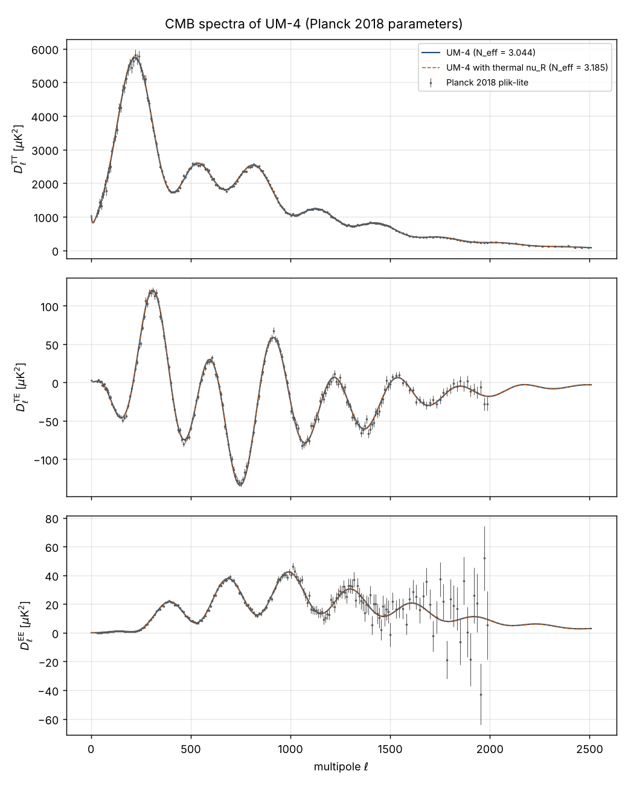

# The fold: definition and examples

<!-- begin fold definition -->
**Definition.** The *fold* is the seven-dimensional surface of the author's eight-dimensional spacetime on which the
cosine of the angle $z = 6Hx_0$ of the hidden direction vanishes:

$$
\mathcal{F} = \big\{X = (x_0, x_1, \dots, x_7):\ \cos(6Hx_0) = 0\big\},\qquad
\text{in one period } 0 < z < \pi\text{ of the metric: } z = \frac{\pi}{2},\quad x_0 = \frac{\pi}{12H} \tag{FD-1}
$$
<!-- symbols: foldF, Xcoord, x0, x1, x7, Hconst, zvar, pi, Lambda, LambdaN, wL -->
<!-- begin generated symbol list -->
**Symbols in (FD-1).**

- $\mathcal{F}$: The fold: the seven-dimensional surface $\cos(6Hx_0) = 0$ of the eight-dimensional spacetime (FD-1), in one period $0 < z < \pi$ the surface $z = \pi/2$, $x_0 = \pi/(12H)$, where $\sigma = 0$; $\vert_{\mathcal{F}}$ means restricted to the fold. Status: DERIVED.
- $X = \{x_0, \dots, x_7\}$: The author's coordinates of the eight-dimensional spacetime, $X = \{x_0, x_1, \dots, x_7\}$ with the hidden direction first (Dirac_Einstein-Lovelock_4+4_Nash.nb, section DEFCHART); $X^M$ is the coordinate with the index $M$ and $\mathrm{d}^8X = \mathrm{d}x_0\,\mathrm{d}x_1\cdots\mathrm{d}x_7$ the coordinate volume element. Unit: length (each coordinate). Status: AUTHOR.
- $x_0$: The hidden space-like coordinate (listed first); the metric depends on it through $z = 6Hx_0$, periodically with the period $\pi/(6H)$. Unit: length. Status: AUTHOR.
- $x_1$: The first coordinate of ordinary 3-space. Unit: length. Status: AUTHOR.
- $x_7$: The third of the three extra time-like coordinates. Unit: length. Status: AUTHOR.
- $H$: The author's constant (an inverse length) that fixes the period $\pi/(6H)$ of $x_0$, the warp factor $\mathrm{e}^{-2H\lvert\sigma\rvert}$ of the metric, the cosmological constant $\Lambda = -21H^2$ and the tension $\kappa\lambda_{\mathrm{F}} = 12H$ of the fold; in UM-4 a free parameter, bounded from below by the propagation of the gauge fields in the bulk. Unit: GeV (1/length). Value: $H \gtrsim 2.5$ TeV (from the invisible width of the Z boson). Status: AUTHOR.
- $z$: The angle variable of the hidden direction, $z = 6Hx_0$; one period of $x_0$ is $0 < z < \pi$, the fold is $z = \pi/2$. Unit: dimensionless. Status: AUTHOR.
- $\pi$: The number pi, the ratio of the circumference of a circle to its diameter. Unit: dimensionless. Value: 3.141592654. Status: STANDARD.
- $\Lambda$: The eight-dimensional cosmological constant of UM-4, $\Lambda = -21H^2$: the value for which the static block is a vacuum of Einstein gravity (its Einstein tensor is $21H^2$ in every direction). The author writes the pure number $\Lambda_{\mathrm{N}}$ in $0 = -\Lambda_{\mathrm{N}} + \sum_p H^{-2p}w_{(p)}\mathcal{E}_{(p)}$, so that $\Lambda = -\Lambda_{\mathrm{N}}H^2$. Unit: GeV$^2$. Value: $-21H^2$; the author's original $-10H^2$; UM-3: $-7H^2$. Status: AUTHOR (the term), DERIVED (the value).
- $\Lambda_{\mathrm{N}}$: The author's pure number in the vacuum equations of his notebook, $\Lambda = -\Lambda_{\mathrm{N}}H^2$: his original value 10; 21 in UM-4 (Einstein gravity), 7 in UM-3. Unit: dimensionless. Value: 21 (the author's original 10). Status: AUTHOR.
- $w_{(p)}$: The Lovelock weights of the author's Einstein-Lovelock action, $w_{(1)} = 1$ and $w_{(2)}$, $w_{(3)}$ of the Gauss-Bonnet and the cubic densities. UM-4 sets $w_{(2)} = w_{(3)} = 0$ (Einstein gravity): the only weights for which gravitons propagate on the light cone on every background, not only around the static block. The author's original weights $w_{(2)} = 1/32$, $w_{(3)} = 1/1152$ (Dirac_Einstein-Lovelock_4+4_Nash.nb, In[134]) keep the gravitons on the light cone only around the static block (with $\Lambda = -161H^2/16$); UM-3 used $(1, 1/20, 1/360)$. Unit: dimensionless. Value: $(1, 0, 0)$ in UM-4; the author's original $(1, 1/32, 1/1152)$. Status: AUTHOR (the form), DERIVED (the values that the order of 2026-10-25 selects).

<!-- end generated symbol list -->

$X = \{x_0, \dots, x_7\}$ are the author's coordinates: $x_0$ the hidden space-like direction, $x_1, x_2, x_3$ ordinary space,
$x_4$ the time, $x_5, x_6, x_7$ the three extra times; $H$ is the author's constant (an inverse length). The metric of UM-4
depends on $x_0$ only through $\cot^2z$ and $(\sin^2z)^{1/6}$, so it repeats with the period $\pi/(6H)$ of $x_0$, and every
period $0 < z < \pi$ contains exactly one surface of $\mathcal{F}$, at $z = \pi/2$: $\mathcal{F}$ is the union of these copies,
one per period (example 2), and "the fold" without a qualifier is the copy in the period that contains our world. A point of
the fold is labelled by the seven coordinates $x_1, \dots, x_7$, and the metric restricted to the fold ($\mathrm{d}x_0 = 0$,
$z = \pi/2$) is

$$
g_{MN}\,\mathrm{d}X^M\mathrm{d}X^N\big\vert_{\mathcal{F}} = \mathrm{e}^{2a_4}\big(\mathrm{d}x_1^2 + \mathrm{d}x_2^2 + \mathrm{d}x_3^2\big)
 - \mathrm{d}x_4^2 - \mathrm{e}^{-2a_4}b_4^2\big(\mathrm{d}x_5^2 + \mathrm{d}x_6^2 + \mathrm{d}x_7^2\big) \tag{FD-2}
$$
<!-- symbols: metric, iM, iN, diff, Xcoord, foldF, euler, a4, b4, x1, x2, x3, x4, x5, x6, x7, prime -->
<!-- begin generated symbol list -->
**Symbols in (FD-2).**

- $g_{MN}$: The metric tensor of the eight-dimensional spacetime (signature $+,+,+,+,-,-,-,-$ in the order $x_0, \dots, x_7$): $g_{MN}\,\mathrm{d}X^M\mathrm{d}X^N$ is the squared interval, $g^{MN}$ its inverse, $\lvert g\rvert$ the absolute value of its determinant ($\sqrt{\lvert g\rvert}\,\mathrm{d}^8X$ is the proper volume element). Unit: dimensionless. Status: AUTHOR.
- $M$: A coordinate index of eight dimensions (also with a numbered copy $M_1, M_2, \dots$): it runs over $x_0, x_1, \dots, x_7$; a repeated index is summed. Status: STANDARD.
- $N$: A coordinate index of eight dimensions (also $N_1, N_2, \dots$), running over $x_0, \dots, x_7$; a repeated index is summed. Status: STANDARD.
- $\mathrm{d}$: The differential: $\mathrm{d}$ in front of a quantity is an infinitesimal change of it (as $\mathrm{d}\sigma$, a small step of $\sigma$); the quotient of two such changes is a derivative; $\mathrm{d}$ with an exponent, in front of several variables, is their volume element, the product of their differentials. Status: STANDARD.
- $X = \{x_0, \dots, x_7\}$: The author's coordinates of the eight-dimensional spacetime, $X = \{x_0, x_1, \dots, x_7\}$ with the hidden direction first (Dirac_Einstein-Lovelock_4+4_Nash.nb, section DEFCHART); $X^M$ is the coordinate with the index $M$ and $\mathrm{d}^8X = \mathrm{d}x_0\,\mathrm{d}x_1\cdots\mathrm{d}x_7$ the coordinate volume element. Unit: length (each coordinate). Status: AUTHOR.
- $\mathcal{F}$: The fold: the seven-dimensional surface $\cos(6Hx_0) = 0$ of the eight-dimensional spacetime (FD-1), in one period $0 < z < \pi$ the surface $z = \pi/2$, $x_0 = \pi/(12H)$, where $\sigma = 0$; $\vert_{\mathcal{F}}$ means restricted to the fold. Status: DERIVED.
- $\mathrm{e}$: Euler's number, the base of the natural logarithm; $\mathrm{e}^{X}$ is the exponential of $X$. Unit: dimensionless. Value: 2.718281828. Status: STANDARD.
- $a_4$: The author's metric function of the time $x_4$ that scales ordinary 3-space: on the fold $\mathrm{e}^{a_4}$ is the scale factor of cosmology and $a_4'$ the Hubble rate. Unit: dimensionless. Status: AUTHOR.
- $b_4$: The author's metric function of the time $x_4$ in the extra-time components, $b_4 > 0$, never identically 1 (the author's order of 2026-10-24); the scale factor (the factor of the lengths) of the extra times is $\mathrm{e}^{-a_4}b_4$ on the fold and $\mathrm{e}^{-a_4}b_4\,\mathrm{e}^{-H\lvert\sigma\rvert}$ at the distance $\sigma$ from it (the square root of the warp factor times $\mathrm{e}^{-a_4}b_4$). Unit: dimensionless. Status: AUTHOR.
- $x_1$: The first coordinate of ordinary 3-space. Unit: length. Status: AUTHOR.
- $x_2$: The second coordinate of ordinary 3-space. Unit: length. Status: AUTHOR.
- $x_3$: The third coordinate of ordinary 3-space. Unit: length. Status: AUTHOR.
- $x_4$: The time; a prime on a function of $x_4$ alone is $\mathrm{d}/\mathrm{d}x_4$. Unit: length (= time, $c = 1$). Status: AUTHOR.
- $x_5$: The first of the three extra time-like coordinates. Unit: length. Status: AUTHOR.
- $x_6$: The second of the three extra time-like coordinates. Unit: length. Status: AUTHOR.
- $x_7$: The third of the three extra time-like coordinates. Unit: length. Status: AUTHOR.
- ${}'$: The derivative of a function of the time $x_4$ alone with respect to $x_4$ ($a_4' = \mathrm{d}a_4/\mathrm{d}x_4$; two primes the second derivative); on a function of $\sigma$ alone (a profile) the derivative with respect to $\sigma$. Status: STANDARD.

<!-- end generated symbol list -->

with three space-like and four time-like directions; $a_4$ and $b_4$ are the author's two functions of the time $x_4$.
Notation: $\ln$ is the natural logarithm, $\mathrm{e}$ Euler's number, $\exp(y) = \mathrm{e}^y$, $\sin$, $\cos$ and
$\cot = \cos/\sin$ the trigonometric functions, $\sinh$ and $\tanh$ the hyperbolic functions, $\lvert y\rvert$ the absolute value;
$f(0^+)$ and $f(0^-)$ are the limits of $f(\sigma)$ as $\sigma$ approaches 0 from above and from below.

**Why this surface is called a fold.** Measured by the proper distance along the hidden direction,

$$
\sigma = \mathrm{sgn}\Big(\frac{\pi}{2} - z\Big)\frac{\ln\sin z}{6H},\qquad \mathrm{d}\sigma = \lvert\cot z\rvert\,\mathrm{d}x_0,\qquad
\sin z = \mathrm{e}^{-6H\lvert\sigma\rvert} \tag{FD-3}
$$
<!-- symbols: sigma, sgn, pi, zvar, Hconst, diff, x0, euler, infty -->
<!-- begin generated symbol list -->
**Symbols in (FD-3).**

- $\sigma$: The proper coordinate of the hidden direction: $\mathrm{d}\sigma = \lvert\cot z\rvert\,\mathrm{d}x_0$, $\sigma = \mathrm{sgn}(\pi/2 - z)\ln(\sin z)/(6H)$ on one period $0 < z < \pi$; $\sigma = 0$ is the fold $z = \pi/2$, $\sigma \to \mp\infty$ the tips $z \to 0, \pi$; one period of $x_0$ is the whole line $-\infty < \sigma < \infty$. Unit: length. Status: DERIVED.
- $\mathrm{sgn}$: The sign function: $+1$ for a positive argument and $-1$ for a negative one. Status: STANDARD.
- $\pi$: The number pi, the ratio of the circumference of a circle to its diameter. Unit: dimensionless. Value: 3.141592654. Status: STANDARD.
- $z$: The angle variable of the hidden direction, $z = 6Hx_0$; one period of $x_0$ is $0 < z < \pi$, the fold is $z = \pi/2$. Unit: dimensionless. Status: AUTHOR.
- $H$: The author's constant (an inverse length) that fixes the period $\pi/(6H)$ of $x_0$, the warp factor $\mathrm{e}^{-2H\lvert\sigma\rvert}$ of the metric, the cosmological constant $\Lambda = -21H^2$ and the tension $\kappa\lambda_{\mathrm{F}} = 12H$ of the fold; in UM-4 a free parameter, bounded from below by the propagation of the gauge fields in the bulk. Unit: GeV (1/length). Value: $H \gtrsim 2.5$ TeV (from the invisible width of the Z boson). Status: AUTHOR.
- $\mathrm{d}$: The differential: $\mathrm{d}$ in front of a quantity is an infinitesimal change of it (as $\mathrm{d}\sigma$, a small step of $\sigma$); the quotient of two such changes is a derivative; $\mathrm{d}$ with an exponent, in front of several variables, is their volume element, the product of their differentials. Status: STANDARD.
- $x_0$: The hidden space-like coordinate (listed first); the metric depends on it through $z = 6Hx_0$, periodically with the period $\pi/(6H)$. Unit: length. Status: AUTHOR.
- $\mathrm{e}$: Euler's number, the base of the natural logarithm; $\mathrm{e}^{X}$ is the exponential of $X$. Unit: dimensionless. Value: 2.718281828. Status: STANDARD.
- $\infty$: Infinity: as a limit of an integral or a sum it means that the range has no bound. Status: STANDARD.

<!-- end generated symbol list -->

(the fold is $\sigma = 0$; the half-period $0 < z < \pi/2$ is $\sigma < 0$, the half-period $\pi/2 < z < \pi$ is $\sigma > 0$; the
two ends of the period, the tips $z \to 0$ and $z \to \pi$, lie at $\sigma \to -\infty$ and $\sigma \to +\infty$), the metric of UM-4 is

$$
g_{MN}\,\mathrm{d}X^M\mathrm{d}X^N = \mathrm{d}\sigma^2 + \mathrm{e}^{-2H\lvert\sigma\rvert}\Big[\mathrm{e}^{2a_4}\big(\mathrm{d}x_1^2
 + \mathrm{d}x_2^2 + \mathrm{d}x_3^2\big) - \mathrm{d}x_4^2 - \mathrm{e}^{-2a_4}b_4^2\big(\mathrm{d}x_5^2 + \mathrm{d}x_6^2 + \mathrm{d}x_7^2\big)\Big] \tag{FD-4}
$$
<!-- symbols: metric, iM, iN, diff, Xcoord, sigma, euler, Hconst, a4, b4, x1, x2, x3, x4, x5, x6, x7 -->
<!-- begin generated symbol list -->
**Symbols in (FD-4).**

- $g_{MN}$: The metric tensor of the eight-dimensional spacetime (signature $+,+,+,+,-,-,-,-$ in the order $x_0, \dots, x_7$): $g_{MN}\,\mathrm{d}X^M\mathrm{d}X^N$ is the squared interval, $g^{MN}$ its inverse, $\lvert g\rvert$ the absolute value of its determinant ($\sqrt{\lvert g\rvert}\,\mathrm{d}^8X$ is the proper volume element). Unit: dimensionless. Status: AUTHOR.
- $M$: A coordinate index of eight dimensions (also with a numbered copy $M_1, M_2, \dots$): it runs over $x_0, x_1, \dots, x_7$; a repeated index is summed. Status: STANDARD.
- $N$: A coordinate index of eight dimensions (also $N_1, N_2, \dots$), running over $x_0, \dots, x_7$; a repeated index is summed. Status: STANDARD.
- $\mathrm{d}$: The differential: $\mathrm{d}$ in front of a quantity is an infinitesimal change of it (as $\mathrm{d}\sigma$, a small step of $\sigma$); the quotient of two such changes is a derivative; $\mathrm{d}$ with an exponent, in front of several variables, is their volume element, the product of their differentials. Status: STANDARD.
- $X = \{x_0, \dots, x_7\}$: The author's coordinates of the eight-dimensional spacetime, $X = \{x_0, x_1, \dots, x_7\}$ with the hidden direction first (Dirac_Einstein-Lovelock_4+4_Nash.nb, section DEFCHART); $X^M$ is the coordinate with the index $M$ and $\mathrm{d}^8X = \mathrm{d}x_0\,\mathrm{d}x_1\cdots\mathrm{d}x_7$ the coordinate volume element. Unit: length (each coordinate). Status: AUTHOR.
- $\sigma$: The proper coordinate of the hidden direction: $\mathrm{d}\sigma = \lvert\cot z\rvert\,\mathrm{d}x_0$, $\sigma = \mathrm{sgn}(\pi/2 - z)\ln(\sin z)/(6H)$ on one period $0 < z < \pi$; $\sigma = 0$ is the fold $z = \pi/2$, $\sigma \to \mp\infty$ the tips $z \to 0, \pi$; one period of $x_0$ is the whole line $-\infty < \sigma < \infty$. Unit: length. Status: DERIVED.
- $\mathrm{e}$: Euler's number, the base of the natural logarithm; $\mathrm{e}^{X}$ is the exponential of $X$. Unit: dimensionless. Value: 2.718281828. Status: STANDARD.
- $H$: The author's constant (an inverse length) that fixes the period $\pi/(6H)$ of $x_0$, the warp factor $\mathrm{e}^{-2H\lvert\sigma\rvert}$ of the metric, the cosmological constant $\Lambda = -21H^2$ and the tension $\kappa\lambda_{\mathrm{F}} = 12H$ of the fold; in UM-4 a free parameter, bounded from below by the propagation of the gauge fields in the bulk. Unit: GeV (1/length). Value: $H \gtrsim 2.5$ TeV (from the invisible width of the Z boson). Status: AUTHOR.
- $a_4$: The author's metric function of the time $x_4$ that scales ordinary 3-space: on the fold $\mathrm{e}^{a_4}$ is the scale factor of cosmology and $a_4'$ the Hubble rate. Unit: dimensionless. Status: AUTHOR.
- $b_4$: The author's metric function of the time $x_4$ in the extra-time components, $b_4 > 0$, never identically 1 (the author's order of 2026-10-24); the scale factor (the factor of the lengths) of the extra times is $\mathrm{e}^{-a_4}b_4$ on the fold and $\mathrm{e}^{-a_4}b_4\,\mathrm{e}^{-H\lvert\sigma\rvert}$ at the distance $\sigma$ from it (the square root of the warp factor times $\mathrm{e}^{-a_4}b_4$). Unit: dimensionless. Status: AUTHOR.
- $x_1$: The first coordinate of ordinary 3-space. Unit: length. Status: AUTHOR.
- $x_2$: The second coordinate of ordinary 3-space. Unit: length. Status: AUTHOR.
- $x_3$: The third coordinate of ordinary 3-space. Unit: length. Status: AUTHOR.
- $x_4$: The time; a prime on a function of $x_4$ alone is $\mathrm{d}/\mathrm{d}x_4$. Unit: length (= time, $c = 1$). Status: AUTHOR.
- $x_5$: The first of the three extra time-like coordinates. Unit: length. Status: AUTHOR.
- $x_6$: The second of the three extra time-like coordinates. Unit: length. Status: AUTHOR.
- $x_7$: The third of the three extra time-like coordinates. Unit: length. Status: AUTHOR.

<!-- end generated symbol list -->

It depends on $\sigma$ only through $\lvert\sigma\rvert$. The function $\mathcal{W}(\sigma) = \mathrm{e}^{-2H\lvert\sigma\rvert}$,
which multiplies the squared steps of all seven directions of the fold (ordinary space, the time and the extra times), is the
warp factor of the metric (its square root $\mathrm{e}^{-H\lvert\sigma\rvert}$ multiplies the lengths). The time $x_4$ is warped
like the other directions (the author's order of 2026-10-25, 13:15 PDT; in UM-3 it was not), so that every surface
$\sigma = \text{const}$ has the light cone of the fold. Four properties make the surface $\sigma = 0$ a fold, and together they
single it out within the period:

1. *It is a mirror.* The reflection $\sigma \to -\sigma$ (that is $z \to \pi - z$, or $x_0 \to \pi/(6H) - x_0$) maps the metric
   to itself, and the fold is the only surface of the period that the reflection leaves in place: the two halves of the
   period are mirror images of each other, joined along the fold, as the two halves of a folded sheet of paper are joined
   along the crease.
2. *The warp factor is largest on it.* The warp factor $(\sin^2z)^{1/6} = \mathrm{e}^{-2H\lvert\sigma\rvert}$ equals 1 on the
   fold and decreases on both sides.
3. *The metric has a kink on it.* The metric is continuous across the fold, but its first derivative along $\sigma$ jumps.
   The extrinsic curvature of the surfaces $\sigma = \text{const}$ changes sign across the fold,

$$
K^a{}_b = \frac12\,g^{ac}\,\partial_\sigma g_{cb} = -H\,\mathrm{sgn}(\sigma)\,\delta^a{}_b\quad(\text{all seven directions of the fold}) \tag{FD-5}
$$
<!-- symbols: Kextr, ia, ib, ic, metric, partial, isigma, sigma, Hconst, sgn, delta, eta, ghat7, diag, xfour -->
<!-- begin generated symbol list -->
**Symbols in (FD-5).**

- $K^a{}_b$: The extrinsic curvature of a surface of constant $\sigma$ of the hidden direction, $K^a{}_b = \frac12 g^{ac}\partial_\sigma g_{cb}$ for $a, b$ along the surface (FD-5): $-H\,\mathrm{sgn}(\sigma)$ along all seven directions of the fold for the author's form of the metric of UM-4; $K = K^c{}_c$ its trace. Unit: GeV (1/length). Status: DERIVED.
- $a$: A frame (orthonormal) index running over $0, 1, \dots, 7$ (frame direction $(0)$ along $\sigma$, $(1), (2), (3)$ along ordinary space, $(4)$ along the time, $(5), (6), (7)$ along the extra times); raised and lowered with the frame metric $\eta_{ab} = \mathrm{diag}(1, 1, 1, 1, -1, -1, -1, -1)$; on the fold ($a, b \in \{1, \dots, 7\}$) the frame of the fold; in the tensors of the fold written with its coordinates $x^a$ (its metric $\hat g_{ab}$ and the tensors built from it) a coordinate index of the fold, $a \in \{1, \dots, 7\}$; a repeated index is summed. Status: STANDARD.
- $b$: A frame index (as $a$). Status: STANDARD.
- $c$: A frame index (as $a$). Status: STANDARD.
- $g_{MN}$: The metric tensor of the eight-dimensional spacetime (signature $+,+,+,+,-,-,-,-$ in the order $x_0, \dots, x_7$): $g_{MN}\,\mathrm{d}X^M\mathrm{d}X^N$ is the squared interval, $g^{MN}$ its inverse, $\lvert g\rvert$ the absolute value of its determinant ($\sqrt{\lvert g\rvert}\,\mathrm{d}^8X$ is the proper volume element). Unit: dimensionless. Status: AUTHOR.
- $\partial$: A partial derivative: the derivative with respect to one variable at fixed values of the others ($\partial_\sigma$ with respect to $\sigma$; $\partial_M$ and $\partial_\mu$ with respect to the coordinate that carries the same index, of the eight dimensions or of the fold). Status: STANDARD.
- $\sigma$: The label $\sigma$ in $\partial_\sigma$: the derivative with respect to the proper hidden coordinate $\sigma$. Status: STANDARD.
- $\sigma$: The proper coordinate of the hidden direction: $\mathrm{d}\sigma = \lvert\cot z\rvert\,\mathrm{d}x_0$, $\sigma = \mathrm{sgn}(\pi/2 - z)\ln(\sin z)/(6H)$ on one period $0 < z < \pi$; $\sigma = 0$ is the fold $z = \pi/2$, $\sigma \to \mp\infty$ the tips $z \to 0, \pi$; one period of $x_0$ is the whole line $-\infty < \sigma < \infty$. Unit: length. Status: DERIVED.
- $H$: The author's constant (an inverse length) that fixes the period $\pi/(6H)$ of $x_0$, the warp factor $\mathrm{e}^{-2H\lvert\sigma\rvert}$ of the metric, the cosmological constant $\Lambda = -21H^2$ and the tension $\kappa\lambda_{\mathrm{F}} = 12H$ of the fold; in UM-4 a free parameter, bounded from below by the propagation of the gauge fields in the bulk. Unit: GeV (1/length). Value: $H \gtrsim 2.5$ TeV (from the invisible width of the Z boson). Status: AUTHOR.
- $\mathrm{sgn}$: The sign function: $+1$ for a positive argument and $-1$ for a negative one. Status: STANDARD.
- $\delta$: The Kronecker delta: with two indices $\delta^M_N = 1$ if $M = N$ and 0 otherwise (likewise $\delta_{X\mathrm{L}}$ is 1 if the label $X$ of a half of dirac16complex is L and 0 otherwise); with two index strings of equal length the generalised Kronecker delta $\delta^{M_1M_2\cdots}_{N_1N_2\cdots}$, the determinant of the square matrix of the Kronecker deltas $\delta^{M_a}_{N_b}$ ($+1$ or $-1$ if the upper indices are an even or odd permutation of the lower ones, 0 otherwise). Status: STANDARD.
- $\eta_{ab}$: The flat metric of the frame, $\eta = \mathrm{diag}(1, 1, 1, 1, -1, -1, -1, -1)$ (eta4488 of 4+4.nb); $\eta^{ab}$ is its inverse (the same matrix). Unit: dimensionless. Status: AUTHOR.
- $\hat g_{ab}$: The metric of the seven-dimensional fold (FD-2) in its coordinates $x_1, \dots, x_7$ (or in its frame), $\hat g^{ab}$ its inverse; $\hat h_{\mu\nu}$ is its part along the four observable directions. Unit: dimensionless. Status: AUTHOR.
- $\mathrm{diag}$: A diagonal matrix with the listed entries on its diagonal (in the order of the coordinates $x_0, x_1, \dots, x_7$ for a tensor of eight dimensions, $x_1, \dots, x_7$ for a tensor of the fold, $x_1, \dots, x_4$ for a four-dimensional tensor). Status: STANDARD.
- $x$: The coordinates of the fold: $x_1, x_2, x_3$ of ordinary space, $x_4$ the time, $x_5, x_6, x_7$ the extra times; a field of the fold is a function of the four observable coordinates $x = (x_1, x_2, x_3, x_4)$, and $\mathrm{d}^4x = \mathrm{d}x_1\,\mathrm{d}x_2\,\mathrm{d}x_3\,\mathrm{d}x_4$. Unit: length (each coordinate). Status: AUTHOR.

<!-- end generated symbol list -->

   ($a, b$ frame indices along the fold); it jumps by $-2H$ in every direction of the fold. The field equations of gravity of
   UM-4, $\mathcal{E}_{(1)}{}^M{}_N + \Lambda\delta^M_N = \kappa\mathcal{T}^M{}_N$ (Einstein gravity: the author's Einstein-Lovelock
   equations with the weights of the Gauss-Bonnet and cubic terms set to zero; $\mathcal{E}_{(1)}$ the Einstein tensor,
   $\Lambda = -21H^2$ the cosmological constant, $\kappa = 8\pi G_8$ the gravitational coupling of eight dimensions,
   $\mathcal{T}^M{}_N$ the energy-momentum tensor, $\delta^M_N$ the Kronecker delta), are linear in the second $\sigma$-derivatives
   of the metric, so the jump puts a Dirac delta function $\delta_{\mathrm{D}}(\sigma)$ into them: the metric solves them only if
   the fold carries a thin source $\mathcal{S}^a{}_b$, an energy-momentum tensor concentrated on $\sigma = 0$, given by the
   integral of the equations across the fold (the junction condition of Israel),

$$
\kappa\,\mathcal{S}^a{}_b = \int_{0^-}^{0^+}\mathrm{d}\sigma\,\mathcal{E}_{(1)}{}^a{}_b
 = -\Big(\big(K^a{}_b\big\vert_{0^+} - K^a{}_b\big\vert_{0^-}\big) - \delta^a{}_b\big(K\big\vert_{0^+} - K\big\vert_{0^-}\big)\Big) \tag{FD-11}
$$
<!-- symbols: kappa, Sfoldsrc, ia, ib, diff, sigma, LovE, ip, Kextr, delta, G8, Riemann, LovL -->
<!-- begin generated symbol list -->
**Symbols in (FD-11).**

- $\kappa$: The eight-dimensional gravitational coupling, $\kappa = 8\pi G_8$. Unit: GeV$^{-6}$. Status: AUTHOR.
- $\mathcal{S}^a{}_b$: The thin source of the fold: the energy-momentum tensor concentrated on the fold, integrated across it, $\kappa\mathcal{S}^a{}_b = \int_{0^-}^{0^+}\mathrm{d}\sigma\,\mathcal{E}_{(1)}{}^a{}_b$ (the junction condition of Israel); $\mathcal{S}^4{}_4$ is minus its energy density, $\mathcal{S}^1{}_1$ and $\mathcal{S}^5{}_5$ its pressures along ordinary space and along the extra times (frame components along the fold, eight-dimensional normalisation: an energy per unit volume of the six other directions of the fold). Unit: GeV$^7$. Value: $\kappa\mathcal{S}^a{}_b = -12H\delta^a{}_b$ for every $a_4$, $b_4$ of the author's form. Status: DERIVED.
- $a$: A frame (orthonormal) index running over $0, 1, \dots, 7$ (frame direction $(0)$ along $\sigma$, $(1), (2), (3)$ along ordinary space, $(4)$ along the time, $(5), (6), (7)$ along the extra times); raised and lowered with the frame metric $\eta_{ab} = \mathrm{diag}(1, 1, 1, 1, -1, -1, -1, -1)$; on the fold ($a, b \in \{1, \dots, 7\}$) the frame of the fold; in the tensors of the fold written with its coordinates $x^a$ (its metric $\hat g_{ab}$ and the tensors built from it) a coordinate index of the fold, $a \in \{1, \dots, 7\}$; a repeated index is summed. Status: STANDARD.
- $b$: A frame index (as $a$). Status: STANDARD.
- $\mathrm{d}$: The differential: $\mathrm{d}$ in front of a quantity is an infinitesimal change of it (as $\mathrm{d}\sigma$, a small step of $\sigma$); the quotient of two such changes is a derivative; $\mathrm{d}$ with an exponent, in front of several variables, is their volume element, the product of their differentials. Status: STANDARD.
- $\sigma$: The proper coordinate of the hidden direction: $\mathrm{d}\sigma = \lvert\cot z\rvert\,\mathrm{d}x_0$, $\sigma = \mathrm{sgn}(\pi/2 - z)\ln(\sin z)/(6H)$ on one period $0 < z < \pi$; $\sigma = 0$ is the fold $z = \pi/2$, $\sigma \to \mp\infty$ the tips $z \to 0, \pi$; one period of $x_0$ is the whole line $-\infty < \sigma < \infty$. Unit: length. Status: DERIVED.
- $\mathcal{E}_{(p)}{}^M{}_N$: The Lovelock tensor of order $p$, $\mathcal{E}_{(p)}{}^M{}_N = -2^{-(p+1)}\,\delta^{MP_1\cdots P_{2p}}_{NQ_1\cdots Q_{2p}}\,R^{Q_1Q_2}{}_{P_1P_2}\cdots R^{Q_{2p-1}Q_{2p}}{}_{P_{2p-1}P_{2p}}$ (with both indices down it is $1/\sqrt{\lvert g\rvert}$ times the variation of $\sqrt{\lvert g\rvert}\,\mathcal{L}_{(p)}$ with respect to $g^{MN}$; $\mathcal{E}_{(1)}$ the Einstein tensor, $\mathcal{E}_{(2)}$ the Gauss-Bonnet tensor, $\mathcal{E}_{(3)}$ the cubic Lovelock tensor); with frame indices its frame components. Unit: 1/length$^{2p}$. Status: STANDARD.
- $p$: The Lovelock order $p = 1, 2, 3$ (Einstein, Gauss-Bonnet, cubic), as an index and as a number (UM-4 keeps only $p = 1$); in the Kohn-Sham equations also a second label of a Kohn-Sham orbital, with the Kronecker delta of the two labels. Status: STANDARD.
- $K^a{}_b$: The extrinsic curvature of a surface of constant $\sigma$ of the hidden direction, $K^a{}_b = \frac12 g^{ac}\partial_\sigma g_{cb}$ for $a, b$ along the surface (FD-5): $-H\,\mathrm{sgn}(\sigma)$ along all seven directions of the fold for the author's form of the metric of UM-4; $K = K^c{}_c$ its trace. Unit: GeV (1/length). Status: DERIVED.
- $\delta$: The Kronecker delta: with two indices $\delta^M_N = 1$ if $M = N$ and 0 otherwise (likewise $\delta_{X\mathrm{L}}$ is 1 if the label $X$ of a half of dirac16complex is L and 0 otherwise); with two index strings of equal length the generalised Kronecker delta $\delta^{M_1M_2\cdots}_{N_1N_2\cdots}$, the determinant of the square matrix of the Kronecker deltas $\delta^{M_a}_{N_b}$ ($+1$ or $-1$ if the upper indices are an even or odd permutation of the lower ones, 0 otherwise). Status: STANDARD.
- $G_8$: The eight-dimensional Newton constant ($\kappa = 8\pi G_8$). Unit: GeV$^{-6}$. Status: AUTHOR.
- $R^{MN}{}_{PQ},\ R_{MN},\ R$: The curvature of the metric $g_{MN}$: with four indices the Riemann tensor $R^M{}_{NPQ}$ (in the convention in which the commutator of two covariant derivatives, acting on a vector, is the Riemann tensor, with its last two indices those of the two derivatives, contracted with the vector), with two indices the Ricci tensor $R_{MN} = R^P{}_{MPN}$, without indices the scalar curvature $R = g^{MN}R_{MN}$; with frame indices $R^{(a)(b)}{}_{(c)(d)}$ its frame components, $R^{(a)(b)}{}_{(a)(b)}$ (no sum) the sectional curvature of the frame plane $(a, b)$. Unit: 1/length$^2$. Status: STANDARD.
- $\mathcal{L}_{(p)}$: The Lovelock density of order $p$, $\mathcal{L}_{(p)} = 2^{-p}\,\delta^{P_1\cdots P_{2p}}_{Q_1\cdots Q_{2p}}\,R^{Q_1Q_2}{}_{P_1P_2}\cdots R^{Q_{2p-1}Q_{2p}}{}_{P_{2p-1}P_{2p}}$, a scalar built from $p$ curvature tensors: $\mathcal{L}_{(1)} = R$ (Einstein-Hilbert), $\mathcal{L}_{(2)}$ the Gauss-Bonnet density, $\mathcal{L}_{(3)}$ the cubic Lovelock density. Unit: 1/length$^{2p}$. Status: STANDARD.

<!-- end generated symbol list -->

   ($K = K^c{}_c$ the trace of the extrinsic curvature), with $\mathcal{S}^4{}_4 = -(\text{its energy density})$,
   $\mathcal{S}^1{}_1 = \mathcal{S}^2{}_2 = \mathcal{S}^3{}_3$ its pressure along ordinary space and
   $\mathcal{S}^5{}_5 = \mathcal{S}^6{}_6 = \mathcal{S}^7{}_7$ its pressure along the extra times; $\mathcal{S}$ is $\mathcal{T}$ integrated
   across the fold, an energy per unit volume of the six other directions of the fold (unit GeV$^7$). For the static block
   ($a_4$ and $b_4$ constant) and, to the first order in the curvature of the fold divided by $H^2$, for every fold

$$
\begin{aligned}
&\text{static block:}\quad \kappa\mathcal{S}^a{}_b = -12H\,\delta^a{}_b\quad\text{(a pure tension)},\qquad \kappa\lambda_{\mathrm{F}} = 12H,\\
&\text{any fold:}\quad \kappa\mathcal{S}^a{}_b = -12H\,\delta^a{}_b + \frac{2}{5H}\,\hat G^a{}_b + \dots
\end{aligned} \tag{FD-12}
$$
<!-- symbols: kappa, Sfoldsrc, ia, ib, Hconst, delta, lambdaF, Ghat, Mred, Vstar, hhat, rhoL, GN, Vt, rhoc, rhoff, rhovac, H4, MPl, h100 -->
<!-- begin generated symbol list -->
**Symbols in (FD-12).**

- $\kappa$: The eight-dimensional gravitational coupling, $\kappa = 8\pi G_8$. Unit: GeV$^{-6}$. Status: AUTHOR.
- $\mathcal{S}^a{}_b$: The thin source of the fold: the energy-momentum tensor concentrated on the fold, integrated across it, $\kappa\mathcal{S}^a{}_b = \int_{0^-}^{0^+}\mathrm{d}\sigma\,\mathcal{E}_{(1)}{}^a{}_b$ (the junction condition of Israel); $\mathcal{S}^4{}_4$ is minus its energy density, $\mathcal{S}^1{}_1$ and $\mathcal{S}^5{}_5$ its pressures along ordinary space and along the extra times (frame components along the fold, eight-dimensional normalisation: an energy per unit volume of the six other directions of the fold). Unit: GeV$^7$. Value: $\kappa\mathcal{S}^a{}_b = -12H\delta^a{}_b$ for every $a_4$, $b_4$ of the author's form. Status: DERIVED.
- $a$: A frame (orthonormal) index running over $0, 1, \dots, 7$ (frame direction $(0)$ along $\sigma$, $(1), (2), (3)$ along ordinary space, $(4)$ along the time, $(5), (6), (7)$ along the extra times); raised and lowered with the frame metric $\eta_{ab} = \mathrm{diag}(1, 1, 1, 1, -1, -1, -1, -1)$; on the fold ($a, b \in \{1, \dots, 7\}$) the frame of the fold; in the tensors of the fold written with its coordinates $x^a$ (its metric $\hat g_{ab}$ and the tensors built from it) a coordinate index of the fold, $a \in \{1, \dots, 7\}$; a repeated index is summed. Status: STANDARD.
- $b$: A frame index (as $a$). Status: STANDARD.
- $H$: The author's constant (an inverse length) that fixes the period $\pi/(6H)$ of $x_0$, the warp factor $\mathrm{e}^{-2H\lvert\sigma\rvert}$ of the metric, the cosmological constant $\Lambda = -21H^2$ and the tension $\kappa\lambda_{\mathrm{F}} = 12H$ of the fold; in UM-4 a free parameter, bounded from below by the propagation of the gauge fields in the bulk. Unit: GeV (1/length). Value: $H \gtrsim 2.5$ TeV (from the invisible width of the Z boson). Status: AUTHOR.
- $\delta$: The Kronecker delta: with two indices $\delta^M_N = 1$ if $M = N$ and 0 otherwise (likewise $\delta_{X\mathrm{L}}$ is 1 if the label $X$ of a half of dirac16complex is L and 0 otherwise); with two index strings of equal length the generalised Kronecker delta $\delta^{M_1M_2\cdots}_{N_1N_2\cdots}$, the determinant of the square matrix of the Kronecker deltas $\delta^{M_a}_{N_b}$ ($+1$ or $-1$ if the upper indices are an even or odd permutation of the lower ones, 0 otherwise). Status: STANDARD.
- $\lambda_{\mathrm{F}}$: The tension that the static block requires of the fold, $\kappa\lambda_{\mathrm{F}} = 12H$: the total vacuum energy of the seven-dimensional fold, made of the tension of the fold fluid and the vacuum energy of the fields of the fold (both have the pressure minus their energy density along ordinary space and along the extra times), per unit volume of the six other directions of the fold (eight-dimensional normalisation); in the four-dimensional normalisation it is $\lambda_{\mathrm{F}}V_*$, and the excess of the total over $\lambda_{\mathrm{F}}V_*$ is the dark energy $\rho_\Lambda$. Unit: GeV$^7$. Value: $12H/\kappa$; $\lambda_{\mathrm{F}}V_* = 30H^2M_{\mathrm{red}}^2 = 1.1\times10^{45}$ GeV$^4$ for $H = 2.5$ TeV. Status: DERIVED.
- $\hat G^\mu{}_\nu$: The Einstein tensor of the metric $\hat g_{ab}$ of the fold (FD-2), with frame indices along its seven directions; with four-dimensional indices, $\hat G^\mu{}_\nu$, its components along the four observable directions, which for frozen extra times are those of the Einstein tensor of the four-dimensional metric $\hat h_{\mu\nu}$. Unit: 1/length$^2$. Status: STANDARD.
- $M_{\mathrm{red}}$: The reduced Planck mass, $M_{\mathrm{red}} = (8\pi G_{\mathrm{N}})^{-1/2}$. Unit: GeV. Value: $2.435\times10^{18}$ GeV. Status: STANDARD.
- $V_*$: The physical volume of the extra times $x_5, x_6, x_7$ on the fold in the late universe, $V_* = V_{\mathrm{t}}(\mathrm{e}^{-a_4}b_4)^3$ (with $V_{\mathrm{t}} = \int\mathrm{d}x_5\,\mathrm{d}x_6\,\mathrm{d}x_7$ the coordinate volume of the extra times) at a time when $\mathrm{e}^{-a_4}b_4$ is constant; it converts the eight-dimensional normalisation into the four-dimensional one. Unit: length$^3$ (GeV$^{-3}$). Status: ASSUMED.
- $\hat h_{\mu\nu}$: The four-dimensional metric of the fold, $\hat h_{\mu\nu} = \mathrm{diag}(\mathrm{e}^{2a_4}, \mathrm{e}^{2a_4}, \mathrm{e}^{2a_4}, -1)$ in the coordinates $x_1, \dots, x_4$ (the induced metric at $\sigma = 0$ without the extra times); $\hat h^{\mu\nu}$ its inverse, $\hat h$ its determinant, $\sqrt{-\hat h} = \mathrm{e}^{3a_4}$; $\hat h^{(1)}_{\mu\nu}$ its first-order cosmological perturbation. Unit: dimensionless. Status: DERIVED.
- $\rho_\Lambda$: The vacuum energy density of the fold above its static tension, the dark energy of UM-4: $\rho_\Lambda = \rho_{\mathrm{ff}} + \rho_{\mathrm{vac}} - \lambda_{\mathrm{F}}V_*$ (four-dimensional normalisation). Unit: GeV$^4$. Value: $0.685\,\rho_{\mathrm{c}}^{(0)} = 2.5\times10^{-47}$ GeV$^4$ (Planck 2018). Status: DERIVED.
- $G_{\mathrm{N}}$: Newton’s constant of four-dimensional gravity (the gravity of our world, on the fold), $G_{\mathrm{N}} = 1/M_{\mathrm{Pl}}^2$ with the Planck mass $M_{\mathrm{Pl}} = 1.221\times10^{19}$ GeV. Unit: GeV$^{-2}$. Value: $6.708\times10^{-39}$ GeV$^{-2}$. Status: STANDARD.
- $V_{\mathrm{t}}$: The coordinate volume of the (compact) extra times, $V_{\mathrm{t}} = \int\mathrm{d}x_5\,\mathrm{d}x_6\,\mathrm{d}x_7$. Unit: length$^3$. Status: ASSUMED.
- $\rho_{\mathrm{c}}$: The critical density, the energy density of a spatially flat fold at the expansion rate $H_4$; $\rho_{\mathrm{c}}^{(0)}$ its value today. Unit: GeV$^4$. Value: $\rho_{\mathrm{c}}^{(0)} = 1.0537\times10^{-5}\,h_{100}^2$ GeV/cm$^3$. Status: STANDARD.
- $\rho_{\mathrm{ff}}$: The energy density of the fold fluid. Unit: GeV$^4$. Value: $\lambda_{\mathrm{F}}V_* + \rho_\Lambda - \rho_{\mathrm{vac}}$: together with the vacuum energy $\rho_{\mathrm{vac}}$ of the fields of the fold it makes up the tension $\lambda_{\mathrm{F}}V_*$ that the static block requires plus the dark energy $\rho_\Lambda$. Status: ASSUMED (the fluid), DERIVED (the value).
- $\rho_{\mathrm{vac}}$: The vacuum energy of the fields of the fold: the minimum of their potential (for the Standard Model the minimum of the Higgs potential with its loop corrections), a tension of the seven-dimensional fold. Unit: GeV$^4$. Status: STANDARD.
- $H_4$: The expansion rate (Hubble rate) of the fold, $H_4 = a_4'$, as a function of the time or of the redshift; $H_4^{(0)}$ its value today, the Hubble constant. Unit: GeV (1/time). Value: $H_4^{(0)} = 100\,h_{100}$ km/s/Mpc with $h_{100} = 0.674$ (Planck 2018): 67.4 km/s/Mpc $= 1.44\times10^{-42}$ GeV. Status: STANDARD.
- $M_{\mathrm{Pl}}$: The Planck mass, $M_{\mathrm{Pl}} = G_{\mathrm{N}}^{-1/2}$. Unit: GeV. Value: $1.221\times10^{19}$ GeV. Status: STANDARD.
- $h_{100}$: The present expansion rate of the fold in units of 100 km/s/Mpc. Unit: dimensionless. Value: 0.674 (Planck 2018). Status: STANDARD.

<!-- end generated symbol list -->

   ($\hat G^a{}_b$ the Einstein tensor of the metric FD-2 of the fold): the tension plus matter that obeys the Einstein equations
   of seven dimensions, $\hat G^a{}_b = \kappa_7\mathsf{t}^a{}_b$ with $\kappa_7 = 5\kappa H/2$ ($\mathsf{t}^a{}_b$ the matter of the fold),
   which for frozen extra times are the Friedmann equations of general relativity. The fold is therefore not only a place but a
   physical object: a thin layer that carries energy and momentum (a brane).
4. *The author's coordinate $x_0$ degenerates on it.* The metric component $g_{x_0x_0} = \cot^2(6Hx_0)$ vanishes on the fold
   and nowhere else in the period; near the fold the proper distance grows with the square of the coordinate distance,

$$
\lvert\sigma\rvert = 3H\Big(x_0 - \frac{\pi}{12H}\Big)^2\Big[1 + 6H^2\Big(x_0 - \frac{\pi}{12H}\Big)^2 + \dots\Big] \tag{FD-6}
$$
<!-- symbols: sigma, Hconst, x0, pi -->
<!-- begin generated symbol list -->
**Symbols in (FD-6).**

- $\sigma$: The proper coordinate of the hidden direction: $\mathrm{d}\sigma = \lvert\cot z\rvert\,\mathrm{d}x_0$, $\sigma = \mathrm{sgn}(\pi/2 - z)\ln(\sin z)/(6H)$ on one period $0 < z < \pi$; $\sigma = 0$ is the fold $z = \pi/2$, $\sigma \to \mp\infty$ the tips $z \to 0, \pi$; one period of $x_0$ is the whole line $-\infty < \sigma < \infty$. Unit: length. Status: DERIVED.
- $H$: The author's constant (an inverse length) that fixes the period $\pi/(6H)$ of $x_0$, the warp factor $\mathrm{e}^{-2H\lvert\sigma\rvert}$ of the metric, the cosmological constant $\Lambda = -21H^2$ and the tension $\kappa\lambda_{\mathrm{F}} = 12H$ of the fold; in UM-4 a free parameter, bounded from below by the propagation of the gauge fields in the bulk. Unit: GeV (1/length). Value: $H \gtrsim 2.5$ TeV (from the invisible width of the Z boson). Status: AUTHOR.
- $x_0$: The hidden space-like coordinate (listed first); the metric depends on it through $z = 6Hx_0$, periodically with the period $\pi/(6H)$. Unit: length. Status: AUTHOR.
- $\pi$: The number pi, the ratio of the circumference of a circle to its diameter. Unit: dimensionless. Value: 3.141592654. Status: STANDARD.

<!-- end generated symbol list -->

   so the two coordinate values on either side of $x_0 = \pi/(12H)$ at the same coordinate distance lie at the same proper
   distance from the fold: the coordinate line of $x_0$ is folded onto the line of proper distances (a fold map, example 5).

**What lives on the fold.** In UM-4 the Higgs doublet (with the author's ad hoc vacuum, a time-dependent choice of its vacuum
value), three generations of quarks and leptons, three right-handed neutrinos and the fold fluid (its tension and the pressure
along the extra times that keeps their volume fixed) live on the fold: they are fields at $\sigma = 0$, functions of
$x_1, \dots, x_4$ (no field depends on the extra times). The gauge fields of $SU(3)_C \times SU(2)_L \times U(1)_Y$ live in the
bulk; their massless modes are bound to the fold, so that the photon and the gluons of the four-dimensional world are waves of
the bulk that the fold holds, and photons that leave the fold travel through the bulk at the speed of light. dirac16complex (the
author's spinor field of eight dimensions) and gravity live in the bulk $\sigma \ne 0$ as well as on the fold; the states $\chi$
of dirac16complex that the fold holds (in UM-4 long-lived resonances) are the part of it near the fold, and the portals
(couplings between dirac16complex and the fields of the fold) act at $\sigma = 0$. Integrated over the extra times, the fold is
the four-dimensional universe that we observe, with the metric $\mathrm{diag}(\mathrm{e}^{2a_4}, \mathrm{e}^{2a_4}, \mathrm{e}^{2a_4}, -1)$
in $x_1, \dots, x_4$. In UM-4 files "the fold" means this surface; the examples below use the word for other surfaces with the
same properties. The word is not used in its other senses: a set of equal energy levels is called degenerate, and a growth by
the factor $\mathrm{e}$ is called an e-folding.

**Examples of folds that are meaningful for UM-4.**

1. *Our fold.* The fold $z = \pi/2$ of the period that contains our world (FD-1): the seven-dimensional world-volume of the
   quarks, leptons and the Higgs field, and after the integration over the extra times the four-dimensional universe that we
   observe.
2. *The copies of the fold.* Because the metric repeats with the period $\pi/(6H)$, every surface
   $x_0 = \pi/(12H) + (\text{an integer multiple of } \pi/(6H))$ is a copy of the fold, one per period. Neighbouring copies are
   separated by a tip ($z$ a multiple of $\pi$), where the warp factor $(\sin^2z)^{1/6}$ vanishes and $g_{x_0x_0} = \cot^2z$
   diverges, and which lies at an infinite proper distance from both: in proper distance every copy has its own complete
   line $-\infty < \sigma < \infty$. A compact direction of length $L$ would give every field a tower of particles with the
   masses $2\pi n/L$, $n = 1, 2, \dots$ (a Kaluza-Klein tower); because the copies are infinitely far apart, the period
   $\pi/(6H)$ of $x_0$ produces no such tower with the spacing $12H$: every field of the bulk has instead a continuum of modes
   that starts at zero mass, and the fold holds its massless mode.
3. *A folded sheet of paper.* The crease of a folded sheet is a fold in this sense: the two halves are mirror images
   (property 1) joined along the crease, the sheet is continuous there and its direction changes abruptly (property 3).
   In UM-4 the direction across the crease is the hidden direction $\sigma$, the seven directions along the crease are
   $x_1, \dots, x_7$, and the crease is the fold.
4. *A folded function.* The warp factor $\mathrm{e}^{-2H\lvert\sigma\rvert}$ is the simplest folded function: continuous,
   mirror symmetric, largest at $\sigma = 0$, with a jump of its derivative,

$$
\frac{\mathrm{d}}{\mathrm{d}\sigma}\mathrm{e}^{-2H\lvert\sigma\rvert} = -2H\,\mathrm{sgn}(\sigma)\,\mathrm{e}^{-2H\lvert\sigma\rvert},\qquad
\frac{\mathrm{d}^2}{\mathrm{d}\sigma^2}\mathrm{e}^{-2H\lvert\sigma\rvert} = 4H^2\,\mathrm{e}^{-2H\lvert\sigma\rvert} - 4H\,\delta_{\mathrm{D}}(\sigma) \tag{FD-7}
$$
<!-- symbols: diff, sigma, euler, Hconst, sgn, deltaD -->
<!-- begin generated symbol list -->
**Symbols in (FD-7).**

- $\mathrm{d}$: The differential: $\mathrm{d}$ in front of a quantity is an infinitesimal change of it (as $\mathrm{d}\sigma$, a small step of $\sigma$); the quotient of two such changes is a derivative; $\mathrm{d}$ with an exponent, in front of several variables, is their volume element, the product of their differentials. Status: STANDARD.
- $\sigma$: The proper coordinate of the hidden direction: $\mathrm{d}\sigma = \lvert\cot z\rvert\,\mathrm{d}x_0$, $\sigma = \mathrm{sgn}(\pi/2 - z)\ln(\sin z)/(6H)$ on one period $0 < z < \pi$; $\sigma = 0$ is the fold $z = \pi/2$, $\sigma \to \mp\infty$ the tips $z \to 0, \pi$; one period of $x_0$ is the whole line $-\infty < \sigma < \infty$. Unit: length. Status: DERIVED.
- $\mathrm{e}$: Euler's number, the base of the natural logarithm; $\mathrm{e}^{X}$ is the exponential of $X$. Unit: dimensionless. Value: 2.718281828. Status: STANDARD.
- $H$: The author's constant (an inverse length) that fixes the period $\pi/(6H)$ of $x_0$, the warp factor $\mathrm{e}^{-2H\lvert\sigma\rvert}$ of the metric, the cosmological constant $\Lambda = -21H^2$ and the tension $\kappa\lambda_{\mathrm{F}} = 12H$ of the fold; in UM-4 a free parameter, bounded from below by the propagation of the gauge fields in the bulk. Unit: GeV (1/length). Value: $H \gtrsim 2.5$ TeV (from the invisible width of the Z boson). Status: AUTHOR.
- $\mathrm{sgn}$: The sign function: $+1$ for a positive argument and $-1$ for a negative one. Status: STANDARD.
- $\delta_{\mathrm{D}}$: The Dirac delta function of $\sigma$: zero for $\sigma \ne 0$, with the integral 1 over any range that contains $\sigma = 0$; the integral of $\delta_{\mathrm{D}}(\sigma)$ times a smooth function of $\sigma$ is the value of that function at $\sigma = 0$. Unit: 1/length (for $\delta_{\mathrm{D}}(\sigma)$). Status: STANDARD.

<!-- end generated symbol list -->

   whose delta function is the origin of the thin source of property 3. Every metric function of FD-4 depends on $\sigma$
   through $\lvert\sigma\rvert$ and is folded at $\sigma = 0$ in this sense.
5. *A fold map.* In the mathematics of smooth maps the fold (Whitney's fold singularity) is the map $u \mapsto u^2$ of a line
   onto a half-line: it folds the line at $u = 0$, two points $\pm u$ land on the same point, and the derivative of the map
   vanishes on the fold. Near the fold the map from the author's coordinate $x_0$ to the distance $\lvert\sigma\rvert$ from the
   fold is of this kind (FD-6), and $g_{x_0x_0} = \cot^2z$, the square of the derivative $\mathrm{d}\sigma/\mathrm{d}x_0$,
   vanishes there.
6. *The brane of Randall and Sundrum.* The five-dimensional metric

$$
\mathrm{d}y_{\mathrm{RS}}^2 + \mathrm{e}^{-2k_{\mathrm{RS}}\lvert y_{\mathrm{RS}}\rvert}\big(\mathrm{d}x_1^2 + \mathrm{d}x_2^2 + \mathrm{d}x_3^2
 - \mathrm{d}x_4^2\big),\qquad \lambda_{\mathrm{RS}} = \frac{6k_{\mathrm{RS}}}{\kappa_5},\qquad \Lambda_{\mathrm{RS}} = -\frac{6k_{\mathrm{RS}}^2}{\kappa_5} \tag{FD-8}
$$
<!-- symbols: diff, yRS, euler, kRS, x1, x2, x3, x4, lambdaRS, kappa5, LambdaRS -->
<!-- begin generated symbol list -->
**Symbols in (FD-8).**

- $\mathrm{d}$: The differential: $\mathrm{d}$ in front of a quantity is an infinitesimal change of it (as $\mathrm{d}\sigma$, a small step of $\sigma$); the quotient of two such changes is a derivative; $\mathrm{d}$ with an exponent, in front of several variables, is their volume element, the product of their differentials. Status: STANDARD.
- $y_{\mathrm{RS}}$: The proper coordinate across the brane of the five-dimensional model of Randall and Sundrum (FD-8, an example, not UM-4). Unit: length. Status: STANDARD.
- $\mathrm{e}$: Euler's number, the base of the natural logarithm; $\mathrm{e}^{X}$ is the exponential of $X$. Unit: dimensionless. Value: 2.718281828. Status: STANDARD.
- $k_{\mathrm{RS}}$: The inverse curvature length of the bulk of the model of Randall and Sundrum: the warp factor of the brane is $\mathrm{e}^{-2k_{\mathrm{RS}}\lvert y_{\mathrm{RS}}\rvert}$ (FD-8, an example, not UM-4). Unit: GeV (1/length). Status: STANDARD.
- $x_1$: The first coordinate of ordinary 3-space. Unit: length. Status: AUTHOR.
- $x_2$: The second coordinate of ordinary 3-space. Unit: length. Status: AUTHOR.
- $x_3$: The third coordinate of ordinary 3-space. Unit: length. Status: AUTHOR.
- $x_4$: The time; a prime on a function of $x_4$ alone is $\mathrm{d}/\mathrm{d}x_4$. Unit: length (= time, $c = 1$). Status: AUTHOR.
- $\lambda_{\mathrm{RS}}$: The tension (energy per unit volume of ordinary space) of the brane of the model of Randall and Sundrum, $\lambda_{\mathrm{RS}} = 6k_{\mathrm{RS}}/\kappa_5$ (FD-8, an example, not UM-4). Unit: GeV$^4$. Status: STANDARD.
- $\kappa_5$: The gravitational coupling of five dimensions in the model of Randall and Sundrum, $8\pi$ times the Newton constant of five dimensions (FD-8, an example, not UM-4). Unit: GeV$^{-3}$. Status: STANDARD.
- $\Lambda_{\mathrm{RS}}$: The vacuum energy density of the bulk of the model of Randall and Sundrum, $\Lambda_{\mathrm{RS}} = -6k_{\mathrm{RS}}^2/\kappa_5$ (FD-8, an example, not UM-4). Unit: GeV$^5$. Status: STANDARD.

<!-- end generated symbol list -->

   has a fold at $y_{\mathrm{RS}} = 0$ with the properties 1 to 3 (its coordinate $y_{\mathrm{RS}}$ is already the proper
   distance, so property 4 does not arise); Einstein's equations require there a brane of the tension $\lambda_{\mathrm{RS}}$
   (Israel's junction condition) and in the bulk the vacuum energy $\Lambda_{\mathrm{RS}}$, and the bulk is otherwise empty. The
   fold of UM-4 is of the same kind, with every direction of the fold warped by the same factor as in the model of Randall and
   Sundrum: its static block is a space of constant curvature $-H^2$ in all eight directions, a vacuum of Einstein gravity with
   $\Lambda = -21H^2$, with a fold of pure tension (FD-12), and the graviton is bound to the fold as there. It differs in that the
   fold has seven dimensions, three of them extra times, in that the space is not cut at the brane (Randall and Sundrum identify
   the two sides of their brane, one physical side; the fold of UM-4 has two distinct sides, example 7), and in that the gauge
   fields live in the bulk as well.
7. *A particle held by a thin layer.* A particle held by an attractive thin layer has a wave function that falls off
   exponentially with the distance on both sides, and the layer makes its derivative jump (for the first-order Dirac
   equation, the wave function itself). In UM-4 the states $\chi$ of dirac16complex near the fold are of this kind only near
   the fold: at rest and without their self-interaction (the field is
   $\Psi = \mathrm{e}^{(7/2)H\lvert\sigma\rvert}\chi(\sigma)\mathrm{e}^{-\mathrm{i}\omega x_4}$)

$$
\begin{aligned}
&\chi(\sigma) = \mathrm{e}^{-q_{\mathrm{b}}\lvert\sigma\rvert}\chi(0^+)\ \ (0 < \sigma \ll \sigma_{\mathrm{t}}),\qquad
\chi(\sigma) = \mathrm{e}^{-q_{\mathrm{b}}\lvert\sigma\rvert}\chi(0^-)\ \ (0 < -\sigma \ll \sigma_{\mathrm{t}}),\\
&\chi(0^+) = \exp\Big(\gamma^{(0)}\big(\mu_{\mathrm{L}}P_{\mathrm{L}} + \mu_{\mathrm{R}}P_{\mathrm{R}}\big)\Big)\chi(0^-),\qquad
\omega_0 = \omega_{\mathrm{r}} - \frac{\mathrm{i}}{2}\,\Gamma_\chi,\qquad \omega_{\mathrm{r}} \to \omega_{\mathrm{b}} = \sqrt{m_\Psi^2 - q_{\mathrm{b}}^2}
\end{aligned} \tag{FD-9}
$$
<!-- symbols: chiprof, sigma, euler, qb, sigmat, gammaM, muX, PL, PR, omega0, omegar, imag, Gammachi, omegab, mPsi, Gamma8, Psi, identity, vielbein, omegafreq, kvec, xvec, tzero, sigma16, dagger, io -->
<!-- begin generated symbol list -->
**Symbols in (FD-9).**

- $\chi(\sigma)$: The profile of a mode of dirac16complex along the hidden direction, $\Psi = \mathrm{e}^{\frac72H\lvert\sigma\rvert}\chi(\sigma)\mathrm{e}^{\mathrm{i}(\vec k\cdot\vec x - \omega x_4)}$ (a 16-component spinor function of $\sigma$); as a four-dimensional field, $\chi$ denotes the particle of the level of dirac16complex at the fold (a long-lived resonance) and $\bar\chi$ its antiparticle. Unit: GeV$^{2}$ (with the $V_*$ normalisation). Status: DERIVED.
- $\sigma$: The proper coordinate of the hidden direction: $\mathrm{d}\sigma = \lvert\cot z\rvert\,\mathrm{d}x_0$, $\sigma = \mathrm{sgn}(\pi/2 - z)\ln(\sin z)/(6H)$ on one period $0 < z < \pi$; $\sigma = 0$ is the fold $z = \pi/2$, $\sigma \to \mp\infty$ the tips $z \to 0, \pi$; one period of $x_0$ is the whole line $-\infty < \sigma < \infty$. Unit: length. Status: DERIVED.
- $\mathrm{e}$: Euler's number, the base of the natural logarithm; $\mathrm{e}^{X}$ is the exponential of $X$. Unit: dimensionless. Value: 2.718281828. Status: STANDARD.
- $q_{\mathrm{b}}$: The inverse width of a state of dirac16complex at the fold: inside the turning point its profile falls as $\mathrm{e}^{-q_{\mathrm{b}}\lvert\sigma\rvert}$. Unit: GeV. Status: DERIVED.
- $\sigma_{\mathrm{t}}$: The turning point of a state of dirac16complex of the frequency $\omega$: the depth at which the warped frequency equals the bulk mass, $\lvert\omega\rvert\mathrm{e}^{H\sigma_{\mathrm{t}}} = m_\Psi$; beyond it every solution oscillates. Unit: length. Status: DERIVED.
- $\gamma^M,\ \gamma^{(a)}$: The Dirac matrices of dirac16complex along the coordinates, $\gamma^M = \mathbf{e}_a{}^MT^a$, $\gamma_M = g_{MN}\gamma^N$; $\gamma^{(a)} = T^a$ along the frame direction $(a)$ ($\gamma^{(0)}$ along $\sigma$, $\gamma^{(4)}$ along the time). Unit: dimensionless. Status: AUTHOR.
- $\mu_X,\ \mu_{\mathrm{L}},\ \mu_{\mathrm{R}}$: The dimensionless strengths of the fold for the left-handed and right-handed halves of dirac16complex, set by the mean fields of the Standard Model at the fold: the jump of the profile across the fold is the exponential of $\gamma^{(0)}(\mu_{\mathrm{L}}P_{\mathrm{L}} + \mu_{\mathrm{R}}P_{\mathrm{R}})$; negative values attract. Unit: dimensionless. Status: DERIVED.
- $P_{\mathrm{L}}$: The author's left-handed chiral projector, $P_{\mathrm{L}} = (\mathbf{1} - \Gamma_8)/2$. Unit: dimensionless. Status: AUTHOR.
- $P_{\mathrm{R}}$: The author's right-handed chiral projector, $P_{\mathrm{R}} = (\mathbf{1} + \Gamma_8)/2$. Unit: dimensionless. Status: AUTHOR.
- $\omega_0$: The energy at rest (zero momentum along ordinary space and along the extra times) of a state of dirac16complex at the fold; complex for a resonance, $\omega_0 = \omega_{\mathrm{r}} - \frac{\mathrm{i}}{2}\Gamma_\chi$. Unit: GeV. Status: DERIVED.
- $\omega_{\mathrm{r}}$: The mass of the particle $\chi$: the real part of the energy at rest of the resonance of dirac16complex at the fold, $\omega_{\mathrm{r}} = \omega_{\mathrm{b}}(1 - H/(2q_{\mathrm{b}})) + \dots$. Unit: GeV. Status: DERIVED.
- $\mathrm{i}$: The imaginary unit, $\mathrm{i}^2 = -1$. Unit: dimensionless. Status: STANDARD.
- $\Gamma_\chi$: The width of the particle $\chi$ at rest: the rate of its decay into the waves of dirac16complex in the bulk. Unit: GeV. Value: below $1/t_0 = 1.5\times10^{-42}$ GeV for dark matter. Status: DERIVED.
- $\omega_{\mathrm{b}}$: The energy at zero momentum of the state of dirac16complex at the fold in the limit $H \to 0$ (the bound state of UM-3): the particle $\chi$ of UM-4 has the mass $\omega_{\mathrm{r}} = \omega_{\mathrm{b}}(1 - H/(2q_{\mathrm{b}})) + \dots$, equal to $\omega_{\mathrm{b}}$ up to the relative correction $H/(2q_{\mathrm{b}})$. Unit: GeV. Status: DERIVED.
- $m_\Psi$: The mass parameter of dirac16complex in the bulk. Unit: GeV. Status: RECORD.
- $\Gamma_8$: The chirality matrix of eight dimensions, $\Gamma_8 = T_0T_1\cdots T_7$ (the author's T16^A[8]) $= \mathrm{diag}(-\mathbf{1}_8, \mathbf{1}_8)$; $\Gamma_8^2 = \mathbf{1}$; it anticommutes with every $T_a$. Unit: dimensionless. Status: AUTHOR.
- $\Psi,\ \bar\Psi$: dirac16complex: the author's 16-component complex spinor field of eight dimensions; $\bar\Psi = \Psi^\dagger\sigma_{16}$ is its Dirac adjoint; in a term of the fold, $\Psi$ is its value at $\sigma = 0$. Unit: GeV$^{7/2}$. Status: AUTHOR.
- $\mathbf{1},\ \mathbf{1}_8$: The identity matrix of the size fixed by the context ($16 \times 16$ on dirac16complex, $4 \times 4$ on a four-dimensional spinor, $3 \times 3$ in generation or flavour space); $\mathbf{1}_8$ is the $8 \times 8$ identity matrix. Unit: dimensionless. Status: STANDARD.
- $\mathbf{e}_a{}^M,\ \mathbf{e}^a{}_M$: The vielbein (frame field) of the metric: $g_{MN} = \eta_{ab}\,\mathbf{e}^a{}_M\mathbf{e}^b{}_N$; $\mathbf{e}_a{}^M$ is its inverse; $\mathbf{e}_{bN} = \eta_{bc}\mathbf{e}^c{}_N$; $\mathbf{e}^{(a)}$ is the frame one-form $\mathbf{e}^a{}_M\,\mathrm{d}X^M$. Unit: dimensionless. Status: STANDARD.
- $\omega$: A frequency: the energy of a mode $\propto \mathrm{e}^{-\mathrm{i}\omega x_4}$ ($\omega_o$ of the orbital $o$). Unit: GeV. Status: STANDARD.
- $\vec k$: The (comoving) momentum along ordinary space, $\vec k^2$ its square. Unit: GeV. Status: STANDARD.
- $\vec x$: The position in ordinary space, $\vec x = (x_1, x_2, x_3)$. Unit: length. Status: AUTHOR.
- $t_0$: The age of the universe. Unit: time. Value: 13.8 Gyr. Status: STANDARD.
- $\sigma_{16}$: The matrix of the Dirac adjoint, $\sigma_{16} = T_0T_1T_2T_3$, real and symmetric; $\sigma_{16}T_a$ is real and antisymmetric. Unit: dimensionless. Status: AUTHOR.
- ${}^\dagger$: Hermitian conjugation: the complex conjugate of the transpose of a matrix or spinor; for an operator on the space of states, its adjoint with respect to the scalar product of that space (for the quantised dirac16complex the indefinite Krein scalar product). Status: STANDARD.
- $o$: The label of a single-particle state of dirac16complex: a Kohn-Sham orbital, or a mode of the quantised field; a sum over $o$ runs over the orbitals or the modes. Status: STANDARD.

<!-- end generated symbol list -->

   where $\mu_{\mathrm{L}}$, $\mu_{\mathrm{R}}$ are the strengths of the fold for the left- and right-handed halves of
   dirac16complex (set by the fields of the fold), $q_{\mathrm{b}} = -m_\Psi(\mu_{\mathrm{L}} + \mu_{\mathrm{R}})\tanh\varsigma/(2\varsigma)$,
   $\varsigma = \sqrt{\mu_{\mathrm{L}}\mu_{\mathrm{R}}}$ ($q_{\mathrm{b}} = -m_\Psi\mu_{\mathrm{L}}/2$ for $\mu_{\mathrm{R}} = 0$), and $\omega_{\mathrm{r}}$
   tends to the energy $\omega_{\mathrm{b}}$ of the bound state of UM-3 when $H/q_{\mathrm{b}} \to 0$. Because the time is warped, the
   energy $\omega$ of the field enters its equation multiplied by $\mathrm{e}^{H\lvert\sigma\rvert}$: beyond the turning point
   $\sigma_{\mathrm{t}}$ ($\omega_{\mathrm{r}}\mathrm{e}^{H\sigma_{\mathrm{t}}} = m_\Psi$) the profile oscillates as a wave that leaves the fold, so the
   state is a resonance of the width $\Gamma_\chi$, which falls like $\mathrm{e}^{-2F(\upsilon_{\mathrm{b}})m_\Psi/H}$ with
   $F(\upsilon) = \ln((1 + \sqrt{1 - \upsilon^2})/\upsilon) - \sqrt{1 - \upsilon^2}$ and $\upsilon_{\mathrm{b}} = \omega_{\mathrm{b}}/m_\Psi$ (the
   tunnelling through the region between the fold and $\sigma_{\mathrm{t}}$). The profile is not a function of $\lvert\sigma\rvert$: it
   jumps at the fold, $\chi(0^+) \ne \chi(0^-)$.
8. *The fold as a mirror for dirac16complex.* The reflection across the fold acts on the profiles $\chi(\sigma)$ in two ways,

$$
(\mathsf{R}_1\chi)(\sigma) = T_0T_1T_2T_3\,\chi(-\sigma),\qquad (\mathsf{R}_2\chi)(\sigma) = T_0T_5T_6T_7\,\chi(-\sigma) \tag{FD-10}
$$
<!-- symbols: R1refl, R2refl, chiprof, sigma, Tmat -->
<!-- begin generated symbol list -->
**Symbols in (FD-10).**

- $\mathsf{R}_1$: The reflection across the fold acting on a profile of dirac16complex together with the reflection of ordinary space, $(\mathsf{R}_1\chi)(\sigma) = T_0T_1T_2T_3\,\chi(-\sigma)$ (FD-10): a symmetry of dirac16complex, of gravity and of the mean field of the gas of the particles $\chi$; the states at the fold of Krein charge $-1$ are even, those of Krein charge $+1$ odd. Unit: dimensionless. Status: DERIVED.
- $\mathsf{R}_2$: The reflection across the fold acting on a profile of dirac16complex together with the reflection of the extra times, $(\mathsf{R}_2\chi)(\sigma) = T_0T_5T_6T_7\,\chi(-\sigma)$ (FD-10): it maps the states at the fold of one Krein charge onto those of the other. Unit: dimensionless. Status: DERIVED.
- $\chi(\sigma)$: The profile of a mode of dirac16complex along the hidden direction, $\Psi = \mathrm{e}^{\frac72H\lvert\sigma\rvert}\chi(\sigma)\mathrm{e}^{\mathrm{i}(\vec k\cdot\vec x - \omega x_4)}$ (a 16-component spinor function of $\sigma$); as a four-dimensional field, $\chi$ denotes the particle of the level of dirac16complex at the fold (a long-lived resonance) and $\bar\chi$ its antiparticle. Unit: GeV$^{2}$ (with the $V_*$ normalisation). Status: DERIVED.
- $\sigma$: The proper coordinate of the hidden direction: $\mathrm{d}\sigma = \lvert\cot z\rvert\,\mathrm{d}x_0$, $\sigma = \mathrm{sgn}(\pi/2 - z)\ln(\sin z)/(6H)$ on one period $0 < z < \pi$; $\sigma = 0$ is the fold $z = \pi/2$, $\sigma \to \mp\infty$ the tips $z \to 0, \pi$; one period of $x_0$ is the whole line $-\infty < \sigma < \infty$. Unit: length. Status: DERIVED.
- $T_a,\ T^a$: The author's eight real $16 \times 16$ Dirac matrices T16^A[a] of 4+4.nb ($a = 0, \dots, 7$; $T_0, \dots, T_7$), with $\{T_a, T_b\} = 2\eta_{ab}\mathbf{1}$; $T^a = \eta^{ab}T_b$. Unit: dimensionless. Status: AUTHOR.

<!-- end generated symbol list -->

   ($T_a$ the author's Dirac matrices; for states at rest $\mathsf{R}_1$ is the reflection across the fold combined with the
   reflection of ordinary space, $\mathsf{R}_2$ the reflection across the fold combined with the reflection of the extra
   times). The Krein charge of a state is its share of the conserved charge of dirac16complex, which is indefinite: a
   state can carry the charge $-1$ or $+1$. $\mathsf{R}_1$ is a symmetry of dirac16complex, of gravity and of a mean field of a
   gas of the particles $\chi$ that is the same on both sides of the fold: the four resonances of Krein charge $-1$ (the
   particles $\chi$) are even under it and the four of Krein charge $+1$ are odd, so such a mean field cannot mix the two signs of
   the indefinite charge. $\mathsf{R}_2$ maps the states of one Krein charge onto those of the other and makes the two sets
   degenerate without the self-interaction.
9. *The planes of Horava and Witten.* In M-theory (the eleven-dimensional theory whose limits include the superstring
   theories) on an interval (a circle whose points are identified with their mirror images), the two ten-dimensional planes
   left in place by the reflection are mirror surfaces (property 1); each carries one $E_8$ gauge group while gravity fills
   the bulk. As in UM-4, gravity fills the bulk; unlike UM-4, the gauge fields live on the mirror planes (in UM-4 they live in
   the bulk), and the two sides of each plane are identified (one physical side).

**What is not a fold.**

* *The tips* $z = 0$ and $z = \pi$ (mod $\pi$): the mirror exchanges them within a period, but there the warp factor vanishes,
  $g_{x_0x_0}$ diverges, and they lie at an infinite proper distance; they carry no thin source.
* *A smooth maximum of a warp factor*, such as $1/\cosh^2(H\sigma)$: mirror symmetric and largest at $\sigma = 0$, but without a
  kink and without a thin source.
<!-- end fold definition -->

# How to read this document

## What this document contains

This document solves, approximately and step by step, the coupled field equations of the universe model UM-4: Einstein gravity
in eight dimensions (the author's Einstein-Lovelock theory with the weights of its Gauss-Bonnet and cubic terms set to zero) with
the metric of UM-4, the author's metric with the time warped like every other direction of the fold (the author's order of
2026-10-25, 13:15 PDT); the author's field dirac16complex (a 16-component complex spinor field) and the gauge fields of the Standard
Model in the bulk; and the Higgs doublet, the quarks and the leptons with three right-handed neutrinos on the fold. It is
self-contained: every equation that is solved is written out here (with the tag it carries in every UM-4 document), every new
equation of the solution carries a tag S-1, S-2, ..., and every symbol of every display equation is defined right after it. The
sections are:

* **Gravity**: why UM-4 uses Einstein gravity with $\Lambda = -21H^2$ (the only choice of the author's Lovelock weights for which
  gravitons travel on the light cone on every background).
* **The background**: the exact bulk equations of the metric of UM-4, the pure tension of the fold, the static block, the Ricci-flat
  folds, the author's vacuum (not a solution), the bulk metric of an expanding fold and the equations of the fold, which to the first
  order in its curvature are the Einstein equations of seven dimensions.
* **The volume of the extra times**, which must be held fixed, and the pressure that holds it.
* **The sources of the fold**: the gravitational waves of the fold, the gravity that the fields of the fold may induce, the fold fluid
  and the tuning of its tension.
* **The Higgs field in the ad hoc vacuum**: the author's ad hoc vacuum written as a gauge rotation, the field of $W^2$ that the Gauss law
  requires, and the one residual that remains.
* **Propagation in the bulk**: the modes of every field of the bulk, the photon and the gravitational wave, the propagators between
  points of the fold, Newton's and Coulomb's laws, the W and Z bosons, the bounds on $H$, and the causal structure of the bulk.
* **dirac16complex**: its equations, the resonances that the fold holds (the particles $\chi$, with their mass and their width), the
  lifetime that the dark matter requires, and the momentum along the extra times.
* **The Kohn-Sham states of dirac16complex**: the self-consistent states of a gas of the particles $\chi$ with the self-interaction,
  gravity and the mean fields of the Standard Model, with their residuals, and the Krein norm of the field.
* **The residuals of every field equation**: how well the approximate solution satisfies each equation.
* **The three neutrino flavours**: the Sun, the envelope of a supernova, the fast instability and the flavour equipartition, and what
  the newer global fit, the Dirac phase and the lightest mass change.
* **The thermal history**: the degrees of freedom, the relic density, the portals of $\chi$ to the Standard Model, why the particles
  $\chi$ of UM-4 cannot be a thermal relic and cannot be bound to the fold by the Higgs portal alone, the right-handed neutrinos and the
  ad hoc vacuum before nucleosynthesis.
* **The primordial era**: the exact de Sitter fold, the inflation of the fold with frozen extra times and its scales.
* **The CMB, the CNB and the BAO** (the cosmic microwave background, the cosmic neutrino background and the baryon acoustic
  oscillations): the cosmological perturbations of the metric of the fold, against the measurements of Planck, of DESI DR2 (the second
  data release of the Dark Energy Spectroscopic Instrument) and of ACT DR6 (the sixth data release of the Atacama Cosmology Telescope).
* **What the solution does not settle**, and **what was verified**.

## The status labels

Every equation and every result carries one of the labels

* **AUTHOR**: from the author (his notebooks `4+4.nb` and `Dirac_Einstein-Lovelock_4+4_Nash.nb`, and his orders of 2026-10-24
  and 2026-10-25: the coordinates, the metric with its change of 2026-10-25 13:15 (the time warped), the Einstein-Lovelock action, the
  Dirac matrices, the chiral projectors, the list of fields, the Higgs potential and the ad hoc vacuum);
* **RECORD**: from the record of this repository (the Lagrangian of dirac16complex with its canonical spin connection and its
  contact self-interaction, the Kohn-Sham treatment);
* **STANDARD**: textbook physics, or a published measurement (the source is named);
* **ASSUMED**: a choice made in UM-4 without derivation;
* **INVENTED**: a new interaction of UM-4 (the portals of dirac16complex);
* **DERIVED**: computed and verified in UM-4 (the verification is stated);
* **ESTIMATE**: an order-of-magnitude evaluation;
* **OPEN**: not settled.

## Every equation is followed by its symbols

Every display equation is followed by the list "Symbols in (S-n)" or "Symbols in (FE-n)" of EVERY symbol that appears in it:
every quantity, field, coupling, constant and operator, every index letter with the values it takes, every mark (prime,
dagger, transpose, star), the imaginary unit, Euler's number and the differential. Each item gives the meaning, the unit
(natural units, in which the reduced Planck constant $\hbar$ and the speed of light $c$ are 1), the value where one exists, and the
status. A symbol that one of these meanings uses is itself listed in this document. A field equation of UM-4 carries a tag FE-$n$ and
a term of the action a tag IN-$n$, the same in every UM-4 document; it is written here exactly as everywhere else. A new
equation of this document carries a tag S-$n$.

## Coordinates, signature and units

The author's coordinates are $X = \{x_0, x_1, \dots, x_7\}$, always with the hidden direction first: $x_0$ is the hidden
space-like coordinate, on which the metric depends periodically with the period $\pi/(6H)$ through the angle $z = 6Hx_0$;
$x_1, x_2, x_3$ are ordinary space, $x_4$ is the time, and $x_5, x_6, x_7$ are three extra time-like coordinates. The
signature is $(+,+,+,+,-,-,-,-)$ in this order; the four observable coordinates $x_1, \dots, x_4$ have the signature
$(+,+,+,-)$. $H$ is the author's constant (an inverse length), a free parameter of UM-4, bounded from below by about 2.5 TeV. Units
are natural: the reduced Planck constant $\hbar$ and the speed of light $c$ are 1 (1 GeV$^{-1}$ = $1.973\times10^{-14}$ cm =
$6.582\times10^{-25}$ s; 1 GeV$^{-2}$ = $3.894\times10^{-28}$ cm$^2$). A prime on a function of the time $x_4$ alone is its derivative
$\mathrm{d}/\mathrm{d}x_4$, and on a profile (a function of $\sigma$ alone) its derivative $\mathrm{d}/\mathrm{d}\sigma$. The proper coordinate of the
hidden direction is $\sigma$ (FE-27): $\sigma = 0$ is the fold $z = \pi/2$. The fields live as follows: gravity, dirac16complex and the gauge
fields of the Standard Model in the bulk (their massless modes are bound to the fold); the Higgs doublet, the quarks and the leptons with
three right-handed neutrinos, a thin fluid (the fold fluid) and, possibly, an Einstein-Hilbert term that the fields of the fold induce
(with the coupling $\kappa_{\mathrm{ind}}$) on the fold $\sigma = 0$.

## The solution at a glance

| part | result | status |
| ---------------- | ------------------------------------------------------------ | -------------- |
| gravity | Einstein gravity with $\Lambda = -21H^2$: the only choice of the author's Lovelock weights for which gravitons travel on the light cone on every background; the static block is its unique vacuum (a space of constant curvature $-H^2$), and the fold of the metric of UM-4 is a pure tension $\kappa\lambda_{\mathrm{F}} = 12H$ | DERIVED |
| background | the metric of the author's form is a vacuum of the bulk only for the Ricci-flat folds (the static fold and two Kasner folds); an expanding fold with matter has a bulk metric corrected at the order of its curvature over $H^2$, and its fold obeys the Einstein equations of seven dimensions with $\kappa_7 = 5\kappa H/2$, with frozen extra times the Friedmann equations of general relativity (corrections of the relative size $(a_4'/H)^2$, about $3\times10^{-91}$ today); the author's vacuum is not a solution | DERIVED |
| volume of the extra times | a free volume would change Newton's constant 8500 times faster than lunar laser ranging allows; the fold fluid holds it fixed with the pressure $q_{\mathrm{hold}} = -0.842\rho_{\mathrm{c}}^{(0)}$ along the extra times today (with no pressure of the baryons along them) | DERIVED, ASSUMED (the holding pressure and the baryons), OPEN (its origin) |
| sources of the fold | the gravitational waves of the fold travel at the speed of light at every wavelength (GW170817 holds for every $H$); the induced gravity is negligible for a cutoff of the order of $H$; the tension $\lambda_{\mathrm{F}}V_* = 30H^2M_{\mathrm{red}}^2$ must be tuned to one part in $10^{92}$ against the observed dark energy | DERIVED, ESTIMATE, OPEN (the tuning) |
| Higgs field | the ad hoc vacuum is an $SU(2)$ rotation of the radial field $\sqrt{v^2 + \mathcal{A}^2}$ with a pure-gauge $W^2$ (the value at the fold of the field of the bulk); one radial residual remains, which vanishes as $\mathcal{A} \to 0$ | DERIVED |
| propagation in the bulk | every massless field of the bulk travels at the speed of light at every depth and every wavelength; the photon is a transverse wave of helicity $\pm1$, the gravitational wave a transverse traceless wave of helicity $\pm2$ with the plus and cross polarisations; dirac16complex is invariant under the boosts of the fold; nothing crosses the bulk faster than light; the massive modes correct Newton's and Coulomb's laws by $0.34/(Hr)^5$ and $0.42/(Hr)^3$ and give the W and Z bosons widths into the bulk, which bound $H > 2.5$ TeV | DERIVED, ESTIMATE (the bounds) |
| dirac16complex | the states at the fold are resonances (the particles $\chi$): mass $\omega_{\mathrm{r}} = \omega_{\mathrm{b}}(1 - H/(2q_{\mathrm{b}}))$, width $\Gamma_\chi \approx 0.14\,m_\Psi\mathrm{e}^{-2F(\upsilon_{\mathrm{b}})m_\Psi/H}$; dark matter needs $m_\Psi/H > 1.1\times10^3$ ($q_{\mathrm{b}} = m_\Psi/2$), so with $H > 2.5$ TeV the particles $\chi$ are heavier than $2.4\times10^6$ GeV; they move slower than light ($\omega^2 = \omega_0^2 + \vec k^2$ exactly) | DERIVED, ESTIMATE |
| Kohn-Sham | self-consistent states of a homogeneous gas of the particles $\chi$ at $m_\Psi/H = 10^4$ ($q_{\mathrm{b}} = 3000H$) for $G_{\mathrm{KS}} = 10^{-6}$ to 0.5: first-order perturbation theory in the dilute limit, the gas confined to the fold, a positive pressure that vanishes in the dilute limit (cold dark matter), a convergent Higgs-portal loop; the repulsive self-interaction lowers the barrier, and the gas lives longer than the universe only for $G_{\mathrm{KS}} < 0.147$; a weakly bound point ($q_{\mathrm{b}} = 0.03\,m_\Psi$) | DERIVED |
| Krein norm | the vacuum is stable; whether the gas of $\chi$ is classically stable is not decided; chiral couplings at the fold produce ghosts (the Higgs portal with 0.94 times its elastic amplitude), so UM-4 with them is not unitary | DERIVED, OPEN |
| residuals | every field equation is satisfied to the stated accuracy, except the radial residual of the ad hoc vacuum, the component of the equations of the fold along the extra times (carried by the fold fluid) and the projected Weyl tensor of the bulk that an expanding fold with dust requires at the order of the square of its density over the tension | DERIVED, ASSUMED, OPEN |
| neutrinos | the flavour conversion of UM-4 is that of the Standard Model with three Dirac neutrinos: solar survival 0.55 at low and 0.30 at high energy (Borexino 0.57, 0.53, 0.43, 0.37); adiabatic supernova resonances; fast instabilities within centimetres wherever the electron lepton number crosses; the equipartition raises or lowers the heating behind the shock depending on the spectra | DERIVED, ESTIMATE |
| neutrino parameters | NuFIT 6.0 changes the results by at most 1.5 per cent; the Dirac phase drops out of every result; DESI DR2 with NuFIT 6.0 bounds the lightest mass below 23 meV, which lowers the CNB capture rate from 6.9 to 4.1 per year at most | DERIVED |
| thermal history | a thermal relic would need $\langle\sigma_{\mathrm{ann}}\mathsf{v}\rangle = 2.2\times10^{-26}$ cm$^3$/s, which unitarity allows only up to $8.9\times10^4$ GeV, 27 times below the lightest long-lived $\chi$: the particles $\chi$ of UM-4 are not a thermal relic; bound by the Higgs portal they would have to be bound so weakly (direct detection) that they live long enough only for $H < 2$ GeV: the dark matter of UM-4 needs a binding to the fold that does not couple $\chi$ to nucleons; the right-handed neutrinos must not thermalise | DERIVED, ESTIMATE, OPEN |
| primordial era | the de Sitter fold is exact (the extra times inflate with ordinary space); an inflation with frozen extra times needs a Weyl tensor of the bulk and, in the regime of general relativity, a rate below $H/10$: below 250 GeV for $H = 2.5$ TeV; Higgs inflation (an extension of the action) would need $H > 1.6\times10^{14}$ GeV | DERIVED, ESTIMATE, OPEN |
| CMB, CNB, BAO | with the Planck 2018 parameters UM-4 reproduces the CMB ($\chi^2 = 584$ for 613 high-$l$ bins) and its derived quantities; the BAO of DESI DR2 show the same tension as the cosmological-constant model (2.3 standard deviations, DESI's number), since the dark energy of UM-4 has $w = -1$; the CNB of Dirac neutrinos has one helicity per state | DERIVED, STANDARD (the DESI tension) |
| extra times | every field with a momentum along the extra times is tachyonic; UM-4 keeps only fields without it and needs a gauge principle that removes it | DERIVED, OPEN |

# Gravity

Gravity in UM-4 is the author's Einstein-Lovelock theory in eight dimensions (his notebook `Dirac_Einstein-Lovelock_4+4_Nash.nb`,
In[134]) with the weights of its Gauss-Bonnet and cubic terms set to zero: Einstein gravity with the cosmological constant
$\Lambda = -21H^2$. The author's order of 2026-10-25, 13:15 PDT requires that gravitons propagate at the speed of light in the bulk; this
section shows that this selects Einstein gravity. Every later section uses it.

$$
\begin{aligned}
S_{\mathrm{EL}} &= \frac{1}{2\kappa}\int\mathrm{d}^8X\,\sqrt{\lvert g\rvert}\,\Big(\sum_{p=1}^{3}\alpha_{(p)}\,\mathcal{L}_{(p)}
 - 2\Lambda\Big) = \frac{1}{2\kappa}\int\mathrm{d}^8X\,\sqrt{\lvert g\rvert}\,\big(R - 2\Lambda\big),\qquad \kappa = 8\pi G_8,\\
\alpha_{(p)} &= w_{(p)}\,H^{2-2p},\qquad w_{(1)} = 1,\quad w_{(2)} = w_{(3)} = 0,\qquad \Lambda = -21H^2
\end{aligned} \tag{IN-2}
$$
<!-- symbols: SEL, kappa, diff, Xcoord, metric, ip, alphaL, LovL, Lambda, Riemann, pi, G8, wL, Hconst -->
<!-- begin generated symbol list -->
**Symbols in (IN-2).**

- $S_{\mathrm{EL}}$: The Einstein-Lovelock action of gravity in eight dimensions; in UM-4 the Einstein-Hilbert action with the cosmological constant. Unit: dimensionless. Status: AUTHOR.
- $\kappa$: The eight-dimensional gravitational coupling, $\kappa = 8\pi G_8$. Unit: GeV$^{-6}$. Status: AUTHOR.
- $\mathrm{d}$: The differential: $\mathrm{d}$ in front of a quantity is an infinitesimal change of it (as $\mathrm{d}\sigma$, a small step of $\sigma$); the quotient of two such changes is a derivative; $\mathrm{d}$ with an exponent, in front of several variables, is their volume element, the product of their differentials. Status: STANDARD.
- $X = \{x_0, \dots, x_7\}$: The author's coordinates of the eight-dimensional spacetime, $X = \{x_0, x_1, \dots, x_7\}$ with the hidden direction first (Dirac_Einstein-Lovelock_4+4_Nash.nb, section DEFCHART); $X^M$ is the coordinate with the index $M$ and $\mathrm{d}^8X = \mathrm{d}x_0\,\mathrm{d}x_1\cdots\mathrm{d}x_7$ the coordinate volume element. Unit: length (each coordinate). Status: AUTHOR.
- $g_{MN}$: The metric tensor of the eight-dimensional spacetime (signature $+,+,+,+,-,-,-,-$ in the order $x_0, \dots, x_7$): $g_{MN}\,\mathrm{d}X^M\mathrm{d}X^N$ is the squared interval, $g^{MN}$ its inverse, $\lvert g\rvert$ the absolute value of its determinant ($\sqrt{\lvert g\rvert}\,\mathrm{d}^8X$ is the proper volume element). Unit: dimensionless. Status: AUTHOR.
- $p$: The Lovelock order $p = 1, 2, 3$ (Einstein, Gauss-Bonnet, cubic), as an index and as a number (UM-4 keeps only $p = 1$); in the Kohn-Sham equations also a second label of a Kohn-Sham orbital, with the Kronecker delta of the two labels. Status: STANDARD.
- $\alpha_{(p)}$: The Lovelock coupling of order $p$, $\alpha_{(p)} = w_{(p)}H^{2-2p}$: in UM-4 $\alpha_{(1)} = 1$ and $\alpha_{(2)} = \alpha_{(3)} = 0$ (Einstein gravity). Unit: GeV$^{2-2p}$. Status: AUTHOR.
- $\mathcal{L}_{(p)}$: The Lovelock density of order $p$, $\mathcal{L}_{(p)} = 2^{-p}\,\delta^{P_1\cdots P_{2p}}_{Q_1\cdots Q_{2p}}\,R^{Q_1Q_2}{}_{P_1P_2}\cdots R^{Q_{2p-1}Q_{2p}}{}_{P_{2p-1}P_{2p}}$, a scalar built from $p$ curvature tensors: $\mathcal{L}_{(1)} = R$ (Einstein-Hilbert), $\mathcal{L}_{(2)}$ the Gauss-Bonnet density, $\mathcal{L}_{(3)}$ the cubic Lovelock density. Unit: 1/length$^{2p}$. Status: STANDARD.
- $\Lambda$: The eight-dimensional cosmological constant of UM-4, $\Lambda = -21H^2$: the value for which the static block is a vacuum of Einstein gravity (its Einstein tensor is $21H^2$ in every direction). The author writes the pure number $\Lambda_{\mathrm{N}}$ in $0 = -\Lambda_{\mathrm{N}} + \sum_p H^{-2p}w_{(p)}\mathcal{E}_{(p)}$, so that $\Lambda = -\Lambda_{\mathrm{N}}H^2$. Unit: GeV$^2$. Value: $-21H^2$; the author's original $-10H^2$; UM-3: $-7H^2$. Status: AUTHOR (the term), DERIVED (the value).
- $R^{MN}{}_{PQ},\ R_{MN},\ R$: The curvature of the metric $g_{MN}$: with four indices the Riemann tensor $R^M{}_{NPQ}$ (in the convention in which the commutator of two covariant derivatives, acting on a vector, is the Riemann tensor, with its last two indices those of the two derivatives, contracted with the vector), with two indices the Ricci tensor $R_{MN} = R^P{}_{MPN}$, without indices the scalar curvature $R = g^{MN}R_{MN}$; with frame indices $R^{(a)(b)}{}_{(c)(d)}$ its frame components, $R^{(a)(b)}{}_{(a)(b)}$ (no sum) the sectional curvature of the frame plane $(a, b)$. Unit: 1/length$^2$. Status: STANDARD.
- $\pi$: The number pi, the ratio of the circumference of a circle to its diameter. Unit: dimensionless. Value: 3.141592654. Status: STANDARD.
- $G_8$: The eight-dimensional Newton constant ($\kappa = 8\pi G_8$). Unit: GeV$^{-6}$. Status: AUTHOR.
- $w_{(p)}$: The Lovelock weights of the author's Einstein-Lovelock action, $w_{(1)} = 1$ and $w_{(2)}$, $w_{(3)}$ of the Gauss-Bonnet and the cubic densities. UM-4 sets $w_{(2)} = w_{(3)} = 0$ (Einstein gravity): the only weights for which gravitons propagate on the light cone on every background, not only around the static block. The author's original weights $w_{(2)} = 1/32$, $w_{(3)} = 1/1152$ (Dirac_Einstein-Lovelock_4+4_Nash.nb, In[134]) keep the gravitons on the light cone only around the static block (with $\Lambda = -161H^2/16$); UM-3 used $(1, 1/20, 1/360)$. Unit: dimensionless. Value: $(1, 0, 0)$ in UM-4; the author's original $(1, 1/32, 1/1152)$. Status: AUTHOR (the form), DERIVED (the values that the order of 2026-10-25 selects).
- $H$: The author's constant (an inverse length) that fixes the period $\pi/(6H)$ of $x_0$, the warp factor $\mathrm{e}^{-2H\lvert\sigma\rvert}$ of the metric, the cosmological constant $\Lambda = -21H^2$ and the tension $\kappa\lambda_{\mathrm{F}} = 12H$ of the fold; in UM-4 a free parameter, bounded from below by the propagation of the gauge fields in the bulk. Unit: GeV (1/length). Value: $H \gtrsim 2.5$ TeV (from the invisible width of the Z boson). Status: AUTHOR.

<!-- end generated symbol list -->
<!-- symbols: -->

The gravitational action of UM-4. The weights multiply the Lovelock densities in units of the author's constant $H$
($\alpha_{(p)} = w_{(p)}H^{2-2p}$); with $w_{(2)} = w_{(3)} = 0$ only the Einstein-Hilbert term and the cosmological constant remain.
Status: AUTHOR (the action), DERIVED (the weights and $\Lambda$ that the order selects, below).

$$
\begin{aligned}
&\sum_{p=1}^{3}\alpha_{(p)}\,\mathcal{E}_{(p)}{}^a{}_b + \Lambda\,\delta^a{}_b = \mathsf{P}(\mathsf{y})\,H^2\,\delta^a{}_b,\qquad
 \mathsf{P}(\mathsf{y}) = 21\mathsf{y} - 420w_{(2)}\mathsf{y}^2 + 2520w_{(3)}\mathsf{y}^3 + \frac{\Lambda}{H^2},\\
&\text{Einstein } (w_{(2)} = w_{(3)} = 0,\ \Lambda = -21H^2):\quad \mathsf{P} = 21(\mathsf{y} - 1);\\
&\text{the author's original weights } \Big(\frac{1}{32}, \frac{1}{1152}\Big),\ \Lambda = -\frac{161}{16}H^2:\quad
 \mathsf{P} = \frac{7}{16}(\mathsf{y} - 1)\big(5\mathsf{y}^2 - 25\mathsf{y} + 23\big);\\
&\text{UM-3's weights } \Big(\frac{1}{20}, \frac{1}{360}\Big),\ \Lambda = -7H^2:\quad \mathsf{P} = 7(\mathsf{y} - 1)^3
\end{aligned} \tag{FE-70}
$$
<!-- symbols: ip, alphaL, LovE, ia, ib, Lambda, delta, Pcon, ycurv, Hconst, wL -->
<!-- begin generated symbol list -->
**Symbols in (FE-70).**

- $p$: The Lovelock order $p = 1, 2, 3$ (Einstein, Gauss-Bonnet, cubic), as an index and as a number (UM-4 keeps only $p = 1$); in the Kohn-Sham equations also a second label of a Kohn-Sham orbital, with the Kronecker delta of the two labels. Status: STANDARD.
- $\alpha_{(p)}$: The Lovelock coupling of order $p$, $\alpha_{(p)} = w_{(p)}H^{2-2p}$: in UM-4 $\alpha_{(1)} = 1$ and $\alpha_{(2)} = \alpha_{(3)} = 0$ (Einstein gravity). Unit: GeV$^{2-2p}$. Status: AUTHOR.
- $\mathcal{E}_{(p)}{}^M{}_N$: The Lovelock tensor of order $p$, $\mathcal{E}_{(p)}{}^M{}_N = -2^{-(p+1)}\,\delta^{MP_1\cdots P_{2p}}_{NQ_1\cdots Q_{2p}}\,R^{Q_1Q_2}{}_{P_1P_2}\cdots R^{Q_{2p-1}Q_{2p}}{}_{P_{2p-1}P_{2p}}$ (with both indices down it is $1/\sqrt{\lvert g\rvert}$ times the variation of $\sqrt{\lvert g\rvert}\,\mathcal{L}_{(p)}$ with respect to $g^{MN}$; $\mathcal{E}_{(1)}$ the Einstein tensor, $\mathcal{E}_{(2)}$ the Gauss-Bonnet tensor, $\mathcal{E}_{(3)}$ the cubic Lovelock tensor); with frame indices its frame components. Unit: 1/length$^{2p}$. Status: STANDARD.
- $a$: A frame (orthonormal) index running over $0, 1, \dots, 7$ (frame direction $(0)$ along $\sigma$, $(1), (2), (3)$ along ordinary space, $(4)$ along the time, $(5), (6), (7)$ along the extra times); raised and lowered with the frame metric $\eta_{ab} = \mathrm{diag}(1, 1, 1, 1, -1, -1, -1, -1)$; on the fold ($a, b \in \{1, \dots, 7\}$) the frame of the fold; in the tensors of the fold written with its coordinates $x^a$ (its metric $\hat g_{ab}$ and the tensors built from it) a coordinate index of the fold, $a \in \{1, \dots, 7\}$; a repeated index is summed. Status: STANDARD.
- $b$: A frame index (as $a$). Status: STANDARD.
- $\Lambda$: The eight-dimensional cosmological constant of UM-4, $\Lambda = -21H^2$: the value for which the static block is a vacuum of Einstein gravity (its Einstein tensor is $21H^2$ in every direction). The author writes the pure number $\Lambda_{\mathrm{N}}$ in $0 = -\Lambda_{\mathrm{N}} + \sum_p H^{-2p}w_{(p)}\mathcal{E}_{(p)}$, so that $\Lambda = -\Lambda_{\mathrm{N}}H^2$. Unit: GeV$^2$. Value: $-21H^2$; the author's original $-10H^2$; UM-3: $-7H^2$. Status: AUTHOR (the term), DERIVED (the value).
- $\delta$: The Kronecker delta: with two indices $\delta^M_N = 1$ if $M = N$ and 0 otherwise (likewise $\delta_{X\mathrm{L}}$ is 1 if the label $X$ of a half of dirac16complex is L and 0 otherwise); with two index strings of equal length the generalised Kronecker delta $\delta^{M_1M_2\cdots}_{N_1N_2\cdots}$, the determinant of the square matrix of the Kronecker deltas $\delta^{M_a}_{N_b}$ ($+1$ or $-1$ if the upper indices are an even or odd permutation of the lower ones, 0 otherwise). Status: STANDARD.
- $\mathsf{P}(\mathsf{y})$: The vacuum polynomial of the static blocks of curvature $-\mathsf{y}H^2$: the left-hand side of the bulk equations divided by $H^2$, the same in every direction, $\mathsf{P}(\mathsf{y}) = 21\mathsf{y} - 420w_{(2)}\mathsf{y}^2 + 2520w_{(3)}\mathsf{y}^3 + \Lambda/H^2$; $\mathsf{P}'(1)$ its derivative at $\mathsf{y} = 1$, which sets the strength of the graviton around the static block relative to Einstein gravity ($\mathsf{P}'(1)/21$). Unit: dimensionless. Value: $21(\mathsf{y} - 1)$ for Einstein gravity with $\Lambda = -21H^2$. Status: DERIVED.
- $\mathsf{y}$: The curvature of a static block of constant curvature $-\mathsf{y}H^2$ in all eight directions, in units of $-H^2$ (its warp is $\mathrm{e}^{-2\sqrt{\mathsf{y}}H\lvert\sigma\rvert}$ in all seven directions of the fold): $\mathsf{y} = 1$ is the static block of UM-4. Unit: dimensionless. Status: DERIVED.
- $H$: The author's constant (an inverse length) that fixes the period $\pi/(6H)$ of $x_0$, the warp factor $\mathrm{e}^{-2H\lvert\sigma\rvert}$ of the metric, the cosmological constant $\Lambda = -21H^2$ and the tension $\kappa\lambda_{\mathrm{F}} = 12H$ of the fold; in UM-4 a free parameter, bounded from below by the propagation of the gauge fields in the bulk. Unit: GeV (1/length). Value: $H \gtrsim 2.5$ TeV (from the invisible width of the Z boson). Status: AUTHOR.
- $w_{(p)}$: The Lovelock weights of the author's Einstein-Lovelock action, $w_{(1)} = 1$ and $w_{(2)}$, $w_{(3)}$ of the Gauss-Bonnet and the cubic densities. UM-4 sets $w_{(2)} = w_{(3)} = 0$ (Einstein gravity): the only weights for which gravitons propagate on the light cone on every background, not only around the static block. The author's original weights $w_{(2)} = 1/32$, $w_{(3)} = 1/1152$ (Dirac_Einstein-Lovelock_4+4_Nash.nb, In[134]) keep the gravitons on the light cone only around the static block (with $\Lambda = -161H^2/16$); UM-3 used $(1, 1/20, 1/360)$. Unit: dimensionless. Value: $(1, 0, 0)$ in UM-4; the author's original $(1, 1/32, 1/1152)$. Status: AUTHOR (the form), DERIVED (the values that the order of 2026-10-25 selects).

<!-- end generated symbol list -->
<!-- symbols: -->

The solution, step 1: the vacua. On the static blocks of curvature $-\mathsf{y}H^2$ in all eight directions the left-hand side of the bulk
equations is the same in every direction, $\mathsf{P}(\mathsf{y})H^2$. The static block of UM-4 ($\mathsf{y} = 1$) is a vacuum if
$\mathsf{P}(1) = 0$ and a non-degenerate one if $\mathsf{P}'(1) \ne 0$. Einstein gravity has the single vacuum $\mathsf{y} = 1$ with
$\mathsf{P}'(1) = 21$; the author's original weights would need $\Lambda = -161H^2/16$ (not his $-10H^2$), with three vacua
($\mathsf{y} = 1$, 1.2155 and 3.7845) and $\mathsf{P}'(1) = 21/16$; UM-3's weights make $\mathsf{y} = 1$ a triple root, a degenerate vacuum
without linear gravitons. Status: DERIVED (`um4_geometry.py`, G4; `um4_gravity.py`, L1).

$$
\frac{\mathsf{P}'(1)}{42}\Big[\mathrm{e}^{2H\lvert\sigma\rvert}\Big(\frac{\partial^2h_{\mathrm{gw}}}{\partial x_4^2}
 - \frac{\partial^2h_{\mathrm{gw}}}{\partial x_3^2}\Big) - \frac{\partial^2h_{\mathrm{gw}}}{\partial\sigma^2}
 + 7H\,\mathrm{sgn}(\sigma)\,\frac{\partial h_{\mathrm{gw}}}{\partial\sigma}\Big] = 0,\qquad
\mathsf{P}'(1) = 21 - 840w_{(2)} + 7560w_{(3)} \tag{FE-68}
$$
<!-- symbols: Pcon, prime, euler, Hconst, sigma, partial, hgw, x4, x3, sgn, wL -->
<!-- begin generated symbol list -->
**Symbols in (FE-68).**

- $\mathsf{P}(\mathsf{y})$: The vacuum polynomial of the static blocks of curvature $-\mathsf{y}H^2$: the left-hand side of the bulk equations divided by $H^2$, the same in every direction, $\mathsf{P}(\mathsf{y}) = 21\mathsf{y} - 420w_{(2)}\mathsf{y}^2 + 2520w_{(3)}\mathsf{y}^3 + \Lambda/H^2$; $\mathsf{P}'(1)$ its derivative at $\mathsf{y} = 1$, which sets the strength of the graviton around the static block relative to Einstein gravity ($\mathsf{P}'(1)/21$). Unit: dimensionless. Value: $21(\mathsf{y} - 1)$ for Einstein gravity with $\Lambda = -21H^2$. Status: DERIVED.
- ${}'$: The derivative of a function of the time $x_4$ alone with respect to $x_4$ ($a_4' = \mathrm{d}a_4/\mathrm{d}x_4$; two primes the second derivative); on a function of $\sigma$ alone (a profile) the derivative with respect to $\sigma$. Status: STANDARD.
- $\mathrm{e}$: Euler's number, the base of the natural logarithm; $\mathrm{e}^{X}$ is the exponential of $X$. Unit: dimensionless. Value: 2.718281828. Status: STANDARD.
- $H$: The author's constant (an inverse length) that fixes the period $\pi/(6H)$ of $x_0$, the warp factor $\mathrm{e}^{-2H\lvert\sigma\rvert}$ of the metric, the cosmological constant $\Lambda = -21H^2$ and the tension $\kappa\lambda_{\mathrm{F}} = 12H$ of the fold; in UM-4 a free parameter, bounded from below by the propagation of the gauge fields in the bulk. Unit: GeV (1/length). Value: $H \gtrsim 2.5$ TeV (from the invisible width of the Z boson). Status: AUTHOR.
- $\sigma$: The proper coordinate of the hidden direction: $\mathrm{d}\sigma = \lvert\cot z\rvert\,\mathrm{d}x_0$, $\sigma = \mathrm{sgn}(\pi/2 - z)\ln(\sin z)/(6H)$ on one period $0 < z < \pi$; $\sigma = 0$ is the fold $z = \pi/2$, $\sigma \to \mp\infty$ the tips $z \to 0, \pi$; one period of $x_0$ is the whole line $-\infty < \sigma < \infty$. Unit: length. Status: DERIVED.
- $\partial$: A partial derivative: the derivative with respect to one variable at fixed values of the others ($\partial_\sigma$ with respect to $\sigma$; $\partial_M$ and $\partial_\mu$ with respect to the coordinate that carries the same index, of the eight dimensions or of the fold). Status: STANDARD.
- $h_{\mathrm{gw}}$: The amplitude of a gravitational wave of the + polarisation travelling along $x_3$: the metric components along $x_1$ and $x_2$ multiplied by $\mathrm{e}^{h_{\mathrm{gw}}}$ and $\mathrm{e}^{-h_{\mathrm{gw}}}$; a function of $\sigma$, $x_3$ and $x_4$ in the bulk, and on the fold the gravitational wave of the four-dimensional world, to the first order its plus polarisation $h_{+}$. Unit: dimensionless. Status: STANDARD.
- $x_4$: The time; a prime on a function of $x_4$ alone is $\mathrm{d}/\mathrm{d}x_4$. Unit: length (= time, $c = 1$). Status: AUTHOR.
- $x_3$: The third coordinate of ordinary 3-space. Unit: length. Status: AUTHOR.
- $\mathrm{sgn}$: The sign function: $+1$ for a positive argument and $-1$ for a negative one. Status: STANDARD.
- $w_{(p)}$: The Lovelock weights of the author's Einstein-Lovelock action, $w_{(1)} = 1$ and $w_{(2)}$, $w_{(3)}$ of the Gauss-Bonnet and the cubic densities. UM-4 sets $w_{(2)} = w_{(3)} = 0$ (Einstein gravity): the only weights for which gravitons propagate on the light cone on every background, not only around the static block. The author's original weights $w_{(2)} = 1/32$, $w_{(3)} = 1/1152$ (Dirac_Einstein-Lovelock_4+4_Nash.nb, In[134]) keep the gravitons on the light cone only around the static block (with $\Lambda = -161H^2/16$); UM-3 used $(1, 1/20, 1/360)$. Unit: dimensionless. Value: $(1, 0, 0)$ in UM-4; the author's original $(1, 1/32, 1/1152)$. Status: AUTHOR (the form), DERIVED (the values that the order of 2026-10-25 selects).

<!-- end generated symbol list -->
<!-- symbols: -->

The solution, step 2: the graviton around the static block, for any weights. A transverse traceless wave of the + polarisation along
$x_3$ obeys the wave equation of the light cone of the fold at every depth, with the strength $\mathsf{P}'(1)/21$ relative to Einstein
gravity: around the static block the order does not single out the weights. Status: DERIVED (`um4_gravity.py`, L2).

$$
\begin{aligned}
&\mathrm{d}\sigma^2 + \mathrm{e}^{-2\mathfrak{p}H\sigma}\,\mathrm{d}\vec x^2 - \mathrm{e}^{-2\mathfrak{q}H\sigma}\,\mathrm{d}x_4^2
 - \mathrm{e}^{-2\mathfrak{r}H\sigma}\,\mathrm{d}\vec x_5^2\quad(\sigma > 0):\\
&c_{\mathrm{x}} - c_{\mathrm{t}} = -4\,(\mathfrak{p} - \mathfrak{q})\big(18\mathfrak{r}^2w_{(3)} - w_{(2)}\big)\big(\mathfrak{p} + \mathfrak{q} + 3\mathfrak{r}\big),\\
&c_\sigma - c_{\mathrm{t}} = -4\big[w_{(2)}\big(\mathfrak{p}\mathfrak{q} - \mathfrak{p}^2 + 3\mathfrak{q}\mathfrak{r} - 3\mathfrak{r}^2\big)
 + 18w_{(3)}\mathfrak{r}^2\big(\mathfrak{p}^2 - 3\mathfrak{p}\mathfrak{q} + 2\mathfrak{p}\mathfrak{r} - \mathfrak{q}\mathfrak{r} + \mathfrak{r}^2\big)\big]
\end{aligned} \tag{FE-69}
$$
<!-- symbols: diff, sigma, euler, wexp, Hconst, xvec, x4, x5vec, cxw, ctw, csig, wL -->
<!-- begin generated symbol list -->
**Symbols in (FE-69).**

- $\mathrm{d}$: The differential: $\mathrm{d}$ in front of a quantity is an infinitesimal change of it (as $\mathrm{d}\sigma$, a small step of $\sigma$); the quotient of two such changes is a derivative; $\mathrm{d}$ with an exponent, in front of several variables, is their volume element, the product of their differentials. Status: STANDARD.
- $\sigma$: The proper coordinate of the hidden direction: $\mathrm{d}\sigma = \lvert\cot z\rvert\,\mathrm{d}x_0$, $\sigma = \mathrm{sgn}(\pi/2 - z)\ln(\sin z)/(6H)$ on one period $0 < z < \pi$; $\sigma = 0$ is the fold $z = \pi/2$, $\sigma \to \mp\infty$ the tips $z \to 0, \pi$; one period of $x_0$ is the whole line $-\infty < \sigma < \infty$. Unit: length. Status: DERIVED.
- $\mathrm{e}$: Euler's number, the base of the natural logarithm; $\mathrm{e}^{X}$ is the exponential of $X$. Unit: dimensionless. Value: 2.718281828. Status: STANDARD.
- $\mathfrak{p},\ \mathfrak{q},\ \mathfrak{r}$: The rates of the warps of ordinary space ($\mathfrak{p}$), of the time ($\mathfrak{q}$) and of the extra times ($\mathfrak{r}$) of a static warped background, in units of $H$. Unit: dimensionless. Value: $\mathfrak{p} = \mathfrak{q} = \mathfrak{r} = 1$ for the static block of UM-4; $\mathfrak{p} = \mathfrak{r} = 1$, $\mathfrak{q} = 0$ for that of UM-3. Status: DERIVED.
- $H$: The author's constant (an inverse length) that fixes the period $\pi/(6H)$ of $x_0$, the warp factor $\mathrm{e}^{-2H\lvert\sigma\rvert}$ of the metric, the cosmological constant $\Lambda = -21H^2$ and the tension $\kappa\lambda_{\mathrm{F}} = 12H$ of the fold; in UM-4 a free parameter, bounded from below by the propagation of the gauge fields in the bulk. Unit: GeV (1/length). Value: $H \gtrsim 2.5$ TeV (from the invisible width of the Z boson). Status: AUTHOR.
- $\vec x$: The position in ordinary space, $\vec x = (x_1, x_2, x_3)$. Unit: length. Status: AUTHOR.
- $x_4$: The time; a prime on a function of $x_4$ alone is $\mathrm{d}/\mathrm{d}x_4$. Unit: length (= time, $c = 1$). Status: AUTHOR.
- $\vec x_5$: The position along the extra times, $\vec x_5 = (x_5, x_6, x_7)$; $\mathrm{d}\vec x_5^2 = \mathrm{d}x_5^2 + \mathrm{d}x_6^2 + \mathrm{d}x_7^2$. Unit: length. Status: AUTHOR.
- $c_{\mathrm{x}}$: The coefficient of the second derivative along the proper length of $x_3$ in the same equation; the wave moves along $x_3$ with the local speed $\sqrt{c_{\mathrm{x}}/c_{\mathrm{t}}}$ in units of the local speed of light. Unit: dimensionless. Value: 1 for Einstein gravity on every background; $1 - 24w_{(2)} + 72w_{(3)}$ at the static block of UM-3 ($c_{\mathrm{x}}/c_{\mathrm{t}} = 5$ with the author's original weights). Status: DERIVED.
- $c_{\mathrm{t}}$: The coefficient of the second derivative along the proper time in the linearised equation of a gravitational wave of the + polarisation on a static warped background, normalised so that Einstein gravity gives 1. Unit: dimensionless. Value: 1 for Einstein gravity on every background; $1 - 40w_{(2)} + 360w_{(3)}$ at the static block of UM-3. Status: DERIVED.
- $c_\sigma$: The coefficient of the second derivative along $\sigma$ in the linearised equation of a gravitational wave on a static warped background, normalised so that Einstein gravity gives 1; the wave moves along $\sigma$ with the local speed $\sqrt{c_\sigma/c_{\mathrm{t}}}$ in units of the local speed of light. Unit: dimensionless. Value: 1 for Einstein gravity on every background. Status: DERIVED.
- $w_{(p)}$: The Lovelock weights of the author's Einstein-Lovelock action, $w_{(1)} = 1$ and $w_{(2)}$, $w_{(3)}$ of the Gauss-Bonnet and the cubic densities. UM-4 sets $w_{(2)} = w_{(3)} = 0$ (Einstein gravity): the only weights for which gravitons propagate on the light cone on every background, not only around the static block. The author's original weights $w_{(2)} = 1/32$, $w_{(3)} = 1/1152$ (Dirac_Einstein-Lovelock_4+4_Nash.nb, In[134]) keep the gravitons on the light cone only around the static block (with $\Lambda = -161H^2/16$); UM-3 used $(1, 1/20, 1/360)$. Unit: dimensionless. Value: $(1, 0, 0)$ in UM-4; the author's original $(1, 1/32, 1/1152)$. Status: AUTHOR (the form), DERIVED (the values that the order of 2026-10-25 selects).

<!-- end generated symbol list -->
<!-- symbols: -->

The solution, step 3: the gravitons on backgrounds that are not of constant curvature, the static warps with the rates $\mathfrak{p}$,
$\mathfrak{q}$, $\mathfrak{r}$ of ordinary space, the time and the extra times. Einstein gravity gives the coefficients
$c_{\mathrm{t}} = c_{\mathrm{x}} = c_\sigma = 1$ of the second derivatives along the proper time, the proper length of $x_3$ and $\sigma$ on every
such background, so its gravitons move on the local light cone; the Gauss-Bonnet and cubic terms give the deviations shown, which vanish for
all rates only for $w_{(2)} = w_{(3)} = 0$. An expanding universe, a star or a gravitational wave of finite amplitude make the warps of the
different directions differ, so any other choice of the weights would let gravitons leave the light cone there. Einstein gravity is
therefore the gravity of UM-4. Status: DERIVED (`um4_gravity.py`, L3 and L4).

# The background

The order 0 of the solution is the metric of UM-4 itself, with the author's two functions of the time, $a_4$ and $b_4$ ($b_4$ is a
function of $x_4$ and never identically 1, by the author's order of 2026-10-24). Its exact curvature and its exact field equations in
the bulk and at the fold are restated here; the solution asks which functions $a_4(x_4)$ and $b_4(x_4)$ they admit, what they require,
and how the metric changes when the fold carries matter.

$$
\begin{aligned}
&g_{MN} = \mathrm{diag}\Big(\cot^2z,\ \mathrm{e}^{2a_4}(\sin^2z)^{1/6},\ \mathrm{e}^{2a_4}(\sin^2z)^{1/6},
 \ \mathrm{e}^{2a_4}(\sin^2z)^{1/6},\ -(\sin^2z)^{1/6},\\
&\qquad\qquad -\mathrm{e}^{-2a_4}b_4^2(\sin^2z)^{1/6},\ -\mathrm{e}^{-2a_4}b_4^2(\sin^2z)^{1/6},
 \ -\mathrm{e}^{-2a_4}b_4^2(\sin^2z)^{1/6}\Big),\qquad z = 6Hx_0,\\
&\sigma = \mathrm{sgn}\Big(\frac{\pi}{2} - z\Big)\frac{\ln\sin z}{6H},\qquad \mathrm{d}\sigma = \lvert\cot z\rvert\,\mathrm{d}x_0,\\
&g_{MN}\,\mathrm{d}X^M\mathrm{d}X^N = \mathrm{d}\sigma^2 + \mathrm{e}^{-2H\lvert\sigma\rvert}\Big[\mathrm{e}^{2a_4}\big(\mathrm{d}x_1^2
 + \mathrm{d}x_2^2 + \mathrm{d}x_3^2\big) - \mathrm{d}x_4^2 - \mathrm{e}^{-2a_4}b_4^2\big(\mathrm{d}x_5^2 + \mathrm{d}x_6^2 + \mathrm{d}x_7^2\big)\Big]
\end{aligned} \tag{FE-27}
$$
<!-- symbols: metric, iM, iN, diag, zvar, euler, a4, b4, Hconst, x0, sigma, sgn, pi, diff, Xcoord, x1, x2, x3, x4, x5, x6, x7 -->
<!-- begin generated symbol list -->
**Symbols in (FE-27).**

- $g_{MN}$: The metric tensor of the eight-dimensional spacetime (signature $+,+,+,+,-,-,-,-$ in the order $x_0, \dots, x_7$): $g_{MN}\,\mathrm{d}X^M\mathrm{d}X^N$ is the squared interval, $g^{MN}$ its inverse, $\lvert g\rvert$ the absolute value of its determinant ($\sqrt{\lvert g\rvert}\,\mathrm{d}^8X$ is the proper volume element). Unit: dimensionless. Status: AUTHOR.
- $M$: A coordinate index of eight dimensions (also with a numbered copy $M_1, M_2, \dots$): it runs over $x_0, x_1, \dots, x_7$; a repeated index is summed. Status: STANDARD.
- $N$: A coordinate index of eight dimensions (also $N_1, N_2, \dots$), running over $x_0, \dots, x_7$; a repeated index is summed. Status: STANDARD.
- $\mathrm{diag}$: A diagonal matrix with the listed entries on its diagonal (in the order of the coordinates $x_0, x_1, \dots, x_7$ for a tensor of eight dimensions, $x_1, \dots, x_7$ for a tensor of the fold, $x_1, \dots, x_4$ for a four-dimensional tensor). Status: STANDARD.
- $z$: The angle variable of the hidden direction, $z = 6Hx_0$; one period of $x_0$ is $0 < z < \pi$, the fold is $z = \pi/2$. Unit: dimensionless. Status: AUTHOR.
- $\mathrm{e}$: Euler's number, the base of the natural logarithm; $\mathrm{e}^{X}$ is the exponential of $X$. Unit: dimensionless. Value: 2.718281828. Status: STANDARD.
- $a_4$: The author's metric function of the time $x_4$ that scales ordinary 3-space: on the fold $\mathrm{e}^{a_4}$ is the scale factor of cosmology and $a_4'$ the Hubble rate. Unit: dimensionless. Status: AUTHOR.
- $b_4$: The author's metric function of the time $x_4$ in the extra-time components, $b_4 > 0$, never identically 1 (the author's order of 2026-10-24); the scale factor (the factor of the lengths) of the extra times is $\mathrm{e}^{-a_4}b_4$ on the fold and $\mathrm{e}^{-a_4}b_4\,\mathrm{e}^{-H\lvert\sigma\rvert}$ at the distance $\sigma$ from it (the square root of the warp factor times $\mathrm{e}^{-a_4}b_4$). Unit: dimensionless. Status: AUTHOR.
- $H$: The author's constant (an inverse length) that fixes the period $\pi/(6H)$ of $x_0$, the warp factor $\mathrm{e}^{-2H\lvert\sigma\rvert}$ of the metric, the cosmological constant $\Lambda = -21H^2$ and the tension $\kappa\lambda_{\mathrm{F}} = 12H$ of the fold; in UM-4 a free parameter, bounded from below by the propagation of the gauge fields in the bulk. Unit: GeV (1/length). Value: $H \gtrsim 2.5$ TeV (from the invisible width of the Z boson). Status: AUTHOR.
- $x_0$: The hidden space-like coordinate (listed first); the metric depends on it through $z = 6Hx_0$, periodically with the period $\pi/(6H)$. Unit: length. Status: AUTHOR.
- $\sigma$: The proper coordinate of the hidden direction: $\mathrm{d}\sigma = \lvert\cot z\rvert\,\mathrm{d}x_0$, $\sigma = \mathrm{sgn}(\pi/2 - z)\ln(\sin z)/(6H)$ on one period $0 < z < \pi$; $\sigma = 0$ is the fold $z = \pi/2$, $\sigma \to \mp\infty$ the tips $z \to 0, \pi$; one period of $x_0$ is the whole line $-\infty < \sigma < \infty$. Unit: length. Status: DERIVED.
- $\mathrm{sgn}$: The sign function: $+1$ for a positive argument and $-1$ for a negative one. Status: STANDARD.
- $\pi$: The number pi, the ratio of the circumference of a circle to its diameter. Unit: dimensionless. Value: 3.141592654. Status: STANDARD.
- $\mathrm{d}$: The differential: $\mathrm{d}$ in front of a quantity is an infinitesimal change of it (as $\mathrm{d}\sigma$, a small step of $\sigma$); the quotient of two such changes is a derivative; $\mathrm{d}$ with an exponent, in front of several variables, is their volume element, the product of their differentials. Status: STANDARD.
- $X = \{x_0, \dots, x_7\}$: The author's coordinates of the eight-dimensional spacetime, $X = \{x_0, x_1, \dots, x_7\}$ with the hidden direction first (Dirac_Einstein-Lovelock_4+4_Nash.nb, section DEFCHART); $X^M$ is the coordinate with the index $M$ and $\mathrm{d}^8X = \mathrm{d}x_0\,\mathrm{d}x_1\cdots\mathrm{d}x_7$ the coordinate volume element. Unit: length (each coordinate). Status: AUTHOR.
- $x_1$: The first coordinate of ordinary 3-space. Unit: length. Status: AUTHOR.
- $x_2$: The second coordinate of ordinary 3-space. Unit: length. Status: AUTHOR.
- $x_3$: The third coordinate of ordinary 3-space. Unit: length. Status: AUTHOR.
- $x_4$: The time; a prime on a function of $x_4$ alone is $\mathrm{d}/\mathrm{d}x_4$. Unit: length (= time, $c = 1$). Status: AUTHOR.
- $x_5$: The first of the three extra time-like coordinates. Unit: length. Status: AUTHOR.
- $x_6$: The second of the three extra time-like coordinates. Unit: length. Status: AUTHOR.
- $x_7$: The third of the three extra time-like coordinates. Unit: length. Status: AUTHOR.

<!-- end generated symbol list -->
<!-- symbols: -->

The metric of UM-4 (the author's metric with the time warped by the same factor $(\sin^2z)^{1/6}$ as the other six directions of the fold)
and the proper chart: one period of $x_0$ is the whole line of $\sigma$, the fold $z = \pi/2$ is $\sigma = 0$, and all seven directions of the
fold are warped by $\mathrm{e}^{-H\lvert\sigma\rvert}$. Status: AUTHOR (the metric and the order), ASSUMED (the way the order is met), DERIVED (the
chart; `um4_geometry.py`, G1).

$$
\begin{aligned}
&\mathbf{e}^{(0)} = \mathrm{d}\sigma,\quad \mathbf{e}^{(i)} = \mathrm{e}^{a_4 - H\lvert\sigma\rvert}\mathrm{d}x_i,\quad
 \mathbf{e}^{(4)} = \mathrm{e}^{-H\lvert\sigma\rvert}\mathrm{d}x_4,\quad \mathbf{e}^{(r)} = b_4\,\mathrm{e}^{-a_4 - H\lvert\sigma\rvert}\mathrm{d}x_r,\qquad
 \sqrt{\lvert g\rvert} = b_4^3\,\mathrm{e}^{-7H\lvert\sigma\rvert},\\
&R^{(a)(b)}{}_{(c)(d)} = \mathrm{e}^{2H\lvert\sigma\rvert}\,\hat R^{(a)(b)}{}_{(c)(d)} - H^2\,\delta^{ab}_{cd}\quad(\text{all four along the fold}),\qquad
 R^{(0)(a)}{}_{(0)(b)} = -H^2\,\delta^a{}_b,\\
&\hat R^{(i)(j)}{}_{(i)(j)} = \mathsf{A}^2H^2,\quad \hat R^{(i)(4)}{}_{(i)(4)} = (\mathsf{A}^2 + \mathsf{A}_1)H^2,\quad
 \hat R^{(i)(r)}{}_{(i)(r)} = \mathsf{A}\mathsf{V}H^2,\\
&\hat R^{(r)(s)}{}_{(r)(s)} = \mathsf{V}^2H^2,\quad
 \hat R^{(4)(r)}{}_{(4)(r)} = (\mathsf{V}^2 + \mathsf{V}_1)H^2,\\
&\mathsf{A} = \frac{a_4'}{H},\qquad \mathsf{U} = \frac{b_4'}{Hb_4},\qquad \mathsf{V} = \mathsf{U} - \mathsf{A},\qquad
 \mathsf{A}_1 = \frac{\mathsf{A}'}{H},\qquad \mathsf{V}_1 = \frac{\mathsf{V}'}{H}
\end{aligned} \tag{FE-28}
$$
<!-- symbols: vielbein, diff, sigma, euler, a4, Hconst, xfour, ii, x4, b4, ir, metric, Riemann, ia, ib, ic, idx, Rhat, delta, ij, is, Asf, A1sf, Vsf, V1sf, Usf, prime -->
<!-- begin generated symbol list -->
**Symbols in (FE-28).**

- $\mathbf{e}_a{}^M,\ \mathbf{e}^a{}_M$: The vielbein (frame field) of the metric: $g_{MN} = \eta_{ab}\,\mathbf{e}^a{}_M\mathbf{e}^b{}_N$; $\mathbf{e}_a{}^M$ is its inverse; $\mathbf{e}_{bN} = \eta_{bc}\mathbf{e}^c{}_N$; $\mathbf{e}^{(a)}$ is the frame one-form $\mathbf{e}^a{}_M\,\mathrm{d}X^M$. Unit: dimensionless. Status: STANDARD.
- $\mathrm{d}$: The differential: $\mathrm{d}$ in front of a quantity is an infinitesimal change of it (as $\mathrm{d}\sigma$, a small step of $\sigma$); the quotient of two such changes is a derivative; $\mathrm{d}$ with an exponent, in front of several variables, is their volume element, the product of their differentials. Status: STANDARD.
- $\sigma$: The proper coordinate of the hidden direction: $\mathrm{d}\sigma = \lvert\cot z\rvert\,\mathrm{d}x_0$, $\sigma = \mathrm{sgn}(\pi/2 - z)\ln(\sin z)/(6H)$ on one period $0 < z < \pi$; $\sigma = 0$ is the fold $z = \pi/2$, $\sigma \to \mp\infty$ the tips $z \to 0, \pi$; one period of $x_0$ is the whole line $-\infty < \sigma < \infty$. Unit: length. Status: DERIVED.
- $\mathrm{e}$: Euler's number, the base of the natural logarithm; $\mathrm{e}^{X}$ is the exponential of $X$. Unit: dimensionless. Value: 2.718281828. Status: STANDARD.
- $a_4$: The author's metric function of the time $x_4$ that scales ordinary 3-space: on the fold $\mathrm{e}^{a_4}$ is the scale factor of cosmology and $a_4'$ the Hubble rate. Unit: dimensionless. Status: AUTHOR.
- $H$: The author's constant (an inverse length) that fixes the period $\pi/(6H)$ of $x_0$, the warp factor $\mathrm{e}^{-2H\lvert\sigma\rvert}$ of the metric, the cosmological constant $\Lambda = -21H^2$ and the tension $\kappa\lambda_{\mathrm{F}} = 12H$ of the fold; in UM-4 a free parameter, bounded from below by the propagation of the gauge fields in the bulk. Unit: GeV (1/length). Value: $H \gtrsim 2.5$ TeV (from the invisible width of the Z boson). Status: AUTHOR.
- $x$: The coordinates of the fold: $x_1, x_2, x_3$ of ordinary space, $x_4$ the time, $x_5, x_6, x_7$ the extra times; a field of the fold is a function of the four observable coordinates $x = (x_1, x_2, x_3, x_4)$, and $\mathrm{d}^4x = \mathrm{d}x_1\,\mathrm{d}x_2\,\mathrm{d}x_3\,\mathrm{d}x_4$. Unit: length (each coordinate). Status: AUTHOR.
- $i$: A generation index ($i = 1, 2, 3$), which also labels the three neutrino mass states; in a frame component such as $\mathcal{S}^{(i)}{}_{(i)}$ one of the three directions of ordinary space (the three components are equal), and in a tensor of ordinary space such as $\mathsf{h}_{ij}$ one of the directions $x_1, x_2, x_3$; a repeated index is not summed unless a sum sign is written. Status: STANDARD.
- $x_4$: The time; a prime on a function of $x_4$ alone is $\mathrm{d}/\mathrm{d}x_4$. Unit: length (= time, $c = 1$). Status: AUTHOR.
- $b_4$: The author's metric function of the time $x_4$ in the extra-time components, $b_4 > 0$, never identically 1 (the author's order of 2026-10-24); the scale factor (the factor of the lengths) of the extra times is $\mathrm{e}^{-a_4}b_4$ on the fold and $\mathrm{e}^{-a_4}b_4\,\mathrm{e}^{-H\lvert\sigma\rvert}$ at the distance $\sigma$ from it (the square root of the warp factor times $\mathrm{e}^{-a_4}b_4$). Unit: dimensionless. Status: AUTHOR.
- $r$: An extra-time direction of the fold: $r \in \{5, 6, 7\}$ ($x_5, x_6, x_7$); not summed (the three components are equal). Status: STANDARD.
- $g_{MN}$: The metric tensor of the eight-dimensional spacetime (signature $+,+,+,+,-,-,-,-$ in the order $x_0, \dots, x_7$): $g_{MN}\,\mathrm{d}X^M\mathrm{d}X^N$ is the squared interval, $g^{MN}$ its inverse, $\lvert g\rvert$ the absolute value of its determinant ($\sqrt{\lvert g\rvert}\,\mathrm{d}^8X$ is the proper volume element). Unit: dimensionless. Status: AUTHOR.
- $R^{MN}{}_{PQ},\ R_{MN},\ R$: The curvature of the metric $g_{MN}$: with four indices the Riemann tensor $R^M{}_{NPQ}$ (in the convention in which the commutator of two covariant derivatives, acting on a vector, is the Riemann tensor, with its last two indices those of the two derivatives, contracted with the vector), with two indices the Ricci tensor $R_{MN} = R^P{}_{MPN}$, without indices the scalar curvature $R = g^{MN}R_{MN}$; with frame indices $R^{(a)(b)}{}_{(c)(d)}$ its frame components, $R^{(a)(b)}{}_{(a)(b)}$ (no sum) the sectional curvature of the frame plane $(a, b)$. Unit: 1/length$^2$. Status: STANDARD.
- $a$: A frame (orthonormal) index running over $0, 1, \dots, 7$ (frame direction $(0)$ along $\sigma$, $(1), (2), (3)$ along ordinary space, $(4)$ along the time, $(5), (6), (7)$ along the extra times); raised and lowered with the frame metric $\eta_{ab} = \mathrm{diag}(1, 1, 1, 1, -1, -1, -1, -1)$; on the fold ($a, b \in \{1, \dots, 7\}$) the frame of the fold; in the tensors of the fold written with its coordinates $x^a$ (its metric $\hat g_{ab}$ and the tensors built from it) a coordinate index of the fold, $a \in \{1, \dots, 7\}$; a repeated index is summed. Status: STANDARD.
- $b$: A frame index (as $a$). Status: STANDARD.
- $c$: A frame index (as $a$). Status: STANDARD.
- $d$: A frame index (as $a$). Status: STANDARD.
- $\hat R$: The curvature of the metric $\hat g_{ab}$ of the fold (FD-2): with four frame indices its Riemann tensor, with two its Ricci tensor $\hat R_{ab}$, without indices its scalar curvature $\hat R$; for frozen extra times the scalar curvature equals that of the four-dimensional metric $\hat h_{\mu\nu}$. Unit: 1/length$^2$. Status: STANDARD.
- $\delta$: The Kronecker delta: with two indices $\delta^M_N = 1$ if $M = N$ and 0 otherwise (likewise $\delta_{X\mathrm{L}}$ is 1 if the label $X$ of a half of dirac16complex is L and 0 otherwise); with two index strings of equal length the generalised Kronecker delta $\delta^{M_1M_2\cdots}_{N_1N_2\cdots}$, the determinant of the square matrix of the Kronecker deltas $\delta^{M_a}_{N_b}$ ($+1$ or $-1$ if the upper indices are an even or odd permutation of the lower ones, 0 otherwise). Status: STANDARD.
- $j$: A second generation or mass-state index, or a second direction of ordinary space (as $i$). Status: STANDARD.
- $s$: A second extra-time direction of the fold (as $r$, different from it). Status: STANDARD.
- $\mathsf{A}$: The expansion rate of ordinary space in units of $H$, $\mathsf{A} = a_4'/H$. Unit: dimensionless. Value: 0 at the static block; $H_4^{(0)}/H$ today ($H_4^{(0)}$ the Hubble constant); the first-order equations of the fold hold for $\mathsf{A}^2 \ll 1$; 1 at the author's vacuum, which is not a solution of UM-4. Status: DERIVED.
- $\mathsf{A}_1$: The time derivative of $\mathsf{A}$ in units of $H$, $\mathsf{A}_1 = \mathsf{A}'/H = a_4''/H^2$. Unit: dimensionless. Status: DERIVED.
- $\mathsf{V}$: The rate of change of the scale factor $\mathrm{e}^{-a_4}b_4$ of the extra times on the fold in units of $H$, $\mathsf{V} = \mathsf{U} - \mathsf{A}$; zero with frozen extra times. Unit: dimensionless. Status: DERIVED.
- $\mathsf{V}_1$: The time derivative of $\mathsf{V}$ in units of $H$, $\mathsf{V}_1 = \mathsf{V}'/H$. Unit: dimensionless. Status: DERIVED.
- $\mathsf{U}$: The rate of change of $b_4$ in units of $H$, $\mathsf{U} = b_4'/(Hb_4)$. Unit: dimensionless. Value: $\mathsf{U} = \mathsf{A}$ with frozen extra times. Status: DERIVED.
- ${}'$: The derivative of a function of the time $x_4$ alone with respect to $x_4$ ($a_4' = \mathrm{d}a_4/\mathrm{d}x_4$; two primes the second derivative); on a function of $\sigma$ alone (a profile) the derivative with respect to $\sigma$. Status: STANDARD.

<!-- end generated symbol list -->
<!-- symbols: -->

The orthonormal frame, the volume element, the exact frame curvature and the curvature of the metric of the fold, with the dimensionless
rates of the background. The metric of UM-4 is a warped product: in every plane of two directions of the fold the curvature of the bulk is
that of the fold enlarged by $\mathrm{e}^{2H\lvert\sigma\rvert}$, minus $H^2$; in every plane with the hidden direction it is $-H^2$. Status:
DERIVED (`um4_geometry.py`, G2, exact, in the author's coordinates on both halves of the period).

$$
\mathcal{E}_{(1)}{}^{(a)}{}_{(b)} + \Lambda\,\delta^a{}_b = \mathrm{e}^{2H\lvert\sigma\rvert}\,\hat G^a{}_b\quad(\text{both along the fold}),\qquad
\mathcal{E}_{(1)}{}^{(0)}{}_{(0)} + \Lambda = -\frac12\,\mathrm{e}^{2H\lvert\sigma\rvert}\,\hat R,\qquad
\mathcal{E}_{(1)}{}^{(0)}{}_{(a)} = 0 \tag{FE-29}
$$
<!-- symbols: LovE, ip, ia, ib, Lambda, delta, euler, Hconst, sigma, Ghat, Rhat -->
<!-- begin generated symbol list -->
**Symbols in (FE-29).**

- $\mathcal{E}_{(p)}{}^M{}_N$: The Lovelock tensor of order $p$, $\mathcal{E}_{(p)}{}^M{}_N = -2^{-(p+1)}\,\delta^{MP_1\cdots P_{2p}}_{NQ_1\cdots Q_{2p}}\,R^{Q_1Q_2}{}_{P_1P_2}\cdots R^{Q_{2p-1}Q_{2p}}{}_{P_{2p-1}P_{2p}}$ (with both indices down it is $1/\sqrt{\lvert g\rvert}$ times the variation of $\sqrt{\lvert g\rvert}\,\mathcal{L}_{(p)}$ with respect to $g^{MN}$; $\mathcal{E}_{(1)}$ the Einstein tensor, $\mathcal{E}_{(2)}$ the Gauss-Bonnet tensor, $\mathcal{E}_{(3)}$ the cubic Lovelock tensor); with frame indices its frame components. Unit: 1/length$^{2p}$. Status: STANDARD.
- $p$: The Lovelock order $p = 1, 2, 3$ (Einstein, Gauss-Bonnet, cubic), as an index and as a number (UM-4 keeps only $p = 1$); in the Kohn-Sham equations also a second label of a Kohn-Sham orbital, with the Kronecker delta of the two labels. Status: STANDARD.
- $a$: A frame (orthonormal) index running over $0, 1, \dots, 7$ (frame direction $(0)$ along $\sigma$, $(1), (2), (3)$ along ordinary space, $(4)$ along the time, $(5), (6), (7)$ along the extra times); raised and lowered with the frame metric $\eta_{ab} = \mathrm{diag}(1, 1, 1, 1, -1, -1, -1, -1)$; on the fold ($a, b \in \{1, \dots, 7\}$) the frame of the fold; in the tensors of the fold written with its coordinates $x^a$ (its metric $\hat g_{ab}$ and the tensors built from it) a coordinate index of the fold, $a \in \{1, \dots, 7\}$; a repeated index is summed. Status: STANDARD.
- $b$: A frame index (as $a$). Status: STANDARD.
- $\Lambda$: The eight-dimensional cosmological constant of UM-4, $\Lambda = -21H^2$: the value for which the static block is a vacuum of Einstein gravity (its Einstein tensor is $21H^2$ in every direction). The author writes the pure number $\Lambda_{\mathrm{N}}$ in $0 = -\Lambda_{\mathrm{N}} + \sum_p H^{-2p}w_{(p)}\mathcal{E}_{(p)}$, so that $\Lambda = -\Lambda_{\mathrm{N}}H^2$. Unit: GeV$^2$. Value: $-21H^2$; the author's original $-10H^2$; UM-3: $-7H^2$. Status: AUTHOR (the term), DERIVED (the value).
- $\delta$: The Kronecker delta: with two indices $\delta^M_N = 1$ if $M = N$ and 0 otherwise (likewise $\delta_{X\mathrm{L}}$ is 1 if the label $X$ of a half of dirac16complex is L and 0 otherwise); with two index strings of equal length the generalised Kronecker delta $\delta^{M_1M_2\cdots}_{N_1N_2\cdots}$, the determinant of the square matrix of the Kronecker deltas $\delta^{M_a}_{N_b}$ ($+1$ or $-1$ if the upper indices are an even or odd permutation of the lower ones, 0 otherwise). Status: STANDARD.
- $\mathrm{e}$: Euler's number, the base of the natural logarithm; $\mathrm{e}^{X}$ is the exponential of $X$. Unit: dimensionless. Value: 2.718281828. Status: STANDARD.
- $H$: The author's constant (an inverse length) that fixes the period $\pi/(6H)$ of $x_0$, the warp factor $\mathrm{e}^{-2H\lvert\sigma\rvert}$ of the metric, the cosmological constant $\Lambda = -21H^2$ and the tension $\kappa\lambda_{\mathrm{F}} = 12H$ of the fold; in UM-4 a free parameter, bounded from below by the propagation of the gauge fields in the bulk. Unit: GeV (1/length). Value: $H \gtrsim 2.5$ TeV (from the invisible width of the Z boson). Status: AUTHOR.
- $\sigma$: The proper coordinate of the hidden direction: $\mathrm{d}\sigma = \lvert\cot z\rvert\,\mathrm{d}x_0$, $\sigma = \mathrm{sgn}(\pi/2 - z)\ln(\sin z)/(6H)$ on one period $0 < z < \pi$; $\sigma = 0$ is the fold $z = \pi/2$, $\sigma \to \mp\infty$ the tips $z \to 0, \pi$; one period of $x_0$ is the whole line $-\infty < \sigma < \infty$. Unit: length. Status: DERIVED.
- $\hat G^\mu{}_\nu$: The Einstein tensor of the metric $\hat g_{ab}$ of the fold (FD-2), with frame indices along its seven directions; with four-dimensional indices, $\hat G^\mu{}_\nu$, its components along the four observable directions, which for frozen extra times are those of the Einstein tensor of the four-dimensional metric $\hat h_{\mu\nu}$. Unit: 1/length$^2$. Status: STANDARD.
- $\hat R$: The curvature of the metric $\hat g_{ab}$ of the fold (FD-2): with four frame indices its Riemann tensor, with two its Ricci tensor $\hat R_{ab}$, without indices its scalar curvature $\hat R$; for frozen extra times the scalar curvature equals that of the four-dimensional metric $\hat h_{\mu\nu}$. Unit: 1/length$^2$. Status: STANDARD.

<!-- end generated symbol list -->
<!-- symbols: -->

The bulk equations of the metric of UM-4 with Einstein gravity and $\Lambda = -21H^2$, exactly, for any $a_4(x_4)$ and $b_4(x_4)$: the
metric of the author's form is a vacuum of the bulk exactly when the metric of the fold is Ricci flat. Status: DERIVED (`um4_geometry.py`,
G5).

$$
K^a{}_b = \frac12\,g^{ac}\,\partial_\sigma g_{cb} = -H\,\mathrm{sgn}(\sigma)\,\delta^a{}_b,\qquad
\kappa\,\mathcal{S}^a{}_b = -12H\,\delta^a{}_b\quad\big(\kappa\lambda_{\mathrm{F}} = 12H\big) \tag{FE-30}
$$
<!-- symbols: Kextr, ia, ib, metric, ic, partial, isigma, Hconst, sgn, sigma, delta, kappa, Sfoldsrc, lambdaF -->
<!-- begin generated symbol list -->
**Symbols in (FE-30).**

- $K^a{}_b$: The extrinsic curvature of a surface of constant $\sigma$ of the hidden direction, $K^a{}_b = \frac12 g^{ac}\partial_\sigma g_{cb}$ for $a, b$ along the surface (FD-5): $-H\,\mathrm{sgn}(\sigma)$ along all seven directions of the fold for the author's form of the metric of UM-4; $K = K^c{}_c$ its trace. Unit: GeV (1/length). Status: DERIVED.
- $a$: A frame (orthonormal) index running over $0, 1, \dots, 7$ (frame direction $(0)$ along $\sigma$, $(1), (2), (3)$ along ordinary space, $(4)$ along the time, $(5), (6), (7)$ along the extra times); raised and lowered with the frame metric $\eta_{ab} = \mathrm{diag}(1, 1, 1, 1, -1, -1, -1, -1)$; on the fold ($a, b \in \{1, \dots, 7\}$) the frame of the fold; in the tensors of the fold written with its coordinates $x^a$ (its metric $\hat g_{ab}$ and the tensors built from it) a coordinate index of the fold, $a \in \{1, \dots, 7\}$; a repeated index is summed. Status: STANDARD.
- $b$: A frame index (as $a$). Status: STANDARD.
- $g_{MN}$: The metric tensor of the eight-dimensional spacetime (signature $+,+,+,+,-,-,-,-$ in the order $x_0, \dots, x_7$): $g_{MN}\,\mathrm{d}X^M\mathrm{d}X^N$ is the squared interval, $g^{MN}$ its inverse, $\lvert g\rvert$ the absolute value of its determinant ($\sqrt{\lvert g\rvert}\,\mathrm{d}^8X$ is the proper volume element). Unit: dimensionless. Status: AUTHOR.
- $c$: A frame index (as $a$). Status: STANDARD.
- $\partial$: A partial derivative: the derivative with respect to one variable at fixed values of the others ($\partial_\sigma$ with respect to $\sigma$; $\partial_M$ and $\partial_\mu$ with respect to the coordinate that carries the same index, of the eight dimensions or of the fold). Status: STANDARD.
- $\sigma$: The label $\sigma$ in $\partial_\sigma$: the derivative with respect to the proper hidden coordinate $\sigma$. Status: STANDARD.
- $H$: The author's constant (an inverse length) that fixes the period $\pi/(6H)$ of $x_0$, the warp factor $\mathrm{e}^{-2H\lvert\sigma\rvert}$ of the metric, the cosmological constant $\Lambda = -21H^2$ and the tension $\kappa\lambda_{\mathrm{F}} = 12H$ of the fold; in UM-4 a free parameter, bounded from below by the propagation of the gauge fields in the bulk. Unit: GeV (1/length). Value: $H \gtrsim 2.5$ TeV (from the invisible width of the Z boson). Status: AUTHOR.
- $\mathrm{sgn}$: The sign function: $+1$ for a positive argument and $-1$ for a negative one. Status: STANDARD.
- $\sigma$: The proper coordinate of the hidden direction: $\mathrm{d}\sigma = \lvert\cot z\rvert\,\mathrm{d}x_0$, $\sigma = \mathrm{sgn}(\pi/2 - z)\ln(\sin z)/(6H)$ on one period $0 < z < \pi$; $\sigma = 0$ is the fold $z = \pi/2$, $\sigma \to \mp\infty$ the tips $z \to 0, \pi$; one period of $x_0$ is the whole line $-\infty < \sigma < \infty$. Unit: length. Status: DERIVED.
- $\delta$: The Kronecker delta: with two indices $\delta^M_N = 1$ if $M = N$ and 0 otherwise (likewise $\delta_{X\mathrm{L}}$ is 1 if the label $X$ of a half of dirac16complex is L and 0 otherwise); with two index strings of equal length the generalised Kronecker delta $\delta^{M_1M_2\cdots}_{N_1N_2\cdots}$, the determinant of the square matrix of the Kronecker deltas $\delta^{M_a}_{N_b}$ ($+1$ or $-1$ if the upper indices are an even or odd permutation of the lower ones, 0 otherwise). Status: STANDARD.
- $\kappa$: The eight-dimensional gravitational coupling, $\kappa = 8\pi G_8$. Unit: GeV$^{-6}$. Status: AUTHOR.
- $\mathcal{S}^a{}_b$: The thin source of the fold: the energy-momentum tensor concentrated on the fold, integrated across it, $\kappa\mathcal{S}^a{}_b = \int_{0^-}^{0^+}\mathrm{d}\sigma\,\mathcal{E}_{(1)}{}^a{}_b$ (the junction condition of Israel); $\mathcal{S}^4{}_4$ is minus its energy density, $\mathcal{S}^1{}_1$ and $\mathcal{S}^5{}_5$ its pressures along ordinary space and along the extra times (frame components along the fold, eight-dimensional normalisation: an energy per unit volume of the six other directions of the fold). Unit: GeV$^7$. Value: $\kappa\mathcal{S}^a{}_b = -12H\delta^a{}_b$ for every $a_4$, $b_4$ of the author's form. Status: DERIVED.
- $\lambda_{\mathrm{F}}$: The tension that the static block requires of the fold, $\kappa\lambda_{\mathrm{F}} = 12H$: the total vacuum energy of the seven-dimensional fold, made of the tension of the fold fluid and the vacuum energy of the fields of the fold (both have the pressure minus their energy density along ordinary space and along the extra times), per unit volume of the six other directions of the fold (eight-dimensional normalisation); in the four-dimensional normalisation it is $\lambda_{\mathrm{F}}V_*$, and the excess of the total over $\lambda_{\mathrm{F}}V_*$ is the dark energy $\rho_\Lambda$. Unit: GeV$^7$. Value: $12H/\kappa$; $\lambda_{\mathrm{F}}V_* = 30H^2M_{\mathrm{red}}^2 = 1.1\times10^{45}$ GeV$^4$ for $H = 2.5$ TeV. Status: DERIVED.

<!-- end generated symbol list -->
<!-- symbols: -->

The fold of the metric of the author's form: the extrinsic curvature is $-H\,\mathrm{sgn}(\sigma)$ in all seven directions, and Israel's junction
condition makes the fold a pure tension $\kappa\lambda_{\mathrm{F}} = 12H$ for every $a_4$, $b_4$; for a fold of $n$ dimensions in a bulk of
$n + 1$ the tension is $2(n - 1)H$ with $\Lambda = -n(n - 1)H^2/2$, which for $n = 4$ is the brane of Randall and Sundrum. Status: DERIVED
(`um4_geometry.py`, G7; `um4_foldsources.py`, FS1).

$$
a_4,\ b_4\ \text{constant}:\qquad R^{(a)(b)}{}_{(a)(b)} = -H^2\ \text{in all 28 frame planes},\qquad
\mathcal{E}_{(1)}{}^a{}_b = 21H^2\,\delta^a{}_b,\qquad \Lambda = -21H^2 \tag{FE-32}
$$
<!-- symbols: a4, b4, Riemann, ia, ib, Hconst, LovE, ip, delta, Lambda -->
<!-- begin generated symbol list -->
**Symbols in (FE-32).**

- $a_4$: The author's metric function of the time $x_4$ that scales ordinary 3-space: on the fold $\mathrm{e}^{a_4}$ is the scale factor of cosmology and $a_4'$ the Hubble rate. Unit: dimensionless. Status: AUTHOR.
- $b_4$: The author's metric function of the time $x_4$ in the extra-time components, $b_4 > 0$, never identically 1 (the author's order of 2026-10-24); the scale factor (the factor of the lengths) of the extra times is $\mathrm{e}^{-a_4}b_4$ on the fold and $\mathrm{e}^{-a_4}b_4\,\mathrm{e}^{-H\lvert\sigma\rvert}$ at the distance $\sigma$ from it (the square root of the warp factor times $\mathrm{e}^{-a_4}b_4$). Unit: dimensionless. Status: AUTHOR.
- $R^{MN}{}_{PQ},\ R_{MN},\ R$: The curvature of the metric $g_{MN}$: with four indices the Riemann tensor $R^M{}_{NPQ}$ (in the convention in which the commutator of two covariant derivatives, acting on a vector, is the Riemann tensor, with its last two indices those of the two derivatives, contracted with the vector), with two indices the Ricci tensor $R_{MN} = R^P{}_{MPN}$, without indices the scalar curvature $R = g^{MN}R_{MN}$; with frame indices $R^{(a)(b)}{}_{(c)(d)}$ its frame components, $R^{(a)(b)}{}_{(a)(b)}$ (no sum) the sectional curvature of the frame plane $(a, b)$. Unit: 1/length$^2$. Status: STANDARD.
- $a$: A frame (orthonormal) index running over $0, 1, \dots, 7$ (frame direction $(0)$ along $\sigma$, $(1), (2), (3)$ along ordinary space, $(4)$ along the time, $(5), (6), (7)$ along the extra times); raised and lowered with the frame metric $\eta_{ab} = \mathrm{diag}(1, 1, 1, 1, -1, -1, -1, -1)$; on the fold ($a, b \in \{1, \dots, 7\}$) the frame of the fold; in the tensors of the fold written with its coordinates $x^a$ (its metric $\hat g_{ab}$ and the tensors built from it) a coordinate index of the fold, $a \in \{1, \dots, 7\}$; a repeated index is summed. Status: STANDARD.
- $b$: A frame index (as $a$). Status: STANDARD.
- $H$: The author's constant (an inverse length) that fixes the period $\pi/(6H)$ of $x_0$, the warp factor $\mathrm{e}^{-2H\lvert\sigma\rvert}$ of the metric, the cosmological constant $\Lambda = -21H^2$ and the tension $\kappa\lambda_{\mathrm{F}} = 12H$ of the fold; in UM-4 a free parameter, bounded from below by the propagation of the gauge fields in the bulk. Unit: GeV (1/length). Value: $H \gtrsim 2.5$ TeV (from the invisible width of the Z boson). Status: AUTHOR.
- $\mathcal{E}_{(p)}{}^M{}_N$: The Lovelock tensor of order $p$, $\mathcal{E}_{(p)}{}^M{}_N = -2^{-(p+1)}\,\delta^{MP_1\cdots P_{2p}}_{NQ_1\cdots Q_{2p}}\,R^{Q_1Q_2}{}_{P_1P_2}\cdots R^{Q_{2p-1}Q_{2p}}{}_{P_{2p-1}P_{2p}}$ (with both indices down it is $1/\sqrt{\lvert g\rvert}$ times the variation of $\sqrt{\lvert g\rvert}\,\mathcal{L}_{(p)}$ with respect to $g^{MN}$; $\mathcal{E}_{(1)}$ the Einstein tensor, $\mathcal{E}_{(2)}$ the Gauss-Bonnet tensor, $\mathcal{E}_{(3)}$ the cubic Lovelock tensor); with frame indices its frame components. Unit: 1/length$^{2p}$. Status: STANDARD.
- $p$: The Lovelock order $p = 1, 2, 3$ (Einstein, Gauss-Bonnet, cubic), as an index and as a number (UM-4 keeps only $p = 1$); in the Kohn-Sham equations also a second label of a Kohn-Sham orbital, with the Kronecker delta of the two labels. Status: STANDARD.
- $\delta$: The Kronecker delta: with two indices $\delta^M_N = 1$ if $M = N$ and 0 otherwise (likewise $\delta_{X\mathrm{L}}$ is 1 if the label $X$ of a half of dirac16complex is L and 0 otherwise); with two index strings of equal length the generalised Kronecker delta $\delta^{M_1M_2\cdots}_{N_1N_2\cdots}$, the determinant of the square matrix of the Kronecker deltas $\delta^{M_a}_{N_b}$ ($+1$ or $-1$ if the upper indices are an even or odd permutation of the lower ones, 0 otherwise). Status: STANDARD.
- $\Lambda$: The eight-dimensional cosmological constant of UM-4, $\Lambda = -21H^2$: the value for which the static block is a vacuum of Einstein gravity (its Einstein tensor is $21H^2$ in every direction). The author writes the pure number $\Lambda_{\mathrm{N}}$ in $0 = -\Lambda_{\mathrm{N}} + \sum_p H^{-2p}w_{(p)}\mathcal{E}_{(p)}$, so that $\Lambda = -\Lambda_{\mathrm{N}}H^2$. Unit: GeV$^2$. Value: $-21H^2$; the author's original $-10H^2$; UM-3: $-7H^2$. Status: AUTHOR (the term), DERIVED (the value).

<!-- end generated symbol list -->
<!-- symbols: -->

The static block ($a_4$ and $b_4$ constant): a space of constant curvature $-H^2$ in all eight directions, on each side of the fold a region of
the anti-de Sitter space of eight dimensions of radius $1/H$, a vacuum of Einstein gravity with $\Lambda = -21H^2$, with a fold of pure
tension: the late universe on the largest scales, and the arrangement of Randall and Sundrum. Status: DERIVED (`um4_geometry.py`, G3, G4).

$$
\begin{aligned}
&\mathrm{e}^{a_4} = x_4^{\mathfrak{k}_1},\quad \mathrm{e}^{-a_4}b_4 = x_4^{\mathfrak{k}_2}:\quad
 3\mathfrak{k}_1 + 3\mathfrak{k}_2 = 1,\quad 3\mathfrak{k}_1^2 + 3\mathfrak{k}_2^2 = 1,\quad
 \{\mathfrak{k}_1, \mathfrak{k}_2\} = \Big\{\frac{1 + \sqrt5}{6}, \frac{1 - \sqrt5}{6}\Big\};\\
&\mathsf{V} = 0:\quad \hat G^{(4)}{}_{(4)} = -3a_4'^2
\end{aligned} \tag{FE-33}
$$
<!-- symbols: euler, a4, b4, x4, kasner, Vsf, Ghat, prime -->
<!-- begin generated symbol list -->
**Symbols in (FE-33).**

- $\mathrm{e}$: Euler's number, the base of the natural logarithm; $\mathrm{e}^{X}$ is the exponential of $X$. Unit: dimensionless. Value: 2.718281828. Status: STANDARD.
- $a_4$: The author's metric function of the time $x_4$ that scales ordinary 3-space: on the fold $\mathrm{e}^{a_4}$ is the scale factor of cosmology and $a_4'$ the Hubble rate. Unit: dimensionless. Status: AUTHOR.
- $b_4$: The author's metric function of the time $x_4$ in the extra-time components, $b_4 > 0$, never identically 1 (the author's order of 2026-10-24); the scale factor (the factor of the lengths) of the extra times is $\mathrm{e}^{-a_4}b_4$ on the fold and $\mathrm{e}^{-a_4}b_4\,\mathrm{e}^{-H\lvert\sigma\rvert}$ at the distance $\sigma$ from it (the square root of the warp factor times $\mathrm{e}^{-a_4}b_4$). Unit: dimensionless. Status: AUTHOR.
- $x_4$: The time; a prime on a function of $x_4$ alone is $\mathrm{d}/\mathrm{d}x_4$. Unit: length (= time, $c = 1$). Status: AUTHOR.
- $\mathfrak{k}_1,\ \mathfrak{k}_2$: The exponents of the Kasner folds (the expanding folds without matter of the author's form of the metric): $\mathrm{e}^{a_4} = x_4^{\mathfrak{k}_1}$ and $\mathrm{e}^{-a_4}b_4 = x_4^{\mathfrak{k}_2}$. Unit: dimensionless. Value: $(1 \pm \sqrt5)/6$. Status: DERIVED.
- $\mathsf{V}$: The rate of change of the scale factor $\mathrm{e}^{-a_4}b_4$ of the extra times on the fold in units of $H$, $\mathsf{V} = \mathsf{U} - \mathsf{A}$; zero with frozen extra times. Unit: dimensionless. Status: DERIVED.
- $\hat G^\mu{}_\nu$: The Einstein tensor of the metric $\hat g_{ab}$ of the fold (FD-2), with frame indices along its seven directions; with four-dimensional indices, $\hat G^\mu{}_\nu$, its components along the four observable directions, which for frozen extra times are those of the Einstein tensor of the four-dimensional metric $\hat h_{\mu\nu}$. Unit: 1/length$^2$. Status: STANDARD.
- ${}'$: The derivative of a function of the time $x_4$ alone with respect to $x_4$ ($a_4' = \mathrm{d}a_4/\mathrm{d}x_4$; two primes the second derivative); on a function of $\sigma$ alone (a profile) the derivative with respect to $\sigma$. Status: STANDARD.

<!-- end generated symbol list -->
<!-- symbols: -->

The other vacua of the author's form: the Ricci-flat metrics of the fold are the static fold and two Kasner folds, in which ordinary space
and the extra times expand and contract with powers of the time. With frozen extra times the only Ricci-flat fold is static: an expanding
fold with frozen extra times needs matter, and with matter its bulk metric is not of the author's form (FE-34). Status: DERIVED
(`um4_geometry.py`, G6; `um4_background.py`, BG1).

$$
a_4 = Hx_4,\quad b_4 = \text{constant}\ (\mathsf{A} = 1,\ \mathsf{U} = 0):\qquad
\hat R_{ab} \ne 0,\qquad \kappa_7\rho_7 = -3H^2,\quad \kappa_7P_7 = \kappa_7q_7 = -3H^2 \tag{FE-31}
$$
<!-- symbols: a4, Hconst, x4, b4, Asf, Usf, Rhat, ia, ib, kappa7, rho7, P7, q7 -->
<!-- begin generated symbol list -->
**Symbols in (FE-31).**

- $a_4$: The author's metric function of the time $x_4$ that scales ordinary 3-space: on the fold $\mathrm{e}^{a_4}$ is the scale factor of cosmology and $a_4'$ the Hubble rate. Unit: dimensionless. Status: AUTHOR.
- $H$: The author's constant (an inverse length) that fixes the period $\pi/(6H)$ of $x_0$, the warp factor $\mathrm{e}^{-2H\lvert\sigma\rvert}$ of the metric, the cosmological constant $\Lambda = -21H^2$ and the tension $\kappa\lambda_{\mathrm{F}} = 12H$ of the fold; in UM-4 a free parameter, bounded from below by the propagation of the gauge fields in the bulk. Unit: GeV (1/length). Value: $H \gtrsim 2.5$ TeV (from the invisible width of the Z boson). Status: AUTHOR.
- $x_4$: The time; a prime on a function of $x_4$ alone is $\mathrm{d}/\mathrm{d}x_4$. Unit: length (= time, $c = 1$). Status: AUTHOR.
- $b_4$: The author's metric function of the time $x_4$ in the extra-time components, $b_4 > 0$, never identically 1 (the author's order of 2026-10-24); the scale factor (the factor of the lengths) of the extra times is $\mathrm{e}^{-a_4}b_4$ on the fold and $\mathrm{e}^{-a_4}b_4\,\mathrm{e}^{-H\lvert\sigma\rvert}$ at the distance $\sigma$ from it (the square root of the warp factor times $\mathrm{e}^{-a_4}b_4$). Unit: dimensionless. Status: AUTHOR.
- $\mathsf{A}$: The expansion rate of ordinary space in units of $H$, $\mathsf{A} = a_4'/H$. Unit: dimensionless. Value: 0 at the static block; $H_4^{(0)}/H$ today ($H_4^{(0)}$ the Hubble constant); the first-order equations of the fold hold for $\mathsf{A}^2 \ll 1$; 1 at the author's vacuum, which is not a solution of UM-4. Status: DERIVED.
- $\mathsf{U}$: The rate of change of $b_4$ in units of $H$, $\mathsf{U} = b_4'/(Hb_4)$. Unit: dimensionless. Value: $\mathsf{U} = \mathsf{A}$ with frozen extra times. Status: DERIVED.
- $\hat R$: The curvature of the metric $\hat g_{ab}$ of the fold (FD-2): with four frame indices its Riemann tensor, with two its Ricci tensor $\hat R_{ab}$, without indices its scalar curvature $\hat R$; for frozen extra times the scalar curvature equals that of the four-dimensional metric $\hat h_{\mu\nu}$. Unit: 1/length$^2$. Status: STANDARD.
- $a$: A frame (orthonormal) index running over $0, 1, \dots, 7$ (frame direction $(0)$ along $\sigma$, $(1), (2), (3)$ along ordinary space, $(4)$ along the time, $(5), (6), (7)$ along the extra times); raised and lowered with the frame metric $\eta_{ab} = \mathrm{diag}(1, 1, 1, 1, -1, -1, -1, -1)$; on the fold ($a, b \in \{1, \dots, 7\}$) the frame of the fold; in the tensors of the fold written with its coordinates $x^a$ (its metric $\hat g_{ab}$ and the tensors built from it) a coordinate index of the fold, $a \in \{1, \dots, 7\}$; a repeated index is summed. Status: STANDARD.
- $b$: A frame index (as $a$). Status: STANDARD.
- $\kappa_7$: The gravitational coupling of the fold: to the first order in its curvature over $H^2$ the fold obeys the Einstein equations of seven dimensions $\hat G^a{}_b = \kappa_7\mathsf{t}^a{}_b$ with $\kappa_7 = 5\kappa H/2$, the coupling of the massless graviton of the bulk bound to the fold; four-dimensional gravity on the fold has $8\pi G_{\mathrm{N}} = \kappa_7/V_*$ (plus the induced term, which is negligible). Unit: GeV$^{-5}$. Value: $5\kappa H/2$. Status: DERIVED.
- $\rho_7$: The energy density of the matter of the fold above its tension in the seven-dimensional normalisation (minus the component $\mathsf{t}^{(4)}{}_{(4)}$: an energy per unit volume of the six other directions of the fold); $V_*\rho_7$ in the four-dimensional normalisation. Unit: GeV$^7$. Status: DERIVED.
- $P_7$: The pressure along ordinary space of the matter of the fold above its tension in the seven-dimensional normalisation (the component $\mathsf{t}^{(i)}{}_{(i)}$). Unit: GeV$^7$. Status: DERIVED.
- $q_7$: The pressure along the extra times of the matter of the fold above its tension in the seven-dimensional normalisation (the component $\mathsf{t}^{(r)}{}_{(r)}$). Unit: GeV$^7$. Status: DERIVED.

<!-- end generated symbol list -->
<!-- symbols: -->

The author's vacuum ($a_4 = Hx_4$ with constant $b_4$), which the earlier versions of the model took as the primordial era, is not a solution of
UM-4: the metric of its fold is not Ricci flat, and as a fold with matter it would need a negative energy density, at a rate outside the regime
in which the equations of the fold hold. Status: DERIVED (`um4_primordial.py`, PR0).

$$
\begin{aligned}
&\hat G^{(i)}{}_{(i)} = -\big(2a_4'' + 3\mathsf{c}'' + 3a_4'^2 + 6a_4'\mathsf{c}' + 6\mathsf{c}'^2\big),\qquad
 \hat G^{(4)}{}_{(4)} = -\big(3a_4'^2 + 9a_4'\mathsf{c}' + 3\mathsf{c}'^2\big),\\
&\hat G^{(r)}{}_{(r)} = -\big(3a_4'' + 2\mathsf{c}'' + 6a_4'^2 + 6a_4'\mathsf{c}' + 3\mathsf{c}'^2\big),\qquad
 \mathsf{c} = \ln\big(\mathrm{e}^{-a_4}b_4\big)
\end{aligned} \tag{FE-66}
$$
<!-- symbols: Ghat, ii, ir, a4, prime, cext, b4, euler -->
<!-- begin generated symbol list -->
**Symbols in (FE-66).**

- $\hat G^\mu{}_\nu$: The Einstein tensor of the metric $\hat g_{ab}$ of the fold (FD-2), with frame indices along its seven directions; with four-dimensional indices, $\hat G^\mu{}_\nu$, its components along the four observable directions, which for frozen extra times are those of the Einstein tensor of the four-dimensional metric $\hat h_{\mu\nu}$. Unit: 1/length$^2$. Status: STANDARD.
- $i$: A generation index ($i = 1, 2, 3$), which also labels the three neutrino mass states; in a frame component such as $\mathcal{S}^{(i)}{}_{(i)}$ one of the three directions of ordinary space (the three components are equal), and in a tensor of ordinary space such as $\mathsf{h}_{ij}$ one of the directions $x_1, x_2, x_3$; a repeated index is not summed unless a sum sign is written. Status: STANDARD.
- $r$: An extra-time direction of the fold: $r \in \{5, 6, 7\}$ ($x_5, x_6, x_7$); not summed (the three components are equal). Status: STANDARD.
- $a_4$: The author's metric function of the time $x_4$ that scales ordinary 3-space: on the fold $\mathrm{e}^{a_4}$ is the scale factor of cosmology and $a_4'$ the Hubble rate. Unit: dimensionless. Status: AUTHOR.
- ${}'$: The derivative of a function of the time $x_4$ alone with respect to $x_4$ ($a_4' = \mathrm{d}a_4/\mathrm{d}x_4$; two primes the second derivative); on a function of $\sigma$ alone (a profile) the derivative with respect to $\sigma$. Status: STANDARD.
- $\mathsf{c}$: The logarithm of the scale factor of the extra times on the fold, $\mathsf{c} = \ln(\mathrm{e}^{-a_4}b_4)$; $\mathsf{c}' = \mathsf{V}H$; frozen extra times have $\mathsf{c}' = 0$. Unit: dimensionless. Status: DERIVED.
- $b_4$: The author's metric function of the time $x_4$ in the extra-time components, $b_4 > 0$, never identically 1 (the author's order of 2026-10-24); the scale factor (the factor of the lengths) of the extra times is $\mathrm{e}^{-a_4}b_4$ on the fold and $\mathrm{e}^{-a_4}b_4\,\mathrm{e}^{-H\lvert\sigma\rvert}$ at the distance $\sigma$ from it (the square root of the warp factor times $\mathrm{e}^{-a_4}b_4$). Unit: dimensionless. Status: AUTHOR.
- $\mathrm{e}$: Euler's number, the base of the natural logarithm; $\mathrm{e}^{X}$ is the exponential of $X$. Unit: dimensionless. Value: 2.718281828. Status: STANDARD.

<!-- end generated symbol list -->
<!-- symbols: -->

The Einstein tensor of the metric of the fold, written with the logarithm $\mathsf{c}$ of the scale factor of the extra times. Status: DERIVED
(`um4_background.py`, BG2).

## The bulk metric of an expanding fold and the equations of the fold

$$
\begin{aligned}
&g_{MN}\,\mathrm{d}X^M\mathrm{d}X^N = \mathrm{d}\sigma^2 + \mathrm{e}^{-2H\lvert\sigma\rvert}\,\tilde g_{ab}\,\mathrm{d}x^a\mathrm{d}x^b,\\
&\tilde g_{ab} = \hat g_{ab} - \frac{\mathrm{e}^{2H\lvert\sigma\rvert} - 1}{5H^2}\Big(\hat R_{ab} - \frac{\hat R}{12}\,\hat g_{ab}\Big)
 + \mathrm{e}^{7H\lvert\sigma\rvert}\,\mathfrak{c}_{ab} + \dots
\end{aligned} \tag{FE-34}
$$
<!-- symbols: metric, iM, iN, diff, Xcoord, sigma, euler, Hconst, gtilde, ia, ib, xfour, ghat7, Rhat, cWeyl -->
<!-- begin generated symbol list -->
**Symbols in (FE-34).**

- $g_{MN}$: The metric tensor of the eight-dimensional spacetime (signature $+,+,+,+,-,-,-,-$ in the order $x_0, \dots, x_7$): $g_{MN}\,\mathrm{d}X^M\mathrm{d}X^N$ is the squared interval, $g^{MN}$ its inverse, $\lvert g\rvert$ the absolute value of its determinant ($\sqrt{\lvert g\rvert}\,\mathrm{d}^8X$ is the proper volume element). Unit: dimensionless. Status: AUTHOR.
- $M$: A coordinate index of eight dimensions (also with a numbered copy $M_1, M_2, \dots$): it runs over $x_0, x_1, \dots, x_7$; a repeated index is summed. Status: STANDARD.
- $N$: A coordinate index of eight dimensions (also $N_1, N_2, \dots$), running over $x_0, \dots, x_7$; a repeated index is summed. Status: STANDARD.
- $\mathrm{d}$: The differential: $\mathrm{d}$ in front of a quantity is an infinitesimal change of it (as $\mathrm{d}\sigma$, a small step of $\sigma$); the quotient of two such changes is a derivative; $\mathrm{d}$ with an exponent, in front of several variables, is their volume element, the product of their differentials. Status: STANDARD.
- $X = \{x_0, \dots, x_7\}$: The author's coordinates of the eight-dimensional spacetime, $X = \{x_0, x_1, \dots, x_7\}$ with the hidden direction first (Dirac_Einstein-Lovelock_4+4_Nash.nb, section DEFCHART); $X^M$ is the coordinate with the index $M$ and $\mathrm{d}^8X = \mathrm{d}x_0\,\mathrm{d}x_1\cdots\mathrm{d}x_7$ the coordinate volume element. Unit: length (each coordinate). Status: AUTHOR.
- $\sigma$: The proper coordinate of the hidden direction: $\mathrm{d}\sigma = \lvert\cot z\rvert\,\mathrm{d}x_0$, $\sigma = \mathrm{sgn}(\pi/2 - z)\ln(\sin z)/(6H)$ on one period $0 < z < \pi$; $\sigma = 0$ is the fold $z = \pi/2$, $\sigma \to \mp\infty$ the tips $z \to 0, \pi$; one period of $x_0$ is the whole line $-\infty < \sigma < \infty$. Unit: length. Status: DERIVED.
- $\mathrm{e}$: Euler's number, the base of the natural logarithm; $\mathrm{e}^{X}$ is the exponential of $X$. Unit: dimensionless. Value: 2.718281828. Status: STANDARD.
- $H$: The author's constant (an inverse length) that fixes the period $\pi/(6H)$ of $x_0$, the warp factor $\mathrm{e}^{-2H\lvert\sigma\rvert}$ of the metric, the cosmological constant $\Lambda = -21H^2$ and the tension $\kappa\lambda_{\mathrm{F}} = 12H$ of the fold; in UM-4 a free parameter, bounded from below by the propagation of the gauge fields in the bulk. Unit: GeV (1/length). Value: $H \gtrsim 2.5$ TeV (from the invisible width of the Z boson). Status: AUTHOR.
- $\tilde g_{ab}$: The metric of the slice at the depth $\sigma$ divided by the warp factor $\mathrm{e}^{-2H\lvert\sigma\rvert}$: equal to the metric of the fold at $\sigma = 0$. Unit: dimensionless. Status: DERIVED.
- $a$: A frame (orthonormal) index running over $0, 1, \dots, 7$ (frame direction $(0)$ along $\sigma$, $(1), (2), (3)$ along ordinary space, $(4)$ along the time, $(5), (6), (7)$ along the extra times); raised and lowered with the frame metric $\eta_{ab} = \mathrm{diag}(1, 1, 1, 1, -1, -1, -1, -1)$; on the fold ($a, b \in \{1, \dots, 7\}$) the frame of the fold; in the tensors of the fold written with its coordinates $x^a$ (its metric $\hat g_{ab}$ and the tensors built from it) a coordinate index of the fold, $a \in \{1, \dots, 7\}$; a repeated index is summed. Status: STANDARD.
- $b$: A frame index (as $a$). Status: STANDARD.
- $x$: The coordinates of the fold: $x_1, x_2, x_3$ of ordinary space, $x_4$ the time, $x_5, x_6, x_7$ the extra times; a field of the fold is a function of the four observable coordinates $x = (x_1, x_2, x_3, x_4)$, and $\mathrm{d}^4x = \mathrm{d}x_1\,\mathrm{d}x_2\,\mathrm{d}x_3\,\mathrm{d}x_4$. Unit: length (each coordinate). Status: AUTHOR.
- $\hat g_{ab}$: The metric of the seven-dimensional fold (FD-2) in its coordinates $x_1, \dots, x_7$ (or in its frame), $\hat g^{ab}$ its inverse; $\hat h_{\mu\nu}$ is its part along the four observable directions. Unit: dimensionless. Status: AUTHOR.
- $\hat R$: The curvature of the metric $\hat g_{ab}$ of the fold (FD-2): with four frame indices its Riemann tensor, with two its Ricci tensor $\hat R_{ab}$, without indices its scalar curvature $\hat R$; for frozen extra times the scalar curvature equals that of the four-dimensional metric $\hat h_{\mu\nu}$. Unit: 1/length$^2$. Status: STANDARD.
- $\mathfrak{c}_{ab}$: A traceless conserved tensor of the fold that sets the homogeneous part of the bulk metric of an expanding fold: the Weyl tensor of the bulk that a field travelling through the bulk can leave (dark radiation); UM-4 takes $\mathfrak{c}_{ab} = 0$. Unit: dimensionless. Value: 0. Status: ASSUMED.

<!-- end generated symbol list -->
<!-- symbols: -->

The solution of the bulk equations for a fold with any metric $\hat g_{ab}(x)$, expanded in the number of derivatives along the fold (the
expansion parameter is the curvature of the fold divided by $H^2$, for a homogeneous fold $\mathsf{A}^2$): the second term solves every
component of the bulk equations to the first order and vanishes at the fold; the third, the bulk Weyl tensor that a field travelling through
the bulk can leave (the dark radiation of the brane of Randall and Sundrum), is set to zero. Status: DERIVED (`um4_fold.py`, F1), ASSUMED
($\mathfrak{c}_{ab} = 0$).

$$
\kappa\,\mathcal{S}^a{}_b = -12H\,\delta^a{}_b + \frac{2}{5H}\,\hat G^a{}_b + \dots,\qquad
\mathcal{S}^a{}_b = -\lambda_{\mathrm{F}}\,\delta^a{}_b + \mathsf{t}^a{}_b:\qquad
\hat G^a{}_b = \kappa_7\,\mathsf{t}^a{}_b,\qquad \kappa_7 = \frac52\,\kappa H \tag{FE-71}
$$
<!-- symbols: kappa, Sfoldsrc, ia, ib, Hconst, delta, Ghat, lambdaF, tfold, kappa7 -->
<!-- begin generated symbol list -->
**Symbols in (FE-71).**

- $\kappa$: The eight-dimensional gravitational coupling, $\kappa = 8\pi G_8$. Unit: GeV$^{-6}$. Status: AUTHOR.
- $\mathcal{S}^a{}_b$: The thin source of the fold: the energy-momentum tensor concentrated on the fold, integrated across it, $\kappa\mathcal{S}^a{}_b = \int_{0^-}^{0^+}\mathrm{d}\sigma\,\mathcal{E}_{(1)}{}^a{}_b$ (the junction condition of Israel); $\mathcal{S}^4{}_4$ is minus its energy density, $\mathcal{S}^1{}_1$ and $\mathcal{S}^5{}_5$ its pressures along ordinary space and along the extra times (frame components along the fold, eight-dimensional normalisation: an energy per unit volume of the six other directions of the fold). Unit: GeV$^7$. Value: $\kappa\mathcal{S}^a{}_b = -12H\delta^a{}_b$ for every $a_4$, $b_4$ of the author's form. Status: DERIVED.
- $a$: A frame (orthonormal) index running over $0, 1, \dots, 7$ (frame direction $(0)$ along $\sigma$, $(1), (2), (3)$ along ordinary space, $(4)$ along the time, $(5), (6), (7)$ along the extra times); raised and lowered with the frame metric $\eta_{ab} = \mathrm{diag}(1, 1, 1, 1, -1, -1, -1, -1)$; on the fold ($a, b \in \{1, \dots, 7\}$) the frame of the fold; in the tensors of the fold written with its coordinates $x^a$ (its metric $\hat g_{ab}$ and the tensors built from it) a coordinate index of the fold, $a \in \{1, \dots, 7\}$; a repeated index is summed. Status: STANDARD.
- $b$: A frame index (as $a$). Status: STANDARD.
- $H$: The author's constant (an inverse length) that fixes the period $\pi/(6H)$ of $x_0$, the warp factor $\mathrm{e}^{-2H\lvert\sigma\rvert}$ of the metric, the cosmological constant $\Lambda = -21H^2$ and the tension $\kappa\lambda_{\mathrm{F}} = 12H$ of the fold; in UM-4 a free parameter, bounded from below by the propagation of the gauge fields in the bulk. Unit: GeV (1/length). Value: $H \gtrsim 2.5$ TeV (from the invisible width of the Z boson). Status: AUTHOR.
- $\delta$: The Kronecker delta: with two indices $\delta^M_N = 1$ if $M = N$ and 0 otherwise (likewise $\delta_{X\mathrm{L}}$ is 1 if the label $X$ of a half of dirac16complex is L and 0 otherwise); with two index strings of equal length the generalised Kronecker delta $\delta^{M_1M_2\cdots}_{N_1N_2\cdots}$, the determinant of the square matrix of the Kronecker deltas $\delta^{M_a}_{N_b}$ ($+1$ or $-1$ if the upper indices are an even or odd permutation of the lower ones, 0 otherwise). Status: STANDARD.
- $\hat G^\mu{}_\nu$: The Einstein tensor of the metric $\hat g_{ab}$ of the fold (FD-2), with frame indices along its seven directions; with four-dimensional indices, $\hat G^\mu{}_\nu$, its components along the four observable directions, which for frozen extra times are those of the Einstein tensor of the four-dimensional metric $\hat h_{\mu\nu}$. Unit: 1/length$^2$. Status: STANDARD.
- $\lambda_{\mathrm{F}}$: The tension that the static block requires of the fold, $\kappa\lambda_{\mathrm{F}} = 12H$: the total vacuum energy of the seven-dimensional fold, made of the tension of the fold fluid and the vacuum energy of the fields of the fold (both have the pressure minus their energy density along ordinary space and along the extra times), per unit volume of the six other directions of the fold (eight-dimensional normalisation); in the four-dimensional normalisation it is $\lambda_{\mathrm{F}}V_*$, and the excess of the total over $\lambda_{\mathrm{F}}V_*$ is the dark energy $\rho_\Lambda$. Unit: GeV$^7$. Value: $12H/\kappa$; $\lambda_{\mathrm{F}}V_* = 30H^2M_{\mathrm{red}}^2 = 1.1\times10^{45}$ GeV$^4$ for $H = 2.5$ TeV. Status: DERIVED.
- $\mathsf{t}^a{}_b,\ \mathsf{t}$: The matter of the fold above its tension: the thin source minus the tension, $\mathcal{S}^a{}_b = -\lambda_{\mathrm{F}}\delta^a{}_b + \mathsf{t}^a{}_b$ (eight-dimensional normalisation); $\mathsf{t} = \mathsf{t}^c{}_c$ its trace; with frozen extra times $\mathsf{t}^a{}_b = \mathrm{diag}(P_7, P_7, P_7, -\rho_7, q_7, q_7, q_7)$. Unit: GeV$^7$. Status: DERIVED.
- $\kappa_7$: The gravitational coupling of the fold: to the first order in its curvature over $H^2$ the fold obeys the Einstein equations of seven dimensions $\hat G^a{}_b = \kappa_7\mathsf{t}^a{}_b$ with $\kappa_7 = 5\kappa H/2$, the coupling of the massless graviton of the bulk bound to the fold; four-dimensional gravity on the fold has $8\pi G_{\mathrm{N}} = \kappa_7/V_*$ (plus the induced term, which is negligible). Unit: GeV$^{-5}$. Value: $5\kappa H/2$. Status: DERIVED.

<!-- end generated symbol list -->
<!-- symbols: -->

The junction condition with the bulk metric FE-34: the thin source is the tension plus $2/(5H)$ times the Einstein tensor of the fold, so the
matter of the fold obeys the Einstein equations of seven dimensions with $\kappa_7 = 5\kappa H/2$ and no cosmological constant of its own (for the
critical tension). Integrated over the extra times (volume $V_*$) Newton's constant is $8\pi G_{\mathrm{N}} = \kappa_7/V_*$. Status: DERIVED
(`um4_fold.py`, F2).

$$
\begin{aligned}
&\hat G_{ab} = \kappa_7\,\mathsf{t}_{ab} + \kappa^2\,\Pi_{ab} - \mathfrak{E}_{ab},\\
&\Pi_{ab} = -\frac14\,\mathsf{t}_{ac}\mathsf{t}^c{}_b + \frac{1}{24}\,\mathsf{t}\,\mathsf{t}_{ab} + \frac18\,\hat g_{ab}\,\mathsf{t}_{cd}\mathsf{t}^{cd}
 - \frac{1}{48}\,\hat g_{ab}\,\mathsf{t}^2,\qquad \mathsf{t} = \mathsf{t}^c{}_c
\end{aligned} \tag{FE-35}
$$
<!-- symbols: Ghat, ia, ib, kappa7, tfold, kappa, PiSMS, EWeyl, ic, idx, ghat7 -->
<!-- begin generated symbol list -->
**Symbols in (FE-35).**

- $\hat G^\mu{}_\nu$: The Einstein tensor of the metric $\hat g_{ab}$ of the fold (FD-2), with frame indices along its seven directions; with four-dimensional indices, $\hat G^\mu{}_\nu$, its components along the four observable directions, which for frozen extra times are those of the Einstein tensor of the four-dimensional metric $\hat h_{\mu\nu}$. Unit: 1/length$^2$. Status: STANDARD.
- $a$: A frame (orthonormal) index running over $0, 1, \dots, 7$ (frame direction $(0)$ along $\sigma$, $(1), (2), (3)$ along ordinary space, $(4)$ along the time, $(5), (6), (7)$ along the extra times); raised and lowered with the frame metric $\eta_{ab} = \mathrm{diag}(1, 1, 1, 1, -1, -1, -1, -1)$; on the fold ($a, b \in \{1, \dots, 7\}$) the frame of the fold; in the tensors of the fold written with its coordinates $x^a$ (its metric $\hat g_{ab}$ and the tensors built from it) a coordinate index of the fold, $a \in \{1, \dots, 7\}$; a repeated index is summed. Status: STANDARD.
- $b$: A frame index (as $a$). Status: STANDARD.
- $\kappa_7$: The gravitational coupling of the fold: to the first order in its curvature over $H^2$ the fold obeys the Einstein equations of seven dimensions $\hat G^a{}_b = \kappa_7\mathsf{t}^a{}_b$ with $\kappa_7 = 5\kappa H/2$, the coupling of the massless graviton of the bulk bound to the fold; four-dimensional gravity on the fold has $8\pi G_{\mathrm{N}} = \kappa_7/V_*$ (plus the induced term, which is negligible). Unit: GeV$^{-5}$. Value: $5\kappa H/2$. Status: DERIVED.
- $\mathsf{t}^a{}_b,\ \mathsf{t}$: The matter of the fold above its tension: the thin source minus the tension, $\mathcal{S}^a{}_b = -\lambda_{\mathrm{F}}\delta^a{}_b + \mathsf{t}^a{}_b$ (eight-dimensional normalisation); $\mathsf{t} = \mathsf{t}^c{}_c$ its trace; with frozen extra times $\mathsf{t}^a{}_b = \mathrm{diag}(P_7, P_7, P_7, -\rho_7, q_7, q_7, q_7)$. Unit: GeV$^7$. Status: DERIVED.
- $\kappa$: The eight-dimensional gravitational coupling, $\kappa = 8\pi G_8$. Unit: GeV$^{-6}$. Status: AUTHOR.
- $\Pi_{ab}$: The correction of high energies in the exact equations of the fold, quadratic in the matter $\mathsf{t}_{ab}$ of the fold. Unit: GeV$^{14}$. Status: DERIVED.
- $\mathfrak{E}_{ab}$: The projection of the Weyl tensor of the bulk onto the fold (its electric part), which enters the exact equations of the fold; zero for a bulk of constant curvature, and not fixed by the fold alone. Unit: 1/length$^2$. Status: DERIVED.
- $c$: A frame index (as $a$). Status: STANDARD.
- $d$: A frame index (as $a$). Status: STANDARD.
- $\hat g_{ab}$: The metric of the seven-dimensional fold (FD-2) in its coordinates $x_1, \dots, x_7$ (or in its frame), $\hat g^{ab}$ its inverse; $\hat h_{\mu\nu}$ is its part along the four observable directions. Unit: dimensionless. Status: AUTHOR.

<!-- end generated symbol list -->
<!-- symbols: -->

The exact equations of the fold in a bulk of constant curvature (the method of Shiromizu, Maeda and Sasaki in eight dimensions): the term
$\kappa^2\Pi_{ab}$, quadratic in the matter of the fold, is the correction of high energies, and $\mathfrak{E}_{ab}$ the projected Weyl tensor of the
bulk. Status: DERIVED (`um4_fold.py`, F3).

$$
\lambda_{\mathrm{F}}V_* = 30H^2M_{\mathrm{red}}^2,\qquad
\frac{\kappa^2\rho_7^2}{\kappa_7\rho_7} = \frac{24}{5}\,\frac{\rho}{\lambda_{\mathrm{F}}V_*} = \frac{12}{25}\,\mathsf{A}^2\qquad
\big(\rho = 3M_{\mathrm{red}}^2a_4'^2\big) \tag{S-1}
$$
<!-- symbols: lambdaF, Vstar, Hconst, Mred, kappa, rho7, kappa7, rhotot, Asf, a4, prime -->
<!-- begin generated symbol list -->
**Symbols in (S-1).**

- $\lambda_{\mathrm{F}}$: The tension that the static block requires of the fold, $\kappa\lambda_{\mathrm{F}} = 12H$: the total vacuum energy of the seven-dimensional fold, made of the tension of the fold fluid and the vacuum energy of the fields of the fold (both have the pressure minus their energy density along ordinary space and along the extra times), per unit volume of the six other directions of the fold (eight-dimensional normalisation); in the four-dimensional normalisation it is $\lambda_{\mathrm{F}}V_*$, and the excess of the total over $\lambda_{\mathrm{F}}V_*$ is the dark energy $\rho_\Lambda$. Unit: GeV$^7$. Value: $12H/\kappa$; $\lambda_{\mathrm{F}}V_* = 30H^2M_{\mathrm{red}}^2 = 1.1\times10^{45}$ GeV$^4$ for $H = 2.5$ TeV. Status: DERIVED.
- $V_*$: The physical volume of the extra times $x_5, x_6, x_7$ on the fold in the late universe, $V_* = V_{\mathrm{t}}(\mathrm{e}^{-a_4}b_4)^3$ (with $V_{\mathrm{t}} = \int\mathrm{d}x_5\,\mathrm{d}x_6\,\mathrm{d}x_7$ the coordinate volume of the extra times) at a time when $\mathrm{e}^{-a_4}b_4$ is constant; it converts the eight-dimensional normalisation into the four-dimensional one. Unit: length$^3$ (GeV$^{-3}$). Status: ASSUMED.
- $H$: The author's constant (an inverse length) that fixes the period $\pi/(6H)$ of $x_0$, the warp factor $\mathrm{e}^{-2H\lvert\sigma\rvert}$ of the metric, the cosmological constant $\Lambda = -21H^2$ and the tension $\kappa\lambda_{\mathrm{F}} = 12H$ of the fold; in UM-4 a free parameter, bounded from below by the propagation of the gauge fields in the bulk. Unit: GeV (1/length). Value: $H \gtrsim 2.5$ TeV (from the invisible width of the Z boson). Status: AUTHOR.
- $M_{\mathrm{red}}$: The reduced Planck mass, $M_{\mathrm{red}} = (8\pi G_{\mathrm{N}})^{-1/2}$. Unit: GeV. Value: $2.435\times10^{18}$ GeV. Status: STANDARD.
- $\kappa$: The eight-dimensional gravitational coupling, $\kappa = 8\pi G_8$. Unit: GeV$^{-6}$. Status: AUTHOR.
- $\rho_7$: The energy density of the matter of the fold above its tension in the seven-dimensional normalisation (minus the component $\mathsf{t}^{(4)}{}_{(4)}$: an energy per unit volume of the six other directions of the fold); $V_*\rho_7$ in the four-dimensional normalisation. Unit: GeV$^7$. Status: DERIVED.
- $\kappa_7$: The gravitational coupling of the fold: to the first order in its curvature over $H^2$ the fold obeys the Einstein equations of seven dimensions $\hat G^a{}_b = \kappa_7\mathsf{t}^a{}_b$ with $\kappa_7 = 5\kappa H/2$, the coupling of the massless graviton of the bulk bound to the fold; four-dimensional gravity on the fold has $8\pi G_{\mathrm{N}} = \kappa_7/V_*$ (plus the induced term, which is negligible). Unit: GeV$^{-5}$. Value: $5\kappa H/2$. Status: DERIVED.
- $\rho$: The total energy density of the matter of the fold (all species); $\Delta\rho$ its perturbation. Unit: GeV$^4$. Status: STANDARD.
- $\mathsf{A}$: The expansion rate of ordinary space in units of $H$, $\mathsf{A} = a_4'/H$. Unit: dimensionless. Value: 0 at the static block; $H_4^{(0)}/H$ today ($H_4^{(0)}$ the Hubble constant); the first-order equations of the fold hold for $\mathsf{A}^2 \ll 1$; 1 at the author's vacuum, which is not a solution of UM-4. Status: DERIVED.
- $a_4$: The author's metric function of the time $x_4$ that scales ordinary 3-space: on the fold $\mathrm{e}^{a_4}$ is the scale factor of cosmology and $a_4'$ the Hubble rate. Unit: dimensionless. Status: AUTHOR.
- ${}'$: The derivative of a function of the time $x_4$ alone with respect to $x_4$ ($a_4' = \mathrm{d}a_4/\mathrm{d}x_4$; two primes the second derivative); on a function of $\sigma$ alone (a profile) the derivative with respect to $\sigma$. Status: STANDARD.

<!-- end generated symbol list -->

The size of the correction of high energies. The tension in the four-dimensional normalisation is $30H^2M_{\mathrm{red}}^2$ ($M_{\mathrm{red}}$ the
reduced Planck mass; $1.1\times10^{45}$ GeV$^4$ for $H = 2.5$ TeV), and the quadratic term relative to the linear one is $12/25$ times the square
of the expansion rate in units of $H$: today $(H_4^{(0)}/H)^2 = 3\times10^{-91}$ for $H = 2.5$ TeV, and it stays below $0.005$
($\mathsf{A} < 0.1$) as long as the energy density of the fold is below $(3.2\times10^{10}\ \text{GeV})^4$ for $H = 2.5$ TeV (the primordial era,
below). The late universe of UM-4 therefore expands as in general relativity. With frozen extra times the divergence of $\Pi_{ab}$ does not vanish for matter other than a vacuum energy, radiation and
stiff matter: for a fluid with the pressure $w\rho$ along ordinary space and the pressure along the extra times that the radion condition
requires, it is $a_4'\rho^2$ times $-3(w - 1)(w + 1)(3w - 1)/32$, so that for dust the projected Weyl tensor $\mathfrak{E}_{ab}$ must be non-zero
at the order $\rho^2/(\lambda_{\mathrm{F}}V_*)$, $10^{-91}$ of the matter today; its value needs the bulk solution and is OPEN. Status: DERIVED
(`um4_fold.py`, F5 and F6), OPEN ($\mathfrak{E}_{ab}$).

## The volume of the extra times

$$
\begin{aligned}
&\mathsf{c}' = 0:\quad 3a_4'^2 = \kappa_7\rho_7,\quad -\big(2a_4'' + 3a_4'^2\big) = \kappa_7P_7,\quad
 -3\big(a_4'' + 2a_4'^2\big) = \kappa_7q_7\quad\Rightarrow\quad q_7 = -\frac{\rho_7 - 3P_7}{2};\\
&q_7 = P_7 = 0,\ \mathsf{c}' = 0:\ \mathsf{c}'' = \frac35\,a_4'^2
\end{aligned} \tag{FE-72}
$$
<!-- symbols: cext, prime, a4, kappa7, rho7, P7, q7 -->
<!-- begin generated symbol list -->
**Symbols in (FE-72).**

- $\mathsf{c}$: The logarithm of the scale factor of the extra times on the fold, $\mathsf{c} = \ln(\mathrm{e}^{-a_4}b_4)$; $\mathsf{c}' = \mathsf{V}H$; frozen extra times have $\mathsf{c}' = 0$. Unit: dimensionless. Status: DERIVED.
- ${}'$: The derivative of a function of the time $x_4$ alone with respect to $x_4$ ($a_4' = \mathrm{d}a_4/\mathrm{d}x_4$; two primes the second derivative); on a function of $\sigma$ alone (a profile) the derivative with respect to $\sigma$. Status: STANDARD.
- $a_4$: The author's metric function of the time $x_4$ that scales ordinary 3-space: on the fold $\mathrm{e}^{a_4}$ is the scale factor of cosmology and $a_4'$ the Hubble rate. Unit: dimensionless. Status: AUTHOR.
- $\kappa_7$: The gravitational coupling of the fold: to the first order in its curvature over $H^2$ the fold obeys the Einstein equations of seven dimensions $\hat G^a{}_b = \kappa_7\mathsf{t}^a{}_b$ with $\kappa_7 = 5\kappa H/2$, the coupling of the massless graviton of the bulk bound to the fold; four-dimensional gravity on the fold has $8\pi G_{\mathrm{N}} = \kappa_7/V_*$ (plus the induced term, which is negligible). Unit: GeV$^{-5}$. Value: $5\kappa H/2$. Status: DERIVED.
- $\rho_7$: The energy density of the matter of the fold above its tension in the seven-dimensional normalisation (minus the component $\mathsf{t}^{(4)}{}_{(4)}$: an energy per unit volume of the six other directions of the fold); $V_*\rho_7$ in the four-dimensional normalisation. Unit: GeV$^7$. Status: DERIVED.
- $P_7$: The pressure along ordinary space of the matter of the fold above its tension in the seven-dimensional normalisation (the component $\mathsf{t}^{(i)}{}_{(i)}$). Unit: GeV$^7$. Status: DERIVED.
- $q_7$: The pressure along the extra times of the matter of the fold above its tension in the seven-dimensional normalisation (the component $\mathsf{t}^{(r)}{}_{(r)}$). Unit: GeV$^7$. Status: DERIVED.

<!-- end generated symbol list -->
<!-- symbols: -->

The fold with frozen extra times: the Friedmann equations of four-dimensional general relativity and the radion condition along the extra
times. Radiation satisfies the radion condition by itself; dust and a vacuum energy do not, and without a pressure along the extra times they
drive the volume of the extra times. Status: DERIVED (`um4_fold.py`, F4; `um4_background.py`, BG2).

$$
\begin{aligned}
&g_1^2 = \frac{3H\mathsf{g}_1^2}{2V_*},\qquad g_2^2 = \frac{3H\mathsf{g}_2^2}{2V_*},\qquad g_3^2 = \frac{3H\mathsf{g}_3^2}{2V_*},\qquad
 8\pi G_{\mathrm{N}} = \frac{\kappa_7}{V_*},\\
&g_{1,\mathrm{eff}} = \frac{g_1}{\sqrt{\mathcal{Z}}},\quad g_{2,\mathrm{eff}} = \frac{g_2}{\sqrt{\mathcal{Z}}},\quad g_{3,\mathrm{eff}} = \frac{g_3}{\sqrt{\mathcal{Z}}},\qquad \lambda_{\mathrm{eff}} = \frac{\lambda}{\mathcal{Z}},\qquad
 \mathcal{Y}_{\mathrm{eff}} = \frac{\mathcal{Y}}{\sqrt{\mathcal{Z}}},\qquad G_{\mathrm{N,eff}} = \frac{G_{\mathrm{N}}}{\mathcal{Z}},\\
&\mathcal{Z} = \frac{V_{\mathrm{t}}\big(\mathrm{e}^{-a_4}b_4\big)^3}{V_*}
\end{aligned} \tag{FE-44}
$$
<!-- symbols: g1, g2, g3, Hconst, gbulk, Vstar, pi, GN, kappa7, geff, Zfold, lameff, lamH, Yeff, Yuk, GNeff, Vt, euler, a4, b4 -->
<!-- begin generated symbol list -->
**Symbols in (FE-44).**

- $g_1$: The $U(1)_Y$ gauge coupling of the four-dimensional world (usually $g'$; not normalised for grand unification): the coupling of the massless mode of the hypercharge field of the bulk, $g_1^2 = 3H\mathsf{g}_1^2/(2V_*)$. Unit: dimensionless. Value: $g_1(m_Z) = 0.3574$. Status: STANDARD.
- $g_2$: The $SU(2)_L$ gauge coupling of the four-dimensional world (usually $g$): the coupling of the massless mode of the $SU(2)_L$ field of the bulk, $g_2^2 = 3H\mathsf{g}_2^2/(2V_*)$. Unit: dimensionless. Value: $g_2(m_Z) = 0.6517$. Status: STANDARD.
- $g_3$: The $SU(3)_C$ gauge coupling of the four-dimensional world (the strong coupling $g_s$): the coupling of the massless mode of the gluon field of the bulk, $g_3^2 = 3H\mathsf{g}_3^2/(2V_*)$. Unit: dimensionless. Value: $g_3(m_Z) = 1.2177$ ($g_3^2/(4\pi) = 0.1180$). Status: STANDARD.
- $H$: The author's constant (an inverse length) that fixes the period $\pi/(6H)$ of $x_0$, the warp factor $\mathrm{e}^{-2H\lvert\sigma\rvert}$ of the metric, the cosmological constant $\Lambda = -21H^2$ and the tension $\kappa\lambda_{\mathrm{F}} = 12H$ of the fold; in UM-4 a free parameter, bounded from below by the propagation of the gauge fields in the bulk. Unit: GeV (1/length). Value: $H \gtrsim 2.5$ TeV (from the invisible width of the Z boson). Status: AUTHOR.
- $\mathsf{g}_1,\ \mathsf{g}_2,\ \mathsf{g}_3$: The gauge couplings of eight dimensions of $U(1)_Y$, $SU(2)_L$ and $SU(3)_C$: the coefficients of the kinetic terms of the gauge fields of the bulk in their geometric normalisation; the four-dimensional couplings are $g_k^2 = 3H\mathsf{g}_k^2/(2V_*)$. Unit: GeV$^{-2}$ ($\mathsf{g}^2$: length$^4$). Status: ASSUMED.
- $V_*$: The physical volume of the extra times $x_5, x_6, x_7$ on the fold in the late universe, $V_* = V_{\mathrm{t}}(\mathrm{e}^{-a_4}b_4)^3$ (with $V_{\mathrm{t}} = \int\mathrm{d}x_5\,\mathrm{d}x_6\,\mathrm{d}x_7$ the coordinate volume of the extra times) at a time when $\mathrm{e}^{-a_4}b_4$ is constant; it converts the eight-dimensional normalisation into the four-dimensional one. Unit: length$^3$ (GeV$^{-3}$). Status: ASSUMED.
- $\pi$: The number pi, the ratio of the circumference of a circle to its diameter. Unit: dimensionless. Value: 3.141592654. Status: STANDARD.
- $G_{\mathrm{N}}$: Newton’s constant of four-dimensional gravity (the gravity of our world, on the fold), $G_{\mathrm{N}} = 1/M_{\mathrm{Pl}}^2$ with the Planck mass $M_{\mathrm{Pl}} = 1.221\times10^{19}$ GeV. Unit: GeV$^{-2}$. Value: $6.708\times10^{-39}$ GeV$^{-2}$. Status: STANDARD.
- $\kappa_7$: The gravitational coupling of the fold: to the first order in its curvature over $H^2$ the fold obeys the Einstein equations of seven dimensions $\hat G^a{}_b = \kappa_7\mathsf{t}^a{}_b$ with $\kappa_7 = 5\kappa H/2$, the coupling of the massless graviton of the bulk bound to the fold; four-dimensional gravity on the fold has $8\pi G_{\mathrm{N}} = \kappa_7/V_*$ (plus the induced term, which is negligible). Unit: GeV$^{-5}$. Value: $5\kappa H/2$. Status: DERIVED.
- $g_{k,\mathrm{eff}}$: The effective (canonically normalised) gauge couplings of the fold when the fold factor is $\mathcal{Z}$, $g_{k,\mathrm{eff}} = g_k/\sqrt{\mathcal{Z}}$ ($k = 1, 2, 3$): the kinetic terms of the massless modes of the gauge fields of the bulk carry the volume of the extra times as the terms of the fold do. Unit: dimensionless. Status: DERIVED.
- $\mathcal{Z}$: The fold factor, $\mathcal{Z}(x_4) = V_{\mathrm{t}}(\mathrm{e}^{-a_4}b_4)^3/V_*$: the factor by which the size of the extra times multiplies every term of the fold and the kinetic terms of the massless modes of the fields of the bulk; $\mathcal{Z} = 1$ when the extra times are frozen at their late value. Unit: dimensionless. Value: 1 in the late universe. Status: DERIVED.
- $\lambda_{\mathrm{eff}}$: The effective quartic Higgs coupling, $\lambda/\mathcal{Z}$. Unit: dimensionless. Status: DERIVED.
- $\lambda$: The quartic coupling of the Higgs potential, $\lambda > 0$. Unit: dimensionless. Value: $\lambda = m_h^2/(2v^2) = 0.129$. Status: AUTHOR.
- $\mathcal{Y}_{\mathrm{eff}}$: The effective Yukawa matrices, $\mathcal{Y}/\sqrt{\mathcal{Z}}$ (for each of $\mathcal{Y}^{u}, \mathcal{Y}^{d}, \mathcal{Y}^{e}, \mathcal{Y}^{\nu}$). Unit: dimensionless. Status: DERIVED.
- $\mathcal{Y}^{u},\ \mathcal{Y}^{d},\ \mathcal{Y}^{e},\ \mathcal{Y}^{\nu}$: The Yukawa matrices ($3 \times 3$ complex matrices in generation space) of the up quarks, the down quarks, the charged leptons and the neutrinos. Unit: dimensionless. Status: STANDARD.
- $G_{\mathrm{N,eff}}$: The effective Newton constant of the fold, $G_{\mathrm{N}}/\mathcal{Z}$. Unit: GeV$^{-2}$. Status: DERIVED.
- $V_{\mathrm{t}}$: The coordinate volume of the (compact) extra times, $V_{\mathrm{t}} = \int\mathrm{d}x_5\,\mathrm{d}x_6\,\mathrm{d}x_7$. Unit: length$^3$. Status: ASSUMED.
- $\mathrm{e}$: Euler's number, the base of the natural logarithm; $\mathrm{e}^{X}$ is the exponential of $X$. Unit: dimensionless. Value: 2.718281828. Status: STANDARD.
- $a_4$: The author's metric function of the time $x_4$ that scales ordinary 3-space: on the fold $\mathrm{e}^{a_4}$ is the scale factor of cosmology and $a_4'$ the Hubble rate. Unit: dimensionless. Status: AUTHOR.
- $b_4$: The author's metric function of the time $x_4$ in the extra-time components, $b_4 > 0$, never identically 1 (the author's order of 2026-10-24); the scale factor (the factor of the lengths) of the extra times is $\mathrm{e}^{-a_4}b_4$ on the fold and $\mathrm{e}^{-a_4}b_4\,\mathrm{e}^{-H\lvert\sigma\rvert}$ at the distance $\sigma$ from it (the square root of the warp factor times $\mathrm{e}^{-a_4}b_4$). Unit: dimensionless. Status: AUTHOR.

<!-- end generated symbol list -->
<!-- symbols: -->

The four-dimensional couplings: the gauge couplings of the massless modes of the bulk, Newton's constant of the massless graviton, and the
factor $\mathcal{Z}$ that the volume of the extra times gives every coupling of the fold. Status: DERIVED.

$$
\frac{\mathrm{d}\ln\mathcal{Z}}{\mathrm{d}x_4} = 3\mathsf{c}',\qquad
q_7 = P_7 = 0,\ \mathsf{c}' = 0:\ \mathsf{c}'' = \frac35\,a_4'^2,\qquad q_7 = P_7 = -\rho_7,\ \mathsf{c}' = 0:\ \mathsf{c}'' = \frac65\,a_4'^2 \tag{S-2}
$$
<!-- symbols: diff, Zfold, x4, cext, prime, q7, P7, a4, rho7 -->
<!-- begin generated symbol list -->
**Symbols in (S-2).**

- $\mathrm{d}$: The differential: $\mathrm{d}$ in front of a quantity is an infinitesimal change of it (as $\mathrm{d}\sigma$, a small step of $\sigma$); the quotient of two such changes is a derivative; $\mathrm{d}$ with an exponent, in front of several variables, is their volume element, the product of their differentials. Status: STANDARD.
- $\mathcal{Z}$: The fold factor, $\mathcal{Z}(x_4) = V_{\mathrm{t}}(\mathrm{e}^{-a_4}b_4)^3/V_*$: the factor by which the size of the extra times multiplies every term of the fold and the kinetic terms of the massless modes of the fields of the bulk; $\mathcal{Z} = 1$ when the extra times are frozen at their late value. Unit: dimensionless. Value: 1 in the late universe. Status: DERIVED.
- $x_4$: The time; a prime on a function of $x_4$ alone is $\mathrm{d}/\mathrm{d}x_4$. Unit: length (= time, $c = 1$). Status: AUTHOR.
- $\mathsf{c}$: The logarithm of the scale factor of the extra times on the fold, $\mathsf{c} = \ln(\mathrm{e}^{-a_4}b_4)$; $\mathsf{c}' = \mathsf{V}H$; frozen extra times have $\mathsf{c}' = 0$. Unit: dimensionless. Status: DERIVED.
- ${}'$: The derivative of a function of the time $x_4$ alone with respect to $x_4$ ($a_4' = \mathrm{d}a_4/\mathrm{d}x_4$; two primes the second derivative); on a function of $\sigma$ alone (a profile) the derivative with respect to $\sigma$. Status: STANDARD.
- $q_7$: The pressure along the extra times of the matter of the fold above its tension in the seven-dimensional normalisation (the component $\mathsf{t}^{(r)}{}_{(r)}$). Unit: GeV$^7$. Status: DERIVED.
- $P_7$: The pressure along ordinary space of the matter of the fold above its tension in the seven-dimensional normalisation (the component $\mathsf{t}^{(i)}{}_{(i)}$). Unit: GeV$^7$. Status: DERIVED.
- $a_4$: The author's metric function of the time $x_4$ that scales ordinary 3-space: on the fold $\mathrm{e}^{a_4}$ is the scale factor of cosmology and $a_4'$ the Hubble rate. Unit: dimensionless. Status: AUTHOR.
- $\rho_7$: The energy density of the matter of the fold above its tension in the seven-dimensional normalisation (minus the component $\mathsf{t}^{(4)}{}_{(4)}$: an energy per unit volume of the six other directions of the fold); $V_*\rho_7$ in the four-dimensional normalisation. Unit: GeV$^7$. Status: DERIVED.

<!-- end generated symbol list -->

A free volume is excluded. The factor $\mathcal{Z}$ changes at three times the rate of the scale factor of the extra times, so every coupling of
the fold changes when the extra times do. Without a pressure along the extra times (dust: point particles at rest in the extra times, whose
energy-momentum tensor has no component along them; a vacuum energy: its pressure $-\rho_7$ along them, its on-shell Lagrangian) the volume
accelerates (S-2). Integrated through a matter era from $\mathsf{c}' = 0$, the ratio $\mathsf{c}'/a_4'$ reaches 0.752, 0.984, 0.999 and 1.000 after
1, 2, 3 and 5 e-folds: the attractor is the seven-dimensional dust solution, in which the extra times expand as ordinary space. Newton's
constant of the fold, $8\pi G_{\mathrm{N}} = \kappa_7/(V_{\mathrm{t}}\mathrm{e}^{3\mathsf{c}})$, then changes at the rate $-3\mathsf{c}' = -3.00H_4$; lunar laser
ranging measures $(-5.0 \pm 9.6)\times10^{-15}$ per year (L. Biskupek, J. Müller and J.-M. Torre, Universe 7 (2021) 34), which allows at most
$3.5\times10^{-4}H_4^{(0)}$ (two standard deviations, $H_4^{(0)} = 67.4$ km/s/Mpc): a free volume is excluded by a factor of 8500. Newton's
constant, the squares of the gauge and Yukawa couplings and the quartic Higgs coupling would all fall like $1/\mathcal{Z}$. The volume of the
extra times must be held fixed. Status: DERIVED (`um4_background.py`, BG3 and BG4), STANDARD (the measurement).

$$
\begin{aligned}
&H_4^2 = \frac{8\pi G_{\mathrm{N}}}{3}\big(\rho_{\mathrm{SM}} + \rho_\chi + \rho_\Lambda\big),\qquad
 2H_4' + 3H_4^2 = -8\pi G_{\mathrm{N}}\,\mathcal{P},\qquad
 \frac{1}{8\pi G_{\mathrm{N}}} = \frac{V_*}{\kappa_7} + \frac{1}{\kappa_{\mathrm{ind}}},\qquad \kappa_7 = \frac52\,\kappa H,\\
&\rho_\Lambda = \rho_{\mathrm{ff}} + \rho_{\mathrm{vac}} - \lambda_{\mathrm{F}}V_*,\qquad
 q_{\mathrm{SM}} + q_\chi + q_{\mathrm{P}} + q_{\mathrm{ff}} + \lambda_{\mathrm{F}}V_* + \frac{\rho - 3\mathcal{P}}{2} = 0,\\
&q_{\mathrm{SM}} = \big\langle\mathcal{L}_{\mathrm{H}} + \mathcal{L}_{\mathrm{f}} + \mathcal{L}_{\mathrm{Y}}\big\rangle,\qquad
 q_{\mathrm{P}} = \langle\mathcal{L}_{\mathrm{P}}\rangle
\end{aligned} \tag{FE-59}
$$
<!-- symbols: H4, prime, pi, GN, rhoSM, rhochi, rhoL, Ptot, Vstar, kappa7, kappaind, kappa, Hconst, rhoff, rhovac, lambdaF, qSM, qchi, qP, qff, rhotot, mean, LH, Lf, LY, LP -->
<!-- begin generated symbol list -->
**Symbols in (FE-59).**

- $H_4$: The expansion rate (Hubble rate) of the fold, $H_4 = a_4'$, as a function of the time or of the redshift; $H_4^{(0)}$ its value today, the Hubble constant. Unit: GeV (1/time). Value: $H_4^{(0)} = 100\,h_{100}$ km/s/Mpc with $h_{100} = 0.674$ (Planck 2018): 67.4 km/s/Mpc $= 1.44\times10^{-42}$ GeV. Status: STANDARD.
- ${}'$: The derivative of a function of the time $x_4$ alone with respect to $x_4$ ($a_4' = \mathrm{d}a_4/\mathrm{d}x_4$; two primes the second derivative); on a function of $\sigma$ alone (a profile) the derivative with respect to $\sigma$. Status: STANDARD.
- $\pi$: The number pi, the ratio of the circumference of a circle to its diameter. Unit: dimensionless. Value: 3.141592654. Status: STANDARD.
- $G_{\mathrm{N}}$: Newton’s constant of four-dimensional gravity (the gravity of our world, on the fold), $G_{\mathrm{N}} = 1/M_{\mathrm{Pl}}^2$ with the Planck mass $M_{\mathrm{Pl}} = 1.221\times10^{19}$ GeV. Unit: GeV$^{-2}$. Value: $6.708\times10^{-39}$ GeV$^{-2}$. Status: STANDARD.
- $\rho_{\mathrm{SM}}$: The energy density of the Standard-Model particles. Unit: GeV$^4$. Status: STANDARD.
- $\rho_\chi$: The energy density of the dark matter, the particles $\chi$ of dirac16complex; $\rho_\chi^{(0)}$ its value today. Unit: GeV$^4$. Status: DERIVED.
- $\rho_\Lambda$: The vacuum energy density of the fold above its static tension, the dark energy of UM-4: $\rho_\Lambda = \rho_{\mathrm{ff}} + \rho_{\mathrm{vac}} - \lambda_{\mathrm{F}}V_*$ (four-dimensional normalisation). Unit: GeV$^4$. Value: $0.685\,\rho_{\mathrm{c}}^{(0)} = 2.5\times10^{-47}$ GeV$^4$ (Planck 2018). Status: DERIVED.
- $\mathcal{P}$: The total pressure of the matter of the fold; $\Delta\mathcal{P}$ its perturbation. Unit: GeV$^4$. Status: STANDARD.
- $V_*$: The physical volume of the extra times $x_5, x_6, x_7$ on the fold in the late universe, $V_* = V_{\mathrm{t}}(\mathrm{e}^{-a_4}b_4)^3$ (with $V_{\mathrm{t}} = \int\mathrm{d}x_5\,\mathrm{d}x_6\,\mathrm{d}x_7$ the coordinate volume of the extra times) at a time when $\mathrm{e}^{-a_4}b_4$ is constant; it converts the eight-dimensional normalisation into the four-dimensional one. Unit: length$^3$ (GeV$^{-3}$). Status: ASSUMED.
- $\kappa_7$: The gravitational coupling of the fold: to the first order in its curvature over $H^2$ the fold obeys the Einstein equations of seven dimensions $\hat G^a{}_b = \kappa_7\mathsf{t}^a{}_b$ with $\kappa_7 = 5\kappa H/2$, the coupling of the massless graviton of the bulk bound to the fold; four-dimensional gravity on the fold has $8\pi G_{\mathrm{N}} = \kappa_7/V_*$ (plus the induced term, which is negligible). Unit: GeV$^{-5}$. Value: $5\kappa H/2$. Status: DERIVED.
- $\kappa_{\mathrm{ind}}$: The coupling of the Einstein-Hilbert term $\hat R/(2\kappa_{\mathrm{ind}})$ that the quantum fluctuations of the fields of the fold may induce, $\kappa_{\mathrm{ind}} = 8\pi G_{\mathrm{ind}}$; it adds to the gravity of the fold, $1/(8\pi G_{\mathrm{N}}) = V_*/\kappa_7 + 1/\kappa_{\mathrm{ind}}$. Unit: GeV$^{-2}$. Value: not fixed by UM-4; negligible for a cutoff of the order of $H$. Status: ESTIMATE.
- $\kappa$: The eight-dimensional gravitational coupling, $\kappa = 8\pi G_8$. Unit: GeV$^{-6}$. Status: AUTHOR.
- $H$: The author's constant (an inverse length) that fixes the period $\pi/(6H)$ of $x_0$, the warp factor $\mathrm{e}^{-2H\lvert\sigma\rvert}$ of the metric, the cosmological constant $\Lambda = -21H^2$ and the tension $\kappa\lambda_{\mathrm{F}} = 12H$ of the fold; in UM-4 a free parameter, bounded from below by the propagation of the gauge fields in the bulk. Unit: GeV (1/length). Value: $H \gtrsim 2.5$ TeV (from the invisible width of the Z boson). Status: AUTHOR.
- $\rho_{\mathrm{ff}}$: The energy density of the fold fluid. Unit: GeV$^4$. Value: $\lambda_{\mathrm{F}}V_* + \rho_\Lambda - \rho_{\mathrm{vac}}$: together with the vacuum energy $\rho_{\mathrm{vac}}$ of the fields of the fold it makes up the tension $\lambda_{\mathrm{F}}V_*$ that the static block requires plus the dark energy $\rho_\Lambda$. Status: ASSUMED (the fluid), DERIVED (the value).
- $\rho_{\mathrm{vac}}$: The vacuum energy of the fields of the fold: the minimum of their potential (for the Standard Model the minimum of the Higgs potential with its loop corrections), a tension of the seven-dimensional fold. Unit: GeV$^4$. Status: STANDARD.
- $\lambda_{\mathrm{F}}$: The tension that the static block requires of the fold, $\kappa\lambda_{\mathrm{F}} = 12H$: the total vacuum energy of the seven-dimensional fold, made of the tension of the fold fluid and the vacuum energy of the fields of the fold (both have the pressure minus their energy density along ordinary space and along the extra times), per unit volume of the six other directions of the fold (eight-dimensional normalisation); in the four-dimensional normalisation it is $\lambda_{\mathrm{F}}V_*$, and the excess of the total over $\lambda_{\mathrm{F}}V_*$ is the dark energy $\rho_\Lambda$. Unit: GeV$^7$. Value: $12H/\kappa$; $\lambda_{\mathrm{F}}V_* = 30H^2M_{\mathrm{red}}^2 = 1.1\times10^{45}$ GeV$^4$ for $H = 2.5$ TeV. Status: DERIVED.
- $q_{\mathrm{SM}}$: The pressure of the Standard Model along the extra times at the fold: the mean on-shell Lagrangian density of the Standard-Model fields (the extra-time component of the energy-momentum tensor of every term of the fold is its Lagrangian, because the fields of the fold do not depend on the extra times). Unit: GeV$^4$. Status: DERIVED (for radiation and free fields), ASSUMED (for the baryons).
- $q_\chi$: The pressure of the particles $\chi$ of dirac16complex along the extra times, integrated across the fold (their on-shell Lagrangian, the self-interaction energy per volume; zero for a dilute gas). Unit: GeV$^4$. Status: DERIVED.
- $q_{\mathrm{P}}$: The pressure of the portals along the extra times: their mean on-shell Lagrangian density. Unit: GeV$^4$. Status: DERIVED.
- $q_{\mathrm{ff}}$: The pressure of the fold fluid along the extra times: minus its energy density (its tension) plus the pressure $q_{\mathrm{hold}}$ that holds the volume of the extra times fixed. Unit: GeV$^4$. Value: $-\rho_{\mathrm{ff}} + q_{\mathrm{hold}}$. Status: ASSUMED (the fluid), DERIVED (the value).
- $\rho$: The total energy density of the matter of the fold (all species); $\Delta\rho$ its perturbation. Unit: GeV$^4$. Status: STANDARD.
- $\langle\cdots\rangle$: The mean (expectation) value of an operator in the state of the medium (the vacuum, a plasma, the Kohn-Sham state). Status: STANDARD.
- $\mathcal{L}_{\mathrm{H}}$: The Lagrangian of the Higgs doublet on the fold. Unit: GeV$^4$. Status: AUTHOR.
- $\mathcal{L}_{\mathrm{f}}$: The kinetic Lagrangian of the quarks and leptons on the fold. Unit: GeV$^4$. Status: STANDARD.
- $\mathcal{L}_{\mathrm{Y}}$: The Yukawa Lagrangian of the quarks and leptons with the Higgs doublet. Unit: GeV$^4$. Status: STANDARD.
- $\mathcal{L}_{\mathrm{P}}$: The Lagrangian of the portals of dirac16complex at the fold. Unit: GeV$^4$. Status: INVENTED.

<!-- end generated symbol list -->
<!-- symbols: -->

The four-dimensional equations of the fold with the volume held fixed: the Friedmann equations of general relativity with Newton's constant
$1/(8\pi G_{\mathrm{N}}) = V_*/\kappa_7 + 1/\kappa_{\mathrm{ind}}$ (the induced term is negligible, below), the dark energy $\rho_\Lambda$ (the excess of
the tension of the fold fluid and of the vacuum energy of the fields over the critical tension), and the radion condition along the extra
times, which the fold fluid fulfils. Status: DERIVED.

$$
q_{\mathrm{hold}} = -\Delta_{\mathrm{r}},\qquad
\Delta_{\mathrm{r}} = \frac{\rho_\chi}{2} + \frac{\rho_{\mathrm{b}}}{2} + \rho_\Lambda = (0.1325 + 0.0245 + 0.685)\,\rho_{\mathrm{c}}^{(0)}
= 0.842\,\rho_{\mathrm{c}}^{(0)}\ \ \text{today} \tag{S-3}
$$
<!-- symbols: qhold, Deltar, rhochi, rhob, rhoL, rhoc -->
<!-- begin generated symbol list -->
**Symbols in (S-3).**

- $q_{\mathrm{hold}}$: The pressure along the extra times that the fold fluid adds to its tension to hold the volume of the extra times fixed (four-dimensional normalisation). Unit: GeV$^4$. Value: $-(\rho - 3\mathcal{P})/2 - q_{\mathrm{SM}} - q_\chi - q_{\mathrm{P}}$: 0 for radiation, $-\rho/2$ for dust, $-\rho$ for a vacuum energy; today $-0.842\,\rho_{\mathrm{c}}^{(0)}$ if the baryons have no pressure along the extra times (ASSUMED). Status: DERIVED (the value), ASSUMED (that the fold fluid supplies it).
- $\Delta_{\mathrm{r}}$: The mismatch of the radion condition: the sum over the matter of the fold of its pressure along the extra times and $(\rho - 3\mathcal{P})/2$ (zero for radiation). Unit: GeV$^4$. Value: today $0.842\,\rho_{\mathrm{c}}^{(0)}$ if the baryons have no pressure along the extra times (the assumption of UM-4), $0.793\,\rho_{\mathrm{c}}^{(0)}$ if they have the pressure $-\rho_{\mathrm{b}}$, $0.891\,\rho_{\mathrm{c}}^{(0)}$ for $+\rho_{\mathrm{b}}$. Status: DERIVED (the condition and the values for each choice), ASSUMED (the pressure of the baryons along the extra times).
- $\rho_\chi$: The energy density of the dark matter, the particles $\chi$ of dirac16complex; $\rho_\chi^{(0)}$ its value today. Unit: GeV$^4$. Status: DERIVED.
- $\rho_{\mathrm{b}}$: The (rest-mass) energy density of the baryons: in a supernova the local density of the matter (quoted in g/cm$^3$), in cosmology the mean density of the baryons ($\rho_{\mathrm{b}}^{(0)}$ today). Unit: GeV$^4$. Status: STANDARD.
- $\rho_\Lambda$: The vacuum energy density of the fold above its static tension, the dark energy of UM-4: $\rho_\Lambda = \rho_{\mathrm{ff}} + \rho_{\mathrm{vac}} - \lambda_{\mathrm{F}}V_*$ (four-dimensional normalisation). Unit: GeV$^4$. Value: $0.685\,\rho_{\mathrm{c}}^{(0)} = 2.5\times10^{-47}$ GeV$^4$ (Planck 2018). Status: DERIVED.
- $\rho_{\mathrm{c}}$: The critical density, the energy density of a spatially flat fold at the expansion rate $H_4$; $\rho_{\mathrm{c}}^{(0)}$ its value today. Unit: GeV$^4$. Value: $\rho_{\mathrm{c}}^{(0)} = 1.0537\times10^{-5}\,h_{100}^2$ GeV/cm$^3$. Status: STANDARD.

<!-- end generated symbol list -->

What the fold fluid must supply today: the mismatch $\Delta_{\mathrm{r}}$ of the radion condition, species by species the pressure along the extra
times plus half of $\rho - 3\mathcal{P}$: $\rho_\chi/2$ for the dark matter (a dilute gas, no pressure along the extra times or along ordinary
space), $\rho_{\mathrm{b}}/2$ for the baryons with no pressure along the extra times (ASSUMED: the on-shell Lagrangian of the quark and gluon fields
inside a nucleon is not computed), $-\rho_\Lambda + 2\rho_\Lambda$ for the vacuum energy, and zero for radiation; with the densities of Planck 2018
(0.265, 0.049 and 0.685 of the critical density $\rho_{\mathrm{c}}^{(0)}$) it is $0.842\rho_{\mathrm{c}}^{(0)}$. If the baryons had the pressure
$-\rho_{\mathrm{b}}$ along the extra times, $\Delta_{\mathrm{r}} = 0.793\rho_{\mathrm{c}}^{(0)}$; with $+\rho_{\mathrm{b}}$, $0.891\rho_{\mathrm{c}}^{(0)}$. Status: DERIVED
(`um4_foldsources.py`, FS5), ASSUMED (the pressure of the baryons along the extra times).

# The sources of the fold

The kink of the warp at the fold requires a thin source (FE-30), and the gravity of the fold must carry gravitational waves with the
speed of light. This section solves both: the gravitational waves of the fold, the gravity that the fields of the fold may induce in
addition to that of the bulk, and the fold fluid with the tuning of its tension.

## The gravitational waves of the fold

$$
\frac{1}{2}\Big(\frac{\partial^2h_{\mathrm{gw}}}{\partial x_4^2} + 3a_4'\,\frac{\partial h_{\mathrm{gw}}}{\partial x_4}
 - \mathrm{e}^{-2a_4}\,\frac{\partial^2h_{\mathrm{gw}}}{\partial x_3^2}\Big) = \kappa_7\,\Pi_{\mathrm{gw}},\qquad
\kappa_7 = \frac52\,\kappa H,\qquad c_{\mathrm{g}} = 1 \tag{FE-63}
$$
<!-- symbols: partial, hgw, x4, a4, prime, euler, x3, kappa7, Pigw, kappa, Hconst, cgrav -->
<!-- begin generated symbol list -->
**Symbols in (FE-63).**

- $\partial$: A partial derivative: the derivative with respect to one variable at fixed values of the others ($\partial_\sigma$ with respect to $\sigma$; $\partial_M$ and $\partial_\mu$ with respect to the coordinate that carries the same index, of the eight dimensions or of the fold). Status: STANDARD.
- $h_{\mathrm{gw}}$: The amplitude of a gravitational wave of the + polarisation travelling along $x_3$: the metric components along $x_1$ and $x_2$ multiplied by $\mathrm{e}^{h_{\mathrm{gw}}}$ and $\mathrm{e}^{-h_{\mathrm{gw}}}$; a function of $\sigma$, $x_3$ and $x_4$ in the bulk, and on the fold the gravitational wave of the four-dimensional world, to the first order its plus polarisation $h_{+}$. Unit: dimensionless. Status: STANDARD.
- $x_4$: The time; a prime on a function of $x_4$ alone is $\mathrm{d}/\mathrm{d}x_4$. Unit: length (= time, $c = 1$). Status: AUTHOR.
- $a_4$: The author's metric function of the time $x_4$ that scales ordinary 3-space: on the fold $\mathrm{e}^{a_4}$ is the scale factor of cosmology and $a_4'$ the Hubble rate. Unit: dimensionless. Status: AUTHOR.
- ${}'$: The derivative of a function of the time $x_4$ alone with respect to $x_4$ ($a_4' = \mathrm{d}a_4/\mathrm{d}x_4$; two primes the second derivative); on a function of $\sigma$ alone (a profile) the derivative with respect to $\sigma$. Status: STANDARD.
- $\mathrm{e}$: Euler's number, the base of the natural logarithm; $\mathrm{e}^{X}$ is the exponential of $X$. Unit: dimensionless. Value: 2.718281828. Status: STANDARD.
- $x_3$: The third coordinate of ordinary 3-space. Unit: length. Status: AUTHOR.
- $\kappa_7$: The gravitational coupling of the fold: to the first order in its curvature over $H^2$ the fold obeys the Einstein equations of seven dimensions $\hat G^a{}_b = \kappa_7\mathsf{t}^a{}_b$ with $\kappa_7 = 5\kappa H/2$, the coupling of the massless graviton of the bulk bound to the fold; four-dimensional gravity on the fold has $8\pi G_{\mathrm{N}} = \kappa_7/V_*$ (plus the induced term, which is negligible). Unit: GeV$^{-5}$. Value: $5\kappa H/2$. Status: DERIVED.
- $\Pi_{\mathrm{gw}}$: The transverse traceless stress of the matter of the fold that drives the gravitational wave $h_{\mathrm{gw}}$ (half the difference of its components along $x_1$ and $x_2$), integrated across the fold (eight-dimensional normalisation). Unit: GeV$^7$. Status: STANDARD.
- $\kappa$: The eight-dimensional gravitational coupling, $\kappa = 8\pi G_8$. Unit: GeV$^{-6}$. Status: AUTHOR.
- $H$: The author's constant (an inverse length) that fixes the period $\pi/(6H)$ of $x_0$, the warp factor $\mathrm{e}^{-2H\lvert\sigma\rvert}$ of the metric, the cosmological constant $\Lambda = -21H^2$ and the tension $\kappa\lambda_{\mathrm{F}} = 12H$ of the fold; in UM-4 a free parameter, bounded from below by the propagation of the gauge fields in the bulk. Unit: GeV (1/length). Value: $H \gtrsim 2.5$ TeV (from the invisible width of the Z boson). Status: AUTHOR.
- $c_{\mathrm{g}}$: The speed of gravitational waves on the fold, in units of the speed of light. Unit: dimensionless. Value: 1 at every wavelength for the four-dimensional graviton on the static block and on every fold with frozen extra times, and for the massless graviton of the bulk at every depth; measured $-3\times10^{-15} \le c_{\mathrm{g}} - 1 \le 7\times10^{-16}$ (GW170817). Status: DERIVED.

<!-- end generated symbol list -->
<!-- symbols: -->

The solution. The equations of the fold FE-71 were linearised for a gravitational wave of the + polarisation that travels along $x_3$ on
an expanding fold with frozen extra times (any $a_4(x_4)$, the static block included): half the difference of the components of the
Einstein tensor of the fold along $x_1$ and $x_2$ is exactly the wave operator of four-dimensional general relativity on the metric
$\mathrm{diag}(\mathrm{e}^{2a_4}, \mathrm{e}^{2a_4}, \mathrm{e}^{2a_4}, -1)$, with the coupling $\kappa_7$ of the Friedmann equations and the transverse
traceless stress $\Pi_{\mathrm{gw}}$ of the matter of the fold as its source. The wave is the zero mode of the graviton of the bulk (FE-76
below), which has the same amplitude at every depth: $c_{\mathrm{g}} = 1$ at every wavelength, and the Planck mass of the waves equals that of
the expansion. The gravitational waves of the neutron-star merger GW170817 arrived from a distance of about 40 Mpc within 1.7 s of the
gamma rays of its burst GRB 170817A, which bounds $-3\times10^{-15} \le c_{\mathrm{g}} - 1 \le 7\times10^{-16}$ (B. P. Abbott et al., Astrophys.
J. Lett. 848 (2017) L13): UM-4 satisfies it for every value of $H$. The massive modes of the bulk graviton add to the propagator of the
fold only terms analytic in the momentum (contact terms) and the correction of long range of Newton's law (FE-81 below), and they move at
most at the speed of light. Status: DERIVED (`um4_foldsources.py`, FS2; `um4_bulk.py`, B4 and B5), STANDARD (the measurement).

## The gravity induced by the fields of the fold

$$
\mathcal{L}_{\mathrm{IG}} = \frac{\hat R}{2\kappa_{\mathrm{ind}}} \tag{IN-9}
$$
<!-- symbols: LIG, Rhat, kappaind -->
<!-- begin generated symbol list -->
**Symbols in (IN-9).**

- $\mathcal{L}_{\mathrm{IG}}$: The Lagrangian of the Einstein-Hilbert term of the four-dimensional metric of the fold that the quantum fluctuations of the fields of the fold induce; it adds to the Einstein-Hilbert term that the graviton of the bulk gives the fold and does not change the speed of gravitational waves. Unit: GeV$^4$. Status: ESTIMATE.
- $\hat R$: The curvature of the metric $\hat g_{ab}$ of the fold (FD-2): with four frame indices its Riemann tensor, with two its Ricci tensor $\hat R_{ab}$, without indices its scalar curvature $\hat R$; for frozen extra times the scalar curvature equals that of the four-dimensional metric $\hat h_{\mu\nu}$. Unit: 1/length$^2$. Status: STANDARD.
- $\kappa_{\mathrm{ind}}$: The coupling of the Einstein-Hilbert term $\hat R/(2\kappa_{\mathrm{ind}})$ that the quantum fluctuations of the fields of the fold may induce, $\kappa_{\mathrm{ind}} = 8\pi G_{\mathrm{ind}}$; it adds to the gravity of the fold, $1/(8\pi G_{\mathrm{N}}) = V_*/\kappa_7 + 1/\kappa_{\mathrm{ind}}$. Unit: GeV$^{-2}$. Value: not fixed by UM-4; negligible for a cutoff of the order of $H$. Status: ESTIMATE.

<!-- end generated symbol list -->
<!-- symbols: -->

$$
\frac{1}{16\pi G_{\mathrm{ind}}} = \frac{N_{\mathrm{ind}}\,\Lambda_{\mathrm{c}}^2}{192\pi^2},\qquad
N_{\mathrm{ind}} = \sum_{\text{real scalars}}\big(1 - 6\xi\big) + N_{\mathrm{Weyl}} - 4N_{\mathrm{gauge}} = 52 - 24\xi_{\mathrm{H}} \tag{FE-64}
$$
<!-- symbols: pi, Gind, Nind, Lambdac, xinm, NWeyl, Ngauge, xiH -->
<!-- begin generated symbol list -->
**Symbols in (FE-64).**

- $\pi$: The number pi, the ratio of the circumference of a circle to its diameter. Unit: dimensionless. Value: 3.141592654. Status: STANDARD.
- $G_{\mathrm{ind}}$: The Newton constant of the induced Einstein-Hilbert term of the fold, $\kappa_{\mathrm{ind}} = 8\pi G_{\mathrm{ind}}$. Unit: GeV$^{-2}$. Status: ESTIMATE.
- $N_{\mathrm{ind}}$: The weighted number of the fields of the fold that induce the Einstein-Hilbert term: each real scalar counts $1 - 6\xi$, each Weyl fermion 1, each gauge field $-4$ (with its ghost fields). Unit: dimensionless. Value: 52 for the fields of the fold of UM-4 (the four real scalars of the Higgs doublet and 48 Weyl fermions; the gauge fields live in the bulk) with $\xi_{\mathrm{H}} = 0$; $52 - 24\xi_{\mathrm{H}}$ with the curvature coupling $\xi_{\mathrm{H}}$ of an extension. Status: DERIVED.
- $\Lambda_{\mathrm{c}}$: The cutoff of the proper-time integral of the one-loop effective action of the fields of the fold: the highest energy of the quantum fluctuations that induce gravity. Unit: GeV. Value: taken of the order of $H$ (2.5 TeV); the induced term alone would give the measured Newton constant for $\Lambda_{\mathrm{c}} = \pi M_{\mathrm{red}}\sqrt{96/52} = 1.0\times10^{19}$ GeV. Status: ESTIMATE.
- $\xi$: The coupling of a real scalar field to the scalar curvature $\hat R$ of the fold: the term $-\frac12\xi\hat R$ times the square of the field in its Lagrangian ($\xi = 1/6$ is the conformal coupling). Unit: dimensionless. Status: STANDARD.
- $N_{\mathrm{Weyl}}$: The number of Weyl (two-component) fermion fields of the fold. Unit: dimensionless. Value: 48 (three generations of quarks and leptons with three right-handed neutrinos). Status: STANDARD.
- $N_{\mathrm{gauge}}$: The number of gauge fields of the fold. Unit: dimensionless. Value: 0 in UM-4 (the gauge fields live in the bulk); 12 (eight gluons, three $W$, one $B$) if they lived on the fold. Status: STANDARD.
- $\xi_{\mathrm{H}}$: The coupling of the Higgs doublet to the scalar curvature of the fold, the term $-\xi_{\mathrm{H}}\hat R\,\Phi^\dagger\Phi$ in the Lagrangian of the fold: an extension of UM-4, whose Higgs Lagrangian has no such term ($\xi_{\mathrm{H}} = 0$). Unit: dimensionless. Value: 0 in UM-4; about $1.6\times10^4$ if the Higgs field drove inflation (ESTIMATE, an extension of the action). Status: ESTIMATE (an extension of the action).

<!-- end generated symbol list -->
<!-- symbols: -->

The solution. The one-loop effective action of every field of the fold with a proper-time cutoff $\Lambda_{\mathrm{c}}$ contains an
Einstein-Hilbert term; its coefficient follows from the second heat-kernel coefficient of each field: a real scalar with the curvature
coupling $\xi$ gives $1 - 6\xi$, a Weyl fermion 1, a gauge field with its ghost fields $-4$. In UM-4 the gauge fields live in the bulk, so the
fields of the fold are the four real scalars of the Higgs doublet and the 48 Weyl fermions of the quarks and leptons with three
right-handed neutrinos: $N_{\mathrm{ind}} = 52 - 24\xi_{\mathrm{H}}$, and the Higgs Lagrangian of UM-4 has no coupling to the curvature of the fold,
$\xi_{\mathrm{H}} = 0$. With a cutoff of the order of $H$ (the fields of the fold are not described beyond the scale of the bulk), at the lower
bound $\Lambda_{\mathrm{c}} = H = 2.5$ TeV, $1/(8\pi G_{\mathrm{ind}}) = 5.8\times10^{-32}M_{\mathrm{red}}^2$: negligible against the gravity of the bulk
graviton, $V_*/\kappa_7$. The same loops give a vacuum energy of about $5.7\times10^{12}$ GeV$^4$, a contribution to the tension of the fold.
The induced term alone would give Newton's constant only for $\Lambda_{\mathrm{c}} = \pi M_{\mathrm{red}}\sqrt{96/52} = 1.0\times10^{19}$ GeV, near the
Planck mass, where one loop cannot be trusted. Status: ESTIMATE (one loop, cutoff-dependent; `um4_foldsources.py`, FS3).

## The fold fluid

$$
\mathcal{T}_{\mathrm{ff}}{}^a{}_b = \mathrm{diag}\big(p_{\mathrm{ff}}, p_{\mathrm{ff}}, p_{\mathrm{ff}}, -\rho_{\mathrm{ff}},
 q_{\mathrm{ff}}, q_{\mathrm{ff}}, q_{\mathrm{ff}}\big) \tag{IN-10}
$$
<!-- symbols: Tff, ia, ib, diag, pff, rhoff, qff -->
<!-- begin generated symbol list -->
**Symbols in (IN-10).**

- $\mathcal{T}_{\mathrm{ff}}{}^a{}_b$: The energy-momentum tensor of the fold fluid (frame components of the fold, four-dimensional normalisation). Unit: GeV$^4$. Status: ASSUMED.
- $a$: A frame (orthonormal) index running over $0, 1, \dots, 7$ (frame direction $(0)$ along $\sigma$, $(1), (2), (3)$ along ordinary space, $(4)$ along the time, $(5), (6), (7)$ along the extra times); raised and lowered with the frame metric $\eta_{ab} = \mathrm{diag}(1, 1, 1, 1, -1, -1, -1, -1)$; on the fold ($a, b \in \{1, \dots, 7\}$) the frame of the fold; in the tensors of the fold written with its coordinates $x^a$ (its metric $\hat g_{ab}$ and the tensors built from it) a coordinate index of the fold, $a \in \{1, \dots, 7\}$; a repeated index is summed. Status: STANDARD.
- $b$: A frame index (as $a$). Status: STANDARD.
- $\mathrm{diag}$: A diagonal matrix with the listed entries on its diagonal (in the order of the coordinates $x_0, x_1, \dots, x_7$ for a tensor of eight dimensions, $x_1, \dots, x_7$ for a tensor of the fold, $x_1, \dots, x_4$ for a four-dimensional tensor). Status: STANDARD.
- $p_{\mathrm{ff}}$: The pressure of the fold fluid along ordinary space. Unit: GeV$^4$. Value: $-\rho_{\mathrm{ff}}$ (a tension). Status: ASSUMED (the fluid), DERIVED (the value).
- $\rho_{\mathrm{ff}}$: The energy density of the fold fluid. Unit: GeV$^4$. Value: $\lambda_{\mathrm{F}}V_* + \rho_\Lambda - \rho_{\mathrm{vac}}$: together with the vacuum energy $\rho_{\mathrm{vac}}$ of the fields of the fold it makes up the tension $\lambda_{\mathrm{F}}V_*$ that the static block requires plus the dark energy $\rho_\Lambda$. Status: ASSUMED (the fluid), DERIVED (the value).
- $q_{\mathrm{ff}}$: The pressure of the fold fluid along the extra times: minus its energy density (its tension) plus the pressure $q_{\mathrm{hold}}$ that holds the volume of the extra times fixed. Unit: GeV$^4$. Value: $-\rho_{\mathrm{ff}} + q_{\mathrm{hold}}$. Status: ASSUMED (the fluid), DERIVED (the value).

<!-- end generated symbol list -->
<!-- symbols: -->

$$
\begin{aligned}
&p_{\mathrm{ff}} = -\rho_{\mathrm{ff}},\qquad q_{\mathrm{ff}} = -\rho_{\mathrm{ff}} + q_{\mathrm{hold}},\qquad
 \kappa\lambda_{\mathrm{F}} = 12H\ \ \big(\lambda_{\mathrm{F}}V_* = 30H^2M_{\mathrm{red}}^2\big),\\
&q_{\mathrm{hold}} = -\frac{\rho - 3\mathcal{P}}{2} - q_{\mathrm{SM}} - q_\chi - q_{\mathrm{P}}:\qquad
 \text{radiation } 0,\quad \text{dust } -\frac{\rho}{2},\quad \text{a vacuum energy } -\rho
\end{aligned} \tag{FE-65}
$$
<!-- symbols: pff, rhoff, qff, qhold, kappa, lambdaF, Hconst, Vstar, Mred, rhotot, Ptot, qSM, qchi, qP -->
<!-- begin generated symbol list -->
**Symbols in (FE-65).**

- $p_{\mathrm{ff}}$: The pressure of the fold fluid along ordinary space. Unit: GeV$^4$. Value: $-\rho_{\mathrm{ff}}$ (a tension). Status: ASSUMED (the fluid), DERIVED (the value).
- $\rho_{\mathrm{ff}}$: The energy density of the fold fluid. Unit: GeV$^4$. Value: $\lambda_{\mathrm{F}}V_* + \rho_\Lambda - \rho_{\mathrm{vac}}$: together with the vacuum energy $\rho_{\mathrm{vac}}$ of the fields of the fold it makes up the tension $\lambda_{\mathrm{F}}V_*$ that the static block requires plus the dark energy $\rho_\Lambda$. Status: ASSUMED (the fluid), DERIVED (the value).
- $q_{\mathrm{ff}}$: The pressure of the fold fluid along the extra times: minus its energy density (its tension) plus the pressure $q_{\mathrm{hold}}$ that holds the volume of the extra times fixed. Unit: GeV$^4$. Value: $-\rho_{\mathrm{ff}} + q_{\mathrm{hold}}$. Status: ASSUMED (the fluid), DERIVED (the value).
- $q_{\mathrm{hold}}$: The pressure along the extra times that the fold fluid adds to its tension to hold the volume of the extra times fixed (four-dimensional normalisation). Unit: GeV$^4$. Value: $-(\rho - 3\mathcal{P})/2 - q_{\mathrm{SM}} - q_\chi - q_{\mathrm{P}}$: 0 for radiation, $-\rho/2$ for dust, $-\rho$ for a vacuum energy; today $-0.842\,\rho_{\mathrm{c}}^{(0)}$ if the baryons have no pressure along the extra times (ASSUMED). Status: DERIVED (the value), ASSUMED (that the fold fluid supplies it).
- $\kappa$: The eight-dimensional gravitational coupling, $\kappa = 8\pi G_8$. Unit: GeV$^{-6}$. Status: AUTHOR.
- $\lambda_{\mathrm{F}}$: The tension that the static block requires of the fold, $\kappa\lambda_{\mathrm{F}} = 12H$: the total vacuum energy of the seven-dimensional fold, made of the tension of the fold fluid and the vacuum energy of the fields of the fold (both have the pressure minus their energy density along ordinary space and along the extra times), per unit volume of the six other directions of the fold (eight-dimensional normalisation); in the four-dimensional normalisation it is $\lambda_{\mathrm{F}}V_*$, and the excess of the total over $\lambda_{\mathrm{F}}V_*$ is the dark energy $\rho_\Lambda$. Unit: GeV$^7$. Value: $12H/\kappa$; $\lambda_{\mathrm{F}}V_* = 30H^2M_{\mathrm{red}}^2 = 1.1\times10^{45}$ GeV$^4$ for $H = 2.5$ TeV. Status: DERIVED.
- $H$: The author's constant (an inverse length) that fixes the period $\pi/(6H)$ of $x_0$, the warp factor $\mathrm{e}^{-2H\lvert\sigma\rvert}$ of the metric, the cosmological constant $\Lambda = -21H^2$ and the tension $\kappa\lambda_{\mathrm{F}} = 12H$ of the fold; in UM-4 a free parameter, bounded from below by the propagation of the gauge fields in the bulk. Unit: GeV (1/length). Value: $H \gtrsim 2.5$ TeV (from the invisible width of the Z boson). Status: AUTHOR.
- $V_*$: The physical volume of the extra times $x_5, x_6, x_7$ on the fold in the late universe, $V_* = V_{\mathrm{t}}(\mathrm{e}^{-a_4}b_4)^3$ (with $V_{\mathrm{t}} = \int\mathrm{d}x_5\,\mathrm{d}x_6\,\mathrm{d}x_7$ the coordinate volume of the extra times) at a time when $\mathrm{e}^{-a_4}b_4$ is constant; it converts the eight-dimensional normalisation into the four-dimensional one. Unit: length$^3$ (GeV$^{-3}$). Status: ASSUMED.
- $M_{\mathrm{red}}$: The reduced Planck mass, $M_{\mathrm{red}} = (8\pi G_{\mathrm{N}})^{-1/2}$. Unit: GeV. Value: $2.435\times10^{18}$ GeV. Status: STANDARD.
- $\rho$: The total energy density of the matter of the fold (all species); $\Delta\rho$ its perturbation. Unit: GeV$^4$. Status: STANDARD.
- $\mathcal{P}$: The total pressure of the matter of the fold; $\Delta\mathcal{P}$ its perturbation. Unit: GeV$^4$. Status: STANDARD.
- $q_{\mathrm{SM}}$: The pressure of the Standard Model along the extra times at the fold: the mean on-shell Lagrangian density of the Standard-Model fields (the extra-time component of the energy-momentum tensor of every term of the fold is its Lagrangian, because the fields of the fold do not depend on the extra times). Unit: GeV$^4$. Status: DERIVED (for radiation and free fields), ASSUMED (for the baryons).
- $q_\chi$: The pressure of the particles $\chi$ of dirac16complex along the extra times, integrated across the fold (their on-shell Lagrangian, the self-interaction energy per volume; zero for a dilute gas). Unit: GeV$^4$. Status: DERIVED.
- $q_{\mathrm{P}}$: The pressure of the portals along the extra times: their mean on-shell Lagrangian density. Unit: GeV$^4$. Status: DERIVED.

<!-- end generated symbol list -->
<!-- symbols: -->

The solution for the fold fluid. The source of the fold of the static block, $\kappa\mathcal{S} = -12H$ in all seven directions (FE-30), is a
pure tension: its pressures are minus its energy density along ordinary space, the time and the extra times, like the tension of the brane of
Randall and Sundrum. The vacuum energy of every field of the fold is a tension of this kind, because the fields do not depend on the extra
times and their pressure along the extra times is their on-shell Lagrangian (FE-5), minus the potential at the minimum, the same as along
ordinary space. The total tension of the fold fluid and of the vacuum energy of the fields must equal $\lambda_{\mathrm{F}}$,
$\lambda_{\mathrm{F}}V_* = 30H^2M_{\mathrm{red}}^2$ in the four-dimensional normalisation; its excess over $\lambda_{\mathrm{F}}$ is the dark energy (S-4). The
component of the equations of the fold along the extra times is the second requirement: the fold fluid must add $q_{\mathrm{hold}}$ (S-3) to hold
the volume of the extra times fixed (FE-72, S-2). Status: DERIVED (the values; `um4_foldsources.py`, FS1 and FS5), ASSUMED (that the fold fluid
supplies $q_{\mathrm{hold}}$; the pressure of the baryons along the extra times), OPEN (its microscopic origin: it acts as a potential for the volume
of the extra times, as the stabilisation of the sizes of compact extra dimensions does in other theories).

$$
\mathcal{S}^a{}_b = -\big(\lambda_{\mathrm{F}} + \Delta\lambda_{\mathrm{F}}\big)\delta^a{}_b + \mathsf{t}^a{}_b:\qquad
\hat G^a{}_b = \kappa_7\big(\mathsf{t}^a{}_b - \Delta\lambda_{\mathrm{F}}\,\delta^a{}_b\big),\qquad
\rho_\Lambda = V_*\,\Delta\lambda_{\mathrm{F}},\qquad
\frac{\Delta\lambda_{\mathrm{F}}}{\lambda_{\mathrm{F}}} = \frac{\rho_\Lambda}{30H^2M_{\mathrm{red}}^2} = 2.2\times10^{-92} \tag{S-4}
$$
<!-- symbols: Sfoldsrc, ia, ib, lambdaF, Delta, delta, tfold, Ghat, kappa7, rhoL, Vstar, Hconst, Mred -->
<!-- begin generated symbol list -->
**Symbols in (S-4).**

- $\mathcal{S}^a{}_b$: The thin source of the fold: the energy-momentum tensor concentrated on the fold, integrated across it, $\kappa\mathcal{S}^a{}_b = \int_{0^-}^{0^+}\mathrm{d}\sigma\,\mathcal{E}_{(1)}{}^a{}_b$ (the junction condition of Israel); $\mathcal{S}^4{}_4$ is minus its energy density, $\mathcal{S}^1{}_1$ and $\mathcal{S}^5{}_5$ its pressures along ordinary space and along the extra times (frame components along the fold, eight-dimensional normalisation: an energy per unit volume of the six other directions of the fold). Unit: GeV$^7$. Value: $\kappa\mathcal{S}^a{}_b = -12H\delta^a{}_b$ for every $a_4$, $b_4$ of the author's form. Status: DERIVED.
- $a$: A frame (orthonormal) index running over $0, 1, \dots, 7$ (frame direction $(0)$ along $\sigma$, $(1), (2), (3)$ along ordinary space, $(4)$ along the time, $(5), (6), (7)$ along the extra times); raised and lowered with the frame metric $\eta_{ab} = \mathrm{diag}(1, 1, 1, 1, -1, -1, -1, -1)$; on the fold ($a, b \in \{1, \dots, 7\}$) the frame of the fold; in the tensors of the fold written with its coordinates $x^a$ (its metric $\hat g_{ab}$ and the tensors built from it) a coordinate index of the fold, $a \in \{1, \dots, 7\}$; a repeated index is summed. Status: STANDARD.
- $b$: A frame index (as $a$). Status: STANDARD.
- $\lambda_{\mathrm{F}}$: The tension that the static block requires of the fold, $\kappa\lambda_{\mathrm{F}} = 12H$: the total vacuum energy of the seven-dimensional fold, made of the tension of the fold fluid and the vacuum energy of the fields of the fold (both have the pressure minus their energy density along ordinary space and along the extra times), per unit volume of the six other directions of the fold (eight-dimensional normalisation); in the four-dimensional normalisation it is $\lambda_{\mathrm{F}}V_*$, and the excess of the total over $\lambda_{\mathrm{F}}V_*$ is the dark energy $\rho_\Lambda$. Unit: GeV$^7$. Value: $12H/\kappa$; $\lambda_{\mathrm{F}}V_* = 30H^2M_{\mathrm{red}}^2 = 1.1\times10^{45}$ GeV$^4$ for $H = 2.5$ TeV. Status: DERIVED.
- $\Delta$: A change, difference or small variation of the quantity that follows (for example an interval of the time, a perturbation of a density, a difference of two squared masses, or an addition to an effective number of species). Status: STANDARD.
- $\delta$: The Kronecker delta: with two indices $\delta^M_N = 1$ if $M = N$ and 0 otherwise (likewise $\delta_{X\mathrm{L}}$ is 1 if the label $X$ of a half of dirac16complex is L and 0 otherwise); with two index strings of equal length the generalised Kronecker delta $\delta^{M_1M_2\cdots}_{N_1N_2\cdots}$, the determinant of the square matrix of the Kronecker deltas $\delta^{M_a}_{N_b}$ ($+1$ or $-1$ if the upper indices are an even or odd permutation of the lower ones, 0 otherwise). Status: STANDARD.
- $\mathsf{t}^a{}_b,\ \mathsf{t}$: The matter of the fold above its tension: the thin source minus the tension, $\mathcal{S}^a{}_b = -\lambda_{\mathrm{F}}\delta^a{}_b + \mathsf{t}^a{}_b$ (eight-dimensional normalisation); $\mathsf{t} = \mathsf{t}^c{}_c$ its trace; with frozen extra times $\mathsf{t}^a{}_b = \mathrm{diag}(P_7, P_7, P_7, -\rho_7, q_7, q_7, q_7)$. Unit: GeV$^7$. Status: DERIVED.
- $\hat G^\mu{}_\nu$: The Einstein tensor of the metric $\hat g_{ab}$ of the fold (FD-2), with frame indices along its seven directions; with four-dimensional indices, $\hat G^\mu{}_\nu$, its components along the four observable directions, which for frozen extra times are those of the Einstein tensor of the four-dimensional metric $\hat h_{\mu\nu}$. Unit: 1/length$^2$. Status: STANDARD.
- $\kappa_7$: The gravitational coupling of the fold: to the first order in its curvature over $H^2$ the fold obeys the Einstein equations of seven dimensions $\hat G^a{}_b = \kappa_7\mathsf{t}^a{}_b$ with $\kappa_7 = 5\kappa H/2$, the coupling of the massless graviton of the bulk bound to the fold; four-dimensional gravity on the fold has $8\pi G_{\mathrm{N}} = \kappa_7/V_*$ (plus the induced term, which is negligible). Unit: GeV$^{-5}$. Value: $5\kappa H/2$. Status: DERIVED.
- $\rho_\Lambda$: The vacuum energy density of the fold above its static tension, the dark energy of UM-4: $\rho_\Lambda = \rho_{\mathrm{ff}} + \rho_{\mathrm{vac}} - \lambda_{\mathrm{F}}V_*$ (four-dimensional normalisation). Unit: GeV$^4$. Value: $0.685\,\rho_{\mathrm{c}}^{(0)} = 2.5\times10^{-47}$ GeV$^4$ (Planck 2018). Status: DERIVED.
- $V_*$: The physical volume of the extra times $x_5, x_6, x_7$ on the fold in the late universe, $V_* = V_{\mathrm{t}}(\mathrm{e}^{-a_4}b_4)^3$ (with $V_{\mathrm{t}} = \int\mathrm{d}x_5\,\mathrm{d}x_6\,\mathrm{d}x_7$ the coordinate volume of the extra times) at a time when $\mathrm{e}^{-a_4}b_4$ is constant; it converts the eight-dimensional normalisation into the four-dimensional one. Unit: length$^3$ (GeV$^{-3}$). Status: ASSUMED.
- $H$: The author's constant (an inverse length) that fixes the period $\pi/(6H)$ of $x_0$, the warp factor $\mathrm{e}^{-2H\lvert\sigma\rvert}$ of the metric, the cosmological constant $\Lambda = -21H^2$ and the tension $\kappa\lambda_{\mathrm{F}} = 12H$ of the fold; in UM-4 a free parameter, bounded from below by the propagation of the gauge fields in the bulk. Unit: GeV (1/length). Value: $H \gtrsim 2.5$ TeV (from the invisible width of the Z boson). Status: AUTHOR.
- $M_{\mathrm{red}}$: The reduced Planck mass, $M_{\mathrm{red}} = (8\pi G_{\mathrm{N}})^{-1/2}$. Unit: GeV. Value: $2.435\times10^{18}$ GeV. Status: STANDARD.

<!-- end generated symbol list -->

The dark energy and the tuning of the tension. A tension above the critical one by $\Delta\lambda_{\mathrm{F}}$ gives the fold, by FE-71, the
cosmological constant $\kappa_7\Delta\lambda_{\mathrm{F}}$, which in the four-dimensional normalisation is the vacuum energy
$\rho_\Lambda = V_*\Delta\lambda_{\mathrm{F}}$ with the equation of state $w = -1$ (its pressure minus its energy density, exactly). The observed
dark energy, $\rho_\Lambda = (2.2\ \text{meV})^4$, needs the tension tuned to $\Delta\lambda_{\mathrm{F}}/\lambda_{\mathrm{F}} = 2.2\times10^{-92}$ for
$H = 2.5$ TeV, smaller still for a larger $H$: the cosmological-constant problem of the brane of Randall and Sundrum. UM-4 accommodates the
value but does not explain it. Status: DERIVED (`um4_foldsources.py`, FS4), OPEN (the tuning).

# The Higgs field in the ad hoc vacuum

$$
\begin{aligned}
&\frac{1}{\sqrt{-\hat h}\,\mathcal{Z}}\,D_\mu\big(\sqrt{-\hat h}\,\mathcal{Z}\,\hat h^{\mu\nu}D_\nu\Phi\big) - \mu^2\Phi
 - 2\lambda\big(\Phi^\dagger\Phi\big)\Phi - c_\Phi\,\bar\Psi P_{\mathrm{L}}\Psi\,\Phi = \Theta,\\
&\Theta = \begin{pmatrix}\bar d_{\mathrm{R}}(\mathcal{Y}^{d})^\dagger u_{\mathrm{L}} + \bar e_{\mathrm{R}}(\mathcal{Y}^{e})^\dagger\nu_{\mathrm{L}}
 - \bar d_{\mathrm{L}}\mathcal{Y}^{u}u_{\mathrm{R}} - \bar e_{\mathrm{L}}\mathcal{Y}^{\nu}\nu_{\mathrm{R}}\\
 \bar d_{\mathrm{R}}(\mathcal{Y}^{d})^\dagger d_{\mathrm{L}} + \bar e_{\mathrm{R}}(\mathcal{Y}^{e})^\dagger e_{\mathrm{L}}
 + \bar u_{\mathrm{L}}\mathcal{Y}^{u}u_{\mathrm{R}} + \bar\nu_{\mathrm{L}}\mathcal{Y}^{\nu}\nu_{\mathrm{R}}\end{pmatrix}
\end{aligned} \tag{FE-15}
$$
<!-- symbols: hhat, Zfold, Dcov, imu, inu, Phi, muH, lamH, dagger, cPhi, Psi, PL, Theta, dR, Yuk, uL, eR, nuL, dL, uR, nuR, eL -->
<!-- begin generated symbol list -->
**Symbols in (FE-15).**

- $\hat h_{\mu\nu}$: The four-dimensional metric of the fold, $\hat h_{\mu\nu} = \mathrm{diag}(\mathrm{e}^{2a_4}, \mathrm{e}^{2a_4}, \mathrm{e}^{2a_4}, -1)$ in the coordinates $x_1, \dots, x_4$ (the induced metric at $\sigma = 0$ without the extra times); $\hat h^{\mu\nu}$ its inverse, $\hat h$ its determinant, $\sqrt{-\hat h} = \mathrm{e}^{3a_4}$; $\hat h^{(1)}_{\mu\nu}$ its first-order cosmological perturbation. Unit: dimensionless. Status: DERIVED.
- $\mathcal{Z}$: The fold factor, $\mathcal{Z}(x_4) = V_{\mathrm{t}}(\mathrm{e}^{-a_4}b_4)^3/V_*$: the factor by which the size of the extra times multiplies every term of the fold and the kinetic terms of the massless modes of the fields of the bulk; $\mathcal{Z} = 1$ when the extra times are frozen at their late value. Unit: dimensionless. Value: 1 in the late universe. Status: DERIVED.
- $D_M,\ D_\mu$: The covariant derivative: on dirac16complex $D_M = \partial_M + \Omega_M$ (with $D_M\bar\Psi = \partial_M\bar\Psi - \bar\Psi\Omega_M$); on the fields of the fold the gauge and spin covariant derivative $D_\mu$ (the partial derivative plus the spin connection of the fold and the gauge fields times their couplings and generators); $D^\mu = \hat h^{\mu\nu}D_\nu$; on an adjoint field $(D_\mu X)^A = \partial_\mu X^A + g_3f^{ABC}G^B_\mu X^C$ (likewise for $SU(2)$ with $g_2\epsilon^{IJK}$). Unit: 1/length. Status: STANDARD.
- $\mu$: A four-dimensional coordinate index running over the observable coordinates $x_1, x_2, x_3, x_4$ of the fold (signature $+,+,+,-$); a repeated index is summed. Status: STANDARD.
- $\nu$: A four-dimensional coordinate index (as $\mu$). Status: STANDARD.
- $\Phi$: The Higgs doublet (two complex components, hypercharge $1/2$), a field of the fold. Unit: GeV. Status: AUTHOR.
- $\mu^2$: The mass parameter of the Higgs potential, $\mu^2 < 0$ (it enters only as $\mu^2$). Unit: GeV$^2$. Value: $\mu^2 = -\lambda v^2 = -m_h^2/2 = -(88.6\ \mathrm{GeV})^2$. Status: AUTHOR.
- $\lambda$: The quartic coupling of the Higgs potential, $\lambda > 0$. Unit: dimensionless. Value: $\lambda = m_h^2/(2v^2) = 0.129$. Status: AUTHOR.
- ${}^\dagger$: Hermitian conjugation: the complex conjugate of the transpose of a matrix or spinor; for an operator on the space of states, its adjoint with respect to the scalar product of that space (for the quantised dirac16complex the indefinite Krein scalar product). Status: STANDARD.
- $c_\Phi$: The Higgs-portal coupling of the left-handed half of dirac16complex (the right-handed half has none). Unit: GeV$^{-5}$. Status: INVENTED.
- $\Psi,\ \bar\Psi$: dirac16complex: the author's 16-component complex spinor field of eight dimensions; $\bar\Psi = \Psi^\dagger\sigma_{16}$ is its Dirac adjoint; in a term of the fold, $\Psi$ is its value at $\sigma = 0$. Unit: GeV$^{7/2}$. Status: AUTHOR.
- $P_{\mathrm{L}}$: The author's left-handed chiral projector, $P_{\mathrm{L}} = (\mathbf{1} - \Gamma_8)/2$. Unit: dimensionless. Status: AUTHOR.
- $\Theta$: The Yukawa source of the Higgs equation, $\Theta = -\partial\mathcal{L}_{\mathrm{Y}}/\partial\Phi^\dagger$ (a doublet of fermion bilinears). Unit: GeV$^3$. Status: STANDARD.
- $d_{\mathrm{R}}$: The right-handed down-type quarks (down, strange and bottom; hypercharge $-1/3$). Unit: GeV$^{3/2}$. Status: STANDARD.
- $\mathcal{Y}^{u},\ \mathcal{Y}^{d},\ \mathcal{Y}^{e},\ \mathcal{Y}^{\nu}$: The Yukawa matrices ($3 \times 3$ complex matrices in generation space) of the up quarks, the down quarks, the charged leptons and the neutrinos. Unit: dimensionless. Status: STANDARD.
- $u_{\mathrm{L}}$: The upper (up-type, left-handed) components of the quark doublets. Unit: GeV$^{3/2}$. Status: STANDARD.
- $e_{\mathrm{R}}$: The right-handed electron, muon and tau (singlets, hypercharge $-1$). Unit: GeV$^{3/2}$. Status: AUTHOR.
- $\nu_{\mathrm{L}}$: The upper (neutral, left-handed) components of the lepton doublets: the left-handed neutrinos. Unit: GeV$^{3/2}$. Status: STANDARD.
- $d_{\mathrm{L}}$: The lower (down-type, left-handed) components of the quark doublets. Unit: GeV$^{3/2}$. Status: STANDARD.
- $u_{\mathrm{R}}$: The right-handed up-type quarks (up, charm and top; singlets of $SU(2)_L$, hypercharge $2/3$). Unit: GeV$^{3/2}$. Status: STANDARD.
- $\nu_{\mathrm{R}}$: The three right-handed neutrinos (gauge singlets). Unit: GeV$^{3/2}$. Status: ASSUMED.
- $e_{\mathrm{L}}$: The lower (charged, left-handed) components of the lepton doublets. Unit: GeV$^{3/2}$. Status: STANDARD.

<!-- end generated symbol list -->
<!-- symbols: -->

$$
\begin{aligned}
&\frac{1}{\sqrt{\lvert g\rvert}}\,D_M\big(\sqrt{\lvert g\rvert}\,W^{IMN}\big) = 0\qquad (\sigma \ne 0),\\
&\frac{1}{\mathsf{g}_2^2}\Big(W^{I\sigma\nu}\big\vert_{0^+} - W^{I\sigma\nu}\big\vert_{0^-}\Big)
 = -\frac{1}{V_*}\Big(J_{\mathrm{w}}^{I\nu} + J_\Phi^{I\nu} + \frac{1}{g_2}\,D_\mu\big[\big(\mathcal{K}_{W} - 1\big)W^{I\mu\nu}\big]\Big),\\
&\mathcal{K}_{W} = 1 + \sum_X c^{W}_X\,\bar\Psi P_X\Psi,\qquad J_{\mathrm{w}}^{I\nu} = \bar Q\,\hat\gamma^\nu\frac{\tau^I}{2}Q + \bar\ell\,\hat\gamma^\nu\frac{\tau^I}{2}\ell,\qquad
 J_\Phi^{I\nu} = \mathrm{i}\Big[(D^\nu\Phi)^\dagger\frac{\tau^I}{2}\Phi - \Phi^\dagger\frac{\tau^I}{2}D^\nu\Phi\Big]
\end{aligned} \tag{FE-17}
$$
<!-- symbols: metric, Dcov, iM, Wsu2, iI, iN, sigma, gbulk, isigma, inu, Vstar, Jweak, JPhi, g2, imu, Kport, iX, cW, Psi, PX, Qdoub, gammahat, taupauli, ell, imag, Phi, dagger -->
<!-- begin generated symbol list -->
**Symbols in (FE-17).**

- $g_{MN}$: The metric tensor of the eight-dimensional spacetime (signature $+,+,+,+,-,-,-,-$ in the order $x_0, \dots, x_7$): $g_{MN}\,\mathrm{d}X^M\mathrm{d}X^N$ is the squared interval, $g^{MN}$ its inverse, $\lvert g\rvert$ the absolute value of its determinant ($\sqrt{\lvert g\rvert}\,\mathrm{d}^8X$ is the proper volume element). Unit: dimensionless. Status: AUTHOR.
- $D_M,\ D_\mu$: The covariant derivative: on dirac16complex $D_M = \partial_M + \Omega_M$ (with $D_M\bar\Psi = \partial_M\bar\Psi - \bar\Psi\Omega_M$); on the fields of the fold the gauge and spin covariant derivative $D_\mu$ (the partial derivative plus the spin connection of the fold and the gauge fields times their couplings and generators); $D^\mu = \hat h^{\mu\nu}D_\nu$; on an adjoint field $(D_\mu X)^A = \partial_\mu X^A + g_3f^{ABC}G^B_\mu X^C$ (likewise for $SU(2)$ with $g_2\epsilon^{IJK}$). Unit: 1/length. Status: STANDARD.
- $M$: A coordinate index of eight dimensions (also with a numbered copy $M_1, M_2, \dots$): it runs over $x_0, x_1, \dots, x_7$; a repeated index is summed. Status: STANDARD.
- $W^I_M,\ W^I_\mu,\ W^I_{MN}$: The gauge field of $SU(2)_L$ ($I = 1, 2, 3$): in the bulk $W^I_M$ (geometric normalisation), on the fold the canonically normalised four-dimensional field $W^I_\mu(x)$ of its massless mode, $g_2W^I_\mu(x) = W^I_\mu(\sigma = 0, x)$; $W^I_{MN}$, $W^I_{\mu\nu}$ their field strengths; $W^\pm_\mu = (W^1_\mu \mp \mathrm{i}W^2_\mu)/\sqrt2$. Unit: GeV (field), GeV$^2$ (field strength). Status: AUTHOR.
- $I$: A weak-isospin (adjoint SU(2)) index running over $1, 2, 3$; a repeated index is summed. Status: STANDARD.
- $N$: A coordinate index of eight dimensions (also $N_1, N_2, \dots$), running over $x_0, \dots, x_7$; a repeated index is summed. Status: STANDARD.
- $\sigma$: The proper coordinate of the hidden direction: $\mathrm{d}\sigma = \lvert\cot z\rvert\,\mathrm{d}x_0$, $\sigma = \mathrm{sgn}(\pi/2 - z)\ln(\sin z)/(6H)$ on one period $0 < z < \pi$; $\sigma = 0$ is the fold $z = \pi/2$, $\sigma \to \mp\infty$ the tips $z \to 0, \pi$; one period of $x_0$ is the whole line $-\infty < \sigma < \infty$. Unit: length. Status: DERIVED.
- $\mathsf{g}_1,\ \mathsf{g}_2,\ \mathsf{g}_3$: The gauge couplings of eight dimensions of $U(1)_Y$, $SU(2)_L$ and $SU(3)_C$: the coefficients of the kinetic terms of the gauge fields of the bulk in their geometric normalisation; the four-dimensional couplings are $g_k^2 = 3H\mathsf{g}_k^2/(2V_*)$. Unit: GeV$^{-2}$ ($\mathsf{g}^2$: length$^4$). Status: ASSUMED.
- $\sigma$: The label $\sigma$ in $\partial_\sigma$: the derivative with respect to the proper hidden coordinate $\sigma$. Status: STANDARD.
- $\nu$: A four-dimensional coordinate index (as $\mu$). Status: STANDARD.
- $V_*$: The physical volume of the extra times $x_5, x_6, x_7$ on the fold in the late universe, $V_* = V_{\mathrm{t}}(\mathrm{e}^{-a_4}b_4)^3$ (with $V_{\mathrm{t}} = \int\mathrm{d}x_5\,\mathrm{d}x_6\,\mathrm{d}x_7$ the coordinate volume of the extra times) at a time when $\mathrm{e}^{-a_4}b_4$ is constant; it converts the eight-dimensional normalisation into the four-dimensional one. Unit: length$^3$ (GeV$^{-3}$). Status: ASSUMED.
- $J_{\mathrm{w}}^{I\nu}$: The weak-isospin current of the left-handed fermion doublets. Unit: GeV$^3$. Status: STANDARD.
- $J_\Phi^{I\nu}$: The weak-isospin current of the Higgs doublet (it contains the mass terms of the $W$ fields); $J_\Phi^{2\,x_4}$ its isospin charge density with $I = 2$. Unit: GeV$^3$. Status: STANDARD.
- $g_2$: The $SU(2)_L$ gauge coupling of the four-dimensional world (usually $g$): the coupling of the massless mode of the $SU(2)_L$ field of the bulk, $g_2^2 = 3H\mathsf{g}_2^2/(2V_*)$. Unit: dimensionless. Value: $g_2(m_Z) = 0.6517$. Status: STANDARD.
- $\mu$: A four-dimensional coordinate index running over the observable coordinates $x_1, x_2, x_3, x_4$ of the fold (signature $+,+,+,-$); a repeated index is summed. Status: STANDARD.
- $\mathcal{K}_{G},\ \mathcal{K}_{W},\ \mathcal{K}_{B}$: The portal factors of the gauge kinetic terms, $\mathcal{K}_{G} = 1 + \sum_Xc^{G}_X\bar\Psi P_X\Psi$ (likewise for $W$ and $B$): the gauge couplings at the fold are divided by the square root of the portal factor. Unit: dimensionless. Value: 1 where dirac16complex vanishes. Status: DERIVED.
- $X$: The label of a half of dirac16complex: $X \in \{\mathrm{L}, \mathrm{R}\}$ (left-handed or right-handed half); a sum over $X$ runs over both. Status: STANDARD.
- $c^{W}_X$: The $W$-kinetic portal coupling of the half $X$. Unit: GeV$^{-7}$. Status: INVENTED.
- $\Psi,\ \bar\Psi$: dirac16complex: the author's 16-component complex spinor field of eight dimensions; $\bar\Psi = \Psi^\dagger\sigma_{16}$ is its Dirac adjoint; in a term of the fold, $\Psi$ is its value at $\sigma = 0$. Unit: GeV$^{7/2}$. Status: AUTHOR.
- $P_X$: The chiral projector of the half $X$: $P_X = P_{\mathrm{L}}$ for $X = \mathrm{L}$, $P_{\mathrm{R}}$ for $X = \mathrm{R}$. Unit: dimensionless. Status: AUTHOR.
- $Q,\ \bar Q$: The left-handed quark doublets of the three generations, $Q = (u_{\mathrm{L}}, d_{\mathrm{L}})$ (colour triplets, hypercharge $1/6$). Unit: GeV$^{3/2}$. Status: AUTHOR.
- $\hat\gamma^\mu$: The four-dimensional complex $4 \times 4$ Dirac matrices of the fold: $\hat\gamma^{(a)}$ along the frame directions of the fold and $\hat\gamma^\mu$ along its coordinates (the frame matrices contracted with the inverse frame field of the fold), $\{\hat\gamma^\mu, \hat\gamma^\nu\} = -2\hat h^{\mu\nu}\mathbf{1}$; $\hat\gamma_\mu = \hat h_{\mu\nu}\hat\gamma^\nu$. Unit: dimensionless. Status: STANDARD.
- $\tau^I$: The Pauli matrices acting on weak doublets ($\tau^1, \tau^2, \tau^3$; $\tau^2$ is the second one, not a square). Unit: dimensionless. Status: STANDARD.
- $\ell,\ \bar\ell$: The left-handed lepton doublets of the three generations, $\ell = (\nu_{\mathrm{L}}, e_{\mathrm{L}})$ (hypercharge $-1/2$). Unit: GeV$^{3/2}$. Status: AUTHOR.
- $\mathrm{i}$: The imaginary unit, $\mathrm{i}^2 = -1$. Unit: dimensionless. Status: STANDARD.
- $\Phi$: The Higgs doublet (two complex components, hypercharge $1/2$), a field of the fold. Unit: GeV. Status: AUTHOR.
- ${}^\dagger$: Hermitian conjugation: the complex conjugate of the transpose of a matrix or spinor; for an operator on the space of states, its adjoint with respect to the scalar product of that space (for the quantised dirac16complex the indefinite Krein scalar product). Status: STANDARD.

<!-- end generated symbol list -->
<!-- symbols: -->

The Higgs equation on the fold (with the factor $\mathcal{Z}$ of the extra times) and the equation of the $SU(2)$ gauge fields, which in UM-4
live in the bulk: away from the fold they obey the Yang-Mills equation of eight dimensions, and at the fold the jump of their field strength
along $\sigma$ is set by the currents of the fold, the isospin current of the Higgs doublet among them. For homogeneous fields the jump
condition is the Gauss law of the fold. Status: DERIVED.

$$
\begin{aligned}
&\mathcal{R}_{\mathcal{A}} = \mathcal{A}'' + 3\frac{b_4'}{b_4}\mathcal{A}' + \lambda\mathcal{A}^3 + c_\Phi\,\bar\Psi P_{\mathrm{L}}\Psi\,\mathcal{A}
 = \Big(4a_{40}^2 - 6a_{40}\frac{b_4'}{b_4}\Big)\mathcal{A} + \lambda\mathcal{A}^3 + c_\Phi\,\bar\Psi P_{\mathrm{L}}\Psi\,\mathcal{A},\\
&\mathcal{R}_v = \lambda\mathcal{A}^2v + c_\Phi\,\bar\Psi P_{\mathrm{L}}\Psi\,v,\qquad
 J_\Phi^{2\,x_4} = a_{40}\,v\,\mathcal{A},\qquad J_\Phi^{1\,x_4} = J_\Phi^{3\,x_4} = 0
\end{aligned} \tag{FE-26}
$$
<!-- symbols: Rres, Aadhoc, prime, b4, lamH, cPhi, Psi, PL, a40, vev, JPhi, x4 -->
<!-- begin generated symbol list -->
**Symbols in (FE-26).**

- $\mathcal{R}_{\mathcal{A}},\ \mathcal{R}_v$: The residuals of the ad hoc Higgs vacuum in the upper ($\mathcal{R}_{\mathcal{A}}$) and lower ($\mathcal{R}_v$) components of the Higgs equation: what the ad hoc vacuum leaves unbalanced. Unit: GeV$^3$. Status: DERIVED.
- $\mathcal{A}$: The author's ad hoc upper component of the Higgs vacuum, almightyAdHoc, $\mathcal{A}(x_4) = v_{\mathcal{A}}\mathrm{e}^{-2a_{40}x_4}$. Unit: GeV. Status: AUTHOR.
- ${}'$: The derivative of a function of the time $x_4$ alone with respect to $x_4$ ($a_4' = \mathrm{d}a_4/\mathrm{d}x_4$; two primes the second derivative); on a function of $\sigma$ alone (a profile) the derivative with respect to $\sigma$. Status: STANDARD.
- $b_4$: The author's metric function of the time $x_4$ in the extra-time components, $b_4 > 0$, never identically 1 (the author's order of 2026-10-24); the scale factor (the factor of the lengths) of the extra times is $\mathrm{e}^{-a_4}b_4$ on the fold and $\mathrm{e}^{-a_4}b_4\,\mathrm{e}^{-H\lvert\sigma\rvert}$ at the distance $\sigma$ from it (the square root of the warp factor times $\mathrm{e}^{-a_4}b_4$). Unit: dimensionless. Status: AUTHOR.
- $\lambda$: The quartic coupling of the Higgs potential, $\lambda > 0$. Unit: dimensionless. Value: $\lambda = m_h^2/(2v^2) = 0.129$. Status: AUTHOR.
- $c_\Phi$: The Higgs-portal coupling of the left-handed half of dirac16complex (the right-handed half has none). Unit: GeV$^{-5}$. Status: INVENTED.
- $\Psi,\ \bar\Psi$: dirac16complex: the author's 16-component complex spinor field of eight dimensions; $\bar\Psi = \Psi^\dagger\sigma_{16}$ is its Dirac adjoint; in a term of the fold, $\Psi$ is its value at $\sigma = 0$. Unit: GeV$^{7/2}$. Status: AUTHOR.
- $P_{\mathrm{L}}$: The author's left-handed chiral projector, $P_{\mathrm{L}} = (\mathbf{1} - \Gamma_8)/2$. Unit: dimensionless. Status: AUTHOR.
- $a_{40}$: The decay constant of almightyAdHoc, $a_{40} > 0$: $\mathcal{A}$ falls by $\mathrm{e}$ in the time $1/(2a_{40})$. Unit: GeV (1/length). Status: AUTHOR.
- $v$: The vacuum expectation value of the lower component of the Higgs doublet, $v^2 = -\mu^2/\lambda$. Unit: GeV. Value: 246.22 GeV $= (\sqrt2\,G_{\mathrm{F}})^{-1/2}$ with the Fermi constant $G_{\mathrm{F}} = 1.1663788\times10^{-5}$ GeV$^{-2}$ of the muon lifetime (Particle Data Group). Status: STANDARD.
- $J_\Phi^{I\nu}$: The weak-isospin current of the Higgs doublet (it contains the mass terms of the $W$ fields); $J_\Phi^{2\,x_4}$ its isospin charge density with $I = 2$. Unit: GeV$^3$. Status: STANDARD.
- $x_4$: The time; a prime on a function of $x_4$ alone is $\mathrm{d}/\mathrm{d}x_4$. Unit: length (= time, $c = 1$). Status: AUTHOR.

<!-- end generated symbol list -->
<!-- symbols: -->

The author's ad hoc vacuum $\Phi = (\mathcal{A}, v + h)/\sqrt2$ with $\mathcal{A} = v_{\mathcal{A}}\mathrm{e}^{-2a_{40}x_4}$, inserted literally into FE-15
and FE-17 (with $h = 0$ and no gauge field): it leaves the residuals $\mathcal{R}_{\mathcal{A}}$ and $\mathcal{R}_v$ in the two components of the
Higgs equation, and it carries a homogeneous charge density of the second isospin direction, which the Gauss law of FE-17 forbids
for homogeneous gauge fields. Status: DERIVED.

$$
\begin{aligned}
&\Phi = \frac{1}{\sqrt2}\begin{pmatrix}\mathcal{A}\\ v\end{pmatrix} = \mathcal{O}(\phi_{\mathrm{rot}})\,\frac{1}{\sqrt2}\begin{pmatrix}0\\ V_{\mathrm{rad}}\end{pmatrix},\qquad
 V_{\mathrm{rad}} = \sqrt{v^2 + \mathcal{A}^2},\qquad \tan\frac{\phi_{\mathrm{rot}}}{2} = \frac{\mathcal{A}}{v},\\
&\mathcal{O}(\phi_{\mathrm{rot}}) = \begin{pmatrix}\cos\frac{\phi_{\mathrm{rot}}}{2} & \sin\frac{\phi_{\mathrm{rot}}}{2}\\ -\sin\frac{\phi_{\mathrm{rot}}}{2} & \cos\frac{\phi_{\mathrm{rot}}}{2}\end{pmatrix},\qquad
 W^2_{x_4} = \frac{\phi_{\mathrm{rot}}'}{g_2} = -\frac{4a_{40}\,v\,\mathcal{A}}{g_2\big(v^2 + \mathcal{A}^2\big)},\qquad J_\Phi^{2\,x_4} = 0,\\
&\text{FE-15} \ \Leftrightarrow\ \mathcal{O}(\phi_{\mathrm{rot}})\,\frac{1}{\sqrt2}\begin{pmatrix}0\\ -\mathcal{R}_{\mathrm{rad}}\end{pmatrix} = 0,\qquad
 \mathcal{R}_{\mathrm{rad}} = V_{\mathrm{rad}}'' + 3\,\frac{b_4'}{b_4}\,V_{\mathrm{rad}}' + \lambda\,\mathcal{A}^2\,V_{\mathrm{rad}} + c_\Phi\,\bar\Psi P_{\mathrm{L}}\Psi\,V_{\mathrm{rad}}
\end{aligned} \tag{S-5}
$$
<!-- symbols: Phi, Aadhoc, vev, Orot, Vrad, phirot, Wsu2, x4, prime, g2, a40, JPhi, Rrad, b4, lamH, cPhi, Psi, PL, GF, vA -->
<!-- begin generated symbol list -->
**Symbols in (S-5).**

- $\Phi$: The Higgs doublet (two complex components, hypercharge $1/2$), a field of the fold. Unit: GeV. Status: AUTHOR.
- $\mathcal{A}$: The author's ad hoc upper component of the Higgs vacuum, almightyAdHoc, $\mathcal{A}(x_4) = v_{\mathcal{A}}\mathrm{e}^{-2a_{40}x_4}$. Unit: GeV. Status: AUTHOR.
- $v$: The vacuum expectation value of the lower component of the Higgs doublet, $v^2 = -\mu^2/\lambda$. Unit: GeV. Value: 246.22 GeV $= (\sqrt2\,G_{\mathrm{F}})^{-1/2}$ with the Fermi constant $G_{\mathrm{F}} = 1.1663788\times10^{-5}$ GeV$^{-2}$ of the muon lifetime (Particle Data Group). Status: STANDARD.
- $\mathcal{O}(\phi_{\mathrm{rot}})$: The $2 \times 2$ isospin rotation by the angle $\phi_{\mathrm{rot}}$ about the second isospin axis (a real element of $SU(2)$). Unit: dimensionless. Status: DERIVED.
- $V_{\mathrm{rad}}$: The modulus of the Higgs doublet in the ad hoc vacuum, $V_{\mathrm{rad}} = \sqrt{v^2 + \mathcal{A}^2}$ ($V_{\mathrm{rad}}^2 = 2\Phi^\dagger\Phi$). Unit: GeV. Status: DERIVED.
- $\phi_{\mathrm{rot}}$: The angle of the isospin rotation that turns $(0, V_{\mathrm{rad}})/\sqrt2$ into the ad hoc vacuum: $\tan(\phi_{\mathrm{rot}}/2) = \mathcal{A}/v$. Unit: dimensionless. Status: DERIVED.
- $W^I_M,\ W^I_\mu,\ W^I_{MN}$: The gauge field of $SU(2)_L$ ($I = 1, 2, 3$): in the bulk $W^I_M$ (geometric normalisation), on the fold the canonically normalised four-dimensional field $W^I_\mu(x)$ of its massless mode, $g_2W^I_\mu(x) = W^I_\mu(\sigma = 0, x)$; $W^I_{MN}$, $W^I_{\mu\nu}$ their field strengths; $W^\pm_\mu = (W^1_\mu \mp \mathrm{i}W^2_\mu)/\sqrt2$. Unit: GeV (field), GeV$^2$ (field strength). Status: AUTHOR.
- $x_4$: The time; a prime on a function of $x_4$ alone is $\mathrm{d}/\mathrm{d}x_4$. Unit: length (= time, $c = 1$). Status: AUTHOR.
- ${}'$: The derivative of a function of the time $x_4$ alone with respect to $x_4$ ($a_4' = \mathrm{d}a_4/\mathrm{d}x_4$; two primes the second derivative); on a function of $\sigma$ alone (a profile) the derivative with respect to $\sigma$. Status: STANDARD.
- $g_2$: The $SU(2)_L$ gauge coupling of the four-dimensional world (usually $g$): the coupling of the massless mode of the $SU(2)_L$ field of the bulk, $g_2^2 = 3H\mathsf{g}_2^2/(2V_*)$. Unit: dimensionless. Value: $g_2(m_Z) = 0.6517$. Status: STANDARD.
- $a_{40}$: The decay constant of almightyAdHoc, $a_{40} > 0$: $\mathcal{A}$ falls by $\mathrm{e}$ in the time $1/(2a_{40})$. Unit: GeV (1/length). Status: AUTHOR.
- $J_\Phi^{I\nu}$: The weak-isospin current of the Higgs doublet (it contains the mass terms of the $W$ fields); $J_\Phi^{2\,x_4}$ its isospin charge density with $I = 2$. Unit: GeV$^3$. Status: STANDARD.
- $\mathcal{R}_{\mathrm{rad}}$: The radial residual of the Higgs equation in the ad hoc vacuum written as a gauge rotation: the amount by which $V_{\mathrm{rad}}$ fails to solve the radial equation; zero for a solution. Unit: GeV$^3$. Status: DERIVED.
- $b_4$: The author's metric function of the time $x_4$ in the extra-time components, $b_4 > 0$, never identically 1 (the author's order of 2026-10-24); the scale factor (the factor of the lengths) of the extra times is $\mathrm{e}^{-a_4}b_4$ on the fold and $\mathrm{e}^{-a_4}b_4\,\mathrm{e}^{-H\lvert\sigma\rvert}$ at the distance $\sigma$ from it (the square root of the warp factor times $\mathrm{e}^{-a_4}b_4$). Unit: dimensionless. Status: AUTHOR.
- $\lambda$: The quartic coupling of the Higgs potential, $\lambda > 0$. Unit: dimensionless. Value: $\lambda = m_h^2/(2v^2) = 0.129$. Status: AUTHOR.
- $c_\Phi$: The Higgs-portal coupling of the left-handed half of dirac16complex (the right-handed half has none). Unit: GeV$^{-5}$. Status: INVENTED.
- $\Psi,\ \bar\Psi$: dirac16complex: the author's 16-component complex spinor field of eight dimensions; $\bar\Psi = \Psi^\dagger\sigma_{16}$ is its Dirac adjoint; in a term of the fold, $\Psi$ is its value at $\sigma = 0$. Unit: GeV$^{7/2}$. Status: AUTHOR.
- $P_{\mathrm{L}}$: The author's left-handed chiral projector, $P_{\mathrm{L}} = (\mathbf{1} - \Gamma_8)/2$. Unit: dimensionless. Status: AUTHOR.
- $G_{\mathrm{F}}$: The Fermi constant, $G_{\mathrm{F}} = 1/(\sqrt2\,v^2)$ in the Standard-Model vacuum (its measured value); in the equations of the neutrino flavours it stands for the local Fermi constant of the ad hoc vacuum. Unit: GeV$^{-2}$. Value: $1.1664\times10^{-5}$ GeV$^{-2}$. Status: STANDARD.
- $v_{\mathcal{A}}$: The amplitude of almightyAdHoc at $x_4 = 0$; the author's almightyAdHoc, $\mathrm{e}^{-2a_{40}x_4}$ (written Exp[-2 a40 x4] in his notebook), has $v_{\mathcal{A}} = 1$ in the units of his notebook. Unit: GeV. Value: 1 in the units of the author's notebook; UM-4 keeps it free (the examples take $v_{\mathcal{A}} = v$ and $10v$). Status: AUTHOR (the form), ASSUMED (a free amplitude).

<!-- end generated symbol list -->

The ad hoc vacuum is a rotation of the doublet $(0, V_{\mathrm{rad}})/\sqrt2$ by the angle $\phi_{\mathrm{rot}}(x_4)$ about the second isospin axis.
Together with the pure-gauge field $W^2_{x_4} = \phi_{\mathrm{rot}}'/g_2$, which undoes the rotation in the covariant derivative, the isospin
charge density of the Higgs field vanishes, so the Gauss law of FE-17 holds with homogeneous fields. In UM-4 this $W^2_{x_4}$ is the value at
the fold of the field of the bulk: a homogeneous pure gauge, constant along $\sigma$ (the profile of the zero mode), which is a solution of the
bulk equation with no field strength and no jump at the fold. The masses of the $W$ and $Z$ bosons and of the fermions depend on the doublet
only through $\Phi^\dagger\Phi$ ($m_{\mathrm{W}}^2 = g_2^2(v^2 + \mathcal{A}^2)/4$, $m_{\mathrm{Z}}^2 = (g_1^2 + g_2^2)(v^2 + \mathcal{A}^2)/4$, each fermion mass
$\propto \sqrt{v^2 + \mathcal{A}^2}$) and are unchanged by the rotation. The Higgs equation FE-15 then reduces exactly to one radial residual
$\mathcal{R}_{\mathrm{rad}}$ (at 20 random points of the parameters the reduction holds exactly). With $\mu^2 = -\lambda v^2$ the ad hoc vacuum is a
solution only in the limit $\mathcal{A} \to 0$, which it reaches exponentially. Status: DERIVED (`um4_background.py`, BG5).

| $a_{40}/v$ | $\mathcal{R}_{\mathrm{rad}}(x_4 = 0)/(\lambda v^3)$ | $\rho_{\mathrm{H}}(x_4 = 0)/v^4$ | time until $\mathcal{A} < 10^{-3}v$ |
| ---------- | ---------- | ---------- | ---------- |
| 0.1 | 1.74 | 0.042 | $34.5/v$ |
| 1 | 34.2 | 1.03 | $3.45/v$ |
| 10 | 3280 | 100 | $0.345/v$ |

The radial residual at $x_4 = 0$ and the energy density of the Higgs field, $\rho_{\mathrm{H}} = \frac12V_{\mathrm{rad}}'^2 + \frac{\lambda}{4}\mathcal{A}^4$,
for $v_{\mathcal{A}} = v$, a constant $b_4$ and no dirac16complex at the fold, for three values of $a_{40}$ (in units of $v = 246.22$ GeV);
the ad hoc component is gone after a time of order $3.5/a_{40}$. Before nucleosynthesis the Fermi constant
$G_{\mathrm{F,loc}} = 1/(\sqrt2(v^2 + \mathcal{A}^2))$ must be within one per cent of its value: $\mathcal{A}^2/v^2 < 0.01$ at $x_4 = 1$ s requires
$a_{40} > \ln(v_{\mathcal{A}}/(0.1v))/(2\ \text{s})$, a weak bound ($a_{40} > 2.3$ s$^{-1}$ $= 1.5\times10^{-24}$ GeV for $v_{\mathcal{A}} = 10v$). Status:
DERIVED (`um4_background.py`, BG6; `um4_thermal.py`, T6).

# Propagation in the bulk

In the metric of UM-4 the warp factor multiplies the whole metric of the fold, the time included, so every slice of constant $\sigma$ of the
static block is a copy of the flat fold scaled in all seven directions alike, with the light cone of the fold. For every field of the bulk the
dependence on $\sigma$ separates from that on the seven coordinates of the fold, and the field of the fold obeys the Lorentz-invariant equation
of seven dimensions with a mass that its profile fixes. This section solves the profiles of every field of the bulk on the static block
($a_4 = 0$, $b_4 = 1$ by the choice of the units of $x_1, \dots, x_7$), the photon and the gravitational wave as waves of four dimensions, the
propagators of the bulk between points of the fold with Newton's and Coulomb's laws and the W and Z bosons, and the causal structure. (In UM-3,
whose time was not warped, the zero modes of bulk scalars and photons moved $\sqrt{3/2} = 1.22$ and $\sqrt2 = 1.41$ times as fast as light on
the fold at long wavelengths; `um4_bulk.py`, B9, recomputes these numbers.)

## The modes of the fields of the bulk

$$
\begin{aligned}
&\phi_{\mathrm{bulk}} = u(\sigma)\,\mathrm{e}^{\mathrm{i}(kx_3 - \omega x_4)}:\qquad
u'' - 7H\,\mathrm{sgn}(\sigma)\,u' + \mathrm{e}^{2H\lvert\sigma\rvert}\,m^2\,u = 0,\qquad m^2 = \omega^2 - k^2,\\
&u_0 = 1,\quad \int_{-\infty}^{\infty}\mathrm{d}\sigma\,\mathrm{e}^{-5H\lvert\sigma\rvert}\,u_0^2 = \frac{2}{5H}
\end{aligned} \tag{FE-73}
$$
<!-- symbols: phibulk, uprof, sigma, euler, imag, kwave, x3, omegafreq, x4, prime, Hconst, sgn, mmass, infty, diff -->
<!-- begin generated symbol list -->
**Symbols in (FE-73).**

- $\phi_{\mathrm{bulk}}$: A massless scalar field of the bulk, $\nabla_M\nabla^M\phi_{\mathrm{bulk}} = 0$ (an illustration: each polarisation of the graviton obeys its equation). Unit: GeV$^3$. Status: STANDARD.
- $u(\sigma),\ u_0$: The profile along the hidden direction of a mode of a field of the bulk (a scalar, a gauge field or a polarisation of the graviton): the field is $u(\sigma)$ times a field of the fold; $u_0 = 1$ is the profile of the massless mode (the zero mode); in a propagator the response of the field to a unit source on the fold. Unit: dimensionless (a relative amplitude); length in a propagator. Status: DERIVED.
- $\sigma$: The proper coordinate of the hidden direction: $\mathrm{d}\sigma = \lvert\cot z\rvert\,\mathrm{d}x_0$, $\sigma = \mathrm{sgn}(\pi/2 - z)\ln(\sin z)/(6H)$ on one period $0 < z < \pi$; $\sigma = 0$ is the fold $z = \pi/2$, $\sigma \to \mp\infty$ the tips $z \to 0, \pi$; one period of $x_0$ is the whole line $-\infty < \sigma < \infty$. Unit: length. Status: DERIVED.
- $\mathrm{e}$: Euler's number, the base of the natural logarithm; $\mathrm{e}^{X}$ is the exponential of $X$. Unit: dimensionless. Value: 2.718281828. Status: STANDARD.
- $\mathrm{i}$: The imaginary unit, $\mathrm{i}^2 = -1$. Unit: dimensionless. Status: STANDARD.
- $k$: A wave number: the momentum of a plane wave along $x_3$, $\mathrm{e}^{\mathrm{i}(kx_3 - \omega x_4)}$; in the cosmological perturbations the comoving wave number of a Fourier mode, $k = \lvert\vec k\rvert$. Unit: GeV (1/length). Status: STANDARD.
- $x_3$: The third coordinate of ordinary 3-space. Unit: length. Status: AUTHOR.
- $\omega$: A frequency: the energy of a mode $\propto \mathrm{e}^{-\mathrm{i}\omega x_4}$ ($\omega_o$ of the orbital $o$). Unit: GeV. Status: STANDARD.
- $x_4$: The time; a prime on a function of $x_4$ alone is $\mathrm{d}/\mathrm{d}x_4$. Unit: length (= time, $c = 1$). Status: AUTHOR.
- ${}'$: The derivative of a function of the time $x_4$ alone with respect to $x_4$ ($a_4' = \mathrm{d}a_4/\mathrm{d}x_4$; two primes the second derivative); on a function of $\sigma$ alone (a profile) the derivative with respect to $\sigma$. Status: STANDARD.
- $H$: The author's constant (an inverse length) that fixes the period $\pi/(6H)$ of $x_0$, the warp factor $\mathrm{e}^{-2H\lvert\sigma\rvert}$ of the metric, the cosmological constant $\Lambda = -21H^2$ and the tension $\kappa\lambda_{\mathrm{F}} = 12H$ of the fold; in UM-4 a free parameter, bounded from below by the propagation of the gauge fields in the bulk. Unit: GeV (1/length). Value: $H \gtrsim 2.5$ TeV (from the invisible width of the Z boson). Status: AUTHOR.
- $\mathrm{sgn}$: The sign function: $+1$ for a positive argument and $-1$ for a negative one. Status: STANDARD.
- $m$: A mass: $m_i$ the mass of the neutrino mass state $i$; $\Delta m_{ij}^2 = m_i^2 - m_j^2$ the squared-mass difference of the states $i$ and $j$ ($\Delta m_{21}^2$, $\Delta m_{31}^2$, $\Delta m_{32}^2$); $\Delta m^2$ without labels the difference of the two states of a resonance, $m_2^2 - m_1^2$, multiplied by $v_{\mathrm{loc}}^2/v^2$ where this differs from 1; $m$ without a label the mass of a mode of a field of the bulk as the fold sees it, $m^2 = \omega^2 - k^2$; for the W and Z bosons their complex pole mass, $m^2 = m_0^2 - \mathrm{i}m_0\Gamma_{\mathrm{bulk}}$ to the leading order; in the relic abundance of the particles $\chi$ their mass. Unit: GeV. Status: STANDARD.
- $\infty$: Infinity: as a limit of an integral or a sum it means that the range has no bound. Status: STANDARD.
- $\mathrm{d}$: The differential: $\mathrm{d}$ in front of a quantity is an infinitesimal change of it (as $\mathrm{d}\sigma$, a small step of $\sigma$); the quotient of two such changes is a derivative; $\mathrm{d}$ with an exponent, in front of several variables, is their volume element, the product of their differentials. Status: STANDARD.

<!-- end generated symbol list -->
<!-- symbols: -->

A massless scalar of the bulk (each polarisation of the graviton obeys the same equation): $\omega$ and $k$ enter only through
$m^2 = \omega^2 - k^2$, so every mode is a field of the fold with the dispersion $\omega^2 = k^2 + m^2$. The zero mode has the profile 1 and the
finite kinetic weight $2/(5H)$: a massless field of the fold, bound to it, at the speed of light at every wavelength; the other modes form a
continuum from zero mass upwards and are slower. Status: DERIVED (`um4_bulk.py`, B1: the profile equation exactly on both halves; the lowest
$\omega^2$ of the operator in a box $\lvert\sigma\rvert < 6/H$ equals $k^2$ to $4\times10^{-12}$ for $k = 0.1H$ to $2H$; B10: the continuum of
massive modes from zero mass).

$$
\begin{aligned}
&B_\sigma = 0,\quad B_a = u(\sigma)\,\hat B_a(x):\qquad
u'' - 5H\,\mathrm{sgn}(\sigma)\,u' + \mathrm{e}^{2H\lvert\sigma\rvert}\,m^2\,u = 0,\qquad
\eta^{ac}\,\partial_a\hat B_{cb} = m^2\,\hat B_b,\\
&u_0 = 1,\quad \int_{-\infty}^{\infty}\mathrm{d}\sigma\,\mathrm{e}^{-3H\lvert\sigma\rvert}\,u_0^2 = \frac{2}{3H}
\end{aligned} \tag{FE-74}
$$
<!-- symbols: Bhyp, isigma, ia, uprof, sigma, Bhat, xfour, prime, Hconst, sgn, euler, mmass, eta, ic, partial, ib, infty, diff -->
<!-- begin generated symbol list -->
**Symbols in (FE-74).**

- $B_M,\ B_\mu,\ B_{MN}$: The hypercharge gauge field of $U(1)_Y$: in the bulk $B_M$ (geometric normalisation), on the fold the canonically normalised four-dimensional field $B_\mu(x)$ of its massless mode, $g_1B_\mu(x) = B_\mu(\sigma = 0, x)$; $B_{MN}$, $B_{\mu\nu}$ their field strengths. Unit: GeV (field), GeV$^2$ (field strength). Status: AUTHOR.
- $\sigma$: The label $\sigma$ in $\partial_\sigma$: the derivative with respect to the proper hidden coordinate $\sigma$. Status: STANDARD.
- $a$: A frame (orthonormal) index running over $0, 1, \dots, 7$ (frame direction $(0)$ along $\sigma$, $(1), (2), (3)$ along ordinary space, $(4)$ along the time, $(5), (6), (7)$ along the extra times); raised and lowered with the frame metric $\eta_{ab} = \mathrm{diag}(1, 1, 1, 1, -1, -1, -1, -1)$; on the fold ($a, b \in \{1, \dots, 7\}$) the frame of the fold; in the tensors of the fold written with its coordinates $x^a$ (its metric $\hat g_{ab}$ and the tensors built from it) a coordinate index of the fold, $a \in \{1, \dots, 7\}$; a repeated index is summed. Status: STANDARD.
- $u(\sigma),\ u_0$: The profile along the hidden direction of a mode of a field of the bulk (a scalar, a gauge field or a polarisation of the graviton): the field is $u(\sigma)$ times a field of the fold; $u_0 = 1$ is the profile of the massless mode (the zero mode); in a propagator the response of the field to a unit source on the fold. Unit: dimensionless (a relative amplitude); length in a propagator. Status: DERIVED.
- $\sigma$: The proper coordinate of the hidden direction: $\mathrm{d}\sigma = \lvert\cot z\rvert\,\mathrm{d}x_0$, $\sigma = \mathrm{sgn}(\pi/2 - z)\ln(\sin z)/(6H)$ on one period $0 < z < \pi$; $\sigma = 0$ is the fold $z = \pi/2$, $\sigma \to \mp\infty$ the tips $z \to 0, \pi$; one period of $x_0$ is the whole line $-\infty < \sigma < \infty$. Unit: length. Status: DERIVED.
- $\hat B_a,\ \hat B_{ab}$: The field of the fold of a mode of the hypercharge field of the bulk (of any gauge field of the bulk to the first order in the field), $B_a = u(\sigma)\hat B_a(x)$; $\hat B_{ab} = \partial_a\hat B_b - \partial_b\hat B_a$ its field strength. Unit: GeV (field), GeV$^2$ (field strength). Status: STANDARD.
- $x$: The coordinates of the fold: $x_1, x_2, x_3$ of ordinary space, $x_4$ the time, $x_5, x_6, x_7$ the extra times; a field of the fold is a function of the four observable coordinates $x = (x_1, x_2, x_3, x_4)$, and $\mathrm{d}^4x = \mathrm{d}x_1\,\mathrm{d}x_2\,\mathrm{d}x_3\,\mathrm{d}x_4$. Unit: length (each coordinate). Status: AUTHOR.
- ${}'$: The derivative of a function of the time $x_4$ alone with respect to $x_4$ ($a_4' = \mathrm{d}a_4/\mathrm{d}x_4$; two primes the second derivative); on a function of $\sigma$ alone (a profile) the derivative with respect to $\sigma$. Status: STANDARD.
- $H$: The author's constant (an inverse length) that fixes the period $\pi/(6H)$ of $x_0$, the warp factor $\mathrm{e}^{-2H\lvert\sigma\rvert}$ of the metric, the cosmological constant $\Lambda = -21H^2$ and the tension $\kappa\lambda_{\mathrm{F}} = 12H$ of the fold; in UM-4 a free parameter, bounded from below by the propagation of the gauge fields in the bulk. Unit: GeV (1/length). Value: $H \gtrsim 2.5$ TeV (from the invisible width of the Z boson). Status: AUTHOR.
- $\mathrm{sgn}$: The sign function: $+1$ for a positive argument and $-1$ for a negative one. Status: STANDARD.
- $\mathrm{e}$: Euler's number, the base of the natural logarithm; $\mathrm{e}^{X}$ is the exponential of $X$. Unit: dimensionless. Value: 2.718281828. Status: STANDARD.
- $m$: A mass: $m_i$ the mass of the neutrino mass state $i$; $\Delta m_{ij}^2 = m_i^2 - m_j^2$ the squared-mass difference of the states $i$ and $j$ ($\Delta m_{21}^2$, $\Delta m_{31}^2$, $\Delta m_{32}^2$); $\Delta m^2$ without labels the difference of the two states of a resonance, $m_2^2 - m_1^2$, multiplied by $v_{\mathrm{loc}}^2/v^2$ where this differs from 1; $m$ without a label the mass of a mode of a field of the bulk as the fold sees it, $m^2 = \omega^2 - k^2$; for the W and Z bosons their complex pole mass, $m^2 = m_0^2 - \mathrm{i}m_0\Gamma_{\mathrm{bulk}}$ to the leading order; in the relic abundance of the particles $\chi$ their mass. Unit: GeV. Status: STANDARD.
- $\eta_{ab}$: The flat metric of the frame, $\eta = \mathrm{diag}(1, 1, 1, 1, -1, -1, -1, -1)$ (eta4488 of 4+4.nb); $\eta^{ab}$ is its inverse (the same matrix). Unit: dimensionless. Status: AUTHOR.
- $c$: A frame index (as $a$). Status: STANDARD.
- $\partial$: A partial derivative: the derivative with respect to one variable at fixed values of the others ($\partial_\sigma$ with respect to $\sigma$; $\partial_M$ and $\partial_\mu$ with respect to the coordinate that carries the same index, of the eight dimensions or of the fold). Status: STANDARD.
- $b$: A frame index (as $a$). Status: STANDARD.
- $\infty$: Infinity: as a limit of an integral or a sum it means that the range has no bound. Status: STANDARD.
- $\mathrm{d}$: The differential: $\mathrm{d}$ in front of a quantity is an infinitesimal change of it (as $\mathrm{d}\sigma$, a small step of $\sigma$); the quotient of two such changes is a derivative; $\mathrm{d}$ with an exponent, in front of several variables, is their volume element, the product of their differentials. Status: STANDARD.

<!-- end generated symbol list -->
<!-- symbols: -->

The modes of a gauge field of the bulk in the gauge $B_\sigma = 0$: the field of the fold obeys the Proca equation with the mass $m$; the
massless mode has the profile 1 and the kinetic weight $2/(3H)$, which gives the four-dimensional couplings $g_k^2 = 3H\mathsf{g}_k^2/(2V_*)$
(FE-44). A component along $\sigma$ has no normalisable zero mode. Status: DERIVED (`um4_bulk.py`, B2).

$$
\begin{aligned}
&A_\mu = \mathfrak{e}_\mu\,\mathrm{e}^{\mathrm{i}k(x_3 - x_4)}:\qquad \mathfrak{e}_3 + \mathfrak{e}_4 = 0,\qquad
\mathfrak{e}_\mu \sim \mathfrak{e}_\mu + \beta_{\mathrm{g}}\,k\,(0, 0, 1, -1),\\
&\mathfrak{e}_\pm = \frac{1}{\sqrt2}\big(1, \pm\mathrm{i}, 0, 0\big) \to \mathrm{e}^{\mp\mathrm{i}\theta_{\mathrm{r}}}\,\mathfrak{e}_\pm,\qquad
\vec E\cdot\vec B = 0,\quad \vec E^2 = \vec B^2
\end{aligned} \tag{FE-75}
$$
<!-- symbols: Aphoton, imu, polvec, euler, imag, kwave, x3, x4, betag, thetar, Efield, Bfield -->
<!-- begin generated symbol list -->
**Symbols in (FE-75).**

- $A_\mu$: The photon field of the fold (canonically normalised): the massless combination of the massless modes of $W^1, W^2, W^3$ and $B$ that the Higgs vacuum leaves massless; a field of the bulk whose zero mode travels at the speed of light. Unit: GeV. Status: STANDARD.
- $\mu$: A four-dimensional coordinate index running over the observable coordinates $x_1, x_2, x_3, x_4$ of the fold (signature $+,+,+,-$); a repeated index is summed. Status: STANDARD.
- $\mathfrak{e}_\mu,\ \mathfrak{e}_\pm$: The polarisation vector of a plane wave of the photon, with components along $x_1, x_2, x_3, x_4$; $\mathfrak{e}_\pm = (1, \pm\mathrm{i}, 0, 0)/\sqrt2$ the circular polarisations of a wave travelling along $x_3$. Unit: dimensionless. Status: STANDARD.
- $\mathrm{e}$: Euler's number, the base of the natural logarithm; $\mathrm{e}^{X}$ is the exponential of $X$. Unit: dimensionless. Value: 2.718281828. Status: STANDARD.
- $\mathrm{i}$: The imaginary unit, $\mathrm{i}^2 = -1$. Unit: dimensionless. Status: STANDARD.
- $k$: A wave number: the momentum of a plane wave along $x_3$, $\mathrm{e}^{\mathrm{i}(kx_3 - \omega x_4)}$; in the cosmological perturbations the comoving wave number of a Fourier mode, $k = \lvert\vec k\rvert$. Unit: GeV (1/length). Status: STANDARD.
- $x_3$: The third coordinate of ordinary 3-space. Unit: length. Status: AUTHOR.
- $x_4$: The time; a prime on a function of $x_4$ alone is $\mathrm{d}/\mathrm{d}x_4$. Unit: length (= time, $c = 1$). Status: AUTHOR.
- $\beta_{\mathrm{g}}$: Any constant: the size of a gauge transformation, which adds a multiple of the wave vector to the polarisation vector of the photon. Unit: dimensionless. Status: STANDARD.
- $\theta_{\mathrm{r}}$: The angle of a rotation about the direction of motion of a wave. Unit: dimensionless (radian). Status: STANDARD.
- $\vec E$: The electric field of the photon on the fold: its component along the direction $x_i$ of ordinary space is $\partial A_4/\partial x_i - \partial A_i/\partial x_4$ ($i = 1, 2, 3$; $A_4$ and $A_i$ the components of $A_\mu$); $\vec E^2$ its square. Unit: GeV$^2$. Status: STANDARD.
- $\vec B$: The magnetic field of the photon on the fold, the curl of the components $A_1, A_2, A_3$ of $A_\mu$ along ordinary space (its component along $x_1$ is $\partial A_3/\partial x_2 - \partial A_2/\partial x_3$, and cyclically); $\vec B^2$ its square. Unit: GeV$^2$. Status: STANDARD.

<!-- end generated symbol list -->
<!-- symbols: -->

The photon as a wave: a transverse wave of helicity $\pm1$ at the speed of light, with its electric and magnetic fields orthogonal to the
direction of motion and to each other and equal in size; the longitudinal and the time-like polarisations are pure gauge. Status: DERIVED
(`um4_bulk.py`, B3), ASSUMED (no components along the extra times).

$$
\begin{aligned}
&\frac12\Big[\mathrm{e}^{2H\lvert\sigma\rvert}\Big(\frac{\partial^2h_{\mathrm{gw}}}{\partial x_4^2} - \frac{\partial^2h_{\mathrm{gw}}}{\partial x_3^2}\Big)
 - \frac{\partial^2h_{\mathrm{gw}}}{\partial\sigma^2} + 7H\,\mathrm{sgn}(\sigma)\,\frac{\partial h_{\mathrm{gw}}}{\partial\sigma}\Big] = 0:\qquad
 h_{\mathrm{gw}} = h_{+}(x_3 - x_4),\\
&\mathsf{h}_{ij} = \begin{pmatrix} h_{+} & h_{\times} & 0\\ h_{\times} & -h_{+} & 0\\ 0 & 0 & 0\end{pmatrix},\qquad
 \frac{\Delta L}{L} = \frac12\big(h_{+}\cos2\phi_{\mathrm{r}} + h_{\times}\sin2\phi_{\mathrm{r}}\big),\qquad
 h_{+} \pm \mathrm{i}h_{\times} \to \mathrm{e}^{\mp2\mathrm{i}\theta_{\mathrm{r}}}\big(h_{+} \pm \mathrm{i}h_{\times}\big)
\end{aligned} \tag{FE-76}
$$
<!-- symbols: euler, Hconst, sigma, partial, hgw, x4, x3, sgn, hplus, hTT, ii, ij, hcross, Delta, Ldist, phir, imag, thetar -->
<!-- begin generated symbol list -->
**Symbols in (FE-76).**

- $\mathrm{e}$: Euler's number, the base of the natural logarithm; $\mathrm{e}^{X}$ is the exponential of $X$. Unit: dimensionless. Value: 2.718281828. Status: STANDARD.
- $H$: The author's constant (an inverse length) that fixes the period $\pi/(6H)$ of $x_0$, the warp factor $\mathrm{e}^{-2H\lvert\sigma\rvert}$ of the metric, the cosmological constant $\Lambda = -21H^2$ and the tension $\kappa\lambda_{\mathrm{F}} = 12H$ of the fold; in UM-4 a free parameter, bounded from below by the propagation of the gauge fields in the bulk. Unit: GeV (1/length). Value: $H \gtrsim 2.5$ TeV (from the invisible width of the Z boson). Status: AUTHOR.
- $\sigma$: The proper coordinate of the hidden direction: $\mathrm{d}\sigma = \lvert\cot z\rvert\,\mathrm{d}x_0$, $\sigma = \mathrm{sgn}(\pi/2 - z)\ln(\sin z)/(6H)$ on one period $0 < z < \pi$; $\sigma = 0$ is the fold $z = \pi/2$, $\sigma \to \mp\infty$ the tips $z \to 0, \pi$; one period of $x_0$ is the whole line $-\infty < \sigma < \infty$. Unit: length. Status: DERIVED.
- $\partial$: A partial derivative: the derivative with respect to one variable at fixed values of the others ($\partial_\sigma$ with respect to $\sigma$; $\partial_M$ and $\partial_\mu$ with respect to the coordinate that carries the same index, of the eight dimensions or of the fold). Status: STANDARD.
- $h_{\mathrm{gw}}$: The amplitude of a gravitational wave of the + polarisation travelling along $x_3$: the metric components along $x_1$ and $x_2$ multiplied by $\mathrm{e}^{h_{\mathrm{gw}}}$ and $\mathrm{e}^{-h_{\mathrm{gw}}}$; a function of $\sigma$, $x_3$ and $x_4$ in the bulk, and on the fold the gravitational wave of the four-dimensional world, to the first order its plus polarisation $h_{+}$. Unit: dimensionless. Status: STANDARD.
- $x_4$: The time; a prime on a function of $x_4$ alone is $\mathrm{d}/\mathrm{d}x_4$. Unit: length (= time, $c = 1$). Status: AUTHOR.
- $x_3$: The third coordinate of ordinary 3-space. Unit: length. Status: AUTHOR.
- $\mathrm{sgn}$: The sign function: $+1$ for a positive argument and $-1$ for a negative one. Status: STANDARD.
- $h_{+}$: The plus polarisation of a gravitational wave travelling along $x_3$: $\mathsf{h}_{11} = -\mathsf{h}_{22} = h_{+}$, a function of $x_3 - x_4$; to the first order the zero mode of $h_{\mathrm{gw}}$. Unit: dimensionless. Status: STANDARD.
- $\mathsf{h}_{ij}$: The transverse traceless perturbation of the metric of ordinary space by a gravitational wave as the four-dimensional world sees it: $\hat h_{ij} = \mathrm{e}^{2a_4}(\delta_{ij} + \mathsf{h}_{ij})$ ($i, j = 1, 2, 3$). Unit: dimensionless. Status: STANDARD.
- $i$: A generation index ($i = 1, 2, 3$), which also labels the three neutrino mass states; in a frame component such as $\mathcal{S}^{(i)}{}_{(i)}$ one of the three directions of ordinary space (the three components are equal), and in a tensor of ordinary space such as $\mathsf{h}_{ij}$ one of the directions $x_1, x_2, x_3$; a repeated index is not summed unless a sum sign is written. Status: STANDARD.
- $j$: A second generation or mass-state index, or a second direction of ordinary space (as $i$). Status: STANDARD.
- $h_{\times}$: The cross polarisation of a gravitational wave travelling along $x_3$: $\mathsf{h}_{12} = \mathsf{h}_{21} = h_{\times}$, a function of $x_3 - x_4$. Unit: dimensionless. Status: STANDARD.
- $\Delta$: A change, difference or small variation of the quantity that follows (for example an interval of the time, a perturbation of a density, a difference of two squared masses, or an addition to an effective number of species). Status: STANDARD.
- $L$: A distance between two points of the fold along ordinary space: for a gravitational wave the radius of a ring of free test masses ($\Delta L$ the change of the distance of one of them from the centre), for a signal the distance between its emitter and its receiver. Unit: length. Status: STANDARD.
- $\phi_{\mathrm{r}}$: The angle at which a test mass sits on a ring of test masses in the plane of $x_1$ and $x_2$, measured from the $x_1$ axis. Unit: dimensionless (radian). Status: STANDARD.
- $\mathrm{i}$: The imaginary unit, $\mathrm{i}^2 = -1$. Unit: dimensionless. Status: STANDARD.
- $\theta_{\mathrm{r}}$: The angle of a rotation about the direction of motion of a wave. Unit: dimensionless (radian). Status: STANDARD.

<!-- end generated symbol list -->
<!-- symbols: -->

The gravitational wave: in the bulk the + polarisation obeys the equation of the massless scalar, and its zero mode, any function of
$x_3 - x_4$, solves the bulk equation and the junction condition; on the fold it is the transverse traceless wave with the plus and the cross
polarisations, which stretch and squeeze a ring of test masses along perpendicular directions, and it has the helicities $\pm2$. Matter of the
fold that does not depend on the extra times and is the same along the three of them emits only these two polarisations and the volume of the
extra times, which the fold fluid holds fixed. Status: DERIVED (`um4_bulk.py`, B4 and B5; `um4_foldsources.py`, FS2), ASSUMED (the volume held
fixed for waves as well).

$$
\begin{aligned}
&\Psi_{\mathrm{k}} = \mathrm{e}^{\frac72H\lvert\sigma\rvert}\,\mathrm{e}^{-M_{\mathrm{k}}\lvert\sigma\rvert}\,\chi_0(x),\qquad
\gamma^{(0)}\chi_0 = -\chi_0,\qquad \gamma^{(a)}\,\partial_a\chi_0 = 0\quad(\text{along the fold}),\\
&\sqrt{\lvert g\rvert}\,\bar\Psi_{\mathrm{k}}\gamma^{x_4}\Psi_{\mathrm{k}} \propto \mathrm{e}^{(H - 2M_{\mathrm{k}})\lvert\sigma\rvert}
\end{aligned} \tag{FE-77}
$$
<!-- symbols: Psik, euler, Hconst, sigma, Mkink, chizero, xfour, gammaM, ia, partial, metric, x4 -->
<!-- begin generated symbol list -->
**Symbols in (FE-77).**

- $\Psi_{\mathrm{k}},\ \bar\Psi_{\mathrm{k}}$: A fermion field of the bulk with the kink mass $M_{\mathrm{k}}\,\mathrm{sgn}(\sigma)$ (an illustration, not a field of UM-4). Unit: GeV$^{7/2}$. Status: ASSUMED.
- $\mathrm{e}$: Euler's number, the base of the natural logarithm; $\mathrm{e}^{X}$ is the exponential of $X$. Unit: dimensionless. Value: 2.718281828. Status: STANDARD.
- $H$: The author's constant (an inverse length) that fixes the period $\pi/(6H)$ of $x_0$, the warp factor $\mathrm{e}^{-2H\lvert\sigma\rvert}$ of the metric, the cosmological constant $\Lambda = -21H^2$ and the tension $\kappa\lambda_{\mathrm{F}} = 12H$ of the fold; in UM-4 a free parameter, bounded from below by the propagation of the gauge fields in the bulk. Unit: GeV (1/length). Value: $H \gtrsim 2.5$ TeV (from the invisible width of the Z boson). Status: AUTHOR.
- $\sigma$: The proper coordinate of the hidden direction: $\mathrm{d}\sigma = \lvert\cot z\rvert\,\mathrm{d}x_0$, $\sigma = \mathrm{sgn}(\pi/2 - z)\ln(\sin z)/(6H)$ on one period $0 < z < \pi$; $\sigma = 0$ is the fold $z = \pi/2$, $\sigma \to \mp\infty$ the tips $z \to 0, \pi$; one period of $x_0$ is the whole line $-\infty < \sigma < \infty$. Unit: length. Status: DERIVED.
- $M_{\mathrm{k}}$: The mass of a fermion of the bulk that changes sign at the fold (a kink mass $M_{\mathrm{k}}\,\mathrm{sgn}(\sigma)$), used to illustrate the speeds of bulk fermions. Unit: GeV. Status: ASSUMED.
- $\chi_0$: The spinor of the fold of the massless mode of a fermion of the bulk: a solution of the massless Dirac equation of the fold of one chirality along $\sigma$. Unit: GeV$^{7/2}$. Status: DERIVED.
- $x$: The coordinates of the fold: $x_1, x_2, x_3$ of ordinary space, $x_4$ the time, $x_5, x_6, x_7$ the extra times; a field of the fold is a function of the four observable coordinates $x = (x_1, x_2, x_3, x_4)$, and $\mathrm{d}^4x = \mathrm{d}x_1\,\mathrm{d}x_2\,\mathrm{d}x_3\,\mathrm{d}x_4$. Unit: length (each coordinate). Status: AUTHOR.
- $\gamma^M,\ \gamma^{(a)}$: The Dirac matrices of dirac16complex along the coordinates, $\gamma^M = \mathbf{e}_a{}^MT^a$, $\gamma_M = g_{MN}\gamma^N$; $\gamma^{(a)} = T^a$ along the frame direction $(a)$ ($\gamma^{(0)}$ along $\sigma$, $\gamma^{(4)}$ along the time). Unit: dimensionless. Status: AUTHOR.
- $a$: A frame (orthonormal) index running over $0, 1, \dots, 7$ (frame direction $(0)$ along $\sigma$, $(1), (2), (3)$ along ordinary space, $(4)$ along the time, $(5), (6), (7)$ along the extra times); raised and lowered with the frame metric $\eta_{ab} = \mathrm{diag}(1, 1, 1, 1, -1, -1, -1, -1)$; on the fold ($a, b \in \{1, \dots, 7\}$) the frame of the fold; in the tensors of the fold written with its coordinates $x^a$ (its metric $\hat g_{ab}$ and the tensors built from it) a coordinate index of the fold, $a \in \{1, \dots, 7\}$; a repeated index is summed. Status: STANDARD.
- $\partial$: A partial derivative: the derivative with respect to one variable at fixed values of the others ($\partial_\sigma$ with respect to $\sigma$; $\partial_M$ and $\partial_\mu$ with respect to the coordinate that carries the same index, of the eight dimensions or of the fold). Status: STANDARD.
- $g_{MN}$: The metric tensor of the eight-dimensional spacetime (signature $+,+,+,+,-,-,-,-$ in the order $x_0, \dots, x_7$): $g_{MN}\,\mathrm{d}X^M\mathrm{d}X^N$ is the squared interval, $g^{MN}$ its inverse, $\lvert g\rvert$ the absolute value of its determinant ($\sqrt{\lvert g\rvert}\,\mathrm{d}^8X$ is the proper volume element). Unit: dimensionless. Status: AUTHOR.
- $x_4$: The time; a prime on a function of $x_4$ alone is $\mathrm{d}/\mathrm{d}x_4$. Unit: length (= time, $c = 1$). Status: AUTHOR.

<!-- end generated symbol list -->
<!-- symbols: -->

A fermion of the bulk with a kink mass (an illustration: UM-4 has no such field): its zero mode is a massless fermion of the fold for
$M_{\mathrm{k}} > H/2$, at the speed of light. Status: DERIVED (`um4_bulk.py`, B6).

$$
\mathsf{S} = \frac12\,\gamma^{(3)}\gamma^{(4)}:\qquad
\big[\mathsf{S}, \gamma^{(0)}\big] = \big[\mathsf{S}, \Gamma_8\big] = 0,\qquad
\big[\mathsf{S}, \gamma^{(3)}\big] = -\gamma^{(4)},\qquad \big[\mathsf{S}, \gamma^{(4)}\big] = -\gamma^{(3)}\qquad\Rightarrow\qquad
\omega^2 = \omega_0^2 + k^2 \tag{FE-78}
$$
<!-- symbols: Sboost, gammaM, Gamma8, omegafreq, omega0, kwave -->
<!-- begin generated symbol list -->
**Symbols in (FE-78).**

- $\mathsf{S}$: The generator of the boosts along $x_3$ on dirac16complex, $\mathsf{S} = \frac12\gamma^{(3)}\gamma^{(4)}$. Unit: dimensionless. Status: DERIVED.
- $\gamma^M,\ \gamma^{(a)}$: The Dirac matrices of dirac16complex along the coordinates, $\gamma^M = \mathbf{e}_a{}^MT^a$, $\gamma_M = g_{MN}\gamma^N$; $\gamma^{(a)} = T^a$ along the frame direction $(a)$ ($\gamma^{(0)}$ along $\sigma$, $\gamma^{(4)}$ along the time). Unit: dimensionless. Status: AUTHOR.
- $\Gamma_8$: The chirality matrix of eight dimensions, $\Gamma_8 = T_0T_1\cdots T_7$ (the author's T16^A[8]) $= \mathrm{diag}(-\mathbf{1}_8, \mathbf{1}_8)$; $\Gamma_8^2 = \mathbf{1}$; it anticommutes with every $T_a$. Unit: dimensionless. Status: AUTHOR.
- $\omega$: A frequency: the energy of a mode $\propto \mathrm{e}^{-\mathrm{i}\omega x_4}$ ($\omega_o$ of the orbital $o$). Unit: GeV. Status: STANDARD.
- $\omega_0$: The energy at rest (zero momentum along ordinary space and along the extra times) of a state of dirac16complex at the fold; complex for a resonance, $\omega_0 = \omega_{\mathrm{r}} - \frac{\mathrm{i}}{2}\Gamma_\chi$. Unit: GeV. Status: DERIVED.
- $k$: A wave number: the momentum of a plane wave along $x_3$, $\mathrm{e}^{\mathrm{i}(kx_3 - \omega x_4)}$; in the cosmological perturbations the comoving wave number of a Fourier mode, $k = \lvert\vec k\rvert$. Unit: GeV (1/length). Status: STANDARD.

<!-- end generated symbol list -->
<!-- symbols: -->

dirac16complex is invariant under the boosts of the fold, so every one of its states at the fold has $\omega^2 = \omega_0^2 + k^2$ exactly and
moves slower than light. Status: DERIVED (`um4_bulk.py`, B7, with the author's matrices).

## The propagators from one point of the fold to another

$$
-\mathrm{e}^{nH\lvert\sigma\rvert}\,\partial_\sigma\big(\mathrm{e}^{-nH\lvert\sigma\rvert}\,\partial_\sigma u\big)
 + \mathrm{e}^{2H\lvert\sigma\rvert}\,\mathsf{p}^2\,u = \delta_{\mathrm{D}}(\sigma),\qquad
\mathbb{G}_n(\mathsf{p}) = u(0) = \frac{\mathrm{K}_{n/2}(\mathsf{p}/H)}{2\mathsf{p}\,\mathrm{K}_{n/2-1}(\mathsf{p}/H)} \tag{FE-79}
$$
<!-- symbols: euler, inn, Hconst, sigma, partial, isigma, uprof, psE, deltaD, Gprop, BesselK -->
<!-- begin generated symbol list -->
**Symbols in (FE-79).**

- $\mathrm{e}$: Euler's number, the base of the natural logarithm; $\mathrm{e}^{X}$ is the exponential of $X$. Unit: dimensionless. Value: 2.718281828. Status: STANDARD.
- $n$: The label of a field of the bulk in its profile equation: the exponent of the weight $\mathrm{e}^{-nH\lvert\sigma\rvert}$ of its $\sigma$-derivatives, $n = 7$ for a scalar and for each polarisation of the graviton, $n = 5$ for a gauge field. Status: STANDARD.
- $H$: The author's constant (an inverse length) that fixes the period $\pi/(6H)$ of $x_0$, the warp factor $\mathrm{e}^{-2H\lvert\sigma\rvert}$ of the metric, the cosmological constant $\Lambda = -21H^2$ and the tension $\kappa\lambda_{\mathrm{F}} = 12H$ of the fold; in UM-4 a free parameter, bounded from below by the propagation of the gauge fields in the bulk. Unit: GeV (1/length). Value: $H \gtrsim 2.5$ TeV (from the invisible width of the Z boson). Status: AUTHOR.
- $\sigma$: The proper coordinate of the hidden direction: $\mathrm{d}\sigma = \lvert\cot z\rvert\,\mathrm{d}x_0$, $\sigma = \mathrm{sgn}(\pi/2 - z)\ln(\sin z)/(6H)$ on one period $0 < z < \pi$; $\sigma = 0$ is the fold $z = \pi/2$, $\sigma \to \mp\infty$ the tips $z \to 0, \pi$; one period of $x_0$ is the whole line $-\infty < \sigma < \infty$. Unit: length. Status: DERIVED.
- $\partial$: A partial derivative: the derivative with respect to one variable at fixed values of the others ($\partial_\sigma$ with respect to $\sigma$; $\partial_M$ and $\partial_\mu$ with respect to the coordinate that carries the same index, of the eight dimensions or of the fold). Status: STANDARD.
- $\sigma$: The label $\sigma$ in $\partial_\sigma$: the derivative with respect to the proper hidden coordinate $\sigma$. Status: STANDARD.
- $u(\sigma),\ u_0$: The profile along the hidden direction of a mode of a field of the bulk (a scalar, a gauge field or a polarisation of the graviton): the field is $u(\sigma)$ times a field of the fold; $u_0 = 1$ is the profile of the massless mode (the zero mode); in a propagator the response of the field to a unit source on the fold. Unit: dimensionless (a relative amplitude); length in a propagator. Status: DERIVED.
- $\mathsf{p}$: The Euclidean momentum along the fold of a source on the fold: $\mathsf{p}^2$ the square of its seven-dimensional momentum (for a static source spread uniformly over the extra times the square of its momentum along ordinary space); $\mathsf{p} = -\mathrm{i}m$ for a time-like momentum of the mass $m$ with outgoing waves into the bulk. Unit: GeV. Status: STANDARD.
- $\delta_{\mathrm{D}}$: The Dirac delta function of $\sigma$: zero for $\sigma \ne 0$, with the integral 1 over any range that contains $\sigma = 0$; the integral of $\delta_{\mathrm{D}}(\sigma)$ times a smooth function of $\sigma$ is the value of that function at $\sigma = 0$. Unit: 1/length (for $\delta_{\mathrm{D}}(\sigma)$). Status: STANDARD.
- $\mathbb{G}_n,\ \mathbb{G}_7,\ \mathbb{G}_5$: The propagator of a massless field of the bulk from one point of the fold to another, in the momentum space of the fold: the value at the fold of its response to a unit source on the fold; $\mathbb{G}_7$ for each polarisation of the graviton and for a scalar, $\mathbb{G}_5$ for a gauge field. Unit: GeV$^{-1}$. Status: DERIVED.
- $\mathrm{K}$: The modified Bessel function of the second kind (of the order written as its subscript): the solution of the modified Bessel equation that decays exponentially for a large argument; for a half-integer order it is an exponential times a polynomial in the inverse of the argument, which makes the propagators of the bulk rational functions. Unit: dimensionless. Status: STANDARD.

<!-- end generated symbol list -->
<!-- symbols: -->

$$
\begin{aligned}
&\mathbb{G}_7 = \frac{H}{2\mathsf{p}^2}\,\frac{x_{\mathrm{p}}^3 + 6x_{\mathrm{p}}^2 + 15x_{\mathrm{p}} + 15}{x_{\mathrm{p}}^2 + 3x_{\mathrm{p}} + 3}
 = \frac{5H}{2\mathsf{p}^2}\Big(1 + \frac{x_{\mathrm{p}}^2}{15} - \frac{x_{\mathrm{p}}^4}{45} + \frac{x_{\mathrm{p}}^5}{45} + \dots\Big),\\
&\mathbb{G}_5 = \frac{H}{2\mathsf{p}^2}\,\frac{x_{\mathrm{p}}^2 + 3x_{\mathrm{p}} + 3}{x_{\mathrm{p}} + 1}
 = \frac{3H}{2\mathsf{p}^2}\Big(1 + \frac{x_{\mathrm{p}}^2}{3} - \frac{x_{\mathrm{p}}^3}{3} + \dots\Big),\qquad x_{\mathrm{p}} = \frac{\mathsf{p}}{H}
\end{aligned} \tag{FE-80}
$$
<!-- symbols: Gprop, Hconst, psE, xp -->
<!-- begin generated symbol list -->
**Symbols in (FE-80).**

- $\mathbb{G}_n,\ \mathbb{G}_7,\ \mathbb{G}_5$: The propagator of a massless field of the bulk from one point of the fold to another, in the momentum space of the fold: the value at the fold of its response to a unit source on the fold; $\mathbb{G}_7$ for each polarisation of the graviton and for a scalar, $\mathbb{G}_5$ for a gauge field. Unit: GeV$^{-1}$. Status: DERIVED.
- $H$: The author's constant (an inverse length) that fixes the period $\pi/(6H)$ of $x_0$, the warp factor $\mathrm{e}^{-2H\lvert\sigma\rvert}$ of the metric, the cosmological constant $\Lambda = -21H^2$ and the tension $\kappa\lambda_{\mathrm{F}} = 12H$ of the fold; in UM-4 a free parameter, bounded from below by the propagation of the gauge fields in the bulk. Unit: GeV (1/length). Value: $H \gtrsim 2.5$ TeV (from the invisible width of the Z boson). Status: AUTHOR.
- $\mathsf{p}$: The Euclidean momentum along the fold of a source on the fold: $\mathsf{p}^2$ the square of its seven-dimensional momentum (for a static source spread uniformly over the extra times the square of its momentum along ordinary space); $\mathsf{p} = -\mathrm{i}m$ for a time-like momentum of the mass $m$ with outgoing waves into the bulk. Unit: GeV. Status: STANDARD.
- $x_{\mathrm{p}}$: The Euclidean momentum along the fold in units of $H$, $x_{\mathrm{p}} = \mathsf{p}/H$. Unit: dimensionless. Status: DERIVED.

<!-- end generated symbol list -->
<!-- symbols: -->

The response of a massless field of the bulk to a unit source on the fold: the propagator of the bulk between points of the fold, rational in
$x_{\mathrm{p}} = \mathsf{p}/H$ for the half-integer orders of the Bessel functions. For small momenta it is the massless propagator of the fold
with the strength $\frac52H$ (graviton) or $\frac32H$ (gauge field); the even powers of $x_{\mathrm{p}}$ are contact terms, the first odd power gives a
correction of long range. Status: DERIVED (`um4_propagators.py`, P1 and P2).

$$
\mathcal{V}_7(r) = \frac{5H}{8\pi r}\Big[1 + \frac{16}{15\pi}\,\frac{1}{(Hr)^5} + \dots\Big],\qquad
\mathcal{V}_5(r) = \frac{3H}{8\pi r}\Big[1 + \frac{4}{3\pi}\,\frac{1}{(Hr)^3} + \dots\Big] \tag{FE-81}
$$
<!-- symbols: Vstat, rrad, Hconst, pi -->
<!-- begin generated symbol list -->
**Symbols in (FE-81).**

- $\mathcal{V}_7(r),\ \mathcal{V}_5(r)$: The static potentials between two unit point sources on the fold at the distance $r$ (spread uniformly over the extra times) from the exchange of the graviton ($\mathcal{V}_7$) and of a gauge field ($\mathcal{V}_5$) of the bulk: the three-dimensional Fourier transforms of $\mathbb{G}_7$ and $\mathbb{G}_5$. Unit: GeV$^2$. Status: DERIVED.
- $r$: A distance from a centre: the distance from the centre of the star along the path of a neutrino; in Newton's and Coulomb's laws the distance between two point sources on the fold. Unit: length. Status: STANDARD.
- $H$: The author's constant (an inverse length) that fixes the period $\pi/(6H)$ of $x_0$, the warp factor $\mathrm{e}^{-2H\lvert\sigma\rvert}$ of the metric, the cosmological constant $\Lambda = -21H^2$ and the tension $\kappa\lambda_{\mathrm{F}} = 12H$ of the fold; in UM-4 a free parameter, bounded from below by the propagation of the gauge fields in the bulk. Unit: GeV (1/length). Value: $H \gtrsim 2.5$ TeV (from the invisible width of the Z boson). Status: AUTHOR.
- $\pi$: The number pi, the ratio of the circumference of a circle to its diameter. Unit: dimensionless. Value: 3.141592654. Status: STANDARD.

<!-- end generated symbol list -->
<!-- symbols: -->

Newton's and Coulomb's laws on the fold: the massive modes of the bulk add the relative corrections $0.3395/(Hr)^5$ and $0.4244/(Hr)^3$. Status:
DERIVED (`um4_propagators.py`, P3: the asymptotic coefficients exactly, and the numerical Fourier transforms at $Hr = 32$ within 1.2 per cent of
them), ESTIMATE (the factor of order one of the tensor structure of the massive gravitons).

$$
\Big(1 + M_{\mathrm{loc}}^2\,\mathbb{G}_5(\mathsf{p})\Big)\Big\vert_{\mathsf{p} = -\mathrm{i}m} = 0:\qquad
m^2 = m_0^2\Big(1 - \frac{m_0^2}{3H^2}\Big) - \mathrm{i}\,\frac{m_0^5}{3H^3} + \dots,\qquad
m_0^2 = \frac32\,H M_{\mathrm{loc}}^2,\qquad \Gamma_{\mathrm{bulk}} = \frac{m_0^4}{3H^3} \tag{FE-82}
$$
<!-- symbols: Mloc, Gprop, psE, imag, mmass, mzero, Hconst, Gammabulk -->
<!-- begin generated symbol list -->
**Symbols in (FE-82).**

- $M_{\mathrm{loc}}$: The mass term that the Higgs vacuum on the fold gives a gauge field of the bulk: $M_{\mathrm{loc}}^2\delta_{\mathrm{D}}(\sigma)$ in its profile equation; for the W, $M_{\mathrm{loc}}^2 = \mathsf{g}_2^2(v^2 + \mathcal{A}^2)/(4V_*)$. Unit: GeV$^{1/2}$ ($M_{\mathrm{loc}}^2$ in GeV). Status: DERIVED.
- $\mathbb{G}_n,\ \mathbb{G}_7,\ \mathbb{G}_5$: The propagator of a massless field of the bulk from one point of the fold to another, in the momentum space of the fold: the value at the fold of its response to a unit source on the fold; $\mathbb{G}_7$ for each polarisation of the graviton and for a scalar, $\mathbb{G}_5$ for a gauge field. Unit: GeV$^{-1}$. Status: DERIVED.
- $\mathsf{p}$: The Euclidean momentum along the fold of a source on the fold: $\mathsf{p}^2$ the square of its seven-dimensional momentum (for a static source spread uniformly over the extra times the square of its momentum along ordinary space); $\mathsf{p} = -\mathrm{i}m$ for a time-like momentum of the mass $m$ with outgoing waves into the bulk. Unit: GeV. Status: STANDARD.
- $\mathrm{i}$: The imaginary unit, $\mathrm{i}^2 = -1$. Unit: dimensionless. Status: STANDARD.
- $m$: A mass: $m_i$ the mass of the neutrino mass state $i$; $\Delta m_{ij}^2 = m_i^2 - m_j^2$ the squared-mass difference of the states $i$ and $j$ ($\Delta m_{21}^2$, $\Delta m_{31}^2$, $\Delta m_{32}^2$); $\Delta m^2$ without labels the difference of the two states of a resonance, $m_2^2 - m_1^2$, multiplied by $v_{\mathrm{loc}}^2/v^2$ where this differs from 1; $m$ without a label the mass of a mode of a field of the bulk as the fold sees it, $m^2 = \omega^2 - k^2$; for the W and Z bosons their complex pole mass, $m^2 = m_0^2 - \mathrm{i}m_0\Gamma_{\mathrm{bulk}}$ to the leading order; in the relic abundance of the particles $\chi$ their mass. Unit: GeV. Status: STANDARD.
- $m_0$: The mass of the W or the Z boson without the massive modes of the bulk (the mass of the massless mode with the Higgs vacuum), $m_0^2 = \frac32HM_{\mathrm{loc}}^2$; $m_0^2 = g_2^2(v^2 + \mathcal{A}^2)/4$ for the W. Unit: GeV. Status: DERIVED.
- $H$: The author's constant (an inverse length) that fixes the period $\pi/(6H)$ of $x_0$, the warp factor $\mathrm{e}^{-2H\lvert\sigma\rvert}$ of the metric, the cosmological constant $\Lambda = -21H^2$ and the tension $\kappa\lambda_{\mathrm{F}} = 12H$ of the fold; in UM-4 a free parameter, bounded from below by the propagation of the gauge fields in the bulk. Unit: GeV (1/length). Value: $H \gtrsim 2.5$ TeV (from the invisible width of the Z boson). Status: AUTHOR.
- $\Gamma_{\mathrm{bulk}}$: The width of the W or the Z boson into the bulk (its decay into the massive modes of the gauge fields of the bulk), $\Gamma_{\mathrm{bulk}} = m_0(m_0/H)^3/3$. Unit: GeV. Value: 1.4 MeV for the Z and 0.9 MeV for the W at $H = 2.5$ TeV. Status: DERIVED.

<!-- end generated symbol list -->
<!-- symbols: -->

The W and Z bosons are resonances of the bulk: the mass term that the Higgs vacuum gives the gauge fields at the fold moves the pole of the
propagator to a complex mass, with the width $\Gamma_{\mathrm{bulk}} = m_0(m_0/H)^3/3$ into the bulk ($m_0$ the mass of the zero mode alone,
$m_0^2 = g_2^2(v^2 + \mathcal{A}^2)/4$ for the W and $(g_1^2 + g_2^2)(v^2 + \mathcal{A}^2)/4$ for the Z). Status: DERIVED (`um4_propagators.py`, P4:
the exact pole of the rational propagator against the expansion, $10^{-5}$ in the real part and $10^{-2}$ in the imaginary part for
$m_0/H = 10^{-2}$ to $10^{-3}$).

| bound on $H$ | from | value |
| ------ | ------ | ------ |
| invisible width of the Z boson | its decay into the bulk: at most 1.4 MeV of extra invisible width (the number of light neutrinos $2.9963 \pm 0.0074$ measured at the Z, P. Janot and S. Jadach, Phys. Lett. B 803 (2020) 135319, with 167.2 MeV per neutrino species; the exact pole gives 1.414 MeV, the formula 1.417 MeV) | $H > 2534$ GeV |
| contact interactions of electrons and muons | the contact term $x_{\mathrm{p}}^2/3$ of the propagator of the photon against the limit $\Lambda_{\mathrm{CI}} > 26.0$ TeV of ATLAS (JHEP 11 (2020) 005) | $H > 1327$ GeV |
| the parameter rho of the electroweak fits | the shift $-m_0^4/(6H^2)$ of the squared masses of the W and Z, against $1.00031 \pm 0.00019$ (Particle Data Group 2024) | $H > 969$ GeV |
| Newton's law at 52 micrometres | the correction $0.3395/(Hr)^5$ against the torsion balances of J. G. Lee, E. G. Adelberger, T. S. Cook, S. M. Fleischer and B. R. Heckel, Phys. Rev. Lett. 124 (2020) 101101 (one per cent) | $H > 7.7\times10^{-3}$ eV |

The bounds on the author's constant ($\Lambda_{\mathrm{CI}}$ the scale of a contact interaction, $r$ the distance between the sources). The strongest is
the invisible width of the Z boson: $H > 2.5$ TeV, the value used everywhere in UM-4. At $H = 2534$ GeV the width of the W into the bulk is
0.85 MeV (its measured total width is 2.1 GeV), the correction of Newton's law at 52 micrometres is $3\times10^{-74}$ and that of Coulomb's law at
the Bohr radius $1.4\times10^{-27}$. Status: ESTIMATE (`um4_propagators.py`, P5: the measured values are inputs).

## The causal structure

$$
\tilde\sigma = \mathrm{sgn}(\sigma)\,\frac{\mathrm{e}^{H\lvert\sigma\rvert} - 1}{H}:\qquad
g_{MN}\,\mathrm{d}X^M\mathrm{d}X^N = \frac{\mathrm{d}\tilde\sigma^2 + \mathrm{d}x_1^2 + \mathrm{d}x_2^2 + \mathrm{d}x_3^2 - \mathrm{d}x_4^2
 - \mathrm{d}x_5^2 - \mathrm{d}x_6^2 - \mathrm{d}x_7^2}{\big(1 + H\lvert\tilde\sigma\rvert\big)^2},\qquad \Delta x_4 \ge L \tag{FE-83}
$$
<!-- symbols: sigmaconf, sgn, sigma, euler, Hconst, metric, iM, iN, diff, Xcoord, x1, x2, x3, x4, x5, x6, x7, Delta, Ldist -->
<!-- begin generated symbol list -->
**Symbols in (FE-83).**

- $\tilde\sigma$: The conformal coordinate of the hidden direction on the static block, $\tilde\sigma = \mathrm{sgn}(\sigma)(\mathrm{e}^{H\lvert\sigma\rvert} - 1)/H$, in which the static block is conformally flat. Unit: length. Status: DERIVED.
- $\mathrm{sgn}$: The sign function: $+1$ for a positive argument and $-1$ for a negative one. Status: STANDARD.
- $\sigma$: The proper coordinate of the hidden direction: $\mathrm{d}\sigma = \lvert\cot z\rvert\,\mathrm{d}x_0$, $\sigma = \mathrm{sgn}(\pi/2 - z)\ln(\sin z)/(6H)$ on one period $0 < z < \pi$; $\sigma = 0$ is the fold $z = \pi/2$, $\sigma \to \mp\infty$ the tips $z \to 0, \pi$; one period of $x_0$ is the whole line $-\infty < \sigma < \infty$. Unit: length. Status: DERIVED.
- $\mathrm{e}$: Euler's number, the base of the natural logarithm; $\mathrm{e}^{X}$ is the exponential of $X$. Unit: dimensionless. Value: 2.718281828. Status: STANDARD.
- $H$: The author's constant (an inverse length) that fixes the period $\pi/(6H)$ of $x_0$, the warp factor $\mathrm{e}^{-2H\lvert\sigma\rvert}$ of the metric, the cosmological constant $\Lambda = -21H^2$ and the tension $\kappa\lambda_{\mathrm{F}} = 12H$ of the fold; in UM-4 a free parameter, bounded from below by the propagation of the gauge fields in the bulk. Unit: GeV (1/length). Value: $H \gtrsim 2.5$ TeV (from the invisible width of the Z boson). Status: AUTHOR.
- $g_{MN}$: The metric tensor of the eight-dimensional spacetime (signature $+,+,+,+,-,-,-,-$ in the order $x_0, \dots, x_7$): $g_{MN}\,\mathrm{d}X^M\mathrm{d}X^N$ is the squared interval, $g^{MN}$ its inverse, $\lvert g\rvert$ the absolute value of its determinant ($\sqrt{\lvert g\rvert}\,\mathrm{d}^8X$ is the proper volume element). Unit: dimensionless. Status: AUTHOR.
- $M$: A coordinate index of eight dimensions (also with a numbered copy $M_1, M_2, \dots$): it runs over $x_0, x_1, \dots, x_7$; a repeated index is summed. Status: STANDARD.
- $N$: A coordinate index of eight dimensions (also $N_1, N_2, \dots$), running over $x_0, \dots, x_7$; a repeated index is summed. Status: STANDARD.
- $\mathrm{d}$: The differential: $\mathrm{d}$ in front of a quantity is an infinitesimal change of it (as $\mathrm{d}\sigma$, a small step of $\sigma$); the quotient of two such changes is a derivative; $\mathrm{d}$ with an exponent, in front of several variables, is their volume element, the product of their differentials. Status: STANDARD.
- $X = \{x_0, \dots, x_7\}$: The author's coordinates of the eight-dimensional spacetime, $X = \{x_0, x_1, \dots, x_7\}$ with the hidden direction first (Dirac_Einstein-Lovelock_4+4_Nash.nb, section DEFCHART); $X^M$ is the coordinate with the index $M$ and $\mathrm{d}^8X = \mathrm{d}x_0\,\mathrm{d}x_1\cdots\mathrm{d}x_7$ the coordinate volume element. Unit: length (each coordinate). Status: AUTHOR.
- $x_1$: The first coordinate of ordinary 3-space. Unit: length. Status: AUTHOR.
- $x_2$: The second coordinate of ordinary 3-space. Unit: length. Status: AUTHOR.
- $x_3$: The third coordinate of ordinary 3-space. Unit: length. Status: AUTHOR.
- $x_4$: The time; a prime on a function of $x_4$ alone is $\mathrm{d}/\mathrm{d}x_4$. Unit: length (= time, $c = 1$). Status: AUTHOR.
- $x_5$: The first of the three extra time-like coordinates. Unit: length. Status: AUTHOR.
- $x_6$: The second of the three extra time-like coordinates. Unit: length. Status: AUTHOR.
- $x_7$: The third of the three extra time-like coordinates. Unit: length. Status: AUTHOR.
- $\Delta$: A change, difference or small variation of the quantity that follows (for example an interval of the time, a perturbation of a density, a difference of two squared masses, or an addition to an effective number of species). Status: STANDARD.
- $L$: A distance between two points of the fold along ordinary space: for a gravitational wave the radius of a ring of free test masses ($\Delta L$ the change of the distance of one of them from the centre), for a signal the distance between its emitter and its receiver. Unit: length. Status: STANDARD.

<!-- end generated symbol list -->
<!-- symbols: -->

The static block is conformally flat: its null geodesics are the null straight lines of flat space, and a signal that leaves the fold and
returns to it arrives later than light along the fold. Status: DERIVED (`um4_causality.py`, C1: 200 sampled paths through the bulk, the smallest
delay $1.7\times10^{-5}$ of the distance).

$$
c_{\mathrm{loc}}(\sigma) = 1 - \frac{a_4''}{5H^2}\big(\mathrm{e}^{2H\lvert\sigma\rvert} - 1\big),\qquad
\sigma(x_3) = \frac{\lvert a_4''\rvert}{5H}\,x_3\,(L - x_3),\qquad
\Delta x_4 = L - \frac{a_4''^2L^3}{150H^2} \tag{FE-84}
$$
<!-- symbols: cloc, sigma, a4, prime, Hconst, euler, x3, Ldist, Delta, x4 -->
<!-- begin generated symbol list -->
**Symbols in (FE-84).**

- $c_{\mathrm{loc}}$: The coordinate speed of light along $x_3$ at the depth $\sigma$ (the rate of change of $x_3$ with $x_4$ along a null line at fixed $\sigma$), in units of that on the fold: $\mathrm{e}^{H\lvert\sigma\rvert}$ on the static block of UM-3, whose time was not warped, 1 on the static block of UM-4, and on an expanding fold of UM-4 different from 1 in proportion to the acceleration $a_4$ of the expansion. Unit: dimensionless. Status: DERIVED.
- $\sigma$: The proper coordinate of the hidden direction: $\mathrm{d}\sigma = \lvert\cot z\rvert\,\mathrm{d}x_0$, $\sigma = \mathrm{sgn}(\pi/2 - z)\ln(\sin z)/(6H)$ on one period $0 < z < \pi$; $\sigma = 0$ is the fold $z = \pi/2$, $\sigma \to \mp\infty$ the tips $z \to 0, \pi$; one period of $x_0$ is the whole line $-\infty < \sigma < \infty$. Unit: length. Status: DERIVED.
- $a_4$: The author's metric function of the time $x_4$ that scales ordinary 3-space: on the fold $\mathrm{e}^{a_4}$ is the scale factor of cosmology and $a_4'$ the Hubble rate. Unit: dimensionless. Status: AUTHOR.
- ${}'$: The derivative of a function of the time $x_4$ alone with respect to $x_4$ ($a_4' = \mathrm{d}a_4/\mathrm{d}x_4$; two primes the second derivative); on a function of $\sigma$ alone (a profile) the derivative with respect to $\sigma$. Status: STANDARD.
- $H$: The author's constant (an inverse length) that fixes the period $\pi/(6H)$ of $x_0$, the warp factor $\mathrm{e}^{-2H\lvert\sigma\rvert}$ of the metric, the cosmological constant $\Lambda = -21H^2$ and the tension $\kappa\lambda_{\mathrm{F}} = 12H$ of the fold; in UM-4 a free parameter, bounded from below by the propagation of the gauge fields in the bulk. Unit: GeV (1/length). Value: $H \gtrsim 2.5$ TeV (from the invisible width of the Z boson). Status: AUTHOR.
- $\mathrm{e}$: Euler's number, the base of the natural logarithm; $\mathrm{e}^{X}$ is the exponential of $X$. Unit: dimensionless. Value: 2.718281828. Status: STANDARD.
- $x_3$: The third coordinate of ordinary 3-space. Unit: length. Status: AUTHOR.
- $L$: A distance between two points of the fold along ordinary space: for a gravitational wave the radius of a ring of free test masses ($\Delta L$ the change of the distance of one of them from the centre), for a signal the distance between its emitter and its receiver. Unit: length. Status: STANDARD.
- $\Delta$: A change, difference or small variation of the quantity that follows (for example an interval of the time, a perturbation of a density, a difference of two squared masses, or an addition to an effective number of species). Status: STANDARD.
- $x_4$: The time; a prime on a function of $x_4$ alone is $\mathrm{d}/\mathrm{d}x_4$. Unit: length (= time, $c = 1$). Status: AUTHOR.

<!-- end generated symbol list -->
<!-- symbols: -->

An expanding fold with frozen extra times: where the expansion decelerates the light cone of the bulk is slightly wider than that of the fold,
and the best path through the bulk gains $a_4''^2L^3/(150H^2)$ over light along the fold; over the Hubble distance today this is
$4.5\times10^{-94}$ of the travel time for $H = 2.5$ TeV. Status: DERIVED (`um4_causality.py`, C2 and C3: the numerical minimisation of the travel
time gives 0.997 of the formula).

# dirac16complex: the resonances at the fold

The author's field dirac16complex lives in the bulk. Its modes along the hidden direction, and the states that the fold holds, are the
"$x_0$ masses" that an observer on the fold sees. This section gives its equations, the solutions of its profile equation, the resonances
of the fold (the particles $\chi$, the dark matter of UM-4) with their mass and their width, and the momentum along the extra times.

$$
\gamma^MD_M\Psi - m_\Psi\Psi - \lambda_\Psi\big(\bar\Psi\Psi\big)\Psi = 0\qquad (\sigma \ne 0) \tag{FE-12}
$$
<!-- symbols: gammaM, iM, Dcov, Psi, mPsi, lamPsi, sigma -->
<!-- begin generated symbol list -->
**Symbols in (FE-12).**

- $\gamma^M,\ \gamma^{(a)}$: The Dirac matrices of dirac16complex along the coordinates, $\gamma^M = \mathbf{e}_a{}^MT^a$, $\gamma_M = g_{MN}\gamma^N$; $\gamma^{(a)} = T^a$ along the frame direction $(a)$ ($\gamma^{(0)}$ along $\sigma$, $\gamma^{(4)}$ along the time). Unit: dimensionless. Status: AUTHOR.
- $M$: A coordinate index of eight dimensions (also with a numbered copy $M_1, M_2, \dots$): it runs over $x_0, x_1, \dots, x_7$; a repeated index is summed. Status: STANDARD.
- $D_M,\ D_\mu$: The covariant derivative: on dirac16complex $D_M = \partial_M + \Omega_M$ (with $D_M\bar\Psi = \partial_M\bar\Psi - \bar\Psi\Omega_M$); on the fields of the fold the gauge and spin covariant derivative $D_\mu$ (the partial derivative plus the spin connection of the fold and the gauge fields times their couplings and generators); $D^\mu = \hat h^{\mu\nu}D_\nu$; on an adjoint field $(D_\mu X)^A = \partial_\mu X^A + g_3f^{ABC}G^B_\mu X^C$ (likewise for $SU(2)$ with $g_2\epsilon^{IJK}$). Unit: 1/length. Status: STANDARD.
- $\Psi,\ \bar\Psi$: dirac16complex: the author's 16-component complex spinor field of eight dimensions; $\bar\Psi = \Psi^\dagger\sigma_{16}$ is its Dirac adjoint; in a term of the fold, $\Psi$ is its value at $\sigma = 0$. Unit: GeV$^{7/2}$. Status: AUTHOR.
- $m_\Psi$: The mass parameter of dirac16complex in the bulk. Unit: GeV. Status: RECORD.
- $\lambda_\Psi$: The coupling of the contact self-interaction of dirac16complex. Unit: GeV$^{-6}$. Status: RECORD.
- $\sigma$: The proper coordinate of the hidden direction: $\mathrm{d}\sigma = \lvert\cot z\rvert\,\mathrm{d}x_0$, $\sigma = \mathrm{sgn}(\pi/2 - z)\ln(\sin z)/(6H)$ on one period $0 < z < \pi$; $\sigma = 0$ is the fold $z = \pi/2$, $\sigma \to \mp\infty$ the tips $z \to 0, \pi$; one period of $x_0$ is the whole line $-\infty < \sigma < \infty$. Unit: length. Status: DERIVED.

<!-- end generated symbol list -->
<!-- symbols: -->

$$
\begin{aligned}
&\Psi\big\vert_{\sigma=0^+} = \exp\Big(\frac{1}{V_*}\,\gamma^{(0)}\,\mathbb{M}\Big)\,\Psi\big\vert_{\sigma=0^-},\\
&\mathbb{M} = c_\Phi\big(\Phi^\dagger\Phi\big)P_{\mathrm{L}} + \sum_X\Big[\frac14\big(c^{G}_X\,G^A_{\mu\nu}G^{A\mu\nu}
 + c^{W}_X\,W^I_{\mu\nu}W^{I\mu\nu} + c^{B}_X\,B_{\mu\nu}B^{\mu\nu}\big)P_X + \frac{d_X}{2}\,B_{\mu\nu}\,\mathrm{i}\Sigma^{\mu\nu}P_X\\
&\qquad\qquad + \sum_f c^{f}_X\big(2\mathrm{i}\,J_f^\mu P_XD_\mu + \mathrm{i}(\hat\nabla_\mu J_f^\mu)P_X\big)\Big]
\end{aligned} \tag{FE-13}
$$
<!-- symbols: Psi, sigma, Vstar, gammaM, Mfold, cPhi, Phi, dagger, PL, iX, cG, Ggluon, iA, imu, inu, cW, Wsu2, iI, cB, Bhyp, PX, ddip, imag, SigmaGen, if, cf, Jcur, Dcov, nablahat -->
<!-- begin generated symbol list -->
**Symbols in (FE-13).**

- $\Psi,\ \bar\Psi$: dirac16complex: the author's 16-component complex spinor field of eight dimensions; $\bar\Psi = \Psi^\dagger\sigma_{16}$ is its Dirac adjoint; in a term of the fold, $\Psi$ is its value at $\sigma = 0$. Unit: GeV$^{7/2}$. Status: AUTHOR.
- $\sigma$: The proper coordinate of the hidden direction: $\mathrm{d}\sigma = \lvert\cot z\rvert\,\mathrm{d}x_0$, $\sigma = \mathrm{sgn}(\pi/2 - z)\ln(\sin z)/(6H)$ on one period $0 < z < \pi$; $\sigma = 0$ is the fold $z = \pi/2$, $\sigma \to \mp\infty$ the tips $z \to 0, \pi$; one period of $x_0$ is the whole line $-\infty < \sigma < \infty$. Unit: length. Status: DERIVED.
- $V_*$: The physical volume of the extra times $x_5, x_6, x_7$ on the fold in the late universe, $V_* = V_{\mathrm{t}}(\mathrm{e}^{-a_4}b_4)^3$ (with $V_{\mathrm{t}} = \int\mathrm{d}x_5\,\mathrm{d}x_6\,\mathrm{d}x_7$ the coordinate volume of the extra times) at a time when $\mathrm{e}^{-a_4}b_4$ is constant; it converts the eight-dimensional normalisation into the four-dimensional one. Unit: length$^3$ (GeV$^{-3}$). Status: ASSUMED.
- $\gamma^M,\ \gamma^{(a)}$: The Dirac matrices of dirac16complex along the coordinates, $\gamma^M = \mathbf{e}_a{}^MT^a$, $\gamma_M = g_{MN}\gamma^N$; $\gamma^{(a)} = T^a$ along the frame direction $(a)$ ($\gamma^{(0)}$ along $\sigma$, $\gamma^{(4)}$ along the time). Unit: dimensionless. Status: AUTHOR.
- $\mathbb{M}$: The fold operator of dirac16complex: the $16 \times 16$ matrix (with a derivative along the fold) built from the Standard-Model fields at the fold by varying the portals with respect to $\bar\Psi$. Unit: GeV$^{-3}$ (so that $\mathbb{M}/V_*$ is dimensionless). Status: DERIVED.
- $c_\Phi$: The Higgs-portal coupling of the left-handed half of dirac16complex (the right-handed half has none). Unit: GeV$^{-5}$. Status: INVENTED.
- $\Phi$: The Higgs doublet (two complex components, hypercharge $1/2$), a field of the fold. Unit: GeV. Status: AUTHOR.
- ${}^\dagger$: Hermitian conjugation: the complex conjugate of the transpose of a matrix or spinor; for an operator on the space of states, its adjoint with respect to the scalar product of that space (for the quantised dirac16complex the indefinite Krein scalar product). Status: STANDARD.
- $P_{\mathrm{L}}$: The author's left-handed chiral projector, $P_{\mathrm{L}} = (\mathbf{1} - \Gamma_8)/2$. Unit: dimensionless. Status: AUTHOR.
- $X$: The label of a half of dirac16complex: $X \in \{\mathrm{L}, \mathrm{R}\}$ (left-handed or right-handed half); a sum over $X$ runs over both. Status: STANDARD.
- $c^{G}_X$: The gluon-kinetic portal coupling of the half $X$ of dirac16complex. Unit: GeV$^{-7}$. Status: INVENTED.
- $G^A_M,\ G^A_\mu,\ G^A_{MN}$: The gluon field of $SU(3)_C$ ($A = 1, \dots, 8$): in the bulk $G^A_M$, a field of eight dimensions in its geometric normalisation (the covariant derivative $\partial - \mathrm{i}G$), and on the fold the canonically normalised four-dimensional field $G^A_\mu(x)$ of its massless mode, $g_3G^A_\mu(x) = G^A_\mu(\sigma = 0, x)$; $G^A_{MN}$ and $G^A_{\mu\nu}$ their field strengths. Unit: GeV (field), GeV$^2$ (field strength). Status: AUTHOR.
- $A$: A colour (adjoint SU(3)) index running over $1, \dots, 8$; a repeated index is summed. Status: STANDARD.
- $\mu$: A four-dimensional coordinate index running over the observable coordinates $x_1, x_2, x_3, x_4$ of the fold (signature $+,+,+,-$); a repeated index is summed. Status: STANDARD.
- $\nu$: A four-dimensional coordinate index (as $\mu$). Status: STANDARD.
- $c^{W}_X$: The $W$-kinetic portal coupling of the half $X$. Unit: GeV$^{-7}$. Status: INVENTED.
- $W^I_M,\ W^I_\mu,\ W^I_{MN}$: The gauge field of $SU(2)_L$ ($I = 1, 2, 3$): in the bulk $W^I_M$ (geometric normalisation), on the fold the canonically normalised four-dimensional field $W^I_\mu(x)$ of its massless mode, $g_2W^I_\mu(x) = W^I_\mu(\sigma = 0, x)$; $W^I_{MN}$, $W^I_{\mu\nu}$ their field strengths; $W^\pm_\mu = (W^1_\mu \mp \mathrm{i}W^2_\mu)/\sqrt2$. Unit: GeV (field), GeV$^2$ (field strength). Status: AUTHOR.
- $I$: A weak-isospin (adjoint SU(2)) index running over $1, 2, 3$; a repeated index is summed. Status: STANDARD.
- $c^{B}_X$: The $B$-kinetic portal coupling of the half $X$. Unit: GeV$^{-7}$. Status: INVENTED.
- $B_M,\ B_\mu,\ B_{MN}$: The hypercharge gauge field of $U(1)_Y$: in the bulk $B_M$ (geometric normalisation), on the fold the canonically normalised four-dimensional field $B_\mu(x)$ of its massless mode, $g_1B_\mu(x) = B_\mu(\sigma = 0, x)$; $B_{MN}$, $B_{\mu\nu}$ their field strengths. Unit: GeV (field), GeV$^2$ (field strength). Status: AUTHOR.
- $P_X$: The chiral projector of the half $X$: $P_X = P_{\mathrm{L}}$ for $X = \mathrm{L}$, $P_{\mathrm{R}}$ for $X = \mathrm{R}$. Unit: dimensionless. Status: AUTHOR.
- $d_X$: The dipole-portal coupling of the half $X$ of dirac16complex with the hypercharge field strength. Unit: GeV$^{-5}$. Status: INVENTED.
- $\mathrm{i}$: The imaginary unit, $\mathrm{i}^2 = -1$. Unit: dimensionless. Status: STANDARD.
- $\Sigma^{ab},\ \Sigma^{\mu\nu}$: The generators of Spin(4,4) on dirac16complex, $\Sigma^{ab} = \frac14[T^a, T^b]$ (the scaled commutators of the author's matrices); $\Sigma^{\mu\nu} = \mathbf{e}_a{}^\mu\mathbf{e}_b{}^\nu\Sigma^{ab}$ along the fold. Unit: dimensionless. Status: AUTHOR.
- $f$: The label of a kind of Standard-Model multiplet: $f \in \{Q, u, d, \ell, e, \nu\}$ (quark doublets, up-quark singlets, down-quark singlets, lepton doublets, charged-lepton singlets, right-handed neutrinos); a sum over $f$ runs over the six. Status: STANDARD.
- $c^{f}_X$: The current-portal coupling of the half $X$ of dirac16complex with the fermion-number current of the multiplets of kind $f$ (flavour blind); $c^{\ell}_X$ and $c^{\nu}_X$ are those of the lepton doublets and of the right-handed neutrinos. Unit: GeV$^{-7}$. Status: INVENTED.
- $J_f^\mu$: The fermion-number current of the Standard-Model multiplets of kind $f$, $J_f^\mu = \bar\psi_f\hat\gamma^\mu\psi_f$ summed over the three generations and the gauge components; with other labels the currents that are the sources of the gauge fields. Unit: GeV$^3$. Status: STANDARD.
- $D_M,\ D_\mu$: The covariant derivative: on dirac16complex $D_M = \partial_M + \Omega_M$ (with $D_M\bar\Psi = \partial_M\bar\Psi - \bar\Psi\Omega_M$); on the fields of the fold the gauge and spin covariant derivative $D_\mu$ (the partial derivative plus the spin connection of the fold and the gauge fields times their couplings and generators); $D^\mu = \hat h^{\mu\nu}D_\nu$; on an adjoint field $(D_\mu X)^A = \partial_\mu X^A + g_3f^{ABC}G^B_\mu X^C$ (likewise for $SU(2)$ with $g_2\epsilon^{IJK}$). Unit: 1/length. Status: STANDARD.
- $\hat\nabla$: The covariant derivative of the fold: with the Levi-Civita connection of the metric of the fold (for four-dimensional tensors of its metric $\hat h_{\mu\nu} = \mathrm{diag}(\mathrm{e}^{2a_4}, \mathrm{e}^{2a_4}, \mathrm{e}^{2a_4}, -1)$ in the observable coordinates $x_1, \dots, x_4$; for $\hat\nabla_a\mathcal{S}^a{}_b$ of the induced metric of the seven-dimensional fold). Status: STANDARD.

<!-- end generated symbol list -->
<!-- symbols: -->

$$
\gamma^M\Omega_M = -\frac72\,H\,\mathrm{sgn}(\sigma)\,\gamma^{(0)} + \frac32\,\frac{b_4'}{b_4}\,\mathrm{e}^{H\lvert\sigma\rvert}\,\gamma^{(4)} \ne 0 \tag{FE-14}
$$
<!-- symbols: gammaM, iM, Omega, Hconst, sgn, sigma, b4, prime, euler -->
<!-- begin generated symbol list -->
**Symbols in (FE-14).**

- $\gamma^M,\ \gamma^{(a)}$: The Dirac matrices of dirac16complex along the coordinates, $\gamma^M = \mathbf{e}_a{}^MT^a$, $\gamma_M = g_{MN}\gamma^N$; $\gamma^{(a)} = T^a$ along the frame direction $(a)$ ($\gamma^{(0)}$ along $\sigma$, $\gamma^{(4)}$ along the time). Unit: dimensionless. Status: AUTHOR.
- $M$: A coordinate index of eight dimensions (also with a numbered copy $M_1, M_2, \dots$): it runs over $x_0, x_1, \dots, x_7$; a repeated index is summed. Status: STANDARD.
- $\Omega_M$: The spin connection acting on dirac16complex, $\Omega_M = \frac12\varpi_{Mab}\Sigma^{ab}$. Unit: 1/length. Status: RECORD.
- $H$: The author's constant (an inverse length) that fixes the period $\pi/(6H)$ of $x_0$, the warp factor $\mathrm{e}^{-2H\lvert\sigma\rvert}$ of the metric, the cosmological constant $\Lambda = -21H^2$ and the tension $\kappa\lambda_{\mathrm{F}} = 12H$ of the fold; in UM-4 a free parameter, bounded from below by the propagation of the gauge fields in the bulk. Unit: GeV (1/length). Value: $H \gtrsim 2.5$ TeV (from the invisible width of the Z boson). Status: AUTHOR.
- $\mathrm{sgn}$: The sign function: $+1$ for a positive argument and $-1$ for a negative one. Status: STANDARD.
- $\sigma$: The proper coordinate of the hidden direction: $\mathrm{d}\sigma = \lvert\cot z\rvert\,\mathrm{d}x_0$, $\sigma = \mathrm{sgn}(\pi/2 - z)\ln(\sin z)/(6H)$ on one period $0 < z < \pi$; $\sigma = 0$ is the fold $z = \pi/2$, $\sigma \to \mp\infty$ the tips $z \to 0, \pi$; one period of $x_0$ is the whole line $-\infty < \sigma < \infty$. Unit: length. Status: DERIVED.
- $b_4$: The author's metric function of the time $x_4$ in the extra-time components, $b_4 > 0$, never identically 1 (the author's order of 2026-10-24); the scale factor (the factor of the lengths) of the extra times is $\mathrm{e}^{-a_4}b_4$ on the fold and $\mathrm{e}^{-a_4}b_4\,\mathrm{e}^{-H\lvert\sigma\rvert}$ at the distance $\sigma$ from it (the square root of the warp factor times $\mathrm{e}^{-a_4}b_4$). Unit: dimensionless. Status: AUTHOR.
- ${}'$: The derivative of a function of the time $x_4$ alone with respect to $x_4$ ($a_4' = \mathrm{d}a_4/\mathrm{d}x_4$; two primes the second derivative); on a function of $\sigma$ alone (a profile) the derivative with respect to $\sigma$. Status: STANDARD.
- $\mathrm{e}$: Euler's number, the base of the natural logarithm; $\mathrm{e}^{X}$ is the exponential of $X$. Unit: dimensionless. Value: 2.718281828. Status: STANDARD.

<!-- end generated symbol list -->
<!-- symbols: -->

The field equation of dirac16complex in the bulk (FE-12, with its contact self-interaction), the matching condition at the fold (FE-13: the
values on the two sides of the fold differ by the exponential of $\gamma^{(0)}\mathbb{M}/V_*$, where the fold operator $\mathbb{M}$ is built from
the Standard-Model fields through the portals) and the canonical spin connection of the metric of UM-4 (FE-14), which couples dirac16complex
to gravity and never vanishes: its first term comes from the warp of the seven directions of the fold, its second from the time dependence of
$b_4$. Status: RECORD (FE-12), DERIVED (FE-13; FE-14, `um4_geometry.py`, G9, with the author's matrices).

$$
\Psi = \mathrm{e}^{\frac72H\lvert\sigma\rvert}\,\chi(\sigma)\,\mathrm{e}^{\mathrm{i}(\vec k\cdot\vec x - \omega x_4)},\qquad
\gamma^{(0)}\chi' + \mathrm{e}^{H\lvert\sigma\rvert}\big(-\mathrm{i}\omega\,\gamma^{(4)} + \mathrm{i}\,\vec k\cdot\vec\gamma\big)\chi
 - m_\Psi\chi = 0\qquad(\sigma \ne 0) \tag{FE-36}
$$
<!-- symbols: Psi, euler, Hconst, sigma, chiprof, imag, kvec, xvec, omegafreq, x4, gammaM, prime, gammavec, mPsi -->
<!-- begin generated symbol list -->
**Symbols in (FE-36).**

- $\Psi,\ \bar\Psi$: dirac16complex: the author's 16-component complex spinor field of eight dimensions; $\bar\Psi = \Psi^\dagger\sigma_{16}$ is its Dirac adjoint; in a term of the fold, $\Psi$ is its value at $\sigma = 0$. Unit: GeV$^{7/2}$. Status: AUTHOR.
- $\mathrm{e}$: Euler's number, the base of the natural logarithm; $\mathrm{e}^{X}$ is the exponential of $X$. Unit: dimensionless. Value: 2.718281828. Status: STANDARD.
- $H$: The author's constant (an inverse length) that fixes the period $\pi/(6H)$ of $x_0$, the warp factor $\mathrm{e}^{-2H\lvert\sigma\rvert}$ of the metric, the cosmological constant $\Lambda = -21H^2$ and the tension $\kappa\lambda_{\mathrm{F}} = 12H$ of the fold; in UM-4 a free parameter, bounded from below by the propagation of the gauge fields in the bulk. Unit: GeV (1/length). Value: $H \gtrsim 2.5$ TeV (from the invisible width of the Z boson). Status: AUTHOR.
- $\sigma$: The proper coordinate of the hidden direction: $\mathrm{d}\sigma = \lvert\cot z\rvert\,\mathrm{d}x_0$, $\sigma = \mathrm{sgn}(\pi/2 - z)\ln(\sin z)/(6H)$ on one period $0 < z < \pi$; $\sigma = 0$ is the fold $z = \pi/2$, $\sigma \to \mp\infty$ the tips $z \to 0, \pi$; one period of $x_0$ is the whole line $-\infty < \sigma < \infty$. Unit: length. Status: DERIVED.
- $\chi(\sigma)$: The profile of a mode of dirac16complex along the hidden direction, $\Psi = \mathrm{e}^{\frac72H\lvert\sigma\rvert}\chi(\sigma)\mathrm{e}^{\mathrm{i}(\vec k\cdot\vec x - \omega x_4)}$ (a 16-component spinor function of $\sigma$); as a four-dimensional field, $\chi$ denotes the particle of the level of dirac16complex at the fold (a long-lived resonance) and $\bar\chi$ its antiparticle. Unit: GeV$^{2}$ (with the $V_*$ normalisation). Status: DERIVED.
- $\mathrm{i}$: The imaginary unit, $\mathrm{i}^2 = -1$. Unit: dimensionless. Status: STANDARD.
- $\vec k$: The (comoving) momentum along ordinary space, $\vec k^2$ its square. Unit: GeV. Status: STANDARD.
- $\vec x$: The position in ordinary space, $\vec x = (x_1, x_2, x_3)$. Unit: length. Status: AUTHOR.
- $\omega$: A frequency: the energy of a mode $\propto \mathrm{e}^{-\mathrm{i}\omega x_4}$ ($\omega_o$ of the orbital $o$). Unit: GeV. Status: STANDARD.
- $x_4$: The time; a prime on a function of $x_4$ alone is $\mathrm{d}/\mathrm{d}x_4$. Unit: length (= time, $c = 1$). Status: AUTHOR.
- $\gamma^M,\ \gamma^{(a)}$: The Dirac matrices of dirac16complex along the coordinates, $\gamma^M = \mathbf{e}_a{}^MT^a$, $\gamma_M = g_{MN}\gamma^N$; $\gamma^{(a)} = T^a$ along the frame direction $(a)$ ($\gamma^{(0)}$ along $\sigma$, $\gamma^{(4)}$ along the time). Unit: dimensionless. Status: AUTHOR.
- ${}'$: The derivative of a function of the time $x_4$ alone with respect to $x_4$ ($a_4' = \mathrm{d}a_4/\mathrm{d}x_4$; two primes the second derivative); on a function of $\sigma$ alone (a profile) the derivative with respect to $\sigma$. Status: STANDARD.
- $\vec\gamma$: The three frame Dirac matrices of dirac16complex along ordinary space, $\vec\gamma = (\gamma^{(1)}, \gamma^{(2)}, \gamma^{(3)})$. Unit: dimensionless. Status: AUTHOR.
- $m_\Psi$: The mass parameter of dirac16complex in the bulk. Unit: GeV. Status: RECORD.

<!-- end generated symbol list -->
<!-- symbols: -->

$$
\begin{aligned}
&\chi' = \mathbb{K}\,\chi,\qquad \mathbb{K} = \gamma^{(0)}\big(m_\Psi + \mathrm{i}\omega\,\mathrm{e}^{H\lvert\sigma\rvert}\gamma^{(4)}\big),\qquad
\mathbb{K}^2 = \big(m_\Psi^2 - \omega^2\mathrm{e}^{2H\lvert\sigma\rvert}\big)\mathbf{1},\\
&q = \sqrt{m_\Psi^2 - \omega^2\mathrm{e}^{2H\lvert\sigma\rvert}},\qquad \lvert\omega\rvert\,\mathrm{e}^{H\sigma_{\mathrm{t}}} = m_\Psi
\end{aligned} \tag{FE-37}
$$
<!-- symbols: chiprof, prime, Kbulk, gammaM, mPsi, imag, omegafreq, euler, Hconst, sigma, identity, qdecay, sigmat -->
<!-- begin generated symbol list -->
**Symbols in (FE-37).**

- $\chi(\sigma)$: The profile of a mode of dirac16complex along the hidden direction, $\Psi = \mathrm{e}^{\frac72H\lvert\sigma\rvert}\chi(\sigma)\mathrm{e}^{\mathrm{i}(\vec k\cdot\vec x - \omega x_4)}$ (a 16-component spinor function of $\sigma$); as a four-dimensional field, $\chi$ denotes the particle of the level of dirac16complex at the fold (a long-lived resonance) and $\bar\chi$ its antiparticle. Unit: GeV$^{2}$ (with the $V_*$ normalisation). Status: DERIVED.
- ${}'$: The derivative of a function of the time $x_4$ alone with respect to $x_4$ ($a_4' = \mathrm{d}a_4/\mathrm{d}x_4$; two primes the second derivative); on a function of $\sigma$ alone (a profile) the derivative with respect to $\sigma$. Status: STANDARD.
- $\mathbb{K}$: The transfer matrix of the profile equation at zero momentum, $\chi' = \mathbb{K}\chi$. Unit: GeV. Status: DERIVED.
- $\gamma^M,\ \gamma^{(a)}$: The Dirac matrices of dirac16complex along the coordinates, $\gamma^M = \mathbf{e}_a{}^MT^a$, $\gamma_M = g_{MN}\gamma^N$; $\gamma^{(a)} = T^a$ along the frame direction $(a)$ ($\gamma^{(0)}$ along $\sigma$, $\gamma^{(4)}$ along the time). Unit: dimensionless. Status: AUTHOR.
- $m_\Psi$: The mass parameter of dirac16complex in the bulk. Unit: GeV. Status: RECORD.
- $\mathrm{i}$: The imaginary unit, $\mathrm{i}^2 = -1$. Unit: dimensionless. Status: STANDARD.
- $\omega$: A frequency: the energy of a mode $\propto \mathrm{e}^{-\mathrm{i}\omega x_4}$ ($\omega_o$ of the orbital $o$). Unit: GeV. Status: STANDARD.
- $\mathrm{e}$: Euler's number, the base of the natural logarithm; $\mathrm{e}^{X}$ is the exponential of $X$. Unit: dimensionless. Value: 2.718281828. Status: STANDARD.
- $H$: The author's constant (an inverse length) that fixes the period $\pi/(6H)$ of $x_0$, the warp factor $\mathrm{e}^{-2H\lvert\sigma\rvert}$ of the metric, the cosmological constant $\Lambda = -21H^2$ and the tension $\kappa\lambda_{\mathrm{F}} = 12H$ of the fold; in UM-4 a free parameter, bounded from below by the propagation of the gauge fields in the bulk. Unit: GeV (1/length). Value: $H \gtrsim 2.5$ TeV (from the invisible width of the Z boson). Status: AUTHOR.
- $\sigma$: The proper coordinate of the hidden direction: $\mathrm{d}\sigma = \lvert\cot z\rvert\,\mathrm{d}x_0$, $\sigma = \mathrm{sgn}(\pi/2 - z)\ln(\sin z)/(6H)$ on one period $0 < z < \pi$; $\sigma = 0$ is the fold $z = \pi/2$, $\sigma \to \mp\infty$ the tips $z \to 0, \pi$; one period of $x_0$ is the whole line $-\infty < \sigma < \infty$. Unit: length. Status: DERIVED.
- $\mathbf{1},\ \mathbf{1}_8$: The identity matrix of the size fixed by the context ($16 \times 16$ on dirac16complex, $4 \times 4$ on a four-dimensional spinor, $3 \times 3$ in generation or flavour space); $\mathbf{1}_8$ is the $8 \times 8$ identity matrix. Unit: dimensionless. Status: STANDARD.
- $q$: The local decay rate of a profile of dirac16complex along $\sigma$ at the frequency $\omega$, $q = \sqrt{m_\Psi^2 - \omega^2\mathrm{e}^{2H\lvert\sigma\rvert}}$ (imaginary beyond the turning point, where the profile oscillates). Unit: GeV. Status: DERIVED.
- $\sigma_{\mathrm{t}}$: The turning point of a state of dirac16complex of the frequency $\omega$: the depth at which the warped frequency equals the bulk mass, $\lvert\omega\rvert\mathrm{e}^{H\sigma_{\mathrm{t}}} = m_\Psi$; beyond it every solution oscillates. Unit: length. Status: DERIVED.

<!-- end generated symbol list -->
<!-- symbols: -->

The field equation on the static block for a mode of definite momentum and frequency (FE-36): the factor $\mathrm{e}^{(7/2)H\lvert\sigma\rvert}$
removes the spin connection, and the factor $\mathrm{e}^{H\lvert\sigma\rvert}$ multiplies the whole Dirac operator of the fold, the frequency as
well as the momentum. At zero momentum (FE-37) the local gap $m_\Psi^2 - \omega^2\mathrm{e}^{2H\lvert\sigma\rvert}$ closes at the turning point
$\sigma_{\mathrm{t}}$; beyond it every solution oscillates. There is no gap in the bulk and no normalisable state of non-zero frequency: the
states that UM-3 bound to the fold are resonances in UM-4. The 16 components split into eight copies of two inequivalent problems of two
components. Status: DERIVED (`um4_spectra.py`, U1, with the author's matrices).

$$
\chi = (\omega\zeta_{\mathrm{w}})^{1/2}\begin{pmatrix}\mathfrak{z}_-(\omega\zeta_{\mathrm{w}})\\ \mathrm{i}\,\mathfrak{z}_+(\omega\zeta_{\mathrm{w}})\end{pmatrix}\quad(\sigma > 0),\qquad
\chi = (\omega\zeta_{\mathrm{w}})^{1/2}\begin{pmatrix}-\mathrm{i}\,\mathfrak{z}_+(\omega\zeta_{\mathrm{w}})\\ \mathfrak{z}_-(\omega\zeta_{\mathrm{w}})\end{pmatrix}\quad(\sigma < 0),\qquad
\zeta_{\mathrm{w}} = \frac{\mathrm{e}^{H\lvert\sigma\rvert}}{H} \tag{FE-85}
$$
<!-- symbols: chiprof, omegafreq, zetaw, besselz, imag, sigma, euler, Hconst -->
<!-- begin generated symbol list -->
**Symbols in (FE-85).**

- $\chi(\sigma)$: The profile of a mode of dirac16complex along the hidden direction, $\Psi = \mathrm{e}^{\frac72H\lvert\sigma\rvert}\chi(\sigma)\mathrm{e}^{\mathrm{i}(\vec k\cdot\vec x - \omega x_4)}$ (a 16-component spinor function of $\sigma$); as a four-dimensional field, $\chi$ denotes the particle of the level of dirac16complex at the fold (a long-lived resonance) and $\bar\chi$ its antiparticle. Unit: GeV$^{2}$ (with the $V_*$ normalisation). Status: DERIVED.
- $\omega$: A frequency: the energy of a mode $\propto \mathrm{e}^{-\mathrm{i}\omega x_4}$ ($\omega_o$ of the orbital $o$). Unit: GeV. Status: STANDARD.
- $\zeta_{\mathrm{w}}$: The warped distance from the fold, $\zeta_{\mathrm{w}} = \mathrm{e}^{H\lvert\sigma\rvert}/H$ ($1/H$ at the fold): $\omega\zeta_{\mathrm{w}}$ is the argument of the exact solutions of dirac16complex, and $m\zeta_{\mathrm{w}}$ that of the massive modes of the mass $m$ of the massless fields of the bulk. Unit: length. Status: DERIVED.
- $\mathfrak{z}_-,\ \mathfrak{z}_+$: Bessel functions of the orders $m_\Psi/H - \frac12$ ($\mathfrak{z}_-$) and $m_\Psi/H + \frac12$ ($\mathfrak{z}_+$), both of the same kind (of the first kind, of the second kind, or the Hankel functions of the first kind for waves that leave the fold), of the argument $\omega\zeta_{\mathrm{w}}$. Unit: dimensionless. Status: STANDARD.
- $\mathrm{i}$: The imaginary unit, $\mathrm{i}^2 = -1$. Unit: dimensionless. Status: STANDARD.
- $\sigma$: The proper coordinate of the hidden direction: $\mathrm{d}\sigma = \lvert\cot z\rvert\,\mathrm{d}x_0$, $\sigma = \mathrm{sgn}(\pi/2 - z)\ln(\sin z)/(6H)$ on one period $0 < z < \pi$; $\sigma = 0$ is the fold $z = \pi/2$, $\sigma \to \mp\infty$ the tips $z \to 0, \pi$; one period of $x_0$ is the whole line $-\infty < \sigma < \infty$. Unit: length. Status: DERIVED.
- $\mathrm{e}$: Euler's number, the base of the natural logarithm; $\mathrm{e}^{X}$ is the exponential of $X$. Unit: dimensionless. Value: 2.718281828. Status: STANDARD.
- $H$: The author's constant (an inverse length) that fixes the period $\pi/(6H)$ of $x_0$, the warp factor $\mathrm{e}^{-2H\lvert\sigma\rvert}$ of the metric, the cosmological constant $\Lambda = -21H^2$ and the tension $\kappa\lambda_{\mathrm{F}} = 12H$ of the fold; in UM-4 a free parameter, bounded from below by the propagation of the gauge fields in the bulk. Unit: GeV (1/length). Value: $H \gtrsim 2.5$ TeV (from the invisible width of the Z boson). Status: AUTHOR.

<!-- end generated symbol list -->
<!-- symbols: -->

The exact solutions of the profile equation in one copy of two components: Bessel functions of the orders $m_\Psi/H \mp \frac12$ of the warped
argument $\omega\zeta_{\mathrm{w}}$; close to the fold they grow or decay like $\mathrm{e}^{\pm q\lvert\sigma\rvert}$, beyond the turning point they are waves,
and the outgoing ones are the Hankel functions of the first kind. Status: DERIVED (`um4_spectra.py`, U2: checked against the differential
equation at three depths).

$$
\begin{aligned}
&\chi(0^+) = \exp\Big(\gamma^{(0)}\big(\mu_{\mathrm{L}}P_{\mathrm{L}} + \mu_{\mathrm{R}}P_{\mathrm{R}}\big)\Big)\,\chi(0^-),\\
&\mu_X = \frac{1}{V_*}\Big[c_\Phi\,\langle\Phi^\dagger\Phi\rangle\,\delta_{X\mathrm{L}} + \frac14\big(c^{G}_X\langle G^2\rangle
 + c^{W}_X\langle W^2\rangle + c^{B}_X\langle B^2\rangle\big) + 2\omega\sum_f c^{f}_X\,n_f\Big],\qquad
 \langle\Phi^\dagger\Phi\rangle = \frac{v^2 + \mathcal{A}^2}{2}
\end{aligned} \tag{FE-39}
$$
<!-- symbols: chiprof, gammaM, muX, PL, PR, iX, Vstar, cPhi, Phi, dagger, mean, delta, cG, Gsq, Ggluon, cW, Wsq, Wsu2, cB, Bsq, Bhyp, omegafreq, if, cf, nf, vev, Aadhoc -->
<!-- begin generated symbol list -->
**Symbols in (FE-39).**

- $\chi(\sigma)$: The profile of a mode of dirac16complex along the hidden direction, $\Psi = \mathrm{e}^{\frac72H\lvert\sigma\rvert}\chi(\sigma)\mathrm{e}^{\mathrm{i}(\vec k\cdot\vec x - \omega x_4)}$ (a 16-component spinor function of $\sigma$); as a four-dimensional field, $\chi$ denotes the particle of the level of dirac16complex at the fold (a long-lived resonance) and $\bar\chi$ its antiparticle. Unit: GeV$^{2}$ (with the $V_*$ normalisation). Status: DERIVED.
- $\gamma^M,\ \gamma^{(a)}$: The Dirac matrices of dirac16complex along the coordinates, $\gamma^M = \mathbf{e}_a{}^MT^a$, $\gamma_M = g_{MN}\gamma^N$; $\gamma^{(a)} = T^a$ along the frame direction $(a)$ ($\gamma^{(0)}$ along $\sigma$, $\gamma^{(4)}$ along the time). Unit: dimensionless. Status: AUTHOR.
- $\mu_X,\ \mu_{\mathrm{L}},\ \mu_{\mathrm{R}}$: The dimensionless strengths of the fold for the left-handed and right-handed halves of dirac16complex, set by the mean fields of the Standard Model at the fold: the jump of the profile across the fold is the exponential of $\gamma^{(0)}(\mu_{\mathrm{L}}P_{\mathrm{L}} + \mu_{\mathrm{R}}P_{\mathrm{R}})$; negative values attract. Unit: dimensionless. Status: DERIVED.
- $P_{\mathrm{L}}$: The author's left-handed chiral projector, $P_{\mathrm{L}} = (\mathbf{1} - \Gamma_8)/2$. Unit: dimensionless. Status: AUTHOR.
- $P_{\mathrm{R}}$: The author's right-handed chiral projector, $P_{\mathrm{R}} = (\mathbf{1} + \Gamma_8)/2$. Unit: dimensionless. Status: AUTHOR.
- $X$: The label of a half of dirac16complex: $X \in \{\mathrm{L}, \mathrm{R}\}$ (left-handed or right-handed half); a sum over $X$ runs over both. Status: STANDARD.
- $V_*$: The physical volume of the extra times $x_5, x_6, x_7$ on the fold in the late universe, $V_* = V_{\mathrm{t}}(\mathrm{e}^{-a_4}b_4)^3$ (with $V_{\mathrm{t}} = \int\mathrm{d}x_5\,\mathrm{d}x_6\,\mathrm{d}x_7$ the coordinate volume of the extra times) at a time when $\mathrm{e}^{-a_4}b_4$ is constant; it converts the eight-dimensional normalisation into the four-dimensional one. Unit: length$^3$ (GeV$^{-3}$). Status: ASSUMED.
- $c_\Phi$: The Higgs-portal coupling of the left-handed half of dirac16complex (the right-handed half has none). Unit: GeV$^{-5}$. Status: INVENTED.
- $\Phi$: The Higgs doublet (two complex components, hypercharge $1/2$), a field of the fold. Unit: GeV. Status: AUTHOR.
- ${}^\dagger$: Hermitian conjugation: the complex conjugate of the transpose of a matrix or spinor; for an operator on the space of states, its adjoint with respect to the scalar product of that space (for the quantised dirac16complex the indefinite Krein scalar product). Status: STANDARD.
- $\langle\cdots\rangle$: The mean (expectation) value of an operator in the state of the medium (the vacuum, a plasma, the Kohn-Sham state). Status: STANDARD.
- $\delta$: The Kronecker delta: with two indices $\delta^M_N = 1$ if $M = N$ and 0 otherwise (likewise $\delta_{X\mathrm{L}}$ is 1 if the label $X$ of a half of dirac16complex is L and 0 otherwise); with two index strings of equal length the generalised Kronecker delta $\delta^{M_1M_2\cdots}_{N_1N_2\cdots}$, the determinant of the square matrix of the Kronecker deltas $\delta^{M_a}_{N_b}$ ($+1$ or $-1$ if the upper indices are an even or odd permutation of the lower ones, 0 otherwise). Status: STANDARD.
- $c^{G}_X$: The gluon-kinetic portal coupling of the half $X$ of dirac16complex. Unit: GeV$^{-7}$. Status: INVENTED.
- $\langle G^2\rangle$: The mean square of the gluon field strength, $\langle G^A_{\mu\nu}G^{A\mu\nu}\rangle$ (the gluon condensate in the QCD vacuum, a thermal value in the plasma). Unit: GeV$^4$. Status: STANDARD.
- $G^A_M,\ G^A_\mu,\ G^A_{MN}$: The gluon field of $SU(3)_C$ ($A = 1, \dots, 8$): in the bulk $G^A_M$, a field of eight dimensions in its geometric normalisation (the covariant derivative $\partial - \mathrm{i}G$), and on the fold the canonically normalised four-dimensional field $G^A_\mu(x)$ of its massless mode, $g_3G^A_\mu(x) = G^A_\mu(\sigma = 0, x)$; $G^A_{MN}$ and $G^A_{\mu\nu}$ their field strengths. Unit: GeV (field), GeV$^2$ (field strength). Status: AUTHOR.
- $c^{W}_X$: The $W$-kinetic portal coupling of the half $X$. Unit: GeV$^{-7}$. Status: INVENTED.
- $\langle W^2\rangle$: The mean square of the $SU(2)$ field strength, $\langle W^I_{\mu\nu}W^{I\mu\nu}\rangle$. Unit: GeV$^4$. Status: STANDARD.
- $W^I_M,\ W^I_\mu,\ W^I_{MN}$: The gauge field of $SU(2)_L$ ($I = 1, 2, 3$): in the bulk $W^I_M$ (geometric normalisation), on the fold the canonically normalised four-dimensional field $W^I_\mu(x)$ of its massless mode, $g_2W^I_\mu(x) = W^I_\mu(\sigma = 0, x)$; $W^I_{MN}$, $W^I_{\mu\nu}$ their field strengths; $W^\pm_\mu = (W^1_\mu \mp \mathrm{i}W^2_\mu)/\sqrt2$. Unit: GeV (field), GeV$^2$ (field strength). Status: AUTHOR.
- $c^{B}_X$: The $B$-kinetic portal coupling of the half $X$. Unit: GeV$^{-7}$. Status: INVENTED.
- $\langle B^2\rangle$: The mean square of the hypercharge field strength, $\langle B_{\mu\nu}B^{\mu\nu}\rangle$. Unit: GeV$^4$. Status: STANDARD.
- $B_M,\ B_\mu,\ B_{MN}$: The hypercharge gauge field of $U(1)_Y$: in the bulk $B_M$ (geometric normalisation), on the fold the canonically normalised four-dimensional field $B_\mu(x)$ of its massless mode, $g_1B_\mu(x) = B_\mu(\sigma = 0, x)$; $B_{MN}$, $B_{\mu\nu}$ their field strengths. Unit: GeV (field), GeV$^2$ (field strength). Status: AUTHOR.
- $\omega$: A frequency: the energy of a mode $\propto \mathrm{e}^{-\mathrm{i}\omega x_4}$ ($\omega_o$ of the orbital $o$). Unit: GeV. Status: STANDARD.
- $f$: The label of a kind of Standard-Model multiplet: $f \in \{Q, u, d, \ell, e, \nu\}$ (quark doublets, up-quark singlets, down-quark singlets, lepton doublets, charged-lepton singlets, right-handed neutrinos); a sum over $f$ runs over the six. Status: STANDARD.
- $c^{f}_X$: The current-portal coupling of the half $X$ of dirac16complex with the fermion-number current of the multiplets of kind $f$ (flavour blind); $c^{\ell}_X$ and $c^{\nu}_X$ are those of the lepton doublets and of the right-handed neutrinos. Unit: GeV$^{-7}$. Status: INVENTED.
- $n_f$: The number density of the Standard-Model fermions of kind $f$ (particles minus antiparticles, summed over generations and gauge components), the time component of the mean current $\langle J_f^\mu\rangle$ in the rest frame of the medium. Unit: GeV$^3$. Status: STANDARD.
- $v$: The vacuum expectation value of the lower component of the Higgs doublet, $v^2 = -\mu^2/\lambda$. Unit: GeV. Value: 246.22 GeV $= (\sqrt2\,G_{\mathrm{F}})^{-1/2}$ with the Fermi constant $G_{\mathrm{F}} = 1.1663788\times10^{-5}$ GeV$^{-2}$ of the muon lifetime (Particle Data Group). Status: STANDARD.
- $\mathcal{A}$: The author's ad hoc upper component of the Higgs vacuum, almightyAdHoc, $\mathcal{A}(x_4) = v_{\mathcal{A}}\mathrm{e}^{-2a_{40}x_4}$. Unit: GeV. Status: AUTHOR.

<!-- end generated symbol list -->
<!-- symbols: -->

$$
\begin{aligned}
&q_{\mathrm{b}} = -m_\Psi\,\big(\mu_{\mathrm{L}} + \mu_{\mathrm{R}}\big)\,\frac{\tanh\varsigma}{2\varsigma},\qquad \varsigma = \sqrt{\mu_{\mathrm{L}}\mu_{\mathrm{R}}},\qquad
\omega_{\mathrm{b}} = \sqrt{m_\Psi^2 - q_{\mathrm{b}}^2},\\
&\omega_{\mathrm{r}} = \omega_{\mathrm{b}}\Big(1 - \frac{H}{2q_{\mathrm{b}}}\Big) + \dots,\qquad
\lvert\chi_{\mathrm{b}}(\sigma)\rvert \propto \mathrm{e}^{-q_{\mathrm{b}}\lvert\sigma\rvert}\quad\big(\lvert\sigma\rvert < \sigma_{\mathrm{t}}\big)
\end{aligned} \tag{FE-40}
$$
<!-- symbols: qb, mPsi, muX, varsigma, omegab, omegar, Hconst, chib, euler, sigma, sigmat -->
<!-- begin generated symbol list -->
**Symbols in (FE-40).**

- $q_{\mathrm{b}}$: The inverse width of a state of dirac16complex at the fold: inside the turning point its profile falls as $\mathrm{e}^{-q_{\mathrm{b}}\lvert\sigma\rvert}$. Unit: GeV. Status: DERIVED.
- $m_\Psi$: The mass parameter of dirac16complex in the bulk. Unit: GeV. Status: RECORD.
- $\mu_X,\ \mu_{\mathrm{L}},\ \mu_{\mathrm{R}}$: The dimensionless strengths of the fold for the left-handed and right-handed halves of dirac16complex, set by the mean fields of the Standard Model at the fold: the jump of the profile across the fold is the exponential of $\gamma^{(0)}(\mu_{\mathrm{L}}P_{\mathrm{L}} + \mu_{\mathrm{R}}P_{\mathrm{R}})$; negative values attract. Unit: dimensionless. Status: DERIVED.
- $\varsigma$: The auxiliary variable of the bound-state condition, $\varsigma = \sqrt{\mu_{\mathrm{L}}\mu_{\mathrm{R}}}$ ($\varsigma_- = \sqrt{-\mu_{\mathrm{L}}\mu_{\mathrm{R}}}$ when $\mu_{\mathrm{L}}\mu_{\mathrm{R}} < 0$). Unit: dimensionless. Status: DERIVED.
- $\omega_{\mathrm{b}}$: The energy at zero momentum of the state of dirac16complex at the fold in the limit $H \to 0$ (the bound state of UM-3): the particle $\chi$ of UM-4 has the mass $\omega_{\mathrm{r}} = \omega_{\mathrm{b}}(1 - H/(2q_{\mathrm{b}})) + \dots$, equal to $\omega_{\mathrm{b}}$ up to the relative correction $H/(2q_{\mathrm{b}})$. Unit: GeV. Status: DERIVED.
- $\omega_{\mathrm{r}}$: The mass of the particle $\chi$: the real part of the energy at rest of the resonance of dirac16complex at the fold, $\omega_{\mathrm{r}} = \omega_{\mathrm{b}}(1 - H/(2q_{\mathrm{b}})) + \dots$. Unit: GeV. Status: DERIVED.
- $H$: The author's constant (an inverse length) that fixes the period $\pi/(6H)$ of $x_0$, the warp factor $\mathrm{e}^{-2H\lvert\sigma\rvert}$ of the metric, the cosmological constant $\Lambda = -21H^2$ and the tension $\kappa\lambda_{\mathrm{F}} = 12H$ of the fold; in UM-4 a free parameter, bounded from below by the propagation of the gauge fields in the bulk. Unit: GeV (1/length). Value: $H \gtrsim 2.5$ TeV (from the invisible width of the Z boson). Status: AUTHOR.
- $\chi_{\mathrm{b}}$: The profile of a state of dirac16complex at the fold (a resonance): it decays as $\mathrm{e}^{-q_{\mathrm{b}}\lvert\sigma\rvert}$ out to the turning point and continues beyond it as an outgoing wave of exponentially small amplitude. Unit: GeV$^{2}$. Status: DERIVED.
- $\mathrm{e}$: Euler's number, the base of the natural logarithm; $\mathrm{e}^{X}$ is the exponential of $X$. Unit: dimensionless. Value: 2.718281828. Status: STANDARD.
- $\sigma$: The proper coordinate of the hidden direction: $\mathrm{d}\sigma = \lvert\cot z\rvert\,\mathrm{d}x_0$, $\sigma = \mathrm{sgn}(\pi/2 - z)\ln(\sin z)/(6H)$ on one period $0 < z < \pi$; $\sigma = 0$ is the fold $z = \pi/2$, $\sigma \to \mp\infty$ the tips $z \to 0, \pi$; one period of $x_0$ is the whole line $-\infty < \sigma < \infty$. Unit: length. Status: DERIVED.
- $\sigma_{\mathrm{t}}$: The turning point of a state of dirac16complex of the frequency $\omega$: the depth at which the warped frequency equals the bulk mass, $\lvert\omega\rvert\mathrm{e}^{H\sigma_{\mathrm{t}}} = m_\Psi$; beyond it every solution oscillates. Unit: length. Status: DERIVED.

<!-- end generated symbol list -->
<!-- symbols: -->

The fold acts on dirac16complex as a chirality-dependent mass concentrated at $\sigma = 0$, with the strengths $\mu_{\mathrm{L}}$ and $\mu_{\mathrm{R}}$
set by the mean fields of the Standard Model (FE-39); close to the fold the decaying solutions joined by FE-39 are the bound states of UM-3,
with the inverse width $q_{\mathrm{b}}$ and the energy $\omega_{\mathrm{b}}$, and in UM-4 the profile keeps decaying as $\mathrm{e}^{-q_{\mathrm{b}}\lvert\sigma\rvert}$ out to the
turning point and continues beyond it as an outgoing wave of exponentially small amplitude (FE-40). The warped frequency lowers the energy by
$\omega_{\mathrm{b}}H\langle\lvert\sigma\rvert\rangle$ to the first order in $H$, with the mean distance $\langle\lvert\sigma\rvert\rangle = 1/(2q_{\mathrm{b}})$. Status:
DERIVED.

$$
\omega_0 = \omega_{\mathrm{r}} - \frac{\mathrm{i}}{2}\,\Gamma_\chi,\qquad
\Gamma_\chi \simeq p_{\mathrm{w}}\,m_\Psi\exp\Big(-2F(\upsilon_{\mathrm{b}})\,\frac{m_\Psi}{H}\Big),\qquad
F(\upsilon) = \ln\frac{1 + \sqrt{1 - \upsilon^2}}{\upsilon} - \sqrt{1 - \upsilon^2},\qquad \upsilon_{\mathrm{b}} = \frac{\omega_{\mathrm{b}}}{m_\Psi} \tag{FE-86}
$$
<!-- symbols: omega0, omegar, imag, Gammachi, pw, mPsi, euler, Fwkb, upsilonr, omegab, Hconst -->
<!-- begin generated symbol list -->
**Symbols in (FE-86).**

- $\omega_0$: The energy at rest (zero momentum along ordinary space and along the extra times) of a state of dirac16complex at the fold; complex for a resonance, $\omega_0 = \omega_{\mathrm{r}} - \frac{\mathrm{i}}{2}\Gamma_\chi$. Unit: GeV. Status: DERIVED.
- $\omega_{\mathrm{r}}$: The mass of the particle $\chi$: the real part of the energy at rest of the resonance of dirac16complex at the fold, $\omega_{\mathrm{r}} = \omega_{\mathrm{b}}(1 - H/(2q_{\mathrm{b}})) + \dots$. Unit: GeV. Status: DERIVED.
- $\mathrm{i}$: The imaginary unit, $\mathrm{i}^2 = -1$. Unit: dimensionless. Status: STANDARD.
- $\Gamma_\chi$: The width of the particle $\chi$ at rest: the rate of its decay into the waves of dirac16complex in the bulk. Unit: GeV. Value: below $1/t_0 = 1.5\times10^{-42}$ GeV for dark matter. Status: DERIVED.
- $p_{\mathrm{w}}$: The prefactor of the width of the particles $\chi$ in its tunnelling form $\Gamma_\chi \approx p_{\mathrm{w}}m_\Psi\mathrm{e}^{-2F(\upsilon_{\mathrm{b}})m_\Psi/H}$, taken from the computed widths at $m_\Psi/H = 40$. Unit: dimensionless. Value: 0.14. Status: ESTIMATE.
- $m_\Psi$: The mass parameter of dirac16complex in the bulk. Unit: GeV. Status: RECORD.
- $\mathrm{e}$: Euler's number, the base of the natural logarithm; $\mathrm{e}^{X}$ is the exponential of $X$. Unit: dimensionless. Value: 2.718281828. Status: STANDARD.
- $F(\upsilon)$: The tunnelling exponent of the width of the particles $\chi$ per unit of $m_\Psi/H$: the integral of the local decay rate $q$ over the region inside the turning point, divided by $m_\Psi/H$, as a function of the ratio $\upsilon$ of the energy to the bulk mass. Unit: dimensionless. Value: 0.049 for $\upsilon = 0.866$; $(q_{\mathrm{b}}/\omega_{\mathrm{b}})^3/3$ for weak binding. Status: DERIVED.
- $\upsilon,\ \upsilon_{\mathrm{b}}$: The argument of the tunnelling exponent $F$, a ratio of an energy to the bulk mass $m_\Psi$; $\upsilon_{\mathrm{b}} = \omega_{\mathrm{b}}/m_\Psi$ that of the particle $\chi$. Unit: dimensionless. Status: DERIVED.
- $\omega_{\mathrm{b}}$: The energy at zero momentum of the state of dirac16complex at the fold in the limit $H \to 0$ (the bound state of UM-3): the particle $\chi$ of UM-4 has the mass $\omega_{\mathrm{r}} = \omega_{\mathrm{b}}(1 - H/(2q_{\mathrm{b}})) + \dots$, equal to $\omega_{\mathrm{b}}$ up to the relative correction $H/(2q_{\mathrm{b}})$. Unit: GeV. Status: DERIVED.
- $H$: The author's constant (an inverse length) that fixes the period $\pi/(6H)$ of $x_0$, the warp factor $\mathrm{e}^{-2H\lvert\sigma\rvert}$ of the metric, the cosmological constant $\Lambda = -21H^2$ and the tension $\kappa\lambda_{\mathrm{F}} = 12H$ of the fold; in UM-4 a free parameter, bounded from below by the propagation of the gauge fields in the bulk. Unit: GeV (1/length). Value: $H \gtrsim 2.5$ TeV (from the invisible width of the Z boson). Status: AUTHOR.

<!-- end generated symbol list -->
<!-- symbols: -->

The resonances: the solutions with outgoing waves on both sides of the fold exist only at the complex energies $\omega_0$, with the mass
$\omega_{\mathrm{r}}$ of the particle $\chi$ and its width $\Gamma_\chi$, the rate of the tunnelling through the region inside the turning point. The
prefactor $p_{\mathrm{w}} = 0.136$ is taken from the computed widths at $m_\Psi/H = 40$. Status: DERIVED (`um4_spectra.py`, U3 and U4), ESTIMATE (the
prefactor).

| $(\mu_{\mathrm{L}}, \mu_{\mathrm{R}})$ | $m_\Psi/H$ | 10 | 20 | 30 | 40 | $H \to 0$ (UM-3) |
| ------ | ------ | ------ | ------ | ------ | ------ | ------ |
| $(-1, 0)$ | $\omega_{\mathrm{r}}/m_\Psi$ | 0.7785 | 0.8175 | 0.8333 | 0.8418 | 0.8660 |
| $(-1, 0)$ | $\Gamma_\chi/m_\Psi$ | 0.0587 | 0.0180 | 0.00670 | 0.00263 | 0 |
| $(-0.6, -0.3)$ | $\omega_{\mathrm{r}}/m_\Psi$ | 0.8098 | 0.8493 | 0.8657 | 0.8750 | 0.9053 |
| $(-0.6, -0.3)$ | $\Gamma_\chi/m_\Psi$ | 0.0865 | 0.0344 | 0.0172 | 0.00933 | 0 |

The resonances computed with the author's exact $16 \times 16$ matrices: the zeros of the matching determinant with outgoing waves on both
sides (an eight-dimensional kernel: the resonances of the eight copies coincide), for a fold bound by the Higgs portal alone and for one
with both halves attracted. As $H/m_\Psi \to 0$ the mass tends to the bound-state energy of UM-3, $\omega_{\mathrm{b}}$. The slope of
$\ln\Gamma_\chi$ in $m_\Psi/H$ between 30 and 40 is $-0.0937$ and $-0.0609$, against $-2F(\upsilon_{\mathrm{b}}) = -0.0986$ and $-0.0575$ of FE-86. Of the
eight resonances at $+\omega_{\mathrm{r}}$ four have the Krein charge $+1$ and four $-1$, as the bound states of UM-3, and the mirror $\mathsf{R}_1$ of the
fold (FD-10) maps them onto themselves, four even (Krein charge $-1$) and four odd (Krein charge $+1$). Status: DERIVED (`um4_spectra.py`, U3,
U4, U7 and U8).

$$
\Gamma_\chi < \frac{1}{t_0}\quad\Leftrightarrow\quad
\frac{m_\Psi}{H} > \frac{\ln\big(p_{\mathrm{w}}\,m_\Psi\,t_0\big)}{2F(\upsilon_{\mathrm{b}})},\qquad
F(\upsilon_{\mathrm{b}}) \simeq \frac13\Big(\frac{q_{\mathrm{b}}}{\omega_{\mathrm{b}}}\Big)^3 - \frac{3}{10}\Big(\frac{q_{\mathrm{b}}}{\omega_{\mathrm{b}}}\Big)^5\quad
\Big(\frac{q_{\mathrm{b}}}{\omega_{\mathrm{b}}} \ll 1\Big) \tag{S-6}
$$
<!-- symbols: Gammachi, tzero, mPsi, Hconst, pw, Fwkb, upsilonr, qb, omegab -->
<!-- begin generated symbol list -->
**Symbols in (S-6).**

- $\Gamma_\chi$: The width of the particle $\chi$ at rest: the rate of its decay into the waves of dirac16complex in the bulk. Unit: GeV. Value: below $1/t_0 = 1.5\times10^{-42}$ GeV for dark matter. Status: DERIVED.
- $t_0$: The age of the universe. Unit: time. Value: 13.8 Gyr. Status: STANDARD.
- $m_\Psi$: The mass parameter of dirac16complex in the bulk. Unit: GeV. Status: RECORD.
- $H$: The author's constant (an inverse length) that fixes the period $\pi/(6H)$ of $x_0$, the warp factor $\mathrm{e}^{-2H\lvert\sigma\rvert}$ of the metric, the cosmological constant $\Lambda = -21H^2$ and the tension $\kappa\lambda_{\mathrm{F}} = 12H$ of the fold; in UM-4 a free parameter, bounded from below by the propagation of the gauge fields in the bulk. Unit: GeV (1/length). Value: $H \gtrsim 2.5$ TeV (from the invisible width of the Z boson). Status: AUTHOR.
- $p_{\mathrm{w}}$: The prefactor of the width of the particles $\chi$ in its tunnelling form $\Gamma_\chi \approx p_{\mathrm{w}}m_\Psi\mathrm{e}^{-2F(\upsilon_{\mathrm{b}})m_\Psi/H}$, taken from the computed widths at $m_\Psi/H = 40$. Unit: dimensionless. Value: 0.14. Status: ESTIMATE.
- $F(\upsilon)$: The tunnelling exponent of the width of the particles $\chi$ per unit of $m_\Psi/H$: the integral of the local decay rate $q$ over the region inside the turning point, divided by $m_\Psi/H$, as a function of the ratio $\upsilon$ of the energy to the bulk mass. Unit: dimensionless. Value: 0.049 for $\upsilon = 0.866$; $(q_{\mathrm{b}}/\omega_{\mathrm{b}})^3/3$ for weak binding. Status: DERIVED.
- $\upsilon,\ \upsilon_{\mathrm{b}}$: The argument of the tunnelling exponent $F$, a ratio of an energy to the bulk mass $m_\Psi$; $\upsilon_{\mathrm{b}} = \omega_{\mathrm{b}}/m_\Psi$ that of the particle $\chi$. Unit: dimensionless. Status: DERIVED.
- $q_{\mathrm{b}}$: The inverse width of a state of dirac16complex at the fold: inside the turning point its profile falls as $\mathrm{e}^{-q_{\mathrm{b}}\lvert\sigma\rvert}$. Unit: GeV. Status: DERIVED.
- $\omega_{\mathrm{b}}$: The energy at zero momentum of the state of dirac16complex at the fold in the limit $H \to 0$ (the bound state of UM-3): the particle $\chi$ of UM-4 has the mass $\omega_{\mathrm{r}} = \omega_{\mathrm{b}}(1 - H/(2q_{\mathrm{b}})) + \dots$, equal to $\omega_{\mathrm{b}}$ up to the relative correction $H/(2q_{\mathrm{b}})$. Unit: GeV. Status: DERIVED.

<!-- end generated symbol list -->

The lifetime that the dark matter requires. The particles $\chi$ that make up the dark matter today must live longer than the age
$t_0 = 13.8$ Gyr of the universe, $\Gamma_\chi < 1/t_0 = 1.5\times10^{-42}$ GeV. With the width of FE-86 this bounds $m_\Psi/H$ from below; for weak
binding the tunnelling exponent is small, $F \simeq (q_{\mathrm{b}}/\omega_{\mathrm{b}})^3/3$, and the bound grows like $(\omega_{\mathrm{b}}/q_{\mathrm{b}})^3$. With $H$ at its
lower bound 2534 GeV:

| binding | lifetime | $F(\upsilon_{\mathrm{b}})$ | $m_\Psi/H$ above | $\omega_{\mathrm{b}}$ above (GeV) |
| ------ | ------ | ------ | ------ | ------ |
| $q_{\mathrm{b}} = m_\Psi/2$ ($q_{\mathrm{b}}/\omega_{\mathrm{b}} = 0.577$) | $t_0$ | 0.0493 | $1.11\times10^3$ | $2.43\times10^6$ |
| $q_{\mathrm{b}} = m_\Psi/2$ | $100\,t_0$ | 0.0493 | $1.15\times10^3$ | $2.53\times10^6$ |
| $q_{\mathrm{b}}/\omega_{\mathrm{b}} = 0.1$ | $t_0$ | $3.30\times10^{-4}$ | $1.73\times10^5$ | $4.36\times10^8$ |
| $q_{\mathrm{b}}/\omega_{\mathrm{b}} = 0.1$ | $100\,t_0$ | $3.30\times10^{-4}$ | $1.80\times10^5$ | $4.53\times10^8$ |

The particles $\chi$ of UM-4 are therefore heavier than about $2.4\times10^6$ GeV, more for weaker binding. A particle moving with the momentum
$\vec k$ has the energy $\sqrt{\omega_0^2 + \vec k^2}$ (FE-38) and the width $\Gamma_\chi\omega_{\mathrm{r}}/\sqrt{\omega_{\mathrm{r}}^2 + \vec k^2}$ (the time
dilation of the boost). Status: ESTIMATE (`um4_spectra.py`, U6).

$$
\begin{aligned}
&Q_\Psi = \int\mathrm{d}\sigma\,\mathrm{d}^3x\,\sqrt{\lvert g\rvert}\;\mathrm{e}^{H\lvert\sigma\rvert}\,\Psi^\dagger\mathfrak{B}\Psi
 = b_4^3\int\mathrm{d}\sigma\,\mathrm{d}^3x\;\mathrm{e}^{H\lvert\sigma\rvert}\,\chi^\dagger\mathfrak{B}\chi,\\
&\mathfrak{B} = \mathrm{i}\,\sigma_{16}\,\gamma^{(4)},\qquad \mathfrak{B}^\dagger = \mathfrak{B},\qquad \mathfrak{B}^2 = \mathbf{1},\qquad
E_o = -\omega_o\,\mathcal{Q}_o
\end{aligned} \tag{FE-43}
$$
<!-- symbols: QPsi, diff, sigma, xfour, metric, euler, Hconst, Psi, dagger, Bkrein, b4, chiprof, imag, sigma16, gammaM, identity, Eorb, io, omegafreq, Qorb -->
<!-- begin generated symbol list -->
**Symbols in (FE-43).**

- $Q_\Psi$: The conserved charge of dirac16complex (the Noether charge of a change of the phase of $\Psi$ by a constant), a Krein form (indefinite); as written it is the charge per unit coordinate volume of the extra times, on which no field depends. Unit: GeV$^3$. Status: DERIVED.
- $\mathrm{d}$: The differential: $\mathrm{d}$ in front of a quantity is an infinitesimal change of it (as $\mathrm{d}\sigma$, a small step of $\sigma$); the quotient of two such changes is a derivative; $\mathrm{d}$ with an exponent, in front of several variables, is their volume element, the product of their differentials. Status: STANDARD.
- $\sigma$: The proper coordinate of the hidden direction: $\mathrm{d}\sigma = \lvert\cot z\rvert\,\mathrm{d}x_0$, $\sigma = \mathrm{sgn}(\pi/2 - z)\ln(\sin z)/(6H)$ on one period $0 < z < \pi$; $\sigma = 0$ is the fold $z = \pi/2$, $\sigma \to \mp\infty$ the tips $z \to 0, \pi$; one period of $x_0$ is the whole line $-\infty < \sigma < \infty$. Unit: length. Status: DERIVED.
- $x$: The coordinates of the fold: $x_1, x_2, x_3$ of ordinary space, $x_4$ the time, $x_5, x_6, x_7$ the extra times; a field of the fold is a function of the four observable coordinates $x = (x_1, x_2, x_3, x_4)$, and $\mathrm{d}^4x = \mathrm{d}x_1\,\mathrm{d}x_2\,\mathrm{d}x_3\,\mathrm{d}x_4$. Unit: length (each coordinate). Status: AUTHOR.
- $g_{MN}$: The metric tensor of the eight-dimensional spacetime (signature $+,+,+,+,-,-,-,-$ in the order $x_0, \dots, x_7$): $g_{MN}\,\mathrm{d}X^M\mathrm{d}X^N$ is the squared interval, $g^{MN}$ its inverse, $\lvert g\rvert$ the absolute value of its determinant ($\sqrt{\lvert g\rvert}\,\mathrm{d}^8X$ is the proper volume element). Unit: dimensionless. Status: AUTHOR.
- $\mathrm{e}$: Euler's number, the base of the natural logarithm; $\mathrm{e}^{X}$ is the exponential of $X$. Unit: dimensionless. Value: 2.718281828. Status: STANDARD.
- $H$: The author's constant (an inverse length) that fixes the period $\pi/(6H)$ of $x_0$, the warp factor $\mathrm{e}^{-2H\lvert\sigma\rvert}$ of the metric, the cosmological constant $\Lambda = -21H^2$ and the tension $\kappa\lambda_{\mathrm{F}} = 12H$ of the fold; in UM-4 a free parameter, bounded from below by the propagation of the gauge fields in the bulk. Unit: GeV (1/length). Value: $H \gtrsim 2.5$ TeV (from the invisible width of the Z boson). Status: AUTHOR.
- $\Psi,\ \bar\Psi$: dirac16complex: the author's 16-component complex spinor field of eight dimensions; $\bar\Psi = \Psi^\dagger\sigma_{16}$ is its Dirac adjoint; in a term of the fold, $\Psi$ is its value at $\sigma = 0$. Unit: GeV$^{7/2}$. Status: AUTHOR.
- ${}^\dagger$: Hermitian conjugation: the complex conjugate of the transpose of a matrix or spinor; for an operator on the space of states, its adjoint with respect to the scalar product of that space (for the quantised dirac16complex the indefinite Krein scalar product). Status: STANDARD.
- $\mathfrak{B}$: The Krein operator, $\mathfrak{B} = \mathrm{i}\sigma_{16}\gamma^{(4)}$: a Hermitian involution with the signature (8, 8); $\Psi^\dagger\mathfrak{B}\Psi$ is the charge density. Unit: dimensionless. Status: DERIVED.
- $b_4$: The author's metric function of the time $x_4$ in the extra-time components, $b_4 > 0$, never identically 1 (the author's order of 2026-10-24); the scale factor (the factor of the lengths) of the extra times is $\mathrm{e}^{-a_4}b_4$ on the fold and $\mathrm{e}^{-a_4}b_4\,\mathrm{e}^{-H\lvert\sigma\rvert}$ at the distance $\sigma$ from it (the square root of the warp factor times $\mathrm{e}^{-a_4}b_4$). Unit: dimensionless. Status: AUTHOR.
- $\chi(\sigma)$: The profile of a mode of dirac16complex along the hidden direction, $\Psi = \mathrm{e}^{\frac72H\lvert\sigma\rvert}\chi(\sigma)\mathrm{e}^{\mathrm{i}(\vec k\cdot\vec x - \omega x_4)}$ (a 16-component spinor function of $\sigma$); as a four-dimensional field, $\chi$ denotes the particle of the level of dirac16complex at the fold (a long-lived resonance) and $\bar\chi$ its antiparticle. Unit: GeV$^{2}$ (with the $V_*$ normalisation). Status: DERIVED.
- $\mathrm{i}$: The imaginary unit, $\mathrm{i}^2 = -1$. Unit: dimensionless. Status: STANDARD.
- $\sigma_{16}$: The matrix of the Dirac adjoint, $\sigma_{16} = T_0T_1T_2T_3$, real and symmetric; $\sigma_{16}T_a$ is real and antisymmetric. Unit: dimensionless. Status: AUTHOR.
- $\gamma^M,\ \gamma^{(a)}$: The Dirac matrices of dirac16complex along the coordinates, $\gamma^M = \mathbf{e}_a{}^MT^a$, $\gamma_M = g_{MN}\gamma^N$; $\gamma^{(a)} = T^a$ along the frame direction $(a)$ ($\gamma^{(0)}$ along $\sigma$, $\gamma^{(4)}$ along the time). Unit: dimensionless. Status: AUTHOR.
- $\mathbf{1},\ \mathbf{1}_8$: The identity matrix of the size fixed by the context ($16 \times 16$ on dirac16complex, $4 \times 4$ on a four-dimensional spinor, $3 \times 3$ in generation or flavour space); $\mathbf{1}_8$ is the $8 \times 8$ identity matrix. Unit: dimensionless. Status: STANDARD.
- $E$: An energy: $E_o$ the energy of the Kohn-Sham orbital $o$; in the neutrino sector the energy of a neutrino. Unit: GeV. Status: STANDARD.
- $o$: The label of a single-particle state of dirac16complex: a Kohn-Sham orbital, or a mode of the quantised field; a sum over $o$ runs over the orbitals or the modes. Status: STANDARD.
- $\omega$: A frequency: the energy of a mode $\propto \mathrm{e}^{-\mathrm{i}\omega x_4}$ ($\omega_o$ of the orbital $o$). Unit: GeV. Status: STANDARD.
- $\mathcal{Q}_o$: The charge $Q_\Psi$ (the Krein charge) of the single-particle state $o$ of dirac16complex, a Kohn-Sham orbital or a mode: $+1$ or $-1$ for a normalised state. Unit: dimensionless. Status: DERIVED.

<!-- end generated symbol list -->
<!-- symbols: -->

The conserved charge of dirac16complex (the Noether charge of a constant change of its phase) and the energy of a mode: the charge density
carries the Krein operator $\mathfrak{B}$, which is indefinite because the author's matrices have the signature (4, 4), and the measure
$\mathrm{e}^{H\lvert\sigma\rvert}$ of the profiles in UM-4 (UM-3: 1); a mode of frequency $\omega_o$ and charge $\mathcal{Q}_o$ carries the energy
$E_o = -\omega_o\mathcal{Q}_o$. Status: DERIVED.

## The momentum along the extra times

$$
\mathrm{e}^{2H\lvert\sigma\rvert}\Big(\omega^2 - \mathrm{e}^{-2a_4}\,\vec k^2 + \mathrm{e}^{2a_4}\,b_4^{-2}\,\vec\kappa^2\Big) = m_\Psi^2 + p_\sigma^2,\qquad
\omega^2 = \omega_0^2 + \vec k^2 - \vec\kappa^2\quad\big(a_4 = 0,\ b_4 = 1\big) \tag{FE-38}
$$
<!-- symbols: euler, Hconst, sigma, omegafreq, a4, kvec, b4, kappavec, mPsi, psigma, omega0 -->
<!-- begin generated symbol list -->
**Symbols in (FE-38).**

- $\mathrm{e}$: Euler's number, the base of the natural logarithm; $\mathrm{e}^{X}$ is the exponential of $X$. Unit: dimensionless. Value: 2.718281828. Status: STANDARD.
- $H$: The author's constant (an inverse length) that fixes the period $\pi/(6H)$ of $x_0$, the warp factor $\mathrm{e}^{-2H\lvert\sigma\rvert}$ of the metric, the cosmological constant $\Lambda = -21H^2$ and the tension $\kappa\lambda_{\mathrm{F}} = 12H$ of the fold; in UM-4 a free parameter, bounded from below by the propagation of the gauge fields in the bulk. Unit: GeV (1/length). Value: $H \gtrsim 2.5$ TeV (from the invisible width of the Z boson). Status: AUTHOR.
- $\sigma$: The proper coordinate of the hidden direction: $\mathrm{d}\sigma = \lvert\cot z\rvert\,\mathrm{d}x_0$, $\sigma = \mathrm{sgn}(\pi/2 - z)\ln(\sin z)/(6H)$ on one period $0 < z < \pi$; $\sigma = 0$ is the fold $z = \pi/2$, $\sigma \to \mp\infty$ the tips $z \to 0, \pi$; one period of $x_0$ is the whole line $-\infty < \sigma < \infty$. Unit: length. Status: DERIVED.
- $\omega$: A frequency: the energy of a mode $\propto \mathrm{e}^{-\mathrm{i}\omega x_4}$ ($\omega_o$ of the orbital $o$). Unit: GeV. Status: STANDARD.
- $a_4$: The author's metric function of the time $x_4$ that scales ordinary 3-space: on the fold $\mathrm{e}^{a_4}$ is the scale factor of cosmology and $a_4'$ the Hubble rate. Unit: dimensionless. Status: AUTHOR.
- $\vec k$: The (comoving) momentum along ordinary space, $\vec k^2$ its square. Unit: GeV. Status: STANDARD.
- $b_4$: The author's metric function of the time $x_4$ in the extra-time components, $b_4 > 0$, never identically 1 (the author's order of 2026-10-24); the scale factor (the factor of the lengths) of the extra times is $\mathrm{e}^{-a_4}b_4$ on the fold and $\mathrm{e}^{-a_4}b_4\,\mathrm{e}^{-H\lvert\sigma\rvert}$ at the distance $\sigma$ from it (the square root of the warp factor times $\mathrm{e}^{-a_4}b_4$). Unit: dimensionless. Status: AUTHOR.
- $\vec\kappa$: A momentum along the extra times (three components); the fields of UM-4 have $\vec\kappa = 0$. Unit: GeV. Status: DERIVED.
- $m_\Psi$: The mass parameter of dirac16complex in the bulk. Unit: GeV. Status: RECORD.
- $p_\sigma$: The momentum along the hidden direction (local wave number of a profile along $\sigma$). Unit: GeV. Status: DERIVED.
- $\omega_0$: The energy at rest (zero momentum along ordinary space and along the extra times) of a state of dirac16complex at the fold; complex for a resonance, $\omega_0 = \omega_{\mathrm{r}} - \frac{\mathrm{i}}{2}\Gamma_\chi$. Unit: GeV. Status: DERIVED.

<!-- end generated symbol list -->
<!-- symbols: -->

The local dispersion relation of dirac16complex and the exact dispersion of every state at the fold: the boosts along ordinary space and the
rotations of the time into an extra time (generated by $\frac12\gamma^{(4)}\gamma^{(5)}$, which commutes with $\gamma^{(0)}$, with $\Gamma_8$ and with the
mass term) are symmetries, because the warp multiplies the frequency and the momenta alike. A momentum along a time-like direction enters with
the sign of the frequency: a state with $\lvert\vec\kappa\rvert > \omega_0$ has $\omega^2 < 0$ and grows exponentially in $x_4$ (a tachyon). Computed with
the author's matrices at $H = 10^{-4}m_\Psi$, $q_{\mathrm{b}} = 0.3\,m_\Psi$ ($\omega_0 = 0.95378\,m_\Psi$): $\omega = 0.94852$, 0.90537 and 0.74141 $m_\Psi$ for
$\lvert\vec\kappa\rvert = 0.1$, 0.3 and 0.6 $m_\Psi$, and $\omega = 0.95901$, 0.99985 and 1.12681 $m_\Psi$ for the same $\lvert\vec k\rvert$, equal to the predictions
to ten digits. The same holds for every field, in the bulk as on the fold: a massless field has growing modes for every
$\lvert\vec\kappa\rvert > \lvert\vec k\rvert$. UM-4 therefore keeps only the fields that do not depend on the extra times (ASSUMED); the restriction is
consistent (the momentum along the extra times is conserved) but not stable (interactions create pairs of opposite momenta, an ESTIMATE). With
frozen extra times a mode with extra-time momentum grows as a single exponential (the rate 0.646586 for $a_4' = 0.3$ and $\lvert\vec\kappa\rvert = 1$,
exactly the formula $(-3a_4' + \sqrt{9a_4'^2 + 4\vec\kappa^2})/2$). Compact extra times of the period $L_{\mathrm{t}}$ do not help: the first harmonic stays
below one e-folding over the age of the universe only for $L_{\mathrm{t}} \ge 26.6$ Gpc, but the $n$-th harmonic grows $n$ times faster, so infinitely
many modes grow for every $L_{\mathrm{t}}$ (and a compact time-like direction is itself a closed time-like curve). UM-4 needs a gauge principle that
removes the momentum along the extra times of every field. Status: DERIVED (`um4_extratimes.py`, EX1 to EX5), ASSUMED (the restriction), OPEN
(the gauge principle).

# The Kohn-Sham states of dirac16complex

dirac16complex is a quantised field. Its states with many particles are described here with the Kohn-Sham equations of the record
(FE-41, FE-42): single-particle orbitals in the mean fields of everything else, iterated until the orbitals reproduce the fields they move
in. The metric is held fixed (the back-reaction of the gas on the warp is left out, ASSUMED); the fields that are iterated are the mean field
of the self-interaction and, for the Higgs loop, the strength $\mu_{\mathrm{L}}$ of the fold. The state solved is a homogeneous gas of the
particles $\chi$ at rest on the static block of the late universe ($a_4$ and $b_4$ constant), with their self-interaction, with gravity (the
warp of the metric and the canonical spin connection) and with every field of the Standard Model, which acts through its mean values at the
fold (the strengths $\mu_{\mathrm{L}}$ and $\mu_{\mathrm{R}}$ of FE-39); the Higgs portal also feeds back, because the left-handed half of the gas shifts the
local electroweak vacuum $v_{\mathrm{loc}}$ of FE-49.

$$
\begin{aligned}
&\big[\gamma^MD_M - m_\Psi - \lambda_\Psi\,n_{\mathrm{s}} + \lambda_\Psi\,\mathcal{N}\big]\varphi_o
 = \delta_{\mathrm{D}}(\sigma)\,\frac{1}{V_*}\,\langle\mathbb{M}\rangle\,\varphi_o,\\
&\mathcal{N} = \sum_o\mathsf{n}_o\,\varphi_o\bar\varphi_o,\qquad n_{\mathrm{s}} = \mathrm{tr}\,\mathcal{N} = \sum_o\mathsf{n}_o\,\bar\varphi_o\varphi_o,\qquad
 \mathsf{n}_o = \frac{1}{\mathrm{e}^{(E_o - \mu_\Psi)/\mathsf{T}_\Psi} + 1},\\
&\chi_o' = \gamma^{(0)}\Big[\mathrm{i}\omega\,\mathrm{e}^{H\lvert\sigma\rvert}\gamma^{(4)} + m_\Psi + \mathcal{M}(\sigma)\Big]\chi_o,\qquad
 \mathcal{M} = G_{\mathrm{KS}}\,\mathrm{e}^{7H\lvert\sigma\rvert}\big(\hat\rho\,\mathbf{1} - \hat{\mathcal{N}}\big),\qquad
 \hat\rho = \frac14\sum_o\bar\chi_o\chi_o,\qquad \hat{\mathcal{N}} = \frac14\sum_o\chi_o\bar\chi_o
\end{aligned} \tag{FE-41}
$$
<!-- symbols: gammaM, iM, Dcov, mPsi, lamPsi, ns, Nmat, KSorb, io, deltaD, sigma, Vstar, mean, Mfold, nocc, trace, euler, Eorb, muPsi, TPsiT, chiKS, prime, imag, omegafreq, Hconst, Mmean, GKS, rhohat, identity, Nhat -->
<!-- begin generated symbol list -->
**Symbols in (FE-41).**

- $\gamma^M,\ \gamma^{(a)}$: The Dirac matrices of dirac16complex along the coordinates, $\gamma^M = \mathbf{e}_a{}^MT^a$, $\gamma_M = g_{MN}\gamma^N$; $\gamma^{(a)} = T^a$ along the frame direction $(a)$ ($\gamma^{(0)}$ along $\sigma$, $\gamma^{(4)}$ along the time). Unit: dimensionless. Status: AUTHOR.
- $M$: A coordinate index of eight dimensions (also with a numbered copy $M_1, M_2, \dots$): it runs over $x_0, x_1, \dots, x_7$; a repeated index is summed. Status: STANDARD.
- $D_M,\ D_\mu$: The covariant derivative: on dirac16complex $D_M = \partial_M + \Omega_M$ (with $D_M\bar\Psi = \partial_M\bar\Psi - \bar\Psi\Omega_M$); on the fields of the fold the gauge and spin covariant derivative $D_\mu$ (the partial derivative plus the spin connection of the fold and the gauge fields times their couplings and generators); $D^\mu = \hat h^{\mu\nu}D_\nu$; on an adjoint field $(D_\mu X)^A = \partial_\mu X^A + g_3f^{ABC}G^B_\mu X^C$ (likewise for $SU(2)$ with $g_2\epsilon^{IJK}$). Unit: 1/length. Status: STANDARD.
- $m_\Psi$: The mass parameter of dirac16complex in the bulk. Unit: GeV. Status: RECORD.
- $\lambda_\Psi$: The coupling of the contact self-interaction of dirac16complex. Unit: GeV$^{-6}$. Status: RECORD.
- $n_{\mathrm{s}}$: The scalar density of dirac16complex in the Kohn-Sham state, $n_{\mathrm{s}} = \langle\bar\Psi\Psi\rangle = \mathrm{tr}\,\mathcal{N}$. Unit: GeV$^7$. Status: DERIVED.
- $\mathcal{N}$: The one-body density matrix of dirac16complex, $\mathcal{N} = \sum_o\mathsf{n}_o\varphi_o\bar\varphi_o$ (a $16 \times 16$ matrix at each point). Unit: GeV$^7$. Status: DERIVED.
- $\varphi_o,\ \bar\varphi_o$: A Kohn-Sham orbital of dirac16complex (a single-particle solution of the Kohn-Sham equation: the Dirac equation of dirac16complex with the mean field of the gas added to its mass) and its Dirac adjoint. Unit: GeV$^{7/2}$. Status: RECORD.
- $o$: The label of a single-particle state of dirac16complex: a Kohn-Sham orbital, or a mode of the quantised field; a sum over $o$ runs over the orbitals or the modes. Status: STANDARD.
- $\delta_{\mathrm{D}}$: The Dirac delta function of $\sigma$: zero for $\sigma \ne 0$, with the integral 1 over any range that contains $\sigma = 0$; the integral of $\delta_{\mathrm{D}}(\sigma)$ times a smooth function of $\sigma$ is the value of that function at $\sigma = 0$. Unit: 1/length (for $\delta_{\mathrm{D}}(\sigma)$). Status: STANDARD.
- $\sigma$: The proper coordinate of the hidden direction: $\mathrm{d}\sigma = \lvert\cot z\rvert\,\mathrm{d}x_0$, $\sigma = \mathrm{sgn}(\pi/2 - z)\ln(\sin z)/(6H)$ on one period $0 < z < \pi$; $\sigma = 0$ is the fold $z = \pi/2$, $\sigma \to \mp\infty$ the tips $z \to 0, \pi$; one period of $x_0$ is the whole line $-\infty < \sigma < \infty$. Unit: length. Status: DERIVED.
- $V_*$: The physical volume of the extra times $x_5, x_6, x_7$ on the fold in the late universe, $V_* = V_{\mathrm{t}}(\mathrm{e}^{-a_4}b_4)^3$ (with $V_{\mathrm{t}} = \int\mathrm{d}x_5\,\mathrm{d}x_6\,\mathrm{d}x_7$ the coordinate volume of the extra times) at a time when $\mathrm{e}^{-a_4}b_4$ is constant; it converts the eight-dimensional normalisation into the four-dimensional one. Unit: length$^3$ (GeV$^{-3}$). Status: ASSUMED.
- $\langle\cdots\rangle$: The mean (expectation) value of an operator in the state of the medium (the vacuum, a plasma, the Kohn-Sham state). Status: STANDARD.
- $\mathbb{M}$: The fold operator of dirac16complex: the $16 \times 16$ matrix (with a derivative along the fold) built from the Standard-Model fields at the fold by varying the portals with respect to $\bar\Psi$. Unit: GeV$^{-3}$ (so that $\mathbb{M}/V_*$ is dimensionless). Status: DERIVED.
- $\mathsf{n}_o$: The occupation of the Kohn-Sham orbital $o$ (between 0 and 1). Unit: dimensionless. Status: RECORD.
- $\mathrm{tr}$: The trace of a matrix: the sum of its diagonal entries. Status: STANDARD.
- $\mathrm{e}$: Euler's number, the base of the natural logarithm; $\mathrm{e}^{X}$ is the exponential of $X$. Unit: dimensionless. Value: 2.718281828. Status: STANDARD.
- $E$: An energy: $E_o$ the energy of the Kohn-Sham orbital $o$; in the neutrino sector the energy of a neutrino. Unit: GeV. Status: STANDARD.
- $\mu_\Psi$: The chemical potential of dirac16complex. Unit: GeV. Status: DERIVED.
- $\mathsf{T}_\Psi$: The temperature of dirac16complex. Unit: GeV. Status: DERIVED.
- $\chi_o(\sigma),\ \bar\chi_o$: The profile of the occupied Kohn-Sham orbital $o$ ($o = 1, \dots, 4$, the four positive-energy states of the level at the fold) of a homogeneous gas of the particles $\chi$ at rest on the static block: a 16-component spinor function of $\sigma$; the orbital of each particle is $\mathrm{e}^{\frac72H\lvert\sigma\rvert}\chi_o(\sigma)\mathrm{e}^{-\mathrm{i}\omega x_4}$ divided by the square root of the volume of ordinary space and of $V_*$; normalised to the Krein charge $-1$ with the measure of UM-4, $\int\mathrm{d}\sigma\,\mathrm{e}^{H\lvert\sigma\rvert}\chi_o^\dagger\mathfrak{B}\chi_o = -1$; $\bar\chi_o = \chi_o^\dagger\sigma_{16}$ is its Dirac adjoint. Unit: GeV$^{1/2}$. Status: DERIVED.
- ${}'$: The derivative of a function of the time $x_4$ alone with respect to $x_4$ ($a_4' = \mathrm{d}a_4/\mathrm{d}x_4$; two primes the second derivative); on a function of $\sigma$ alone (a profile) the derivative with respect to $\sigma$. Status: STANDARD.
- $\mathrm{i}$: The imaginary unit, $\mathrm{i}^2 = -1$. Unit: dimensionless. Status: STANDARD.
- $\omega$: A frequency: the energy of a mode $\propto \mathrm{e}^{-\mathrm{i}\omega x_4}$ ($\omega_o$ of the orbital $o$). Unit: GeV. Status: STANDARD.
- $H$: The author's constant (an inverse length) that fixes the period $\pi/(6H)$ of $x_0$, the warp factor $\mathrm{e}^{-2H\lvert\sigma\rvert}$ of the metric, the cosmological constant $\Lambda = -21H^2$ and the tension $\kappa\lambda_{\mathrm{F}} = 12H$ of the fold; in UM-4 a free parameter, bounded from below by the propagation of the gauge fields in the bulk. Unit: GeV (1/length). Value: $H \gtrsim 2.5$ TeV (from the invisible width of the Z boson). Status: AUTHOR.
- $\mathcal{M}(\sigma)$: The mean field of the self-interaction in the Kohn-Sham equation of the gas: the $16 \times 16$ matrix $\lambda_\Psi(n_{\mathrm{s}}\mathbf{1} - \mathcal{N})$ at each $\sigma$, which adds to the mass $m_\Psi$; positive (repulsive) for $\lambda_\Psi > 0$. Unit: GeV. Status: DERIVED.
- $G_{\mathrm{KS}}$: The dimensionless strength of the self-interaction of the gas of particles $\chi$ in the Kohn-Sham states: the self-coupling $\lambda_\Psi$ times the number density $n_\chi$ of the particles on the fold divided by the volume $V_*$ of the extra times, $G_{\mathrm{KS}} = \lambda_\Psi n_\chi/V_*$ (in units of $m_\Psi$ when numbers are given). Unit: dimensionless. Value: $10^{-6}$ to 0.5 in the solutions. Status: DERIVED.
- $\hat\rho(\sigma)$: The scalar density of the occupied orbitals, $\hat\rho = \frac14\sum_o\bar\chi_o\chi_o$ (per particle); the scalar density of the gas is $n_{\mathrm{s}} = (n_\chi/V_*)\,\mathrm{e}^{7H\lvert\sigma\rvert}\hat\rho$. Unit: GeV. Status: DERIVED.
- $\mathbf{1},\ \mathbf{1}_8$: The identity matrix of the size fixed by the context ($16 \times 16$ on dirac16complex, $4 \times 4$ on a four-dimensional spinor, $3 \times 3$ in generation or flavour space); $\mathbf{1}_8$ is the $8 \times 8$ identity matrix. Unit: dimensionless. Status: STANDARD.
- $\hat{\mathcal{N}}(\sigma)$: The one-body density matrix of the occupied orbitals, $\hat{\mathcal{N}} = \frac14\sum_o\chi_o\bar\chi_o$ (a $16 \times 16$ matrix at each $\sigma$, per particle); the density matrix of the gas is $\mathcal{N} = (n_\chi/V_*)\,\mathrm{e}^{7H\lvert\sigma\rvert}\hat{\mathcal{N}}$. Unit: GeV. Status: DERIVED.

<!-- end generated symbol list -->
<!-- symbols: -->

$$
\langle{\mathcal{T}_\Psi}_{MN}\rangle = -\frac14\sum_o\mathsf{n}_o\Big(\bar\varphi_o\gamma_MD_N\varphi_o + \bar\varphi_o\gamma_ND_M\varphi_o
 - (D_M\bar\varphi_o)\gamma_N\varphi_o - (D_N\bar\varphi_o)\gamma_M\varphi_o\Big) + \frac{\lambda_\Psi}{2}\,g_{MN}\big(n_{\mathrm{s}}^2 - \mathrm{tr}\,\mathcal{N}^2\big) \tag{FE-42}
$$
<!-- symbols: mean, TPsi, iM, iN, io, nocc, KSorb, gammaM, Dcov, lamPsi, metric, ns, trace, Nmat -->
<!-- begin generated symbol list -->
**Symbols in (FE-42).**

- $\langle\cdots\rangle$: The mean (expectation) value of an operator in the state of the medium (the vacuum, a plasma, the Kohn-Sham state). Status: STANDARD.
- $\mathcal{T}_\Psi$: The energy-momentum tensor of dirac16complex: $-2/\sqrt{\lvert g\rvert}$ times the variation of the action $S_\Psi$ of dirac16complex with respect to $g^{MN}$. Unit: GeV$^8$. Status: STANDARD.
- $M$: A coordinate index of eight dimensions (also with a numbered copy $M_1, M_2, \dots$): it runs over $x_0, x_1, \dots, x_7$; a repeated index is summed. Status: STANDARD.
- $N$: A coordinate index of eight dimensions (also $N_1, N_2, \dots$), running over $x_0, \dots, x_7$; a repeated index is summed. Status: STANDARD.
- $o$: The label of a single-particle state of dirac16complex: a Kohn-Sham orbital, or a mode of the quantised field; a sum over $o$ runs over the orbitals or the modes. Status: STANDARD.
- $\mathsf{n}_o$: The occupation of the Kohn-Sham orbital $o$ (between 0 and 1). Unit: dimensionless. Status: RECORD.
- $\varphi_o,\ \bar\varphi_o$: A Kohn-Sham orbital of dirac16complex (a single-particle solution of the Kohn-Sham equation: the Dirac equation of dirac16complex with the mean field of the gas added to its mass) and its Dirac adjoint. Unit: GeV$^{7/2}$. Status: RECORD.
- $\gamma^M,\ \gamma^{(a)}$: The Dirac matrices of dirac16complex along the coordinates, $\gamma^M = \mathbf{e}_a{}^MT^a$, $\gamma_M = g_{MN}\gamma^N$; $\gamma^{(a)} = T^a$ along the frame direction $(a)$ ($\gamma^{(0)}$ along $\sigma$, $\gamma^{(4)}$ along the time). Unit: dimensionless. Status: AUTHOR.
- $D_M,\ D_\mu$: The covariant derivative: on dirac16complex $D_M = \partial_M + \Omega_M$ (with $D_M\bar\Psi = \partial_M\bar\Psi - \bar\Psi\Omega_M$); on the fields of the fold the gauge and spin covariant derivative $D_\mu$ (the partial derivative plus the spin connection of the fold and the gauge fields times their couplings and generators); $D^\mu = \hat h^{\mu\nu}D_\nu$; on an adjoint field $(D_\mu X)^A = \partial_\mu X^A + g_3f^{ABC}G^B_\mu X^C$ (likewise for $SU(2)$ with $g_2\epsilon^{IJK}$). Unit: 1/length. Status: STANDARD.
- $\lambda_\Psi$: The coupling of the contact self-interaction of dirac16complex. Unit: GeV$^{-6}$. Status: RECORD.
- $g_{MN}$: The metric tensor of the eight-dimensional spacetime (signature $+,+,+,+,-,-,-,-$ in the order $x_0, \dots, x_7$): $g_{MN}\,\mathrm{d}X^M\mathrm{d}X^N$ is the squared interval, $g^{MN}$ its inverse, $\lvert g\rvert$ the absolute value of its determinant ($\sqrt{\lvert g\rvert}\,\mathrm{d}^8X$ is the proper volume element). Unit: dimensionless. Status: AUTHOR.
- $n_{\mathrm{s}}$: The scalar density of dirac16complex in the Kohn-Sham state, $n_{\mathrm{s}} = \langle\bar\Psi\Psi\rangle = \mathrm{tr}\,\mathcal{N}$. Unit: GeV$^7$. Status: DERIVED.
- $\mathrm{tr}$: The trace of a matrix: the sum of its diagonal entries. Status: STANDARD.
- $\mathcal{N}$: The one-body density matrix of dirac16complex, $\mathcal{N} = \sum_o\mathsf{n}_o\varphi_o\bar\varphi_o$ (a $16 \times 16$ matrix at each point). Unit: GeV$^7$. Status: DERIVED.

<!-- end generated symbol list -->
<!-- symbols: -->

The Kohn-Sham equations of dirac16complex coupled to itself, to gravity and to every Standard-Model field (FE-41) and the energy-momentum
tensor of the Kohn-Sham state (FE-42): each orbital $\varphi_o$ obeys the field equation with the mean fields, the self-interaction contributes
the Hartree term $\lambda_\Psi n_{\mathrm{s}}$ and the exact exchange term $-\lambda_\Psi\mathcal{N}$, and every Standard-Model field enters through the
mean fold operator $\langle\mathbb{M}\rangle$; correlation beyond exchange and the sea of negative-energy states are left out. Status: RECORD (the
Kohn-Sham treatment), DERIVED (the exchange term), ASSUMED (no correlation, no sea).

## The equations of the gas of particles $\chi$

$$
\begin{aligned}
&\Psi = \mathrm{e}^{\frac72H\lvert\sigma\rvert}\,\chi_o(\sigma)\,\mathrm{e}^{-\mathrm{i}\omega x_4},\qquad
 \chi_o' = \gamma^{(0)}\Big(\mathrm{i}\omega\,\mathrm{e}^{H\lvert\sigma\rvert}\gamma^{(4)} + m_\Psi + \mathcal{M}(\sigma)\Big)\chi_o\qquad(\sigma \ne 0),\\
&\mathcal{M}(\sigma) = G_{\mathrm{KS}}\,\mathrm{e}^{7H\lvert\sigma\rvert}\Big(\hat\rho(\sigma)\,\mathbf{1} - \hat{\mathcal{N}}(\sigma)\Big),\qquad
 \hat\rho = \frac14\sum_{o=1}^{4}\bar\chi_o\chi_o,\qquad \hat{\mathcal{N}} = \frac14\sum_{o=1}^{4}\chi_o\bar\chi_o,\\
&\chi_o(0^+) = \exp\Big(\gamma^{(0)}\big(\mu_{\mathrm{L}}P_{\mathrm{L}} + \mu_{\mathrm{R}}P_{\mathrm{R}}\big)\Big)\chi_o(0^-),\qquad
 \int\mathrm{d}\sigma\,\mathrm{e}^{H\lvert\sigma\rvert}\,\chi_o^\dagger\mathfrak{B}\chi_p = -\delta_{op},\qquad G_{\mathrm{KS}} = \frac{\lambda_\Psi\,n_\chi}{V_*}
\end{aligned} \tag{S-7}
$$
<!-- symbols: Psi, euler, Hconst, sigma, chiKS, io, ip, imag, omegafreq, x4, prime, gammaM, mPsi, Mmean, GKS, rhohat, identity, Nhat, muX, PL, PR, diff, dagger, Bkrein, delta, lamPsi, nchi, Vstar -->
<!-- begin generated symbol list -->
**Symbols in (S-7).**

- $\Psi,\ \bar\Psi$: dirac16complex: the author's 16-component complex spinor field of eight dimensions; $\bar\Psi = \Psi^\dagger\sigma_{16}$ is its Dirac adjoint; in a term of the fold, $\Psi$ is its value at $\sigma = 0$. Unit: GeV$^{7/2}$. Status: AUTHOR.
- $\mathrm{e}$: Euler's number, the base of the natural logarithm; $\mathrm{e}^{X}$ is the exponential of $X$. Unit: dimensionless. Value: 2.718281828. Status: STANDARD.
- $H$: The author's constant (an inverse length) that fixes the period $\pi/(6H)$ of $x_0$, the warp factor $\mathrm{e}^{-2H\lvert\sigma\rvert}$ of the metric, the cosmological constant $\Lambda = -21H^2$ and the tension $\kappa\lambda_{\mathrm{F}} = 12H$ of the fold; in UM-4 a free parameter, bounded from below by the propagation of the gauge fields in the bulk. Unit: GeV (1/length). Value: $H \gtrsim 2.5$ TeV (from the invisible width of the Z boson). Status: AUTHOR.
- $\sigma$: The proper coordinate of the hidden direction: $\mathrm{d}\sigma = \lvert\cot z\rvert\,\mathrm{d}x_0$, $\sigma = \mathrm{sgn}(\pi/2 - z)\ln(\sin z)/(6H)$ on one period $0 < z < \pi$; $\sigma = 0$ is the fold $z = \pi/2$, $\sigma \to \mp\infty$ the tips $z \to 0, \pi$; one period of $x_0$ is the whole line $-\infty < \sigma < \infty$. Unit: length. Status: DERIVED.
- $\chi_o(\sigma),\ \bar\chi_o$: The profile of the occupied Kohn-Sham orbital $o$ ($o = 1, \dots, 4$, the four positive-energy states of the level at the fold) of a homogeneous gas of the particles $\chi$ at rest on the static block: a 16-component spinor function of $\sigma$; the orbital of each particle is $\mathrm{e}^{\frac72H\lvert\sigma\rvert}\chi_o(\sigma)\mathrm{e}^{-\mathrm{i}\omega x_4}$ divided by the square root of the volume of ordinary space and of $V_*$; normalised to the Krein charge $-1$ with the measure of UM-4, $\int\mathrm{d}\sigma\,\mathrm{e}^{H\lvert\sigma\rvert}\chi_o^\dagger\mathfrak{B}\chi_o = -1$; $\bar\chi_o = \chi_o^\dagger\sigma_{16}$ is its Dirac adjoint. Unit: GeV$^{1/2}$. Status: DERIVED.
- $o$: The label of a single-particle state of dirac16complex: a Kohn-Sham orbital, or a mode of the quantised field; a sum over $o$ runs over the orbitals or the modes. Status: STANDARD.
- $p$: The Lovelock order $p = 1, 2, 3$ (Einstein, Gauss-Bonnet, cubic), as an index and as a number (UM-4 keeps only $p = 1$); in the Kohn-Sham equations also a second label of a Kohn-Sham orbital, with the Kronecker delta of the two labels. Status: STANDARD.
- $\mathrm{i}$: The imaginary unit, $\mathrm{i}^2 = -1$. Unit: dimensionless. Status: STANDARD.
- $\omega$: A frequency: the energy of a mode $\propto \mathrm{e}^{-\mathrm{i}\omega x_4}$ ($\omega_o$ of the orbital $o$). Unit: GeV. Status: STANDARD.
- $x_4$: The time; a prime on a function of $x_4$ alone is $\mathrm{d}/\mathrm{d}x_4$. Unit: length (= time, $c = 1$). Status: AUTHOR.
- ${}'$: The derivative of a function of the time $x_4$ alone with respect to $x_4$ ($a_4' = \mathrm{d}a_4/\mathrm{d}x_4$; two primes the second derivative); on a function of $\sigma$ alone (a profile) the derivative with respect to $\sigma$. Status: STANDARD.
- $\gamma^M,\ \gamma^{(a)}$: The Dirac matrices of dirac16complex along the coordinates, $\gamma^M = \mathbf{e}_a{}^MT^a$, $\gamma_M = g_{MN}\gamma^N$; $\gamma^{(a)} = T^a$ along the frame direction $(a)$ ($\gamma^{(0)}$ along $\sigma$, $\gamma^{(4)}$ along the time). Unit: dimensionless. Status: AUTHOR.
- $m_\Psi$: The mass parameter of dirac16complex in the bulk. Unit: GeV. Status: RECORD.
- $\mathcal{M}(\sigma)$: The mean field of the self-interaction in the Kohn-Sham equation of the gas: the $16 \times 16$ matrix $\lambda_\Psi(n_{\mathrm{s}}\mathbf{1} - \mathcal{N})$ at each $\sigma$, which adds to the mass $m_\Psi$; positive (repulsive) for $\lambda_\Psi > 0$. Unit: GeV. Status: DERIVED.
- $G_{\mathrm{KS}}$: The dimensionless strength of the self-interaction of the gas of particles $\chi$ in the Kohn-Sham states: the self-coupling $\lambda_\Psi$ times the number density $n_\chi$ of the particles on the fold divided by the volume $V_*$ of the extra times, $G_{\mathrm{KS}} = \lambda_\Psi n_\chi/V_*$ (in units of $m_\Psi$ when numbers are given). Unit: dimensionless. Value: $10^{-6}$ to 0.5 in the solutions. Status: DERIVED.
- $\hat\rho(\sigma)$: The scalar density of the occupied orbitals, $\hat\rho = \frac14\sum_o\bar\chi_o\chi_o$ (per particle); the scalar density of the gas is $n_{\mathrm{s}} = (n_\chi/V_*)\,\mathrm{e}^{7H\lvert\sigma\rvert}\hat\rho$. Unit: GeV. Status: DERIVED.
- $\mathbf{1},\ \mathbf{1}_8$: The identity matrix of the size fixed by the context ($16 \times 16$ on dirac16complex, $4 \times 4$ on a four-dimensional spinor, $3 \times 3$ in generation or flavour space); $\mathbf{1}_8$ is the $8 \times 8$ identity matrix. Unit: dimensionless. Status: STANDARD.
- $\hat{\mathcal{N}}(\sigma)$: The one-body density matrix of the occupied orbitals, $\hat{\mathcal{N}} = \frac14\sum_o\chi_o\bar\chi_o$ (a $16 \times 16$ matrix at each $\sigma$, per particle); the density matrix of the gas is $\mathcal{N} = (n_\chi/V_*)\,\mathrm{e}^{7H\lvert\sigma\rvert}\hat{\mathcal{N}}$. Unit: GeV. Status: DERIVED.
- $\mu_X,\ \mu_{\mathrm{L}},\ \mu_{\mathrm{R}}$: The dimensionless strengths of the fold for the left-handed and right-handed halves of dirac16complex, set by the mean fields of the Standard Model at the fold: the jump of the profile across the fold is the exponential of $\gamma^{(0)}(\mu_{\mathrm{L}}P_{\mathrm{L}} + \mu_{\mathrm{R}}P_{\mathrm{R}})$; negative values attract. Unit: dimensionless. Status: DERIVED.
- $P_{\mathrm{L}}$: The author's left-handed chiral projector, $P_{\mathrm{L}} = (\mathbf{1} - \Gamma_8)/2$. Unit: dimensionless. Status: AUTHOR.
- $P_{\mathrm{R}}$: The author's right-handed chiral projector, $P_{\mathrm{R}} = (\mathbf{1} + \Gamma_8)/2$. Unit: dimensionless. Status: AUTHOR.
- $\mathrm{d}$: The differential: $\mathrm{d}$ in front of a quantity is an infinitesimal change of it (as $\mathrm{d}\sigma$, a small step of $\sigma$); the quotient of two such changes is a derivative; $\mathrm{d}$ with an exponent, in front of several variables, is their volume element, the product of their differentials. Status: STANDARD.
- ${}^\dagger$: Hermitian conjugation: the complex conjugate of the transpose of a matrix or spinor; for an operator on the space of states, its adjoint with respect to the scalar product of that space (for the quantised dirac16complex the indefinite Krein scalar product). Status: STANDARD.
- $\mathfrak{B}$: The Krein operator, $\mathfrak{B} = \mathrm{i}\sigma_{16}\gamma^{(4)}$: a Hermitian involution with the signature (8, 8); $\Psi^\dagger\mathfrak{B}\Psi$ is the charge density. Unit: dimensionless. Status: DERIVED.
- $\delta$: The Kronecker delta: with two indices $\delta^M_N = 1$ if $M = N$ and 0 otherwise (likewise $\delta_{X\mathrm{L}}$ is 1 if the label $X$ of a half of dirac16complex is L and 0 otherwise); with two index strings of equal length the generalised Kronecker delta $\delta^{M_1M_2\cdots}_{N_1N_2\cdots}$, the determinant of the square matrix of the Kronecker deltas $\delta^{M_a}_{N_b}$ ($+1$ or $-1$ if the upper indices are an even or odd permutation of the lower ones, 0 otherwise). Status: STANDARD.
- $\lambda_\Psi$: The coupling of the contact self-interaction of dirac16complex. Unit: GeV$^{-6}$. Status: RECORD.
- $n_\chi$: The number density of the dark-matter particles $\chi$ (particles plus antiparticles). Unit: GeV$^3$. Status: DERIVED.
- $V_*$: The physical volume of the extra times $x_5, x_6, x_7$ on the fold in the late universe, $V_* = V_{\mathrm{t}}(\mathrm{e}^{-a_4}b_4)^3$ (with $V_{\mathrm{t}} = \int\mathrm{d}x_5\,\mathrm{d}x_6\,\mathrm{d}x_7$ the coordinate volume of the extra times) at a time when $\mathrm{e}^{-a_4}b_4$ is constant; it converts the eight-dimensional normalisation into the four-dimensional one. Unit: length$^3$ (GeV$^{-3}$). Status: ASSUMED.

<!-- end generated symbol list -->

FE-41 for this state, with $m_\Psi = 1$ as the unit wherever numbers are given. The factor $\mathrm{e}^{(7/2)H\lvert\sigma\rvert}$ removes the first term
of the spin connection FE-14 exactly, and the second vanishes on the static block, so the four occupied orbitals $\chi_o(\sigma)$ obey a Dirac
equation of one variable in which the warped frequency $\omega\mathrm{e}^{H\lvert\sigma\rvert}$ appears (in UM-3 the factors were $\mathrm{e}^{3H\lvert\sigma\rvert}$ and 1).
Gravity enters through the warp: the proper scalar density of the gas at $\sigma$ is $\mathrm{e}^{7H\lvert\sigma\rvert}$ times the density of the profiles,
so the mean field $\mathcal{M}$ of the self-interaction (the Hartree part $\hat\rho\,\mathbf{1}$ and the exchange part $\hat{\mathcal{N}}$, the one-body density
matrix) carries that factor. The Standard Model acts through the matching at the fold (FE-39). The occupied orbitals are the four states of the
level at the fold with positive energy: Krein charge $-1$ each with the measure $\mathrm{e}^{H\lvert\sigma\rvert}\mathrm{d}\sigma$ of UM-4 (FE-43), energy
$-\omega\mathcal{Q}_o = \omega$, mutually Krein-orthogonal. The states are resonances: beyond the turning point every solution oscillates. The
computation therefore takes the parameters deep in the regime of long-lived particles, $H = 10^{-4}m_\Psi$ ($m_\Psi/H = 10^4$) with
$\mu_{\mathrm{L}} = -0.6$, $\mu_{\mathrm{R}} = 0$ ($q_{\mathrm{b}} = 0.3 = 3000H$, $\omega_{\mathrm{b}} = 0.953939$ in the limit $H \to 0$), and solves the orbitals in the box
$\lvert\sigma\rvert \le 40$ (with the step 0.03), far inside the turning point $\sigma_{\mathrm{t}} = 470$, with the decaying solutions at its end; the normalisation
integral of S-7 runs over the box. The exponentially small outgoing part beyond the turning point is the width, which follows from the tunnelling
exponent (S-12). $G_{\mathrm{KS}}$ is the dimensionless strength of the self-interaction: the self-coupling $\lambda_\Psi$ times the number density
$n_\chi$ of the particles on the fold, divided by the volume $V_*$ of the extra times. Status: DERIVED (from FE-41, FE-14, FE-39), ASSUMED (the
parameters).

$$
\Sigma^{12}\chi_1 = \Sigma^{56}\chi_1 = \frac{\mathrm{i}}{2}\,\chi_1 \tag{S-8}
$$
<!-- symbols: SigmaGen, chiKS, imag, Tmat -->
<!-- begin generated symbol list -->
**Symbols in (S-8).**

- $\Sigma^{ab},\ \Sigma^{\mu\nu}$: The generators of Spin(4,4) on dirac16complex, $\Sigma^{ab} = \frac14[T^a, T^b]$ (the scaled commutators of the author's matrices); $\Sigma^{\mu\nu} = \mathbf{e}_a{}^\mu\mathbf{e}_b{}^\nu\Sigma^{ab}$ along the fold. Unit: dimensionless. Status: AUTHOR.
- $\chi_o(\sigma),\ \bar\chi_o$: The profile of the occupied Kohn-Sham orbital $o$ ($o = 1, \dots, 4$, the four positive-energy states of the level at the fold) of a homogeneous gas of the particles $\chi$ at rest on the static block: a 16-component spinor function of $\sigma$; the orbital of each particle is $\mathrm{e}^{\frac72H\lvert\sigma\rvert}\chi_o(\sigma)\mathrm{e}^{-\mathrm{i}\omega x_4}$ divided by the square root of the volume of ordinary space and of $V_*$; normalised to the Krein charge $-1$ with the measure of UM-4, $\int\mathrm{d}\sigma\,\mathrm{e}^{H\lvert\sigma\rvert}\chi_o^\dagger\mathfrak{B}\chi_o = -1$; $\bar\chi_o = \chi_o^\dagger\sigma_{16}$ is its Dirac adjoint. Unit: GeV$^{1/2}$. Status: DERIVED.
- $\mathrm{i}$: The imaginary unit, $\mathrm{i}^2 = -1$. Unit: dimensionless. Status: STANDARD.
- $T_a,\ T^a$: The author's eight real $16 \times 16$ Dirac matrices T16^A[a] of 4+4.nb ($a = 0, \dots, 7$; $T_0, \dots, T_7$), with $\{T_a, T_b\} = 2\eta_{ab}\mathbf{1}$; $T^a = \eta^{ab}T_b$. Unit: dimensionless. Status: AUTHOR.

<!-- end generated symbol list -->

The symmetry that makes the problem small. The author's $T_0, \dots, T_3$ are symmetric and $T_4, \dots, T_7$ antisymmetric, so the rotations of
ordinary space ($\Sigma^{ij}$, $i, j = 1, 2, 3$) and of the extra times ($\Sigma^{rs}$, $r, s = 5, 6, 7$) form a compact group $SU(2) \times SU(2)$ of
real orthogonal matrices, and $\gamma^{(0)}$, $\gamma^{(4)}$, $P_{\mathrm{L}}$, $P_{\mathrm{R}}$, $\sigma_{16}$ and the Krein operator $\mathfrak{B}$ commute with
it: the 16 components split into four copies of the representation $(2, 2)$ of this group. The four occupied orbitals form one $(2, 2)$
multiplet, the mean field is invariant, and the equations reduce exactly to the four-dimensional weight space S-8 (the states with the eigenvalue
$\mathrm{i}/2$ of both $\Sigma^{12}$ and $\Sigma^{56}$): one orbital of four components, from which the multiplet is recovered by rotations by $\pi$ and
checked in sixteen components. Status: DERIVED (`um4_kohnsham.py`, K1).

$$
\begin{aligned}
&\mathsf{E}_{\mathrm{int}} = \frac{G_{\mathrm{KS}}}{2}\int\mathrm{d}\sigma\,\mathrm{e}^{7H\lvert\sigma\rvert}\Big(\hat\rho^2 - \mathrm{tr}\,\hat{\mathcal{N}}^2\Big),\qquad
 \epsilon_{\mathrm{p}} = \omega - \mathsf{E}_{\mathrm{int}},\qquad P_{\mathrm{KS}} = q_\chi = n_\chi\,\mathsf{E}_{\mathrm{int}},\\
&\Delta\omega = G_{\mathrm{KS}}\int\mathrm{d}\sigma\,\mathrm{e}^{7H\lvert\sigma\rvert}\Big(\hat\rho^2 - \mathrm{tr}\,\hat{\mathcal{N}}^2\Big)\Big\vert_{G_{\mathrm{KS}} = 0}\qquad\Big(q_{\mathrm{b}} > \frac74H\Big)
\end{aligned} \tag{S-9}
$$
<!-- symbols: Eint, GKS, diff, sigma, euler, Hconst, rhohat, trace, Nhat, epsp, omegafreq, PKS, qchi, nchi, Delta, qb -->
<!-- begin generated symbol list -->
**Symbols in (S-9).**

- $\mathsf{E}_{\mathrm{int}}$: The interaction energy per particle of the gas of $\chi$: the mean self-interaction energy $\frac{\lambda_\Psi}{2}(n_{\mathrm{s}}^2 - \mathrm{tr}\,\mathcal{N}^2)$ integrated across the hidden direction, per particle. Unit: GeV. Status: DERIVED.
- $G_{\mathrm{KS}}$: The dimensionless strength of the self-interaction of the gas of particles $\chi$ in the Kohn-Sham states: the self-coupling $\lambda_\Psi$ times the number density $n_\chi$ of the particles on the fold divided by the volume $V_*$ of the extra times, $G_{\mathrm{KS}} = \lambda_\Psi n_\chi/V_*$ (in units of $m_\Psi$ when numbers are given). Unit: dimensionless. Value: $10^{-6}$ to 0.5 in the solutions. Status: DERIVED.
- $\mathrm{d}$: The differential: $\mathrm{d}$ in front of a quantity is an infinitesimal change of it (as $\mathrm{d}\sigma$, a small step of $\sigma$); the quotient of two such changes is a derivative; $\mathrm{d}$ with an exponent, in front of several variables, is their volume element, the product of their differentials. Status: STANDARD.
- $\sigma$: The proper coordinate of the hidden direction: $\mathrm{d}\sigma = \lvert\cot z\rvert\,\mathrm{d}x_0$, $\sigma = \mathrm{sgn}(\pi/2 - z)\ln(\sin z)/(6H)$ on one period $0 < z < \pi$; $\sigma = 0$ is the fold $z = \pi/2$, $\sigma \to \mp\infty$ the tips $z \to 0, \pi$; one period of $x_0$ is the whole line $-\infty < \sigma < \infty$. Unit: length. Status: DERIVED.
- $\mathrm{e}$: Euler's number, the base of the natural logarithm; $\mathrm{e}^{X}$ is the exponential of $X$. Unit: dimensionless. Value: 2.718281828. Status: STANDARD.
- $H$: The author's constant (an inverse length) that fixes the period $\pi/(6H)$ of $x_0$, the warp factor $\mathrm{e}^{-2H\lvert\sigma\rvert}$ of the metric, the cosmological constant $\Lambda = -21H^2$ and the tension $\kappa\lambda_{\mathrm{F}} = 12H$ of the fold; in UM-4 a free parameter, bounded from below by the propagation of the gauge fields in the bulk. Unit: GeV (1/length). Value: $H \gtrsim 2.5$ TeV (from the invisible width of the Z boson). Status: AUTHOR.
- $\hat\rho(\sigma)$: The scalar density of the occupied orbitals, $\hat\rho = \frac14\sum_o\bar\chi_o\chi_o$ (per particle); the scalar density of the gas is $n_{\mathrm{s}} = (n_\chi/V_*)\,\mathrm{e}^{7H\lvert\sigma\rvert}\hat\rho$. Unit: GeV. Status: DERIVED.
- $\mathrm{tr}$: The trace of a matrix: the sum of its diagonal entries. Status: STANDARD.
- $\hat{\mathcal{N}}(\sigma)$: The one-body density matrix of the occupied orbitals, $\hat{\mathcal{N}} = \frac14\sum_o\chi_o\bar\chi_o$ (a $16 \times 16$ matrix at each $\sigma$, per particle); the density matrix of the gas is $\mathcal{N} = (n_\chi/V_*)\,\mathrm{e}^{7H\lvert\sigma\rvert}\hat{\mathcal{N}}$. Unit: GeV. Status: DERIVED.
- $\epsilon_{\mathrm{p}}$: The energy per particle of the gas of $\chi$: the orbital energy minus the interaction energy per particle, which the orbital energy counts twice. Unit: GeV. Status: DERIVED.
- $\omega$: A frequency: the energy of a mode $\propto \mathrm{e}^{-\mathrm{i}\omega x_4}$ ($\omega_o$ of the orbital $o$). Unit: GeV. Status: STANDARD.
- $P_{\mathrm{KS}}$: The pressure of the gas of $\chi$ along ordinary space in the Kohn-Sham state: the particles are at rest, so it is the mean self-interaction, $P_{\mathrm{KS}} = n_\chi\mathsf{E}_{\mathrm{int}}$. Unit: GeV$^4$. Status: DERIVED.
- $q_\chi$: The pressure of the particles $\chi$ of dirac16complex along the extra times, integrated across the fold (their on-shell Lagrangian, the self-interaction energy per volume; zero for a dilute gas). Unit: GeV$^4$. Status: DERIVED.
- $n_\chi$: The number density of the dark-matter particles $\chi$ (particles plus antiparticles). Unit: GeV$^3$. Status: DERIVED.
- $\Delta$: A change, difference or small variation of the quantity that follows (for example an interval of the time, a perturbation of a density, a difference of two squared masses, or an addition to an effective number of species). Status: STANDARD.
- $q_{\mathrm{b}}$: The inverse width of a state of dirac16complex at the fold: inside the turning point its profile falls as $\mathrm{e}^{-q_{\mathrm{b}}\lvert\sigma\rvert}$. Unit: GeV. Status: DERIVED.

<!-- end generated symbol list -->

The energy of the state (FE-42 for the gas). $\mathsf{E}_{\mathrm{int}}$ is the interaction energy per particle (the trace runs over the sixteen
components); the energy per particle is $\epsilon_{\mathrm{p}} = \omega - \mathsf{E}_{\mathrm{int}}$, because the orbital energy counts the interaction twice.
The particles are at rest and do not depend on the extra times, so both pressures are the mean self-interaction, $P_{\mathrm{KS}} = q_\chi =
n_\chi\mathsf{E}_{\mathrm{int}}$. $\Delta\omega$ is the first-order shift of the level, the mean of the mean field over the orbitals without the
self-interaction: it equals $2\mathsf{E}_{\mathrm{int}}$ to the first order, and it is finite when the integrand, which behaves as
$\mathrm{e}^{(7H - 4q_{\mathrm{b}})\lvert\sigma\rvert}$ inside the turning point, decays, that is for $q_{\mathrm{b}} > 7H/4$ (in UM-3: $3H/2$). Status: DERIVED.

$$
\omega - \omega_{\mathrm{free}} \propto G_{\mathrm{KS}}\quad(G_{\mathrm{KS}} \to 0),\qquad
\mathrm{e}^{7H\lvert\sigma\rvert}\,\hat\rho(\sigma) \propto \mathrm{e}^{-(2q_{\mathrm{loc}} - 7H)\lvert\sigma\rvert}\quad\big(\lvert\sigma\rvert \text{ large, inside the turning point}\big) \tag{S-10}
$$
<!-- symbols: omegafreq, omegafree, GKS, euler, Hconst, sigma, rhohat, qloc -->
<!-- begin generated symbol list -->
**Symbols in (S-10).**

- $\omega$: A frequency: the energy of a mode $\propto \mathrm{e}^{-\mathrm{i}\omega x_4}$ ($\omega_o$ of the orbital $o$). Unit: GeV. Status: STANDARD.
- $\omega_{\mathrm{free}}$: The level of the occupied orbitals of the gas of particles $\chi$ without the self-interaction ($G_{\mathrm{KS}} = 0$), on the static block. Unit: GeV. Value: $0.9537799412\,m_\Psi$ for $H = 10^{-4}m_\Psi$, $\mu_{\mathrm{L}} = -0.6$, $\mu_{\mathrm{R}} = 0$. Status: DERIVED.
- $G_{\mathrm{KS}}$: The dimensionless strength of the self-interaction of the gas of particles $\chi$ in the Kohn-Sham states: the self-coupling $\lambda_\Psi$ times the number density $n_\chi$ of the particles on the fold divided by the volume $V_*$ of the extra times, $G_{\mathrm{KS}} = \lambda_\Psi n_\chi/V_*$ (in units of $m_\Psi$ when numbers are given). Unit: dimensionless. Value: $10^{-6}$ to 0.5 in the solutions. Status: DERIVED.
- $\mathrm{e}$: Euler's number, the base of the natural logarithm; $\mathrm{e}^{X}$ is the exponential of $X$. Unit: dimensionless. Value: 2.718281828. Status: STANDARD.
- $H$: The author's constant (an inverse length) that fixes the period $\pi/(6H)$ of $x_0$, the warp factor $\mathrm{e}^{-2H\lvert\sigma\rvert}$ of the metric, the cosmological constant $\Lambda = -21H^2$ and the tension $\kappa\lambda_{\mathrm{F}} = 12H$ of the fold; in UM-4 a free parameter, bounded from below by the propagation of the gauge fields in the bulk. Unit: GeV (1/length). Value: $H \gtrsim 2.5$ TeV (from the invisible width of the Z boson). Status: AUTHOR.
- $\sigma$: The proper coordinate of the hidden direction: $\mathrm{d}\sigma = \lvert\cot z\rvert\,\mathrm{d}x_0$, $\sigma = \mathrm{sgn}(\pi/2 - z)\ln(\sin z)/(6H)$ on one period $0 < z < \pi$; $\sigma = 0$ is the fold $z = \pi/2$, $\sigma \to \mp\infty$ the tips $z \to 0, \pi$; one period of $x_0$ is the whole line $-\infty < \sigma < \infty$. Unit: length. Status: DERIVED.
- $\hat\rho(\sigma)$: The scalar density of the occupied orbitals, $\hat\rho = \frac14\sum_o\bar\chi_o\chi_o$ (per particle); the scalar density of the gas is $n_{\mathrm{s}} = (n_\chi/V_*)\,\mathrm{e}^{7H\lvert\sigma\rvert}\hat\rho$. Unit: GeV. Status: DERIVED.
- $q_{\mathrm{loc}}$: The local decay rate of a Kohn-Sham orbital at the depth $\sigma$ inside the turning point: the smallest decay rate of the local equation of the orbital with the self-consistent mean field (without the self-interaction the rate $q$ of the free profile). Unit: GeV. Status: DERIVED.

<!-- end generated symbol list -->

The dilute limit and the confinement of the gas. For $q_{\mathrm{b}} > 7H/4$ the shift of the level is linear in $G_{\mathrm{KS}}$ in the dilute limit
($\omega_{\mathrm{free}}$ the level without the self-interaction). Far from the fold, but inside the turning point, the proper scalar density decays at the
rate $2q_{\mathrm{loc}} - 7H$, with $q_{\mathrm{loc}}$ the local decay rate of the orbital: it stays positive, so the gas stays at the fold. In UM-3, whose
factor was $\mathrm{e}^{6H\lvert\sigma\rvert}$ and whose regimes included $q_{\mathrm{b}} < 3H$, the proper density saturated far from the fold; the regimes of UM-3
with $q_{\mathrm{b}}$ of the order of $H$ do not exist in UM-4, because such states are broad resonances, not particles. Status: DERIVED (K4, K5).

$$
\mu_{\mathrm{L}} = \mu_{\mathrm{L}0}\Big(1 - \kappa_{\mathrm{H}}\,\frac{\hat\rho_{\mathrm{L}}(0)}{\hat\rho_{\mathrm{L}0}(0)}\Big),\qquad
\hat\rho_{\mathrm{L}} = \frac14\sum_{o=1}^{4}\bar\chi_oP_{\mathrm{L}}\chi_o,\qquad
\kappa_{\mathrm{H}} = \frac{c_\Phi\,n_\chi\,\hat\rho_{\mathrm{L}0}(0)}{\lambda\,v^2\,V_*} \tag{S-11}
$$
<!-- symbols: muX, muL0, kappaH, rhohatL, rhohatL0, chiKS, io, PL, cPhi, nchi, lamH, vev, Vstar -->
<!-- begin generated symbol list -->
**Symbols in (S-11).**

- $\mu_X,\ \mu_{\mathrm{L}},\ \mu_{\mathrm{R}}$: The dimensionless strengths of the fold for the left-handed and right-handed halves of dirac16complex, set by the mean fields of the Standard Model at the fold: the jump of the profile across the fold is the exponential of $\gamma^{(0)}(\mu_{\mathrm{L}}P_{\mathrm{L}} + \mu_{\mathrm{R}}P_{\mathrm{R}})$; negative values attract. Unit: dimensionless. Status: DERIVED.
- $\mu_{\mathrm{L}0}$: The strength $\mu_{\mathrm{L}}$ of the fold for the left-handed half without the feedback of the gas on the Higgs field. Unit: dimensionless. Value: $-0.6$ in the solutions. Status: DERIVED.
- $\kappa_{\mathrm{H}}$: The strength of the Higgs-portal loop of the gas: the gas without the feedback changes the local $v_{\mathrm{loc}}^2$ at the fold by the factor $1 - \kappa_{\mathrm{H}}$, $\kappa_{\mathrm{H}} = c_\Phi n_\chi\hat\rho_{\mathrm{L}0}(0)/(\lambda v^2V_*)$; negative where the Higgs portal binds the fold ($c_\Phi < 0$, $\hat\rho_{\mathrm{L}0}(0) > 0$): the gas raises $v_{\mathrm{loc}}^2$. Unit: dimensionless. Value: $-0.3$ in the test of the loop. Status: ASSUMED (the value), DERIVED (the sign).
- $\hat\rho_{\mathrm{L}}$: The scalar density of the left-handed half of the occupied orbitals, $\hat\rho_{\mathrm{L}} = \frac14\sum_o\bar\chi_oP_{\mathrm{L}}\chi_o$; at the fold the mean of its values on the two sides. Unit: GeV. Status: DERIVED.
- $\hat\rho_{\mathrm{L}0}$: The left-handed scalar density $\hat\rho_{\mathrm{L}}$ of the state at the fold without the self-interaction and without the Higgs feedback. Unit: GeV. Status: DERIVED.
- $\chi_o(\sigma),\ \bar\chi_o$: The profile of the occupied Kohn-Sham orbital $o$ ($o = 1, \dots, 4$, the four positive-energy states of the level at the fold) of a homogeneous gas of the particles $\chi$ at rest on the static block: a 16-component spinor function of $\sigma$; the orbital of each particle is $\mathrm{e}^{\frac72H\lvert\sigma\rvert}\chi_o(\sigma)\mathrm{e}^{-\mathrm{i}\omega x_4}$ divided by the square root of the volume of ordinary space and of $V_*$; normalised to the Krein charge $-1$ with the measure of UM-4, $\int\mathrm{d}\sigma\,\mathrm{e}^{H\lvert\sigma\rvert}\chi_o^\dagger\mathfrak{B}\chi_o = -1$; $\bar\chi_o = \chi_o^\dagger\sigma_{16}$ is its Dirac adjoint. Unit: GeV$^{1/2}$. Status: DERIVED.
- $o$: The label of a single-particle state of dirac16complex: a Kohn-Sham orbital, or a mode of the quantised field; a sum over $o$ runs over the orbitals or the modes. Status: STANDARD.
- $P_{\mathrm{L}}$: The author's left-handed chiral projector, $P_{\mathrm{L}} = (\mathbf{1} - \Gamma_8)/2$. Unit: dimensionless. Status: AUTHOR.
- $c_\Phi$: The Higgs-portal coupling of the left-handed half of dirac16complex (the right-handed half has none). Unit: GeV$^{-5}$. Status: INVENTED.
- $n_\chi$: The number density of the dark-matter particles $\chi$ (particles plus antiparticles). Unit: GeV$^3$. Status: DERIVED.
- $\lambda$: The quartic coupling of the Higgs potential, $\lambda > 0$. Unit: dimensionless. Value: $\lambda = m_h^2/(2v^2) = 0.129$. Status: AUTHOR.
- $v$: The vacuum expectation value of the lower component of the Higgs doublet, $v^2 = -\mu^2/\lambda$. Unit: GeV. Value: 246.22 GeV $= (\sqrt2\,G_{\mathrm{F}})^{-1/2}$ with the Fermi constant $G_{\mathrm{F}} = 1.1663788\times10^{-5}$ GeV$^{-2}$ of the muon lifetime (Particle Data Group). Status: STANDARD.
- $V_*$: The physical volume of the extra times $x_5, x_6, x_7$ on the fold in the late universe, $V_* = V_{\mathrm{t}}(\mathrm{e}^{-a_4}b_4)^3$ (with $V_{\mathrm{t}} = \int\mathrm{d}x_5\,\mathrm{d}x_6\,\mathrm{d}x_7$ the coordinate volume of the extra times) at a time when $\mathrm{e}^{-a_4}b_4$ is constant; it converts the eight-dimensional normalisation into the four-dimensional one. Unit: length$^3$ (GeV$^{-3}$). Status: ASSUMED.

<!-- end generated symbol list -->

The Higgs-portal loop. Where the Higgs portal alone sets the strength of the fold for the left-handed half, $\mu_{\mathrm{L}}$ is proportional to
$\langle\Phi^\dagger\Phi\rangle = v_{\mathrm{loc}}^2/2$, and the left-handed scalar density of the gas at the fold shifts $v_{\mathrm{loc}}^2$ (FE-49). $\mu_{\mathrm{L}0}$ and
$\hat\rho_{\mathrm{L}0}(0)$ are the values without the feedback, $\hat\rho_{\mathrm{L}}(0)$ is the mean of the values on the two sides of the fold, and
$\kappa_{\mathrm{H}}$ measures the strength of the loop: the gas without feedback changes $v_{\mathrm{loc}}^2$ by the factor $1 - \kappa_{\mathrm{H}}$. Where the Higgs
portal alone binds the fold ($\mu_{\mathrm{R}} = 0$), $\mu_{\mathrm{L}0} = c_\Phi v^2/(2V_*) < 0$, so $c_\Phi < 0$; and the occupied orbitals have
$\hat\rho_{\mathrm{L}0}(0) = \partial\omega_0/\partial\mu_{\mathrm{L}} > 0$ (the Hellmann-Feynman theorem with the Krein charge $-1$). Hence $\kappa_{\mathrm{H}} < 0$:
the gas raises $v_{\mathrm{loc}}^2$, the fold binds more strongly, and the level falls. The orbitals and $\mu_{\mathrm{L}}$ are iterated together. Status:
DERIVED (from FE-39, FE-40 and FE-49), ASSUMED (the value of $\kappa_{\mathrm{H}}$ used below).

$$
\Gamma_\chi \sim \omega\,\mathrm{e}^{-S_{\mathrm{t}}},\qquad
S_{\mathrm{t}} = 2\Big(\int_0^{L_{\mathrm{b}}}q_{\mathrm{loc}}\,\mathrm{d}\sigma + \frac{F\big(\omega\,\mathrm{e}^{HL_{\mathrm{b}}}\big)}{H}\Big) \tag{S-12}
$$
<!-- symbols: Gammachi, omegafreq, euler, Stun, Lbox, qloc, diff, sigma, Fwkb, Hconst -->
<!-- begin generated symbol list -->
**Symbols in (S-12).**

- $\Gamma_\chi$: The width of the particle $\chi$ at rest: the rate of its decay into the waves of dirac16complex in the bulk. Unit: GeV. Value: below $1/t_0 = 1.5\times10^{-42}$ GeV for dark matter. Status: DERIVED.
- $\omega$: A frequency: the energy of a mode $\propto \mathrm{e}^{-\mathrm{i}\omega x_4}$ ($\omega_o$ of the orbital $o$). Unit: GeV. Status: STANDARD.
- $\mathrm{e}$: Euler's number, the base of the natural logarithm; $\mathrm{e}^{X}$ is the exponential of $X$. Unit: dimensionless. Value: 2.718281828. Status: STANDARD.
- $S_{\mathrm{t}}$: The tunnelling exponent of the width of a state of the gas of particles $\chi$: twice the integral of the local decay rate of its orbital over the region inside the turning point (the self-consistent part in the computational box and the free barrier beyond it). Unit: dimensionless. Value: $111.0$ for a lifetime equal to the age of the universe at $m_\Psi/H = 10^4$. Status: DERIVED.
- $L_{\mathrm{b}}$: The half-width of the computational box $\lvert\sigma\rvert \le L_{\mathrm{b}}$ of the Kohn-Sham states, far inside the turning point. Unit: length. Value: $40/m_\Psi$. Status: ASSUMED.
- $q_{\mathrm{loc}}$: The local decay rate of a Kohn-Sham orbital at the depth $\sigma$ inside the turning point: the smallest decay rate of the local equation of the orbital with the self-consistent mean field (without the self-interaction the rate $q$ of the free profile). Unit: GeV. Status: DERIVED.
- $\mathrm{d}$: The differential: $\mathrm{d}$ in front of a quantity is an infinitesimal change of it (as $\mathrm{d}\sigma$, a small step of $\sigma$); the quotient of two such changes is a derivative; $\mathrm{d}$ with an exponent, in front of several variables, is their volume element, the product of their differentials. Status: STANDARD.
- $\sigma$: The proper coordinate of the hidden direction: $\mathrm{d}\sigma = \lvert\cot z\rvert\,\mathrm{d}x_0$, $\sigma = \mathrm{sgn}(\pi/2 - z)\ln(\sin z)/(6H)$ on one period $0 < z < \pi$; $\sigma = 0$ is the fold $z = \pi/2$, $\sigma \to \mp\infty$ the tips $z \to 0, \pi$; one period of $x_0$ is the whole line $-\infty < \sigma < \infty$. Unit: length. Status: DERIVED.
- $F(\upsilon)$: The tunnelling exponent of the width of the particles $\chi$ per unit of $m_\Psi/H$: the integral of the local decay rate $q$ over the region inside the turning point, divided by $m_\Psi/H$, as a function of the ratio $\upsilon$ of the energy to the bulk mass. Unit: dimensionless. Value: 0.049 for $\upsilon = 0.866$; $(q_{\mathrm{b}}/\omega_{\mathrm{b}})^3/3$ for weak binding. Status: DERIVED.
- $H$: The author's constant (an inverse length) that fixes the period $\pi/(6H)$ of $x_0$, the warp factor $\mathrm{e}^{-2H\lvert\sigma\rvert}$ of the metric, the cosmological constant $\Lambda = -21H^2$ and the tension $\kappa\lambda_{\mathrm{F}} = 12H$ of the fold; in UM-4 a free parameter, bounded from below by the propagation of the gauge fields in the bulk. Unit: GeV (1/length). Value: $H \gtrsim 2.5$ TeV (from the invisible width of the Z boson). Status: AUTHOR.

<!-- end generated symbol list -->

The width of the gas. The tunnelling exponent $S_{\mathrm{t}}$ of a self-consistent orbital is the integral of its smallest local decay rate
$q_{\mathrm{loc}}$ (with the self-consistent mean field) over the box of the half-width $L_{\mathrm{b}}$, plus the free barrier beyond the box with the
tunnelling exponent $F$ of FE-86; without the self-interaction $S_{\mathrm{t}}H$ is the free barrier $2F(\upsilon_{\mathrm{b}})$. The repulsive mean field raises
the level towards $m_\Psi$, the barrier shrinks and the gas leaks into the bulk. Status: DERIVED (K8), ESTIMATE (the prefactor of the width).

## The method

The level is found by shooting. On each side of the fold the equation S-7 is integrated inward from $\lvert\sigma\rvert = 40$ with the classical
fourth-order Runge-Kutta method of step 0.03 (the step written as a matrix and the solutions re-orthonormalised every eight steps),
starting with the solutions that decay at the end of the box; the frequency is the zero of the residual of the matching at the fold for a matching
vector of negative Krein norm. The orbital gives the densities, the densities the mean field, and the mean field (with $\mu_{\mathrm{L}}$ for the Higgs
loop) is iterated with Anderson mixing. An iteration has converged when the largest relative change of the mean field is below $10^{-8}$ and the
level changes by less than $10^{-10}$. The coupling is raised by continuation. Every converged solution is lifted to sixteen components and
checked there: the Kohn-Sham equation by central differences on the grid, with the mean field rebuilt in sixteen components from the lifted
orbitals, the matching at the fold, the Krein charges and the Krein orthogonality; the residual of self-consistency is that of the reduced problem,
evaluated once more with the accepted field. The computation runs in four parts (the free level, the gas, the Higgs loop and the weakly bound
point), each invocation under 400 seconds. Status: DERIVED (`um4_kohnsham.py`).

## The solution

| $G_{\mathrm{KS}}$ | $\omega$ | $\omega - \omega_{\mathrm{free}}$ | $\mathsf{E}_{\mathrm{int}}$ | $P_{\mathrm{KS}}/(n_\chi\epsilon_{\mathrm{p}})$ | iterations | decay rate of the proper density | $S_{\mathrm{t}}H$ |
| ------ | ------ | ------ | ------ | ------ | ------ | ------ | ------ |
| $10^{-6}$ | 0.95378004 | $1.02\times10^{-7}$ | $5.11\times10^{-8}$ | $5.4\times10^{-8}$ | 5 | 0.5781 | 0.01914 |
| $10^{-5}$ | 0.95378096 | $1.02\times10^{-6}$ | $5.11\times10^{-7}$ | $5.4\times10^{-7}$ | 4 | 0.5781 | 0.01914 |
| $10^{-4}$ | 0.95379016 | $1.02\times10^{-5}$ | $5.11\times10^{-6}$ | $5.4\times10^{-6}$ | 4 | 0.5781 | 0.01913 |
| $10^{-3}$ | 0.95388205 | $1.02\times10^{-4}$ | $5.11\times10^{-5}$ | $5.4\times10^{-5}$ | 7 | 0.5775 | 0.01908 |
| 0.01 | 0.95479700 | $1.02\times10^{-3}$ | $5.08\times10^{-4}$ | $5.3\times10^{-4}$ | 7 | 0.5713 | 0.01850 |
| 0.1 | 0.96352883 | 0.00975 | 0.00480 | 0.0050 | 9 | 0.5088 | 0.01338 |
| 0.2 | 0.97227589 | 0.0185 | 0.00891 | 0.0093 | 10 | 0.4366 | 0.00887 |
| 0.3 | 0.97991992 | 0.0261 | 0.0123 | 0.0127 | 10 | 0.3611 | 0.00551 |
| 0.4 | 0.98635877 | 0.0326 | 0.0148 | 0.0153 | 10 | 0.2813 | 0.00316 |
| 0.5 | 0.99147560 | 0.0377 | 0.0164 | 0.0169 | 12 | 0.1950 | 0.00168 |

The self-consistent states ($m_\Psi = 1$, $H = 10^{-4}$, $\mu_{\mathrm{L}} = -0.6$, $\mu_{\mathrm{R}} = 0$; the continuation also passed $G_{\mathrm{KS}} = 0.15$, 0.25,
0.35 and 0.45 and stopped at 0.5, where $\omega = 0.991476$ exceeds 0.99). $\omega$ is the orbital energy of the occupied level, $\mathsf{E}_{\mathrm{int}}$ the
interaction energy per particle, $P_{\mathrm{KS}}/(n_\chi\epsilon_{\mathrm{p}})$ the pressure divided by the energy density, the seventh column the decay rate of
the proper scalar density at $0.85$ of the half-width of the box, and the last the tunnelling exponent of S-12 in units of $m_\Psi/H$. Status:
DERIVED (`um4_kohnsham.py`, K3).

The free level and the symmetry. Without the self-interaction the shooting with the author's $16 \times 16$ matrices gives $\omega = 0.9537799412$, and
the reduced four-dimensional problem of S-8 the same level; it consists of eight degenerate states, four of each Krein sign (two, one of each
sign, in the reduced problem). The flat value is $\omega_{\mathrm{b}} = 0.9539392014$, and $\omega_{\mathrm{b}}(1 - H/(2q_{\mathrm{b}})) = 0.9537802116$: the computed level
differs from it by $-2.70\times10^{-7} = -27.0H^2$, a term of the second order in $H$ (4.04 times as large at $2H$). The box method agrees with the
exact resonance of FE-86 (outgoing Hankel waves on both sides) at $m_\Psi/H = 200$, $\mu_{\mathrm{L}} = -1$: 0.8616233418 against 0.8616233403 (the width
there is $\Gamma_\chi = 4.8\times10^{-10}m_\Psi$). Status: DERIVED (K1).

The dilute limit. The shift of the level divided by the first-order shift of S-9 (the coefficient $\Delta\omega/G_{\mathrm{KS}} = 0.102162$, computed in
sixteen components) is 0.99995, 0.99994, 0.99990 and 0.99951 for $G_{\mathrm{KS}} = 10^{-6}$, $10^{-5}$, $10^{-4}$ and $10^{-3}$; fitted for
$G_{\mathrm{KS}} \le 10^{-4}$ the shift grows as $G_{\mathrm{KS}}^{\,p}$ with $p = 1.0000$ (S-10). From $G_{\mathrm{KS}} = 10^{-2}$ on the occupied and the empty
multiplets split. Status: DERIVED (K2, K4).

Confinement. Far from the fold the proper scalar density decays at the rates 0.578 (dilute) to 0.195 ($G_{\mathrm{KS}} = 0.5$), always $2q_{\mathrm{loc}} - 7H$
with $7H = 7\times10^{-4}$: the gas stays at the fold and does not saturate the bulk. An attractive self-interaction, $G_{\mathrm{KS}} = -10^{-4}$ and $-10^{-2}$
from the free state, converges too and lowers the level to $\omega = 0.95376973$ and 0.95275389. Status: DERIVED (K5).

The Higgs-portal loop. The occupied orbitals without the self-interaction have $\hat\rho_{\mathrm{L}0}(0) = 0.15694536$, equal to $\partial\omega_0/\partial\mu_{\mathrm{L}} =
0.15694959$ (the level solved at $\mu_{\mathrm{L}} \pm 10^{-4}$) up to $2.70\times10^{-5}$, the error of the trapezoidal normalisation on the grid (the flat
formula $-\mu_{\mathrm{L}}/(4\omega_{\mathrm{b}})$ gives 0.15724273); so $\kappa_{\mathrm{H}} < 0$. With $\kappa_{\mathrm{H}} = -0.3$ and $G_{\mathrm{KS}} = 0.1$ the orbitals and $\mu_{\mathrm{L}}$
of S-11 converge together in 13 iterations: $\mu_{\mathrm{L}} = -0.873128$ (from $-0.6$): the gas raises the local electroweak vacuum, the fold binds more
strongly, and the level falls to $\omega = 0.91257910$ (0.96352883 without the feedback). Status: DERIVED (K6), ASSUMED (the value of $\kappa_{\mathrm{H}}$).

The equation of state. The pressure is positive for the repulsive self-interaction and vanishes in the dilute limit: $P_{\mathrm{KS}}/(n_\chi\epsilon_{\mathrm{p}}) =
5.36\times10^{-8}$, $5.36\times10^{-7}$, $5.36\times10^{-6}$, $5.35\times10^{-5}$, $5.32\times10^{-4}$ and $5.00\times10^{-3}$ for $G_{\mathrm{KS}} = 10^{-6}$ to 0.1. A dilute gas
of the particles $\chi$ is pressureless: cold dark matter. Status: DERIVED (K7).

The width of the gas. The tunnelling exponent falls from $S_{\mathrm{t}}H = 0.01914$ at $G_{\mathrm{KS}} = 10^{-6}$ (the free barrier $2F(\upsilon_{\mathrm{b}}) = 0.01914$) to
0.00168 at $G_{\mathrm{KS}} = 0.5$: the width grows with the self-interaction. At $m_\Psi/H = 10^4$ the gas lives longer than the age of the universe
($S_{\mathrm{t}} > 111.0$) only for $G_{\mathrm{KS}} < 0.147$. (In UM-3 the warped proper density saturated far from the fold and kept the state bound beyond
$\omega = m_\Psi$; in UM-4 the energy is warped as well, and the level approaches $m_\Psi$ from below while the orbital spreads into the barrier.) Status:
DERIVED (K8).

The residuals. Each of the 14 converged solutions was lifted to sixteen components and checked there: the largest relative residual of the
Kohn-Sham equation by central differences on the grid is $1.0\times10^{-4}$ (the error of the difference formula, of the order of the square of the step), of the matching at
the fold $2\times10^{-15}$, of self-consistency (in the reduced problem) $7.5\times10^{-9}$; the four orbitals have the Krein charge $-1$ and are
Krein-orthogonal to $10^{-16}$, and the bound on the mean field is never active. Status: DERIVED (K3).

## A weakly bound gas

Direct detection requires a weak binding of $\chi$ by the Higgs portal (the thermal history, below). A point of this kind is solved as well:
$\mu_{\mathrm{L}} = -0.06$ ($q_{\mathrm{b}} = 0.03$, $q_{\mathrm{b}}/\omega_{\mathrm{b}} = 0.0300$) and $H = 10^{-7}$ (the free barrier $2F = 1.81\times10^{-5}$ per unit of $m_\Psi/H$, so
that $2Fm_\Psi/H = 181$ and the particles live longer than the universe for $\omega_{\mathrm{b}}$ of about $10^9$ GeV). The shooting in sixteen components gives
$\omega = 0.9995482297$ against $\omega_{\mathrm{b}}(1 - H/(2q_{\mathrm{b}})) = 0.9995482328$ (the difference $-3.1\times10^{-9}$ is of the second order in $H$, 4.04 times as large at
$2H$), with four Krein-negative orbitals, and the first-order coefficient of S-9 is $\Delta\omega/G_{\mathrm{KS}} = 0.011209$. The self-consistent shift divided
by the first-order shift is 0.99933, 0.99367 and 0.93699 for $G_{\mathrm{KS}} = 10^{-4}$, $10^{-3}$ and $10^{-2}$ (approaching 1 as $G_{\mathrm{KS}} \to 0$), with
$P_{\mathrm{KS}}/(n_\chi\epsilon_{\mathrm{p}}) = 5.6\times10^{-7}$, $5.6\times10^{-6}$ and $5.1\times10^{-5}$: a dilute gas of weakly bound particles $\chi$ is cold. Status:
DERIVED (K9).

## The Krein norm and the stability of the gas

$$
\big\{\mathsf{a}_o, \mathsf{a}_o^\dagger\big\} = -\mathcal{Q}_o,\qquad
\mathsf{H}_\Psi = \sum_o\big(-\mathcal{Q}_o\,\omega_o\big)\,\mathsf{a}_o^\dagger\mathsf{a}_o,\qquad
\big[\mathsf{H}_\Psi, \mathsf{a}_o^\dagger\big] = \omega_o\,\mathsf{a}_o^\dagger \tag{FE-67}
$$
<!-- symbols: amode, io, dagger, Qorb, HPsi, omegafreq -->
<!-- begin generated symbol list -->
**Symbols in (FE-67).**

- $\mathsf{a}_o,\ \mathsf{a}_o^\dagger$: The annihilation and the creation operator of the mode $o$ of the quantised dirac16complex (frequency $\omega_o$, Krein charge $\mathcal{Q}_o$); the dagger is the adjoint with respect to the indefinite (Krein) scalar product. Unit: dimensionless. Status: STANDARD.
- $o$: The label of a single-particle state of dirac16complex: a Kohn-Sham orbital, or a mode of the quantised field; a sum over $o$ runs over the orbitals or the modes. Status: STANDARD.
- ${}^\dagger$: Hermitian conjugation: the complex conjugate of the transpose of a matrix or spinor; for an operator on the space of states, its adjoint with respect to the scalar product of that space (for the quantised dirac16complex the indefinite Krein scalar product). Status: STANDARD.
- $\mathcal{Q}_o$: The charge $Q_\Psi$ (the Krein charge) of the single-particle state $o$ of dirac16complex, a Kohn-Sham orbital or a mode: $+1$ or $-1$ for a normalised state. Unit: dimensionless. Status: DERIVED.
- $\mathsf{H}_\Psi$: The Hamiltonian (the energy operator) of the quantised dirac16complex. Unit: GeV. Status: DERIVED.
- $\omega$: A frequency: the energy of a mode $\propto \mathrm{e}^{-\mathrm{i}\omega x_4}$ ($\omega_o$ of the orbital $o$). Unit: GeV. Status: STANDARD.

<!-- end generated symbol list -->
<!-- symbols: -->

The quantised dirac16complex: a mode $o$ of the frequency $\omega_o$ and the Krein charge $\mathcal{Q}_o = \pm1$ (FE-43) has the anticommutator
$-\mathcal{Q}_o$, and every quantum raises the energy by its frequency. In the positive-energy quantisation every particle and every hole carries a
positive energy and the norm $-\mathcal{Q}_o$ of its mode: the particles and the holes of the modes of charge $-1$ are physical, those of the modes of
charge $+1$ are ghosts (negative norm), and no choice of the vacuum removes them. The Kohn-Sham states above occupy four orbitals of charge
$-1$: they are physical states, and the questions are whether they are stable and whether the couplings of the fold produce ghosts. Status:
DERIVED (`um4_krein.py`, KR1: the Krein operator has eight eigenvalues $+1$ and eight $-1$; the conjugates of the four Krein-negative states at
$+\omega_0$ are Krein-positive states at $-\omega_0$).

The symmetry and its mirrors. At rest, the transformations of the sixteen components that keep the states at the fold (they commute with
$\gamma^{(0)}$, $\gamma^{(4)}$ and $\Gamma_8$ and preserve the Dirac adjoint) form a Lie algebra of dimension 32: 16 compact generators keep the two Krein
charges apart, and 16 boosts mix them, among them the nine boosts $\Sigma^{ir}$ between ordinary space and the extra times; for a moving particle
only four compact generators remain. The mirror $\mathsf{R}_1$ of the fold (FD-10) keeps the charges: the four states of charge $-1$ are even, the four
of charge $+1$ odd, and the self-consistent orbital at $G_{\mathrm{KS}} = 0.1$ and its mean field are even (to $3\times10^{-10}$); $\mathsf{R}_2$ exchanges the two
charges. Status: DERIVED (KR2, KR3).

The stability of the gas is not decided. The boosts that mix the charges map the self-consistent gas onto self-consistent gases (at
$G_{\mathrm{KS}} = 0.1$ the residual of the Kohn-Sham equation stays $3.5\times10^{-5}$, as without the boost, and the charges stay $-1$, while the orbitals acquire
admixtures of charge $+1$ whose positive-definite norm grows up to 2.43 times): these directions are exactly flat, and exact zero modes would give
the frequency 0 in the linear response. The linear response truncated to the level at the fold (the 16 admixtures of the four empty orbitals of
charge $+1$, split from the occupied level by $3.491\times10^{-3}$) has frequencies of the order $10^{-4}$, two of them imaginary (up to
$2.05\times10^{-4}$): the truncation error is as large as these frequencies, so the truncated response does not decide whether the dilute gas is stable.
The partner level (the level of charge $+1$ next to the occupied one in the self-consistent mean field) is real and bound up to $G_{\mathrm{KS}} = 0.3$, the
largest computed, and it moves away from the occupied level as the coupling grows (the gap is 0.0004, 0.0035, 0.0064 and 0.0087 at
$G_{\mathrm{KS}} = 0.01$, 0.1, 0.2 and 0.3): the two cannot mix, because they have opposite parity under the mirror $\mathsf{R}_1$ in a mirror-even mean field.
Status: DERIVED (KR4, KR5), OPEN (the stability of the gas).

The couplings of the fold decide unitarity. At rest none of the 16 chirality-blind operators of the fold (the products of
$\gamma^{(1)}, \dots, \gamma^{(4)}$) connects a physical state with a ghost, and each of the 16 chiral ones (the same times $\Gamma_8$) does. The
left-handed Higgs portal $P_{\mathrm{L}}$ of the author has the elastic amplitude 0.157, no conversion of a particle into a ghost, no physical pair at rest
(a p-wave), and the amplitude 0.148 (an s-wave) for a physical particle $\chi$ with a ghost antiparticle, 0.94 times the elastic one. For moving
particles (the eight states at $\lvert\vec k\rvert = 0.05$ and 0.15 have exactly $\sqrt{\omega_0^2 + \vec k^2}$, the boost invariance of UM-4) the scalar, the
density and the vector currents still do not mix (below $10^{-9}$), but the magnetic dipole $\Sigma^{12}$ does, in proportion to the momentum
($5.2\times10^{-4}$ and $1.6\times10^{-3}$). The vacuum cannot decay (every quantum has a positive energy), but with chiral couplings at the fold ghosts are
produced wherever the portals act: UM-4 with the author's left-handed Higgs portal is not a unitary quantum theory. Chirality-blind couplings are
necessary for a unitary UM-4, but they are not shown to be sufficient. Status: DERIVED (KR6, KR7), OPEN (a unitary set of couplings).

# The residuals of every field equation

The approximate solution of UM-4 consists of the parts above and below. The field equations that the other sections do not write out are
restated first, so that the table at the end of this section can refer to each of them: the field equations of the bulk, the junction
condition and the thin source of the fold, the conservation laws, the field equations of the gluons and of the hypercharge field, and those
of the quarks and leptons.

$$
\mathcal{E}_{(1)}{}^M{}_N + \Lambda\,\delta^M_N = \kappa\,\big(\mathcal{T}_\Psi{}^M{}_N + \mathcal{T}_{\mathrm{gauge}}{}^M{}_N\big)
 \qquad (\sigma \ne 0) \tag{FE-1}
$$
<!-- symbols: LovE, ip, iM, iN, Lambda, delta, kappa, TPsi, Tgauge, sigma -->
<!-- begin generated symbol list -->
**Symbols in (FE-1).**

- $\mathcal{E}_{(p)}{}^M{}_N$: The Lovelock tensor of order $p$, $\mathcal{E}_{(p)}{}^M{}_N = -2^{-(p+1)}\,\delta^{MP_1\cdots P_{2p}}_{NQ_1\cdots Q_{2p}}\,R^{Q_1Q_2}{}_{P_1P_2}\cdots R^{Q_{2p-1}Q_{2p}}{}_{P_{2p-1}P_{2p}}$ (with both indices down it is $1/\sqrt{\lvert g\rvert}$ times the variation of $\sqrt{\lvert g\rvert}\,\mathcal{L}_{(p)}$ with respect to $g^{MN}$; $\mathcal{E}_{(1)}$ the Einstein tensor, $\mathcal{E}_{(2)}$ the Gauss-Bonnet tensor, $\mathcal{E}_{(3)}$ the cubic Lovelock tensor); with frame indices its frame components. Unit: 1/length$^{2p}$. Status: STANDARD.
- $p$: The Lovelock order $p = 1, 2, 3$ (Einstein, Gauss-Bonnet, cubic), as an index and as a number (UM-4 keeps only $p = 1$); in the Kohn-Sham equations also a second label of a Kohn-Sham orbital, with the Kronecker delta of the two labels. Status: STANDARD.
- $M$: A coordinate index of eight dimensions (also with a numbered copy $M_1, M_2, \dots$): it runs over $x_0, x_1, \dots, x_7$; a repeated index is summed. Status: STANDARD.
- $N$: A coordinate index of eight dimensions (also $N_1, N_2, \dots$), running over $x_0, \dots, x_7$; a repeated index is summed. Status: STANDARD.
- $\Lambda$: The eight-dimensional cosmological constant of UM-4, $\Lambda = -21H^2$: the value for which the static block is a vacuum of Einstein gravity (its Einstein tensor is $21H^2$ in every direction). The author writes the pure number $\Lambda_{\mathrm{N}}$ in $0 = -\Lambda_{\mathrm{N}} + \sum_p H^{-2p}w_{(p)}\mathcal{E}_{(p)}$, so that $\Lambda = -\Lambda_{\mathrm{N}}H^2$. Unit: GeV$^2$. Value: $-21H^2$; the author's original $-10H^2$; UM-3: $-7H^2$. Status: AUTHOR (the term), DERIVED (the value).
- $\delta$: The Kronecker delta: with two indices $\delta^M_N = 1$ if $M = N$ and 0 otherwise (likewise $\delta_{X\mathrm{L}}$ is 1 if the label $X$ of a half of dirac16complex is L and 0 otherwise); with two index strings of equal length the generalised Kronecker delta $\delta^{M_1M_2\cdots}_{N_1N_2\cdots}$, the determinant of the square matrix of the Kronecker deltas $\delta^{M_a}_{N_b}$ ($+1$ or $-1$ if the upper indices are an even or odd permutation of the lower ones, 0 otherwise). Status: STANDARD.
- $\kappa$: The eight-dimensional gravitational coupling, $\kappa = 8\pi G_8$. Unit: GeV$^{-6}$. Status: AUTHOR.
- $\mathcal{T}_\Psi$: The energy-momentum tensor of dirac16complex: $-2/\sqrt{\lvert g\rvert}$ times the variation of the action $S_\Psi$ of dirac16complex with respect to $g^{MN}$. Unit: GeV$^8$. Status: STANDARD.
- $\mathcal{T}_{\mathrm{gauge}}$: The energy-momentum tensor of the gauge fields of the bulk. Unit: GeV$^8$. Status: STANDARD.
- $\sigma$: The proper coordinate of the hidden direction: $\mathrm{d}\sigma = \lvert\cot z\rvert\,\mathrm{d}x_0$, $\sigma = \mathrm{sgn}(\pi/2 - z)\ln(\sin z)/(6H)$ on one period $0 < z < \pi$; $\sigma = 0$ is the fold $z = \pi/2$, $\sigma \to \mp\infty$ the tips $z \to 0, \pi$; one period of $x_0$ is the whole line $-\infty < \sigma < \infty$. Unit: length. Status: DERIVED.

<!-- end generated symbol list -->
<!-- symbols: -->

The Einstein equations of the bulk, away from the fold: the Einstein tensor plus the cosmological constant equals $\kappa$ times the
energy-momentum tensor of the fields of the bulk, dirac16complex and the gauge fields. Status: AUTHOR (the theory with the weights that the order
selects), STANDARD (the variation).

$$
\kappa\,\mathcal{S}^a{}_b = \lim_{\varepsilon\to0}\int_{-\varepsilon}^{\varepsilon}\mathrm{d}\sigma\,\mathcal{E}_{(1)}{}^a{}_b
 = -\Big(\big(K^a{}_b\big\vert_{0^+} - K^a{}_b\big\vert_{0^-}\big) - \delta^a{}_b\big(K\big\vert_{0^+} - K\big\vert_{0^-}\big)\Big),\qquad
 K = K^c{}_c \tag{FE-4}
$$
<!-- symbols: kappa, Sfoldsrc, ia, ib, varepsilon, diff, sigma, LovE, ip, Kextr, delta, ic -->
<!-- begin generated symbol list -->
**Symbols in (FE-4).**

- $\kappa$: The eight-dimensional gravitational coupling, $\kappa = 8\pi G_8$. Unit: GeV$^{-6}$. Status: AUTHOR.
- $\mathcal{S}^a{}_b$: The thin source of the fold: the energy-momentum tensor concentrated on the fold, integrated across it, $\kappa\mathcal{S}^a{}_b = \int_{0^-}^{0^+}\mathrm{d}\sigma\,\mathcal{E}_{(1)}{}^a{}_b$ (the junction condition of Israel); $\mathcal{S}^4{}_4$ is minus its energy density, $\mathcal{S}^1{}_1$ and $\mathcal{S}^5{}_5$ its pressures along ordinary space and along the extra times (frame components along the fold, eight-dimensional normalisation: an energy per unit volume of the six other directions of the fold). Unit: GeV$^7$. Value: $\kappa\mathcal{S}^a{}_b = -12H\delta^a{}_b$ for every $a_4$, $b_4$ of the author's form. Status: DERIVED.
- $a$: A frame (orthonormal) index running over $0, 1, \dots, 7$ (frame direction $(0)$ along $\sigma$, $(1), (2), (3)$ along ordinary space, $(4)$ along the time, $(5), (6), (7)$ along the extra times); raised and lowered with the frame metric $\eta_{ab} = \mathrm{diag}(1, 1, 1, 1, -1, -1, -1, -1)$; on the fold ($a, b \in \{1, \dots, 7\}$) the frame of the fold; in the tensors of the fold written with its coordinates $x^a$ (its metric $\hat g_{ab}$ and the tensors built from it) a coordinate index of the fold, $a \in \{1, \dots, 7\}$; a repeated index is summed. Status: STANDARD.
- $b$: A frame index (as $a$). Status: STANDARD.
- $\varepsilon$: The half-thickness of a layer around the fold, taken to zero. Unit: length. Status: STANDARD.
- $\mathrm{d}$: The differential: $\mathrm{d}$ in front of a quantity is an infinitesimal change of it (as $\mathrm{d}\sigma$, a small step of $\sigma$); the quotient of two such changes is a derivative; $\mathrm{d}$ with an exponent, in front of several variables, is their volume element, the product of their differentials. Status: STANDARD.
- $\sigma$: The proper coordinate of the hidden direction: $\mathrm{d}\sigma = \lvert\cot z\rvert\,\mathrm{d}x_0$, $\sigma = \mathrm{sgn}(\pi/2 - z)\ln(\sin z)/(6H)$ on one period $0 < z < \pi$; $\sigma = 0$ is the fold $z = \pi/2$, $\sigma \to \mp\infty$ the tips $z \to 0, \pi$; one period of $x_0$ is the whole line $-\infty < \sigma < \infty$. Unit: length. Status: DERIVED.
- $\mathcal{E}_{(p)}{}^M{}_N$: The Lovelock tensor of order $p$, $\mathcal{E}_{(p)}{}^M{}_N = -2^{-(p+1)}\,\delta^{MP_1\cdots P_{2p}}_{NQ_1\cdots Q_{2p}}\,R^{Q_1Q_2}{}_{P_1P_2}\cdots R^{Q_{2p-1}Q_{2p}}{}_{P_{2p-1}P_{2p}}$ (with both indices down it is $1/\sqrt{\lvert g\rvert}$ times the variation of $\sqrt{\lvert g\rvert}\,\mathcal{L}_{(p)}$ with respect to $g^{MN}$; $\mathcal{E}_{(1)}$ the Einstein tensor, $\mathcal{E}_{(2)}$ the Gauss-Bonnet tensor, $\mathcal{E}_{(3)}$ the cubic Lovelock tensor); with frame indices its frame components. Unit: 1/length$^{2p}$. Status: STANDARD.
- $p$: The Lovelock order $p = 1, 2, 3$ (Einstein, Gauss-Bonnet, cubic), as an index and as a number (UM-4 keeps only $p = 1$); in the Kohn-Sham equations also a second label of a Kohn-Sham orbital, with the Kronecker delta of the two labels. Status: STANDARD.
- $K^a{}_b$: The extrinsic curvature of a surface of constant $\sigma$ of the hidden direction, $K^a{}_b = \frac12 g^{ac}\partial_\sigma g_{cb}$ for $a, b$ along the surface (FD-5): $-H\,\mathrm{sgn}(\sigma)$ along all seven directions of the fold for the author's form of the metric of UM-4; $K = K^c{}_c$ its trace. Unit: GeV (1/length). Status: DERIVED.
- $\delta$: The Kronecker delta: with two indices $\delta^M_N = 1$ if $M = N$ and 0 otherwise (likewise $\delta_{X\mathrm{L}}$ is 1 if the label $X$ of a half of dirac16complex is L and 0 otherwise); with two index strings of equal length the generalised Kronecker delta $\delta^{M_1M_2\cdots}_{N_1N_2\cdots}$, the determinant of the square matrix of the Kronecker deltas $\delta^{M_a}_{N_b}$ ($+1$ or $-1$ if the upper indices are an even or odd permutation of the lower ones, 0 otherwise). Status: STANDARD.
- $c$: A frame index (as $a$). Status: STANDARD.

<!-- end generated symbol list -->
<!-- symbols: -->

The field equations at the fold: the metric has a kink at $\sigma = 0$, so its second derivatives along $\sigma$ contain a delta function, and
the jump of the extrinsic curvature across the fold equals $\kappa$ times the thin source $\mathcal{S}$ of the fold (Israel's condition). Status:
DERIVED.

$$
\mathcal{S}^a{}_b = \frac{1}{V_*}\Big(\mathcal{T}_{\mathrm{H}}{}^a{}_b + \mathcal{T}_{\mathrm{f}}{}^a{}_b
 + \mathcal{T}_{\mathrm{P}}{}^a{}_b + \mathcal{T}_{\mathrm{ff}}{}^a{}_b + \mathcal{T}_{\mathrm{IG}}{}^a{}_b\Big),\qquad
\mathcal{T}_{\mathrm{IG}}{}^\mu{}_\nu = -\frac{1}{\kappa_{\mathrm{ind}}}\,\hat G^\mu{}_\nu,\qquad
\mathcal{T}^r{}_r = \mathcal{L}_{\mathrm{fold}} \tag{FE-5}
$$
<!-- symbols: Sfoldsrc, ia, ib, Vstar, TH, Tf, TP, Tff, TIG, imu, inu, kappaind, Ghat, ir, Tany, Lfold -->
<!-- begin generated symbol list -->
**Symbols in (FE-5).**

- $\mathcal{S}^a{}_b$: The thin source of the fold: the energy-momentum tensor concentrated on the fold, integrated across it, $\kappa\mathcal{S}^a{}_b = \int_{0^-}^{0^+}\mathrm{d}\sigma\,\mathcal{E}_{(1)}{}^a{}_b$ (the junction condition of Israel); $\mathcal{S}^4{}_4$ is minus its energy density, $\mathcal{S}^1{}_1$ and $\mathcal{S}^5{}_5$ its pressures along ordinary space and along the extra times (frame components along the fold, eight-dimensional normalisation: an energy per unit volume of the six other directions of the fold). Unit: GeV$^7$. Value: $\kappa\mathcal{S}^a{}_b = -12H\delta^a{}_b$ for every $a_4$, $b_4$ of the author's form. Status: DERIVED.
- $a$: A frame (orthonormal) index running over $0, 1, \dots, 7$ (frame direction $(0)$ along $\sigma$, $(1), (2), (3)$ along ordinary space, $(4)$ along the time, $(5), (6), (7)$ along the extra times); raised and lowered with the frame metric $\eta_{ab} = \mathrm{diag}(1, 1, 1, 1, -1, -1, -1, -1)$; on the fold ($a, b \in \{1, \dots, 7\}$) the frame of the fold; in the tensors of the fold written with its coordinates $x^a$ (its metric $\hat g_{ab}$ and the tensors built from it) a coordinate index of the fold, $a \in \{1, \dots, 7\}$; a repeated index is summed. Status: STANDARD.
- $b$: A frame index (as $a$). Status: STANDARD.
- $V_*$: The physical volume of the extra times $x_5, x_6, x_7$ on the fold in the late universe, $V_* = V_{\mathrm{t}}(\mathrm{e}^{-a_4}b_4)^3$ (with $V_{\mathrm{t}} = \int\mathrm{d}x_5\,\mathrm{d}x_6\,\mathrm{d}x_7$ the coordinate volume of the extra times) at a time when $\mathrm{e}^{-a_4}b_4$ is constant; it converts the eight-dimensional normalisation into the four-dimensional one. Unit: length$^3$ (GeV$^{-3}$). Status: ASSUMED.
- $\mathcal{T}_{\mathrm{H}}$: The energy-momentum tensor of the Higgs doublet (four-dimensional normalisation). Unit: GeV$^4$. Status: STANDARD.
- $\mathcal{T}_{\mathrm{f}}$: The energy-momentum tensor of the quarks and leptons. Unit: GeV$^4$. Status: STANDARD.
- $\mathcal{T}_{\mathrm{P}}$: The energy-momentum tensor of the portals of dirac16complex. Unit: GeV$^4$. Status: DERIVED.
- $\mathcal{T}_{\mathrm{ff}}{}^a{}_b$: The energy-momentum tensor of the fold fluid (frame components of the fold, four-dimensional normalisation). Unit: GeV$^4$. Status: ASSUMED.
- $\mathcal{T}_{\mathrm{IG}}$: The energy-momentum tensor of the induced Einstein-Hilbert term of the fold, $\mathcal{T}_{\mathrm{IG}}{}^\mu{}_\nu = -\hat G^\mu{}_\nu/\kappa_{\mathrm{ind}}$. Unit: GeV$^4$. Status: ESTIMATE.
- $\mu$: A four-dimensional coordinate index running over the observable coordinates $x_1, x_2, x_3, x_4$ of the fold (signature $+,+,+,-$); a repeated index is summed. Status: STANDARD.
- $\nu$: A four-dimensional coordinate index (as $\mu$). Status: STANDARD.
- $\kappa_{\mathrm{ind}}$: The coupling of the Einstein-Hilbert term $\hat R/(2\kappa_{\mathrm{ind}})$ that the quantum fluctuations of the fields of the fold may induce, $\kappa_{\mathrm{ind}} = 8\pi G_{\mathrm{ind}}$; it adds to the gravity of the fold, $1/(8\pi G_{\mathrm{N}}) = V_*/\kappa_7 + 1/\kappa_{\mathrm{ind}}$. Unit: GeV$^{-2}$. Value: not fixed by UM-4; negligible for a cutoff of the order of $H$. Status: ESTIMATE.
- $\hat G^\mu{}_\nu$: The Einstein tensor of the metric $\hat g_{ab}$ of the fold (FD-2), with frame indices along its seven directions; with four-dimensional indices, $\hat G^\mu{}_\nu$, its components along the four observable directions, which for frozen extra times are those of the Einstein tensor of the four-dimensional metric $\hat h_{\mu\nu}$. Unit: 1/length$^2$. Status: STANDARD.
- $r$: An extra-time direction of the fold: $r \in \{5, 6, 7\}$ ($x_5, x_6, x_7$); not summed (the three components are equal). Status: STANDARD.
- $\mathcal{T}$: The energy-momentum tensor of any one term of the fold (in $\mathcal{T}^r{}_r = \mathcal{L}_{\mathrm{fold}}$). Unit: GeV$^4$. Status: STANDARD.
- $\mathcal{L}_{\mathrm{fold}}$: The Lagrangian of any one term of the fold (four-dimensional normalisation). Unit: GeV$^4$. Status: STANDARD.

<!-- end generated symbol list -->
<!-- symbols: -->

The thin source of the fold: the energy-momentum tensor of everything that lives on the fold (the Higgs doublet, the quarks and leptons, the
portals, the fold fluid and, if the fields of the fold induce one, the induced gravity) divided by the volume $V_*$ of the extra times; along each
extra time its component is the Lagrangian of the term, because the fields of the fold do not depend on the extra times. Status: DERIVED.

$$
\begin{aligned}
&\nabla_M\,\big(\mathcal{T}_\Psi{}^M{}_N + \mathcal{T}_{\mathrm{gauge}}{}^M{}_N\big) = 0\qquad (\sigma \ne 0),\\
&\hat\nabla_a\,\mathcal{S}^a{}_b = -\Big(\mathcal{T}_{\mathrm{bulk}}{}^{(0)}{}_b\big\vert_{\sigma=0^+}
 - \mathcal{T}_{\mathrm{bulk}}{}^{(0)}{}_b\big\vert_{\sigma=0^-}\Big),\qquad
 \mathcal{T}_{\mathrm{bulk}} = \mathcal{T}_\Psi + \mathcal{T}_{\mathrm{gauge}}
\end{aligned} \tag{FE-11}
$$
<!-- symbols: nabla, TPsi, Tgauge, iM, iN, sigma, nablahat, Sfoldsrc, ia, ib, Tbulk -->
<!-- begin generated symbol list -->
**Symbols in (FE-11).**

- $\nabla$: The covariant derivative of a tensor with the Levi-Civita connection of the metric $g_{MN}$ (Christoffel symbols $\Gamma^P{}_{MN}$). Status: STANDARD.
- $\mathcal{T}_\Psi$: The energy-momentum tensor of dirac16complex: $-2/\sqrt{\lvert g\rvert}$ times the variation of the action $S_\Psi$ of dirac16complex with respect to $g^{MN}$. Unit: GeV$^8$. Status: STANDARD.
- $\mathcal{T}_{\mathrm{gauge}}$: The energy-momentum tensor of the gauge fields of the bulk. Unit: GeV$^8$. Status: STANDARD.
- $M$: A coordinate index of eight dimensions (also with a numbered copy $M_1, M_2, \dots$): it runs over $x_0, x_1, \dots, x_7$; a repeated index is summed. Status: STANDARD.
- $N$: A coordinate index of eight dimensions (also $N_1, N_2, \dots$), running over $x_0, \dots, x_7$; a repeated index is summed. Status: STANDARD.
- $\sigma$: The proper coordinate of the hidden direction: $\mathrm{d}\sigma = \lvert\cot z\rvert\,\mathrm{d}x_0$, $\sigma = \mathrm{sgn}(\pi/2 - z)\ln(\sin z)/(6H)$ on one period $0 < z < \pi$; $\sigma = 0$ is the fold $z = \pi/2$, $\sigma \to \mp\infty$ the tips $z \to 0, \pi$; one period of $x_0$ is the whole line $-\infty < \sigma < \infty$. Unit: length. Status: DERIVED.
- $\hat\nabla$: The covariant derivative of the fold: with the Levi-Civita connection of the metric of the fold (for four-dimensional tensors of its metric $\hat h_{\mu\nu} = \mathrm{diag}(\mathrm{e}^{2a_4}, \mathrm{e}^{2a_4}, \mathrm{e}^{2a_4}, -1)$ in the observable coordinates $x_1, \dots, x_4$; for $\hat\nabla_a\mathcal{S}^a{}_b$ of the induced metric of the seven-dimensional fold). Status: STANDARD.
- $\mathcal{S}^a{}_b$: The thin source of the fold: the energy-momentum tensor concentrated on the fold, integrated across it, $\kappa\mathcal{S}^a{}_b = \int_{0^-}^{0^+}\mathrm{d}\sigma\,\mathcal{E}_{(1)}{}^a{}_b$ (the junction condition of Israel); $\mathcal{S}^4{}_4$ is minus its energy density, $\mathcal{S}^1{}_1$ and $\mathcal{S}^5{}_5$ its pressures along ordinary space and along the extra times (frame components along the fold, eight-dimensional normalisation: an energy per unit volume of the six other directions of the fold). Unit: GeV$^7$. Value: $\kappa\mathcal{S}^a{}_b = -12H\delta^a{}_b$ for every $a_4$, $b_4$ of the author's form. Status: DERIVED.
- $a$: A frame (orthonormal) index running over $0, 1, \dots, 7$ (frame direction $(0)$ along $\sigma$, $(1), (2), (3)$ along ordinary space, $(4)$ along the time, $(5), (6), (7)$ along the extra times); raised and lowered with the frame metric $\eta_{ab} = \mathrm{diag}(1, 1, 1, 1, -1, -1, -1, -1)$; on the fold ($a, b \in \{1, \dots, 7\}$) the frame of the fold; in the tensors of the fold written with its coordinates $x^a$ (its metric $\hat g_{ab}$ and the tensors built from it) a coordinate index of the fold, $a \in \{1, \dots, 7\}$; a repeated index is summed. Status: STANDARD.
- $b$: A frame index (as $a$). Status: STANDARD.
- $\mathcal{T}_{\mathrm{bulk}}$: The energy-momentum tensor of all sources of the bulk, dirac16complex and the gauge fields, $\mathcal{T}_{\mathrm{bulk}} = \mathcal{T}_\Psi + \mathcal{T}_{\mathrm{gauge}}$; $\mathcal{T}_{\mathrm{bulk}}{}^{(0)}{}_b$ is its flux along $\sigma$ (frame components). Unit: GeV$^8$. Status: STANDARD.

<!-- end generated symbol list -->
<!-- symbols: -->

The conservation laws: in the bulk the energy-momentum tensor of the fields of the bulk is conserved; at the fold the covariant divergence of the
thin source equals minus the jump of the flux of energy and momentum of the bulk along $\sigma$, so the fold loses exactly what the bulk carries away
(the waves of the gauge fields and of dirac16complex into which the W and Z bosons and the particles $\chi$ decay). Status: DERIVED.

$$
\begin{aligned}
&\frac{1}{\sqrt{\lvert g\rvert}}\,D_M\big(\sqrt{\lvert g\rvert}\,G^{AMN}\big) = 0\qquad (\sigma \ne 0),\\
&\frac{1}{\mathsf{g}_3^2}\Big(G^{A\sigma\nu}\big\vert_{0^+} - G^{A\sigma\nu}\big\vert_{0^-}\Big)
 = -\frac{1}{V_*}\Big(J_{\mathrm{c}}^{A\nu} + \frac{1}{g_3}\,D_\mu\big[\big(\mathcal{K}_{G} - 1\big)G^{A\mu\nu}\big]\Big),\qquad
 \mathcal{K}_{G} = 1 + \sum_X c^{G}_X\,\bar\Psi P_X\Psi,\\
&J_{\mathrm{c}}^{A\nu} = \bar Q\,\hat\gamma^\nu t^AQ + \bar u_{\mathrm{R}}\,\hat\gamma^\nu t^Au_{\mathrm{R}}
 + \bar d_{\mathrm{R}}\,\hat\gamma^\nu t^Ad_{\mathrm{R}}
\end{aligned} \tag{FE-16}
$$
<!-- symbols: metric, Dcov, iM, Ggluon, iA, iN, sigma, gbulk, isigma, inu, Vstar, Jcolour, g3, imu, Kport, iX, cG, Psi, PX, Qdoub, gammahat, tgen, uR, dR -->
<!-- begin generated symbol list -->
**Symbols in (FE-16).**

- $g_{MN}$: The metric tensor of the eight-dimensional spacetime (signature $+,+,+,+,-,-,-,-$ in the order $x_0, \dots, x_7$): $g_{MN}\,\mathrm{d}X^M\mathrm{d}X^N$ is the squared interval, $g^{MN}$ its inverse, $\lvert g\rvert$ the absolute value of its determinant ($\sqrt{\lvert g\rvert}\,\mathrm{d}^8X$ is the proper volume element). Unit: dimensionless. Status: AUTHOR.
- $D_M,\ D_\mu$: The covariant derivative: on dirac16complex $D_M = \partial_M + \Omega_M$ (with $D_M\bar\Psi = \partial_M\bar\Psi - \bar\Psi\Omega_M$); on the fields of the fold the gauge and spin covariant derivative $D_\mu$ (the partial derivative plus the spin connection of the fold and the gauge fields times their couplings and generators); $D^\mu = \hat h^{\mu\nu}D_\nu$; on an adjoint field $(D_\mu X)^A = \partial_\mu X^A + g_3f^{ABC}G^B_\mu X^C$ (likewise for $SU(2)$ with $g_2\epsilon^{IJK}$). Unit: 1/length. Status: STANDARD.
- $M$: A coordinate index of eight dimensions (also with a numbered copy $M_1, M_2, \dots$): it runs over $x_0, x_1, \dots, x_7$; a repeated index is summed. Status: STANDARD.
- $G^A_M,\ G^A_\mu,\ G^A_{MN}$: The gluon field of $SU(3)_C$ ($A = 1, \dots, 8$): in the bulk $G^A_M$, a field of eight dimensions in its geometric normalisation (the covariant derivative $\partial - \mathrm{i}G$), and on the fold the canonically normalised four-dimensional field $G^A_\mu(x)$ of its massless mode, $g_3G^A_\mu(x) = G^A_\mu(\sigma = 0, x)$; $G^A_{MN}$ and $G^A_{\mu\nu}$ their field strengths. Unit: GeV (field), GeV$^2$ (field strength). Status: AUTHOR.
- $A$: A colour (adjoint SU(3)) index running over $1, \dots, 8$; a repeated index is summed. Status: STANDARD.
- $N$: A coordinate index of eight dimensions (also $N_1, N_2, \dots$), running over $x_0, \dots, x_7$; a repeated index is summed. Status: STANDARD.
- $\sigma$: The proper coordinate of the hidden direction: $\mathrm{d}\sigma = \lvert\cot z\rvert\,\mathrm{d}x_0$, $\sigma = \mathrm{sgn}(\pi/2 - z)\ln(\sin z)/(6H)$ on one period $0 < z < \pi$; $\sigma = 0$ is the fold $z = \pi/2$, $\sigma \to \mp\infty$ the tips $z \to 0, \pi$; one period of $x_0$ is the whole line $-\infty < \sigma < \infty$. Unit: length. Status: DERIVED.
- $\mathsf{g}_1,\ \mathsf{g}_2,\ \mathsf{g}_3$: The gauge couplings of eight dimensions of $U(1)_Y$, $SU(2)_L$ and $SU(3)_C$: the coefficients of the kinetic terms of the gauge fields of the bulk in their geometric normalisation; the four-dimensional couplings are $g_k^2 = 3H\mathsf{g}_k^2/(2V_*)$. Unit: GeV$^{-2}$ ($\mathsf{g}^2$: length$^4$). Status: ASSUMED.
- $\sigma$: The label $\sigma$ in $\partial_\sigma$: the derivative with respect to the proper hidden coordinate $\sigma$. Status: STANDARD.
- $\nu$: A four-dimensional coordinate index (as $\mu$). Status: STANDARD.
- $V_*$: The physical volume of the extra times $x_5, x_6, x_7$ on the fold in the late universe, $V_* = V_{\mathrm{t}}(\mathrm{e}^{-a_4}b_4)^3$ (with $V_{\mathrm{t}} = \int\mathrm{d}x_5\,\mathrm{d}x_6\,\mathrm{d}x_7$ the coordinate volume of the extra times) at a time when $\mathrm{e}^{-a_4}b_4$ is constant; it converts the eight-dimensional normalisation into the four-dimensional one. Unit: length$^3$ (GeV$^{-3}$). Status: ASSUMED.
- $J_{\mathrm{c}}^{A\nu}$: The colour current of the quarks. Unit: GeV$^3$. Status: STANDARD.
- $g_3$: The $SU(3)_C$ gauge coupling of the four-dimensional world (the strong coupling $g_s$): the coupling of the massless mode of the gluon field of the bulk, $g_3^2 = 3H\mathsf{g}_3^2/(2V_*)$. Unit: dimensionless. Value: $g_3(m_Z) = 1.2177$ ($g_3^2/(4\pi) = 0.1180$). Status: STANDARD.
- $\mu$: A four-dimensional coordinate index running over the observable coordinates $x_1, x_2, x_3, x_4$ of the fold (signature $+,+,+,-$); a repeated index is summed. Status: STANDARD.
- $\mathcal{K}_{G},\ \mathcal{K}_{W},\ \mathcal{K}_{B}$: The portal factors of the gauge kinetic terms, $\mathcal{K}_{G} = 1 + \sum_Xc^{G}_X\bar\Psi P_X\Psi$ (likewise for $W$ and $B$): the gauge couplings at the fold are divided by the square root of the portal factor. Unit: dimensionless. Value: 1 where dirac16complex vanishes. Status: DERIVED.
- $X$: The label of a half of dirac16complex: $X \in \{\mathrm{L}, \mathrm{R}\}$ (left-handed or right-handed half); a sum over $X$ runs over both. Status: STANDARD.
- $c^{G}_X$: The gluon-kinetic portal coupling of the half $X$ of dirac16complex. Unit: GeV$^{-7}$. Status: INVENTED.
- $\Psi,\ \bar\Psi$: dirac16complex: the author's 16-component complex spinor field of eight dimensions; $\bar\Psi = \Psi^\dagger\sigma_{16}$ is its Dirac adjoint; in a term of the fold, $\Psi$ is its value at $\sigma = 0$. Unit: GeV$^{7/2}$. Status: AUTHOR.
- $P_X$: The chiral projector of the half $X$: $P_X = P_{\mathrm{L}}$ for $X = \mathrm{L}$, $P_{\mathrm{R}}$ for $X = \mathrm{R}$. Unit: dimensionless. Status: AUTHOR.
- $Q,\ \bar Q$: The left-handed quark doublets of the three generations, $Q = (u_{\mathrm{L}}, d_{\mathrm{L}})$ (colour triplets, hypercharge $1/6$). Unit: GeV$^{3/2}$. Status: AUTHOR.
- $\hat\gamma^\mu$: The four-dimensional complex $4 \times 4$ Dirac matrices of the fold: $\hat\gamma^{(a)}$ along the frame directions of the fold and $\hat\gamma^\mu$ along its coordinates (the frame matrices contracted with the inverse frame field of the fold), $\{\hat\gamma^\mu, \hat\gamma^\nu\} = -2\hat h^{\mu\nu}\mathbf{1}$; $\hat\gamma_\mu = \hat h_{\mu\nu}\hat\gamma^\nu$. Unit: dimensionless. Status: STANDARD.
- $t^A$: The generators of $SU(3)$ on colour triplets, $t^A$: half the Gell-Mann matrices, with $\mathrm{tr}(t^At^B) = \delta^{AB}/2$. Unit: dimensionless. Status: STANDARD.
- $u_{\mathrm{R}}$: The right-handed up-type quarks (up, charm and top; singlets of $SU(2)_L$, hypercharge $2/3$). Unit: GeV$^{3/2}$. Status: STANDARD.
- $d_{\mathrm{R}}$: The right-handed down-type quarks (down, strange and bottom; hypercharge $-1/3$). Unit: GeV$^{3/2}$. Status: STANDARD.

<!-- end generated symbol list -->
<!-- symbols: -->

$$
\begin{aligned}
&\frac{1}{\sqrt{\lvert g\rvert}}\,\partial_M\big(\sqrt{\lvert g\rvert}\,B^{MN}\big) = 0\qquad (\sigma \ne 0),\\
&\frac{1}{\mathsf{g}_1^2}\Big(B^{\sigma\nu}\big\vert_{0^+} - B^{\sigma\nu}\big\vert_{0^-}\Big)
 = -\frac{1}{V_*}\Big(J_Y^\nu + \frac{1}{g_1}\,\partial_\mu\Big[\big(\mathcal{K}_{B} - 1\big)B^{\mu\nu} + \sum_X d_X\,\mathcal{D}_X^{\mu\nu}\Big]\Big),\qquad
 \mathcal{K}_{B} = 1 + \sum_X c^{B}_X\,\bar\Psi P_X\Psi,\\
&J_Y^\nu = \sum_\psi Y_\psi\,\bar\psi\,\hat\gamma^\nu\psi + \frac{\mathrm{i}}{2}\big[(D^\nu\Phi)^\dagger\Phi - \Phi^\dagger D^\nu\Phi\big]
\end{aligned} \tag{FE-18}
$$
<!-- symbols: metric, partial, iM, Bhyp, iN, sigma, gbulk, isigma, inu, Vstar, JY, g1, imu, Kport, iX, ddip, Ddip, cB, Psi, PX, ipsi, Yhyp, psiSM, gammahat, imag, Dcov, Phi, dagger -->
<!-- begin generated symbol list -->
**Symbols in (FE-18).**

- $g_{MN}$: The metric tensor of the eight-dimensional spacetime (signature $+,+,+,+,-,-,-,-$ in the order $x_0, \dots, x_7$): $g_{MN}\,\mathrm{d}X^M\mathrm{d}X^N$ is the squared interval, $g^{MN}$ its inverse, $\lvert g\rvert$ the absolute value of its determinant ($\sqrt{\lvert g\rvert}\,\mathrm{d}^8X$ is the proper volume element). Unit: dimensionless. Status: AUTHOR.
- $\partial$: A partial derivative: the derivative with respect to one variable at fixed values of the others ($\partial_\sigma$ with respect to $\sigma$; $\partial_M$ and $\partial_\mu$ with respect to the coordinate that carries the same index, of the eight dimensions or of the fold). Status: STANDARD.
- $M$: A coordinate index of eight dimensions (also with a numbered copy $M_1, M_2, \dots$): it runs over $x_0, x_1, \dots, x_7$; a repeated index is summed. Status: STANDARD.
- $B_M,\ B_\mu,\ B_{MN}$: The hypercharge gauge field of $U(1)_Y$: in the bulk $B_M$ (geometric normalisation), on the fold the canonically normalised four-dimensional field $B_\mu(x)$ of its massless mode, $g_1B_\mu(x) = B_\mu(\sigma = 0, x)$; $B_{MN}$, $B_{\mu\nu}$ their field strengths. Unit: GeV (field), GeV$^2$ (field strength). Status: AUTHOR.
- $N$: A coordinate index of eight dimensions (also $N_1, N_2, \dots$), running over $x_0, \dots, x_7$; a repeated index is summed. Status: STANDARD.
- $\sigma$: The proper coordinate of the hidden direction: $\mathrm{d}\sigma = \lvert\cot z\rvert\,\mathrm{d}x_0$, $\sigma = \mathrm{sgn}(\pi/2 - z)\ln(\sin z)/(6H)$ on one period $0 < z < \pi$; $\sigma = 0$ is the fold $z = \pi/2$, $\sigma \to \mp\infty$ the tips $z \to 0, \pi$; one period of $x_0$ is the whole line $-\infty < \sigma < \infty$. Unit: length. Status: DERIVED.
- $\mathsf{g}_1,\ \mathsf{g}_2,\ \mathsf{g}_3$: The gauge couplings of eight dimensions of $U(1)_Y$, $SU(2)_L$ and $SU(3)_C$: the coefficients of the kinetic terms of the gauge fields of the bulk in their geometric normalisation; the four-dimensional couplings are $g_k^2 = 3H\mathsf{g}_k^2/(2V_*)$. Unit: GeV$^{-2}$ ($\mathsf{g}^2$: length$^4$). Status: ASSUMED.
- $\sigma$: The label $\sigma$ in $\partial_\sigma$: the derivative with respect to the proper hidden coordinate $\sigma$. Status: STANDARD.
- $\nu$: A four-dimensional coordinate index (as $\mu$). Status: STANDARD.
- $V_*$: The physical volume of the extra times $x_5, x_6, x_7$ on the fold in the late universe, $V_* = V_{\mathrm{t}}(\mathrm{e}^{-a_4}b_4)^3$ (with $V_{\mathrm{t}} = \int\mathrm{d}x_5\,\mathrm{d}x_6\,\mathrm{d}x_7$ the coordinate volume of the extra times) at a time when $\mathrm{e}^{-a_4}b_4$ is constant; it converts the eight-dimensional normalisation into the four-dimensional one. Unit: length$^3$ (GeV$^{-3}$). Status: ASSUMED.
- $J_Y^\nu$: The hypercharge current of the fermions and of the Higgs doublet. Unit: GeV$^3$. Status: STANDARD.
- $g_1$: The $U(1)_Y$ gauge coupling of the four-dimensional world (usually $g'$; not normalised for grand unification): the coupling of the massless mode of the hypercharge field of the bulk, $g_1^2 = 3H\mathsf{g}_1^2/(2V_*)$. Unit: dimensionless. Value: $g_1(m_Z) = 0.3574$. Status: STANDARD.
- $\mu$: A four-dimensional coordinate index running over the observable coordinates $x_1, x_2, x_3, x_4$ of the fold (signature $+,+,+,-$); a repeated index is summed. Status: STANDARD.
- $\mathcal{K}_{G},\ \mathcal{K}_{W},\ \mathcal{K}_{B}$: The portal factors of the gauge kinetic terms, $\mathcal{K}_{G} = 1 + \sum_Xc^{G}_X\bar\Psi P_X\Psi$ (likewise for $W$ and $B$): the gauge couplings at the fold are divided by the square root of the portal factor. Unit: dimensionless. Value: 1 where dirac16complex vanishes. Status: DERIVED.
- $X$: The label of a half of dirac16complex: $X \in \{\mathrm{L}, \mathrm{R}\}$ (left-handed or right-handed half); a sum over $X$ runs over both. Status: STANDARD.
- $d_X$: The dipole-portal coupling of the half $X$ of dirac16complex with the hypercharge field strength. Unit: GeV$^{-5}$. Status: INVENTED.
- $\mathcal{D}_X^{\mu\nu}$: The dipole (antisymmetric tensor) density of the half $X$ of dirac16complex at the fold, $\mathcal{D}_X^{\mu\nu} = \mathrm{i}\bar\Psi\Sigma^{\mu\nu}P_X\Psi$ (real, DERIVED). Unit: GeV$^7$. Status: DERIVED.
- $c^{B}_X$: The $B$-kinetic portal coupling of the half $X$. Unit: GeV$^{-7}$. Status: INVENTED.
- $\Psi,\ \bar\Psi$: dirac16complex: the author's 16-component complex spinor field of eight dimensions; $\bar\Psi = \Psi^\dagger\sigma_{16}$ is its Dirac adjoint; in a term of the fold, $\Psi$ is its value at $\sigma = 0$. Unit: GeV$^{7/2}$. Status: AUTHOR.
- $P_X$: The chiral projector of the half $X$: $P_X = P_{\mathrm{L}}$ for $X = \mathrm{L}$, $P_{\mathrm{R}}$ for $X = \mathrm{R}$. Unit: dimensionless. Status: AUTHOR.
- $\psi$: The label of a Standard-Model fermion field in a sum: $\psi$ runs over $Q, u_{\mathrm{R}}, d_{\mathrm{R}}, \ell, e_{\mathrm{R}}, \nu_{\mathrm{R}}$. Status: STANDARD.
- $Y_f$: The hypercharge of a field, the charge of its coupling $g_1Y_fB_\mu$ to the hypercharge field in the covariant derivative ($1/6$, $2/3$, $-1/3$, $-1/2$, $-1$, $0$ for $Q, u_{\mathrm{R}}, d_{\mathrm{R}}, \ell, e_{\mathrm{R}}, \nu_{\mathrm{R}}$, $1/2$ for $\Phi$). Unit: dimensionless. Status: STANDARD.
- $\psi,\ \bar\psi$: A Standard-Model fermion field (a four-dimensional Weyl field of the fold with three generations, written as a four-component spinor of fixed chirality); $\bar\psi = \psi^\dagger\beta$; $\psi_f$ the fields of the kind $f$. Unit: GeV$^{3/2}$. Status: STANDARD.
- $\hat\gamma^\mu$: The four-dimensional complex $4 \times 4$ Dirac matrices of the fold: $\hat\gamma^{(a)}$ along the frame directions of the fold and $\hat\gamma^\mu$ along its coordinates (the frame matrices contracted with the inverse frame field of the fold), $\{\hat\gamma^\mu, \hat\gamma^\nu\} = -2\hat h^{\mu\nu}\mathbf{1}$; $\hat\gamma_\mu = \hat h_{\mu\nu}\hat\gamma^\nu$. Unit: dimensionless. Status: STANDARD.
- $\mathrm{i}$: The imaginary unit, $\mathrm{i}^2 = -1$. Unit: dimensionless. Status: STANDARD.
- $D_M,\ D_\mu$: The covariant derivative: on dirac16complex $D_M = \partial_M + \Omega_M$ (with $D_M\bar\Psi = \partial_M\bar\Psi - \bar\Psi\Omega_M$); on the fields of the fold the gauge and spin covariant derivative $D_\mu$ (the partial derivative plus the spin connection of the fold and the gauge fields times their couplings and generators); $D^\mu = \hat h^{\mu\nu}D_\nu$; on an adjoint field $(D_\mu X)^A = \partial_\mu X^A + g_3f^{ABC}G^B_\mu X^C$ (likewise for $SU(2)$ with $g_2\epsilon^{IJK}$). Unit: 1/length. Status: STANDARD.
- $\Phi$: The Higgs doublet (two complex components, hypercharge $1/2$), a field of the fold. Unit: GeV. Status: AUTHOR.
- ${}^\dagger$: Hermitian conjugation: the complex conjugate of the transpose of a matrix or spinor; for an operator on the space of states, its adjoint with respect to the scalar product of that space (for the quantised dirac16complex the indefinite Krein scalar product). Status: STANDARD.

<!-- end generated symbol list -->
<!-- symbols: -->

The Yang-Mills equation of the gluons and the Maxwell equation of the hypercharge field, which live in the bulk: away from the fold the field
equations of eight dimensions, and at the fold the jump of the field strength along $\sigma$ set by the currents of the fold (the colour current of
the quarks; the hypercharge current of the fermions and of the Higgs doublet) and by the portal factors and the dipole density of dirac16complex.
Status: STANDARD (INVENTED portal terms).

$$
\mathrm{i}\hat\gamma^\mu\big(D_\mu + \mathrm{i}\,\mathcal{V}^{Q}_\mu\big)Q = \mathcal{Y}^{u}\tilde\Phi\,u_{\mathrm{R}}
 + \mathcal{Y}^{d}\Phi\,d_{\mathrm{R}},\qquad \mathcal{V}^{f}_\mu = \sum_X c^{f}_X\,j_{X\mu} \tag{FE-19}
$$
<!-- symbols: imag, gammahat, imu, Dcov, Vport, Qdoub, Yuk, Phitilde, uR, Phi, dR, iX, cf, jcur, if -->
<!-- begin generated symbol list -->
**Symbols in (FE-19).**

- $\mathrm{i}$: The imaginary unit, $\mathrm{i}^2 = -1$. Unit: dimensionless. Status: STANDARD.
- $\hat\gamma^\mu$: The four-dimensional complex $4 \times 4$ Dirac matrices of the fold: $\hat\gamma^{(a)}$ along the frame directions of the fold and $\hat\gamma^\mu$ along its coordinates (the frame matrices contracted with the inverse frame field of the fold), $\{\hat\gamma^\mu, \hat\gamma^\nu\} = -2\hat h^{\mu\nu}\mathbf{1}$; $\hat\gamma_\mu = \hat h_{\mu\nu}\hat\gamma^\nu$. Unit: dimensionless. Status: STANDARD.
- $\mu$: A four-dimensional coordinate index running over the observable coordinates $x_1, x_2, x_3, x_4$ of the fold (signature $+,+,+,-$); a repeated index is summed. Status: STANDARD.
- $D_M,\ D_\mu$: The covariant derivative: on dirac16complex $D_M = \partial_M + \Omega_M$ (with $D_M\bar\Psi = \partial_M\bar\Psi - \bar\Psi\Omega_M$); on the fields of the fold the gauge and spin covariant derivative $D_\mu$ (the partial derivative plus the spin connection of the fold and the gauge fields times their couplings and generators); $D^\mu = \hat h^{\mu\nu}D_\nu$; on an adjoint field $(D_\mu X)^A = \partial_\mu X^A + g_3f^{ABC}G^B_\mu X^C$ (likewise for $SU(2)$ with $g_2\epsilon^{IJK}$). Unit: 1/length. Status: STANDARD.
- $\mathcal{V}^{f}_\mu$: The vector potential that dirac16complex exerts on the Standard-Model fermions of kind $f$ through the current portals, $\mathcal{V}^{f}_\mu = \sum_Xc^{f}_Xj_{X\mu}$ ($\mathcal{V}^{Q}, \mathcal{V}^{u}, \dots, \mathcal{V}^{\nu}$ for the six kinds); flavour blind. Unit: GeV. Status: DERIVED.
- $Q,\ \bar Q$: The left-handed quark doublets of the three generations, $Q = (u_{\mathrm{L}}, d_{\mathrm{L}})$ (colour triplets, hypercharge $1/6$). Unit: GeV$^{3/2}$. Status: AUTHOR.
- $\mathcal{Y}^{u},\ \mathcal{Y}^{d},\ \mathcal{Y}^{e},\ \mathcal{Y}^{\nu}$: The Yukawa matrices ($3 \times 3$ complex matrices in generation space) of the up quarks, the down quarks, the charged leptons and the neutrinos. Unit: dimensionless. Status: STANDARD.
- $\tilde\Phi$: The conjugate Higgs doublet, $\tilde\Phi = \mathrm{i}\tau^2\Phi^*$ (hypercharge $-1/2$). Unit: GeV. Status: STANDARD.
- $u_{\mathrm{R}}$: The right-handed up-type quarks (up, charm and top; singlets of $SU(2)_L$, hypercharge $2/3$). Unit: GeV$^{3/2}$. Status: STANDARD.
- $\Phi$: The Higgs doublet (two complex components, hypercharge $1/2$), a field of the fold. Unit: GeV. Status: AUTHOR.
- $d_{\mathrm{R}}$: The right-handed down-type quarks (down, strange and bottom; hypercharge $-1/3$). Unit: GeV$^{3/2}$. Status: STANDARD.
- $X$: The label of a half of dirac16complex: $X \in \{\mathrm{L}, \mathrm{R}\}$ (left-handed or right-handed half); a sum over $X$ runs over both. Status: STANDARD.
- $c^{f}_X$: The current-portal coupling of the half $X$ of dirac16complex with the fermion-number current of the multiplets of kind $f$ (flavour blind); $c^{\ell}_X$ and $c^{\nu}_X$ are those of the lepton doublets and of the right-handed neutrinos. Unit: GeV$^{-7}$. Status: INVENTED.
- $j_X^\mu$: The convective current of the half $X$ of dirac16complex, $j_X^\mu = \mathrm{i}(\bar\Psi P_XD^\mu\Psi - (D^\mu\bar\Psi)P_X\Psi)$ (real and joining the half with itself, DERIVED). Unit: GeV$^8$. Status: DERIVED.
- $f$: The label of a kind of Standard-Model multiplet: $f \in \{Q, u, d, \ell, e, \nu\}$ (quark doublets, up-quark singlets, down-quark singlets, lepton doublets, charged-lepton singlets, right-handed neutrinos); a sum over $f$ runs over the six. Status: STANDARD.

<!-- end generated symbol list -->
<!-- symbols: -->

$$
\mathrm{i}\hat\gamma^\mu\big(D_\mu + \mathrm{i}\,\mathcal{V}^{u}_\mu\big)u_{\mathrm{R}} = (\mathcal{Y}^{u})^\dagger\tilde\Phi^\dagger Q \tag{FE-20}
$$
<!-- symbols: imag, gammahat, imu, Dcov, Vport, uR, Yuk, dagger, Phitilde, Qdoub -->
<!-- begin generated symbol list -->
**Symbols in (FE-20).**

- $\mathrm{i}$: The imaginary unit, $\mathrm{i}^2 = -1$. Unit: dimensionless. Status: STANDARD.
- $\hat\gamma^\mu$: The four-dimensional complex $4 \times 4$ Dirac matrices of the fold: $\hat\gamma^{(a)}$ along the frame directions of the fold and $\hat\gamma^\mu$ along its coordinates (the frame matrices contracted with the inverse frame field of the fold), $\{\hat\gamma^\mu, \hat\gamma^\nu\} = -2\hat h^{\mu\nu}\mathbf{1}$; $\hat\gamma_\mu = \hat h_{\mu\nu}\hat\gamma^\nu$. Unit: dimensionless. Status: STANDARD.
- $\mu$: A four-dimensional coordinate index running over the observable coordinates $x_1, x_2, x_3, x_4$ of the fold (signature $+,+,+,-$); a repeated index is summed. Status: STANDARD.
- $D_M,\ D_\mu$: The covariant derivative: on dirac16complex $D_M = \partial_M + \Omega_M$ (with $D_M\bar\Psi = \partial_M\bar\Psi - \bar\Psi\Omega_M$); on the fields of the fold the gauge and spin covariant derivative $D_\mu$ (the partial derivative plus the spin connection of the fold and the gauge fields times their couplings and generators); $D^\mu = \hat h^{\mu\nu}D_\nu$; on an adjoint field $(D_\mu X)^A = \partial_\mu X^A + g_3f^{ABC}G^B_\mu X^C$ (likewise for $SU(2)$ with $g_2\epsilon^{IJK}$). Unit: 1/length. Status: STANDARD.
- $\mathcal{V}^{f}_\mu$: The vector potential that dirac16complex exerts on the Standard-Model fermions of kind $f$ through the current portals, $\mathcal{V}^{f}_\mu = \sum_Xc^{f}_Xj_{X\mu}$ ($\mathcal{V}^{Q}, \mathcal{V}^{u}, \dots, \mathcal{V}^{\nu}$ for the six kinds); flavour blind. Unit: GeV. Status: DERIVED.
- $u_{\mathrm{R}}$: The right-handed up-type quarks (up, charm and top; singlets of $SU(2)_L$, hypercharge $2/3$). Unit: GeV$^{3/2}$. Status: STANDARD.
- $\mathcal{Y}^{u},\ \mathcal{Y}^{d},\ \mathcal{Y}^{e},\ \mathcal{Y}^{\nu}$: The Yukawa matrices ($3 \times 3$ complex matrices in generation space) of the up quarks, the down quarks, the charged leptons and the neutrinos. Unit: dimensionless. Status: STANDARD.
- ${}^\dagger$: Hermitian conjugation: the complex conjugate of the transpose of a matrix or spinor; for an operator on the space of states, its adjoint with respect to the scalar product of that space (for the quantised dirac16complex the indefinite Krein scalar product). Status: STANDARD.
- $\tilde\Phi$: The conjugate Higgs doublet, $\tilde\Phi = \mathrm{i}\tau^2\Phi^*$ (hypercharge $-1/2$). Unit: GeV. Status: STANDARD.
- $Q,\ \bar Q$: The left-handed quark doublets of the three generations, $Q = (u_{\mathrm{L}}, d_{\mathrm{L}})$ (colour triplets, hypercharge $1/6$). Unit: GeV$^{3/2}$. Status: AUTHOR.

<!-- end generated symbol list -->
<!-- symbols: -->

$$
\mathrm{i}\hat\gamma^\mu\big(D_\mu + \mathrm{i}\,\mathcal{V}^{d}_\mu\big)d_{\mathrm{R}} = (\mathcal{Y}^{d})^\dagger\Phi^\dagger Q \tag{FE-21}
$$
<!-- symbols: imag, gammahat, imu, Dcov, Vport, dR, Yuk, dagger, Phi, Qdoub -->
<!-- begin generated symbol list -->
**Symbols in (FE-21).**

- $\mathrm{i}$: The imaginary unit, $\mathrm{i}^2 = -1$. Unit: dimensionless. Status: STANDARD.
- $\hat\gamma^\mu$: The four-dimensional complex $4 \times 4$ Dirac matrices of the fold: $\hat\gamma^{(a)}$ along the frame directions of the fold and $\hat\gamma^\mu$ along its coordinates (the frame matrices contracted with the inverse frame field of the fold), $\{\hat\gamma^\mu, \hat\gamma^\nu\} = -2\hat h^{\mu\nu}\mathbf{1}$; $\hat\gamma_\mu = \hat h_{\mu\nu}\hat\gamma^\nu$. Unit: dimensionless. Status: STANDARD.
- $\mu$: A four-dimensional coordinate index running over the observable coordinates $x_1, x_2, x_3, x_4$ of the fold (signature $+,+,+,-$); a repeated index is summed. Status: STANDARD.
- $D_M,\ D_\mu$: The covariant derivative: on dirac16complex $D_M = \partial_M + \Omega_M$ (with $D_M\bar\Psi = \partial_M\bar\Psi - \bar\Psi\Omega_M$); on the fields of the fold the gauge and spin covariant derivative $D_\mu$ (the partial derivative plus the spin connection of the fold and the gauge fields times their couplings and generators); $D^\mu = \hat h^{\mu\nu}D_\nu$; on an adjoint field $(D_\mu X)^A = \partial_\mu X^A + g_3f^{ABC}G^B_\mu X^C$ (likewise for $SU(2)$ with $g_2\epsilon^{IJK}$). Unit: 1/length. Status: STANDARD.
- $\mathcal{V}^{f}_\mu$: The vector potential that dirac16complex exerts on the Standard-Model fermions of kind $f$ through the current portals, $\mathcal{V}^{f}_\mu = \sum_Xc^{f}_Xj_{X\mu}$ ($\mathcal{V}^{Q}, \mathcal{V}^{u}, \dots, \mathcal{V}^{\nu}$ for the six kinds); flavour blind. Unit: GeV. Status: DERIVED.
- $d_{\mathrm{R}}$: The right-handed down-type quarks (down, strange and bottom; hypercharge $-1/3$). Unit: GeV$^{3/2}$. Status: STANDARD.
- $\mathcal{Y}^{u},\ \mathcal{Y}^{d},\ \mathcal{Y}^{e},\ \mathcal{Y}^{\nu}$: The Yukawa matrices ($3 \times 3$ complex matrices in generation space) of the up quarks, the down quarks, the charged leptons and the neutrinos. Unit: dimensionless. Status: STANDARD.
- ${}^\dagger$: Hermitian conjugation: the complex conjugate of the transpose of a matrix or spinor; for an operator on the space of states, its adjoint with respect to the scalar product of that space (for the quantised dirac16complex the indefinite Krein scalar product). Status: STANDARD.
- $\Phi$: The Higgs doublet (two complex components, hypercharge $1/2$), a field of the fold. Unit: GeV. Status: AUTHOR.
- $Q,\ \bar Q$: The left-handed quark doublets of the three generations, $Q = (u_{\mathrm{L}}, d_{\mathrm{L}})$ (colour triplets, hypercharge $1/6$). Unit: GeV$^{3/2}$. Status: AUTHOR.

<!-- end generated symbol list -->
<!-- symbols: -->

$$
\mathrm{i}\hat\gamma^\mu\big(D_\mu + \mathrm{i}\,\mathcal{V}^{\ell}_\mu\big)\ell = \mathcal{Y}^{e}\Phi\,e_{\mathrm{R}}
 + \mathcal{Y}^{\nu}\tilde\Phi\,\nu_{\mathrm{R}} \tag{FE-22}
$$
<!-- symbols: imag, gammahat, imu, Dcov, Vport, ell, Yuk, Phi, eR, Phitilde, nuR -->
<!-- begin generated symbol list -->
**Symbols in (FE-22).**

- $\mathrm{i}$: The imaginary unit, $\mathrm{i}^2 = -1$. Unit: dimensionless. Status: STANDARD.
- $\hat\gamma^\mu$: The four-dimensional complex $4 \times 4$ Dirac matrices of the fold: $\hat\gamma^{(a)}$ along the frame directions of the fold and $\hat\gamma^\mu$ along its coordinates (the frame matrices contracted with the inverse frame field of the fold), $\{\hat\gamma^\mu, \hat\gamma^\nu\} = -2\hat h^{\mu\nu}\mathbf{1}$; $\hat\gamma_\mu = \hat h_{\mu\nu}\hat\gamma^\nu$. Unit: dimensionless. Status: STANDARD.
- $\mu$: A four-dimensional coordinate index running over the observable coordinates $x_1, x_2, x_3, x_4$ of the fold (signature $+,+,+,-$); a repeated index is summed. Status: STANDARD.
- $D_M,\ D_\mu$: The covariant derivative: on dirac16complex $D_M = \partial_M + \Omega_M$ (with $D_M\bar\Psi = \partial_M\bar\Psi - \bar\Psi\Omega_M$); on the fields of the fold the gauge and spin covariant derivative $D_\mu$ (the partial derivative plus the spin connection of the fold and the gauge fields times their couplings and generators); $D^\mu = \hat h^{\mu\nu}D_\nu$; on an adjoint field $(D_\mu X)^A = \partial_\mu X^A + g_3f^{ABC}G^B_\mu X^C$ (likewise for $SU(2)$ with $g_2\epsilon^{IJK}$). Unit: 1/length. Status: STANDARD.
- $\mathcal{V}^{f}_\mu$: The vector potential that dirac16complex exerts on the Standard-Model fermions of kind $f$ through the current portals, $\mathcal{V}^{f}_\mu = \sum_Xc^{f}_Xj_{X\mu}$ ($\mathcal{V}^{Q}, \mathcal{V}^{u}, \dots, \mathcal{V}^{\nu}$ for the six kinds); flavour blind. Unit: GeV. Status: DERIVED.
- $\ell,\ \bar\ell$: The left-handed lepton doublets of the three generations, $\ell = (\nu_{\mathrm{L}}, e_{\mathrm{L}})$ (hypercharge $-1/2$). Unit: GeV$^{3/2}$. Status: AUTHOR.
- $\mathcal{Y}^{u},\ \mathcal{Y}^{d},\ \mathcal{Y}^{e},\ \mathcal{Y}^{\nu}$: The Yukawa matrices ($3 \times 3$ complex matrices in generation space) of the up quarks, the down quarks, the charged leptons and the neutrinos. Unit: dimensionless. Status: STANDARD.
- $\Phi$: The Higgs doublet (two complex components, hypercharge $1/2$), a field of the fold. Unit: GeV. Status: AUTHOR.
- $e_{\mathrm{R}}$: The right-handed electron, muon and tau (singlets, hypercharge $-1$). Unit: GeV$^{3/2}$. Status: AUTHOR.
- $\tilde\Phi$: The conjugate Higgs doublet, $\tilde\Phi = \mathrm{i}\tau^2\Phi^*$ (hypercharge $-1/2$). Unit: GeV. Status: STANDARD.
- $\nu_{\mathrm{R}}$: The three right-handed neutrinos (gauge singlets). Unit: GeV$^{3/2}$. Status: ASSUMED.

<!-- end generated symbol list -->
<!-- symbols: -->

$$
\mathrm{i}\hat\gamma^\mu\big(D_\mu + \mathrm{i}\,\mathcal{V}^{e}_\mu\big)e_{\mathrm{R}} = (\mathcal{Y}^{e})^\dagger\Phi^\dagger\ell \tag{FE-23}
$$
<!-- symbols: imag, gammahat, imu, Dcov, Vport, eR, Yuk, dagger, Phi, ell -->
<!-- begin generated symbol list -->
**Symbols in (FE-23).**

- $\mathrm{i}$: The imaginary unit, $\mathrm{i}^2 = -1$. Unit: dimensionless. Status: STANDARD.
- $\hat\gamma^\mu$: The four-dimensional complex $4 \times 4$ Dirac matrices of the fold: $\hat\gamma^{(a)}$ along the frame directions of the fold and $\hat\gamma^\mu$ along its coordinates (the frame matrices contracted with the inverse frame field of the fold), $\{\hat\gamma^\mu, \hat\gamma^\nu\} = -2\hat h^{\mu\nu}\mathbf{1}$; $\hat\gamma_\mu = \hat h_{\mu\nu}\hat\gamma^\nu$. Unit: dimensionless. Status: STANDARD.
- $\mu$: A four-dimensional coordinate index running over the observable coordinates $x_1, x_2, x_3, x_4$ of the fold (signature $+,+,+,-$); a repeated index is summed. Status: STANDARD.
- $D_M,\ D_\mu$: The covariant derivative: on dirac16complex $D_M = \partial_M + \Omega_M$ (with $D_M\bar\Psi = \partial_M\bar\Psi - \bar\Psi\Omega_M$); on the fields of the fold the gauge and spin covariant derivative $D_\mu$ (the partial derivative plus the spin connection of the fold and the gauge fields times their couplings and generators); $D^\mu = \hat h^{\mu\nu}D_\nu$; on an adjoint field $(D_\mu X)^A = \partial_\mu X^A + g_3f^{ABC}G^B_\mu X^C$ (likewise for $SU(2)$ with $g_2\epsilon^{IJK}$). Unit: 1/length. Status: STANDARD.
- $\mathcal{V}^{f}_\mu$: The vector potential that dirac16complex exerts on the Standard-Model fermions of kind $f$ through the current portals, $\mathcal{V}^{f}_\mu = \sum_Xc^{f}_Xj_{X\mu}$ ($\mathcal{V}^{Q}, \mathcal{V}^{u}, \dots, \mathcal{V}^{\nu}$ for the six kinds); flavour blind. Unit: GeV. Status: DERIVED.
- $e_{\mathrm{R}}$: The right-handed electron, muon and tau (singlets, hypercharge $-1$). Unit: GeV$^{3/2}$. Status: AUTHOR.
- $\mathcal{Y}^{u},\ \mathcal{Y}^{d},\ \mathcal{Y}^{e},\ \mathcal{Y}^{\nu}$: The Yukawa matrices ($3 \times 3$ complex matrices in generation space) of the up quarks, the down quarks, the charged leptons and the neutrinos. Unit: dimensionless. Status: STANDARD.
- ${}^\dagger$: Hermitian conjugation: the complex conjugate of the transpose of a matrix or spinor; for an operator on the space of states, its adjoint with respect to the scalar product of that space (for the quantised dirac16complex the indefinite Krein scalar product). Status: STANDARD.
- $\Phi$: The Higgs doublet (two complex components, hypercharge $1/2$), a field of the fold. Unit: GeV. Status: AUTHOR.
- $\ell,\ \bar\ell$: The left-handed lepton doublets of the three generations, $\ell = (\nu_{\mathrm{L}}, e_{\mathrm{L}})$ (hypercharge $-1/2$). Unit: GeV$^{3/2}$. Status: AUTHOR.

<!-- end generated symbol list -->
<!-- symbols: -->

$$
\mathrm{i}\hat\gamma^\mu\big(D_\mu + \mathrm{i}\,\mathcal{V}^{\nu}_\mu\big)\nu_{\mathrm{R}} = (\mathcal{Y}^{\nu})^\dagger\tilde\Phi^\dagger\ell \tag{FE-24}
$$
<!-- symbols: imag, gammahat, imu, Dcov, Vport, nuR, Yuk, dagger, Phitilde, ell -->
<!-- begin generated symbol list -->
**Symbols in (FE-24).**

- $\mathrm{i}$: The imaginary unit, $\mathrm{i}^2 = -1$. Unit: dimensionless. Status: STANDARD.
- $\hat\gamma^\mu$: The four-dimensional complex $4 \times 4$ Dirac matrices of the fold: $\hat\gamma^{(a)}$ along the frame directions of the fold and $\hat\gamma^\mu$ along its coordinates (the frame matrices contracted with the inverse frame field of the fold), $\{\hat\gamma^\mu, \hat\gamma^\nu\} = -2\hat h^{\mu\nu}\mathbf{1}$; $\hat\gamma_\mu = \hat h_{\mu\nu}\hat\gamma^\nu$. Unit: dimensionless. Status: STANDARD.
- $\mu$: A four-dimensional coordinate index running over the observable coordinates $x_1, x_2, x_3, x_4$ of the fold (signature $+,+,+,-$); a repeated index is summed. Status: STANDARD.
- $D_M,\ D_\mu$: The covariant derivative: on dirac16complex $D_M = \partial_M + \Omega_M$ (with $D_M\bar\Psi = \partial_M\bar\Psi - \bar\Psi\Omega_M$); on the fields of the fold the gauge and spin covariant derivative $D_\mu$ (the partial derivative plus the spin connection of the fold and the gauge fields times their couplings and generators); $D^\mu = \hat h^{\mu\nu}D_\nu$; on an adjoint field $(D_\mu X)^A = \partial_\mu X^A + g_3f^{ABC}G^B_\mu X^C$ (likewise for $SU(2)$ with $g_2\epsilon^{IJK}$). Unit: 1/length. Status: STANDARD.
- $\mathcal{V}^{f}_\mu$: The vector potential that dirac16complex exerts on the Standard-Model fermions of kind $f$ through the current portals, $\mathcal{V}^{f}_\mu = \sum_Xc^{f}_Xj_{X\mu}$ ($\mathcal{V}^{Q}, \mathcal{V}^{u}, \dots, \mathcal{V}^{\nu}$ for the six kinds); flavour blind. Unit: GeV. Status: DERIVED.
- $\nu_{\mathrm{R}}$: The three right-handed neutrinos (gauge singlets). Unit: GeV$^{3/2}$. Status: ASSUMED.
- $\mathcal{Y}^{u},\ \mathcal{Y}^{d},\ \mathcal{Y}^{e},\ \mathcal{Y}^{\nu}$: The Yukawa matrices ($3 \times 3$ complex matrices in generation space) of the up quarks, the down quarks, the charged leptons and the neutrinos. Unit: dimensionless. Status: STANDARD.
- ${}^\dagger$: Hermitian conjugation: the complex conjugate of the transpose of a matrix or spinor; for an operator on the space of states, its adjoint with respect to the scalar product of that space (for the quantised dirac16complex the indefinite Krein scalar product). Status: STANDARD.
- $\tilde\Phi$: The conjugate Higgs doublet, $\tilde\Phi = \mathrm{i}\tau^2\Phi^*$ (hypercharge $-1/2$). Unit: GeV. Status: STANDARD.
- $\ell,\ \bar\ell$: The left-handed lepton doublets of the three generations, $\ell = (\nu_{\mathrm{L}}, e_{\mathrm{L}})$ (hypercharge $-1/2$). Unit: GeV$^{3/2}$. Status: AUTHOR.

<!-- end generated symbol list -->
<!-- symbols: -->

The Dirac equations of the quark doublets (FE-19), the up-quark and down-quark singlets (FE-20, FE-21), the lepton doublets (FE-22), the
charged-lepton singlets (FE-23) and the right-handed neutrinos (FE-24): every fermion sees the gauge fields at the fold, the Higgs doublet through
its Yukawa matrix and dirac16complex through the flavour-blind vector potential of the current portals; the right-handed neutrinos see no gauge
field. Status: STANDARD (INVENTED potentials).

The table states, for every field equation, how the solution satisfies it.

| equation | how it is solved | residual | status |
| ---------------- | ---------------------------------------- | ---------------------------------------- | -------------- |
| bulk gravity FE-1 | the static block is an exact vacuum (FE-32); around an expanding fold the bulk metric FE-34 solves every component to the first order in the curvature of the fold over $H^2$ (FE-29 for the order 0) | the terms of the next order, of the relative size $(a_4'/H)^2 = 3\times10^{-91}$ today; the projected Weyl tensor that dust requires at the order of $\rho^2/(\lambda_{\mathrm{F}}V_*)$ (S-1) is not computed | DERIVED, OPEN |
| bulk sources of FE-1 | the gas of the particles $\chi$ is confined to the fold within $1/q_{\mathrm{b}} \ll 1/H$ and is counted as matter of the fold; the gauge fields carry no mean field strength | the back-reaction of the profile of $\chi$ on the warp is left out | ASSUMED |
| junction FE-4, FE-5: time and space components | FE-71, FE-72, FE-59: the Friedmann equations of general relativity with $8\pi G_{\mathrm{N}} = \kappa_7/V_*$ | the correction of high energies, of the relative size $(12/25)\mathsf{A}^2$ (S-1) | DERIVED |
| junction FE-4: extra-time component | FE-65, FE-72, S-3: the volume of the extra times held fixed | the mismatch $\Delta_{\mathrm{r}} = 0.842\rho_{\mathrm{c}}^{(0)}$ today (with no pressure of the baryons along the extra times; 0.793 or 0.891 with $-\rho_{\mathrm{b}}$ or $+\rho_{\mathrm{b}}$), carried by the pressure $q_{\mathrm{hold}}$ of the fold fluid | DERIVED, ASSUMED, OPEN |
| conservation FE-11 | the fold loses what the bulk carries away: the widths of the W and Z bosons (FE-82) and of the particles $\chi$ (FE-86) into the bulk | 0 (an identity of the junction condition with the bulk equations) | DERIVED |
| dirac16complex FE-12 to FE-14, Kohn-Sham FE-41 | the Kohn-Sham states (S-7 to S-12), lifted to sixteen components | Kohn-Sham equation $1.0\times10^{-4}$ (central differences), fold matching $2\times10^{-15}$, self-consistency $7.5\times10^{-9}$; Krein charges $-1$ to $10^{-16}$ | DERIVED |
| Higgs doublet FE-15 | S-5: the ad hoc vacuum as a gauge rotation | the radial residual $\mathcal{R}_{\mathrm{rad}}$ (the table of S-5), zero once $\mathcal{A} = 0$ | DERIVED |
| $SU(2)$ gauge fields FE-17 | S-5: the pure-gauge $W^2_{x_4}$, constant along $\sigma$ | 0: the isospin charge density vanishes exactly | DERIVED |
| gluons FE-16 and hypercharge field FE-18 | no mean field strengths (the gluon condensate enters FE-39 as a mean value) | 0 | DERIVED |
| quarks and leptons FE-19 to FE-24 | no mean fermion fields; the plasma and the neutrinos are treated statistically (FE-48 to FE-62) | 0 in the vacuum | STANDARD |
| neutrino flavours FE-48 to FE-50 | the Sun and the supernova envelope (S-13, S-14) | halving the step changes $\mathsf{P}_{\mathrm{ee}}$ by less than $10^{-6}$ (Sun) and $10^{-9}$ (envelope) | DERIVED |
| fast instability FE-51 | S-15 | the dispersion relation holds to $10^{-14}$ at the computed frequencies | DERIVED |
| relic density FE-61 | S-19 | relative tolerance $10^{-8}$ of the implicit integration | DERIVED |
| cosmological perturbations FE-54, FE-55 | CAMB with the content of UM-4 | the accuracy of CAMB (about $10^{-3}$ in $C_l$); background and ruler checked independently to $10^{-6}$ | STANDARD, DERIVED |

# The three neutrino flavours

The author asks for a correct flavour conversion in the universe model, because the flavour conversion of neutrinos shapes the explosion of
massive stars (Gogilashvili and Tamborra, "Neutrino Flavor Conversion Shapes the Rate of Failed Core-collapse Supernovae", arXiv:2605.16504).
The quarks and leptons of UM-4 live on the fold, as in UM-3, so this section solves the same flavour equations in the Sun and in core-collapse
supernovae; the numbers are those of UM-3, recomputed in UM-4.

$$
\begin{aligned}
&\mathrm{i}\big(\partial_{x_4} + \hat v\cdot\vec\nabla\big)\varrho_{\vec p} = \big[\mathsf{H}_{\vec p},\ \varrho_{\vec p}\big] + \mathrm{i}\,\mathcal{C}_{\vec p},\qquad
 \mathrm{i}\big(\partial_{x_4} + \hat v\cdot\vec\nabla\big)\bar\varrho_{\vec p} = \big[\bar{\mathsf{H}}_{\vec p},\ \bar\varrho_{\vec p}\big] + \mathrm{i}\,\bar{\mathcal{C}}_{\vec p},\\
&\mathsf{H}_{\vec p} = \frac{v_{\mathrm{loc}}^2}{v^2}\,\frac{U_{\mathrm{PMNS}}\,\mathsf{M}^2\,U_{\mathrm{PMNS}}^\dagger}{2E} + \mathsf{V}_{\mathrm{m}} + \mathsf{V}_{\nu\nu} + V_\Psi\mathbf{1},\qquad
 \mathsf{M}^2 = \mathrm{diag}\big(m_1^2,\ m_2^2,\ m_3^2\big),\\
&\bar{\mathsf{H}}_{\vec p} = -\frac{v_{\mathrm{loc}}^2}{v^2}\,\frac{U_{\mathrm{PMNS}}\,\mathsf{M}^2\,U_{\mathrm{PMNS}}^\dagger}{2E} + \mathsf{V}_{\mathrm{m}} + \mathsf{V}_{\nu\nu} + V_\Psi\mathbf{1}
\end{aligned} \tag{FE-48}
$$
<!-- symbols: imag, partial, x4, vhat, nablavec, rhoflav, pvec, Hflav, Ccoll, vloc, vev, Pmns, dagger, Mmass, Eorb, Vm, Vnunu, VPsi, identity, diag, mferm -->
<!-- begin generated symbol list -->
**Symbols in (FE-48).**

- $\mathrm{i}$: The imaginary unit, $\mathrm{i}^2 = -1$. Unit: dimensionless. Status: STANDARD.
- $\partial$: A partial derivative: the derivative with respect to one variable at fixed values of the others ($\partial_\sigma$ with respect to $\sigma$; $\partial_M$ and $\partial_\mu$ with respect to the coordinate that carries the same index, of the eight dimensions or of the fold). Status: STANDARD.
- $x_4$: The time; a prime on a function of $x_4$ alone is $\mathrm{d}/\mathrm{d}x_4$. Unit: length (= time, $c = 1$). Status: AUTHOR.
- $\hat v,\ \hat v^\mu$: The direction of motion of a neutrino: the unit vector $\hat v = \vec p/\lvert\vec p\rvert$ ($\hat v_{\vec p}$, $\hat v_{\vec q}$ for the momenta $\vec p$, $\vec q$), and the four-vector $\hat v^\mu = (1, \hat v)$ in the order $(x_4; x_1, x_2, x_3)$; $\mathrm{d}^2\hat v$ is the element of solid angle of the directions. Unit: dimensionless. Status: STANDARD.
- $\vec\nabla$: The gradient along ordinary space, $\vec\nabla = (\partial_{x_1}, \partial_{x_2}, \partial_{x_3})$ (in the local frame of the medium). Unit: 1/length. Status: STANDARD.
- $\varrho_{\vec p},\ \bar\varrho_{\vec p}$: The $3 \times 3$ flavour density matrices of the neutrinos and of the antineutrinos of momentum $\vec p$ in the flavour basis (electron, muon, tau): the diagonal entries are the occupation numbers of the three flavours, the off-diagonal entries the coherence between the flavours; $\bar\varrho$ is defined with the flavour indices in the reversed order, so that it obeys an equation of the same form. Unit: dimensionless. Status: STANDARD.
- $\vec p$: The momentum of a neutrino (three components along ordinary space, in the rest frame of the medium); $\lvert\vec p\rvert = E$ for a neutrino of negligible mass. Unit: GeV. Status: STANDARD.
- $\mathsf{H}_{\vec p},\ \bar{\mathsf{H}}_{\vec p}$: The flavour Hamiltonians ($3 \times 3$ Hermitian matrices) of the neutrinos and of the antineutrinos of momentum $\vec p$. Unit: GeV. Status: STANDARD.
- $\mathcal{C}_{\vec p},\ \bar{\mathcal{C}}_{\vec p}$: The collision terms ($3 \times 3$ matrices) of the neutrinos and the antineutrinos of momentum $\vec p$: the rates of change of $\varrho_{\vec p}$ and $\bar\varrho_{\vec p}$ by emission, absorption, scattering and pair processes with the matter. Unit: GeV. Status: STANDARD.
- $v_{\mathrm{loc}}$: The local value of the electroweak vacuum, $v_{\mathrm{loc}}^2 = 2\langle\Phi^\dagger\Phi\rangle$: it sets the local masses of the quarks and leptons (each mass times $v_{\mathrm{loc}}/v$) and the local Fermi constant; $v_{\mathrm{loc}} = v$ in the Standard-Model vacuum. Unit: GeV. Value: $v$ in the late universe outside dense dirac16complex. Status: DERIVED.
- $v$: The vacuum expectation value of the lower component of the Higgs doublet, $v^2 = -\mu^2/\lambda$. Unit: GeV. Value: 246.22 GeV $= (\sqrt2\,G_{\mathrm{F}})^{-1/2}$ with the Fermi constant $G_{\mathrm{F}} = 1.1663788\times10^{-5}$ GeV$^{-2}$ of the muon lifetime (Particle Data Group). Status: STANDARD.
- $U_{\mathrm{PMNS}}$: The lepton mixing matrix (Pontecorvo-Maki-Nakagawa-Sakata) of the three Dirac neutrinos; its entries $(U_{\mathrm{PMNS}})_{\alpha i}$ connect the flavour state $\nu_\alpha$ with the mass state $\nu_i$. Unit: dimensionless. Value: $\theta_{12} = 33.40^\circ$, $\theta_{23} = 49.14^\circ$, $\theta_{13} = 8.54^\circ$ (NuFIT 5.2, November 2022, normal ordering, the fit without the Super-Kamiokande atmospheric data); the Dirac phase is set to zero (ASSUMED; the fit prefers $197^\circ$). Status: STANDARD, ASSUMED (the phase).
- ${}^\dagger$: Hermitian conjugation: the complex conjugate of the transpose of a matrix or spinor; for an operator on the space of states, its adjoint with respect to the scalar product of that space (for the quantised dirac16complex the indefinite Krein scalar product). Status: STANDARD.
- $\mathsf{M}^2$: The diagonal matrix of the squared masses of the three neutrino mass states, $\mathsf{M}^2 = \mathrm{diag}(m_1^2, m_2^2, m_3^2)$ ($\mathsf{M}$ appears only squared). Unit: GeV$^2$ (of $\mathsf{M}^2$). Status: STANDARD.
- $E$: An energy: $E_o$ the energy of the Kohn-Sham orbital $o$; in the neutrino sector the energy of a neutrino. Unit: GeV. Status: STANDARD.
- $\mathsf{V}_{\mathrm{m}}$: The matter potential of the neutrinos (a $3 \times 3$ matrix in flavour space) from their forward scattering on the electrons, positrons and neutrons of the medium. Unit: GeV. Status: STANDARD.
- $\mathsf{V}_{\nu\nu}$: The neutrino-neutrino potential (a $3 \times 3$ matrix in flavour space) from the forward scattering of a neutrino on the other neutrinos and antineutrinos of the medium; it depends on their flavour content and their directions. Unit: GeV. Status: STANDARD.
- $V_\Psi$: The potential energy that dirac16complex gives every neutrino through the current portal of the lepton doublets, $V_\Psi = \mathcal{V}^{\ell}_{x_4}$ (the same for the three flavours). Unit: GeV. Status: DERIVED.
- $\mathbf{1},\ \mathbf{1}_8$: The identity matrix of the size fixed by the context ($16 \times 16$ on dirac16complex, $4 \times 4$ on a four-dimensional spinor, $3 \times 3$ in generation or flavour space); $\mathbf{1}_8$ is the $8 \times 8$ identity matrix. Unit: dimensionless. Status: STANDARD.
- $\mathrm{diag}$: A diagonal matrix with the listed entries on its diagonal (in the order of the coordinates $x_0, x_1, \dots, x_7$ for a tensor of eight dimensions, $x_1, \dots, x_7$ for a tensor of the fold, $x_1, \dots, x_4$ for a four-dimensional tensor). Status: STANDARD.
- $m_u, \dots, m_3$: The masses of the quarks ($m_u, m_c, m_t$; $m_d, m_s, m_b$), of the charged leptons ($m_e, m_\mu, m_\tau$) and of the three neutrino mass states ($m_1, m_2, m_3$, Dirac masses). Unit: GeV. Value: measured values; $\Delta m_{21}^2 = 7.41\times10^{-5}$ eV$^2$, $\lvert\Delta m_{31}^2\rvert = 2.511\times10^{-3}$ eV$^2$ in the computations of UM-4 (the global fit NuFIT 5.2 of the oscillation data, November 2022), $7.49\times10^{-5}$ and $2.513\times10^{-3}$ eV$^2$ in NuFIT 6.0 (2024); the lightest mass $m_1 = 0$ in the computations, below 23 meV by DESI DR2 with the CMB and NuFIT 6.0. Status: STANDARD.

<!-- end generated symbol list -->
<!-- symbols: -->

$$
\begin{aligned}
&\mathsf{V}_{\mathrm{m}} = \sqrt2\,G_{\mathrm{F,loc}}\,\mathrm{diag}\big(n_e - n_{\bar e},\ 0,\ 0\big) - \frac{G_{\mathrm{F,loc}}}{\sqrt2}\,n_n\mathbf{1},\qquad
 \mathsf{V}_{\nu\nu} = \sqrt2\,G_{\mathrm{F,loc}}\int\frac{\mathrm{d}^3\vec q}{(2\pi)^3}\big(1 - \hat v_{\vec p}\cdot\hat v_{\vec q}\big)\big(\varrho_{\vec q} - \bar\varrho_{\vec q}\big),\\
&V_\Psi = \mathcal{V}^{\ell}_{x_4} = \sum_X c^{\ell}_X\,j_{X\,x_4},\qquad G_{\mathrm{F,loc}} = \frac{1}{\sqrt2\,v_{\mathrm{loc}}^2},\\
&v_{\mathrm{loc}}^2 = 2\langle\Phi^\dagger\Phi\rangle,\qquad v_{\mathrm{loc}}^2 = v^2 + \mathcal{A}^2\ \ \text{(the ad hoc vacuum)},\\
&v_{\mathrm{loc}}^2 = v^2 - \frac{c_\Phi}{\lambda}\,\langle\bar\Psi P_{\mathrm{L}}\Psi\rangle\ \ \text{(the relaxed vacuum with dirac16complex)}
\end{aligned} \tag{FE-49}
$$
<!-- symbols: Vm, GFloc, diag, ne, nebar, nn, identity, Vnunu, diff, qvec, pi, vhat, pvec, rhoflav, VPsi, Vport, x4, iX, cf, jcur, vloc, Phi, dagger, mean, vev, Aadhoc, cPhi, lamH, Psi, PL -->
<!-- begin generated symbol list -->
**Symbols in (FE-49).**

- $\mathsf{V}_{\mathrm{m}}$: The matter potential of the neutrinos (a $3 \times 3$ matrix in flavour space) from their forward scattering on the electrons, positrons and neutrons of the medium. Unit: GeV. Status: STANDARD.
- $G_{\mathrm{F,loc}}$: The local Fermi constant, $G_{\mathrm{F,loc}} = 1/(\sqrt2\,v_{\mathrm{loc}}^2)$ ($= G_{\mathrm{F}}$ where $v_{\mathrm{loc}} = v$). Unit: GeV$^{-2}$. Status: DERIVED.
- $\mathrm{diag}$: A diagonal matrix with the listed entries on its diagonal (in the order of the coordinates $x_0, x_1, \dots, x_7$ for a tensor of eight dimensions, $x_1, \dots, x_7$ for a tensor of the fold, $x_1, \dots, x_4$ for a four-dimensional tensor). Status: STANDARD.
- $n_e$: The number density of electrons (bound and free; in a supernova all are free, in the recombining universe $x_{\mathrm{e}}n_e$ is the density of the free electrons). Unit: GeV$^3$ (cm$^{-3}$). Status: STANDARD.
- $n_{\bar e}$: The number density of positrons. Unit: GeV$^3$. Status: STANDARD.
- $n_n$: The number density of neutrons. Unit: GeV$^3$. Status: STANDARD.
- $\mathbf{1},\ \mathbf{1}_8$: The identity matrix of the size fixed by the context ($16 \times 16$ on dirac16complex, $4 \times 4$ on a four-dimensional spinor, $3 \times 3$ in generation or flavour space); $\mathbf{1}_8$ is the $8 \times 8$ identity matrix. Unit: dimensionless. Status: STANDARD.
- $\mathsf{V}_{\nu\nu}$: The neutrino-neutrino potential (a $3 \times 3$ matrix in flavour space) from the forward scattering of a neutrino on the other neutrinos and antineutrinos of the medium; it depends on their flavour content and their directions. Unit: GeV. Status: STANDARD.
- $\mathrm{d}$: The differential: $\mathrm{d}$ in front of a quantity is an infinitesimal change of it (as $\mathrm{d}\sigma$, a small step of $\sigma$); the quotient of two such changes is a derivative; $\mathrm{d}$ with an exponent, in front of several variables, is their volume element, the product of their differentials. Status: STANDARD.
- $\vec q$: The momentum of another neutrino of the medium (the integration variable of the neutrino-neutrino potential); $\mathrm{d}^3\vec q$ its volume element. Unit: GeV. Status: STANDARD.
- $\pi$: The number pi, the ratio of the circumference of a circle to its diameter. Unit: dimensionless. Value: 3.141592654. Status: STANDARD.
- $\hat v,\ \hat v^\mu$: The direction of motion of a neutrino: the unit vector $\hat v = \vec p/\lvert\vec p\rvert$ ($\hat v_{\vec p}$, $\hat v_{\vec q}$ for the momenta $\vec p$, $\vec q$), and the four-vector $\hat v^\mu = (1, \hat v)$ in the order $(x_4; x_1, x_2, x_3)$; $\mathrm{d}^2\hat v$ is the element of solid angle of the directions. Unit: dimensionless. Status: STANDARD.
- $\vec p$: The momentum of a neutrino (three components along ordinary space, in the rest frame of the medium); $\lvert\vec p\rvert = E$ for a neutrino of negligible mass. Unit: GeV. Status: STANDARD.
- $\varrho_{\vec p},\ \bar\varrho_{\vec p}$: The $3 \times 3$ flavour density matrices of the neutrinos and of the antineutrinos of momentum $\vec p$ in the flavour basis (electron, muon, tau): the diagonal entries are the occupation numbers of the three flavours, the off-diagonal entries the coherence between the flavours; $\bar\varrho$ is defined with the flavour indices in the reversed order, so that it obeys an equation of the same form. Unit: dimensionless. Status: STANDARD.
- $V_\Psi$: The potential energy that dirac16complex gives every neutrino through the current portal of the lepton doublets, $V_\Psi = \mathcal{V}^{\ell}_{x_4}$ (the same for the three flavours). Unit: GeV. Status: DERIVED.
- $\mathcal{V}^{f}_\mu$: The vector potential that dirac16complex exerts on the Standard-Model fermions of kind $f$ through the current portals, $\mathcal{V}^{f}_\mu = \sum_Xc^{f}_Xj_{X\mu}$ ($\mathcal{V}^{Q}, \mathcal{V}^{u}, \dots, \mathcal{V}^{\nu}$ for the six kinds); flavour blind. Unit: GeV. Status: DERIVED.
- $x_4$: The time; a prime on a function of $x_4$ alone is $\mathrm{d}/\mathrm{d}x_4$. Unit: length (= time, $c = 1$). Status: AUTHOR.
- $X$: The label of a half of dirac16complex: $X \in \{\mathrm{L}, \mathrm{R}\}$ (left-handed or right-handed half); a sum over $X$ runs over both. Status: STANDARD.
- $c^{f}_X$: The current-portal coupling of the half $X$ of dirac16complex with the fermion-number current of the multiplets of kind $f$ (flavour blind); $c^{\ell}_X$ and $c^{\nu}_X$ are those of the lepton doublets and of the right-handed neutrinos. Unit: GeV$^{-7}$. Status: INVENTED.
- $j_X^\mu$: The convective current of the half $X$ of dirac16complex, $j_X^\mu = \mathrm{i}(\bar\Psi P_XD^\mu\Psi - (D^\mu\bar\Psi)P_X\Psi)$ (real and joining the half with itself, DERIVED). Unit: GeV$^8$. Status: DERIVED.
- $v_{\mathrm{loc}}$: The local value of the electroweak vacuum, $v_{\mathrm{loc}}^2 = 2\langle\Phi^\dagger\Phi\rangle$: it sets the local masses of the quarks and leptons (each mass times $v_{\mathrm{loc}}/v$) and the local Fermi constant; $v_{\mathrm{loc}} = v$ in the Standard-Model vacuum. Unit: GeV. Value: $v$ in the late universe outside dense dirac16complex. Status: DERIVED.
- $\Phi$: The Higgs doublet (two complex components, hypercharge $1/2$), a field of the fold. Unit: GeV. Status: AUTHOR.
- ${}^\dagger$: Hermitian conjugation: the complex conjugate of the transpose of a matrix or spinor; for an operator on the space of states, its adjoint with respect to the scalar product of that space (for the quantised dirac16complex the indefinite Krein scalar product). Status: STANDARD.
- $\langle\cdots\rangle$: The mean (expectation) value of an operator in the state of the medium (the vacuum, a plasma, the Kohn-Sham state). Status: STANDARD.
- $v$: The vacuum expectation value of the lower component of the Higgs doublet, $v^2 = -\mu^2/\lambda$. Unit: GeV. Value: 246.22 GeV $= (\sqrt2\,G_{\mathrm{F}})^{-1/2}$ with the Fermi constant $G_{\mathrm{F}} = 1.1663788\times10^{-5}$ GeV$^{-2}$ of the muon lifetime (Particle Data Group). Status: STANDARD.
- $\mathcal{A}$: The author's ad hoc upper component of the Higgs vacuum, almightyAdHoc, $\mathcal{A}(x_4) = v_{\mathcal{A}}\mathrm{e}^{-2a_{40}x_4}$. Unit: GeV. Status: AUTHOR.
- $c_\Phi$: The Higgs-portal coupling of the left-handed half of dirac16complex (the right-handed half has none). Unit: GeV$^{-5}$. Status: INVENTED.
- $\lambda$: The quartic coupling of the Higgs potential, $\lambda > 0$. Unit: dimensionless. Value: $\lambda = m_h^2/(2v^2) = 0.129$. Status: AUTHOR.
- $\Psi,\ \bar\Psi$: dirac16complex: the author's 16-component complex spinor field of eight dimensions; $\bar\Psi = \Psi^\dagger\sigma_{16}$ is its Dirac adjoint; in a term of the fold, $\Psi$ is its value at $\sigma = 0$. Unit: GeV$^{7/2}$. Status: AUTHOR.
- $P_{\mathrm{L}}$: The author's left-handed chiral projector, $P_{\mathrm{L}} = (\mathbf{1} - \Gamma_8)/2$. Unit: dimensionless. Status: AUTHOR.

<!-- end generated symbol list -->
<!-- symbols: -->

The flavour equations of the neutrinos of momentum $\vec p$ and the potentials (FE-48, FE-49). Two facts make them those of the Standard Model
with three Dirac neutrinos wherever $v_{\mathrm{loc}} = v$: the portal potential $V_\Psi$ is the same for the three flavours and drops out of every
commutator, and the Higgs portal moves $v_{\mathrm{loc}}$ by only $\Delta v^2/v^2 = -\mathfrak{g}_{h\chi}\rho_\chi/(\lambda v^3\omega_{\mathrm{b}}) \approx
-10^{-50}\,\mathfrak{g}_{h\chi}$ at the local dark-matter density $\rho_\chi = 0.3$ GeV/cm$^3$ for $\omega_{\mathrm{b}} = 100$ GeV (the value falls as
$1/\omega_{\mathrm{b}}$ for the heavier particles $\chi$ of UM-4; $\mathfrak{g}_{h\chi}$ is the coupling of the Higgs boson to $\chi$ of FE-47). Status:
DERIVED (`um4_neutrino.py`, N1: $V_\Psi\mathbf{1}$ changes the evolution by at most $7\times10^{-13}$, a change of $v_{\mathrm{loc}}$ leaves the mixing matrix
unchanged to $10^{-15}$ and scales the masses by $v_{\mathrm{loc}}/v$). For a single neutrino along its path (no collisions, no neutrino-neutrino
potential) FE-48 is a Schrodinger equation $\mathrm{i}\,\mathrm{d}\psi_\nu/\mathrm{d}r = \mathsf{H}\psi_\nu$ for the flavour amplitudes $\psi_\nu$; for
antineutrinos the vacuum term has $U_{\mathrm{PMNS}}^*$ and the matter potential the opposite sign. It is integrated here with the fourth-order
commutator-free Magnus method (the exponentials of the Hamiltonian at the two Gauss points of each step, exact for a constant density), and every
result is recomputed with half the step.

$$
\begin{aligned}
&\tan2\theta_{\mathrm{m}} = \frac{\sin2\theta}{\cos2\theta - 2EV_{\mathrm{CC}}/\Delta m^2},\qquad
 V_{\mathrm{CC}} = \sqrt2\,G_{\mathrm{F,loc}}\,n_e,\qquad
 n_{e,\mathrm{res}} = \frac{\Delta m^2\cos2\theta}{2\sqrt2\,G_{\mathrm{F,loc}}\,E},\\
&P_{\mathrm{LZ}} = \exp\Big(-\frac{\pi}{2}\,\frac{\Delta m^2\sin^22\theta}{2E\cos2\theta}\,\Big\lvert\frac{\mathrm{d}\ln n_e}{\mathrm{d}r}\Big\rvert^{-1}_{\mathrm{res}}\Big)
\end{aligned} \tag{FE-50}
$$
<!-- symbols: thetam, thetamix, Eorb, VCC, Delta, mmass, GFloc, ne, neres, PLZ, pi, diff, rrad, res -->
<!-- begin generated symbol list -->
**Symbols in (FE-50).**

- $\theta_{\mathrm{m}}$: The mixing angle of two neutrino flavours in matter. Unit: dimensionless. Status: STANDARD.
- $\theta$: The vacuum mixing angle of two neutrino flavours (in the two-flavour description of a resonance, one of the three angles $\theta_{12}, \theta_{13}, \theta_{23}$ of $U_{\mathrm{PMNS}}$). Unit: dimensionless. Status: STANDARD.
- $E$: An energy: $E_o$ the energy of the Kohn-Sham orbital $o$; in the neutrino sector the energy of a neutrino. Unit: GeV. Status: STANDARD.
- $V_{\mathrm{CC}}$: The charged-current matter potential of the electron neutrinos (forward scattering on electrons through $W$ exchange). Unit: GeV. Status: STANDARD.
- $\Delta$: A change, difference or small variation of the quantity that follows (for example an interval of the time, a perturbation of a density, a difference of two squared masses, or an addition to an effective number of species). Status: STANDARD.
- $m$: A mass: $m_i$ the mass of the neutrino mass state $i$; $\Delta m_{ij}^2 = m_i^2 - m_j^2$ the squared-mass difference of the states $i$ and $j$ ($\Delta m_{21}^2$, $\Delta m_{31}^2$, $\Delta m_{32}^2$); $\Delta m^2$ without labels the difference of the two states of a resonance, $m_2^2 - m_1^2$, multiplied by $v_{\mathrm{loc}}^2/v^2$ where this differs from 1; $m$ without a label the mass of a mode of a field of the bulk as the fold sees it, $m^2 = \omega^2 - k^2$; for the W and Z bosons their complex pole mass, $m^2 = m_0^2 - \mathrm{i}m_0\Gamma_{\mathrm{bulk}}$ to the leading order; in the relic abundance of the particles $\chi$ their mass. Unit: GeV. Status: STANDARD.
- $G_{\mathrm{F,loc}}$: The local Fermi constant, $G_{\mathrm{F,loc}} = 1/(\sqrt2\,v_{\mathrm{loc}}^2)$ ($= G_{\mathrm{F}}$ where $v_{\mathrm{loc}} = v$). Unit: GeV$^{-2}$. Status: DERIVED.
- $n_e$: The number density of electrons (bound and free; in a supernova all are free, in the recombining universe $x_{\mathrm{e}}n_e$ is the density of the free electrons). Unit: GeV$^3$ (cm$^{-3}$). Status: STANDARD.
- $n_{e,\mathrm{res}}$: The electron density at which the flavour conversion in matter is resonant (the Mikheyev-Smirnov-Wolfenstein resonance). Unit: GeV$^3$. Status: STANDARD.
- $P_{\mathrm{LZ}}$: The probability that a neutrino jumps between the eigenstates of matter at the resonance (Landau-Zener); $P_{\mathrm{LZ}} = 0$ is an adiabatic resonance. Unit: dimensionless. Status: STANDARD.
- $\pi$: The number pi, the ratio of the circumference of a circle to its diameter. Unit: dimensionless. Value: 3.141592654. Status: STANDARD.
- $\mathrm{d}$: The differential: $\mathrm{d}$ in front of a quantity is an infinitesimal change of it (as $\mathrm{d}\sigma$, a small step of $\sigma$); the quotient of two such changes is a derivative; $\mathrm{d}$ with an exponent, in front of several variables, is their volume element, the product of their differentials. Status: STANDARD.
- $r$: A distance from a centre: the distance from the centre of the star along the path of a neutrino; in Newton's and Coulomb's laws the distance between two point sources on the fold. Unit: length. Status: STANDARD.
- $\mathrm{res}$: The label of a quantity evaluated at the resonance, where $n_e = n_{e,\mathrm{res}}$. Status: STANDARD.

<!-- end generated symbol list -->
<!-- symbols: -->

The mixing angle in matter, the resonance density and the Landau-Zener jump probability (FE-50). Status: STANDARD (`um4_neutrino.py`, N2: the
formula for $\theta_{\mathrm{m}}$ agrees with an exact diagonalisation to $10^{-16}$, the Landau-Zener formula with an exact integration through a linear
profile to $10^{-6}$).

## The Sun

$$
\begin{aligned}
&\mathsf{H}_{2} = \frac12\begin{pmatrix}-\frac{\Delta m^2_{21}}{2E}\cos2\theta_{12} + \cos^2\theta_{13}\,V_{\mathrm{CC}} & \frac{\Delta m^2_{21}}{2E}\sin2\theta_{12}\\
 \frac{\Delta m^2_{21}}{2E}\sin2\theta_{12} & \frac{\Delta m^2_{21}}{2E}\cos2\theta_{12} - \cos^2\theta_{13}\,V_{\mathrm{CC}}\end{pmatrix},\qquad
 n_e(r) = 245\,N_{\mathrm{A}}\,\mathrm{e}^{-10.54\,r/R_\odot}\ \text{cm}^{-3},\\
&\mathsf{P}_{\mathrm{ee}} = \cos^4\theta_{13}\,\mathsf{P}_{2} + \sin^4\theta_{13},\qquad
 \mathsf{P}_{2} = \frac12 + \Big(\frac12 - \mathsf{P}_{\mathrm{c}}\Big)\cos2\theta_{12}\cos2\theta_{\mathrm{m}}(r_{\mathrm{p}}),\\
&\mathsf{P}_{\mathrm{c}} = \frac{\mathrm{e}^{-2\pi r_{\odot}\frac{\Delta m^2_{21}}{2E}\sin^2\theta_{12}} - \mathrm{e}^{-2\pi r_{\odot}\frac{\Delta m^2_{21}}{2E}}}
 {1 - \mathrm{e}^{-2\pi r_{\odot}\frac{\Delta m^2_{21}}{2E}}},\qquad r_{\odot} = \frac{R_\odot}{10.54}
\end{aligned} \tag{S-13}
$$
<!-- symbols: H2flav, Delta, mmass, Eorb, thetaij, VCC, ne, rrad, NA, euler, Rsun, Pee, P2, Pc, thetam, rprod, pi, rsunscale -->
<!-- begin generated symbol list -->
**Symbols in (S-13).**

- $\mathsf{H}_{2}$: The two-flavour Hamiltonian of the electron neutrinos in the Sun (the mass states 1 and 2 with the potential $\cos^2\theta_{13}V_{\mathrm{CC}}$; the third state decouples). Unit: GeV (or 1/km). Status: STANDARD.
- $\Delta$: A change, difference or small variation of the quantity that follows (for example an interval of the time, a perturbation of a density, a difference of two squared masses, or an addition to an effective number of species). Status: STANDARD.
- $m$: A mass: $m_i$ the mass of the neutrino mass state $i$; $\Delta m_{ij}^2 = m_i^2 - m_j^2$ the squared-mass difference of the states $i$ and $j$ ($\Delta m_{21}^2$, $\Delta m_{31}^2$, $\Delta m_{32}^2$); $\Delta m^2$ without labels the difference of the two states of a resonance, $m_2^2 - m_1^2$, multiplied by $v_{\mathrm{loc}}^2/v^2$ where this differs from 1; $m$ without a label the mass of a mode of a field of the bulk as the fold sees it, $m^2 = \omega^2 - k^2$; for the W and Z bosons their complex pole mass, $m^2 = m_0^2 - \mathrm{i}m_0\Gamma_{\mathrm{bulk}}$ to the leading order; in the relic abundance of the particles $\chi$ their mass. Unit: GeV. Status: STANDARD.
- $E$: An energy: $E_o$ the energy of the Kohn-Sham orbital $o$; in the neutrino sector the energy of a neutrino. Unit: GeV. Status: STANDARD.
- $\theta_{12},\ \theta_{13},\ \theta_{23}$: The three mixing angles of $U_{\mathrm{PMNS}}$ (its fourth parameter is the Dirac phase, which does not enter the electron-flavour results of UM-4). Unit: dimensionless. Value: $33.40^\circ$, $8.54^\circ$, $49.14^\circ$ in the computations of UM-4 ($\sin^2\theta_{12} = 0.303$, $\sin^2\theta_{13} = 0.02203$, $\sin^2\theta_{23} = 0.572$: NuFIT 5.2, November 2022, normal ordering, the fit without the Super-Kamiokande atmospheric data); $33.71^\circ$, $8.56^\circ$, $43.28^\circ$ in NuFIT 6.0 (2024, with the Super-Kamiokande atmospheric data; $\sin^2\theta_{12} = 0.308$, $\sin^2\theta_{13} = 0.02215$, $\sin^2\theta_{23} = 0.470$). Status: STANDARD.
- $V_{\mathrm{CC}}$: The charged-current matter potential of the electron neutrinos (forward scattering on electrons through $W$ exchange). Unit: GeV. Status: STANDARD.
- $n_e$: The number density of electrons (bound and free; in a supernova all are free, in the recombining universe $x_{\mathrm{e}}n_e$ is the density of the free electrons). Unit: GeV$^3$ (cm$^{-3}$). Status: STANDARD.
- $r$: A distance from a centre: the distance from the centre of the star along the path of a neutrino; in Newton's and Coulomb's laws the distance between two point sources on the fold. Unit: length. Status: STANDARD.
- $N_{\mathrm{A}}$: Avogadro's number: $245N_{\mathrm{A}}$ cm$^{-3}$ is 245 moles of electrons per cubic centimetre. Unit: per mole. Value: $6.02214076\times10^{23}$. Status: STANDARD.
- $\mathrm{e}$: Euler's number, the base of the natural logarithm; $\mathrm{e}^{X}$ is the exponential of $X$. Unit: dimensionless. Value: 2.718281828. Status: STANDARD.
- $R_\odot$: The radius of the Sun. Unit: length. Value: $6.957\times10^5$ km. Status: STANDARD.
- $\mathsf{P}_{\mathrm{ee}}$: The survival probability of electron neutrinos: the probability that an electron neutrino is detected as an electron neutrino. Unit: dimensionless. Status: DERIVED.
- $\mathsf{P}_{2}$: The survival probability of the two-flavour problem of the mass states 1 and 2. Unit: dimensionless. Status: DERIVED.
- $\mathsf{P}_{\mathrm{c}}$: The crossing probability: the probability that a neutrino jumps from one eigenstate of matter to the other on its way through the Sun (exact for an exponential profile, Petcov). Unit: dimensionless. Status: STANDARD.
- $\theta_{\mathrm{m}}$: The mixing angle of two neutrino flavours in matter. Unit: dimensionless. Status: STANDARD.
- $r_{\mathrm{p}}$: The radius at which the solar neutrinos of a given reaction are produced. Unit: length. Value: $0.05R_\odot$ to $0.10R_\odot$. Status: STANDARD.
- $\pi$: The number pi, the ratio of the circumference of a circle to its diameter. Unit: dimensionless. Value: 3.141592654. Status: STANDARD.
- $r_\odot$: The scale height of the electron density of the Sun, $r_\odot = R_\odot/10.54$. Unit: length. Value: $6.6\times10^4$ km. Status: STANDARD.

<!-- end generated symbol list -->

The solar neutrinos: the third mass state decouples (it oscillates too fast and mixes only through $\theta_{13}$), so the electron neutrinos evolve
with the two-flavour Hamiltonian $\mathsf{H}_{2}$ (with the potential $\cos^2\theta_{13}V_{\mathrm{CC}}$) through the electron density of the Sun in its
exponential approximation (Bahcall), from the radius $r_{\mathrm{p}}$ of their production to the surface; the phases average out over the production
region and the distance to the Earth, so the survival probability $\mathsf{P}_{\mathrm{ee}}$ follows from the probabilities of the mass states at the
surface. The second line is the adiabatic solution with the exact crossing probability $\mathsf{P}_{\mathrm{c}}$ of an exponential profile (Petcov).
Status: STANDARD (the equations), DERIVED (the solution below).

| source | $E$ (MeV) | $r_{\mathrm{p}}/R_\odot$ | $\mathsf{P}_{\mathrm{ee}}$ (exact integration) | $\mathsf{P}_{\mathrm{ee}}$ (S-13) | Borexino |
| ------ | ------ | ------ | ------ | ------ | ------ |
| pp | 0.267 | 0.10 | 0.5454 | 0.5454 | $0.57 \pm 0.09$ |
| $^7$Be | 0.862 | 0.06 | 0.5126 | 0.5126 | $0.53 \pm 0.05$ |
| pep | 1.44 | 0.10 | 0.5083 | 0.5083 | $0.43 \pm 0.11$ |
| $^8$B | 5.0 | 0.05 | 0.3362 | 0.3362 | |
| $^8$B | 8.1 | 0.05 | 0.3080 | 0.3080 | $0.37 \pm 0.08$ |
| $^8$B | 10.0 | 0.05 | 0.3017 | 0.3017 | |
| $^8$B | 15.0 | 0.05 | 0.2951 | 0.2951 | |

The survival probability of solar electron neutrinos in UM-4 (with $\theta_{12} = 33.40^\circ$, $\theta_{13} = 8.54^\circ$, $\Delta m^2_{21} =
7.41\times10^{-5}$ eV$^2$): the exact integration and the adiabatic formula agree to $10^{-6}$, $\mathsf{P}_{\mathrm{c}} < 10^{-10}$ at every energy (the Sun is
adiabatic), and halving the step changes nothing at the level $10^{-6}$. At low energy $\mathsf{P}_{\mathrm{ee}}$ approaches the vacuum average
$\cos^4\theta_{13}(1 - \frac12\sin^22\theta_{12}) + \sin^4\theta_{13} = 0.553$, at high energy the full matter conversion
$\cos^4\theta_{13}\sin^2\theta_{12} + \sin^4\theta_{13} = 0.290$; the Borexino measurements (Nature 562, 505 (2018), with the high-metallicity solar
model) lie within one standard deviation. Status: DERIVED (`um4_flavour.py`, F1).

## The envelope of a supernova

$$
\rho_{\mathrm{b}}(r) = 10^4\ \text{g/cm}^3\Big(\frac{r}{10^9\ \text{cm}}\Big)^{-3},\qquad n_e = \frac{Y_{\mathrm{e}}\,\rho_{\mathrm{b}}}{m_{\mathrm{u}}},\qquad
\gamma_{\mathrm{LZ}} = \frac{\Delta m^2\sin^22\theta}{2E\cos2\theta}\,\frac{r_{\mathrm{res}}}{3} \tag{S-14}
$$
<!-- symbols: rhob, rrad, ne, Ye, mamu, gammaLZ, Delta, mmass, thetamix, Eorb, rres -->
<!-- begin generated symbol list -->
**Symbols in (S-14).**

- $\rho_{\mathrm{b}}$: The (rest-mass) energy density of the baryons: in a supernova the local density of the matter (quoted in g/cm$^3$), in cosmology the mean density of the baryons ($\rho_{\mathrm{b}}^{(0)}$ today). Unit: GeV$^4$. Status: STANDARD.
- $r$: A distance from a centre: the distance from the centre of the star along the path of a neutrino; in Newton's and Coulomb's laws the distance between two point sources on the fold. Unit: length. Status: STANDARD.
- $n_e$: The number density of electrons (bound and free; in a supernova all are free, in the recombining universe $x_{\mathrm{e}}n_e$ is the density of the free electrons). Unit: GeV$^3$ (cm$^{-3}$). Status: STANDARD.
- $Y_{\mathrm{e}}$: The electron fraction of stellar matter: the number of electrons per nucleon. Unit: dimensionless. Value: 0.5 in the envelope. Status: STANDARD.
- $m_{\mathrm{u}}$: The atomic mass unit, the mass per nucleon of stellar matter to within one per cent: $n_e = Y_e\rho/m_{\mathrm{u}}$. Unit: g. Value: $1.66054\times10^{-24}$ g. Status: STANDARD.
- $\gamma_{\mathrm{LZ}}$: The adiabaticity parameter of a resonance: the jump probability at the resonance is $\exp(-\pi\gamma_{\mathrm{LZ}}/2)$; $\gamma_{\mathrm{LZ}} \gg 1$ is adiabatic. Unit: dimensionless. Status: STANDARD.
- $\Delta$: A change, difference or small variation of the quantity that follows (for example an interval of the time, a perturbation of a density, a difference of two squared masses, or an addition to an effective number of species). Status: STANDARD.
- $m$: A mass: $m_i$ the mass of the neutrino mass state $i$; $\Delta m_{ij}^2 = m_i^2 - m_j^2$ the squared-mass difference of the states $i$ and $j$ ($\Delta m_{21}^2$, $\Delta m_{31}^2$, $\Delta m_{32}^2$); $\Delta m^2$ without labels the difference of the two states of a resonance, $m_2^2 - m_1^2$, multiplied by $v_{\mathrm{loc}}^2/v^2$ where this differs from 1; $m$ without a label the mass of a mode of a field of the bulk as the fold sees it, $m^2 = \omega^2 - k^2$; for the W and Z bosons their complex pole mass, $m^2 = m_0^2 - \mathrm{i}m_0\Gamma_{\mathrm{bulk}}$ to the leading order; in the relic abundance of the particles $\chi$ their mass. Unit: GeV. Status: STANDARD.
- $\theta$: The vacuum mixing angle of two neutrino flavours (in the two-flavour description of a resonance, one of the three angles $\theta_{12}, \theta_{13}, \theta_{23}$ of $U_{\mathrm{PMNS}}$). Unit: dimensionless. Status: STANDARD.
- $E$: An energy: $E_o$ the energy of the Kohn-Sham orbital $o$; in the neutrino sector the energy of a neutrino. Unit: GeV. Status: STANDARD.
- $r_{\mathrm{res}}$: The radius of a resonance: where the electron density equals the resonance density $n_{e,\mathrm{res}}$ ($r_{\mathrm{H}}$ for $\Delta m^2_{31}$, $r_{\mathrm{L}}$ for $\Delta m^2_{21}$). Unit: length. Status: STANDARD.

<!-- end generated symbol list -->

The outer layers of the progenitor star (density $\rho_{\mathrm{b}} \propto r^{-3}$, electron fraction $Y_{\mathrm{e}} = 0.5$, $m_{\mathrm{u}}$ the atomic mass unit),
through which the neutrinos of a supernova pass after they have left the dense core; $\gamma_{\mathrm{LZ}}$ is the adiabaticity of a resonance at the radius
$r_{\mathrm{res}}$ (the exponent of FE-50 is $-\frac{\pi}{2}\gamma_{\mathrm{LZ}}$, since $\lvert\mathrm{d}\ln n_e/\mathrm{d}r\rvert = 3/r$). The three-flavour equation
with the full mixing matrix ($\theta_{23} = 49.14^\circ$, $\Delta m^2_{31} = 2.511\times10^{-3}$ eV$^2$ in the normal ordering) is integrated from $0.2r_{\mathrm{H}}$ to
$5r_{\mathrm{L}}$ at $E = 15$ MeV, starting with an electron neutrino (antineutrino). Status: STANDARD (the profile and the equations), DERIVED (the
solution).

| ordering | particle | $\mathsf{P}_{\mathrm{ee}}$ | expected for adiabatic resonances | probabilities of the mass states at the surface |
| ------ | ------ | ------ | ------ | ------ |
| normal | $\nu_e$ | 0.022030 | $\lvert U_{\mathrm{e}3}\rvert^2 = 0.022030$ | $\nu_3$: $1 - 1.5\times10^{-6}$ |
| normal | $\bar\nu_e$ | 0.681644 | $\lvert U_{\mathrm{e}1}\rvert^2 = 0.681645$ | $\bar\nu_1$: $1 - 1.5\times10^{-6}$ |
| inverted | $\nu_e$ | 0.296325 | $\lvert U_{\mathrm{e}2}\rvert^2 = 0.296325$ | $\nu_2$: $1 - 1.5\times10^{-6}$ |
| inverted | $\bar\nu_e$ | 0.022031 | $\lvert U_{\mathrm{e}3}\rvert^2 = 0.022030$ | $\bar\nu_3$: $1 - 1.6\times10^{-6}$ |

The resonance of $\Delta m^2_{31}$ lies at $r_{\mathrm{H}} = 16\,833$ km in the normal ordering and at $17\,002$ km in the inverted one (which keeps
$\lvert m_3^2 - m_2^2\rvert = 2.511\times10^{-3}$ eV$^2$, so that $m_3^2 - m_1^2 = -2.437\times10^{-3}$ eV$^2$), and that of $\Delta m^2_{21}$ at
$r_{\mathrm{L}} = 73\,195$ km; all are adiabatic ($\gamma_{\mathrm{LZ}} = 215$, 210 and 655, so $P_{\mathrm{LZ}} = 0$). An electron neutrino, produced in the
heaviest state of matter, leaves the star as $\nu_3$ in the normal ordering and as $\nu_2$ in the inverted one; an electron antineutrino leaves as
$\bar\nu_1$ or $\bar\nu_3$. The exact integration agrees with these limits to $1.1\times10^{-6}$ (and with half the step to $10^{-9}$). Shock waves and
turbulence in the envelope, which can make the high resonance non-adiabatic, and the collective conversion deeper inside are not included in this
static profile. Status: DERIVED (`um4_flavour.py`, F2).

## The fast instability near the neutrinosphere

$$
\begin{aligned}
&\mathcal{G}_{\mathrm{ELN}}(\hat v) = \sqrt2\,G_{\mathrm{F,loc}}\int_0^\infty\frac{E^2\,\mathrm{d}E}{(2\pi)^3}\Big[\mathcal{F}_{e} - \bar{\mathcal{F}}_{e}
 - \big(\mathcal{F}_{x} - \bar{\mathcal{F}}_{x}\big)\Big],\\
&\det\Big[\eta_{\mathrm{M}}^{\mu\nu} + \int\mathrm{d}^2\hat v\;\mathcal{G}_{\mathrm{ELN}}(\hat v)\,
 \frac{\hat v^\mu\hat v^\nu}{\Omega_{\mathrm{fw}} - \vec K\cdot\hat v}\Big] = 0,\qquad \hat v^\mu = (1,\ \hat v)
\end{aligned} \tag{FE-51}
$$
<!-- symbols: GELN, vhat, GFloc, infty, Eorb, diff, pi, Focc, etaM, imu, inu, Omegafw, Kvec -->
<!-- begin generated symbol list -->
**Symbols in (FE-51).**

- $\mathcal{G}_{\mathrm{ELN}}(\hat v)$: The angular distribution of the electron lepton number carried by the neutrinos minus that carried by the heavy-lepton neutrinos, per unit solid angle of the direction $\hat v$, multiplied by $\sqrt2G_{\mathrm{F,loc}}$. Unit: GeV. Status: STANDARD.
- $\hat v,\ \hat v^\mu$: The direction of motion of a neutrino: the unit vector $\hat v = \vec p/\lvert\vec p\rvert$ ($\hat v_{\vec p}$, $\hat v_{\vec q}$ for the momenta $\vec p$, $\vec q$), and the four-vector $\hat v^\mu = (1, \hat v)$ in the order $(x_4; x_1, x_2, x_3)$; $\mathrm{d}^2\hat v$ is the element of solid angle of the directions. Unit: dimensionless. Status: STANDARD.
- $G_{\mathrm{F,loc}}$: The local Fermi constant, $G_{\mathrm{F,loc}} = 1/(\sqrt2\,v_{\mathrm{loc}}^2)$ ($= G_{\mathrm{F}}$ where $v_{\mathrm{loc}} = v$). Unit: GeV$^{-2}$. Status: DERIVED.
- $\infty$: Infinity: as a limit of an integral or a sum it means that the range has no bound. Status: STANDARD.
- $E$: An energy: $E_o$ the energy of the Kohn-Sham orbital $o$; in the neutrino sector the energy of a neutrino. Unit: GeV. Status: STANDARD.
- $\mathrm{d}$: The differential: $\mathrm{d}$ in front of a quantity is an infinitesimal change of it (as $\mathrm{d}\sigma$, a small step of $\sigma$); the quotient of two such changes is a derivative; $\mathrm{d}$ with an exponent, in front of several variables, is their volume element, the product of their differentials. Status: STANDARD.
- $\pi$: The number pi, the ratio of the circumference of a circle to its diameter. Unit: dimensionless. Value: 3.141592654. Status: STANDARD.
- $\mathcal{F}_{e},\ \bar{\mathcal{F}}_{e},\ \mathcal{F}_{x},\ \bar{\mathcal{F}}_{x}$: The occupation numbers of the electron neutrinos, of the electron antineutrinos, and of one heavy-lepton neutrino and antineutrino ($x = \mu$ or $\tau$), as functions of the energy $E$ and the direction $\hat v$ (the diagonal entries of $\varrho_{\vec p}$ and $\bar\varrho_{\vec p}$); in a transport code, the same for the number of particles in an energy bin. Unit: dimensionless. Status: STANDARD.
- $\eta_{\mathrm{M}}^{\mu\nu}$: The Minkowski metric of the four-vectors $\hat v^\mu$, $\eta_{\mathrm{M}} = \mathrm{diag}(1, -1, -1, -1)$ in the order $(x_4; x_1, x_2, x_3)$. Unit: dimensionless. Status: STANDARD.
- $\mu$: A four-dimensional coordinate index running over the observable coordinates $x_1, x_2, x_3, x_4$ of the fold (signature $+,+,+,-$); a repeated index is summed. Status: STANDARD.
- $\nu$: A four-dimensional coordinate index (as $\mu$). Status: STANDARD.
- $\Omega_{\mathrm{fw}}$: The (complex) frequency of a flavour wave of the neutrino gas, measured from the shift caused by the potentials; an imaginary part greater than zero is an instability. Unit: GeV. Status: STANDARD.
- $\vec K$: The (real) wave vector of a flavour wave of the neutrino gas, measured from the shift caused by the potentials. Unit: GeV. Status: STANDARD.

<!-- end generated symbol list -->
<!-- symbols: -->

$$
\begin{aligned}
&\Big(\Omega_{\mathrm{fw}} - K_{\mathrm{r}}\,\mathsf{u}\Big)\mathsf{Q}(\mathsf{u}) = -2\pi\int_{-1}^{1}\mathrm{d}\mathsf{u}'\,\big(1 - \mathsf{u}\mathsf{u}'\big)\,\mathcal{G}_{\mathrm{ELN}}(\mathsf{u}')\,\mathsf{Q}(\mathsf{u}')\qquad(\text{axially symmetric mode}),\\
&\Big(\Omega_{\mathrm{fw}} - K_{\mathrm{r}}\,\mathsf{u}\Big)\mathsf{Q}(\mathsf{u}) = \pi\int_{-1}^{1}\mathrm{d}\mathsf{u}'\,\sqrt{1 - \mathsf{u}^2}\sqrt{1 - \mathsf{u}'^2}\,\mathcal{G}_{\mathrm{ELN}}(\mathsf{u}')\,\mathsf{Q}(\mathsf{u}')\qquad(\text{first azimuthal mode})
\end{aligned} \tag{S-15}
$$
<!-- symbols: Omegafw, Kr, ucos, Qflav, pi, diff, prime, GELN -->
<!-- begin generated symbol list -->
**Symbols in (S-15).**

- $\Omega_{\mathrm{fw}}$: The (complex) frequency of a flavour wave of the neutrino gas, measured from the shift caused by the potentials; an imaginary part greater than zero is an instability. Unit: GeV. Status: STANDARD.
- $K_{\mathrm{r}}$: The wave number of a flavour wave along the radial direction (the radial component of $\vec K$). Unit: GeV (1/length). Status: STANDARD.
- $\mathsf{u}$: The cosine of the angle between the direction of motion of a neutrino and the radial direction; with the subscript of a flavour (the electron neutrinos or the electron antineutrinos), its value at the edge of the emission cone of that flavour. Unit: dimensionless. Status: STANDARD.
- $\mathsf{Q}(\mathsf{u})$: The amplitude of a small flavour coherence (the off-diagonal entry of $\varrho$) of the neutrinos moving with the direction cosine $\mathsf{u}$, in a flavour wave. Unit: dimensionless. Status: STANDARD.
- $\pi$: The number pi, the ratio of the circumference of a circle to its diameter. Unit: dimensionless. Value: 3.141592654. Status: STANDARD.
- $\mathrm{d}$: The differential: $\mathrm{d}$ in front of a quantity is an infinitesimal change of it (as $\mathrm{d}\sigma$, a small step of $\sigma$); the quotient of two such changes is a derivative; $\mathrm{d}$ with an exponent, in front of several variables, is their volume element, the product of their differentials. Status: STANDARD.
- ${}'$: The derivative of a function of the time $x_4$ alone with respect to $x_4$ ($a_4' = \mathrm{d}a_4/\mathrm{d}x_4$; two primes the second derivative); on a function of $\sigma$ alone (a profile) the derivative with respect to $\sigma$. Status: STANDARD.
- $\mathcal{G}_{\mathrm{ELN}}(\hat v)$: The angular distribution of the electron lepton number carried by the neutrinos minus that carried by the heavy-lepton neutrinos, per unit solid angle of the direction $\hat v$, multiplied by $\sqrt2G_{\mathrm{F,loc}}$. Unit: GeV. Status: STANDARD.

<!-- end generated symbol list -->

The fast instability as an eigenvalue problem: for an electron-lepton-number distribution that depends only on the cosine $\mathsf{u}$ of the angle to
the radial direction, a flavour wave with the wave number $K_{\mathrm{r}}$ along the radius and the amplitude $\mathsf{Q}(\mathsf{u})$ (axially symmetric, or
proportional to the cosine of the azimuth) has the frequencies $\Omega_{\mathrm{fw}}$ that are the eigenvalues of S-15 (FE-48 linearised; equivalent to the
dispersion relation FE-51, which the solutions satisfy to $10^{-14}$). The distribution is taken from the neutrinospheres: electron neutrinos
emitted uniformly (half-isotropically) from a sphere of radius $R_e = 30$ km and antineutrinos from $R_{\bar e} = 27$ km (they decouple deeper and are
more forward peaked), seen at $r = 40$ km, where each fills the cone $\mathsf{u} > \sqrt{1 - (R/r)^2}$ ($R = R_e$ or $R_{\bar e}$); $\alpha$ is the ratio of
their number densities, the heavy flavours cancel in the electron lepton number, and 200 Gauss-Legendre nodes discretise the angle. Status:
STANDARD (the equations), DERIVED (the solution).

| $\alpha = n_{\bar\nu_e}/n_{\nu_e}$ | 0.50 | 0.75 | 0.80 | 0.95 | 1.20 |
| ------ | ------ | ------ | ------ | ------ | ------ |
| angular crossing | no | no | yes | yes | yes |
| growth rate $\mathrm{Im}\,\Omega_{\mathrm{fw}}$ ($\sqrt2G_{\mathrm{F}}n_{\nu_e}$) | 0 | 0 | 0.0137 | 0.0556 | 0.0925 |
| growth length, factor e (cm) | -- | -- | 22 | 5.4 | 3.2 |

The electron lepton number crosses zero as a function of the angle exactly when $\alpha > (1 - \mathsf{u}_{\bar e})/(1 - \mathsf{u}_e) = 0.7744$
($\mathsf{u}_e$, $\mathsf{u}_{\bar e}$ the edges of the two cones); without a crossing every frequency is real (growth below $10^{-17}$), with a crossing the
axially symmetric mode grows. For a luminosity $L = 5\times10^{52}$ erg/s and a mean energy $\langle E\rangle = 12$ MeV of the electron neutrinos, their
density at 40 km is $n_{\nu_e} = L(1 - \mathsf{u}_e)/(2\pi R_e^2c\langle E\rangle) = 5.2\times10^{32}$ cm$^{-3}$ ($c$ the speed of light), so
$\sqrt2G_{\mathrm{F}}n_{\nu_e} = 3.34$ cm$^{-1}$ (with the Fermi constant $G_{\mathrm{F}}$ of the vacuum); the growth length of the table is the inverse of the growth
rate in cm$^{-1}$. The instability grows within centimetres: much faster than anything else in the star, it drives the flavours toward equipartition
wherever the crossing exists. Status: DERIVED (`um4_flavour.py`, F3; `um4_neutrino.py`, N3, for the crossing criterion with general distributions).

## The flavour equipartition and the heating behind the shock

$$
\begin{aligned}
&\mathcal{F}_{e} \to \mathcal{F}_{e} - \delta_{\mathrm{FC}},\qquad \bar{\mathcal{F}}_{e} \to \bar{\mathcal{F}}_{e} - \delta_{\mathrm{FC}},\qquad
 \mathcal{F}_{x} = \bar{\mathcal{F}}_{x} \to \mathcal{F}_{x} + \frac{\delta_{\mathrm{FC}}}{2},\\
&\delta_{\mathrm{FC}} = \max\Big(\frac23\Big(\min\big(\mathcal{F}_{e},\ \bar{\mathcal{F}}_{e}\big) - \mathcal{F}_{x}\Big),\ \max\big(\mathcal{F}_{e},\ \bar{\mathcal{F}}_{e}\big) - 1\Big),\\
&\text{applied where}\ \ \rho_{\mathrm{b}} < \rho_{\mathrm{FC}}\ \ \text{and}\ \ x_4 - x_{4,\mathrm{b}} > t_{\mathrm{FC}}
\end{aligned} \tag{FE-52}
$$
<!-- symbols: Focc, deltaFC, rhob, rhoFC, x4, x4b, tFC -->
<!-- begin generated symbol list -->
**Symbols in (FE-52).**

- $\mathcal{F}_{e},\ \bar{\mathcal{F}}_{e},\ \mathcal{F}_{x},\ \bar{\mathcal{F}}_{x}$: The occupation numbers of the electron neutrinos, of the electron antineutrinos, and of one heavy-lepton neutrino and antineutrino ($x = \mu$ or $\tau$), as functions of the energy $E$ and the direction $\hat v$ (the diagonal entries of $\varrho_{\vec p}$ and $\bar\varrho_{\vec p}$); in a transport code, the same for the number of particles in an energy bin. Unit: dimensionless. Status: STANDARD.
- $\delta_{\mathrm{FC}}$: The occupation (or number per energy bin) of electron neutrino-antineutrino pairs converted into heavy-lepton pairs by the flavour equipartition (the conversion that equalises the occupations of the three flavours where the fast flavour instability acts); a negative value converts heavy-lepton pairs into electron pairs. Unit: dimensionless. Status: ASSUMED.
- $\rho_{\mathrm{b}}$: The (rest-mass) energy density of the baryons: in a supernova the local density of the matter (quoted in g/cm$^3$), in cosmology the mean density of the baryons ($\rho_{\mathrm{b}}^{(0)}$ today). Unit: GeV$^4$. Status: STANDARD.
- $\rho_{\mathrm{FC}}$: The baryon density below which the flavour equipartition is applied (the critical density $\rho_{\mathrm{c}}$ of Gogilashvili and Tamborra). Unit: GeV$^4$ (g/cm$^3$). Value: $10^9$, $10^{10}$, $10^{11}$ or $10^{13}$ g/cm$^3$. Status: STANDARD.
- $x_4$: The time; a prime on a function of $x_4$ alone is $\mathrm{d}/\mathrm{d}x_4$. Unit: length (= time, $c = 1$). Status: AUTHOR.
- $x_{4,\mathrm{b}}$: The time of the bounce of the collapsing stellar core. Unit: length (= time). Status: STANDARD.
- $t_{\mathrm{FC}}$: The time after the bounce from which the flavour equipartition is applied. Unit: time. Value: 0.02 s. Status: STANDARD.

<!-- end generated symbol list -->
<!-- symbols: -->

The flavour equipartition of Gogilashvili and Tamborra (FE-52), applied in every energy bin. Status: STANDARD (the constraints), ASSUMED (this
form). On $10^5$ random occupations in $[0, 1]^3$ it conserves the electron lepton number and the numbers of neutrinos and of antineutrinos to
$10^{-15}$, keeps every occupation between 0 and 1 (the Pauli bound acts in 22% of the cases), and a second application changes nothing
($10^{-16}$). Status: DERIVED (`um4_flavour.py`, F4; `um4_neutrino.py`, N4).

$$
\dot Q_{\mathrm{heat}} \propto \int_0^\infty\mathrm{d}E\,E^3\big(\mathcal{F}_{e} + \bar{\mathcal{F}}_{e}\big),\qquad
\mathcal{F}_{e},\ \bar{\mathcal{F}}_{e},\ \mathcal{F}_{x} \propto \frac{L_{\mathrm{s}}}{E_{\mathrm{s}}^2}\Big(\frac{E}{E_{\mathrm{s}}}\Big)^{\alpha_{\mathrm{s}}}\mathrm{e}^{-(\alpha_{\mathrm{s}} + 1)E/E_{\mathrm{s}}} \tag{S-16}
$$
<!-- symbols: Qheat, diff, Eorb, infty, Focc, Lspec, Espec, alphas, euler -->
<!-- begin generated symbol list -->
**Symbols in (S-16).**

- $\dot Q_{\mathrm{heat}}$: The rate at which the absorption of electron neutrinos and antineutrinos heats the matter of the gain region (energy per time and mass). Unit: energy per time and mass. Status: STANDARD.
- $\mathrm{d}$: The differential: $\mathrm{d}$ in front of a quantity is an infinitesimal change of it (as $\mathrm{d}\sigma$, a small step of $\sigma$); the quotient of two such changes is a derivative; $\mathrm{d}$ with an exponent, in front of several variables, is their volume element, the product of their differentials. Status: STANDARD.
- $E$: An energy: $E_o$ the energy of the Kohn-Sham orbital $o$; in the neutrino sector the energy of a neutrino. Unit: GeV. Status: STANDARD.
- $\infty$: Infinity: as a limit of an integral or a sum it means that the range has no bound. Status: STANDARD.
- $\mathcal{F}_{e},\ \bar{\mathcal{F}}_{e},\ \mathcal{F}_{x},\ \bar{\mathcal{F}}_{x}$: The occupation numbers of the electron neutrinos, of the electron antineutrinos, and of one heavy-lepton neutrino and antineutrino ($x = \mu$ or $\tau$), as functions of the energy $E$ and the direction $\hat v$ (the diagonal entries of $\varrho_{\vec p}$ and $\bar\varrho_{\vec p}$); in a transport code, the same for the number of particles in an energy bin. Unit: dimensionless. Status: STANDARD.
- $L_{\mathrm{s}}$: The luminosity (energy per time) of one neutrino species leaving the neutrinosphere. Unit: erg/s. Value: $(2$ to $5)\times10^{52}$ erg/s. Status: STANDARD.
- $E_{\mathrm{s}}$: The mean energy of one neutrino species. Unit: GeV (MeV). Value: 10 to 16 MeV. Status: STANDARD.
- $\alpha_{\mathrm{s}}$: The shape (pinching) parameter of a neutrino spectrum (Keil, Raffelt and Janka). Unit: dimensionless. Value: 3. Status: STANDARD.
- $\mathrm{e}$: Euler's number, the base of the natural logarithm; $\mathrm{e}^{X}$ is the exponential of $X$. Unit: dimensionless. Value: 2.718281828. Status: STANDARD.

<!-- end generated symbol list -->

The charged-current heating of the gain region behind the stalled shock ($\nu_e n \to e^- p$ and $\bar\nu_e p \to e^+ n$: the cross-section grows as
$E^2$ and the deposited energy is about $E$), with the number spectra S-16 of the neutrinos ($L_{\mathrm{s}}$ and $E_{\mathrm{s}}$ the luminosity and the mean
energy of the species, $\alpha_{\mathrm{s}} = 3$ the shape parameter). In the table the species are the electron neutrinos $\nu_e$, the electron
antineutrinos $\bar\nu_e$ and each of the four heavy-lepton species $\nu_x$; the mean energies after the equipartition are those of the mixed
spectra. Status: STANDARD, ESTIMATE (equal weights of the two reactions).

| phase | $L_{\mathrm{s}}$ of $\nu_e$, $\bar\nu_e$, $\nu_x$ ($10^{52}$ erg/s) | $E_{\mathrm{s}}$ (MeV) | $E_{\mathrm{s}}$ after (MeV) | heating after / before |
| ------ | ------ | ------ | ------ | ------ |
| accretion (0.2 s) | 5, 5, 2 | 11, 14, 16 | 11.3, 16.1, 14.1 | 0.96 |
| accretion, softer $\nu_x$ | 5, 5, 2 | 11, 14, 14 | 10.9, 15.3, 13.2 | 0.86 |
| end of accretion | 4, 4, 2.5 | 11, 13, 15 | 11.9, 14.7, 13.6 | 1.12 |
| cooling (comparable luminosities) | 3, 3, 3 | 10, 12, 14 | 11.4, 13.8, 13.0 | 1.55 |

Equipartition removes absorbable electron neutrinos and antineutrinos; it hardens the spectrum of the electron antineutrinos in every case and that
of the electron neutrinos unless the heavy-lepton spectra are as soft as in the second row. When the heavy-lepton luminosity is well below the
electron-flavour one (the accretion phase) the loss of numbers wins and the heating falls; when they are comparable the harder spectra win and it
rises. In the transport simulations of Gogilashvili and Tamborra (195 progenitor models; arXiv:2605.16504 version 3) the flavour equipartition,
applied wherever the baryon density falls below a critical value, raises the fraction of failed explosions from 25.6% without conversion to 50.8%,
77.4%, 93.3% and 96.4% for the critical densities $10^9$, $10^{10}$, $10^{11}$ and $10^{13}$ g/cm$^3$: the deeper the equilibration, the stronger the
suppression of the revival of the shock. This estimate includes neither the feedback on the cooling nor the hydrodynamics. Since the flavour physics
of UM-4 is that of the Standard Model with three Dirac neutrinos (FE-49), their results apply to UM-4 unchanged. Status: ESTIMATE (`um4_flavour.py`,
F4).

## The newer global fit, the Dirac phase and the lightest mass

The computations above use the global fit NuFIT 5.2 (November 2022; normal ordering, the fit without the atmospheric data of Super-Kamiokande:
$\sin^2\theta_{12} = 0.303$, $\sin^2\theta_{23} = 0.572$, $\sin^2\theta_{13} = 0.02203$, $\Delta m^2_{21} = 7.41\times10^{-5}$ eV$^2$, $\Delta m^2_{31} = 2.511\times10^{-3}$
eV$^2$) with the Dirac phase $\delta_{\mathrm{CP}} = 0$ and the lightest mass $m_1 = 0$. The newer fit NuFIT 6.0 (I. Esteban, M. C. Gonzalez-Garcia, M.
Maltoni, I. Martinez-Soler, J. P. Pinheiro and T. Schwetz, JHEP 12 (2024) 216) has two data sets. With the atmospheric data of Super-Kamiokande (the
normal ordering preferred by $\Delta\chi^2 = 6.1$): $\sin^2\theta_{12} = 0.308$, $\sin^2\theta_{23} = 0.470$, $\sin^2\theta_{13} = 0.02215$, $\delta_{\mathrm{CP}} = 212^\circ$,
$\Delta m^2_{21} = 7.49\times10^{-5}$ eV$^2$ and $\Delta m^2_{31} = 2.513\times10^{-3}$ eV$^2$. Without them: $\sin^2\theta_{12} = 0.307$, $\sin^2\theta_{23} = 0.561$,
$\sin^2\theta_{13} = 0.02195$, $\delta_{\mathrm{CP}} = 177^\circ$, $\Delta m^2_{21} = 7.49\times10^{-5}$ eV$^2$, $\Delta m^2_{31} = 2.534\times10^{-3}$ eV$^2$ in the normal
ordering.

$$
\big(\lvert U_{\mathrm{e}i}\rvert^2\big)_{i = 1, 2, 3} = \big(\cos^2\theta_{12}\cos^2\theta_{13},\ \sin^2\theta_{12}\cos^2\theta_{13},\ \sin^2\theta_{13}\big) \tag{S-17}
$$
<!-- symbols: Uei, ii, thetaij -->
<!-- begin generated symbol list -->
**Symbols in (S-17).**

- $U_{\mathrm{e}i}$: The electron row of the mixing matrix, $U_{\mathrm{e}i} = (U_{\mathrm{PMNS}})_{ei}$: $\lvert U_{\mathrm{e}i}\rvert^2$ is the electron-flavour fraction of the mass state $i$. Unit: dimensionless. Value: $\lvert U_{\mathrm{e}i}\rvert^2 = 0.682$, 0.296 and 0.022 for $i = 1, 2, 3$ (NuFIT 5.2, the fit without the Super-Kamiokande atmospheric data: the values of the record; NuFIT 6.0 with them gives 0.677, 0.301 and 0.022). Status: STANDARD.
- $i$: A generation index ($i = 1, 2, 3$), which also labels the three neutrino mass states; in a frame component such as $\mathcal{S}^{(i)}{}_{(i)}$ one of the three directions of ordinary space (the three components are equal), and in a tensor of ordinary space such as $\mathsf{h}_{ij}$ one of the directions $x_1, x_2, x_3$; a repeated index is not summed unless a sum sign is written. Status: STANDARD.
- $\theta_{12},\ \theta_{13},\ \theta_{23}$: The three mixing angles of $U_{\mathrm{PMNS}}$ (its fourth parameter is the Dirac phase, which does not enter the electron-flavour results of UM-4). Unit: dimensionless. Value: $33.40^\circ$, $8.54^\circ$, $49.14^\circ$ in the computations of UM-4 ($\sin^2\theta_{12} = 0.303$, $\sin^2\theta_{13} = 0.02203$, $\sin^2\theta_{23} = 0.572$: NuFIT 5.2, November 2022, normal ordering, the fit without the Super-Kamiokande atmospheric data); $33.71^\circ$, $8.56^\circ$, $43.28^\circ$ in NuFIT 6.0 (2024, with the Super-Kamiokande atmospheric data; $\sin^2\theta_{12} = 0.308$, $\sin^2\theta_{13} = 0.02215$, $\sin^2\theta_{23} = 0.470$). Status: STANDARD.

<!-- end generated symbol list -->

The Dirac phase drops out of every result of UM-4. The mixing matrix is $U_{\mathrm{PMNS}} = R_{23}U_{13}(\delta_{\mathrm{CP}})R_{12}$ (rotations by the three angles,
the phase attached to the middle one), and its electron row contains only $\theta_{12}$ and $\theta_{13}$ (S-17; computed for $\delta_{\mathrm{CP}} = 0$,
$177^\circ$, $212^\circ$ and $274^\circ$, identical to $7\times10^{-18}$). Every flavour result of UM-4 is a result for electron neutrinos in matter: the
matter potential acts on $\nu_e$ only, so the phase can be moved into $\nu_\mu$ and $\nu_\tau$, and the three-flavour evolution through the envelope of
a supernova gives the same survival probability for $\delta_{\mathrm{CP}} = 0$ and $212^\circ$ (largest difference $6.0\times10^{-14}$ at 10 and 20 MeV, for
neutrinos and antineutrinos). The phase enters only the appearance channels, which UM-4 does not compute: the vacuum probability of
$\nu_\mu \to \nu_e$ at 295 km and 0.6 GeV (the baseline and the peak energy of T2K) is 0.0421 for $\delta_{\mathrm{CP}} = 0$, 0.0478 for $212^\circ$ and 0.0541 for
$270^\circ$, that of $\bar\nu_\mu \to \bar\nu_e$ 0.0421, 0.0346 and 0.0291, and the Jarlskog invariant of CP violation is $-0.0178$ at $212^\circ$. Status:
DERIVED (`um4_numass.py`, NM3).

$$
m_2 = \sqrt{m_1^2 + \Delta m^2_{21}},\qquad m_3 = \sqrt{m_1^2 + \Delta m^2_{31}},\qquad
m_1 < 23\ \text{meV}\ \ (\text{95 per cent}),\qquad
m_{\mathrm{eff}}^2 = \sum_i\lvert U_{\mathrm{e}i}\rvert^2m_i^2 \tag{S-18}
$$
<!-- symbols: mferm, Delta, mmass, ii, meff, Uei -->
<!-- begin generated symbol list -->
**Symbols in (S-18).**

- $m_u, \dots, m_3$: The masses of the quarks ($m_u, m_c, m_t$; $m_d, m_s, m_b$), of the charged leptons ($m_e, m_\mu, m_\tau$) and of the three neutrino mass states ($m_1, m_2, m_3$, Dirac masses). Unit: GeV. Value: measured values; $\Delta m_{21}^2 = 7.41\times10^{-5}$ eV$^2$, $\lvert\Delta m_{31}^2\rvert = 2.511\times10^{-3}$ eV$^2$ in the computations of UM-4 (the global fit NuFIT 5.2 of the oscillation data, November 2022), $7.49\times10^{-5}$ and $2.513\times10^{-3}$ eV$^2$ in NuFIT 6.0 (2024); the lightest mass $m_1 = 0$ in the computations, below 23 meV by DESI DR2 with the CMB and NuFIT 6.0. Status: STANDARD.
- $\Delta$: A change, difference or small variation of the quantity that follows (for example an interval of the time, a perturbation of a density, a difference of two squared masses, or an addition to an effective number of species). Status: STANDARD.
- $m$: A mass: $m_i$ the mass of the neutrino mass state $i$; $\Delta m_{ij}^2 = m_i^2 - m_j^2$ the squared-mass difference of the states $i$ and $j$ ($\Delta m_{21}^2$, $\Delta m_{31}^2$, $\Delta m_{32}^2$); $\Delta m^2$ without labels the difference of the two states of a resonance, $m_2^2 - m_1^2$, multiplied by $v_{\mathrm{loc}}^2/v^2$ where this differs from 1; $m$ without a label the mass of a mode of a field of the bulk as the fold sees it, $m^2 = \omega^2 - k^2$; for the W and Z bosons their complex pole mass, $m^2 = m_0^2 - \mathrm{i}m_0\Gamma_{\mathrm{bulk}}$ to the leading order; in the relic abundance of the particles $\chi$ their mass. Unit: GeV. Status: STANDARD.
- $i$: A generation index ($i = 1, 2, 3$), which also labels the three neutrino mass states; in a frame component such as $\mathcal{S}^{(i)}{}_{(i)}$ one of the three directions of ordinary space (the three components are equal), and in a tensor of ordinary space such as $\mathsf{h}_{ij}$ one of the directions $x_1, x_2, x_3$; a repeated index is not summed unless a sum sign is written. Status: STANDARD.
- $m_{\mathrm{eff}}$: The effective mass of the electron neutrino measured in the beta decay of tritium, $m_{\mathrm{eff}}^2 = \sum_i\lvert U_{\mathrm{e}i}\rvert^2m_i^2$. Unit: eV. Value: below 0.45 eV (KATRIN 2025, 90 per cent). Status: STANDARD.
- $U_{\mathrm{e}i}$: The electron row of the mixing matrix, $U_{\mathrm{e}i} = (U_{\mathrm{PMNS}})_{ei}$: $\lvert U_{\mathrm{e}i}\rvert^2$ is the electron-flavour fraction of the mass state $i$. Unit: dimensionless. Value: $\lvert U_{\mathrm{e}i}\rvert^2 = 0.682$, 0.296 and 0.022 for $i = 1, 2, 3$ (NuFIT 5.2, the fit without the Super-Kamiokande atmospheric data: the values of the record; NuFIT 6.0 with them gives 0.677, 0.301 and 0.022). Status: STANDARD.

<!-- end generated symbol list -->

The lightest mass. The smallest sums of the masses are 0.0588 eV in the normal and 0.0989 eV in the inverted ordering. DESI DR2 (the BAO) with the
CMB, combined with NuFIT 6.0 (W. Elbers et al., arXiv:2503.14744; the cosmological-constant model, 95 per cent), bounds the lightest mass to
$m_1 < 23$ meV in the normal ordering and the sum of the masses to 0.101 eV (normal); the inverted ordering is disfavoured but not excluded. At
$m_1 = 23$ meV the masses are 23.00, 24.57 and 55.15 meV, their sum 0.1027 eV; the effective mass of the beta decay of tritium is
$m_{\mathrm{eff}} = 8.84$ to 24.64 meV in this range, far below the limit 0.45 eV of KATRIN (2025). Within the range the lightest mass changes one result
of UM-4, the capture of the cosmic neutrinos (S-28): on 100 g of tritium the rate falls from 6.88 per year at $m_1 = 0$ to 4.41 at 5 meV, 4.25 at
10 meV and 4.15 per year at 23 meV, because $\nu_1$ becomes slow (mean speed 0.023 today at 23 meV) and loses the doubling of the capture of
relativistic neutrinos (4.06 per year if all states were at rest); and the sum of the masses, which enters the CMB and BAO calculation through
$\Omega_\nu h_{100}^2 = \sum_i m_i/(93.14\ \text{eV})$, rises from 0.0588 to 0.1027 eV. The record (NuFIT 5.2 without the atmospheric data of Super-Kamiokande,
$\delta_{\mathrm{CP}} = 0$, $m_1 = 0$) gives the solar survival probabilities 0.5454, 0.5126, 0.5083 and 0.3080 at the energies of the pp, $^7$Be, pep and
$^8$B neutrinos; NuFIT 6.0 gives 0.5427, 0.5108, 0.5066 and 0.3119 in the same data set and 0.5418, 0.5100, 0.5059 and 0.3126 in the preferred one; the
largest relative change is 1.3 per cent like with like and 1.5 per cent against the preferred data set. Status: DERIVED (`um4_numass.py`, NM1, NM2,
NM4 and NM5), STANDARD (the fits and the bounds).

# The thermal history

$$
\rho_{\mathrm{SM}} = \frac{\pi^2}{30}\,g_\rho(\mathsf{T})\,\mathsf{T}^4,\qquad s = \frac{2\pi^2}{45}\,g_{\mathrm{s}}(\mathsf{T})\,\mathsf{T}^3,\qquad
H_4 = \sqrt{\frac{8\pi^3g_\rho}{90}}\,\frac{\mathsf{T}^2}{M_{\mathrm{Pl}}},\qquad M_{\mathrm{Pl}} = G_{\mathrm{N}}^{-1/2} \tag{FE-60}
$$
<!-- symbols: rhoSM, pi, grho, Ttemp, sent, gs, H4, MPl, GN -->
<!-- begin generated symbol list -->
**Symbols in (FE-60).**

- $\rho_{\mathrm{SM}}$: The energy density of the Standard-Model particles. Unit: GeV$^4$. Status: STANDARD.
- $\pi$: The number pi, the ratio of the circumference of a circle to its diameter. Unit: dimensionless. Value: 3.141592654. Status: STANDARD.
- $g_\rho$: The effective number of relativistic degrees of freedom of the energy density. Unit: dimensionless. Value: 106.75 in the Standard Model above the electroweak scale. Status: STANDARD.
- $\mathsf{T}$: The temperature of the Standard-Model plasma (of the photons after the annihilation of electrons and positrons). Unit: GeV. Status: STANDARD.
- $s$: The entropy density of the Standard-Model plasma. Unit: GeV$^3$. Status: STANDARD.
- $g_{\mathrm{s}}$: The effective number of relativistic degrees of freedom of the entropy density. Unit: dimensionless. Value: 3.909 today. Status: STANDARD.
- $H_4$: The expansion rate (Hubble rate) of the fold, $H_4 = a_4'$, as a function of the time or of the redshift; $H_4^{(0)}$ its value today, the Hubble constant. Unit: GeV (1/time). Value: $H_4^{(0)} = 100\,h_{100}$ km/s/Mpc with $h_{100} = 0.674$ (Planck 2018): 67.4 km/s/Mpc $= 1.44\times10^{-42}$ GeV. Status: STANDARD.
- $M_{\mathrm{Pl}}$: The Planck mass, $M_{\mathrm{Pl}} = G_{\mathrm{N}}^{-1/2}$. Unit: GeV. Value: $1.221\times10^{19}$ GeV. Status: STANDARD.
- $G_{\mathrm{N}}$: Newton’s constant of four-dimensional gravity (the gravity of our world, on the fold), $G_{\mathrm{N}} = 1/M_{\mathrm{Pl}}^2$ with the Planck mass $M_{\mathrm{Pl}} = 1.221\times10^{19}$ GeV. Unit: GeV$^{-2}$. Value: $6.708\times10^{-39}$ GeV$^{-2}$. Status: STANDARD.

<!-- end generated symbol list -->
<!-- symbols: -->

The radiation of the Standard Model in thermal equilibrium and the expansion rate of the radiation era (FE-60). The effective numbers of degrees
of freedom are computed here from the exact Bose and Fermi integrals of every particle of the Standard Model with its mass (quarks and gluons above
the QCD transition, taken at $\mathsf{T} = 0.155$ GeV, the light hadrons below; the neutrinos decouple at 1 MeV and afterwards have the temperature
$(4/11)^{1/3}\mathsf{T}$): $g_\rho = g_{\mathrm{s}} = 106.75$ above the electroweak scale, 97.4 and 96.6 at 50 GeV, 85.6 and 85.4 at 5 GeV, 76.4 and 75.5 at
1 GeV, 10.76 at 10 MeV, and today $g_{\mathrm{s}} = 3.909$, $g_\rho = 3.363$ (the transition region near 0.155 GeV and the annihilation of electrons and
positrons are approximated). Three right-handed neutrinos in equilibrium would add 5.25. Status: STANDARD, DERIVED (`um4_thermal.py`, T1).

## The relic density of the particles $\chi$

$$
\frac{\mathrm{d}n_\chi}{\mathrm{d}x_4} + 3H_4\,n_\chi = -\langle\sigma_{\mathrm{ann}}\mathsf{v}\rangle\big(n_\chi^2 - n_{\chi,\mathrm{eq}}^2\big),\qquad
n_{\chi,\mathrm{eq}} = g_\chi\Big(\frac{\omega_{\mathrm{b}}\mathsf{T}}{2\pi}\Big)^{3/2}\mathrm{e}^{-\omega_{\mathrm{b}}/\mathsf{T}},\qquad
\Omega_\chi h_{100}^2 \simeq \frac{1.07\times10^9\ \text{GeV}^{-1}\,x_{\mathrm{f}}}{\sqrt{g_*}\,M_{\mathrm{Pl}}\,\langle\sigma_{\mathrm{ann}}\mathsf{v}\rangle} \tag{FE-61}
$$
<!-- symbols: diff, nchi, x4, H4, sigmaann, vrel, mean, nchieq, gchi, omegab, Ttemp, pi, euler, Omegachi, h100, xf, gstar, MPl -->
<!-- begin generated symbol list -->
**Symbols in (FE-61).**

- $\mathrm{d}$: The differential: $\mathrm{d}$ in front of a quantity is an infinitesimal change of it (as $\mathrm{d}\sigma$, a small step of $\sigma$); the quotient of two such changes is a derivative; $\mathrm{d}$ with an exponent, in front of several variables, is their volume element, the product of their differentials. Status: STANDARD.
- $n_\chi$: The number density of the dark-matter particles $\chi$ (particles plus antiparticles). Unit: GeV$^3$. Status: DERIVED.
- $x_4$: The time; a prime on a function of $x_4$ alone is $\mathrm{d}/\mathrm{d}x_4$. Unit: length (= time, $c = 1$). Status: AUTHOR.
- $H_4$: The expansion rate (Hubble rate) of the fold, $H_4 = a_4'$, as a function of the time or of the redshift; $H_4^{(0)}$ its value today, the Hubble constant. Unit: GeV (1/time). Value: $H_4^{(0)} = 100\,h_{100}$ km/s/Mpc with $h_{100} = 0.674$ (Planck 2018): 67.4 km/s/Mpc $= 1.44\times10^{-42}$ GeV. Status: STANDARD.
- $\sigma_{\mathrm{ann}}$: The annihilation cross-section of the particles $\chi$ into Standard-Model particles (through the portals) in the normalisation of the relic abundance, where $n_\chi$ counts the four particle and the four antiparticle states of the level at the fold: $\langle\sigma_{\mathrm{ann}}\mathsf{v}\rangle$ is a quarter of the annihilation rate $(\sigma\mathsf{v})_{\chi\bar\chi}$ of one particle $\chi_a$ with one antiparticle $\bar\chi_a$. Unit: GeV$^{-2}$. Status: DERIVED.
- $\mathsf{v}$: The relative velocity of two annihilating particles; $\langle\sigma_{\mathrm{ann}}\mathsf{v}\rangle$ is the thermal average of the product. Unit: dimensionless. Status: STANDARD.
- $\langle\cdots\rangle$: The mean (expectation) value of an operator in the state of the medium (the vacuum, a plasma, the Kohn-Sham state). Status: STANDARD.
- $n_{\chi,\mathrm{eq}}$: The number density of $\chi$ in thermal equilibrium with the plasma (non-relativistic). Unit: GeV$^3$. Status: STANDARD.
- $g_\chi$: The number of internal states of the level of $\chi$ at the fold that are in thermal equilibrium. Unit: dimensionless. Value: 8 (four particles and four antiparticles). Status: DERIVED.
- $\omega_{\mathrm{b}}$: The energy at zero momentum of the state of dirac16complex at the fold in the limit $H \to 0$ (the bound state of UM-3): the particle $\chi$ of UM-4 has the mass $\omega_{\mathrm{r}} = \omega_{\mathrm{b}}(1 - H/(2q_{\mathrm{b}})) + \dots$, equal to $\omega_{\mathrm{b}}$ up to the relative correction $H/(2q_{\mathrm{b}})$. Unit: GeV. Status: DERIVED.
- $\mathsf{T}$: The temperature of the Standard-Model plasma (of the photons after the annihilation of electrons and positrons). Unit: GeV. Status: STANDARD.
- $\pi$: The number pi, the ratio of the circumference of a circle to its diameter. Unit: dimensionless. Value: 3.141592654. Status: STANDARD.
- $\mathrm{e}$: Euler's number, the base of the natural logarithm; $\mathrm{e}^{X}$ is the exponential of $X$. Unit: dimensionless. Value: 2.718281828. Status: STANDARD.
- $\Omega_\chi$: The density parameter of the dark matter today. Unit: dimensionless. Value: $\Omega_\chi h_{100}^2 = 0.120$ (Planck 2018). Status: DERIVED.
- $h_{100}$: The present expansion rate of the fold in units of 100 km/s/Mpc. Unit: dimensionless. Value: 0.674 (Planck 2018). Status: STANDARD.
- $x_{\mathrm{f}}$: The ratio of the mass of $\chi$ to the temperature at which its annihilations stop (freeze-out). Unit: dimensionless. Value: 23 to 30 (for $\omega_{\mathrm{b}}$ = 10 GeV to 10 TeV). Status: STANDARD.
- $g_*$: The effective number of relativistic degrees of freedom at the freeze-out ($g_\rho$ there). Unit: dimensionless. Status: STANDARD.
- $M_{\mathrm{Pl}}$: The Planck mass, $M_{\mathrm{Pl}} = G_{\mathrm{N}}^{-1/2}$. Unit: GeV. Value: $1.221\times10^{19}$ GeV. Status: STANDARD.

<!-- end generated symbol list -->
<!-- symbols: -->

$$
\begin{aligned}
&\frac{\mathrm{d}\mathsf{Y}}{\mathrm{d}\mathsf{x}} = -\frac{s\,\langle\sigma_{\mathrm{ann}}\mathsf{v}\rangle}{\mathsf{x}\,H_4}\Big(1 + \frac13\frac{\mathrm{d}\ln g_{\mathrm{s}}}{\mathrm{d}\ln\mathsf{T}}\Big)
 \big(\mathsf{Y}^2 - \mathsf{Y}_{\mathrm{eq}}^2\big),\qquad \mathsf{Y} = \frac{n_\chi}{s},\qquad \mathsf{Y}_{\mathrm{eq}} = \frac{n_{\chi,\mathrm{eq}}}{s},\qquad \mathsf{x} = \frac{\omega_{\mathrm{b}}}{\mathsf{T}},\\
&n_{\chi,\mathrm{eq}} = \frac{g_\chi\,\omega_{\mathrm{b}}^2\,\mathsf{T}}{2\pi^2}\,K_2\Big(\frac{\omega_{\mathrm{b}}}{\mathsf{T}}\Big),\qquad
 \Omega_\chi h_{100}^2 = \frac{\omega_{\mathrm{b}}\,\mathsf{Y}(\infty)\,s^{(0)}}{\rho_{\mathrm{c}}^{(0)}/h_{100}^2}
\end{aligned} \tag{S-19}
$$
<!-- symbols: diff, Yield, xmass, sent, sigmaann, vrel, mean, H4, gs, Ttemp, Yieldeq, nchi, nchieq, omegab, gchi, pi, Kbessel, Omegachi, h100, infty, rhoc -->
<!-- begin generated symbol list -->
**Symbols in (S-19).**

- $\mathrm{d}$: The differential: $\mathrm{d}$ in front of a quantity is an infinitesimal change of it (as $\mathrm{d}\sigma$, a small step of $\sigma$); the quotient of two such changes is a derivative; $\mathrm{d}$ with an exponent, in front of several variables, is their volume element, the product of their differentials. Status: STANDARD.
- $\mathsf{Y}$: The yield of the particles $\chi$: their number density divided by the entropy density, $\mathsf{Y} = n_\chi/s$ (constant when they neither annihilate nor are produced). Unit: dimensionless. Status: STANDARD.
- $\mathsf{x}$: The ratio of the mass of $\chi$ to the temperature, $\mathsf{x} = \omega_{\mathrm{b}}/\mathsf{T}$ (the time variable of the freeze-out). Unit: dimensionless. Status: STANDARD.
- $s$: The entropy density of the Standard-Model plasma. Unit: GeV$^3$. Status: STANDARD.
- $\sigma_{\mathrm{ann}}$: The annihilation cross-section of the particles $\chi$ into Standard-Model particles (through the portals) in the normalisation of the relic abundance, where $n_\chi$ counts the four particle and the four antiparticle states of the level at the fold: $\langle\sigma_{\mathrm{ann}}\mathsf{v}\rangle$ is a quarter of the annihilation rate $(\sigma\mathsf{v})_{\chi\bar\chi}$ of one particle $\chi_a$ with one antiparticle $\bar\chi_a$. Unit: GeV$^{-2}$. Status: DERIVED.
- $\mathsf{v}$: The relative velocity of two annihilating particles; $\langle\sigma_{\mathrm{ann}}\mathsf{v}\rangle$ is the thermal average of the product. Unit: dimensionless. Status: STANDARD.
- $\langle\cdots\rangle$: The mean (expectation) value of an operator in the state of the medium (the vacuum, a plasma, the Kohn-Sham state). Status: STANDARD.
- $H_4$: The expansion rate (Hubble rate) of the fold, $H_4 = a_4'$, as a function of the time or of the redshift; $H_4^{(0)}$ its value today, the Hubble constant. Unit: GeV (1/time). Value: $H_4^{(0)} = 100\,h_{100}$ km/s/Mpc with $h_{100} = 0.674$ (Planck 2018): 67.4 km/s/Mpc $= 1.44\times10^{-42}$ GeV. Status: STANDARD.
- $g_{\mathrm{s}}$: The effective number of relativistic degrees of freedom of the entropy density. Unit: dimensionless. Value: 3.909 today. Status: STANDARD.
- $\mathsf{T}$: The temperature of the Standard-Model plasma (of the photons after the annihilation of electrons and positrons). Unit: GeV. Status: STANDARD.
- $\mathsf{Y}_{\mathrm{eq}}$: The yield of $\chi$ in thermal equilibrium, $n_{\chi,\mathrm{eq}}/s$. Unit: dimensionless. Status: STANDARD.
- $n_\chi$: The number density of the dark-matter particles $\chi$ (particles plus antiparticles). Unit: GeV$^3$. Status: DERIVED.
- $n_{\chi,\mathrm{eq}}$: The number density of $\chi$ in thermal equilibrium with the plasma (non-relativistic). Unit: GeV$^3$. Status: STANDARD.
- $\omega_{\mathrm{b}}$: The energy at zero momentum of the state of dirac16complex at the fold in the limit $H \to 0$ (the bound state of UM-3): the particle $\chi$ of UM-4 has the mass $\omega_{\mathrm{r}} = \omega_{\mathrm{b}}(1 - H/(2q_{\mathrm{b}})) + \dots$, equal to $\omega_{\mathrm{b}}$ up to the relative correction $H/(2q_{\mathrm{b}})$. Unit: GeV. Status: DERIVED.
- $g_\chi$: The number of internal states of the level of $\chi$ at the fold that are in thermal equilibrium. Unit: dimensionless. Value: 8 (four particles and four antiparticles). Status: DERIVED.
- $\pi$: The number pi, the ratio of the circumference of a circle to its diameter. Unit: dimensionless. Value: 3.141592654. Status: STANDARD.
- $K_2$: The modified Bessel function of the second kind of order 2 ($K_2(y) \approx \sqrt{\pi/(2y)}\,\mathrm{e}^{-y}$ for large $y$). Unit: dimensionless. Status: STANDARD.
- $\Omega_\chi$: The density parameter of the dark matter today. Unit: dimensionless. Value: $\Omega_\chi h_{100}^2 = 0.120$ (Planck 2018). Status: DERIVED.
- $h_{100}$: The present expansion rate of the fold in units of 100 km/s/Mpc. Unit: dimensionless. Value: 0.674 (Planck 2018). Status: STANDARD.
- $\infty$: Infinity: as a limit of an integral or a sum it means that the range has no bound. Status: STANDARD.
- $\rho_{\mathrm{c}}$: The critical density, the energy density of a spatially flat fold at the expansion rate $H_4$; $\rho_{\mathrm{c}}^{(0)}$ its value today. Unit: GeV$^4$. Value: $\rho_{\mathrm{c}}^{(0)} = 1.0537\times10^{-5}\,h_{100}^2$ GeV/cm$^3$. Status: STANDARD.

<!-- end generated symbol list -->

FE-61 rewritten for the yield $\mathsf{Y}$ (the number density per entropy, constant without annihilation) as a function of
$\mathsf{x} = \omega_{\mathrm{b}}/\mathsf{T}$, with the equilibrium density valid also for relativistic $\chi$ ($K_2$ the modified Bessel function of the second kind),
and the relic density from the yield after freeze-out ($s^{(0)} = 2891.2$ cm$^{-3}$ the entropy density today, $\rho_{\mathrm{c}}^{(0)}/h_{100}^2 =
1.0537\times10^{-5}$ GeV/cm$^3$). The level of dirac16complex at the fold holds four particle states (one multiplet of the rotations of ordinary space and
of the extra times: two Dirac fermions $\chi_a$, $a = 1, 2$) and four antiparticle states, so $g_\chi = 8$ and FE-61, written for the total density,
has $\langle\sigma_{\mathrm{ann}}\mathsf{v}\rangle = (\sigma\mathsf{v})_{\chi\bar\chi}/4$, where $(\sigma\mathsf{v})_{\chi\bar\chi}$ is the annihilation of one $\chi_a$ with
one $\bar\chi_a$ summed over the final states. The mass of $\chi$ is its rest energy $\omega_{\mathrm{r}} \simeq \omega_{\mathrm{b}}$ (FE-40; the difference is of the relative size
$H/(2q_{\mathrm{b}})$, below $10^{-3}$ for the long-lived particles). The equation is integrated from $\mathsf{x} = 1$ to $\mathsf{x} = 1000$ with an implicit method.
Status: STANDARD (the equation), DERIVED (the solution).

| $\omega_{\mathrm{b}}$ (GeV) | 10 | 30 | 100 | 300 | 1000 | 3000 | 10000 |
| ------ | ------ | ------ | ------ | ------ | ------ | ------ | ------ |
| $\langle\sigma_{\mathrm{ann}}\mathsf{v}\rangle$ for $\Omega_\chi h_{100}^2 = 0.120$ ($10^{-26}$ cm$^3$/s) | 2.31 | 2.19 | 2.17 | 2.25 | 2.28 | 2.26 | 2.31 |
| freeze-out $x_{\mathrm{f}}$ | 23.1 | 24.0 | 25.1 | 26.2 | 27.4 | 28.4 | 29.6 |
| $g_*$ at freeze-out | 67.9 | 78.6 | 85.2 | 86.4 | 93.8 | 103.9 | 106.5 |
| estimate of FE-61 ($\Omega_\chi h_{100}^2$) | 0.124 | 0.127 | 0.128 | 0.128 | 0.127 | 0.126 | 0.127 |

A thermal relic with the measured dark-matter density (Planck 2018: $\Omega_\chi h_{100}^2 = 0.1200$) needs, in the normalisation of FE-61,
$\langle\sigma_{\mathrm{ann}}\mathsf{v}\rangle \approx 2.2\times10^{-26}$ cm$^3$/s for every mass from 10 GeV to 10 TeV (so $(\sigma\mathsf{v})_{\chi\bar\chi} \approx
9\times10^{-26}$ cm$^3$/s); the analytic estimate of FE-61 agrees within 7%. Status: DERIVED (`um4_thermal.py`, T2).

$$
\sigma_{\mathrm{pair}}\mathsf{v} \le \frac{4\pi}{\omega_{\mathrm{b}}^2\,\mathsf{v}},\qquad \Big\langle\frac{1}{\mathsf{v}}\Big\rangle = \sqrt{\frac{\mathsf{x}}{\pi}}:\qquad
\Omega_\chi h_{100}^2 = 0.120\ \ \text{at}\ \ \omega_{\mathrm{b}} = 8.87\times10^4\ \text{GeV} \tag{S-20}
$$
<!-- symbols: sigmapair, vrel, omegab, pi, mean, xmass, Omegachi, h100 -->
<!-- begin generated symbol list -->
**Symbols in (S-20).**

- $\sigma_{\mathrm{pair}}$: The cross-section of the annihilation of one particle $\chi_a$ with one antiparticle $\bar\chi_a$ of the same species, summed over the final states; $\sigma_{\mathrm{pair}}\mathsf{v}$ its product with the relative velocity (a constant for s-wave annihilation). Unit: GeV$^{-2}$. Status: DERIVED.
- $\mathsf{v}$: The relative velocity of two annihilating particles; $\langle\sigma_{\mathrm{ann}}\mathsf{v}\rangle$ is the thermal average of the product. Unit: dimensionless. Status: STANDARD.
- $\omega_{\mathrm{b}}$: The energy at zero momentum of the state of dirac16complex at the fold in the limit $H \to 0$ (the bound state of UM-3): the particle $\chi$ of UM-4 has the mass $\omega_{\mathrm{r}} = \omega_{\mathrm{b}}(1 - H/(2q_{\mathrm{b}})) + \dots$, equal to $\omega_{\mathrm{b}}$ up to the relative correction $H/(2q_{\mathrm{b}})$. Unit: GeV. Status: DERIVED.
- $\pi$: The number pi, the ratio of the circumference of a circle to its diameter. Unit: dimensionless. Value: 3.141592654. Status: STANDARD.
- $\langle\cdots\rangle$: The mean (expectation) value of an operator in the state of the medium (the vacuum, a plasma, the Kohn-Sham state). Status: STANDARD.
- $\mathsf{x}$: The ratio of the mass of $\chi$ to the temperature, $\mathsf{x} = \omega_{\mathrm{b}}/\mathsf{T}$ (the time variable of the freeze-out). Unit: dimensionless. Status: STANDARD.
- $\Omega_\chi$: The density parameter of the dark matter today. Unit: dimensionless. Value: $\Omega_\chi h_{100}^2 = 0.120$ (Planck 2018). Status: DERIVED.
- $h_{100}$: The present expansion rate of the fold in units of 100 km/s/Mpc. Unit: dimensionless. Value: 0.674 (Planck 2018). Status: STANDARD.

<!-- end generated symbol list -->

The particles $\chi$ of UM-4 are not a thermal relic. Partial-wave unitarity bounds the s-wave annihilation $\sigma_{\mathrm{pair}}\mathsf{v}$ of one $\chi$ with
one $\bar\chi$ (the first relation, spin-averaged; $\mathsf{v}$ the relative velocity, with the thermal average of the Maxwell-Boltzmann distribution, and
$\langle\sigma_{\mathrm{ann}}\mathsf{v}\rangle = \sigma_{\mathrm{pair}}\mathsf{v}/4$ in FE-61); with this largest
annihilation the relic density of S-19 equals the measured one at $\omega_{\mathrm{b}} = 8.87\times10^4$ GeV, and heavier particles would be overproduced by
freeze-out (the classic bound of K. Griest and M. Kamionkowski, Phys. Rev. Lett. 64 (1990) 615). The particles $\chi$ of UM-4 live longer than the
universe only above $2.43\times10^6$ GeV (S-6, with $H > 2.5$ TeV), 27 times more: they cannot be a thermal relic, and their abundance needs a
non-thermal origin. Status: DERIVED (`um4_thermal.py`, T7), OPEN (the origin of the abundance).

## The portals of $\chi$ to the Standard Model

$$
\begin{aligned}
&\mathfrak{g}_{\Phi} = \frac{\partial\omega_{\mathrm{b}}}{\partial\mu_{\mathrm{L}}}\,\frac{c_\Phi}{V_*},\qquad
 \mathfrak{g}_{G} = \sum_X\frac{\partial\omega_{\mathrm{b}}}{\partial\mu_X}\,\frac{c^{G}_X}{4V_*},\qquad
 \mathfrak{g}_{f} = \sum_X\frac{\partial\omega_{\mathrm{b}}}{\partial\mu_X}\,\frac{2\omega_{\mathrm{b}}\,c^{f}_X}{V_*},\qquad
 \frac{\partial\omega_{\mathrm{b}}}{\partial\mu_X} = -\frac{q_{\mathrm{b}}}{\omega_{\mathrm{b}}}\,\frac{\partial q_{\mathrm{b}}}{\partial\mu_X},\\
&\Delta\omega_{\mathrm{b}} = \mathfrak{g}_{\Phi}\,\Delta\langle\Phi^\dagger\Phi\rangle + \mathfrak{g}_{G}\,\Delta\langle G^2\rangle + \sum_f\mathfrak{g}_{f}\,\Delta n_f,\qquad
 \mathfrak{g}_{h\chi} = \mathfrak{g}_{\Phi}\,v = -\frac{m_\Psi^2\,\mu_{\mathrm{L}}^2}{2\,\omega_{\mathrm{b}}\,v}\quad(\mu_{\mathrm{R}} = 0)
\end{aligned} \tag{FE-47}
$$
<!-- symbols: gport, partial, omegab, muX, cPhi, Vstar, cG, iX, cf, if, qb, Delta, Phi, dagger, mean, Gsq, Ggluon, nf, vev, mPsi -->
<!-- begin generated symbol list -->
**Symbols in (FE-47).**

- $\mathfrak{g}_{\Phi},\ \mathfrak{g}_{G},\ \mathfrak{g}_{f},\ \mathfrak{g}_{h\chi}$: The four-dimensional couplings of the particles $\chi$ of dirac16complex to the Standard Model: to $\Phi^\dagger\Phi$, to the gluon kinetic density, to the number densities of the fermions of kind $f$, and the Yukawa coupling of the Higgs boson to $\chi$. Unit: $\mathfrak{g}_{\Phi}$: GeV$^{-1}$; $\mathfrak{g}_{G}$: GeV$^{-3}$; $\mathfrak{g}_{f}$: GeV$^{-2}$; $\mathfrak{g}_{h\chi}$: dimensionless. Status: DERIVED.
- $\partial$: A partial derivative: the derivative with respect to one variable at fixed values of the others ($\partial_\sigma$ with respect to $\sigma$; $\partial_M$ and $\partial_\mu$ with respect to the coordinate that carries the same index, of the eight dimensions or of the fold). Status: STANDARD.
- $\omega_{\mathrm{b}}$: The energy at zero momentum of the state of dirac16complex at the fold in the limit $H \to 0$ (the bound state of UM-3): the particle $\chi$ of UM-4 has the mass $\omega_{\mathrm{r}} = \omega_{\mathrm{b}}(1 - H/(2q_{\mathrm{b}})) + \dots$, equal to $\omega_{\mathrm{b}}$ up to the relative correction $H/(2q_{\mathrm{b}})$. Unit: GeV. Status: DERIVED.
- $\mu_X,\ \mu_{\mathrm{L}},\ \mu_{\mathrm{R}}$: The dimensionless strengths of the fold for the left-handed and right-handed halves of dirac16complex, set by the mean fields of the Standard Model at the fold: the jump of the profile across the fold is the exponential of $\gamma^{(0)}(\mu_{\mathrm{L}}P_{\mathrm{L}} + \mu_{\mathrm{R}}P_{\mathrm{R}})$; negative values attract. Unit: dimensionless. Status: DERIVED.
- $c_\Phi$: The Higgs-portal coupling of the left-handed half of dirac16complex (the right-handed half has none). Unit: GeV$^{-5}$. Status: INVENTED.
- $V_*$: The physical volume of the extra times $x_5, x_6, x_7$ on the fold in the late universe, $V_* = V_{\mathrm{t}}(\mathrm{e}^{-a_4}b_4)^3$ (with $V_{\mathrm{t}} = \int\mathrm{d}x_5\,\mathrm{d}x_6\,\mathrm{d}x_7$ the coordinate volume of the extra times) at a time when $\mathrm{e}^{-a_4}b_4$ is constant; it converts the eight-dimensional normalisation into the four-dimensional one. Unit: length$^3$ (GeV$^{-3}$). Status: ASSUMED.
- $c^{G}_X$: The gluon-kinetic portal coupling of the half $X$ of dirac16complex. Unit: GeV$^{-7}$. Status: INVENTED.
- $X$: The label of a half of dirac16complex: $X \in \{\mathrm{L}, \mathrm{R}\}$ (left-handed or right-handed half); a sum over $X$ runs over both. Status: STANDARD.
- $c^{f}_X$: The current-portal coupling of the half $X$ of dirac16complex with the fermion-number current of the multiplets of kind $f$ (flavour blind); $c^{\ell}_X$ and $c^{\nu}_X$ are those of the lepton doublets and of the right-handed neutrinos. Unit: GeV$^{-7}$. Status: INVENTED.
- $f$: The label of a kind of Standard-Model multiplet: $f \in \{Q, u, d, \ell, e, \nu\}$ (quark doublets, up-quark singlets, down-quark singlets, lepton doublets, charged-lepton singlets, right-handed neutrinos); a sum over $f$ runs over the six. Status: STANDARD.
- $q_{\mathrm{b}}$: The inverse width of a state of dirac16complex at the fold: inside the turning point its profile falls as $\mathrm{e}^{-q_{\mathrm{b}}\lvert\sigma\rvert}$. Unit: GeV. Status: DERIVED.
- $\Delta$: A change, difference or small variation of the quantity that follows (for example an interval of the time, a perturbation of a density, a difference of two squared masses, or an addition to an effective number of species). Status: STANDARD.
- $\Phi$: The Higgs doublet (two complex components, hypercharge $1/2$), a field of the fold. Unit: GeV. Status: AUTHOR.
- ${}^\dagger$: Hermitian conjugation: the complex conjugate of the transpose of a matrix or spinor; for an operator on the space of states, its adjoint with respect to the scalar product of that space (for the quantised dirac16complex the indefinite Krein scalar product). Status: STANDARD.
- $\langle\cdots\rangle$: The mean (expectation) value of an operator in the state of the medium (the vacuum, a plasma, the Kohn-Sham state). Status: STANDARD.
- $\langle G^2\rangle$: The mean square of the gluon field strength, $\langle G^A_{\mu\nu}G^{A\mu\nu}\rangle$ (the gluon condensate in the QCD vacuum, a thermal value in the plasma). Unit: GeV$^4$. Status: STANDARD.
- $G^A_M,\ G^A_\mu,\ G^A_{MN}$: The gluon field of $SU(3)_C$ ($A = 1, \dots, 8$): in the bulk $G^A_M$, a field of eight dimensions in its geometric normalisation (the covariant derivative $\partial - \mathrm{i}G$), and on the fold the canonically normalised four-dimensional field $G^A_\mu(x)$ of its massless mode, $g_3G^A_\mu(x) = G^A_\mu(\sigma = 0, x)$; $G^A_{MN}$ and $G^A_{\mu\nu}$ their field strengths. Unit: GeV (field), GeV$^2$ (field strength). Status: AUTHOR.
- $n_f$: The number density of the Standard-Model fermions of kind $f$ (particles minus antiparticles, summed over generations and gauge components), the time component of the mean current $\langle J_f^\mu\rangle$ in the rest frame of the medium. Unit: GeV$^3$. Status: STANDARD.
- $v$: The vacuum expectation value of the lower component of the Higgs doublet, $v^2 = -\mu^2/\lambda$. Unit: GeV. Value: 246.22 GeV $= (\sqrt2\,G_{\mathrm{F}})^{-1/2}$ with the Fermi constant $G_{\mathrm{F}} = 1.1663788\times10^{-5}$ GeV$^{-2}$ of the muon lifetime (Particle Data Group). Status: STANDARD.
- $m_\Psi$: The mass parameter of dirac16complex in the bulk. Unit: GeV. Status: RECORD.

<!-- end generated symbol list -->
<!-- symbols: -->

The couplings of the particles $\chi$ to the Standard Model (FE-47): the Higgs-portal Yukawa coupling $\mathfrak{g}_{h\chi}$ is fixed by the binding, the
current-portal couplings $\mathfrak{g}_f$ are free (through the INVENTED $c^{f}_X$). Status: DERIVED.

$$
\begin{aligned}
&\sigma_{\mathrm{pair}}\mathsf{v} = \sum_f\frac{\mathfrak{g}_f^2\,\omega_{\mathrm{b}}^2}{2\pi},\qquad
 \langle\sigma_{\mathrm{ann}}\mathsf{v}\rangle = \frac{\sigma_{\mathrm{pair}}\mathsf{v}}{4},\qquad
 \sigma_{\mathrm{SI}} = \frac{\mu_{\mathrm{red}}^2\,f_{\mathrm{N}}^2}{\pi},\qquad f_{\mathrm{N}} = 3\,\mathfrak{g}_{\mathrm{q}}\ \ (\text{quark portals}),\\
&f_{\mathrm{N}} = \mathfrak{g}_{\mathrm{p}} = \frac{\alpha_{\mathrm{em}}}{3\pi}\,\mathfrak{g}_{\mathrm{l}}\sum_{l}\ln\frac{\omega_{\mathrm{b}}^2}{\max\big(m_l^2,\ q_{\mathrm{t}}^2\big)}\ \ (\text{lepton portals}),\qquad
 f_{\mathrm{N}} = \frac{\mathfrak{g}_{h\chi}\,f_{\mathrm{H}}\,m_{\mathrm{N}}}{v\,m_h^2}\ \ (\text{Higgs portal})
\end{aligned} \tag{S-21}
$$
<!-- symbols: sigmapair, vrel, gport, if, omegab, pi, sigmaann, mean, sigmaSI, mured, fN, gportql, alphaem, il, mmass, qtransfer, mN, vev, mh, fH -->
<!-- begin generated symbol list -->
**Symbols in (S-21).**

- $\sigma_{\mathrm{pair}}$: The cross-section of the annihilation of one particle $\chi_a$ with one antiparticle $\bar\chi_a$ of the same species, summed over the final states; $\sigma_{\mathrm{pair}}\mathsf{v}$ its product with the relative velocity (a constant for s-wave annihilation). Unit: GeV$^{-2}$. Status: DERIVED.
- $\mathsf{v}$: The relative velocity of two annihilating particles; $\langle\sigma_{\mathrm{ann}}\mathsf{v}\rangle$ is the thermal average of the product. Unit: dimensionless. Status: STANDARD.
- $\mathfrak{g}_{\Phi},\ \mathfrak{g}_{G},\ \mathfrak{g}_{f},\ \mathfrak{g}_{h\chi}$: The four-dimensional couplings of the particles $\chi$ of dirac16complex to the Standard Model: to $\Phi^\dagger\Phi$, to the gluon kinetic density, to the number densities of the fermions of kind $f$, and the Yukawa coupling of the Higgs boson to $\chi$. Unit: $\mathfrak{g}_{\Phi}$: GeV$^{-1}$; $\mathfrak{g}_{G}$: GeV$^{-3}$; $\mathfrak{g}_{f}$: GeV$^{-2}$; $\mathfrak{g}_{h\chi}$: dimensionless. Status: DERIVED.
- $f$: The label of a kind of Standard-Model multiplet: $f \in \{Q, u, d, \ell, e, \nu\}$ (quark doublets, up-quark singlets, down-quark singlets, lepton doublets, charged-lepton singlets, right-handed neutrinos); a sum over $f$ runs over the six. Status: STANDARD.
- $\omega_{\mathrm{b}}$: The energy at zero momentum of the state of dirac16complex at the fold in the limit $H \to 0$ (the bound state of UM-3): the particle $\chi$ of UM-4 has the mass $\omega_{\mathrm{r}} = \omega_{\mathrm{b}}(1 - H/(2q_{\mathrm{b}})) + \dots$, equal to $\omega_{\mathrm{b}}$ up to the relative correction $H/(2q_{\mathrm{b}})$. Unit: GeV. Status: DERIVED.
- $\pi$: The number pi, the ratio of the circumference of a circle to its diameter. Unit: dimensionless. Value: 3.141592654. Status: STANDARD.
- $\sigma_{\mathrm{ann}}$: The annihilation cross-section of the particles $\chi$ into Standard-Model particles (through the portals) in the normalisation of the relic abundance, where $n_\chi$ counts the four particle and the four antiparticle states of the level at the fold: $\langle\sigma_{\mathrm{ann}}\mathsf{v}\rangle$ is a quarter of the annihilation rate $(\sigma\mathsf{v})_{\chi\bar\chi}$ of one particle $\chi_a$ with one antiparticle $\bar\chi_a$. Unit: GeV$^{-2}$. Status: DERIVED.
- $\langle\cdots\rangle$: The mean (expectation) value of an operator in the state of the medium (the vacuum, a plasma, the Kohn-Sham state). Status: STANDARD.
- $\sigma_{\mathrm{SI}}$: The spin-independent cross-section of the scattering of $\chi$ on a nucleon (normalised per nucleon, as the direct-detection limits are quoted). Unit: GeV$^{-2}$ (cm$^2$). Status: ESTIMATE.
- $\mu_{\mathrm{red}}$: The reduced mass of $\chi$ and a nucleon, $\omega_{\mathrm{b}}m_{\mathrm{N}}/(\omega_{\mathrm{b}} + m_{\mathrm{N}})$. Unit: GeV. Status: STANDARD.
- $f_{\mathrm{N}}$: The effective coupling of $\chi$ to a nucleon in the coherent scattering (a vector or scalar contact interaction). Unit: GeV$^{-2}$. Status: ESTIMATE.
- $\mathfrak{g}_{\mathrm{q}},\ \mathfrak{g}_{\mathrm{l}},\ \mathfrak{g}_{\mathrm{p}}$: The current-portal couplings $\mathfrak{g}_f$ taken equal for all chiral quark states ($\mathfrak{g}_{\mathrm{q}}$) or for the nine chiral lepton states that take part, the six of the lepton doublets and the three right-handed charged leptons ($\mathfrak{g}_{\mathrm{l}}$), and the coupling to the proton that the lepton loop induces ($\mathfrak{g}_{\mathrm{p}}$). Unit: GeV$^{-2}$. Status: ESTIMATE.
- $\alpha_{\mathrm{em}}$: The fine-structure constant. Unit: dimensionless. Value: 1/137.036. Status: STANDARD.
- $l$: The multipole index and number ($l = 0, 1, 2, \dots$) of an expansion in Legendre polynomials of the direction of a photon or a neutrino relative to the wave vector, or of the CMB sky in spherical harmonics. Status: STANDARD.
- $m$: A mass: $m_i$ the mass of the neutrino mass state $i$; $\Delta m_{ij}^2 = m_i^2 - m_j^2$ the squared-mass difference of the states $i$ and $j$ ($\Delta m_{21}^2$, $\Delta m_{31}^2$, $\Delta m_{32}^2$); $\Delta m^2$ without labels the difference of the two states of a resonance, $m_2^2 - m_1^2$, multiplied by $v_{\mathrm{loc}}^2/v^2$ where this differs from 1; $m$ without a label the mass of a mode of a field of the bulk as the fold sees it, $m^2 = \omega^2 - k^2$; for the W and Z bosons their complex pole mass, $m^2 = m_0^2 - \mathrm{i}m_0\Gamma_{\mathrm{bulk}}$ to the leading order; in the relic abundance of the particles $\chi$ their mass. Unit: GeV. Status: STANDARD.
- $q_{\mathrm{t}}$: The momentum transfer of the scattering of $\chi$ on a xenon nucleus in a detector. Unit: GeV. Value: 0.05 GeV. Status: STANDARD.
- $m_{\mathrm{N}}$: The mass of a nucleon. Unit: GeV. Value: 0.939 GeV. Status: STANDARD.
- $v$: The vacuum expectation value of the lower component of the Higgs doublet, $v^2 = -\mu^2/\lambda$. Unit: GeV. Value: 246.22 GeV $= (\sqrt2\,G_{\mathrm{F}})^{-1/2}$ with the Fermi constant $G_{\mathrm{F}} = 1.1663788\times10^{-5}$ GeV$^{-2}$ of the muon lifetime (Particle Data Group). Status: STANDARD.
- $m_h$: The mass of the Higgs boson. Unit: GeV. Value: 125.25 GeV (Particle Data Group 2022). Status: STANDARD.
- $f_{\mathrm{H}}$: The nucleon matrix element of the Higgs coupling: the fraction of the nucleon mass carried by the quark masses and, through the trace anomaly, by the gluons. Unit: dimensionless. Value: 0.30. Status: STANDARD.

<!-- end generated symbol list -->

The annihilation and the scattering on nucleons through the portals, for a vector contact interaction
$\mathfrak{g}_f(\bar\chi\hat\gamma^\mu\chi)(\bar\psi_f\hat\gamma_\mu\psi_f)$ of $\chi$ with a chiral fermion state $f$ of the Standard Model:
$\sigma_{\mathrm{pair}}\mathsf{v}$ is the annihilation of one $\chi_a$ with one $\bar\chi_a$ into massless final states (s-wave, summed over the chiral states
$f$), and FE-61 has a quarter of it. The coherent spin-independent cross-section per nucleon $\sigma_{\mathrm{SI}}$ has the reduced mass $\mu_{\mathrm{red}}$ of $\chi$
and the nucleon and the nucleon coupling $f_{\mathrm{N}}$: for quark portals of equal strength $\mathfrak{g}_{\mathrm{q}}$ the vector charge of the nucleon is three
times the quark coupling; for lepton portals ($\mathfrak{g}_{\mathrm{l}}$ for the nine chiral lepton states that take part) the scattering arises at one loop
through the photon, with the coupling $\mathfrak{g}_{\mathrm{p}}$ to the proton ($\alpha_{\mathrm{em}} = 1/137.036$, the momentum transfer $q_{\mathrm{t}} = 50$ MeV of a
xenon detector, the cut-off of the logarithm taken at $\omega_{\mathrm{b}}$); for the Higgs portal the nucleon (mass $m_{\mathrm{N}} = 0.939$ GeV) couples through
$f_{\mathrm{H}} = 0.30$. Status: STANDARD (the formulas), ESTIMATE (the loop and the matrix elements).

| $\omega_{\mathrm{b}}$ (GeV) | 10 | 30 | 100 | 300 | 1000 | 3000 | 10000 |
| ------ | ------ | ------ | ------ | ------ | ------ | ------ | ------ |
| quark portals: $\sigma_{\mathrm{SI}}$ (cm$^2$) | $1.1\times10^{-38}$ | $1.3\times10^{-39}$ | $1.3\times10^{-40}$ | $1.5\times10^{-41}$ | $1.3\times10^{-42}$ | $1.5\times10^{-43}$ | $1.4\times10^{-44}$ |
| lepton portals: $\sigma_{\mathrm{SI}}$ (cm$^2$) | $2.8\times10^{-43}$ | $5.4\times10^{-44}$ | $7.7\times10^{-45}$ | $1.3\times10^{-45}$ | $1.6\times10^{-46}$ | $2.2\times10^{-47}$ | $2.6\times10^{-48}$ |
| limit of the LUX-ZEPLIN experiment (cm$^2$) | not compared | not compared | $5.5\times10^{-48}$ | $1.7\times10^{-47}$ | $5.5\times10^{-47}$ | $1.7\times10^{-46}$ | $5.5\times10^{-46}$ |
| Higgs portal: largest $q_{\mathrm{b}}/\omega_{\mathrm{b}}$ | | | 0.062 | 0.047 | 0.035 | 0.026 | 0.019 |

The direct-detection test of thermal relics of these masses against the limit of the LUX-ZEPLIN experiment (4.2 tonne-years of xenon, Phys. Rev.
Lett. 135, 011802 (2025), arXiv:2410.17036 version 3: $2.2\times10^{-48}$ cm$^2$ at its minimum, 40 GeV, at 90% confidence; above the minimum the limit
is scaled in proportion to the mass, which is conservative). Quark portals that set the relic density are excluded from 100 GeV to 10 TeV, by factors
from $2\times10^7$ to 25; lepton portals give a loop-suppressed scattering that the limit excludes below about 1.5 TeV and allows above. These masses
are, however, far below the lightest long-lived $\chi$ of UM-4 (S-6), so for UM-4 the table shows what the portals would have to do, not a viable
relic. The Higgs-portal coupling of FE-47, $\lvert\mathfrak{g}_{h\chi}\rvert = 2q_{\mathrm{b}}^2/(\omega_{\mathrm{b}}v)$, must stay below $3.1\times10^{-3}$ (100 GeV) to
$3.1\times10^{-2}$ (10 TeV), so the binding by the Higgs portal must be weak: $q_{\mathrm{b}} \lesssim 0.06\,\omega_{\mathrm{b}}$ (100 GeV) to $0.02\,\omega_{\mathrm{b}}$ (10 TeV).
Status: ESTIMATE (`um4_thermal.py`, T3 and T4).

$$
\frac{q_{\mathrm{b}}}{\omega_{\mathrm{b}}}\Big\vert_{\max} \propto \omega_{\mathrm{b}}^{-1/4},\qquad
H < H_{\max} = \frac{2F(\upsilon_{\mathrm{b}})\,m_\Psi}{\ln\big(p_{\mathrm{w}}\,m_\Psi\,t_0\big)} \tag{S-22}
$$
<!-- symbols: qb, omegab, Hconst, Hmaxb, Fwkb, upsilonr, mPsi, pw, tzero -->
<!-- begin generated symbol list -->
**Symbols in (S-22).**

- $q_{\mathrm{b}}$: The inverse width of a state of dirac16complex at the fold: inside the turning point its profile falls as $\mathrm{e}^{-q_{\mathrm{b}}\lvert\sigma\rvert}$. Unit: GeV. Status: DERIVED.
- $\omega_{\mathrm{b}}$: The energy at zero momentum of the state of dirac16complex at the fold in the limit $H \to 0$ (the bound state of UM-3): the particle $\chi$ of UM-4 has the mass $\omega_{\mathrm{r}} = \omega_{\mathrm{b}}(1 - H/(2q_{\mathrm{b}})) + \dots$, equal to $\omega_{\mathrm{b}}$ up to the relative correction $H/(2q_{\mathrm{b}})$. Unit: GeV. Status: DERIVED.
- $H$: The author's constant (an inverse length) that fixes the period $\pi/(6H)$ of $x_0$, the warp factor $\mathrm{e}^{-2H\lvert\sigma\rvert}$ of the metric, the cosmological constant $\Lambda = -21H^2$ and the tension $\kappa\lambda_{\mathrm{F}} = 12H$ of the fold; in UM-4 a free parameter, bounded from below by the propagation of the gauge fields in the bulk. Unit: GeV (1/length). Value: $H \gtrsim 2.5$ TeV (from the invisible width of the Z boson). Status: AUTHOR.
- $H_{\max}$: The largest value of the author's constant $H$ for which particles $\chi$ bound to the fold by the Higgs portal, with the weakest binding that direct detection requires, live longer than the age $t_0$ of the universe. Unit: GeV. Value: from $4.7\times10^{-4}$ GeV at $\omega_{\mathrm{b}} = 10^4$ GeV to 2.1 GeV at the Planck mass. Status: ESTIMATE.
- $F(\upsilon)$: The tunnelling exponent of the width of the particles $\chi$ per unit of $m_\Psi/H$: the integral of the local decay rate $q$ over the region inside the turning point, divided by $m_\Psi/H$, as a function of the ratio $\upsilon$ of the energy to the bulk mass. Unit: dimensionless. Value: 0.049 for $\upsilon = 0.866$; $(q_{\mathrm{b}}/\omega_{\mathrm{b}})^3/3$ for weak binding. Status: DERIVED.
- $\upsilon,\ \upsilon_{\mathrm{b}}$: The argument of the tunnelling exponent $F$, a ratio of an energy to the bulk mass $m_\Psi$; $\upsilon_{\mathrm{b}} = \omega_{\mathrm{b}}/m_\Psi$ that of the particle $\chi$. Unit: dimensionless. Status: DERIVED.
- $m_\Psi$: The mass parameter of dirac16complex in the bulk. Unit: GeV. Status: RECORD.
- $p_{\mathrm{w}}$: The prefactor of the width of the particles $\chi$ in its tunnelling form $\Gamma_\chi \approx p_{\mathrm{w}}m_\Psi\mathrm{e}^{-2F(\upsilon_{\mathrm{b}})m_\Psi/H}$, taken from the computed widths at $m_\Psi/H = 40$. Unit: dimensionless. Value: 0.14. Status: ESTIMATE.
- $t_0$: The age of the universe. Unit: time. Value: 13.8 Gyr. Status: STANDARD.

<!-- end generated symbol list -->

The particles $\chi$ bound by the Higgs portal cannot be the dark matter of UM-4. With the binding of the author's specification (the Higgs portal of
the left-handed half) the largest $q_{\mathrm{b}}/\omega_{\mathrm{b}}$ that the LUX-ZEPLIN limit allows falls like $\omega_{\mathrm{b}}^{-1/4}$ (the coupling $\mathfrak{g}_{h\chi}$
grows like $q_{\mathrm{b}}^2/\omega_{\mathrm{b}}$, the limit on the cross-section like $\omega_{\mathrm{b}}$), and with that binding the lifetime condition S-6 holds only for
$H$ below $H_{\max}$:

| $\omega_{\mathrm{b}}$ (GeV) | $10^4$ | $10^6$ | $2.4\times10^6$ | $10^8$ | $10^{10}$ | $10^{12}$ | $10^{14}$ | $10^{16}$ | $1.2\times10^{19}$ |
| ------ | ------ | ------ | ------ | ------ | ------ | ------ | ------ | ------ | ------ |
| largest $q_{\mathrm{b}}/\omega_{\mathrm{b}}$ | 0.019 | 0.0062 | 0.0049 | 0.0019 | $6.2\times10^{-4}$ | $1.9\times10^{-4}$ | $6.2\times10^{-5}$ | $1.9\times10^{-5}$ | $3.3\times10^{-6}$ |
| $H_{\max}$ (GeV) | $4.7\times10^{-4}$ | $1.4\times10^{-3}$ | $1.8\times10^{-3}$ | $4.4\times10^{-3}$ | 0.013 | 0.040 | 0.12 | 0.37 | 2.1 |

$H_{\max}$ grows only like $\omega_{\mathrm{b}}^{1/4}$ and stays below 2.1 GeV even at the Planck mass ($1.22\times10^{19}$ GeV), far below the bound
$H > 2.5$ TeV at every mass: the dark matter of UM-4 needs a binding of $\chi$ to the fold that does not couple it to nucleons (the gauge-kinetic
portals with a small nucleon coupling, or a fold strength $\mu_{\mathrm{R}}$ of the right-handed half that the Higgs field does not supply), which the
action of UM-4 does not specify. Status: ESTIMATE (`um4_thermal.py`, T8: the limit extrapolated in proportion to the mass, the prefactor $p_{\mathrm{w}}$ from
the computed widths), OPEN (the binding).

## The right-handed neutrinos

$$
\frac{\mathrm{d}\rho_{\nu_{\mathrm{R}}}}{\mathrm{d}x_4} + 4H_4\,\rho_{\nu_{\mathrm{R}}} = \mathcal{C}_{\nu_{\mathrm{R}}},\qquad
\Delta N_{\mathrm{eff}} = 3\Big(\frac{10.75}{g_{\mathrm{s}}(\mathsf{T}_{\mathrm{dec}})}\Big)^{4/3}\ \ \text{(three right-handed neutrinos decoupling at } \mathsf{T}_{\mathrm{dec}}) \tag{FE-62}
$$
<!-- symbols: diff, rhonuR, x4, H4, CnuR, Delta, Neff, gs, Tdec -->
<!-- begin generated symbol list -->
**Symbols in (FE-62).**

- $\mathrm{d}$: The differential: $\mathrm{d}$ in front of a quantity is an infinitesimal change of it (as $\mathrm{d}\sigma$, a small step of $\sigma$); the quotient of two such changes is a derivative; $\mathrm{d}$ with an exponent, in front of several variables, is their volume element, the product of their differentials. Status: STANDARD.
- $\rho_{\nu_{\mathrm{R}}}$: The energy density of the three right-handed neutrinos. Unit: GeV$^4$. Status: STANDARD.
- $x_4$: The time; a prime on a function of $x_4$ alone is $\mathrm{d}/\mathrm{d}x_4$. Unit: length (= time, $c = 1$). Status: AUTHOR.
- $H_4$: The expansion rate (Hubble rate) of the fold, $H_4 = a_4'$, as a function of the time or of the redshift; $H_4^{(0)}$ its value today, the Hubble constant. Unit: GeV (1/time). Value: $H_4^{(0)} = 100\,h_{100}$ km/s/Mpc with $h_{100} = 0.674$ (Planck 2018): 67.4 km/s/Mpc $= 1.44\times10^{-42}$ GeV. Status: STANDARD.
- $\mathcal{C}_{\nu_{\mathrm{R}}}$: The collision term of the right-handed neutrinos: the rate at which collisions produce (or remove) their energy density. Unit: GeV$^5$. Status: STANDARD.
- $\Delta$: A change, difference or small variation of the quantity that follows (for example an interval of the time, a perturbation of a density, a difference of two squared masses, or an addition to an effective number of species). Status: STANDARD.
- $N_{\mathrm{eff}}$: The effective number of neutrino species: the energy density of the relativistic particles other than photons in units of that of one neutrino species whose temperature is $(4/11)^{1/3}$ times that of the photons. Unit: dimensionless. Value: 3.044 (Standard Model); measured $2.99 \pm 0.17$ (Planck 2018). Status: STANDARD.
- $g_{\mathrm{s}}$: The effective number of relativistic degrees of freedom of the entropy density. Unit: dimensionless. Value: 3.909 today. Status: STANDARD.
- $\mathsf{T}_{\mathrm{dec}}$: The temperature at which the right-handed neutrinos decouple from the plasma. Unit: GeV. Status: STANDARD.

<!-- end generated symbol list -->
<!-- symbols: -->

$$
\frac{n_{\chi,\mathrm{eq}}^2\,\sigma_{\mathrm{pair}}\mathsf{v}}{16\,n_{\nu_{\mathrm{R}},\mathrm{eq}}}\Big\vert_{\mathsf{T} = \mathsf{T}_{\mathrm{dec}}}
= H_4\big(\mathsf{T}_{\mathrm{dec}}\big),\qquad n_{\nu_{\mathrm{R}},\mathrm{eq}} = \frac{9\,\zeta(3)}{2\pi^2}\,\mathsf{T}^3 \tag{S-23}
$$
<!-- symbols: nchieq, sigmapair, vrel, nnuReq, Ttemp, Tdec, H4, zeta, pi -->
<!-- begin generated symbol list -->
**Symbols in (S-23).**

- $n_{\chi,\mathrm{eq}}$: The number density of $\chi$ in thermal equilibrium with the plasma (non-relativistic). Unit: GeV$^3$. Status: STANDARD.
- $\sigma_{\mathrm{pair}}$: The cross-section of the annihilation of one particle $\chi_a$ with one antiparticle $\bar\chi_a$ of the same species, summed over the final states; $\sigma_{\mathrm{pair}}\mathsf{v}$ its product with the relative velocity (a constant for s-wave annihilation). Unit: GeV$^{-2}$. Status: DERIVED.
- $\mathsf{v}$: The relative velocity of two annihilating particles; $\langle\sigma_{\mathrm{ann}}\mathsf{v}\rangle$ is the thermal average of the product. Unit: dimensionless. Status: STANDARD.
- $n_{\nu_{\mathrm{R}},\mathrm{eq}}$: The number density of the three right-handed neutrinos and their antiparticles in thermal equilibrium at the temperature $\mathsf{T}$. Unit: GeV$^3$. Status: STANDARD.
- $\mathsf{T}$: The temperature of the Standard-Model plasma (of the photons after the annihilation of electrons and positrons). Unit: GeV. Status: STANDARD.
- $\mathsf{T}_{\mathrm{dec}}$: The temperature at which the right-handed neutrinos decouple from the plasma. Unit: GeV. Status: STANDARD.
- $H_4$: The expansion rate (Hubble rate) of the fold, $H_4 = a_4'$, as a function of the time or of the redshift; $H_4^{(0)}$ its value today, the Hubble constant. Unit: GeV (1/time). Value: $H_4^{(0)} = 100\,h_{100}$ km/s/Mpc with $h_{100} = 0.674$ (Planck 2018): 67.4 km/s/Mpc $= 1.44\times10^{-42}$ GeV. Status: STANDARD.
- $\zeta$: The Riemann zeta function; $\zeta(3) = 1.2020569$. Unit: dimensionless. Status: STANDARD.
- $\pi$: The number pi, the ratio of the circumference of a circle to its diameter. Unit: dimensionless. Value: 3.141592654. Status: STANDARD.

<!-- end generated symbol list -->

The right-handed neutrinos. Their production by the neutrino Yukawa couplings is negligible: the rate of their production divided by the expansion rate
is $5\times10^{-9}$ at 100 GeV, for the Yukawa coupling $0.05\ \text{eV}/v$ of the heaviest neutrino. If the lepton portal includes them ($c^{\nu}_X \ne 0$),
they stay in equilibrium with $\chi$ as long as the rate per right-handed neutrino of $\nu_{\mathrm{R}}\bar\nu_{\mathrm{R}} \to \chi\bar\chi$ (the left-hand side of S-23,
by detailed balance) exceeds the expansion rate, and decouple at $\mathsf{T}_{\mathrm{dec}}$. Status: STANDARD, ESTIMATE (the case of equal couplings of the
twelve chiral lepton states, the right-handed neutrinos included).

| $\omega_{\mathrm{b}}$ (GeV) | 10 | 30 | 100 | 300 | 1000 | 3000 | 10000 |
| ------ | ------ | ------ | ------ | ------ | ------ | ------ | ------ |
| $\omega_{\mathrm{b}}/\mathsf{T}_{\mathrm{dec}}$ | 13.4 | 14.0 | 14.6 | 15.2 | 15.8 | 16.4 | 17.0 |
| $\Delta N_{\mathrm{eff}}$ (FE-62) | 0.236 | 0.199 | 0.188 | 0.182 | 0.155 | 0.143 | 0.141 |
| $N_{\mathrm{eff}}$ | 3.28 | 3.24 | 3.23 | 3.23 | 3.20 | 3.19 | 3.18 |
| standard deviations above ACT DR6 ($2.89 \pm 0.11$) | 3.5 | 3.2 | 3.1 | 3.1 | 2.8 | 2.7 | 2.7 |

Thermalised right-handed neutrinos would add $\Delta N_{\mathrm{eff}} = 0.14$ to $0.24$ ($N_{\mathrm{eff}}$ the effective number of neutrino species), which is 1.1 to
1.7 standard deviations above Planck 2018 ($N_{\mathrm{eff}} = 2.99 \pm 0.17$) and 2.7 to 3.5 above the combination of ACT DR6 with Planck, lensing, DESI BAO
and nucleosynthesis ($2.89 \pm 0.11$); for the heavier particles $\chi$ of UM-4, which would decouple the right-handed neutrinos above the electroweak
scale, the addition is 0.141. UM-4 therefore requires that the right-handed neutrinos never thermalise: their portal couplings must be much smaller
than those of the lepton doublets, and then $N_{\mathrm{eff}} = 3.044$ as in the Standard Model. Status: DERIVED (`um4_thermal.py`, T5), ESTIMATE (the rates).

# The primordial era

The author's vacuum, which the earlier versions of the model took as the primordial era, is not a solution of UM-4 (FE-31). This section solves the
two candidates for an inflation of the fold: the exact de Sitter fold, in which the extra times inflate with ordinary space, and the inflation with
frozen extra times, which the observed constancy of the couplings requires.

$$
\begin{aligned}
&g_{MN}\,\mathrm{d}X^M\mathrm{d}X^N = \mathrm{d}\sigma^2 + f_{\mathrm{dS}}^2\Big[\mathrm{e}^{2H_{\mathrm{i}}x_4}\big(\mathrm{d}\vec x^2 - \mathrm{d}\vec x_5^2\big) - \mathrm{d}x_4^2\Big],\qquad
 f_{\mathrm{dS}} = \frac{\sinh\big(H(\sigma_0 - \lvert\sigma\rvert)\big)}{\sinh(H\sigma_0)},\qquad H_{\mathrm{i}} = \frac{H}{\sinh(H\sigma_0)},\\
&\kappa\big(\lambda_{\mathrm{F}} + \rho_{\mathrm{i}}\big) = 12H\coth(H\sigma_0),\qquad
 H_{\mathrm{i}}^2 = \Big(\frac{\kappa(\lambda_{\mathrm{F}} + \rho_{\mathrm{i}})}{12}\Big)^2 - H^2 = \frac{\kappa_7\rho_{\mathrm{i}}}{15}\Big(1 + \frac{\rho_{\mathrm{i}}}{2\lambda_{\mathrm{F}}}\Big)
\end{aligned} \tag{FE-87}
$$
<!-- symbols: metric, iM, iN, diff, Xcoord, sigma, fdS, euler, Hi, x4, xvec, x5vec, sigma0, Hconst, kappa, lambdaF, rhoi, kappa7 -->
<!-- begin generated symbol list -->
**Symbols in (FE-87).**

- $g_{MN}$: The metric tensor of the eight-dimensional spacetime (signature $+,+,+,+,-,-,-,-$ in the order $x_0, \dots, x_7$): $g_{MN}\,\mathrm{d}X^M\mathrm{d}X^N$ is the squared interval, $g^{MN}$ its inverse, $\lvert g\rvert$ the absolute value of its determinant ($\sqrt{\lvert g\rvert}\,\mathrm{d}^8X$ is the proper volume element). Unit: dimensionless. Status: AUTHOR.
- $M$: A coordinate index of eight dimensions (also with a numbered copy $M_1, M_2, \dots$): it runs over $x_0, x_1, \dots, x_7$; a repeated index is summed. Status: STANDARD.
- $N$: A coordinate index of eight dimensions (also $N_1, N_2, \dots$), running over $x_0, \dots, x_7$; a repeated index is summed. Status: STANDARD.
- $\mathrm{d}$: The differential: $\mathrm{d}$ in front of a quantity is an infinitesimal change of it (as $\mathrm{d}\sigma$, a small step of $\sigma$); the quotient of two such changes is a derivative; $\mathrm{d}$ with an exponent, in front of several variables, is their volume element, the product of their differentials. Status: STANDARD.
- $X = \{x_0, \dots, x_7\}$: The author's coordinates of the eight-dimensional spacetime, $X = \{x_0, x_1, \dots, x_7\}$ with the hidden direction first (Dirac_Einstein-Lovelock_4+4_Nash.nb, section DEFCHART); $X^M$ is the coordinate with the index $M$ and $\mathrm{d}^8X = \mathrm{d}x_0\,\mathrm{d}x_1\cdots\mathrm{d}x_7$ the coordinate volume element. Unit: length (each coordinate). Status: AUTHOR.
- $\sigma$: The proper coordinate of the hidden direction: $\mathrm{d}\sigma = \lvert\cot z\rvert\,\mathrm{d}x_0$, $\sigma = \mathrm{sgn}(\pi/2 - z)\ln(\sin z)/(6H)$ on one period $0 < z < \pi$; $\sigma = 0$ is the fold $z = \pi/2$, $\sigma \to \mp\infty$ the tips $z \to 0, \pi$; one period of $x_0$ is the whole line $-\infty < \sigma < \infty$. Unit: length. Status: DERIVED.
- $f_{\mathrm{dS}}$: The warp of the de Sitter fold: the factor of the lengths of the fold at the depth $\sigma$. Unit: dimensionless. Status: DERIVED.
- $\mathrm{e}$: Euler's number, the base of the natural logarithm; $\mathrm{e}^{X}$ is the exponential of $X$. Unit: dimensionless. Value: 2.718281828. Status: STANDARD.
- $H_{\mathrm{i}}$: A constant expansion rate of ordinary space: of the de Sitter fold (whose extra times expand at the same rate) or of an inflation of the fold with frozen extra times. Unit: GeV. Status: DERIVED (FE-87), ASSUMED (FE-88).
- $x_4$: The time; a prime on a function of $x_4$ alone is $\mathrm{d}/\mathrm{d}x_4$. Unit: length (= time, $c = 1$). Status: AUTHOR.
- $\vec x$: The position in ordinary space, $\vec x = (x_1, x_2, x_3)$. Unit: length. Status: AUTHOR.
- $\vec x_5$: The position along the extra times, $\vec x_5 = (x_5, x_6, x_7)$; $\mathrm{d}\vec x_5^2 = \mathrm{d}x_5^2 + \mathrm{d}x_6^2 + \mathrm{d}x_7^2$. Unit: length. Status: AUTHOR.
- $\sigma_0$: The depth at which the warp of the de Sitter fold vanishes (a horizon of the bulk), $\sinh(H\sigma_0) = H/H_{\mathrm{i}}$. Unit: length. Status: DERIVED.
- $H$: The author's constant (an inverse length) that fixes the period $\pi/(6H)$ of $x_0$, the warp factor $\mathrm{e}^{-2H\lvert\sigma\rvert}$ of the metric, the cosmological constant $\Lambda = -21H^2$ and the tension $\kappa\lambda_{\mathrm{F}} = 12H$ of the fold; in UM-4 a free parameter, bounded from below by the propagation of the gauge fields in the bulk. Unit: GeV (1/length). Value: $H \gtrsim 2.5$ TeV (from the invisible width of the Z boson). Status: AUTHOR.
- $\kappa$: The eight-dimensional gravitational coupling, $\kappa = 8\pi G_8$. Unit: GeV$^{-6}$. Status: AUTHOR.
- $\lambda_{\mathrm{F}}$: The tension that the static block requires of the fold, $\kappa\lambda_{\mathrm{F}} = 12H$: the total vacuum energy of the seven-dimensional fold, made of the tension of the fold fluid and the vacuum energy of the fields of the fold (both have the pressure minus their energy density along ordinary space and along the extra times), per unit volume of the six other directions of the fold (eight-dimensional normalisation); in the four-dimensional normalisation it is $\lambda_{\mathrm{F}}V_*$, and the excess of the total over $\lambda_{\mathrm{F}}V_*$ is the dark energy $\rho_\Lambda$. Unit: GeV$^7$. Value: $12H/\kappa$; $\lambda_{\mathrm{F}}V_* = 30H^2M_{\mathrm{red}}^2 = 1.1\times10^{45}$ GeV$^4$ for $H = 2.5$ TeV. Status: DERIVED.
- $\rho_{\mathrm{i}}$: The vacuum energy of the fold above the critical tension $\lambda_{\mathrm{F}}$ that expands the de Sitter fold (eight-dimensional normalisation). Unit: GeV$^7$. Status: DERIVED.
- $\kappa_7$: The gravitational coupling of the fold: to the first order in its curvature over $H^2$ the fold obeys the Einstein equations of seven dimensions $\hat G^a{}_b = \kappa_7\mathsf{t}^a{}_b$ with $\kappa_7 = 5\kappa H/2$, the coupling of the massless graviton of the bulk bound to the fold; four-dimensional gravity on the fold has $8\pi G_{\mathrm{N}} = \kappa_7/V_*$ (plus the induced term, which is negligible). Unit: GeV$^{-5}$. Value: $5\kappa H/2$. Status: DERIVED.

<!-- end generated symbol list -->
<!-- symbols: -->

The exact de Sitter fold: a fold with a tension above the critical one in a bulk of constant curvature $-H^2$, whose metric is a de Sitter space of
seven dimensions expanding at the rate $H_{\mathrm{i}}$ in all its space-like and time-like directions; the warp vanishes at the depth $\sigma_0$ (a horizon
of the bulk), and the expansion rate obeys the Friedmann equation of seven dimensions with the correction of high energies, as for the brane of
Randall and Sundrum. The extra times inflate together with ordinary space, so the factor $\mathcal{Z}$ of the couplings of the fold grows like
$\mathrm{e}^{3N}$ after $N$ e-folds and every coupling of the fold falls like $\mathrm{e}^{-3N}$, by $6.7\times10^{-79}$ after 60 e-folds: it is not the primordial
era of our universe. Status: DERIVED (`um4_primordial.py`, PR1 and PR5: the bulk equations hold exactly in all eight directions, and the junction gives
the tension and the expansion rate exactly).

$$
\mathsf{c}' = 0,\quad a_4' = H_{\mathrm{i}}:\qquad \kappa_7\rho_7 = 3H_{\mathrm{i}}^2,\qquad P_7 = -\rho_7,\qquad q_7 = -2\rho_7,\qquad
\frac{H_{\mathrm{i}}}{H} < \frac{1}{10} \tag{FE-88}
$$
<!-- symbols: cext, prime, a4, Hi, kappa7, rho7, P7, q7, Hconst -->
<!-- begin generated symbol list -->
**Symbols in (FE-88).**

- $\mathsf{c}$: The logarithm of the scale factor of the extra times on the fold, $\mathsf{c} = \ln(\mathrm{e}^{-a_4}b_4)$; $\mathsf{c}' = \mathsf{V}H$; frozen extra times have $\mathsf{c}' = 0$. Unit: dimensionless. Status: DERIVED.
- ${}'$: The derivative of a function of the time $x_4$ alone with respect to $x_4$ ($a_4' = \mathrm{d}a_4/\mathrm{d}x_4$; two primes the second derivative); on a function of $\sigma$ alone (a profile) the derivative with respect to $\sigma$. Status: STANDARD.
- $a_4$: The author's metric function of the time $x_4$ that scales ordinary 3-space: on the fold $\mathrm{e}^{a_4}$ is the scale factor of cosmology and $a_4'$ the Hubble rate. Unit: dimensionless. Status: AUTHOR.
- $H_{\mathrm{i}}$: A constant expansion rate of ordinary space: of the de Sitter fold (whose extra times expand at the same rate) or of an inflation of the fold with frozen extra times. Unit: GeV. Status: DERIVED (FE-87), ASSUMED (FE-88).
- $\kappa_7$: The gravitational coupling of the fold: to the first order in its curvature over $H^2$ the fold obeys the Einstein equations of seven dimensions $\hat G^a{}_b = \kappa_7\mathsf{t}^a{}_b$ with $\kappa_7 = 5\kappa H/2$, the coupling of the massless graviton of the bulk bound to the fold; four-dimensional gravity on the fold has $8\pi G_{\mathrm{N}} = \kappa_7/V_*$ (plus the induced term, which is negligible). Unit: GeV$^{-5}$. Value: $5\kappa H/2$. Status: DERIVED.
- $\rho_7$: The energy density of the matter of the fold above its tension in the seven-dimensional normalisation (minus the component $\mathsf{t}^{(4)}{}_{(4)}$: an energy per unit volume of the six other directions of the fold); $V_*\rho_7$ in the four-dimensional normalisation. Unit: GeV$^7$. Status: DERIVED.
- $P_7$: The pressure along ordinary space of the matter of the fold above its tension in the seven-dimensional normalisation (the component $\mathsf{t}^{(i)}{}_{(i)}$). Unit: GeV$^7$. Status: DERIVED.
- $q_7$: The pressure along the extra times of the matter of the fold above its tension in the seven-dimensional normalisation (the component $\mathsf{t}^{(r)}{}_{(r)}$). Unit: GeV$^7$. Status: DERIVED.
- $H$: The author's constant (an inverse length) that fixes the period $\pi/(6H)$ of $x_0$, the warp factor $\mathrm{e}^{-2H\lvert\sigma\rvert}$ of the metric, the cosmological constant $\Lambda = -21H^2$ and the tension $\kappa\lambda_{\mathrm{F}} = 12H$ of the fold; in UM-4 a free parameter, bounded from below by the propagation of the gauge fields in the bulk. Unit: GeV (1/length). Value: $H \gtrsim 2.5$ TeV (from the invisible width of the Z boson). Status: AUTHOR.

<!-- end generated symbol list -->
<!-- symbols: -->

The inflation of the fold with frozen extra times, the primordial era that UM-4 assumes: a vacuum energy of the fold expands ordinary space at the
constant rate $H_{\mathrm{i}}$ by the Friedmann equation of FE-72, and the radion condition requires the pressure $q_7 = -2\rho_7$ along the extra times,
twice that of a vacuum energy: the fold fluid adds $q_{\mathrm{hold}} = -\rho_7$ (FE-65). These are the equations of the first order. The exact equations of
a fold with this extrinsic curvature in a bulk of constant curvature have no solution for $H_{\mathrm{i}} \ne 0$ (Gauss's equation has only the static
solutions $\pm H$ in every direction), so the inflation with frozen extra times needs a Weyl tensor of the bulk (for $w = -1$ the correction
$\rho_7^2$ is conserved by itself, so the Weyl tensor can be consistent with it); its bulk solution is not computed. Status: DERIVED (`um4_primordial.py`,
PR2), OPEN (the Weyl tensor of the bulk, the origin of the holding pressure).

$$
\begin{aligned}
&r_{\mathrm{T}} < 0.032:\qquad H_{\mathrm{i}} < \pi M_{\mathrm{red}}\sqrt{\frac{r_{\mathrm{T}}A_{\mathrm{s}}}{2}} = 4.43\times10^{13}\ \text{GeV},\\
&\frac{H_{\mathrm{i}}}{H} < \frac{1}{10}:\qquad H > 4.4\times10^{14}\ \text{GeV}\ \ \text{or}\ \ H_{\mathrm{i}} < 250\ \text{GeV}\ \ (H = 2.5\ \text{TeV})
\end{aligned} \tag{S-24}
$$
<!-- symbols: rT, Hi, pi, Mred, As, Hconst -->
<!-- begin generated symbol list -->
**Symbols in (S-24).**

- $r_{\mathrm{T}}$: The ratio of the amplitudes of the primordial spectra of gravitational waves (tensor) and of curvature (scalar) at the pivot scale. Unit: dimensionless. Value: below 0.032 (Planck PR4 with BICEP/Keck 2018 and BAO, M. Tristram et al. 2022, 95 per cent). Status: STANDARD.
- $H_{\mathrm{i}}$: A constant expansion rate of ordinary space: of the de Sitter fold (whose extra times expand at the same rate) or of an inflation of the fold with frozen extra times. Unit: GeV. Status: DERIVED (FE-87), ASSUMED (FE-88).
- $\pi$: The number pi, the ratio of the circumference of a circle to its diameter. Unit: dimensionless. Value: 3.141592654. Status: STANDARD.
- $M_{\mathrm{red}}$: The reduced Planck mass, $M_{\mathrm{red}} = (8\pi G_{\mathrm{N}})^{-1/2}$. Unit: GeV. Value: $2.435\times10^{18}$ GeV. Status: STANDARD.
- $A_{\mathrm{s}}$: The amplitude of the primordial curvature spectrum at the pivot $k_*$. Unit: dimensionless. Value: $2.10\times10^{-9}$ (Planck 2018). Status: ASSUMED.
- $H$: The author's constant (an inverse length) that fixes the period $\pi/(6H)$ of $x_0$, the warp factor $\mathrm{e}^{-2H\lvert\sigma\rvert}$ of the metric, the cosmological constant $\Lambda = -21H^2$ and the tension $\kappa\lambda_{\mathrm{F}} = 12H$ of the fold; in UM-4 a free parameter, bounded from below by the propagation of the gauge fields in the bulk. Unit: GeV (1/length). Value: $H \gtrsim 2.5$ TeV (from the invisible width of the Z boson). Status: AUTHOR.

<!-- end generated symbol list -->

The scales of the inflation. The bound $r_{\mathrm{T}} < 0.032$ on the ratio of the tensor to the scalar perturbations (Planck PR4 with BICEP/Keck 2018 and BAO,
M. Tristram et al. 2022, 95 per cent) with the measured amplitude $A_{\mathrm{s}} = 2.1\times10^{-9}$ of the scalar perturbations limits any inflation to $H_{\mathrm{i}} < 4.4\times10^{13}$ GeV. The
equations of the fold are those of general relativity only for $(12/25)(H_{\mathrm{i}}/H)^2 \ll 1$ (S-1), that is $H_{\mathrm{i}} < H/10$: an inflation at the
tensor bound needs $H > 4.4\times10^{14}$ GeV, and with $H$ at its lower bound of 2.5 TeV only an inflation with $H_{\mathrm{i}} < 250$ GeV (an energy scale below
$3.2\times10^{10}$ GeV) is in that regime. Status: DERIVED (`um4_primordial.py`, PR3), STANDARD (the measurements).

$$
\xi_{\mathrm{H}} = N_{\mathrm{e}}\sqrt{\frac{\lambda}{72\pi^2A_{\mathrm{s}}}},\qquad n_{\mathrm{S}} = 1 - \frac{2}{N_{\mathrm{e}}},\qquad r_{\mathrm{T}} = \frac{12}{N_{\mathrm{e}}^2},\qquad
H_{\mathrm{i}} = \sqrt{\frac{\lambda}{12}}\,\frac{M_{\mathrm{red}}}{\xi_{\mathrm{H}}} \tag{S-25}
$$
<!-- symbols: xiH, Ne, lamH, pi, As, nS, rT, Hi, Mred -->
<!-- begin generated symbol list -->
**Symbols in (S-25).**

- $\xi_{\mathrm{H}}$: The coupling of the Higgs doublet to the scalar curvature of the fold, the term $-\xi_{\mathrm{H}}\hat R\,\Phi^\dagger\Phi$ in the Lagrangian of the fold: an extension of UM-4, whose Higgs Lagrangian has no such term ($\xi_{\mathrm{H}} = 0$). Unit: dimensionless. Value: 0 in UM-4; about $1.6\times10^4$ if the Higgs field drove inflation (ESTIMATE, an extension of the action). Status: ESTIMATE (an extension of the action).
- $N_{\mathrm{e}}$: The number of e-foldings of inflation after the pivot scale left the horizon. Unit: dimensionless. Value: 55. Status: STANDARD.
- $\lambda$: The quartic coupling of the Higgs potential, $\lambda > 0$. Unit: dimensionless. Value: $\lambda = m_h^2/(2v^2) = 0.129$. Status: AUTHOR.
- $\pi$: The number pi, the ratio of the circumference of a circle to its diameter. Unit: dimensionless. Value: 3.141592654. Status: STANDARD.
- $A_{\mathrm{s}}$: The amplitude of the primordial curvature spectrum at the pivot $k_*$. Unit: dimensionless. Value: $2.10\times10^{-9}$ (Planck 2018). Status: ASSUMED.
- $n_{\mathrm{S}}$: The spectral index of the primordial curvature spectrum. Unit: dimensionless. Value: 0.965 (Planck 2018). Status: ASSUMED.
- $r_{\mathrm{T}}$: The ratio of the amplitudes of the primordial spectra of gravitational waves (tensor) and of curvature (scalar) at the pivot scale. Unit: dimensionless. Value: below 0.032 (Planck PR4 with BICEP/Keck 2018 and BAO, M. Tristram et al. 2022, 95 per cent). Status: STANDARD.
- $H_{\mathrm{i}}$: A constant expansion rate of ordinary space: of the de Sitter fold (whose extra times expand at the same rate) or of an inflation of the fold with frozen extra times. Unit: GeV. Status: DERIVED (FE-87), ASSUMED (FE-88).
- $M_{\mathrm{red}}$: The reduced Planck mass, $M_{\mathrm{red}} = (8\pi G_{\mathrm{N}})^{-1/2}$. Unit: GeV. Value: $2.435\times10^{18}$ GeV. Status: STANDARD.

<!-- end generated symbol list -->

Higgs inflation, an extension of the action. If the Higgs doublet had a coupling $\xi_{\mathrm{H}}$ to the curvature of the fold, which the Higgs Lagrangian of
UM-4 does not contain, the Higgs field could drive the inflation of the fold with $N_{\mathrm{e}}$ e-folds after the pivot scale left the horizon: with $N_{\mathrm{e}} = 55$,
$\xi_{\mathrm{H}} = 16195$ ($\lambda = 0.1294$) or 4502 ($\lambda = 0.01$, the running value near the scale of inflation), $n_{\mathrm{S}} = 0.9636$ and
$r_{\mathrm{T}} = 0.0040$ ($0.3$ standard deviations below Planck 2018, $0.9649 \pm 0.0042$, and 3.5 below ACT DR6 combined with Planck, CMB lensing and DESI,
$0.974 \pm 0.003$), and $H_{\mathrm{i}} = 1.6\times10^{13}$ GeV, so that UM-4 would need $H > 1.6\times10^{14}$ GeV for it. UM-4 does not specify its inflaton.
Status: ESTIMATE (`um4_primordial.py`, PR4), OPEN (the inflaton).

# The CMB, the CNB and the BAO

The CMB, the CNB and the BAO are computed with the metric of the fold as the expanding background with frozen extra times and its cosmological
perturbations (of the order $10^{-5}$); the terms of the second order in the perturbations are dropped. With the volume of the extra times held fixed
(FE-65) the fold obeys the Friedmann equations of general relativity with Newton's constant $8\pi G_{\mathrm{N}} = \kappa_7/V_*$ (FE-59), up to the correction of
high energies of the relative size $(12/25)(H_4/H)^2$ (S-1), below $10^{-80}$ at recombination for $H > 2.5$ TeV: the bulk adds no correction to the
expansion at any observable level. The content of the fold is that of UM-4: the particles $\chi$ of dirac16complex as cold dark matter (pressureless in
the dilute limit, as the Kohn-Sham equation of state shows; their abundance is taken from the measurement, because it is not a thermal relic, S-20),
the vacuum energy $\rho_\Lambda$ of the fold as dark energy (with the equation of state $w = -1$, $w$ the ratio of its pressure to its energy density,
S-4), the baryons and photons of the Standard Model, and three Dirac neutrinos of the normal ordering with the lightest mass zero ($m_1 = 0$,
$m_2 = \sqrt{\Delta m^2_{21}} = 8.61$ meV, $m_3 = \sqrt{\Delta m^2_{31}} = 50.1$ meV, $\sum_im_i = 0.0587$ eV; ASSUMED: the lightest mass is not fixed by any
measurement; DESI DR2 with the CMB and NuFIT 6.0 bounds it below 23 meV, S-18) whose right-handed states are not populated ($N_{\mathrm{eff}} = 3.044$). The
primordial spectrum, the optical depth and the densities are the Planck 2018 values (TT,TE,EE+lowE+lensing: $\Omega_{\mathrm{b}}h_{100}^2 = 0.02237$,
$\Omega_\chi h_{100}^2 = 0.1200$, $H_4^{(0)} = 67.36$ km/s/Mpc, the optical depth $\tau_{\mathrm{reion}} = 0.0544$ of the reionised universe to the CMB photons,
$\ln(10^{10}A_{\mathrm{s}}) = 3.044$, $n_{\mathrm{S}} = 0.9649$; ASSUMED: UM-4 does not compute its primordial era to this precision). The particles $\chi$ do not
drag the baryons: their number density, $\rho_\chi/\omega_{\mathrm{b}}$ with $\omega_{\mathrm{b}} > 2.4\times10^6$ GeV, is tiny, and their momentum exchange with the
baryons at the direct-detection limits is far below the expansion rate at recombination. Status: ESTIMATE. The Boltzmann hierarchy and the
line-of-sight integrals are solved by the code CAMB (Lewis, Challinor and Lasenby 2000); the background and the BAO ruler are computed a second time
here, independently.

$$
\begin{aligned}
&\Big(\partial_{x_4} - a_4'\,\lvert\vec p\rvert\,\frac{\partial}{\partial\lvert\vec p\rvert}\Big)\varrho_{\vec p}
 = -\mathrm{i}\big[\mathsf{H}_{\vec p},\ \varrho_{\vec p}\big] + \mathcal{C}_{\vec p},\\
&N_{\mathrm{eff}} = \frac87\Big(\frac{11}{4}\Big)^{4/3}\frac{\rho_\nu}{\rho_\gamma},\qquad
 \mathsf{T}_\nu^{(0)} = \Big(\frac{4}{11}\Big)^{1/3}\mathsf{T}_\gamma^{(0)},\qquad
 n_\nu^{(0)} = \frac{3\zeta(3)}{2\pi^2}\big(\mathsf{T}_\nu^{(0)}\big)^3
\end{aligned} \tag{FE-53}
$$
<!-- symbols: partial, x4, a4, prime, pvec, rhoflav, imag, Hflav, Ccoll, Neff, rhonu, rhogamma, Tnu, Tgamma, nnu, zeta, pi -->
<!-- begin generated symbol list -->
**Symbols in (FE-53).**

- $\partial$: A partial derivative: the derivative with respect to one variable at fixed values of the others ($\partial_\sigma$ with respect to $\sigma$; $\partial_M$ and $\partial_\mu$ with respect to the coordinate that carries the same index, of the eight dimensions or of the fold). Status: STANDARD.
- $x_4$: The time; a prime on a function of $x_4$ alone is $\mathrm{d}/\mathrm{d}x_4$. Unit: length (= time, $c = 1$). Status: AUTHOR.
- $a_4$: The author's metric function of the time $x_4$ that scales ordinary 3-space: on the fold $\mathrm{e}^{a_4}$ is the scale factor of cosmology and $a_4'$ the Hubble rate. Unit: dimensionless. Status: AUTHOR.
- ${}'$: The derivative of a function of the time $x_4$ alone with respect to $x_4$ ($a_4' = \mathrm{d}a_4/\mathrm{d}x_4$; two primes the second derivative); on a function of $\sigma$ alone (a profile) the derivative with respect to $\sigma$. Status: STANDARD.
- $\vec p$: The momentum of a neutrino (three components along ordinary space, in the rest frame of the medium); $\lvert\vec p\rvert = E$ for a neutrino of negligible mass. Unit: GeV. Status: STANDARD.
- $\varrho_{\vec p},\ \bar\varrho_{\vec p}$: The $3 \times 3$ flavour density matrices of the neutrinos and of the antineutrinos of momentum $\vec p$ in the flavour basis (electron, muon, tau): the diagonal entries are the occupation numbers of the three flavours, the off-diagonal entries the coherence between the flavours; $\bar\varrho$ is defined with the flavour indices in the reversed order, so that it obeys an equation of the same form. Unit: dimensionless. Status: STANDARD.
- $\mathrm{i}$: The imaginary unit, $\mathrm{i}^2 = -1$. Unit: dimensionless. Status: STANDARD.
- $\mathsf{H}_{\vec p},\ \bar{\mathsf{H}}_{\vec p}$: The flavour Hamiltonians ($3 \times 3$ Hermitian matrices) of the neutrinos and of the antineutrinos of momentum $\vec p$. Unit: GeV. Status: STANDARD.
- $\mathcal{C}_{\vec p},\ \bar{\mathcal{C}}_{\vec p}$: The collision terms ($3 \times 3$ matrices) of the neutrinos and the antineutrinos of momentum $\vec p$: the rates of change of $\varrho_{\vec p}$ and $\bar\varrho_{\vec p}$ by emission, absorption, scattering and pair processes with the matter. Unit: GeV. Status: STANDARD.
- $N_{\mathrm{eff}}$: The effective number of neutrino species: the energy density of the relativistic particles other than photons in units of that of one neutrino species whose temperature is $(4/11)^{1/3}$ times that of the photons. Unit: dimensionless. Value: 3.044 (Standard Model); measured $2.99 \pm 0.17$ (Planck 2018). Status: STANDARD.
- $\rho_\nu$: The energy density of the neutrinos and antineutrinos of all flavours. Unit: GeV$^4$. Status: STANDARD.
- $\rho_\gamma$: The energy density of the photons. Unit: GeV$^4$. Status: STANDARD.
- $\mathsf{T}_\nu$: The temperature of the cosmic neutrino background; $\mathsf{T}_\nu^{(0)}$ its value today. Unit: GeV (or K). Value: 1.945 K today. Status: STANDARD.
- $\mathsf{T}_\gamma$: The temperature of the photons (of the CMB); $\mathsf{T}_\gamma^{(0)}$ its value today. Unit: GeV (or K). Value: 2.7255 K today. Status: STANDARD.
- $n_\nu$: The number density of the cosmic neutrino background per flavour (neutrinos plus antineutrinos, one helicity each); $n_\nu^{(0)}$ its value today. Unit: GeV$^3$. Value: 112 cm$^{-3}$ today. Status: STANDARD.
- $\zeta$: The Riemann zeta function; $\zeta(3) = 1.2020569$. Unit: dimensionless. Status: STANDARD.
- $\pi$: The number pi, the ratio of the circumference of a circle to its diameter. Unit: dimensionless. Value: 3.141592654. Status: STANDARD.

<!-- end generated symbol list -->
<!-- symbols: -->

$$
\begin{aligned}
&\hat h_{\mu\nu}\,\mathrm{d}x^\mu\mathrm{d}x^\nu = a^2\Big[-(1 + 2\psi_{\mathrm{B}})\,\mathrm{d}\tau_{\mathrm{c}}^2
 + (1 - 2\phi_{\mathrm{B}})\big(\mathrm{d}x_1^2 + \mathrm{d}x_2^2 + \mathrm{d}x_3^2\big)\Big],\\
&a = \mathrm{e}^{a_4},\qquad \mathrm{d}\tau_{\mathrm{c}} = \frac{\mathrm{d}x_4}{a},\qquad \mathcal{H} = \frac{\dot a}{a},\\
&k^2\phi_{\mathrm{B}} + 3\mathcal{H}\big(\dot\phi_{\mathrm{B}} + \mathcal{H}\psi_{\mathrm{B}}\big) = -4\pi G_{\mathrm{N}}a^2\,\Delta\rho,\qquad
 k^2\big(\dot\phi_{\mathrm{B}} + \mathcal{H}\psi_{\mathrm{B}}\big) = 4\pi G_{\mathrm{N}}a^2(\rho + \mathcal{P})\,\vartheta,\\
&\ddot\phi_{\mathrm{B}} + \mathcal{H}\big(\dot\psi_{\mathrm{B}} + 2\dot\phi_{\mathrm{B}}\big) + \Big(2\frac{\ddot a}{a} - \mathcal{H}^2\Big)\psi_{\mathrm{B}}
 + \frac{k^2}{3}\big(\phi_{\mathrm{B}} - \psi_{\mathrm{B}}\big) = 4\pi G_{\mathrm{N}}a^2\,\Delta\mathcal{P},\\
&k^2\big(\phi_{\mathrm{B}} - \psi_{\mathrm{B}}\big) = 12\pi G_{\mathrm{N}}a^2(\rho + \mathcal{P})\,\Sigma_{\mathrm{s}}
\end{aligned} \tag{FE-54}
$$
<!-- symbols: hhat, imu, inu, diff, xfour, ascale, psiB, tauc, phiB, x1, x2, x3, euler, a4, x4, Hconf, kwave, pi, GN, Delta, rhotot, Ptot, varthetatot, Sigmas -->
<!-- begin generated symbol list -->
**Symbols in (FE-54).**

- $\hat h_{\mu\nu}$: The four-dimensional metric of the fold, $\hat h_{\mu\nu} = \mathrm{diag}(\mathrm{e}^{2a_4}, \mathrm{e}^{2a_4}, \mathrm{e}^{2a_4}, -1)$ in the coordinates $x_1, \dots, x_4$ (the induced metric at $\sigma = 0$ without the extra times); $\hat h^{\mu\nu}$ its inverse, $\hat h$ its determinant, $\sqrt{-\hat h} = \mathrm{e}^{3a_4}$; $\hat h^{(1)}_{\mu\nu}$ its first-order cosmological perturbation. Unit: dimensionless. Status: DERIVED.
- $\mu$: A four-dimensional coordinate index running over the observable coordinates $x_1, x_2, x_3, x_4$ of the fold (signature $+,+,+,-$); a repeated index is summed. Status: STANDARD.
- $\nu$: A four-dimensional coordinate index (as $\mu$). Status: STANDARD.
- $\mathrm{d}$: The differential: $\mathrm{d}$ in front of a quantity is an infinitesimal change of it (as $\mathrm{d}\sigma$, a small step of $\sigma$); the quotient of two such changes is a derivative; $\mathrm{d}$ with an exponent, in front of several variables, is their volume element, the product of their differentials. Status: STANDARD.
- $x$: The coordinates of the fold: $x_1, x_2, x_3$ of ordinary space, $x_4$ the time, $x_5, x_6, x_7$ the extra times; a field of the fold is a function of the four observable coordinates $x = (x_1, x_2, x_3, x_4)$, and $\mathrm{d}^4x = \mathrm{d}x_1\,\mathrm{d}x_2\,\mathrm{d}x_3\,\mathrm{d}x_4$. Unit: length (each coordinate). Status: AUTHOR.
- $a,\ \dot a,\ \ddot a$: The scale factor of the fold, $a = \mathrm{e}^{a_4}$ (normalised to 1 today by the choice of the comoving coordinates $x_1, x_2, x_3$), and its first and second derivatives with respect to the conformal time $\tau_{\mathrm{c}}$. Unit: dimensionless. Status: STANDARD.
- $\psi_{\mathrm{B}},\ \dot\psi_{\mathrm{B}}$: The Bardeen potential of the time-time part of the perturbed metric of the fold (the Newtonian potential) in the conformal Newtonian gauge, a function of $\tau_{\mathrm{c}}$ and of the wave number $k$, and its derivative with respect to $\tau_{\mathrm{c}}$. Unit: dimensionless. Status: STANDARD.
- $\tau_{\mathrm{c}}$: The conformal time of the fold, $\mathrm{d}\tau_{\mathrm{c}} = \mathrm{e}^{-a_4}\mathrm{d}x_4$ (the time divided by the scale factor $\mathrm{e}^{a_4}$ of the fold); a dot on a quantity of the cosmological perturbations is $\mathrm{d}/\mathrm{d}\tau_{\mathrm{c}}$. Unit: length (= time). Status: STANDARD.
- $\phi_{\mathrm{B}},\ \dot\phi_{\mathrm{B}},\ \ddot\phi_{\mathrm{B}}$: The Bardeen potential of the space-space part of the perturbed metric of the fold (the curvature potential) in the conformal Newtonian gauge, and its first and second derivatives with respect to $\tau_{\mathrm{c}}$. Unit: dimensionless. Status: STANDARD.
- $x_1$: The first coordinate of ordinary 3-space. Unit: length. Status: AUTHOR.
- $x_2$: The second coordinate of ordinary 3-space. Unit: length. Status: AUTHOR.
- $x_3$: The third coordinate of ordinary 3-space. Unit: length. Status: AUTHOR.
- $\mathrm{e}$: Euler's number, the base of the natural logarithm; $\mathrm{e}^{X}$ is the exponential of $X$. Unit: dimensionless. Value: 2.718281828. Status: STANDARD.
- $a_4$: The author's metric function of the time $x_4$ that scales ordinary 3-space: on the fold $\mathrm{e}^{a_4}$ is the scale factor of cosmology and $a_4'$ the Hubble rate. Unit: dimensionless. Status: AUTHOR.
- $x_4$: The time; a prime on a function of $x_4$ alone is $\mathrm{d}/\mathrm{d}x_4$. Unit: length (= time, $c = 1$). Status: AUTHOR.
- $\mathcal{H}$: The conformal expansion rate, $\mathcal{H} = \dot a/a = a\,a_4'$. Unit: 1/length. Status: STANDARD.
- $k$: A wave number: the momentum of a plane wave along $x_3$, $\mathrm{e}^{\mathrm{i}(kx_3 - \omega x_4)}$; in the cosmological perturbations the comoving wave number of a Fourier mode, $k = \lvert\vec k\rvert$. Unit: GeV (1/length). Status: STANDARD.
- $\pi$: The number pi, the ratio of the circumference of a circle to its diameter. Unit: dimensionless. Value: 3.141592654. Status: STANDARD.
- $G_{\mathrm{N}}$: Newton’s constant of four-dimensional gravity (the gravity of our world, on the fold), $G_{\mathrm{N}} = 1/M_{\mathrm{Pl}}^2$ with the Planck mass $M_{\mathrm{Pl}} = 1.221\times10^{19}$ GeV. Unit: GeV$^{-2}$. Value: $6.708\times10^{-39}$ GeV$^{-2}$. Status: STANDARD.
- $\Delta$: A change, difference or small variation of the quantity that follows (for example an interval of the time, a perturbation of a density, a difference of two squared masses, or an addition to an effective number of species). Status: STANDARD.
- $\rho$: The total energy density of the matter of the fold (all species); $\Delta\rho$ its perturbation. Unit: GeV$^4$. Status: STANDARD.
- $\mathcal{P}$: The total pressure of the matter of the fold; $\Delta\mathcal{P}$ its perturbation. Unit: GeV$^4$. Status: STANDARD.
- $\vartheta$: The divergence of the velocity of the total matter: $(\rho + \mathcal{P})\vartheta$ is the sum over the species of their energy density plus pressure times the divergence of their velocity. Unit: 1/length. Status: STANDARD.
- $\Sigma_{\mathrm{s}}$: The anisotropic stress (shear) of the total matter: $(\rho + \mathcal{P})\Sigma_{\mathrm{s}}$ is the sum over the species (photons and neutrinos) of their energy density plus pressure times their shear. Unit: dimensionless. Status: STANDARD.

<!-- end generated symbol list -->
<!-- symbols: -->

$$
\begin{aligned}
&\dot\delta_\chi = -\vartheta_\chi + 3\dot\phi_{\mathrm{B}},\qquad
 \dot\vartheta_\chi = -\mathcal{H}\vartheta_\chi + k^2\psi_{\mathrm{B}} + \Gamma_{\chi\mathrm{b}}\big(\vartheta_{\mathrm{b}} - \vartheta_\chi\big),\\
&\dot\delta_{\mathrm{b}} = -\vartheta_{\mathrm{b}} + 3\dot\phi_{\mathrm{B}},\qquad
 \dot\vartheta_{\mathrm{b}} = -\mathcal{H}\vartheta_{\mathrm{b}} + c_{\mathrm{s}}^2k^2\delta_{\mathrm{b}} + k^2\psi_{\mathrm{B}}
 + \frac{a\,x_{\mathrm{e}}n_e\sigma_{\mathrm{T}}}{\mathsf{R}}\big(\vartheta_\gamma - \vartheta_{\mathrm{b}}\big)
 + \frac{\rho_\chi}{\rho_{\mathrm{b}}}\,\Gamma_{\chi\mathrm{b}}\big(\vartheta_\chi - \vartheta_{\mathrm{b}}\big),\qquad
 \mathsf{R} = \frac{3\rho_{\mathrm{b}}}{4\rho_\gamma},\\
&\dot\delta_\gamma = -\frac43\vartheta_\gamma + 4\dot\phi_{\mathrm{B}},\qquad
 \dot\vartheta_\gamma = k^2\Big(\frac{\delta_\gamma}{4} - \Sigma_\gamma\Big) + k^2\psi_{\mathrm{B}} + a\,x_{\mathrm{e}}n_e\sigma_{\mathrm{T}}\big(\vartheta_{\mathrm{b}} - \vartheta_\gamma\big),\\
&\dot{\mathsf{F}}_l = \frac{k}{2l + 1}\big(l\,\mathsf{F}_{l-1} - (l + 1)\,\mathsf{F}_{l+1}\big)
 - a\,x_{\mathrm{e}}n_e\sigma_{\mathrm{T}}\Big(\mathsf{F}_l - \frac{\mathsf{G}_0 + \mathsf{F}_2 + \mathsf{G}_2}{10}\,\delta_{l2}\Big)\quad(l \ge 2),\\
&\dot{\mathsf{G}}_l = \frac{k}{2l + 1}\big(l\,\mathsf{G}_{l-1} - (l + 1)\,\mathsf{G}_{l+1}\big)
 - a\,x_{\mathrm{e}}n_e\sigma_{\mathrm{T}}\Big(\mathsf{G}_l - \frac{\mathsf{G}_0 + \mathsf{F}_2 + \mathsf{G}_2}{2}\Big(\delta_{l0} + \frac{\delta_{l2}}{5}\Big)\Big)\quad(l \ge 0),\\
&\mathsf{F}_0 = \delta_\gamma,\qquad \mathsf{F}_1 = \frac{4\vartheta_\gamma}{3k},\qquad \mathsf{F}_2 = 2\Sigma_\gamma,\\
&\dot\delta_\nu = -\frac43\vartheta_\nu + 4\dot\phi_{\mathrm{B}},\qquad \dot\vartheta_\nu = k^2\Big(\frac{\delta_\nu}{4} - \Sigma_\nu\Big) + k^2\psi_{\mathrm{B}},\qquad
 \dot{\mathsf{N}}_l = \frac{k}{2l + 1}\big(l\,\mathsf{N}_{l-1} - (l + 1)\,\mathsf{N}_{l+1}\big)\quad(l \ge 2),\\
&\mathsf{N}_1 = \frac{4\vartheta_\nu}{3k},\qquad \mathsf{N}_2 = 2\Sigma_\nu,\\
&\dot\Upsilon_0 = -\frac{\mathsf{q}k}{\mathsf{E}}\Upsilon_1 - \dot\phi_{\mathrm{B}}\frac{\mathrm{d}\ln\mathcal{F}_0}{\mathrm{d}\ln\mathsf{q}},\qquad
 \dot\Upsilon_1 = \frac{\mathsf{q}k}{3\mathsf{E}}\big(\Upsilon_0 - 2\Upsilon_2\big) - \frac{\mathsf{E}k}{3\mathsf{q}}\,\psi_{\mathrm{B}}\frac{\mathrm{d}\ln\mathcal{F}_0}{\mathrm{d}\ln\mathsf{q}},\\
&\dot\Upsilon_l = \frac{\mathsf{q}k}{(2l + 1)\mathsf{E}}\big(l\,\Upsilon_{l-1} - (l + 1)\,\Upsilon_{l+1}\big)\quad(l \ge 2),\qquad
 \mathsf{E} = \sqrt{\mathsf{q}^2 + a^2m_i^2},\qquad \mathcal{F}_0 = \frac{1}{\mathrm{e}^{\mathsf{q}/\mathsf{T}_\nu^{(0)}} + 1}
\end{aligned} \tag{FE-55}
$$
<!-- symbols: deltachi, varthetachi, phiB, Hconf, kwave, psiB, Gammachib, varthetab, deltab, cs, ascale, xe, ne, sigmaT, Rbg, varthetagamma, rhochi, rhob, rhogamma, deltagamma, Sigmagamma, Fgamma, il, Ggamma, delta, deltanu, varthetanu, Sigmanu, Nnu, Upsilonnu, qcom, Ecom, diff, Fzero, mmass, ii, euler, Tnu -->
<!-- begin generated symbol list -->
**Symbols in (FE-55).**

- $\delta_\chi,\ \dot\delta_\chi$: The density contrast of the dark matter (the particles $\chi$ of dirac16complex), the perturbation of its energy density divided by its mean, and its derivative with respect to $\tau_{\mathrm{c}}$. Unit: dimensionless. Status: STANDARD.
- $\vartheta_\chi,\ \dot\vartheta_\chi$: The divergence of the velocity of the dark matter (for a Fourier mode, $\mathrm{i}k$ times its velocity along the wave vector), and its derivative. Unit: 1/length. Status: STANDARD.
- $\phi_{\mathrm{B}},\ \dot\phi_{\mathrm{B}},\ \ddot\phi_{\mathrm{B}}$: The Bardeen potential of the space-space part of the perturbed metric of the fold (the curvature potential) in the conformal Newtonian gauge, and its first and second derivatives with respect to $\tau_{\mathrm{c}}$. Unit: dimensionless. Status: STANDARD.
- $\mathcal{H}$: The conformal expansion rate, $\mathcal{H} = \dot a/a = a\,a_4'$. Unit: 1/length. Status: STANDARD.
- $k$: A wave number: the momentum of a plane wave along $x_3$, $\mathrm{e}^{\mathrm{i}(kx_3 - \omega x_4)}$; in the cosmological perturbations the comoving wave number of a Fourier mode, $k = \lvert\vec k\rvert$. Unit: GeV (1/length). Status: STANDARD.
- $\psi_{\mathrm{B}},\ \dot\psi_{\mathrm{B}}$: The Bardeen potential of the time-time part of the perturbed metric of the fold (the Newtonian potential) in the conformal Newtonian gauge, a function of $\tau_{\mathrm{c}}$ and of the wave number $k$, and its derivative with respect to $\tau_{\mathrm{c}}$. Unit: dimensionless. Status: STANDARD.
- $\Gamma_{\chi\mathrm{b}}$: The rate (per conformal time) at which the dark matter exchanges momentum with the baryons through the portal couplings (elastic scattering of $\chi$ on nuclei and electrons). Unit: 1/length. Value: negligible for the couplings that direct detection allows. Status: DERIVED.
- $\vartheta_{\mathrm{b}},\ \dot\vartheta_{\mathrm{b}}$: The divergence of the velocity of the baryons and its derivative. Unit: 1/length. Status: STANDARD.
- $\delta_{\mathrm{b}},\ \dot\delta_{\mathrm{b}}$: The density contrast of the baryons and its derivative. Unit: dimensionless. Status: STANDARD.
- $c_{\mathrm{s}}$: The sound speed of the baryon gas: its square is the temperature of the gas divided by the mean mass per particle, times one minus a third of the logarithmic derivative of that temperature with respect to $a$. Unit: dimensionless. Status: STANDARD.
- $a,\ \dot a,\ \ddot a$: The scale factor of the fold, $a = \mathrm{e}^{a_4}$ (normalised to 1 today by the choice of the comoving coordinates $x_1, x_2, x_3$), and its first and second derivatives with respect to the conformal time $\tau_{\mathrm{c}}$. Unit: dimensionless. Status: STANDARD.
- $x_{\mathrm{e}}$: The ionisation fraction: the fraction of the electrons that are free. Unit: dimensionless. Status: STANDARD.
- $n_e$: The number density of electrons (bound and free; in a supernova all are free, in the recombining universe $x_{\mathrm{e}}n_e$ is the density of the free electrons). Unit: GeV$^3$ (cm$^{-3}$). Status: STANDARD.
- $\sigma_{\mathrm{T}}$: The Thomson cross-section of the scattering of photons on free electrons. Unit: GeV$^{-2}$. Value: $6.6524587\times10^{-25}$ cm$^2$. Status: STANDARD.
- $\mathsf{R}$: The ratio of the inertia of the baryons to that of the photons, $\mathsf{R} = 3\rho_{\mathrm{b}}/(4\rho_\gamma)$. Unit: dimensionless. Status: STANDARD.
- $\vartheta_\gamma,\ \dot\vartheta_\gamma$: The divergence of the velocity of the photons and its derivative. Unit: 1/length. Status: STANDARD.
- $\rho_\chi$: The energy density of the dark matter, the particles $\chi$ of dirac16complex; $\rho_\chi^{(0)}$ its value today. Unit: GeV$^4$. Status: DERIVED.
- $\rho_{\mathrm{b}}$: The (rest-mass) energy density of the baryons: in a supernova the local density of the matter (quoted in g/cm$^3$), in cosmology the mean density of the baryons ($\rho_{\mathrm{b}}^{(0)}$ today). Unit: GeV$^4$. Status: STANDARD.
- $\rho_\gamma$: The energy density of the photons. Unit: GeV$^4$. Status: STANDARD.
- $\delta_\gamma,\ \dot\delta_\gamma$: The density contrast of the photons and its derivative. Unit: dimensionless. Status: STANDARD.
- $\Sigma_\gamma$: The anisotropic stress (shear) of the photons. Unit: dimensionless. Status: STANDARD.
- $\mathsf{F}_l,\ \dot{\mathsf{F}}_l$: The multipoles of the temperature perturbation of the photons ($\mathsf{F}_0 = \delta_\gamma$, $\mathsf{F}_1 = 4\vartheta_\gamma/(3k)$, $\mathsf{F}_2 = 2\Sigma_\gamma$; the photon multipoles of Ma and Bertschinger) and their derivatives with respect to $\tau_{\mathrm{c}}$. Unit: dimensionless. Status: STANDARD.
- $l$: The multipole index and number ($l = 0, 1, 2, \dots$) of an expansion in Legendre polynomials of the direction of a photon or a neutrino relative to the wave vector, or of the CMB sky in spherical harmonics. Status: STANDARD.
- $\mathsf{G}_l,\ \dot{\mathsf{G}}_l$: The multipoles of the polarisation perturbation of the photons (the $G_{\gamma l}$ of Ma and Bertschinger) and their derivatives. Unit: dimensionless. Status: STANDARD.
- $\delta$: The Kronecker delta: with two indices $\delta^M_N = 1$ if $M = N$ and 0 otherwise (likewise $\delta_{X\mathrm{L}}$ is 1 if the label $X$ of a half of dirac16complex is L and 0 otherwise); with two index strings of equal length the generalised Kronecker delta $\delta^{M_1M_2\cdots}_{N_1N_2\cdots}$, the determinant of the square matrix of the Kronecker deltas $\delta^{M_a}_{N_b}$ ($+1$ or $-1$ if the upper indices are an even or odd permutation of the lower ones, 0 otherwise). Status: STANDARD.
- $\delta_\nu,\ \dot\delta_\nu$: The density contrast of the relativistic neutrinos and its derivative. Unit: dimensionless. Status: STANDARD.
- $\vartheta_\nu,\ \dot\vartheta_\nu$: The divergence of the velocity of the relativistic neutrinos and its derivative. Unit: 1/length. Status: STANDARD.
- $\Sigma_\nu$: The anisotropic stress (shear) of the relativistic neutrinos. Unit: dimensionless. Status: STANDARD.
- $\mathsf{N}_l,\ \dot{\mathsf{N}}_l$: The multipoles of the perturbation of the relativistic neutrinos ($\mathsf{N}_0 = \delta_\nu$, $\mathsf{N}_1 = 4\vartheta_\nu/(3k)$, $\mathsf{N}_2 = 2\Sigma_\nu$) and their derivatives. Unit: dimensionless. Status: STANDARD.
- $\Upsilon_l(\mathsf{q}),\ \dot\Upsilon_l$: The multipoles of the relative perturbation of the distribution of a massive neutrino state at the comoving momentum $\mathsf{q}$ (the $\Psi_l$ of Ma and Bertschinger) and their derivatives. Unit: dimensionless. Status: STANDARD.
- $\mathsf{q}$: The comoving momentum of a neutrino, $a\lvert\vec p\rvert$. Unit: GeV. Status: STANDARD.
- $\mathsf{E}$: The comoving energy of a massive neutrino ($a$ times its energy). Unit: GeV. Status: STANDARD.
- $\mathrm{d}$: The differential: $\mathrm{d}$ in front of a quantity is an infinitesimal change of it (as $\mathrm{d}\sigma$, a small step of $\sigma$); the quotient of two such changes is a derivative; $\mathrm{d}$ with an exponent, in front of several variables, is their volume element, the product of their differentials. Status: STANDARD.
- $\mathcal{F}_0(\mathsf{q})$: The unperturbed (Fermi-Dirac) occupation number of the cosmic neutrino background at the comoving momentum $\mathsf{q}$. Unit: dimensionless. Status: STANDARD.
- $m$: A mass: $m_i$ the mass of the neutrino mass state $i$; $\Delta m_{ij}^2 = m_i^2 - m_j^2$ the squared-mass difference of the states $i$ and $j$ ($\Delta m_{21}^2$, $\Delta m_{31}^2$, $\Delta m_{32}^2$); $\Delta m^2$ without labels the difference of the two states of a resonance, $m_2^2 - m_1^2$, multiplied by $v_{\mathrm{loc}}^2/v^2$ where this differs from 1; $m$ without a label the mass of a mode of a field of the bulk as the fold sees it, $m^2 = \omega^2 - k^2$; for the W and Z bosons their complex pole mass, $m^2 = m_0^2 - \mathrm{i}m_0\Gamma_{\mathrm{bulk}}$ to the leading order; in the relic abundance of the particles $\chi$ their mass. Unit: GeV. Status: STANDARD.
- $i$: A generation index ($i = 1, 2, 3$), which also labels the three neutrino mass states; in a frame component such as $\mathcal{S}^{(i)}{}_{(i)}$ one of the three directions of ordinary space (the three components are equal), and in a tensor of ordinary space such as $\mathsf{h}_{ij}$ one of the directions $x_1, x_2, x_3$; a repeated index is not summed unless a sum sign is written. Status: STANDARD.
- $\mathrm{e}$: Euler's number, the base of the natural logarithm; $\mathrm{e}^{X}$ is the exponential of $X$. Unit: dimensionless. Value: 2.718281828. Status: STANDARD.
- $\mathsf{T}_\nu$: The temperature of the cosmic neutrino background; $\mathsf{T}_\nu^{(0)}$ its value today. Unit: GeV (or K). Value: 1.945 K today. Status: STANDARD.

<!-- end generated symbol list -->
<!-- symbols: -->

$$
\begin{aligned}
&r_{\mathrm{s}} = \int_0^{\tau_{\mathrm{d}}}c_{\gamma\mathrm{b}}\,\mathrm{d}\tau_{\mathrm{c}},\qquad c_{\gamma\mathrm{b}} = \frac{1}{\sqrt{3(1 + \mathsf{R})}},\\
&D_{\mathrm{M}}(\mathsf{z}) = \int_0^{\mathsf{z}}\frac{\mathrm{d}\mathsf{z}'}{H_4(\mathsf{z}')},\qquad
 D_{\mathrm{H}}(\mathsf{z}) = \frac{1}{H_4(\mathsf{z})},\qquad
 D_{\mathrm{V}}(\mathsf{z}) = \big(\mathsf{z}\,D_{\mathrm{M}}^2(\mathsf{z})\,D_{\mathrm{H}}(\mathsf{z})\big)^{1/3}
\end{aligned} \tag{FE-56}
$$
<!-- symbols: rs, taud, csgb, diff, tauc, Rbg, DM, zred, prime, H4, DH, DV -->
<!-- begin generated symbol list -->
**Symbols in (FE-56).**

- $r_{\mathrm{s}}$: The comoving sound horizon at the drag epoch: the comoving distance that a sound wave of the photon-baryon fluid travels until the baryons are released from the photons. Unit: length. Value: about 147 Mpc (Planck 2018). Status: STANDARD.
- $\tau_{\mathrm{d}}$: The conformal time of the drag epoch, when the baryons are released from the photons (redshift about 1060). Unit: length (= time). Status: STANDARD.
- $c_{\gamma\mathrm{b}}$: The sound speed of the tightly coupled photon-baryon fluid. Unit: dimensionless. Status: STANDARD.
- $\mathrm{d}$: The differential: $\mathrm{d}$ in front of a quantity is an infinitesimal change of it (as $\mathrm{d}\sigma$, a small step of $\sigma$); the quotient of two such changes is a derivative; $\mathrm{d}$ with an exponent, in front of several variables, is their volume element, the product of their differentials. Status: STANDARD.
- $\tau_{\mathrm{c}}$: The conformal time of the fold, $\mathrm{d}\tau_{\mathrm{c}} = \mathrm{e}^{-a_4}\mathrm{d}x_4$ (the time divided by the scale factor $\mathrm{e}^{a_4}$ of the fold); a dot on a quantity of the cosmological perturbations is $\mathrm{d}/\mathrm{d}\tau_{\mathrm{c}}$. Unit: length (= time). Status: STANDARD.
- $\mathsf{R}$: The ratio of the inertia of the baryons to that of the photons, $\mathsf{R} = 3\rho_{\mathrm{b}}/(4\rho_\gamma)$. Unit: dimensionless. Status: STANDARD.
- $D_{\mathrm{M}}(\mathsf{z})$: The transverse comoving distance (comoving angular-diameter distance) to the redshift $\mathsf{z}$, for a spatially flat fold. Unit: length. Status: STANDARD.
- $\mathsf{z}$: The redshift, $1 + \mathsf{z} = 1/a$; $\mathsf{z}'$ an integration variable. Unit: dimensionless. Status: STANDARD.
- ${}'$: The derivative of a function of the time $x_4$ alone with respect to $x_4$ ($a_4' = \mathrm{d}a_4/\mathrm{d}x_4$; two primes the second derivative); on a function of $\sigma$ alone (a profile) the derivative with respect to $\sigma$. Status: STANDARD.
- $H_4$: The expansion rate (Hubble rate) of the fold, $H_4 = a_4'$, as a function of the time or of the redshift; $H_4^{(0)}$ its value today, the Hubble constant. Unit: GeV (1/time). Value: $H_4^{(0)} = 100\,h_{100}$ km/s/Mpc with $h_{100} = 0.674$ (Planck 2018): 67.4 km/s/Mpc $= 1.44\times10^{-42}$ GeV. Status: STANDARD.
- $D_{\mathrm{H}}(\mathsf{z})$: The Hubble distance at the redshift $\mathsf{z}$. Unit: length. Status: STANDARD.
- $D_{\mathrm{V}}(\mathsf{z})$: The volume-averaged distance to the redshift $\mathsf{z}$. Unit: length. Status: STANDARD.

<!-- end generated symbol list -->
<!-- symbols: -->

$$
\begin{aligned}
&C_l^{\mathrm{TT}} = 4\pi\int\frac{\mathrm{d}k}{k}\,\mathcal{P}_{\mathcal{R}}(k)\,\big(\mathcal{I}_l^{\mathrm{T}}(k)\big)^2,\qquad
 C_l^{\mathrm{TE}} = 4\pi\int\frac{\mathrm{d}k}{k}\,\mathcal{P}_{\mathcal{R}}(k)\,\mathcal{I}_l^{\mathrm{T}}(k)\,\mathcal{I}_l^{\mathrm{E}}(k),\\
&C_l^{\mathrm{EE}} = 4\pi\int\frac{\mathrm{d}k}{k}\,\mathcal{P}_{\mathcal{R}}(k)\,\big(\mathcal{I}_l^{\mathrm{E}}(k)\big)^2,\qquad
 \mathcal{P}_{\mathcal{R}}(k) = A_{\mathrm{s}}\Big(\frac{k}{k_*}\Big)^{n_{\mathrm{S}} - 1}
\end{aligned} \tag{FE-57}
$$
<!-- symbols: Cl, il, CMBlab, pi, diff, kwave, PRspec, Itrans, As, kstar, nS -->
<!-- begin generated symbol list -->
**Symbols in (FE-57).**

- $C_l^{\mathrm{TT}},\ C_l^{\mathrm{TE}},\ C_l^{\mathrm{EE}}$: The angular power spectra of the CMB at the multipole $l$: temperature with temperature, temperature with E-mode polarisation, E-mode polarisation with itself. Unit: dimensionless. Status: STANDARD.
- $l$: The multipole index and number ($l = 0, 1, 2, \dots$) of an expansion in Legendre polynomials of the direction of a photon or a neutrino relative to the wave vector, or of the CMB sky in spherical harmonics. Status: STANDARD.
- $\mathrm{T},\ \mathrm{E}$: The labels of the CMB observables: $\mathrm{T}$ the temperature anisotropy, $\mathrm{E}$ the E-mode (gradient) polarisation; $\mathrm{TT}$, $\mathrm{TE}$, $\mathrm{EE}$ label the spectra of their products. Status: STANDARD.
- $\pi$: The number pi, the ratio of the circumference of a circle to its diameter. Unit: dimensionless. Value: 3.141592654. Status: STANDARD.
- $\mathrm{d}$: The differential: $\mathrm{d}$ in front of a quantity is an infinitesimal change of it (as $\mathrm{d}\sigma$, a small step of $\sigma$); the quotient of two such changes is a derivative; $\mathrm{d}$ with an exponent, in front of several variables, is their volume element, the product of their differentials. Status: STANDARD.
- $k$: A wave number: the momentum of a plane wave along $x_3$, $\mathrm{e}^{\mathrm{i}(kx_3 - \omega x_4)}$; in the cosmological perturbations the comoving wave number of a Fourier mode, $k = \lvert\vec k\rvert$. Unit: GeV (1/length). Status: STANDARD.
- $\mathcal{P}_{\mathcal{R}}(k)$: The primordial power spectrum of the comoving curvature perturbation, per logarithmic interval of $k$. Unit: dimensionless. Status: ASSUMED.
- $\mathcal{I}_l^{\mathrm{T}}(k),\ \mathcal{I}_l^{\mathrm{E}}(k)$: The transfer functions of the CMB: the multipole $l$ of the temperature or E-mode anisotropy today produced by a Fourier mode $k$ of unit primordial curvature perturbation, computed by the line-of-sight integral. Unit: dimensionless. Status: STANDARD.
- $A_{\mathrm{s}}$: The amplitude of the primordial curvature spectrum at the pivot $k_*$. Unit: dimensionless. Value: $2.10\times10^{-9}$ (Planck 2018). Status: ASSUMED.
- $k_*$: The pivot wave number of the primordial spectrum. Unit: GeV (1/length). Value: 0.05 Mpc$^{-1}$. Status: STANDARD.
- $n_{\mathrm{S}}$: The spectral index of the primordial curvature spectrum. Unit: dimensionless. Value: 0.965 (Planck 2018). Status: ASSUMED.

<!-- end generated symbol list -->
<!-- symbols: -->

$$
\begin{aligned}
&\Omega_\chi = \frac{\rho_\chi^{(0)}}{\rho_{\mathrm{c}}^{(0)}},\qquad \Omega_{\mathrm{b}} = \frac{\rho_{\mathrm{b}}^{(0)}}{\rho_{\mathrm{c}}^{(0)}},\qquad
 \Omega_\Lambda = \frac{\rho_\Lambda}{\rho_{\mathrm{c}}^{(0)}},\qquad \Omega_\nu h_{100}^2 = \frac{\sum_im_i}{93.14\ \text{eV}},\\
&\rho_{\mathrm{c}}^{(0)} = \frac{3\big(H_4^{(0)}\big)^2}{8\pi G_{\mathrm{N}}},\qquad H_4^{(0)} = 100\,h_{100}\ \text{km/s/Mpc}
\end{aligned} \tag{FE-58}
$$
<!-- symbols: Omegachi, rhochi, rhoc, Omegab, rhob, OmegaL, rhoL, Omeganu, h100, ii, mmass, H4, pi, GN -->
<!-- begin generated symbol list -->
**Symbols in (FE-58).**

- $\Omega_\chi$: The density parameter of the dark matter today. Unit: dimensionless. Value: $\Omega_\chi h_{100}^2 = 0.120$ (Planck 2018). Status: DERIVED.
- $\rho_\chi$: The energy density of the dark matter, the particles $\chi$ of dirac16complex; $\rho_\chi^{(0)}$ its value today. Unit: GeV$^4$. Status: DERIVED.
- $\rho_{\mathrm{c}}$: The critical density, the energy density of a spatially flat fold at the expansion rate $H_4$; $\rho_{\mathrm{c}}^{(0)}$ its value today. Unit: GeV$^4$. Value: $\rho_{\mathrm{c}}^{(0)} = 1.0537\times10^{-5}\,h_{100}^2$ GeV/cm$^3$. Status: STANDARD.
- $\Omega_{\mathrm{b}}$: The density parameter of the baryons today. Unit: dimensionless. Value: $\Omega_{\mathrm{b}}h_{100}^2 = 0.0224$ (Planck 2018). Status: STANDARD.
- $\rho_{\mathrm{b}}$: The (rest-mass) energy density of the baryons: in a supernova the local density of the matter (quoted in g/cm$^3$), in cosmology the mean density of the baryons ($\rho_{\mathrm{b}}^{(0)}$ today). Unit: GeV$^4$. Status: STANDARD.
- $\Omega_\Lambda$: The density parameter of the dark energy (the vacuum energy of the fold) today. Unit: dimensionless. Value: 0.685 (Planck 2018). Status: DERIVED.
- $\rho_\Lambda$: The vacuum energy density of the fold above its static tension, the dark energy of UM-4: $\rho_\Lambda = \rho_{\mathrm{ff}} + \rho_{\mathrm{vac}} - \lambda_{\mathrm{F}}V_*$ (four-dimensional normalisation). Unit: GeV$^4$. Value: $0.685\,\rho_{\mathrm{c}}^{(0)} = 2.5\times10^{-47}$ GeV$^4$ (Planck 2018). Status: DERIVED.
- $\Omega_\nu,\ \Omega_\nu^{(i)}$: The density parameter of the neutrinos of the CNB: $\Omega_\nu$ that of the massive states today; $\Omega_\nu^{(i)}(\mathsf{z})$ the energy density of the mass state $i$ at the redshift $\mathsf{z}$ in units of the critical density today. Unit: dimensionless. Status: STANDARD.
- $h_{100}$: The present expansion rate of the fold in units of 100 km/s/Mpc. Unit: dimensionless. Value: 0.674 (Planck 2018). Status: STANDARD.
- $i$: A generation index ($i = 1, 2, 3$), which also labels the three neutrino mass states; in a frame component such as $\mathcal{S}^{(i)}{}_{(i)}$ one of the three directions of ordinary space (the three components are equal), and in a tensor of ordinary space such as $\mathsf{h}_{ij}$ one of the directions $x_1, x_2, x_3$; a repeated index is not summed unless a sum sign is written. Status: STANDARD.
- $m$: A mass: $m_i$ the mass of the neutrino mass state $i$; $\Delta m_{ij}^2 = m_i^2 - m_j^2$ the squared-mass difference of the states $i$ and $j$ ($\Delta m_{21}^2$, $\Delta m_{31}^2$, $\Delta m_{32}^2$); $\Delta m^2$ without labels the difference of the two states of a resonance, $m_2^2 - m_1^2$, multiplied by $v_{\mathrm{loc}}^2/v^2$ where this differs from 1; $m$ without a label the mass of a mode of a field of the bulk as the fold sees it, $m^2 = \omega^2 - k^2$; for the W and Z bosons their complex pole mass, $m^2 = m_0^2 - \mathrm{i}m_0\Gamma_{\mathrm{bulk}}$ to the leading order; in the relic abundance of the particles $\chi$ their mass. Unit: GeV. Status: STANDARD.
- $H_4$: The expansion rate (Hubble rate) of the fold, $H_4 = a_4'$, as a function of the time or of the redshift; $H_4^{(0)}$ its value today, the Hubble constant. Unit: GeV (1/time). Value: $H_4^{(0)} = 100\,h_{100}$ km/s/Mpc with $h_{100} = 0.674$ (Planck 2018): 67.4 km/s/Mpc $= 1.44\times10^{-42}$ GeV. Status: STANDARD.
- $\pi$: The number pi, the ratio of the circumference of a circle to its diameter. Unit: dimensionless. Value: 3.141592654. Status: STANDARD.
- $G_{\mathrm{N}}$: Newton’s constant of four-dimensional gravity (the gravity of our world, on the fold), $G_{\mathrm{N}} = 1/M_{\mathrm{Pl}}^2$ with the Planck mass $M_{\mathrm{Pl}} = 1.221\times10^{19}$ GeV. Unit: GeV$^{-2}$. Value: $6.708\times10^{-39}$ GeV$^{-2}$. Status: STANDARD.

<!-- end generated symbol list -->
<!-- symbols: -->

The neutrinos in the expanding universe (FE-53), the scalar perturbations of the metric of the fold in the conformal Newtonian gauge and the
Einstein equations of the fold to the first order (FE-54), the Boltzmann equations of the species (FE-55), the BAO ruler and distances (FE-56), the
angular power spectra of the CMB (FE-57) and the density parameters (FE-58). Status: STANDARD (UM-4: the dark matter is $\chi$, the dark energy is the
vacuum energy of the fold).

## The background and the BAO ruler

$$
\begin{aligned}
&\Big(\frac{H_4(\mathsf{z})}{H_4^{(0)}}\Big)^2 = \Omega_{\gamma}(1 + \mathsf{z})^4 + \sum_{i=1}^{3}\Omega_{\nu}^{(i)}(\mathsf{z}) + \big(\Omega_{\mathrm{b}} + \Omega_\chi\big)(1 + \mathsf{z})^3 + \Omega_\Lambda,\\
&\Omega_{\nu}^{(i)}(\mathsf{z}) = \frac78\Big(\frac{\mathsf{T}_{\nu,\mathrm{eff}}}{\mathsf{T}_\gamma}\Big)^4\,\Omega_{\gamma}\,(1 + \mathsf{z})^4\,
 \frac{\mathsf{I}\big(m_i/\mathsf{T}_{\nu,\mathrm{eff}}\big)}{\mathsf{I}(0)},\qquad
 \mathsf{I}(y) = \int_0^\infty\mathrm{d}\mathsf{q}\,\frac{\mathsf{q}^2\sqrt{\mathsf{q}^2 + y^2}}{\mathrm{e}^{\mathsf{q}} + 1},\qquad
 \mathsf{T}_{\nu,\mathrm{eff}} = \Big(\frac{N_{\mathrm{eff}}}{3}\Big)^{1/4}\Big(\frac{4}{11}\Big)^{1/3}\mathsf{T}_\gamma
\end{aligned} \tag{S-26}
$$
<!-- symbols: H4, zred, Omegagamma, ii, Omeganu, Omegab, Omegachi, OmegaL, Tnueff, Tgamma, Ifd, mmass, yarg, diff, qcom, euler, infty, Neff -->
<!-- begin generated symbol list -->
**Symbols in (S-26).**

- $H_4$: The expansion rate (Hubble rate) of the fold, $H_4 = a_4'$, as a function of the time or of the redshift; $H_4^{(0)}$ its value today, the Hubble constant. Unit: GeV (1/time). Value: $H_4^{(0)} = 100\,h_{100}$ km/s/Mpc with $h_{100} = 0.674$ (Planck 2018): 67.4 km/s/Mpc $= 1.44\times10^{-42}$ GeV. Status: STANDARD.
- $\mathsf{z}$: The redshift, $1 + \mathsf{z} = 1/a$; $\mathsf{z}'$ an integration variable. Unit: dimensionless. Status: STANDARD.
- $\Omega_\gamma$: The density parameter of the photons today. Unit: dimensionless. Value: $5.450\times10^{-5}$ (for $h_{100} = 0.6736$). Status: STANDARD.
- $i$: A generation index ($i = 1, 2, 3$), which also labels the three neutrino mass states; in a frame component such as $\mathcal{S}^{(i)}{}_{(i)}$ one of the three directions of ordinary space (the three components are equal), and in a tensor of ordinary space such as $\mathsf{h}_{ij}$ one of the directions $x_1, x_2, x_3$; a repeated index is not summed unless a sum sign is written. Status: STANDARD.
- $\Omega_\nu,\ \Omega_\nu^{(i)}$: The density parameter of the neutrinos of the CNB: $\Omega_\nu$ that of the massive states today; $\Omega_\nu^{(i)}(\mathsf{z})$ the energy density of the mass state $i$ at the redshift $\mathsf{z}$ in units of the critical density today. Unit: dimensionless. Status: STANDARD.
- $\Omega_{\mathrm{b}}$: The density parameter of the baryons today. Unit: dimensionless. Value: $\Omega_{\mathrm{b}}h_{100}^2 = 0.0224$ (Planck 2018). Status: STANDARD.
- $\Omega_\chi$: The density parameter of the dark matter today. Unit: dimensionless. Value: $\Omega_\chi h_{100}^2 = 0.120$ (Planck 2018). Status: DERIVED.
- $\Omega_\Lambda$: The density parameter of the dark energy (the vacuum energy of the fold) today. Unit: dimensionless. Value: 0.685 (Planck 2018). Status: DERIVED.
- $\mathsf{T}_{\nu,\mathrm{eff}}$: The effective temperature of the neutrinos that carries $N_{\mathrm{eff}}$ (the convention of CAMB). Unit: GeV (or K). Status: STANDARD.
- $\mathsf{T}_\gamma$: The temperature of the photons (of the CMB); $\mathsf{T}_\gamma^{(0)}$ its value today. Unit: GeV (or K). Value: 2.7255 K today. Status: STANDARD.
- $\mathsf{I}(y)$: The Fermi-Dirac energy integral of a neutrino state with the mass-to-temperature ratio $y$; $\mathsf{I}(0) = 7\pi^4/120$. Unit: dimensionless. Status: STANDARD.
- $m$: A mass: $m_i$ the mass of the neutrino mass state $i$; $\Delta m_{ij}^2 = m_i^2 - m_j^2$ the squared-mass difference of the states $i$ and $j$ ($\Delta m_{21}^2$, $\Delta m_{31}^2$, $\Delta m_{32}^2$); $\Delta m^2$ without labels the difference of the two states of a resonance, $m_2^2 - m_1^2$, multiplied by $v_{\mathrm{loc}}^2/v^2$ where this differs from 1; $m$ without a label the mass of a mode of a field of the bulk as the fold sees it, $m^2 = \omega^2 - k^2$; for the W and Z bosons their complex pole mass, $m^2 = m_0^2 - \mathrm{i}m_0\Gamma_{\mathrm{bulk}}$ to the leading order; in the relic abundance of the particles $\chi$ their mass. Unit: GeV. Status: STANDARD.
- $y$: The ratio of the mass of a neutrino state to its temperature, the argument of $\mathsf{I}$. Unit: dimensionless. Status: STANDARD.
- $\mathrm{d}$: The differential: $\mathrm{d}$ in front of a quantity is an infinitesimal change of it (as $\mathrm{d}\sigma$, a small step of $\sigma$); the quotient of two such changes is a derivative; $\mathrm{d}$ with an exponent, in front of several variables, is their volume element, the product of their differentials. Status: STANDARD.
- $\mathsf{q}$: The comoving momentum of a neutrino, $a\lvert\vec p\rvert$. Unit: GeV. Status: STANDARD.
- $\mathrm{e}$: Euler's number, the base of the natural logarithm; $\mathrm{e}^{X}$ is the exponential of $X$. Unit: dimensionless. Value: 2.718281828. Status: STANDARD.
- $\infty$: Infinity: as a limit of an integral or a sum it means that the range has no bound. Status: STANDARD.
- $N_{\mathrm{eff}}$: The effective number of neutrino species: the energy density of the relativistic particles other than photons in units of that of one neutrino species whose temperature is $(4/11)^{1/3}$ times that of the photons. Unit: dimensionless. Value: 3.044 (Standard Model); measured $2.99 \pm 0.17$ (Planck 2018). Status: STANDARD.

<!-- end generated symbol list -->

The expansion rate of the fold as a function of the redshift $\mathsf{z}$ (FE-59 with the content of UM-4): photons, the three neutrino states with their
exact Fermi-Dirac energy integrals (each at the temperature $\mathsf{T}_{\nu,\mathrm{eff}}$ that carries $N_{\mathrm{eff}} = 3.044$, the convention of CAMB), baryons, $\chi$,
and the vacuum energy $\Omega_\Lambda$ that makes the fold spatially flat. Computed here it agrees with CAMB to $8.7\times10^{-7}$ for
$0 \le \mathsf{z} \le 10^4$, with $\Omega_\gamma = 5.450\times10^{-5}$, $\Omega_\nu = 1.404\times10^{-3}$ today (the massless state included), $\Omega_{\mathrm{b}} = 0.0493$,
$\Omega_\chi = 0.2645$, $\Omega_\Lambda = 0.6848$; the age of the fold universe is 13.798 Gyr. With frozen extra times this expansion is that of general
relativity: the bulk changes neither $H_4$ nor the distances nor the ruler at any observable level. Status: DERIVED (`um4_cosmology.py`, C1).

The ruler FE-56, integrated here with the same background up to the drag epoch $\mathsf{z}_{\mathrm{d}} = 1059.93$ of CAMB, is $r_{\mathrm{s}} = 147.1047$ Mpc (CAMB:
147.1047 Mpc), and the distances $D_{\mathrm{M}}$ and $D_{\mathrm{H}}$ at the seven redshifts of DESI agree with CAMB to $8.4\times10^{-7}$ (for example
$D_{\mathrm{M}} = 1985.92$ Mpc and $D_{\mathrm{H}} = 3345.07$ Mpc at $\mathsf{z} = 0.51$). Status: DERIVED (`um4_cosmology.py`, C2).

## The CMB

| quantity | UM-4 | Planck 2018 | difference in standard deviations |
| ------ | ------ | ------ | ------ |
| redshift of last scattering $\mathsf{z}_*$ | 1089.905 | $1089.92 \pm 0.25$ | $-0.06$ |
| sound horizon $r_*$ (Mpc) | 144.445 | $144.43 \pm 0.26$ | $+0.06$ |
| acoustic angle $100\,\theta_*$ | 1.04108 | $1.04110 \pm 0.00031$ | $-0.06$ |
| drag redshift $\mathsf{z}_{\mathrm{d}}$ | 1059.931 | $1059.94 \pm 0.30$ | $-0.03$ |
| ruler $r_{\mathrm{s}}(\mathsf{z}_{\mathrm{d}})$ (Mpc) | 147.105 | $147.09 \pm 0.26$ | $+0.06$ |
| damping wave number $k_{\mathrm{D}}$ (Mpc$^{-1}$) | 0.140865 | $0.14087 \pm 0.00030$ | $-0.02$ |
| matter-radiation equality $\mathsf{z}_{\mathrm{eq}}$ | 3402.9 | $3402 \pm 26$ | $+0.03$ |
| $\sigma_8$ | 0.8120 | $0.8111 \pm 0.0060$ | $+0.15$ |
| age (Gyr) | 13.7977 | $13.797 \pm 0.023$ | $+0.03$ |

The derived quantities of the CMB of UM-4 with the Planck 2018 parameters (the column TT,TE,EE+lowE+lensing of Table 2 of Planck 2018 VI) lie within
0.2 standard deviations of the Planck values. The small differences come from evaluating CAMB at the mean values of the Planck parameters (the published
derived quantities are means over the posterior) and, for $\sigma_8$, $100\theta_*$ and the age, from the three neutrino states of UM-4 (Planck uses one
massive state of 0.06 eV). Here $\sigma_8$ is the root mean square of the matter density contrast in spheres of radius $8h_{100}^{-1}$ Mpc today. Status:
DERIVED (`um4_cosmology.py`, C3).

$$
\chi_{\mathrm{fit}}^2 = \big(\mathsf{X}_{\mathrm{model}} - \mathsf{X}_{\mathrm{data}}\big)^T\,\mathsf{C}^{-1}\big(\mathsf{X}_{\mathrm{model}} - \mathsf{X}_{\mathrm{data}}\big),\qquad
\mathsf{X}_b = \sum_{l\ \text{in the bin}\ b}\mathsf{w}_{l}\,C_l \tag{S-27}
$$
<!-- symbols: chisq, Xvec, transpose, Cmat, Xbin, ib, il, wbin, Cl -->
<!-- begin generated symbol list -->
**Symbols in (S-27).**

- $\chi_{\mathrm{fit}}^2$: The chi-square of a comparison of a model with data (written $\chi^2$ in the text): the squared deviations weighted with the inverse covariance. Unit: dimensionless. Status: STANDARD.
- $\mathsf{X}_{\mathrm{model}},\ \mathsf{X}_{\mathrm{data}}$: The vectors of the model values and of the measured values of a data set (binned CMB spectra, BAO distances). Unit: as the data. Status: STANDARD.
- ${}^T$: The transpose of a matrix. Status: STANDARD.
- $\mathsf{C}$: The covariance matrix of the measured values; $\mathsf{C}^{-1}$ its inverse. Unit: as the data squared. Status: STANDARD.
- $\mathsf{X}_b$: A model value of the binned CMB spectrum, for the bin $b$ of the plik-lite binning. Unit: $\mu$K$^2$. Status: STANDARD.
- $b$: A frame index (as $a$). Status: STANDARD.
- $l$: The multipole index and number ($l = 0, 1, 2, \dots$) of an expansion in Legendre polynomials of the direction of a photon or a neutrino relative to the wave vector, or of the CMB sky in spherical harmonics. Status: STANDARD.
- $\mathsf{w}_l$: The Planck weight of the multipole $l$ in its bin. Unit: dimensionless. Status: STANDARD.
- $C_l^{\mathrm{TT}},\ C_l^{\mathrm{TE}},\ C_l^{\mathrm{EE}}$: The angular power spectra of the CMB at the multipole $l$: temperature with temperature, temperature with E-mode polarisation, E-mode polarisation with itself. Unit: dimensionless. Status: STANDARD.

<!-- end generated symbol list -->

The comparison with measurements, $\chi_{\mathrm{fit}}^2$ (the usual $\chi^2$): the measured values $\mathsf{X}_{\mathrm{data}}$ (binned spectra or BAO distances), their
covariance matrix $\mathsf{C}$, and the model values $\mathsf{X}_{\mathrm{model}}$; for the Planck 2018 high-$l$ likelihood (plik-lite: foreground-marginalised spectra in
215 bins of TT for $30 \le l \le 2508$ and 199 bins each of TE and EE for $30 \le l \le 1996$, with the Planck calibration fixed at 1) a model bin is the
weighted sum $\mathsf{X}_b$ of the $C_l$ of the multipoles of the bin with the Planck weights $\mathsf{w}_l$; two Gaussian bins of the low-$l$ temperature
spectrum can be added (Prince and Dunkley 2019). The implementation reproduces the reference log-likelihoods of the plik-lite code on its test spectrum
to $10^{-13}$ ($-101.5812307$ for TT, $-293.9558650$ for TT, TE, EE with the low-$l$ bins). Status: STANDARD (the likelihood), DERIVED (its implementation,
`um4_cosmology.py`, C4).

| model | $N_{\mathrm{eff}}$ | $\chi^2$ high-$l$ TT, TE, EE (613 bins) | $\chi^2$ TT (215 bins) | refitted $\chi^2$ (615 bins) | $H_4^{(0)}$ after the refit |
| ------ | ------ | ------ | ------ | ------ | ------ |
| UM-4 | 3.044 | 583.8 | 206.2 | 587.9 | 67.31 |
| UM-4 with thermal $\nu_{\mathrm{R}}$, same $\theta_*$ | 3.185 | 604.3 | 215.1 | 589.5 | 68.23 |
| Planck's convention (one state of 0.06 eV) | 3.044 | 583.9 | 206.1 | | |

The CMB spectra of UM-4 against the Planck 2018 data: $\chi^2 = 583.8$ for 613 bins (expected $613 \pm 35$). Three thermal right-handed neutrinos at the
same acoustic angle and the same other parameters raise $\chi^2$ by 20.5 (the damping tail); when $\Omega_{\mathrm{b}}h_{100}^2$, $\Omega_\chi h_{100}^2$, $\theta_*$,
$A_{\mathrm{s}}$ and $n_{\mathrm{S}}$ are refitted (Gauss-Newton with the Jacobian of CAMB, $\tau_{\mathrm{reion}}$ fixed) to the 613 high-$l$ bins and the two low-$l$ bins,
the difference shrinks to $\Delta\chi^2 = +1.6$, in line with the Planck bound $N_{\mathrm{eff}} = 2.99 \pm 0.17$ (the refit shifts $n_{\mathrm{S}}$ from 0.9650 to 0.9702 and
$H_4^{(0)}$ from 67.31 to 68.23 km/s/Mpc; the errors from the Fisher matrix, $\sigma(\Omega_{\mathrm{b}}h_{100}^2) = 0.00015$, $\sigma(\Omega_\chi h_{100}^2) = 0.0013$,
$\sigma(n_{\mathrm{S}}) = 0.0042$, match Planck's). The spectra are shown in the figure. Status: DERIVED (`um4_cosmology.py`, C4).

## The BAO

| tracer | $\mathsf{z}$ | measured (DESI DR2) | UM-4 | $\chi^2$ |
| ------ | ------ | ------ | ------ | ------ |
| BGS | 0.295 | $D_{\mathrm{V}}/r_{\mathrm{s}} = 7.942 \pm 0.075$ | 8.057 | 2.34 |
| LRG1 | 0.510 | $D_{\mathrm{M}}/r_{\mathrm{s}} = 13.588 \pm 0.167$, $D_{\mathrm{H}}/r_{\mathrm{s}} = 21.863 \pm 0.425$ | 13.500, 22.739 | 4.48 |
| LRG2 | 0.706 | $17.351 \pm 0.177$, $19.455 \pm 0.330$ | 17.700, 20.169 | 14.36 |
| LRG3+ELG1 | 0.934 | $21.576 \pm 0.152$, $17.641 \pm 0.193$ | 21.994, 17.569 | 8.29 |
| ELG2 | 1.321 | $27.601 \pm 0.318$, $14.176 \pm 0.221$ | 28.081, 14.065 | 2.31 |
| QSO | 1.484 | $30.512 \pm 0.760$, $12.817 \pm 0.516$ | 30.275, 12.880 | 0.10 |
| Ly$\alpha$ | 2.330 | $38.988 \pm 0.531$, $8.632 \pm 0.101$ | 39.182, 8.616 | 0.13 |

The BAO distances of UM-4 with the Planck parameters (the matter density parameter $\Omega_{\mathrm{m}} = 0.3152$, the density of all matter today in units of
the critical density, and $h_{100}r_{\mathrm{s}} = 99.09$ Mpc) against DESI DR2 (DESI Collaboration 2025, Table IV; $\chi^2$ with the correlation of $D_{\mathrm{M}}$ and
$D_{\mathrm{H}}$ of each tracer): $\chi^2 = 32.0$ for 13 measurements. Fitted to DESI alone, $\Omega_{\mathrm{m}} = 0.2971$ and $h_{100}r_{\mathrm{s}} = 101.56$ Mpc with
$\chi^2 = 10.5$ for 11 degrees of freedom ($p = 0.48$), as DESI finds for the cosmological-constant model; the Planck point lies $\Delta\chi^2 = 21.5$ above
this optimum when its own errors are neglected (with the CMB errors DESI quotes a 2.3 standard-deviation tension between BAO and CMB). The dark energy
of UM-4 is a vacuum energy with $w = -1$ exactly: UM-4 inherits this tension and cannot produce the evolving dark energy that DESI DR2 with the CMB
prefers at 3.1 standard deviations, $w(a) = w_0 + w_a(1 - a)$ (the equation of state as a function of the scale factor $a = \mathrm{e}^{a_4}$, $a = 1$ today,
with its present value $w_0$ and its slope $w_a$) with $w_0 > -1$ and $w_a < 0$. Status: DERIVED (`um4_cosmology.py`, C5), STANDARD (DESI's
significances).

## The CNB

$$
\Gamma_{\mathrm{C\nu B}} = N_{\mathrm{T}}\,\bar\sigma_{\mathrm{T}}\,\frac{n_\nu^{(0)}}{2}\sum_{i=1}^{3}\lvert U_{\mathrm{e}i}\rvert^2\big(1 + \mathsf{s}_i\big)\qquad(\text{Dirac neutrinos}) \tag{S-28}
$$
<!-- symbols: GammaCnuB, NT, sigmabarT, nnu, ii, Uei, sstate -->
<!-- begin generated symbol list -->
**Symbols in (S-28).**

- $\Gamma_{\mathrm{C\nu B}}$: The rate at which a tritium target captures neutrinos of the cosmic neutrino background. Unit: 1/time. Status: STANDARD.
- $N_{\mathrm{T}}$: The number of tritium nuclei of the target. Unit: dimensionless. Value: $2.0\times10^{25}$ for 100 g. Status: STANDARD.
- $\bar\sigma_{\mathrm{T}}$: The averaged cross-section of the capture of an electron neutrino on tritium: a tritium nucleus captures left-handed electron neutrinos of mean speed $\mathsf{s}$ and number density $n$ at the rate $\bar\sigma_{\mathrm{T}}(1 + \mathsf{s})\,c\,n$ ($c$ the speed of light, 1 in the formulas; Long, Lunardini and Sabancilar). Unit: cm$^2$. Value: $3.834\times10^{-45}$ cm$^2$. Status: STANDARD.
- $n_\nu$: The number density of the cosmic neutrino background per flavour (neutrinos plus antineutrinos, one helicity each); $n_\nu^{(0)}$ its value today. Unit: GeV$^3$. Value: 112 cm$^{-3}$ today. Status: STANDARD.
- $i$: A generation index ($i = 1, 2, 3$), which also labels the three neutrino mass states; in a frame component such as $\mathcal{S}^{(i)}{}_{(i)}$ one of the three directions of ordinary space (the three components are equal), and in a tensor of ordinary space such as $\mathsf{h}_{ij}$ one of the directions $x_1, x_2, x_3$; a repeated index is not summed unless a sum sign is written. Status: STANDARD.
- $U_{\mathrm{e}i}$: The electron row of the mixing matrix, $U_{\mathrm{e}i} = (U_{\mathrm{PMNS}})_{ei}$: $\lvert U_{\mathrm{e}i}\rvert^2$ is the electron-flavour fraction of the mass state $i$. Unit: dimensionless. Value: $\lvert U_{\mathrm{e}i}\rvert^2 = 0.682$, 0.296 and 0.022 for $i = 1, 2, 3$ (NuFIT 5.2, the fit without the Super-Kamiokande atmospheric data: the values of the record; NuFIT 6.0 with them gives 0.677, 0.301 and 0.022). Status: STANDARD.
- $\mathsf{s}_i$: The mean speed of the neutrino mass state $i$ today, averaged over its momentum distribution (0 for a state at rest, 1 for a massless one). Unit: dimensionless. Value: 1, 0.061 and 0.011 for the mass states 1, 2 and 3 with $m_1 = 0$; 0.023 for the state 1 with $m_1 = 23$ meV. Status: STANDARD.

<!-- end generated symbol list -->

The capture rate of the cosmic neutrinos on a target of $N_{\mathrm{T}}$ tritium nuclei ($\nu_e + {}^3\mathrm{H} \to {}^3\mathrm{He} + e^-$, the PTOLEMY idea): each mass
state $i$ contributes with its electron fraction $\lvert U_{\mathrm{e}i}\rvert^2$; for Dirac neutrinos only the left-handed helicity of each state is populated
($n_\nu^{(0)}/2 = 56$ cm$^{-3}$ per state), and it is captured with the averaged cross-section $\bar\sigma_{\mathrm{T}} = 3.834\times10^{-45}$ cm$^2$ times
$(1 + \mathsf{s}_i)$, $\mathsf{s}_i$ the mean speed of the state over its momentum distribution (Long, Lunardini and Sabancilar 2014). Status: STANDARD.

The CNB of UM-4: the temperature $\mathsf{T}_\nu^{(0)} = (4/11)^{1/3}\mathsf{T}_\gamma^{(0)} = 1.9454$ K ($1.676\times10^{-4}$ eV); 112.0 neutrinos and antineutrinos per
cm$^3$ per flavour, 336 in all (FE-53); the states $\nu_2$ and $\nu_3$ became non-relativistic at $\mathsf{z} = 15.3$ and 94 (where their mass equals the mean
momentum $3.15\mathsf{T}_\nu$), $\nu_1$ is massless; $\Omega_\nu h_{100}^2 = 6.31\times10^{-4}$ for the two massive states (FE-58: $\sum m_i/93.14$ eV
$= 6.30\times10^{-4}$; CAMB: $6.31\times10^{-4}$). Because the right-handed states are not populated, the CNB of UM-4 has one helicity per state: a 100 g tritium
target captures 4.1 cosmic neutrinos per year if all states are non-relativistic (Majorana neutrinos: 8.1, twice as many), and 6.9 per year in UM-4, whose
massless $\nu_1$ moves with the speed of light, so that its left-handed helicity is captured twice as often, while $\nu_2$ and $\nu_3$ move with the mean
speeds $\mathsf{s}_2 = 0.061$ and $\mathsf{s}_3 = 0.011$ today. The sum of the masses, 0.0587 eV, lies below the bounds of DESI DR2 with the CMB (0.0642 eV for
three equal masses, 0.101 eV in the normal ordering with NuFIT 6.0) and of ACT DR6 (0.082 eV, 95%). With the largest lightest mass that DESI DR2 with
NuFIT 6.0 allows, $m_1 = 23$ meV, the capture rate falls to 4.15 per year (S-18). Status: DERIVED (`um4_cosmology.py`, C6).

# What the solution does not settle

* **The tension and the dark energy** (DERIVED: the tuning; OPEN: its origin). The static block needs the total tension $\lambda_{\mathrm{F}}V_* =
  30H^2M_{\mathrm{red}}^2$ of the fold (FE-65); the dark energy $\rho_\Lambda$ is the small excess of the tension of the fold fluid and the vacuum energy of the
  fields over it (S-4), a tuning to one part in $10^{92}$ for $H = 2.5$ TeV, as severe as the cosmological-constant problem of the brane of Randall and
  Sundrum. UM-4 accommodates the value of $\rho_\Lambda$ but does not explain it, and its dark energy has $w = -1$ exactly, so the evolving dark energy that
  DESI DR2 with the CMB prefers is not available.
* **The volume of the extra times** (DERIVED: that it must be held fixed; ASSUMED: the holding pressure; OPEN: its origin). A free volume would change
  Newton's constant 8500 times faster than lunar laser ranging allows (S-2). UM-4 assumes that the fold fluid supplies the pressure $q_{\mathrm{hold}}$ along the
  extra times that holds it fixed (FE-65, S-3; its value today depends on the assumed pressure of the baryons along the extra times); what produces this
  pressure (a potential for the volume, like the stabilisation of the sizes of compact extra dimensions in other theories) is not part of UM-4.
* **The bulk of an expanding fold** (DERIVED: the first order; OPEN: the Weyl tensor). The bulk metric of an expanding fold is computed to the first order in
  the curvature of the fold over $H^2$ (FE-34) with no dark radiation ($\mathfrak{c}_{ab} = 0$, ASSUMED); the projected Weyl tensor that dust requires at the order
  $\rho^2/(\lambda_{\mathrm{F}}V_*)$ (S-1), and that an inflation with frozen extra times requires (FE-88), needs the bulk solution, which is not computed.
* **The dark matter** (DERIVED, ESTIMATE; OPEN: its binding and its origin). The particles $\chi$ of dirac16complex are resonances of the fold (FE-86); they
  live longer than the universe only if $m_\Psi/H > 1.1\times10^3$ (S-6), so with $H > 2.5$ TeV they are heavier than $2.4\times10^6$ GeV. Above
  $8.9\times10^4$ GeV no thermal relic is possible (S-20): their abundance needs a non-thermal origin. Bound to the fold by the author's Higgs portal they
  would have to be bound so weakly (direct detection) that they live long enough only for $H < 2$ GeV (S-22): the dark matter of UM-4 needs a binding of
  $\chi$ to the fold that does not couple it to nucleons, which the action of UM-4 does not specify.
* **The Krein norm** (DERIVED; OPEN: stability and a unitary coupling). The charge of dirac16complex is indefinite (FE-43); its quantisation (FE-67) has
  ghosts that no choice of the vacuum removes. The vacuum cannot decay; whether the gas of the particles $\chi$ is classically stable is not decided (the
  truncated response has frequencies of the size of its error). The chiral couplings of the fold, the left-handed Higgs portal among them, produce ghosts,
  so UM-4 with them is not unitary; chirality-blind couplings are necessary for unitarity but not shown to be sufficient.
* **The extra times** (ASSUMED, OPEN). Every field that depends on the extra times is tachyonic (FE-38); UM-4 keeps only fields that do not depend on them.
  The restriction is consistent but not stable: interactions of fields without extra-time momentum can create pairs of opposite momenta (ESTIMATE, no rate
  computed), and compact extra times do not help. UM-4 needs a gauge principle that removes the momentum along the extra times of every field. The four
  time-like directions also allow closed time-like curves through every point of the eight-dimensional spacetime (every circle in a plane of the time and an
  extra time); the time $x_4$ is a time function only on the sections of fixed extra times, on which UM-4 lives.
* **The primordial era** (DERIVED, ESTIMATE, OPEN). The author's vacuum is not a solution (FE-31); the exact de Sitter fold inflates the extra times as well
  (FE-87); the inflation with frozen extra times (FE-88) needs a Weyl tensor of the bulk and, in the regime of general relativity, a rate below $H/10$
  (S-24). UM-4 does not specify its inflaton: Higgs inflation, an extension of the action, would need $H > 1.6\times10^{14}$ GeV (S-25); what precedes inflation,
  the reheating and the role of the ad hoc vacuum at $x_4 = 0$ are not computed, and the primordial spectrum, the optical depth and the densities are taken
  from Planck 2018.
* **The free parameters**. The bulk mass $m_\Psi$, the scale $H$ (bounded from below by 2.5 TeV), the volume $V_*$ of the extra times (Newton's constant fixes only
  $8\pi G_{\mathrm{N}} = 5\kappa H/(2V_*)$), the gauge couplings of eight dimensions (fixed by the measured couplings through FE-44), the portal couplings, the
  self-coupling $\lambda_\Psi$, the amplitude $v_{\mathcal{A}}$ and rate $a_{40}$ of the ad hoc vacuum, the lightest neutrino mass (taken as zero; below 23 meV, S-18)
  and the Dirac phase (taken as zero; it drops out of every result, S-17) are not fixed by UM-4.
* **Neutrinos in dense matter** (STANDARD, ESTIMATE). The non-linear evolution of the fast instability and the collective conversion deep in a supernova are
  not solved; their outcome is modelled by the equipartition FE-52, whose effect on the explosion is taken from the transport simulations of Gogilashvili and
  Tamborra.

# What was verified

Every result labelled DERIVED rests on a computation in the folder `universe_model_4/code/` of the repository, which checks itself and writes a report to
`universe_model_4/reports/` (all equations and results are written out above). Each script is run with `python universe_model_4/code/NAME.py` (Python 3 with
numpy, scipy, sympy, matplotlib and CAMB 2.0.5; the cosmology script downloads the Planck 2018 plik-lite files from github.com/heatherprince/planck-lite-py
into `universe_model_4/external/` once), and no single calculation runs longer than 423 seconds. All 185 checks of the 20 programs pass.

* `um4_dirac_matrices.py` (55 checks): the author's matrices, their reality, the Clifford relations, the chiral projectors, Pin(4,4).
* `um4_geometry.py` (10 checks): the proper chart, the exact curvature of the metric of UM-4, the static block of constant curvature, the Lovelock tensors of
  the static block, the exact bulk equations of Einstein gravity, the Ricci-flat folds, the pure tension, the light cone of every slice, the spin connection
  with the author's matrices, and the vacua of the static warps (only equal rates).
* `um4_gravity.py` (4 checks): the vacua of the static family, the graviton around the static block for any weights, the light cone on every background
  only for Einstein gravity, the gravity of UM-4.
* `um4_bulk.py` (10 checks): the bulk scalar, the bulk photon, the transverse photon of spin 1, the bulk graviton, the plus and cross polarisations of spin 2,
  the bulk fermion, the boost invariance of dirac16complex, the summary of the speeds, the speeds of UM-3 recomputed, and the continuum of
  massive modes from zero mass.
* `um4_fold.py` (6 checks): the bulk metric of an expanding fold, the Einstein equations of seven dimensions on the fold, the exact equations of the fold,
  the Friedmann equations with frozen extra times, the size of the corrections, the Weyl term that dust requires.
* `um4_foldsources.py` (5 checks): the tension, the gravitational waves of the fold, the induced gravity, the tuning of the tension, the fold fluid.
* `um4_background.py` (6 checks): the vacua of the author's form, the expanding fold, the exclusion of a free volume, the fold factor, the ad hoc vacuum as a
  gauge rotation (S-5) and its numbers.
* `um4_propagators.py` (5 checks): the propagators of the bulk, their expansions, Newton's and Coulomb's laws, the W and Z resonances, the bounds on $H$.
* `um4_causality.py` (4 checks): no shortcut through the static bulk, the light cone of an expanding fold, the largest advance, the closed
  time-like curves.
* `um4_fields.py` (16 checks): the bilinears of dirac16complex, the Krein operator, the electroweak masses of the ad hoc vacuum, the anomalies with three
  right-handed neutrinos.
* `um4_spectra.py` (8 checks): the algebra of the profile equation, its exact solutions, the resonances, their widths, their dispersion, the lifetime
  condition (S-6), their Krein signature and the mirror of the fold.
* `um4_kohnsham.py` (10 checks): the Kohn-Sham states (S-7 to S-12), lifted to sixteen components, and how dilute the gas of the universe is.
* `um4_krein.py` (7 checks): FE-67, the symmetries and mirrors of the states at the fold, the flat directions and the partner level of the gas, the selection
  rules at the fold.
* `um4_extratimes.py` (5 checks): the fields with a momentum along the extra times.
* `um4_neutrino.py` (5 checks): the flavour blindness of $V_\Psi$, the resonance formulas, the crossing criterion, the equipartition, the CNB numbers.
* `um4_flavour.py` (4 checks): S-13 to S-16.
* `um4_numass.py` (5 checks): S-17, S-18 and the comparison with NuFIT 6.0.
* `um4_thermal.py` (8 checks): the degrees of freedom, S-19 to S-23, the ad hoc vacuum before nucleosynthesis.
* `um4_primordial.py` (6 checks): the author's vacuum (not a solution), the de Sitter fold, the inflation with frozen extra times, its scales (S-24), Higgs
  inflation (S-25, an extension of the action) and the fold factor.
* `um4_cosmology.py` (6 checks): S-26 to S-28 and the comparisons with Planck 2018 and DESI DR2.

The Kohn-Sham module runs in parts (`um4_kohnsham.py part NAME` for NAME = K1, I, K6, K9, then `um4_kohnsham.py assemble`), so that no single calculation
takes longer than 423 seconds; the assembled results are identical to a single run.

# Further symbols

<!-- further symbols: Mred, hHiggs, SPsi, Christoffel, betaD, epsLC, omegaSC, star, Lt, Wwarp, deltaCP, mW, mZ, nugen -->
<!-- begin generated symbol list -->
**Further symbols.** These symbols appear in the definitions of the symbols listed after the equations of this document.

- $M_{\mathrm{red}}$: The reduced Planck mass, $M_{\mathrm{red}} = (8\pi G_{\mathrm{N}})^{-1/2}$. Unit: GeV. Value: $2.435\times10^{18}$ GeV. Status: STANDARD.
- $h$: The Higgs field: the fluctuation of the lower component of the Higgs doublet about $v$. Unit: GeV. Value: $m_h = 125.25$ GeV. Status: STANDARD.
- $S_\Psi$: The action of dirac16complex in the bulk (kinetic term with the canonical spin connection, mass term, contact self-interaction). Unit: dimensionless. Status: RECORD.
- $\Gamma^P{}_{MN}$: The Christoffel symbols of the metric $g_{MN}$ (the Levi-Civita connection). Unit: 1/length. Status: STANDARD.
- $\beta$: The matrix of the four-dimensional Dirac adjoint, $\beta = \hat\gamma^{(4)}$ (Hermitian, $\beta^2 = \mathbf{1}$). Unit: dimensionless. Status: STANDARD.
- $\epsilon^{IJK}$: The Levi-Civita symbol of three indices (the structure constants of $SU(2)$), $\epsilon^{123} = 1$. Unit: dimensionless. Status: STANDARD.
- $\varpi_{Mab}$: The canonical (Levi-Civita) spin connection of the vielbein, antisymmetric in $a, b$. Unit: 1/length. Status: STANDARD.
- ${}^*$: Complex conjugation of a number, or of each entry of a matrix or column. Status: STANDARD.
- $L_{\mathrm{t}}$: The physical period of the extra times, if they are compact. Unit: length. Status: ASSUMED.
- $\mathcal{W}$: The warp factor: in a warped metric, the function of the position along one direction that multiplies the squared steps of other directions (its square root multiplies their lengths); in UM-4 the function of $\sigma$ that multiplies all seven directions of the fold, ordinary space, the time and the extra times, $\mathcal{W} = \mathrm{e}^{-2H\lvert\sigma\rvert} = (\sin^2z)^{1/6}$, equal to 1 on the fold. Unit: dimensionless. Status: DERIVED.
- $\delta_{\mathrm{CP}}$: The Dirac phase of the mixing matrix $U_{\mathrm{PMNS}}$. Unit: degree. Value: $212^\circ$ (NuFIT 6.0, normal ordering); 0 in the computations of UM-4. Status: STANDARD.
- $m_{\mathrm{W}}$: The mass of the $W$ bosons. Unit: GeV. Value: 80.37 GeV ($\mathcal{A} = 0$). Status: STANDARD.
- $m_{\mathrm{Z}}$: The mass of the Z boson. Unit: GeV. Value: 91.19 GeV ($\mathcal{A} = 0$). Status: STANDARD.
- $\nu_\alpha,\ \nu_i$: A neutrino field: $\nu_\alpha$ the flavour states (the flavour index runs over the electron, muon and tau flavours), $\nu_i$ the mass states ($i = 1, 2, 3$). Unit: GeV$^{3/2}$. Status: STANDARD.

<!-- end generated symbol list -->
